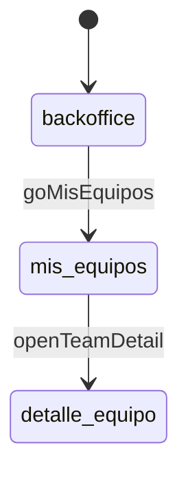
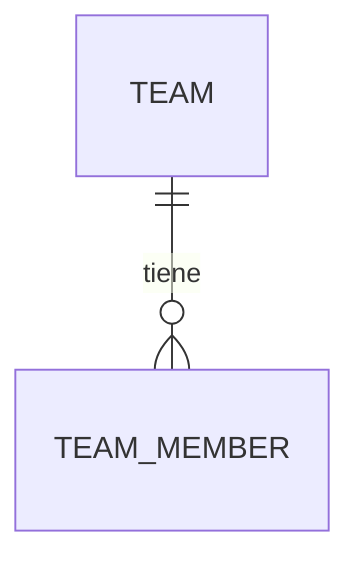

# Modo flujo — leer el mockup para diseñar el back

Para cuando el back recibe el mockup (y casi siempre un markdown con el contexto
del proyecto o módulo) **sin acceso al repo del frontend**, y necesita saber qué
hace el usuario, qué ve y qué se guarda para diseñar endpoints y tablas.

Aquí el mockup no se traduce a pantallas implementables: se traduce a **flujo,
operaciones, datos, reglas y estados**. Lo visual (colores, tipografía, espaciado)
no se documenta.

Casi siempre llegan **varios mockups del mismo proyecto**, uno por canal (app y web). El back es
uno solo: se documentan juntos con una matriz de canales ([§4](#4-varios-canales-del-mismo-proyecto-app--web)).

## 1. Qué manda

| Fuente | Rol |
|---|---|
| Markdown de contexto del proyecto/módulo | **Manda** en reglas de negocio, alcance y vocabulario |
| Mockup(s), uno por canal | Mandan en el **flujo**: pantallas, acciones, datos visibles, estados, mensajes |
| Repo del back + base por MCP (si hay acceso) | Manda en lo que **ya existe**: tablas, SPs, endpoints, catálogos. Reusar antes de crear |
| `sdd.config.yaml` → profiles `database` / `backend` | Convenciones (naming, esquemas, patrón de SP, estándar de API) |
| Docs de API vigentes (si existen) | Qué ya devuelve el back |

Si el mockup contradice el markdown de contexto, o dos canales se contradicen en una regla, **no se
elige**: va a 06 como decisión abierta.

## 2. Extraer el flujo del mockup

1. Inventario con flujo:
   ```bash
   python scripts/mockup_inventory.py <mockup> --flow --out <tmp>/inventario.md --json <tmp>/inventario.json
   ```
   La sección **Flujo** lista:
   - **Navegación y escenarios**: variables como `screen`, `modal`, `tab`, `step`, `*Stage`, `*Scenario` con sus valores → mapa de pantallas, subflujos y escenarios de prueba.
   - **Variables con varios estados**: `status`, `state`, `type`, `kind`, `persona`, `role`… → candidatos a catálogos, enums y máquinas de estado.
   - **Acciones (handlers)**: `goBandeja → screen=bandeja`, `finishReqFlow → screen=bandeja, reqStage=capture` → acciones del usuario y transiciones.
   - **Campos de formulario** → entradas de las operaciones de escritura.
   - **Estado inicial** → defaults y datos que la pantalla necesita al entrar.
2. Recorrer el mockup en el navegador **todas** las rutas que salen del inventario: cada escenario,
   persona/rol, pestaña, modal y etapa de cada subflujo. Anotar lo que el código no dice (textos
   de error, confirmaciones, vacíos).
3. Captura de referencia del mockup original:
   ```bash
   python scripts/render_screens.py <mockup> --out "<salida>/png" --full [--variants "nombre=?q=1,…"]
   ```
   Si el prototipo solo navega con clics, capturar a mano cada estado al recorrerlo.
4. Clasificar **cada** texto, estatus, color y número visible según [`contenido-configurable.md`](contenido-configurable.md) §1
   (marco de UI, negocio, error, regla, presentación, flag). La sección «Textos que mencionan cantidades»
   del inventario marca los que probablemente esconden un parámetro.
5. Leer los textos del inventario buscando **reglas**: «Rechazó tu solicitud dos veces», «Solo hasta
   dos generaciones», «Quedan 12 días», «Este código pertenece a un empresario de…». Cada uno es una
   regla, un límite o una validación.

**Datos de ejemplo:** sirven para inferir tipo y formato (`40219853` → ID numérico de 8 dígitos;
«16-abril al 22-abril» → rango de fechas), **nunca** para inferir reglas. Una regla vista en un solo
ejemplo va como `(asumido)` + pregunta.

## 3. Cruce con lo que ya existe (si hay acceso)

| Qué buscar | Cómo |
|---|---|
| Tablas y catálogos con el mismo concepto | MCP de TEST (`vars.MCP_TEST`): buscar por nombre y por columnas |
| SPs / endpoints que ya devuelven los datos de una pantalla | Repo del back (`vars.RUTA_REPO_API`), `_graph.md`, specs del dominio |
| Estatus existentes | Tablas catálogo; no crear un enum nuevo si ya hay catálogo |
| Contratos actuales | Docs de API vigentes, `TKT-*-APIS.md` anteriores |

Toda consulta que se cite lleva la evidencia de verificación del proyecto (`-- ✓ MCP [TEST] → <resultado>`).
Sin acceso: decirlo en el README y marcar el modelo como «sin verificar contra la base».

## 4. Varios canales del mismo proyecto (app + web)

Lo normal es que un proyecto llegue con **un mockup por canal** (app móvil y página web, a veces
también un backoffice). Comparten casi todos los procesos, con diferencias pequeñas. El back es
**uno solo** para todos los canales, así que se documentan juntos: un solo `Contexto Backend`, con
la matriz de canales al frente. Con un solo mockup, esta sección no aplica (no se crea el 00).

### 4.1 Comparar

```bash
python scripts/mockup_inventory.py --channel app=<mockup app> --channel web=<mockup web> \
  --flow --out <tmp>/canales.md --json <tmp>/canales.json
```

El reporte trae, por canal: navegación y escenarios, variables con estados, acciones, campos y
textos exclusivos (en **negritas** lo que solo tiene un canal), y después el flujo completo de cada
uno. La equivalencia es por nombre: si la app dice `invitar` y la web resuelve lo mismo en un modal
`invite`, aparecen como exclusivos y **se emparejan a mano** en la matriz.

Recorrer los dos mockups en el navegador, uno junto al otro, caso de uso por caso de uso.
Capturas de referencia por canal:

```bash
python scripts/render_screens.py <mockup app> --out "<salida>/Contexto Backend <nombre>/png" --full --width 1400 --name app-original
python scripts/render_screens.py <mockup web> --out "<salida>/Contexto Backend <nombre>/png" --full --width 1440 --name web-original
```

### 4.2 Clasificar cada diferencia

| Tipo | Ejemplo | ¿Toca el back? | Qué hacer |
|---|---|---|---|
| **Presentación** | Web en tabla, app en tarjetas; modal en web, pantalla en app | No | Anotar en la matriz y no diseñar nada por ella |
| **Pasos del flujo** | App con paso de confirmación; web en un solo paso | Casi nunca | La operación es la misma; si un canal valida antes de confirmar, puede requerir una operación de **validación** separada (sin escribir) |
| **Volumen / navegación de datos** | Web con filtros, orden, paginación o exportar; app con scroll infinito | Sí, en parámetros | Mismo endpoint con parámetros opcionales (paginación, orden, filtros); exportar puede ser operación propia |
| **Datos** | La web muestra o pide un campo más | Sí | Mismo contrato con el campo opcional; el canal que no lo usa lo ignora |
| **Entrada** | App pega EIN en texto; web además carga archivo o arrastra | Sí | Normalizar en el back a la misma operación (lista de EIN); la carga de archivo es una entrada más, no otro proceso |
| **Alcance** | Un caso de uso solo existe en un canal | Sí | Operación propia, marcada con su canal |
| **Regla** | Límite, validación o permiso distinto entre canales | **Siempre** | **Decisión obligatoria en 06**: ¿error de un mockup o regla real por canal? Las reglas se validan en el back sin importar el canal; si de verdad difieren, el canal viaja como parámetro y la regla se parametriza |
| **Textos** | Mensaje distinto para el mismo error | Solo si el texto sale del API | Mismo código de error; cada canal pone su texto, o el API devuelve el texto por canal si así es el estándar |

### 4.3 Contrato único

Escalera para cada diferencia que toca el back: **mismo endpoint** → **parámetro opcional** →
**campo opcional en la respuesta** → **endpoint propio del canal**. Un endpoint por canal solo cuando
el caso de uso es exclusivo o los contratos son incompatibles; nunca por diferencias de presentación.

### 4.5 Canal de administración (WinUI, ERP, backoffice)

El tercer canal casi siempre es un sistema interno (WinUI de escritorio o un ERP) donde se
**administra lo que se hizo en la app y la web**. No repite sus procesos: los supervisa, los corrige
y los configura. Por eso **no se compara pantalla contra pantalla** con los clientes, sino contra las
**entidades y los estados** que los clientes generan.

Formas en que llega: mockup HTML, XAML (+ ViewModel `.cs`), capturas o un documento del ERP.

```bash
python scripts/mockup_inventory.py --channel app=<app> --channel web=<web> --channel erp:admin=<mockup o carpeta XAML> --flow
```

El rol `admin` también se deduce si el canal se llama `admin`, `erp`, `winui` o `backoffice`. El reporte
compara solo los clientes entre sí y agrega una sección **Administración** con sus acciones, campos,
textos y la tabla **Estados de administración contra los clientes**: cada estado que maneja el admin
y si algún cliente lo usa, cruzado **por valor** (aunque la variable se llame distinto:
`InvitationStatus.Pendiente` = `status: 'pendiente'`).

**Cómo leer ese cruce:**

| Hallazgo | Qué significa para el back |
|---|---|
| Estado que solo aparece en admin y tiene acción («Cancelar invitación» → `CanceladaPorAdmin`) | Transición **manual** de administración: operación propia, rol interno, motivo obligatorio, auditoría, ¿se notifica al usuario? |
| Estado que solo aparece en admin **sin** acción que lo dispare (`Vencida`) | Lo pone un **proceso automático** (job, SP programado) o falta en los clientes: decisión en 06 |
| Estado de los clientes que admin no muestra | ¿Administración no lo necesita o falta en su mockup? Pregunta en 06 |
| Admin edita algo que los clientes crean (reasignar, corregir, reabrir) | La corrección debe respetar las **mismas reglas** (cupos, país, genealogía) o declarar que las salta, con auditoría |
| Filtros, búsqueda y exportar en admin | Paginación, orden y filtros **en servidor**; índices; exportación asíncrona si el volumen es grande |
| Regla que el cliente muestra fija («máximo 2 rechazos») | ¿Administración la configura? Si sí: tabla de parámetros, no constante en el SP |

**Necesidades de administración a revisar siempre** (con o sin mockup de admin). Por cada entidad que
generan los clientes, llenar la fila; lo que nadie cubre va a 06 como pregunta, **no se diseña por adivinanza**:

| Capacidad | Pregunta |
|---|---|
| Consultar | ¿Quién ve el historial completo de esta entidad, con filtros y exportación? |
| Corregir | Si el usuario se equivoca o el sistema falla, ¿quién lo arregla y con qué operación? |
| Cambiar estado | ¿Qué transiciones son manuales y de quién? ¿Requieren motivo? |
| Configurar | ¿Qué límites, ventanas de tiempo o catálogos debe poder cambiar negocio sin un deploy? |
| Auditar | ¿Se necesita saber quién hizo cada cambio y cuándo (columnas de auditoría o tabla de historial)? |
| Operar en lote | ¿Hay acciones masivas (cerrar periodo, recalcular, reenviar)? |
| Notificar | Cuando administración cambia algo, ¿se avisa al usuario de la app/web? |

**ERP de terceros:** si el ERP no es nuestro, no hay endpoints para su UI: hay una **integración**
(sincronización por lote, API o webhook). Documentarla en 02 como operación de integración con
mapeo de campos, llaves externas, idempotencia, frecuencia y conciliación de diferencias.

### 4.6 Canal que llega después

Si la web llega cuando la app ya está documentada (o al revés): agregar el canal a la matriz,
correr la comparación, marcar cada operación existente como «sirve igual / sirve con parámetro /
no sirve», y solo entonces agregar operaciones nuevas. Registro de cambios en cada documento tocado.
Si el back de la app ya está implementado, las diferencias de tipo **datos** o **regla** son cambios
de contrato: van como decisión en 06 y como ticket del back, no se resuelven en silencio.

## 5. Documentos — `Contexto Backend <nombre>/`

Mismas reglas de redacción que [`documentos.md`](documentos.md) (tablas, `[← README]`,
Registro de cambios, decisiones con número estable). Los valores de las plantillas son
**ilustrativos** (salen de un caso real de app + web, pero las reglas y límites de ejemplo no).

### README.md
Propósito, fuentes (mockups por canal, markdown de contexto, repo/MCP revisados o «sin acceso»), modo
**flujo**, resumen en una frase, tabla de casos de uso (# · caso · canales · pantallas · operaciones ·
tablas), índice y fuera de alcance.

### 00 - Matriz de canales.md  (con 2+ mockups, o siempre §5–6 si hay entidades que administrar)
~~~markdown
## 1. Canales
| Canal | Rol | Mockup | Versión / fecha | Repo frontend (si se conoce) | Pantallas |
|---|---|---|---|---|---|
| app | cliente | `Afiliacion por Equipos Mobile F2.html` | F2 · 2026-09 | `nice_app` | 7 |
| web | cliente | `Afiliacion por Equipos F2.html` | F2 · 2026-09 | `<repo web>` | 9 |
| erp | administración | `Invitaciones.xaml` | v1 · 2026-10 | `<repo WinUI>` | 1 |

## 2. Equivalencia de pantallas
| Caso de uso | app | web | Diferencia | Tipo |
|---|---|---|---|---|
| Invitar por EIN | `invitar` (pantalla) · capture → confirmacion → resultados | modal `invite` · capture → resultados | App confirma antes de enviar | Pasos del flujo |
| Crear equipo | modal `crear_equipo` | pantalla `crear_equipo` | — | Presentación |
| Aceptar invitación | toast | pantalla `aceptado_exito` | — | Presentación |

## 3. Casos de uso × canal
| # | Caso de uso | app | web | Operaciones (02) |
|---|---|---|---|---|
| CU1 | Invitar por EIN | ✓ | ✓ (difiere) | O1, O2 |
| CU7 | Exportar historial | — | ✓ | O9 |

## 4. Diferencias que tocan el back
| # | Diferencia | Tipo | Cómo se resuelve en el contrato | Decisión |
|---|---|---|---|---|
| X1 | Web carga EIN por archivo | Entrada | Mismo `POST …/invitations` con lista; el archivo se lee en el front | — |
| X2 | App limita a 10 EIN por envío, web no | Regla | — | [D3](06…#d3) |

## 5. Administración (si hay canal admin, o como revisión obligatoria)
| Entidad | Consultar | Corregir | Cambiar estado | Configurar | Auditar | Lote | Canal admin |
|---|---|---|---|---|---|---|---|
| Invitación | ✓ filtros + Excel | Reasignar equipo | Cancelar (motivo) | — | ✓ | — | erp |
| Equipo | ✓ | ? | ? | Cupos por rango | ✓ | Cerrar periodo | — → D5 |

## 6. Huecos de administración
| # | Hueco | Por qué importa | Decisión |
|---|---|---|---|
| H1 | Nadie puede corregir un equipo con un miembro mal asignado | Soporte no tiene herramienta | [D5](06…) |
| H2 | `Vencida` solo aparece en el ERP; nadie la dispara | Falta job de vencimiento o falta en clientes | [D6](06…) |
~~~


### 01 - Pantallas y flujo.md
~~~markdown
## 1. Mapa de pantallas
| Id | Pantalla (mockup) | Canal(es) | Quién la ve | Cómo se llega | Datos al entrar |
|---|---|---|---|---|---|

## 2. Navegación
Con varios canales: un diagrama por canal, o uno solo con las transiciones exclusivas marcadas
(`: openInviteModal [app]`).


## 3. Subflujos (asistentes, etapas)
| Subflujo | Etapas | Acción que avanza | Acción que regresa | Fin |
|---|---|---|---|---|
| Invitar | capture → confirmacion → resultados | … | backToBatchCapture | finishInviteFlow |

## 4. Escenarios / personas
| Escenario | Variable(s) | Qué cambia en el flujo |
|---|---|---|
~~~

### 02 - Acciones y operaciones.md
Una fila por acción que **toca datos** (las de pura navegación quedan en 01). Las operaciones de
administración van en su propia sección (`## Administración`) con rol interno, motivo y auditoría.
```markdown
| # | Acción (pantalla) | Canales | Tipo | Entradas | Salida | Validaciones / errores | Quién | Operación candidata |
|---|---|---|---|---|---|---|---|---|
| O1 | Enviar invitaciones (Invitar) | app, web | Escritura (lote) | EIN[], teamId | por EIN: valido / excede_cupo / inexistente / pais_distinto | máx. cupo por rango; mismo país | Líder | `POST …/invitations` |
| O2 | Validar EIN antes de enviar (paso «confirmación») | app | Lectura | EIN[], teamId | mismo resultado por EIN, sin escribir | igual que O1 | Líder | `POST …/invitations/validate` |
```
Distinguir lectura / escritura / escritura en lote / acción idempotente; marcar las que necesitan
confirmación del usuario (modal) y las que se pueden deshacer.

### 03 - Datos por pantalla.md
```markdown
## <Caso de uso / pantalla>
| Dato visible | Canales | Tipo / formato | Origen | Campo candidato | Notas |
|---|---|---|---|---|---|
| «Vidas x Cambiar» | app, web | entero | **Calculado** (suma de afiliaciones del periodo) | `TotalProgramAffiliation` | Llave ausente vs 0 |
| Nombre del equipo | app, web | texto ≤ 40 | Guardado | `Team.Name` | |
| Fecha de la última invitación | web | fecha | Guardado | `Invitation.SentAt` | Campo opcional; la app lo ignora |
```
Con varios canales se agrupa por caso de uso (no por pantalla de un canal) y la columna Canales
muestra quién lo pinta. Origen: **guardado**, **calculado** (en SP / back), **agregado** (total de varios registros),
**configuración** (catálogo, parámetro) o **solo UI** (no va al back). Lo calculado se calcula en el
back, no en el cliente.

### 04 - Modelo de datos candidato.md
~~~markdown
## 1. Entidades
| Entidad | Para qué | Existe hoy (tabla) | Decisión |
|---|---|---|---|
| Equipo | … | `mpr.Teams` ✓ MCP | Reusar + columna `CountryID` |

## 2. Atributos nuevos o cambiados
| Entidad | Atributo | Tipo | Nulo | Default | Por qué (pantalla / acción) |
|---|---|---|---|---|---|
| Invitación | `CancelReason` | nvarchar(250) | sí | — | erp: «Motivo de la cancelación» |
| Invitación | `UpdatedBy` / `UpdatedAt` | int / datetime2 | sí | — | Auditoría de cambios de administración (o tabla de historial) |

## 3. Relaciones y cardinalidad
## 4. Catálogos y estados (de la sección «Variables con varios estados»)
| Catálogo | Valores | Existe hoy | Decisión |
|---|---|---|---|

## 5. Diagrama

~~~
Escalera de alcance por cada objeto: reusar → extender (columna / parámetro) → nuevo.
Es **candidato**: el DDL final va en `design.md` con verificación MCP.

### 05 - Reglas y estados.md
```markdown
## 1. Máquinas de estado
| Entidad | Estado | → Estado | Disparador (acción) | Quién (rol / canal / job) | Condición |
|---|---|---|---|---|---|
| Invitación | Pendiente | CanceladaPorAdmin | Cancelar invitación | Admin · erp | Motivo obligatorio |
| Invitación | Pendiente | Vencida | — | **Job** (¿cuál?) → D6 | N días sin respuesta |
## 2. Reglas de negocio vistas en el mockup
| # | Regla | Canales | Dónde se ve (pantalla / texto) | Evidencia | Estado |
|---|---|---|---|---|---|
| R1 | Tras 2 rechazos no se puede volver a solicitar | app, web | Solicitar unirme: «Rechazó tu solicitud dos veces» | Mockup + contexto §3 | confirmada / (asumido) |
| R2 | Máximo 10 EIN por envío | **solo app** | Invitar: «Hasta 10 códigos» | Mockup app | → [D3](06…) ¿regla real o falta en web? |
## 3. Permisos por rol
| Acción | Líder | Experto | Novato | Sin equipo | Admin (rol interno) |
|---|---|---|---|---|---|
## 4. Casos borde (vacíos, límites, concurrencia, ventanas de tiempo)
```

### 06 - Decisiones y pendientes.md
Igual que en el modo frontend: decisiones D-n con recomendación (contradicciones mockup ↔ contexto,
reglas `(asumido)`, datos sin origen claro) y §B «lo que el mockup trae y no entra».

### 07 - Contenido configurable.md
Plantilla y reglas en [`contenido-configurable.md`](contenido-configurable.md) §6: inventario de todo el
contenido visible de **todos los canales** con su clase, fuente, llave, alcance, placeholders y respaldo; los
catálogos y parámetros nuevos; el catálogo de errores; los flags; y lo poco que queda en la app. El objetivo es que
un cambio de texto, estatus o umbral **no requiera publicar la app** (iOS tarda hasta 5 días en revisión).

## 6. Endpoints candidatos (dentro de 02)

Agrupar las operaciones por caso de uso, no por pantalla, y por cada uno: método, ruta tentativa,
entrada, salida, errores de negocio y qué pantallas lo consumen. Una pantalla que necesita datos de
varios lugares sugiere un endpoint de **tablero** (una llamada) en vez de N llamadas. Respetar el
estándar de API del profile `backend`. Con varios canales, un solo contrato (escalera de §4.3) y la
columna Canales dice quién consume cada endpoint.

**No es el diseño final:** el contrato definitivo sale de `/diseñar` y, al cerrar, de `TKT-*-APIS.md`
(fase `/revisar`). Ese reporte es la entrada del documento **04 - Datos y APIs** cuando el frontend
corre el modo delta/nuevo.

## 7. Checklist del modo flujo

- [ ] Cada valor de `screen` / `modal` / `tab` / `*Stage` del inventario está en 01, recorrido en el navegador.
- [ ] Cada acción que toca datos tiene fila en 02 con entradas, salida, errores y quién.
- [ ] Cada dato visible tiene origen (guardado / calculado / agregado / configuración / solo UI).
- [ ] Cada variable con varios estados es catálogo, enum o máquina de estado en 04/05, o se descarta con motivo.
- [ ] Cada regla leída en un texto tiene evidencia o está `(asumido)` con pregunta en 06.
- [ ] Cruce contra la base hecho (con evidencia MCP) o declarado «sin acceso».
- [ ] Ningún diseño final (DDL, contrato definitivo) presentado como decidido.
- [ ] (Varios canales) Cada pantalla de cada canal está emparejada en 00 §2 o marcada exclusiva.
- [ ] (Varios canales) Cada diferencia que toca el back está clasificada (00 §4) y las de tipo **regla** tienen decisión en 06.
- [ ] (Varios canales) Ningún endpoint duplicado por canal sin justificación de la escalera §4.3.
- [ ] (Administración) Cada entidad que generan los clientes tiene su fila en 00 §5; lo que nadie cubre está en 00 §6 con decisión.
- [ ] (Administración) Cada estado que solo aparece en admin tiene actor (rol o job) en 05, o pregunta en 06.
- [ ] (Administración) Las correcciones de admin dicen si respetan o saltan las reglas de los clientes, con auditoría.
- [ ] (Contenido) Todo texto, estatus, color y número visible está en 07 con su clase; ningún contenido de negocio queda en el ARB.
- [ ] (Contenido) Ningún texto de negocio ni error se propone como literal dentro de un SP; todo sale de un catálogo con alcance.
- [ ] (Contenido) Ningún número que existe como parámetro aparece escrito en un texto: va como placeholder.
- [ ] (Contenido) Códigos, nulos, fechas y nombres de campo siguen el contrato uniforme (contenido-configurable §4).
