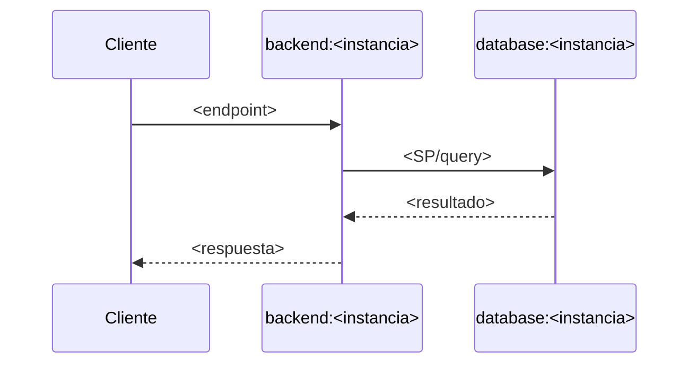

# design.md — TKT-<id>: <título>

> Generado por: **generador de contexto SDD** tras validar spec.md
> Consumido por: implementador (`implementer.tool` — agentes según su toolchain)

## Estrategia técnica

<Decisión central y justificación. Alternativas descartadas y por qué — esto
hace el cambio auditable.>

### Escalera de decisión (methodology.md regla 6) — recorrer ANTES de las tablas de objetos

<!-- Una fila por capacidad pedida. El peldaño es el primero que la resuelve.
     Toda capacidad que termine en objeto NUEVO debe ser peldaño 5 con la
     evidencia de por qué fallaron 2-4 (incluida la feature nativa evaluada). -->

| Capacidad pedida | Peldaño (1-5) | Objeto resultante | Por qué se descartaron los anteriores |
|---|---|---|---|
| <capacidad> | 5 (nuevo) | `<objeto según naming del profile>` | 2: no hay feature nativa que…; 3: no existe objeto/endpoint que…; 4: cambio mínimo insuficiente porque… |

<!-- ============ SECCIONES POR TARGET: incluir SOLO instancias en scope ============ -->

## database:<instancia>

<!-- Repetir esta sección por cada DB en scope. Respetar profiles/database.md.
     Toda fila con Acción=crear debe tener su fila peldaño 5 en la sub-tabla
     "Escalera de decisión" de arriba. -->
| Objeto | Tipo | Acción | Notas |
|---|---|---|---|
| `<objeto>` | <tipo> | crear/modificar | |

```
-- Esqueleto/firma propuesta (no implementación completa: eso es del implementador)
-- Antes de incluir la query/comando real: verificarlo con tools.verify / MCP
-- del profile. Formato obligatorio si el proyecto usa MCP SQL:
--   ✓ MCP [<entorno>] → <N filas o resultado>  (ej: -- ✓ MCP [nesgotest] → 5 filas)
```

## backend:<instancia>

<!-- Repetir por cada API en scope. Respetar profiles/backend.md -->
| Endpoint | Verbo | Request | Response | Acción |
|---|---|---|---|---|

## frontend:<instancia>

<!-- Solo si frontend está en scope -->
| Componente/Vista | Acción | Contrato API que consume |
|---|---|---|

## mobile:<instancia>

<!-- Solo si mobile está en scope -->
| Pantalla/Widget | Acción | Contrato API que consume |
|---|---|---|

## integrations:<instancia>

<!-- Solo si hay integración en scope: eventos, payloads, idempotencia -->

<!-- ================================================================== -->

## Contenido configurable

<!-- methodology.md regla 7 · core/contenido-configurable.md. Obligatorio si el requerimiento muestra
     textos, estatus, mensajes, errores o números de negocio. Si no aplica: «No aplica — sin contenido
     visible». Clases: marco de UI (ARB) · negocio (catálogo) · error (catálogo de errores) · regla
     (parámetro + placeholder) · presentación (ColorTone / IconCode) · flag. -->

| # | Contenido | Dónde se ve | Clase | Fuente (catálogo / parámetro / flag / ARB) | Llave / campo | Alcance | Placeholders | Respaldo en la app |
|---|---|---|---|---|---|---|---|---|

Catálogos / parámetros nuevos (con alcance, ES/EN, `IsActive`, auditoría, POST de ambos idiomas): —
Errores nuevos (código UPPER_SNAKE · ES · EN): —

## Valores nuevos y sus consumidores

<!-- OBLIGATORIO si el requerimiento agrega o cambia un VALOR de dominio: estado, tipo,
     OverrideID, código de error, bandera, rango, ID de catálogo, o amplía lo que acepta
     un validador. Si no → «No aplica (sin valores nuevos)».
     El análisis de impacto ve OBJETOS; esto ve VALORES: un valor nuevo cae en el
     ELSE/default equivocado de un CASE o IN que nadie tocó.
     Cómo: buscar los valores HERMANOS (los que ya existen) en todo el código —
       SELECT OBJECT_SCHEMA_NAME(object_id)+'.'+OBJECT_NAME(object_id) AS Objeto
       FROM sys.sql_modules WHERE definition LIKE '%<valor hermano>%';
     y leer cada consumidor. Verificar con MCP y anotar -- ✓ MCP. -->

| Valor nuevo | Hermanos buscados | Consumidor (`schema.objeto` / archivo) | Veredicto | Acción |
|---|---|---|---|---|
| `<OverrideID 215>` | `212, 214, 230` | `sls.prcX` (CASE en marcador `-- TKT-…`) | Lo maneja / **Cae en default** / Fuera de alcance | <cambio o N/A> |

## Diagrama de flujo (Mermaid, opcional)

<!-- Incluir SOLO si el requerimiento toca >2 objetos/instancias o cruza la frontera
     SQL→API (o API→frontend). Un requerimiento de un solo SP o un solo endpoint no
     lo necesita — no agregar diagramas por costumbre. -->



<!-- ================================================================== -->

## Orden de implementación

<!-- Una fila por paso. "Entregable" = objeto que queda listo al terminar el paso.
     "Dependencia" = número del paso previo requerido (o "—" si es primero).
     "Verificación" = chequeo puntual antes de avanzar al siguiente paso — build,
     SELECT de smoke test, o N/A si no hay verificación razonable. -->
| # | Paso | Target:Instancia | Entregable | Dependencia | Verificación |
|---|------|-------------------|------------|-------------|--------------|
| 1 | <qué hacer> | `target:instancia` | <objeto que queda listo> | — | <build / SELECT smoke test / N/A> |

## Plan de pruebas

<!-- Por instancia en scope: tipos de prueba del profile del target.
     OBLIGATORIO: una fila TC-INV-x por cada invariante de spec.md (regresión),
     y TC-RB para validar la estrategia de rollback.
     ENDURECIMIENTO (Unidad 7 — Regla de Oro): el humano define el QUE.
     - OBLIGATORIO >=1 caso NEGATIVO/de error (TC-ERR-x): entrada inválida, código
       5xxxx, borde de dominio. Un plan sin caso negativo = Test Theater (se rechaza).
     - El plan se materializa en un script ejecutable a partir de
       `sdd-toolkit/templates/pruebas.sql` (nombre `<yyyymmdd>_<TKT>_Pruebas*.sql`),
       corrido en `<MCP_TEST>` con TRAN+ROLLBACK y anotado
       `-- [OK] TESTS [<entorno>] -> <N> PASS / <M> ROJO esperado` (fase TEST, nace en ROJO).
       El hook `check-tests-green.ps1` bloquea el script sin caso negativo, sin TC-IDEM si
       ejecuta un prcSet*, o sin evidencia; y bloquea un CREATE/ALTER PROCEDURE sin un
       `*Pruebas*.sql` que lo pruebe (shift-left).
     - Paso adversarial en SP de negocio o cambios difíciles de revertir: aplicar
       la skill `abogado-del-diablo` sobre los propios tests antes de darlos por buenos. -->
| Prueba | Target | Tipo | Cubre CA | Entrada | Expected |
|---|---|---|---|---|---|
| `TC-INV-1` | <instancia> | regresión | CA-R1 (invariante INV-1) | <fixture / parámetros> | <valor exacto> |
| `TC-ERR-1` | <instancia> | negativo | <CA> | <entrada inválida> | <ErrorID 5xxxx / sin cambio de estado> |
| `TC-RB` | <instancia> | rollback | estrategia de rollback | <cambio aplicado> | <estado original idéntico> |

<!-- `Expected` es CONTRATO: la fase TEST lo copia idéntico al script y /revisar lo compara. -->

### Contratos de escritura (SP `prcSet*` / procesos que escriben)

<!-- OBLIGATORIO si el requerimiento crea o modifica un SP/endpoint que ESCRIBE
     (prcSet*, procesos, POST/DELETE). Cada fila lleva su TC-ID o «N/A porque…».
     Un 200/ErrorID=0 NO es completitud: se aserta el efecto de negocio final.
     El hook check-tests-green exige TC-IDEM en el script si invoca un prcSet*. -->
| Contrato | Qué se aserta | TC |
|---|---|---|
| Éxito con efecto final | el estado de negocio resultante (filas, montos), no solo ErrorID=0 | `TC-…` |
| Entrada inválida | error esperado **y** ningún cambio de estado prohibido | `TC-ERR-…` |
| Idempotencia / duplicado | ejecutar 2 veces = 1 solo efecto durable (contar filas) | `TC-IDEM-1` |
| Concurrencia / orden | ambos órdenes (A→B y B→A) dan el mismo resultado | `TC-CONC-1` / N/A porque… |
| Falla parcial | error a mitad → rollback completo, sin estado a medias | `TC-PARC-1` / N/A porque… |
| Transición de estado | solo transiciones permitidas; la prohibida falla | `TC-EST-1` / N/A porque… |

### Ratio de pruebas (Testing Trophy)

<!-- CUÁNDO APLICA: siempre que haya tests (costo cero de incluir).
     Sesgo a integración: SP vía MCP y controller con BD de test = integración.
     Unitario solo para lógica pura sin dependencias. -->
- Integración: ~70 % (BD real / MCP `nesgotest`)
- Unitario: ~30 % (solo lógica pura)
- Mocks: solo APIs externas imposibles de integrar en test

### Characterization (paridad — solo Refactor)

<!-- CUÁNDO APLICA: Tipo = Refactor de objeto legacy.
     Si Tipo ≠ Refactor → eliminar esta subsección completa. -->
| Test | CHAR-x del spec | Baseline | Paridad post-cambio |
|---|---|---|---|
| `TC-CHAR-1` | CHAR-1 | `<output actual>` | ☐ |

### Triangulación

<!-- CUÁNDO APLICA: Feature o Refactor con comportamiento nuevo no trivial.
     En typo, doc o cambio sin lógica → eliminar esta subsección. -->
| Comportamiento | Dataset A | Dataset B | Qué generaliza |
|---|---|---|---|
| <SP acepta input válido> | caso mínimo | caso máximo | que no quedó hardcodeado |

### Mutation

<!-- CUÁNDO APLICA: paths críticos (lógica de negocio, cálculos financieros, gates).
     En cambios sin paths críticos → eliminar esta subsección.
     SQL: 3 mutantes manuales (WHERE, operador, umbral). C#/TS: Stryker, kill rate ≥ 80 %. -->
| Objeto | Técnica | Kill rate objetivo |
|---|---|---|
| `<SP/clase>` | 3 mutantes manuales / Stryker | ≥ 80 % paths críticos |

## Estrategia de rollback

<Cómo revertir cada cambio. Según el profile: script inverso, dry-run, feature flag, etc.>

## Sondas canario (post-deploy)

<!-- OBLIGATORIO si el requerimiento toca cálculos de negocio (comisiones, overrides,
     precios, inventario, pedidos, puntos) o modifica datos; si no → «No aplica».
     Consultas de SOLO LECTURA que miden la salud de negocio que este cambio puede
     romper. release.md toma la línea base en PROD antes del deploy y compara a T+1h y
     T+1d. Se alerta por CAMBIO contra la línea base, no por valor absoluto.
     Verificar cada query en <MCP_TEST> y anotar -- ✓ MCP. -->

| Sonda | Query (solo lectura) | Umbral de alerta |
|---|---|---|
| `<conteo overrides 214 del periodo>` | `SELECT COUNT(*) FROM … WHERE …` | `±10 % vs base` |

## Pre-mortem

<!-- SOLO para requerimientos con riesgo alto, estado RIESGOSO o estructura extendida.
     En requerimientos simples, eliminar esta sección. -->
- **Si esto falla en PROD, la causa más probable es:** <...>
- **Cómo lo detectamos:** <query/log/alerta concreta>
- **Acción inmediata:** <rollback de release.md / a quién avisar>

## Decisiones técnicas (auditoría)

<!-- Por cada objeto nuevo (peldaño 5), una fila citando por qué fallaron los
     peldaños 2-4 — incluida la feature nativa evaluada y descartada (peldaño 2).
     Sin esa evidencia, el peldaño 2 no se considera recorrido. -->

| # | Decisión | Justificación |
|---|---|---|

## Autoverificación antes del handoff

<!-- Autochequeo del generador de contexto, no una auditoría del implementador
     (esa es post-impl.md). Objetivo: que este design.md no contradiga lo que
     spec.md ya prometió. -->

**Consistencia con spec.md:**
- [ ] Ningún objeto/tabla de este design.md implementa algo listado como `Won't`
      en spec.md — si algo del `Won't` aparece aquí, es un error, no una mejora
- [ ] Cada fila de "Plan de pruebas" `TC-INV-x` corresponde a un invariante real
      de spec.md (uno por invariante, ninguno huérfano ni faltante)

**Calidad del artefacto:**
- [ ] Contenido configurable (regla 7): ningún texto de negocio, error o número de regla como literal en
      un SP ni solo en el ARB; la sección «Contenido configurable» está llena o dice «No aplica»
- [ ] «Valores nuevos y sus consumidores» llena (cada consumidor con veredicto) o «No aplica»
- [ ] SP que escribe: tabla «Contratos de escritura» con TC o «N/A porque…» en cada fila (TC-IDEM obligatorio)
- [ ] «Sondas canario» llena si toca cálculos de negocio/datos, o «No aplica»
- [ ] Lectura en frío ≥ 7/10 (paso 11.7 de /diseñar) y sello `diseno` registrado
- [ ] Toda query/comando SQL verificado con MCP — anotado `-- ✓ MCP [<entorno>] → <resultado>`
- [ ] Orden de implementación: cada paso tiene Entregable + Dependencia explícita
- [ ] Sin falsa agencia: ningún "el sistema aplica" ni "el diseño propone" —
      cada paso nombra el actor real (SP / controller / agente Cursor)
- [ ] Toda query/comando propuesto verificado antes de escribirlo — no se asume
      que un objeto citado en la escalera existe sin haberlo verificado vía MCP
- [ ] Si el spec tiene CHAR-x → hay una fila `TC-CHAR-x` por cada uno (paridad cubierta)
- [ ] Cada comportamiento nuevo tiene ≥ 2 datasets en la tabla de Triangulación
