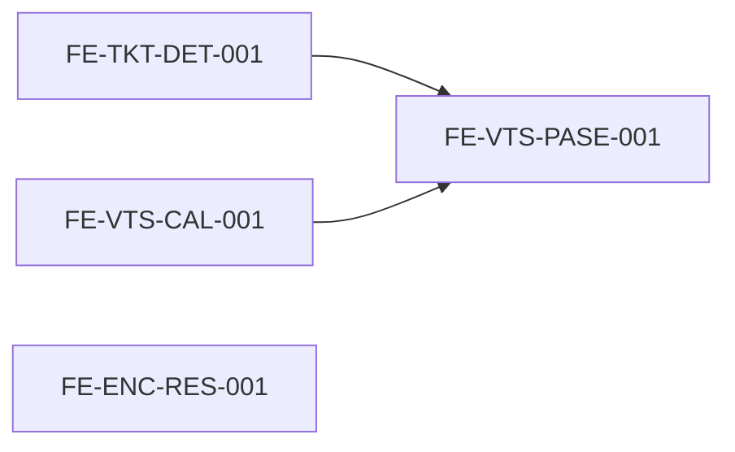

# Gaps MVP operativo — roadmap SDD

> Brechas detectadas post-entrega módulos (2026-10-28). Contrato académico: `readme.md` §5. Fuentes: `specs/tickets.md`, `specs/visitas-areas.md`, `specs/encuestas.md`, paridad `Web_diseño/`.

## Objetivo

Cerrar en la **SPA `Web/`** (JWT Cuarta, sin `*/legacy`) cuatro capacidades que el usuario describe como operación diaria del fraccionamiento.

## Tickets SDD

| Orden | ID | Carpeta | Alcance | Estado SDD |
|------:|----|---------|---------|------------|
| 1 | [[FE-TKT-DET-001]] | [tkt-fe-tkt-det-001](tkt-fe-tkt-det-001/_index.md) | Detalle ticket + comentarios + seguimiento residente/admin | **LISTO PARA EJECUTAR** |
| 2 | [[FE-VTS-PASE-001]] | [tkt-fe-vts-pase-001](tkt-fe-vts-pase-001/_index.md) | Pase visita QR, WhatsApp, validación guardia | **LISTO PARA EJECUTAR** |
| 3 | [[FE-VTS-CAL-001]] | [tkt-fe-vts-cal-001](tkt-fe-vts-cal-001/_index.md) | Calendario comunitario de reservas por área | **LISTO PARA EJECUTAR** |
| 4 | [[FE-ENC-RES-001]] | [tkt-fe-enc-res-001](tkt-fe-enc-res-001/_index.md) | Resultados de encuesta visibles para residentes | **LISTO PARA EJECUTAR** |

## Documentos de entrada (gate)

| Documento | Ubicación |
|-----------|-----------|
| Contexto del requerimiento | Conversación + tabla de brechas (este archivo) |
| Contexto técnico | `readme.md`, `CLAUDE.md`, `specs/*.md`, `Web_diseño/` (pase QR) |
| Referencia visual | [ui-referencia-visual.md](../referencia/ui-referencia-visual.md) |

Mockup formal: **opcional** — reutilizar `Web_diseño` como referencia de flujo QR y encuestas.

## Flujo SDD por ticket

1. Revisar y aceptar `design.md` → estado **LISTO PARA EJECUTAR**
2. `/test` (Vitest / xUnit según design; SQL solo si hay delta BD)
3. `/ejecutar` → rama `feature/<id>-<slug>`
4. `/revisar` → `/completar`

## Dependencias entre tickets

- **FE-VTS-CAL-001** no bloquea a PASE; conviene terminar CAL antes de pulir UX de `/areas-comunes`.
- **FE-TKT-DET-001** y **FE-ENC-RES-001** son independientes entre sí.

## Criterio de cierre del lote

- [ ] Cuatro tickets **ARCHIVADO** con `delta.md` y specs actualizados
- [ ] Smoke manual: ticket hilo, pase QR válido/expirado, reserva visible en calendario, resultados encuesta residente
- [ ] `dotnet test` + `npm test -- --run` en verde
