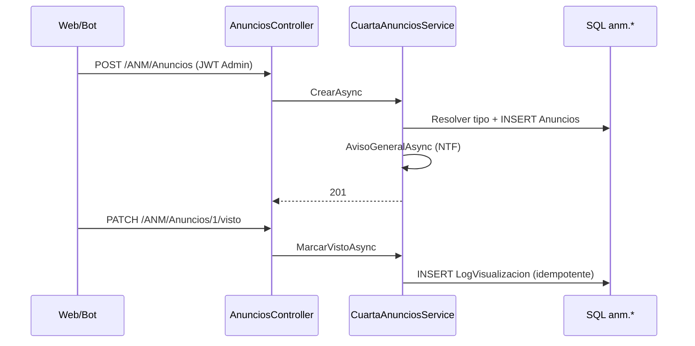

[← index](_index.md) | [← spec](spec.md) | [FE-043](../tkt-fe-043/design.md)

# design.md — ANM-BE-027: Anuncios y comunicados (API Cuarta)

## Estrategia técnica

Extender `AnunciosController` y `TiposAnuncioController` con acciones **Cuarta** (JWT, DTOs camelCase, `ProblemDetails` + `code`) y **mover** el scaffold actual a rutas `*/legacy`, igual que `CasasController`. Capa: `CuartaAnunciosRepository` (Dapper) + `CuartaAnunciosService` + FluentValidation. Vigencia evaluada en SQL con `SYSUTCDATETIME()`. Campo `visto` calculado con `EXISTS` sobre `anm.LogVisualizacionAnuncios` para el `UsuarioID` del JWT.

**Alternativa descartada:** GraphQL-only — FE-043 y readme fijan REST Cuarta.

### Escalera de decisión

| Capacidad | Peldaño | Objeto | Motivo |
|-----------|---------|--------|--------|
| Listar/publicar anuncios JWT | 4 | Extender controllers + servicio nuevo | Tablas y vista ya existen; legacy no usable por FE |
| Catálogo tipos para select | 4 | `GET /ANM/TiposAnuncio` JWT | Misma tabla; solo lectura |
| Bitácora lectura | 4 | `PATCH …/visto` + INSERT log | Tabla log ya existe |

## database:CuartaQuinientos

| Objeto | Tipo | Acción | Notas |
|--------|------|--------|-------|
| `anm.TiposAnuncio` | tabla | DML seed | `SQL/DB-003_anm_tipos_seed.sql` (idempotente MERGE) |
| `anm.Anuncios` | tabla | — | Sin DDL |
| `anm.LogVisualizacionAnuncios` | tabla | — | Sin DDL |

**Seed (valores cerrados en diseño):** `General`, `Urgente`, `Mantenimiento` — `UsuarioCreacionID = 1`, `Creado = 'DB-003'`, `FechaCreacion = SYSUTCDATETIME()`.

Script de prueba data-layer: [20261019_ANM-BE-027_PruebasUnitarias.sql](20261019_ANM-BE-027_PruebasUnitarias.sql).

## backend:cuartaquinientos-api

### DTOs (`GraphApi/Models/ANM/Anuncios/CuartaAnunciosDtos.cs`)

| DTO | Campos JSON |
|-----|-------------|
| `AnuncioListItemDto` | `anuncioId`, `titulo`, `contenido`, `fechaPublicacion`, `vigenteHasta`, `tipoAnuncio`, `visto` |
| `AnuncioCrearRequest` | `titulo`, `contenido`, `tipoAnuncio`, `vigenteHasta?` |
| `AnuncioActualizarRequest` | `titulo?`, `contenido?`, `tipoAnuncio?`, `vigenteHasta?` |
| `TipoAnuncioItemDto` | `tipoAnuncioId`, `tipoAnuncio` |

### Validators

- `AnuncioCrearRequestValidator`: `Titulo` not empty max 200; `Contenido` not empty; `TipoAnuncio` not empty max 100.

### Repository (`ICuartaAnunciosRepository` / `CuartaAnunciosRepository`)

| Método | SQL (resumen) |
|--------|----------------|
| `ListarAsync(usuarioId, incluirNoVigentes, ct)` | `anm.vsAnuncios` + filtro vigencia + `EXISTS` log → `visto` |
| `ObtenerAsync(anuncioId, usuarioId, soloVigentes, ct)` | Idem por ID |
| `ResolverTipoIdAsync(nombre, tx)` | `SELECT TipoAnuncioID FROM anm.TiposAnuncio WHERE TipoAnuncio = @n AND bEliminado = 0` |
| `InsertAsync(...)` | `INSERT anm.Anuncios` |
| `UpdateAsync(...)` | `UPDATE` auditoría |
| `SoftDeleteAsync(...)` | `bEliminado = 1` |
| `MarcarVistoAsync(anuncioId, usuarioId, correo, tx)` | `IF NOT EXISTS` → `INSERT LogVisualizacion` (`Medio = 'WEB'`) |
| `ListarTiposAsync(ct)` | `SELECT` tipos activos |

### Service (`ICuartaAnunciosService` / `CuartaAnunciosService`)

| Método | Reglas |
|--------|--------|
| `ListarAsync` | `incluirNoVigentes` solo si caller es admin (controller valida policy antes de pasar `true`) |
| `CrearAsync` | Transacción; tipo inválido → `400` `TIPO_ANUNCIO_INVALIDO`; post-commit `AvisoGeneralAsync(titulo, contenido truncado 500, autor)` **Should** — no rollback si falla notif (log warning) |
| `MarcarVistoAsync` | 404 si anuncio no vigente; idempotente |

### Endpoints (`AnunciosController`)

| Endpoint | Auth | Request | Response |
|----------|------|---------|----------|
| `GET /ANM/Anuncios` | JWT | `?incluirNoVigentes` (admin) | `200` `AnuncioListItemDto[]` |
| `GET /ANM/Anuncios/{id}` | JWT | — | `200` / `404` |
| `PATCH /ANM/Anuncios/{id}/visto` | JWT | body vacío | `204` / `404` |
| `POST /ANM/Anuncios` | SoloAdministrador | `AnuncioCrearRequest` | `201` |
| `PUT /ANM/Anuncios/{id}` | SoloAdministrador | `AnuncioActualizarRequest` | `200` / `404` |
| `DELETE /ANM/Anuncios/{id}` | SoloAdministrador | — | `204` / `404` |
| `GET/POST/PATCH/DELETE …/legacy` | headers legacy | sin cambio de firma | scaffold actual |

### `TiposAnuncioController`

| Endpoint | Auth | Response |
|----------|------|----------|
| `GET /ANM/TiposAnuncio` | JWT | `200` `TipoAnuncioItemDto[]` (vacío `[]` si no seed — no `404`) |
| CRUD legacy | `*/legacy` | scaffold |

**Orden de rutas:** `condominios`-style literals antes de `{id}`; `PATCH {id}/visto` antes de conflictos con `legacy`.

### DI (`ServiceCollectionExtensions`)

Registrar `ICuartaAnunciosRepository`, `ICuartaAnunciosService`, validators.

## Contenido configurable

| # | Contenido | Clase | Fuente |
|---|-----------|-------|--------|
| 1 | Tipos `General`, `Urgente`, `Mantenimiento` | catálogo | `anm.TiposAnuncio` seed DB-003 |
| 2 | Código `TIPO_ANUNCIO_INVALIDO` | error | servicio |

## Valores nuevos y consumidores

| Valor | Hermanos | Consumidor | Acción |
|-------|----------|------------|--------|
| Tipos seed | — | `POST` resuelve por nombre | INSERT DB-003 |

## Diagrama de flujo

## Orden de implementación

| # | Paso | Entregable | Verificación |
|---|------|------------|--------------|
| 1 | `DB-003` seed + script prueba SQL | tipos en BD local | sqlcmd OK |
| 2 | DTOs + validators | compile | `dotnet build` |
| 3 | Repository | queries parametrizadas | — |
| 4 | Service + NTF Should | unit tests Moq | `dotnet test` |
| 5 | Controllers legacy move + Cuarta | Swagger | manual |
| 6 | `CuartaAnunciosServiceTests` + `ANM-BE-027_api_tests.http` | suite verde | `dotnet test` |

## Plan de pruebas

| Prueba | Target | Tipo | CA | Expected |
|--------|--------|------|-----|----------|
| TC-INV-1 | SQL | regresión | CA-R1 | Legacy route intacta (manual swagger) |
| TC-1 | xUnit | happy | CA-1 | `CrearAsync` con tipo válido → repo Insert llamado |
| TC-2 | xUnit | happy | CA-2 | `ListarAsync` con repo mock sin eliminados fuera de vigencia |
| TC-3 | xUnit | idempotencia | CA-3 | `MarcarVistoAsync` 2× → un Insert |
| TC-ERR-1 | xUnit | negativo | CA-4 | Controller/policy rechaza POST residente |
| TC-ERR-2 | xUnit | negativo | — | `CrearAsync` tipo inválido → `TIPO_ANUNCIO_INVALIDO` |
| TC-5 | SQL | seed | CA-5 | Tras DB-003, `COUNT(*)` tipos ≥ 3 |

**Archivo xUnit:** `GraphApi.Tests/CuartaAnunciosServiceTests.cs` (crear en `/ejecutar` fase RED).

**Ratio:** ~60 % integración (http/sqlcmd) / ~40 % unit (servicio).

### Contratos de escritura

| Contrato | TC |
|----------|-----|
| POST crea fila `anm.Anuncios` | TC-1 |
| PATCH visto idempotente | TC-3 |
| DELETE solo `bEliminado` | TC-2 (admin list sin incluir) |

## Pasada adversarial (design)

| # | Objeción | Resolución |
|---|----------|------------|
| D1 | `AvisoGeneralAsync` falla tras commit | No rollback anuncio; log + métrica |
| D2 | Lista admin sin `incluirNoVigentes` oculta expirados | Default `false` en FE admin pasa `true` |
| D3 | Contenido MAX en notificación | Truncar mensaje NTF a 500 chars |

**Veredicto:** APROBADO para `/ejecutar`.

## Pre-mortem

Fallo más probable: olvidar mover `GET` legacy → clientes viejos rompen; mitigar documentando en `ANM-BE-027-APIS.md` y CA-R1.
