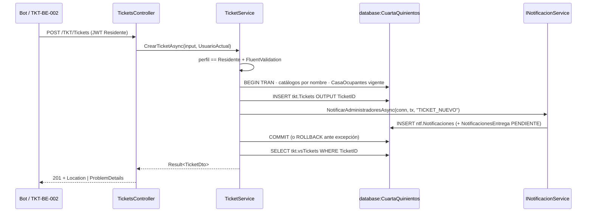

[← index](_index.md) | [← spec](spec.md)

# design.md — TKT-BE-001: Backend: crear ticket (repositorio Dapper + servicio + REST)

> Generado por: **generador de contexto SDD** tras validar spec.md
> Consumido por: implementador (`implementer.tool` = cursor — `desarrollador-api` → `api-tester` → `auditor-codigo` → `auditor-seguridad`)

## Estrategia técnica

Capas: `TicketsController` (delgado) → `ITicketService.CrearTicketAsync` → `TicketRepository` (Dapper, `IDbTransaction`) + `ICatalogoService.ResolverTicketAsync` (resolución por nombre) + `ICasaOcupantesRepository.CasaVigenteAsync` + `INotificacionService.NotificarAdministradoresAsync` (NTF-BE-013). El servicio devuelve `Result<TicketDto>`; el controller lo traduce a `201 Created` + `Location` o `ProblemDetails` con `code`. El patrón de código es el del readme §6 Ticket 1.

Decisión central: toda la regla de negocio vive en el servicio (una sola vez) para que la reutilicen REST (bot) y GraphQL (TKT-BE-002, web). La transacción la abre el servicio y la comparte con el catálogo, el repositorio y `INotificacionService`; la lectura de `tkt.vsTickets` va después del commit para no bloquear la vista dentro de la transacción.

Alternativas descartadas:
- **Stored procedure `prcCreateTicket`**: rechazado por ADR-001 (lógica testeable en C#, sin SPs de negocio).
- **EF Core**: descartado por ADR-001 (Dapper + vistas).
- **Notificar fuera de la transacción (post-commit)**: descartado; readme Ticket 1 exige insert + notificaciones en la misma transacción. El riesgo de Telegram lo absorbe el outbox (ADR-009): dentro de la transacción solo se insertan filas en `ntf.*`, no se llama a Telegram.
- **Validar perfil solo con `[Authorize(Roles)]`**: insuficiente, porque el resolver GraphQL (TKT-BE-002) llama al servicio directamente; se valida en ambos (atributo + servicio).
- **IDs de catálogo en constantes C#**: descartado; los catálogos se resuelven por nombre (INV-2, convención CLAUDE.md).

### Escalera de decisión (methodology.md regla 6) — recorrer ANTES de las tablas de objetos

| Capacidad pedida | Peldaño (1-5) | Objeto resultante | Por qué se descartaron los anteriores |
|---|---|---|---|
| Persistir el ticket | 3 (reuso) | `tkt.Tickets` (existente, DB-000/DB-001) | 1: es Must; 2: n/a |
| Leer el ticket creado | 3 (reuso) | `tkt.vsTickets` (ampliada por DB-001) | 1: Must (respuesta 201 con el ticket); 2: n/a |
| Resolver estado/prioridad/categoría/canal | 3 (reuso) + 5 (código mínimo) | catálogos `tkt.*` + `ICatalogoService.ResolverTicketAsync` | 2: sin feature nativa de catálogo; 3: no existe servicio de catálogos (proyecto sin código); 4: no hay objeto que modificar |
| Inferir casa del solicitante | 3 (reuso) | `sgr.CasaOcupantes` + `CasaVigenteAsync` | `sgr.Casas.PropietarioUsuarioID` no cubre arrendatarios |
| Notificar a administradores | 3 (reuso) | `INotificacionService.NotificarAdministradoresAsync` (NTF-BE-013) | 5 descartado: INV-7 prohíbe insertar en `ntf.*` fuera del servicio |
| Validar entrada | 2 (nativo plataforma) + 5 | FluentValidation `CrearTicketInputValidator` | 2: FluentValidation es la librería del stack (readme §2.2); 3: no existe validator |
| Autorizar Residente | 2 (nativo) | `[Authorize(Roles = "Residente")]` con `RoleClaimType = "perfil"` (SETUP-000) + chequeo en servicio | 3/4: no hay política existente específica |
| Orquestar alta + endpoint | 5 (nuevo) | `TicketService.CrearTicketAsync`, `TicketRepository.InsertarAsync`, `TicketsController.Crear` | 2: sin feature nativa; 3: no existe servicio/endpoint de tickets; 4: no hay objeto que modificar |

## database:CuartaQuinientos

| Objeto | Tipo | Acción | Notas |
|---|---|---|---|
| `tkt.Tickets` | tabla | reusar (INSERT) | Columnas lógicas §3.2 tras DB-001 (`Titulo`, `Descripcion`, `CasaID`, `FechaCreacion`) |
| `tkt.EstadosTickets` | catálogo | reusar (SELECT por nombre) | "Nuevo" |
| `tkt.PrioridadesTicket` | catálogo | reusar (SELECT por nombre) | default "Media" |
| `tkt.CategoriasTicket` | catálogo | reusar (SELECT por nombre) | columna lógica `Categoria` (DB-001) |
| `tkt.CanalesTicket` | catálogo | reusar (SELECT por nombre) | default "WEB" |
| `sgr.CasaOcupantes` | tabla | reusar (SELECT) | fila `Vigente = 1` del solicitante |
| `tkt.vsTickets` | vista | reusar (SELECT post-commit) | ampliada por DB-001 (categoría, canal, casa) |
| `ntf.Notificaciones`, `ntf.TiposNotificacion`, `ntf.NotificacionesEntrega` | tablas | reusar vía `INotificacionService` | no se tocan desde `TicketService` |

```sql
-- Esqueleto (nombres lógicos §3.2). Columnas cotejadas contra SQL/cuartaquinientos_schema.sql + diccionario DB-001.
-- ⏳ MCP [nesgotest] pendiente — BD no desplegada; verificar en Entrega 2 tras DB-000..DB-002.
SELECT EstadoTicketID    FROM tkt.EstadosTickets    WHERE EstadoTicket    = @Estado    AND bEliminado = 0;
SELECT PrioridadTicketID FROM tkt.PrioridadesTicket WHERE PrioridadTicket = @Prioridad AND bEliminado = 0;
SELECT CategoriaTicketID FROM tkt.CategoriasTicket  WHERE Categoria       = @Categoria AND bEliminado = 0;
SELECT CanalID           FROM tkt.CanalesTicket     WHERE Canal           = @Canal     AND bEliminado = 0;

SELECT TOP (1) CasaID FROM sgr.CasaOcupantes
WHERE UsuarioID = @UsuarioId AND Vigente = 1 AND bEliminado = 0;

INSERT INTO tkt.Tickets (Titulo, Descripcion, UsuarioSolicitanteID, CasaID, PrioridadTicketID,
       EstadoTicketID, CategoriaTicketID, CanalID, FechaCreacionTicket,
       Creado, UsuarioCreacionID, FechaCreacion, bEliminado)
OUTPUT INSERTED.TicketID
VALUES (@Titulo, @Descripcion, @By, @CasaId, @PrioridadId, @EstadoId, @CategoriaId, @CanalId,
        SYSUTCDATETIME(), @ByCorreo, @By, SYSUTCDATETIME(), 0);

-- Post-commit
SELECT * FROM tkt.vsTickets WHERE TicketID = @id;
```

## backend:cuartaquinientos-api

| Endpoint | Verbo | Request | Response | Acción |
|---|---|---|---|---|
| `/TKT/Tickets` | POST | `CrearTicketInput { titulo: string (≤200), descripcion: string (≤4000), categoria: string, prioridad?: "Baja"\|"Media"\|"Alta"\|"Crítica", canal?: "WEB"\|"TELEGRAM" }` + `Authorization: Bearer` (perfil Residente) | `201 Created` + `Location: /TKT/Tickets/{id}` + `TicketDto` (desde `tkt.vsTickets`); `400 VALIDATION_ERROR`, `401`, `403 FORBIDDEN` en `ProblemDetails` | crear |

Clases nuevas: `CrearTicketInput` (compartido con TKT-BE-002), `CrearTicketInputValidator`, `ITicketService`/`TicketService`, `TicketRepository`, `ICatalogoService.ResolverTicketAsync`, `TicketsController`. `UsuarioActual.DesdeClaims` (claims `sub`, `correo`, `perfil`) lo provee USR-BE-007/SETUP-000.

## Diagrama de flujo (Mermaid, opcional)



## Orden de implementación

| # | Paso | Target:Instancia | Entregable | Dependencia | Verificación |
|---|------|-------------------|------------|-------------|--------------|
| 1 | Input + validator (Titulo ≤ 200, Descripcion ≤ 4 000, Categoria requerida, Prioridad/Canal por lista) | `backend:cuartaquinientos-api` | `CrearTicketInput`, `CrearTicketInputValidator` | — | `dotnet build` + unit tests del validator |
| 2 | Resolución de catálogos por nombre | `backend:cuartaquinientos-api` | `CatalogoService.ResolverTicketAsync` | DB-002 | SELECT smoke de catálogos (MCP pendiente Entrega 2) |
| 3 | Servicio transaccional (perfil, catálogos, casa, insert, notificación, rollback) | `backend:cuartaquinientos-api` | `TicketService.CrearTicketAsync`, `TicketRepository.InsertarAsync` | 1, 2, USR-BE-007, NTF-BE-013 (o mock) | unit tests CA-2, CA-5, CA-10 |
| 4 | Controller REST | `backend:cuartaquinientos-api` | `POST /TKT/Tickets` `[Authorize(Roles = "Residente")]` → 201 + `Location` | 3 | `.http` happy path contra API levantado |
| 5 | Tests unitarios + integración del endpoint | `backend:cuartaquinientos-api` | `GraphApi.Tests` en verde | 3, 4 | `dotnet test GraphApi.Tests` |

## Plan de pruebas

| Prueba | Target | Tipo | Cubre CA |
|---|---|---|---|
| `CrearTicketAsync_Exito_CreaNuevoYNotifica` | cuartaquinientos-api | integración | CA-1, CA-9, CA-11 |
| `TC-INV-1` | cuartaquinientos-api | regresión | CA-R1 (INV-1: estado Nuevo) |
| `TC-INV-2` | cuartaquinientos-api | regresión | CA-R1, CA-6 (INV-2: FKs de catálogo) |
| `TC-INV-3` | cuartaquinientos-api | regresión | CA-3 (INV-3: título ≤ 200) |
| `TC-INV-4` | cuartaquinientos-api | regresión | CA-7, CA-8 (INV-4: `sub` y `CasaOcupantes`) |
| `TC-INV-5` | cuartaquinientos-api | regresión | CA-1, CA-6 (INV-5: defaults Media/WEB) |
| `TC-INV-6` | cuartaquinientos-api | regresión | CA-11 (INV-6: `bEliminado = 0`) |
| `TC-INV-7` | cuartaquinientos-api | regresión | CA-R2 (INV-7: solo `INotificacionService` escribe `ntf.*`) |
| `TC-INV-8` | cuartaquinientos-api | regresión | CA-9 (INV-8: tipo `TICKET_NUEVO` de catálogo) |
| `TC-INV-9` | cuartaquinientos-api | regresión | CA-R2 (INV-9: solo encola, no llama Telegram) |
| `TC-INV-10` | cuartaquinientos-api | regresión | revisión de código: sin `CommandType.StoredProcedure`, parámetros Dapper |
| `TC-ERR-1` | cuartaquinientos-api | negativo | CA-2: perfil Trabajador → `FORBIDDEN`, sin insert |
| `TC-ERR-2` | cuartaquinientos-api | negativo | CA-5: `categoria: "Plomería"` → `VALIDATION_ERROR` |
| `TC-ERR-3` | cuartaquinientos-api | negativo | CA-3/CA-4: título 201 / descripción 4 001 → `400` |
| `TC-ERR-4` | cuartaquinientos-api | negativo | CA-12: sin token → `401` |
| `TC-RB` | cuartaquinientos-api | rollback | CA-10: excepción en notificación → 0 filas nuevas en `tkt.Tickets` y `ntf.Notificaciones` |

No se genera `*Pruebas*.sql`: el ticket no crea objetos SQL; las pruebas son xUnit en `GraphApi.Tests` contra la BD de test.

### Ratio de pruebas (Testing Trophy)

- Integración: ~70 % (endpoint + servicio contra BD de test `CuartaQuinientos` con DB-000..DB-002; MCP `nesgotest` en Entrega 2)
- Unitario: ~30 % (validator y reglas del servicio con repositorio mockeado)
- Mocks: `INotificacionService` solo mientras NTF-BE-013 no esté integrado

### Triangulación

| Comportamiento | Dataset A | Dataset B | Qué generaliza |
|---|---|---|---|
| Alta válida | mínimo: solo `titulo`/`descripcion`/`categoria` (defaults Media/WEB) | máximo: título 200, descripción 4 000, `prioridad: "Crítica"`, `canal: "TELEGRAM"` | que defaults y límites no quedaron hardcodeados |
| Casa inferida | residente con casa vigente | residente sin casa (`CasaID = NULL`) | que `CasaID` sale de `sgr.CasaOcupantes`, no del input |
| Destinatarios | 0 administradores activos | 2 administradores activos (+1 inactivo) | que se filtra por `bActivo = 1` y `bAdministrador = 1` |

### Mutation

| Objeto | Técnica | Kill rate objetivo |
|---|---|---|
| `TicketService.CrearTicketAsync` (gate de perfil, rollback) + `CrearTicketInputValidator` (límites 200/4 000) | Stryker.NET | ≥ 80 % paths críticos |

## Estrategia de rollback

Sin cambios de esquema ni datos de catálogo: el rollback es revertir el PR (`git revert` del merge en `feature/entrega-2-AFS`) y redeploy del API. Tickets ya creados permanecen válidos (el esquema no cambia); si hubiera que retirarlos se usa soft delete (`bEliminado = 1`), nunca `DELETE`. En runtime, cualquier fallo dentro de la transacción ejecuta `tx.Rollback()` (TC-RB).

## Pre-mortem

- **Si esto falla en PROD, la causa más probable es:** catálogos no sembrados o con nombre distinto al esperado (DB-002 incompleto) → todas las altas devuelven `VALIDATION_ERROR`.
- **Cómo lo detectamos:** pico de `400 VALIDATION_ERROR` con `errors.categoria`/`estado` en Serilog (`CorrelationId`); `SELECT COUNT(*) FROM tkt.EstadosTickets WHERE bEliminado = 0` = 0.
- **Acción inmediata:** re-ejecutar DB-002 (idempotente); si el fallo es de código, revertir el PR según release.md y avisar al owner del proyecto.

## Decisiones técnicas (auditoría)

| # | Decisión | Justificación |
|---|---|---|
| 1 | `TicketService.CrearTicketAsync` nuevo (peldaño 5) | 2: ninguna feature nativa orquesta validación + transacción + notificación; 3: no existe servicio de tickets (sin código aún); 4: nada que modificar. ADR-001 descarta SP |
| 2 | `ICatalogoService.ResolverTicketAsync` nuevo (peldaño 5) | 2: sin feature nativa; 3: no existe resolución de catálogos; necesario para INV-2 sin IDs hardcodeados |
| 3 | `TicketsController.Crear` nuevo (peldaño 5) | 3: no existe endpoint; controller delgado sin reglas |
| 4 | Notificación dentro de la transacción | readme Ticket 1; ADR-009 garantiza que Telegram no está en la transacción |
| 5 | Lectura de `tkt.vsTickets` post-commit | readme Ticket 1; evita leer dentro de la transacción |

## Autoverificación antes del handoff

**Consistencia con spec.md:**
- [x] Ningún objeto/tabla de este design.md implementa algo listado como `Won't` en spec.md (sin adjuntos, sin GraphQL, sin SP, sin envío Telegram)
- [x] Cada fila de "Plan de pruebas" `TC-INV-x` corresponde a un invariante real de spec.md (INV-1..INV-10, uno por invariante)

**Calidad del artefacto:**
- [ ] Toda query/comando SQL verificado con MCP — **pendiente Entrega 2** (BD no desplegada); marcado `⏳ MCP [nesgotest] pendiente`
- [x] Orden de implementación: cada paso tiene Entregable + Dependencia explícita
- [x] Sin falsa agencia: cada paso nombra el actor real (`TicketService`, `TicketsController`, `INotificacionService`)
- [ ] Toda query/comando propuesto verificado antes de escribirlo — cotejado contra `SQL/cuartaquinientos_schema.sql` + diccionario DB-001; verificación MCP **pendiente Entrega 2**
- [x] Si el spec tiene CHAR-x → hay una fila `TC-CHAR-x` por cada uno (no aplica: Feature)
- [x] Cada comportamiento nuevo tiene ≥ 2 datasets en la tabla de Triangulación
