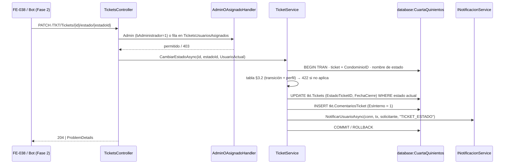

[← index](_index.md) | [← spec](spec.md)

# design.md — TKT-BE-016: Gestión de tickets por Administrador

> Generado por: **generador de contexto SDD** tras validar spec.md
> Consumido por: implementador (`implementer.tool` = cursor — `desarrollador-tdd` (máquina de estados) → `desarrollador-api` → `api-tester` → `auditor-codigo` → `auditor-seguridad`)

## Estrategia técnica

Extender `ITicketService`/`TicketService` (TKT-BE-001) con `ListarAsync`, `CambiarEstadoAsync` y `AsignarAsync`; agregar acciones `GET` y `PATCH …/estado/{estadoId}` en `TicketsController` y crear `TicketsUsuariosAsignadosController` (`POST`). Notificaciones vía `INotificacionService.NotificarUsuarioAsync` (patrón TKT-BE-001, NTF-BE-013). Políticas `SoloAdministrador` y `AdminOAsignado` de SETUP-000.

Máquina de estados: tabla estática en `TicketService` indexada **por nombre** de estado (`"Nuevo" → {"En seguimiento"}`, `"En seguimiento" → {"Resuelto"}`, `"Resuelto" → {"En seguimiento", "Cerrado"}`), con el conjunto de perfiles permitidos por transición (Administrador en las 4; trabajador asignado solo en las 2 primeras). Los IDs se resuelven con `ICatalogoService`; nunca se compara por ID fijo.

`CambiarEstadoAsync(ticketId, estadoId, UsuarioActual)` en una transacción:
1. Carga el ticket (`bEliminado = 0`) con su estado actual y `CondominioID` vía `sgr.Casas` → `404 NOT_FOUND` si no existe o es de otro condominio `(asumido)`.
2. Resuelve el nombre del estado destino → `400 VALIDATION_ERROR` si no existe `(asumido)`.
3. Valida transición y actor → `422 INVALID_TRANSITION`.
4. `UPDATE tkt.Tickets … WHERE TicketID = @id AND EstadoTicketID = @estadoActual` (control optimista; 0 filas → `409 CONFLICT` `(asumido)`), con `FechaCierre` según el destino (Resuelto = `SYSUTCDATETIME()`; reapertura = `NULL`; Cerrado = sin cambio).
5. `INSERT tkt.ComentariosTicket` (`EsInterno = 1`, texto "Estado: <origen> → <destino>" `(asumido)`).
6. `INotificacionService.NotificarUsuarioAsync(conn, tx, UsuarioSolicitanteID, "TICKET_ESTADO", …)` en **toda** transición, incluidas reapertura y cierre (readme §3.2).
7. `Commit` (o `Rollback` ante excepción).

`AsignarAsync(ticketId, usuarioId, UsuarioActual)` en una transacción: valida ticket del condominio (`404`), usuario activo con perfil "Trabajador" resuelto por nombre en `sgr.Perfiles` (`422 VALIDATION_ERROR` `(asumido)`), duplicado activo (`409 CONFLICT` `(asumido)`), `INSERT tkt.TicketsUsuariosAsignados` (`Terminado = 0`) y `NotificarUsuarioAsync(…, "TICKET_ASIGNADO", …)`.

Alternativas descartadas:
- **Máquina de estados en BD (tabla de transiciones o trigger)**: descartada; ADR-001 (reglas en servicios C# testeables) y el readme §3.2 asigna la validación a `TicketService`.
- **Comparar transiciones por ID de estado**: descartado por INV-5 y la convención de catálogos por nombre.
- **Solo `[Authorize(Roles = "Administrador")]` en el `PATCH`**: no cubre al trabajador asignado; se usa `AdminOAsignado` + chequeo del par transición/perfil en el servicio.
- **Endpoint distinto por transición (`/resolver`, `/cerrar`)**: descartado; specs/tickets.md exige reusar `PATCH …/estado/{id}` para web y bot.
- **Tabla de auditoría de transiciones**: descartada; el comentario de sistema `EsInterno = 1` es la traza definida (readme Ticket 16) y no existe tabla dedicada (specs/tickets.md Notas).

### Escalera de decisión (methodology.md regla 6) — recorrer ANTES de las tablas de objetos

| Capacidad pedida | Peldaño (1-5) | Objeto resultante | Por qué se descartaron los anteriores |
|---|---|---|---|
| Listar tickets del condominio | 3 (reuso) + 4 | `tkt.vsTickets` + join `sgr.Casas`; `ListarAsync` en `TicketService` | 2: n/a; 3: la vista no expone `CondominioID` → join mínimo en la consulta, sin alterar la vista |
| Paginar | 2 (nativo motor) | `OFFSET … FETCH` | — |
| Validar transiciones | 4 (cambio mínimo) | tabla de transiciones en `TicketService` | 2: sin feature nativa; 3: no existe validador de estados; 5 innecesario: vive en el servicio existente |
| Autorizar Admin / asignado | 3 (reuso) + 5 | políticas de SETUP-000; handler de recurso `AdminOAsignadoHandler` | 2: `[Authorize(Roles)]` no puede evaluar la asignación al ticket; 3: la política está declarada pero su handler depende del ticket |
| Traza del cambio | 3 (reuso) | `tkt.ComentariosTicket` con `EsInterno = 1` | tabla de auditoría descartada (YAGNI, peldaño 1) |
| Asignar personal | 3 (reuso) + 5 | `tkt.TicketsUsuariosAsignados`; `TicketsUsuariosAsignadosController` nuevo | 3: no existe controller de asignación (inventario §4 lo nombra); 4: n/a |
| Notificar | 3 (reuso) | `INotificacionService.NotificarUsuarioAsync` | INV-7 prohíbe escribir `ntf.*` desde `TicketService` |

## database:CuartaQuinientos

| Objeto | Tipo | Acción | Notas |
|---|---|---|---|
| `tkt.vsTickets` | vista | reusar (SELECT) | listado; columnas ampliadas por DB-001 (categoría, canal, `CasaID`) |
| `sgr.Casas` | tabla | reusar (JOIN) | `CondominioID` para el filtro del JWT |
| `tkt.Tickets` | tabla | reusar (UPDATE) | `EstadoTicketID`, `FechaCierre`, `Modificado`, `UsuarioModificacionID`, `FechaModificacion` |
| `tkt.EstadosTickets` | catálogo | reusar (SELECT por ID/nombre) | columna `EstadoTicket` |
| `tkt.PrioridadesTicket` | catálogo | reusar | `Orden` solo si se ordena por prioridad (INV-8) |
| `tkt.ComentariosTicket` | tabla | reusar (INSERT) | `EsInterno = 1`, `FechaComentario` |
| `tkt.TicketsUsuariosAsignados` | tabla | reusar (SELECT/INSERT) | `Terminado = 0`; lectura para `AdminOAsignado` |
| `sgr.Usuarios`, `sgr.Perfiles` | tablas | reusar (SELECT) | `bActivo = 1`, perfil por nombre "Trabajador" (columna lógica `Nombre`, DB-001) |

```sql
-- Esqueletos parametrizados. ⏳ MCP [nesgotest] pendiente — BD no desplegada; verificar en Entrega 2 tras DB-000..DB-002.
-- Listado (COUNT con los mismos filtros en la misma llamada QueryMultiple)
SELECT T.TicketID, T.Titulo, T.EstadoTicket, T.PrioridadTicket, T.Categoria,
       T.NombreSolicitante, T.FechaCreacionTicket
FROM tkt.vsTickets T
INNER JOIN sgr.Casas C ON C.CasaID = T.CasaID AND C.bEliminado = 0
WHERE C.CondominioID = @condominioId AND T.bEliminado = 0
  AND (@estadoTicketId    IS NULL OR T.EstadoTicketID    = @estadoTicketId)
  AND (@prioridadTicketId IS NULL OR T.PrioridadTicketID = @prioridadTicketId)
ORDER BY T.FechaCreacionTicket DESC, T.TicketID DESC
OFFSET @offset ROWS FETCH NEXT @size ROWS ONLY;

-- Cambio de estado (dentro de la transacción)
UPDATE tkt.Tickets
SET EstadoTicketID = @estadoDestinoId,
    FechaCierre = CASE WHEN @accionCierre = 'REGISTRAR' THEN SYSUTCDATETIME()
                       WHEN @accionCierre = 'LIMPIAR'   THEN NULL
                       ELSE FechaCierre END,
    Modificado = @ByCorreo, UsuarioModificacionID = @By, FechaModificacion = SYSUTCDATETIME()
WHERE TicketID = @ticketId AND EstadoTicketID = @estadoActualId AND bEliminado = 0;

INSERT INTO tkt.ComentariosTicket (TicketID, UsuarioID, Comentario, EsInterno, FechaComentario,
       Creado, UsuarioCreacionID, FechaCreacion, bEliminado)
VALUES (@ticketId, @By, @comentario, 1, SYSUTCDATETIME(), @ByCorreo, @By, SYSUTCDATETIME(), 0);

-- Asignación
SELECT COUNT(*) FROM sgr.Usuarios U
INNER JOIN sgr.Perfiles P ON P.PerfilID = U.PerfilID
WHERE U.UsuarioID = @usuarioId AND U.bActivo = 1 AND U.bEliminado = 0 AND P.Nombre = N'Trabajador';

INSERT INTO tkt.TicketsUsuariosAsignados (TicketID, UsuarioID, Terminado, Creado, UsuarioCreacionID, FechaCreacion, bEliminado)
OUTPUT INSERTED.TicketsUsuariosAsignadosID
VALUES (@ticketId, @usuarioId, 0, @ByCorreo, @By, SYSUTCDATETIME(), 0);
```

## backend:cuartaquinientos-api

| Endpoint | Verbo | Request | Response | Acción |
|---|---|---|---|---|
| `/TKT/Tickets` | GET | `Authorization` (política `SoloAdministrador`) + query `estadoTicketId?`, `prioridadTicketId?`, `pagina? (1)`, `tamano? (20, máx 100)` `(asumido defaults)` | `200 { total, pagina, items: [{ ticketId, titulo, estado, prioridad, categoria, solicitante, fechaCreacion }] }` `(asumido forma)`; `401`, `403 FORBIDDEN` | crear (acción en controller existente) |
| `/TKT/Tickets/{ticketID}/estado/{estadoId}` | PATCH | `Authorization` (política `AdminOAsignado`); sin body | `204`; `400 VALIDATION_ERROR`, `403 FORBIDDEN`, `404 NOT_FOUND`, `409 CONFLICT`, `422 INVALID_TRANSITION` (`ProblemDetails`) | crear |
| `/TKT/TicketsUsuariosAsignados` | POST | `Authorization` (política `SoloAdministrador`) + `{ ticketId: int, usuarioId: int }` | `201 Created` + `Location: /TKT/TicketsUsuariosAsignados/{id}` `(asumido)`; `400`, `403`, `404`, `409 CONFLICT`, `422 VALIDATION_ERROR` | crear (controller nuevo) |

## Diagrama de flujo (Mermaid, opcional)



## Orden de implementación

| # | Paso | Target:Instancia | Entregable | Dependencia | Verificación |
|---|------|-------------------|------------|-------------|--------------|
| 1 | Tests en rojo de la máquina de estados (16 pares × perfil) | `backend:cuartaquinientos-api` | `TicketStateMachineTests` en rojo | TKT-BE-001 | `dotnet test` falla por la razón esperada (Red phase) |
| 2 | Tabla de transiciones + `CambiarEstadoAsync` transaccional | `backend:cuartaquinientos-api` | `TicketService.CambiarEstadoAsync` | 1, NTF-BE-013 (o mock) | tests del paso 1 en verde + `CambiarEstadoAsync_ActualizaEstadoYFechaCierre` |
| 3 | Handler de `AdminOAsignado` + acción `PATCH` | `backend:cuartaquinientos-api` | `AdminOAsignadoHandler`, `TicketsController.CambiarEstado` | 2, SETUP-000 | `.http` 204 / 403 / 422 contra API levantado |
| 4 | Listado paginado del condominio | `backend:cuartaquinientos-api` | `TicketService.ListarAsync`, `TicketsController.Listar` | TKT-BE-015 (DTOs de paginación) | `.http` 200 con filtros; SELECT smoke (MCP pendiente) |
| 5 | Asignación | `backend:cuartaquinientos-api` | `TicketService.AsignarAsync`, `TicketsUsuariosAsignadosController` | 2 | `AsignarTicket_InsertaTicketsUsuariosAsignados` + `.http` 201 / 422 |
| 6 | Integración de los 3 endpoints | `backend:cuartaquinientos-api` | suite en verde | 3, 4, 5 | `dotnet test GraphApi.Tests` |

## Plan de pruebas

| Prueba | Target | Tipo | Cubre CA |
|---|---|---|---|
| `CambiarEstadoAsync_ActualizaEstadoYFechaCierre` | cuartaquinientos-api | integración | CA-4, CA-5, CA-6, CA-7 |
| `AsignarTicket_InsertaTicketsUsuariosAsignados` | cuartaquinientos-api | integración | CA-14 |
| `Listar_FiltraPorCondominioYFiltros` | cuartaquinientos-api | integración | CA-1, CA-2 |
| `TC-INV-1` | cuartaquinientos-api | regresión | CA-R1, CA-8, CA-10 (INV-1: 16 pares) |
| `TC-INV-2` | cuartaquinientos-api | regresión | CA-4..CA-7 (INV-2: `FechaCierre` en Resuelto + 1 notificación `TICKET_ESTADO` por cada una de las 4 transiciones) |
| `TC-INV-3` | cuartaquinientos-api | regresión | CA-14 (INV-3: fila N:M + notificación al asignado) |
| `TC-INV-4` | cuartaquinientos-api | regresión | CA-R2 (INV-4: comentario de sistema `EsInterno = 1`) |
| `TC-INV-5` | cuartaquinientos-api | regresión | CA-11, CA-R1 (INV-5: transiciones por nombre de catálogo) |
| `TC-INV-6` | cuartaquinientos-api | regresión | CA-12 (INV-6: ticket con `bEliminado = 1` → 404, no listado) |
| `TC-INV-7` | cuartaquinientos-api | regresión | CA-13, CA-R2 (INV-7: solo `INotificacionService` escribe `ntf.*`) |
| `TC-INV-8` | cuartaquinientos-api | regresión | revisión de código: ningún `ORDER BY PrioridadTicketID` |
| `TC-INV-9` | cuartaquinientos-api | regresión | CA-1, CA-9 (INV-9: `condominioId`/`sub` del JWT, body ignorado) |
| `TC-ERR-1` | cuartaquinientos-api | negativo | CA-8: Nuevo → Cerrado → `422 INVALID_TRANSITION` |
| `TC-ERR-2` | cuartaquinientos-api | negativo | CA-15: asignar a Residente / Trabajador inactivo → `422` |
| `TC-ERR-3` | cuartaquinientos-api | negativo | CA-3, CA-9, CA-16: perfiles no autorizados → `403` |
| `TC-ERR-4` | cuartaquinientos-api | negativo | CA-11, CA-12: `estadoId` 999 → `400`; ticket de otro condominio → `404` |
| `TC-RB` | cuartaquinientos-api | rollback | CA-13: excepción en notificación → estado, `FechaCierre` y comentarios intactos |

No se genera `*Pruebas*.sql`: el ticket no crea objetos SQL. PBT-1/PBT-2 se implementan como test parametrizado (xUnit `Theory` con los 16 pares) y como secuencias aleatorias de transiciones válidas.

### Ratio de pruebas (Testing Trophy)

- Integración: ~70 % (endpoints + servicio contra BD de test `CuartaQuinientos` con DB-000..DB-002; MCP `nesgotest` en Entrega 2)
- Unitario: ~30 % (tabla de transiciones pura, cálculo de `FechaCierre`)
- Mocks: `INotificacionService` solo mientras NTF-BE-013 no esté integrado

### Triangulación

| Comportamiento | Dataset A | Dataset B | Qué generaliza |
|---|---|---|---|
| Transición válida | Admin: Nuevo → En seguimiento | Trabajador asignado: En seguimiento → Resuelto | que la regla depende de (transición, perfil), no de un caso fijo |
| `FechaCierre` | Resuelto (registra) | Reapertura (limpia) y Cerrado (conserva) | los tres efectos de §3.2 |
| Filtro por condominio | 1 condominio con 1 ticket | 2 condominios con tickets en ambos | que el filtro sale del claim `condominioId` |

### Mutation

| Objeto | Técnica | Kill rate objetivo |
|---|---|---|
| `TicketService.CambiarEstadoAsync` (tabla de transiciones, perfiles, `FechaCierre`) + `AdminOAsignadoHandler` | Stryker.NET | ≥ 80 % paths críticos |

## Estrategia de rollback

Solo código: revertir el PR (`git revert` en `feature/entrega-2-AFS`) y redeploy. Sin cambios de esquema. Los datos generados (estados, comentarios de sistema, asignaciones) son válidos con el esquema existente; si hubiera que anular una asignación se usa soft delete (`bEliminado = 1`), nunca `DELETE`. En runtime, toda excepción dentro de la transacción ejecuta `Rollback` (TC-RB).

## Pre-mortem

- **Si esto falla en PROD, la causa más probable es:** una transición mal mapeada (p. ej. nombres de estado sembrados con otra grafía) que bloquea el flujo con `422` o permite un salto no permitido.
- **Cómo lo detectamos:** pico de `422 INVALID_TRANSITION` en Serilog por `CorrelationId`; `SELECT EstadoTicket FROM tkt.EstadosTickets WHERE bEliminado = 0` distinto de Nuevo / En seguimiento / Resuelto / Cerrado; tickets en Resuelto con `FechaCierre IS NULL` (PBT-2).
- **Acción inmediata:** corregir el catálogo con DB-002 (idempotente) o revertir el PR según release.md; avisar al owner del proyecto.

## Decisiones técnicas (auditoría)

| # | Decisión | Justificación |
|---|---|---|
| 1 | `TicketsUsuariosAsignadosController` nuevo (peldaño 5) | 2: sin feature nativa; 3: no existe controller de asignación (inventario §4 lo define); 4: no hay controller que extender con esa ruta |
| 2 | `AdminOAsignadoHandler` nuevo (peldaño 5) | 2: `[Authorize(Roles)]` nativo no evalúa la asignación por ticket; 3: SETUP-000 declara la política pero la regla depende del recurso; 4: n/a |
| 3 | Máquina de estados en `TicketService` (peldaño 4) | readme §3.2 la asigna al servicio; ADR-001 descarta triggers/SPs |
| 4 | Control optimista `WHERE EstadoTicketID = @estadoActual` `(asumido)` | evita dobles transiciones concurrentes sin bloqueos largos |
| 5 | Join a `sgr.Casas` en la consulta en lugar de alterar `tkt.vsTickets` | cambio mínimo sin tocar una vista compartida (DB-001 la define) |

## Autoverificación antes del handoff

**Consistencia con spec.md:**
- [x] Ningún objeto/tabla de este design.md implementa algo listado como `Won't` en spec.md (sin candidatos a asignar, sin `Terminado = 1`, sin comentarios de usuario, sin UI)
- [x] Cada fila de "Plan de pruebas" `TC-INV-x` corresponde a un invariante real de spec.md (INV-1..INV-9)

**Calidad del artefacto:**
- [ ] Toda query/comando SQL verificado con MCP — **pendiente Entrega 2** (BD no desplegada); marcado `⏳ MCP [nesgotest] pendiente`
- [x] Orden de implementación: cada paso tiene Entregable + Dependencia explícita
- [x] Sin falsa agencia: cada paso nombra el actor real (`TicketService`, `TicketsController`, `AdminOAsignadoHandler`, `INotificacionService`)
- [ ] Toda query/comando propuesto verificado antes de escribirlo — columnas base cotejadas contra `SQL/cuartaquinientos_schema.sql`; columnas ampliadas por DB-001 y MCP **pendientes Entrega 2**
- [x] Si el spec tiene CHAR-x → hay una fila `TC-CHAR-x` por cada uno (no aplica: Feature)
- [x] Cada comportamiento nuevo tiene ≥ 2 datasets en la tabla de Triangulación
