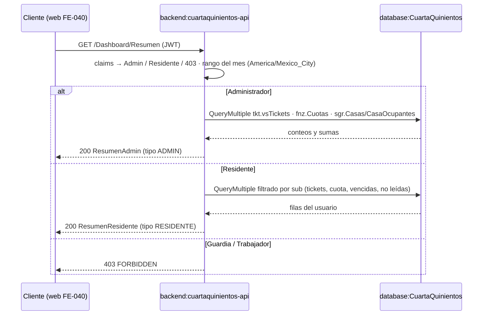

[← index](_index.md) | [← spec](spec.md)

# design.md — DASH-BE-014: Dashboard — KPIs Admin y resumen residente

> Generado por: **generador de contexto SDD** tras validar spec.md
> Consumido por: implementador (`implementer.tool` = cursor — agentes `desarrollador-api`, `api-tester`, `auditor-codigo`, `auditor-seguridad`)

## Estrategia técnica

`ResumenController` (`/Dashboard/Resumen`) → `DashboardService : IDashboardService` → `DashboardRepository` (Dapper, solo `SELECT` parametrizados). El servicio:

1. Lee claims del JWT: `bAdministrador = 1` → rama Admin; `perfil = 'Residente'` → rama Residente (asumido: claim `perfil`); cualquier otro perfil → `Result.Forbidden` → `403`.
2. Calcula en C# el rango del período `[@Inicio, @Fin)` y `@Hoy` en `America/Mexico_City` (parámetros `mes`/`anio` opcionales, por defecto mes en curso).
3. **Admin:** ejecuta un batch de lecturas con `QueryMultiple` (conteos de tickets, morosos, montos del mes, ocupación, tickets por canal) y arma `ResumenAdmin`; `ocupacion = total == 0 ? 0 : ocupadas * 100.0 / total` redondeado a 1 decimal (asumido).
4. **Residente:** batch filtrado por `@UsuarioID = sub` (tickets activos, cuota del período, cuotas vencidas, no leídas) y clasifica el estado de la cuota con la regla de FNZ-BE-010 (INV-8).

**Alternativas descartadas:**
- **Tabla/vista propia de KPIs o snapshot** — descartado: INV-1 y Non-goals Dashboard; las tendencias son de BI (`bi.KpiSnapshots`, Fase 3).
- **Dos endpoints (`/Dashboard/Admin`, `/Dashboard/Residente`)** — descartado: §4 Endpoint 3 define un único endpoint con `oneOf` y campo `tipo`.
- **Estado de cuota calculado en SQL (`CASE`)** — descartado: FNZ-BE-010 exige clasificación en servicio C# para una sola fuente de la regla.
- **Resolver solo por GraphQL** — descartado para Fase 1: §4 define el contrato REST; GraphQL queda como Could.
- **Stored procedure de agregación** — descartado por ADR-001.

### Escalera de decisión (methodology.md regla 6) — recorrer ANTES de las tablas de objetos

| Capacidad pedida | Peldaño (1-5) | Objeto resultante | Por qué se descartaron los anteriores |
|---|---|---|---|
| Conteos de tickets por estado y activos del residente | 3 (reuso) | `tkt.vsTickets` | 1: Must HU-DASH-01/02; 2: n/a |
| Tickets del mes por canal | 3 (reuso) | `tkt.vsTickets` (canal agregado por DB-001) / `tkt.Tickets.CanalID` + `tkt.CanalesTicket` | 1: Must HU-DASH-01; 2: n/a |
| Morosos, montos, cuota del residente | 3 (reuso) | `fnz.Cuotas` + predicado de FNZ-BE-012 | 1: Must; 2: n/a |
| Ocupación | 3 (reuso) | `sgr.CasaOcupantes` + `sgr.Casas` | 1: Must; 2: n/a |
| No leídas del residente | 3 (reuso) | Consulta de conteo de `NotificacionRepository` (NTF-BE-013) | 1: Must; 2: n/a |
| Estado de cuota Pagada/Pendiente/Vencida | 3 (reuso) | Clasificador C# de FNZ-BE-010 | 1: Must; 2: n/a |
| Zona horaria del período | 2 (nativo) | `TimeZoneInfo.FindSystemTimeZoneById("America/Mexico_City")` de .NET | 1: Must (INV-6) |
| Orquestación por perfil | 5 (nuevo) | `IDashboardService` / `DashboardService` | 2: sin feature nativa; 3: no existe servicio de dashboard; 4: ningún servicio existente tiene responsabilidad de agregación cross-dominio |
| Lecturas agregadas | 5 (nuevo) | `DashboardRepository` | 3: no existe repositorio de dashboard; 4: añadir estas consultas a repositorios TKT/FNZ mezclaría responsabilidades |
| Endpoint | 5 (nuevo) | `ResumenController` | 3: no existe controller `/Dashboard`; 4: n/a |

## database:CuartaQuinientos

Sin DDL ni escrituras (INV-1). Depende de DB-001 (ampliación de `tkt.vsTickets` con canal/casa, `sgr.CasaOcupantes`) y DB-002 (estados de ticket y canales sembrados).

| Objeto | Tipo | Acción | Notas |
|---|---|---|---|
| `tkt.vsTickets` | vista | leer | `EstadoTicket`, `Canal`, `UsuarioSolicitanteID`, `FechaCreacionTicket` |
| `fnz.Cuotas` | tabla | leer | `Pagado`, `Monto`, `MontoPagado`, `PeriodoInicio`, `FechaVencimiento`, `UsuarioID`, `bEliminado` |
| `sgr.CasaOcupantes`, `sgr.Casas` | tablas | leer | `Vigente = 1`, `CondominioID` |
| `ntf.Notificaciones`, `ntf.NotificacionesVisualizadas` | tablas | leer | Vía consulta de NTF-BE-013; nunca `Leido` |

```sql
-- Verificación MCP pendiente Entrega 2 (BD no desplegada): sin anotación ✓ MCP.
-- Admin (un batch QueryMultiple; @Inicio/@Fin/@Hoy calculados en C# con America/Mexico_City)
SELECT COUNT(*) FROM tkt.vsTickets WHERE EstadoTicket = N'Nuevo';
SELECT COUNT(*) FROM tkt.vsTickets WHERE EstadoTicket = N'En seguimiento';
SELECT COUNT(DISTINCT UsuarioID) FROM fnz.Cuotas
 WHERE Pagado = 0 AND FechaVencimiento < @Hoy AND bEliminado = 0;
SELECT ISNULL(SUM(CASE WHEN Pagado = 1 THEN MontoPagado END), 0) AS MontoCobrado,
       ISNULL(SUM(CASE WHEN Pagado = 0 THEN Monto END), 0)       AS MontoPendiente
  FROM fnz.Cuotas
 WHERE PeriodoInicio >= @Inicio AND PeriodoInicio < @Fin AND bEliminado = 0;   -- (asumido: mes por PeriodoInicio)
SELECT COUNT(*) AS Total,
       SUM(CASE WHEN EXISTS (SELECT 1 FROM sgr.CasaOcupantes o
                             WHERE o.CasaID = c.CasaID AND o.Vigente = 1 AND o.bEliminado = 0)
                THEN 1 ELSE 0 END) AS Ocupadas
  FROM sgr.Casas c
 WHERE c.CondominioID = @CondominioID AND c.bEliminado = 0;                  -- (asumido: claim condominioId)
SELECT Canal, COUNT(*) AS Total FROM tkt.vsTickets
 WHERE FechaCreacionTicket >= @Inicio AND FechaCreacionTicket < @Fin
 GROUP BY Canal;                                                              -- WEB / TELEGRAM → web / telegram

-- Residente (@UsuarioID = sub)
SELECT COUNT(*) FROM tkt.vsTickets
 WHERE UsuarioSolicitanteID = @UsuarioID AND EstadoTicket <> N'Cerrado';
SELECT TOP 1 Monto, FechaVencimiento, Pagado FROM fnz.Cuotas
 WHERE UsuarioID = @UsuarioID AND PeriodoInicio >= @Inicio AND PeriodoInicio < @Fin AND bEliminado = 0
 ORDER BY FechaVencimiento;                                                   -- (asumido: varias → la más antigua)
SELECT CAST(CASE WHEN EXISTS (SELECT 1 FROM fnz.Cuotas
        WHERE UsuarioID = @UsuarioID AND Pagado = 0 AND FechaVencimiento < @Hoy AND bEliminado = 0)
        THEN 1 ELSE 0 END AS BIT);
-- notificacionesNoLeidas: reutiliza la consulta COUNT … NOT EXISTS de NTF-BE-013
```

Los literales de estado (`Nuevo`, `En seguimiento`, `Cerrado`) son **nombres** del catálogo `tkt.EstadosTickets` sembrado por DB-002 (resolución por nombre, no por ID); se pasan como parámetros constantes del servicio.

## backend:cuartaquinientos-api

| Endpoint | Verbo | Request | Response | Acción |
|---|---|---|---|---|
| `/Dashboard/Resumen` | GET | query opcional `mes` (1-12), `anio` (≥ 2024); JWT `bearerAuth` | `200 ResumenAdmin \| ResumenResidente` (campo `tipo`) · `400 VALIDATION_ERROR` · `401` · `403 FORBIDDEN` | crear |

DTOs (contrato §4 Endpoint 3, camelCase en JSON):

```csharp
public sealed record ResumenAdmin(string Tipo /* "ADMIN" */, int TicketsNuevos, int TicketsEnSeguimiento,
    int MorososMes, decimal MontoCobrado, decimal MontoPendiente, decimal Ocupacion, TicketsPorCanal TicketsPorCanal);
public sealed record TicketsPorCanal(int Web, int Telegram);
public sealed record ResumenResidente(string Tipo /* "RESIDENTE" */, int TicketsActivos,
    EstadoCuotaMes? EstadoCuotaMes, int NotificacionesNoLeidas, bool AvisoVencida);
public sealed record EstadoCuotaMes(decimal Monto, DateOnly FechaVencimiento, string Estado /* Pagada|Pendiente|Vencida */);
```

- `[Authorize]` en `ResumenController`; la decisión Admin/Residente/403 vive en `DashboardService` (INV-2).
- Validación de `mes`/`anio` con FluentValidation; errores en `ProblemDetails` con `code`.
- Identidad solo del JWT (`sub`, `bAdministrador`, `perfil`, `condominioId`); ningún parámetro de usuario en query.
- Swagger con `oneOf` según §4.

## Diagrama de flujo (Mermaid, opcional)



## Orden de implementación

| # | Paso | Target:Instancia | Entregable | Dependencia | Verificación |
|---|------|-------------------|------------|-------------|--------------|
| 1 | Confirmar DB-001/DB-002 aplicados y disponibles FNZ-BE-010 (clasificador) y NTF-BE-013 (conteo no leídas) | `database:CuartaQuinientos` | Precondiciones verificadas | — | `SELECT` de `tkt.vsTickets` (columna canal) y catálogos vía MCP (Entrega 2) |
| 2 | `DashboardRepository` (batch Admin y batch Residente) | `backend:cuartaquinientos-api` | Repositorio Dapper solo lectura | 1 | `dotnet build` |
| 3 | `IDashboardService` / `DashboardService` (perfil, período, clasificación, ocupación) + DI | `backend:cuartaquinientos-api` | Servicio con ramas Admin/Residente/403 | 2 | Tests unitarios (repositorio mockeado, reloj inyectado) |
| 4 | `ResumenController` + DTOs + validador de `mes`/`anio` + Swagger `oneOf` | `backend:cuartaquinientos-api` | Endpoint en `/swagger` | 3 | `dotnet build` + `.http` de `api-tester` |
| 5 | Tests de integración con los 4 datasets del readme | `backend:cuartaquinientos-api` | Suite en `GraphApi.Tests` verde | 4 | `dotnet test GraphApi.Tests` |
| 6 | Actualizar `specs/dashboard.md`/§4 en `/completar` si cambió contrato | `context:contexto-cuartaquinientos` | Delta documentado | 5 | N/A |

## Plan de pruebas

| Prueba | Target | Tipo | Cubre CA |
|---|---|---|---|
| `TC-01` Admin con datos mixtos: cada KPI | cuartaquinientos-api | integración | CA-1 |
| `TC-02` Admin sin datos: ceros y `ocupacion = 0` | cuartaquinientos-api | integración | CA-2 |
| `TC-03` Residente con cuota vencida | cuartaquinientos-api | integración | CA-3 |
| `TC-04` Residente al corriente | cuartaquinientos-api | integración | CA-4 |
| `TC-05` vence hoy → Pendiente (reloj fijo en `America/Mexico_City`) | cuartaquinientos-api | unitario | CA-8 |
| `TC-06` `?mes=8&anio=2026` calcula sobre agosto | cuartaquinientos-api | integración | CA-9 |
| `TC-07` residente sin cuota del mes → `estadoCuotaMes = null` | cuartaquinientos-api | integración | CA-10 |
| `TC-INV-1` repositorio solo emite `SELECT`; sin transacción de escritura | cuartaquinientos-api | regresión | CA-R1 (INV-1) |
| `TC-INV-2` Admin/Residente/Guardia/Trabajador → ADMIN/RESIDENTE/403/403 | cuartaquinientos-api | regresión | CA-5 (INV-2) |
| `TC-INV-3` `morososMes` = usuarios de `GET /Reports/Reportes/Morosos` | cuartaquinientos-api | regresión | CA-R2 (INV-3) |
| `TC-INV-4` `ticketsPorCanal` agrupa por canal del mes | cuartaquinientos-api | regresión | CA-1 (INV-4) |
| `TC-INV-5` residente A no ve datos de B | cuartaquinientos-api | regresión | CA-7 (INV-5) |
| `TC-INV-6` sin datos → 0; "hoy" en `America/Mexico_City` | cuartaquinientos-api | regresión | CA-2, CA-8 (INV-6) |
| `TC-INV-7` `notificacionesNoLeidas` = `totalNoLeidas` de NTF | cuartaquinientos-api | regresión | CA-R3 (INV-7) |
| `TC-INV-8` `estadoCuotaMes.estado` = estado en `GET /FNZ/Cuotas/mis` | cuartaquinientos-api | regresión | CA-R3 (INV-8) |
| `TC-ERR-1` sin JWT → `401` | cuartaquinientos-api | negativo | CA-6 |
| `TC-ERR-2` Guardia/Trabajador → `403 FORBIDDEN` | cuartaquinientos-api | negativo | CA-5 |
| `TC-ERR-3` `?mes=13` / `?anio=2023` → `400 VALIDATION_ERROR` | cuartaquinientos-api | negativo | CA-9 |
| `TC-RB` revert del PR deja BD intacta (sin DDL ni datos) | cuartaquinientos-api | rollback | estrategia de rollback |

### Ratio de pruebas (Testing Trophy)

- Integración: ~70 % (endpoint contra BD de test `CuartaQuinientos`; MCP `nesgotest` en Entrega 2)
- Unitario: ~30 % (selección de perfil, rango del mes, clasificación de cuota, cálculo de ocupación)
- Mocks: repositorio y reloj en unitarios; ninguna API externa

### Triangulación

| Comportamiento | Dataset A | Dataset B | Qué generaliza |
|---|---|---|---|
| KPIs Admin | BD vacía (todo 0) | datos mixtos de CA-1 | que los conteos/sumas no quedaron hardcodeados |
| Estado de cuota del residente | cuota pagada | cuota vencida / vence hoy | que la frontera `FechaVencimiento < hoy` es correcta |
| `ocupacion` | 0 casas | 8 casas, 7 ocupadas (87.5) | que la división por cero y el redondeo son correctos |

### Mutation

| Objeto | Técnica | Kill rate objetivo |
|---|---|---|
| `DashboardService` (selección de perfil, frontera de vencimiento, ocupación) | Stryker.NET o 3 mutantes manuales (`<` → `<=` en vencimiento, invertir `bAdministrador`, quitar guarda de división por cero) | ≥ 80 % paths críticos |

## Estrategia de rollback

Solo lectura, sin DDL ni datos: el rollback es revertir el PR de `feature/DASH-BE-014-dashboard-resumen` (controller, servicio, repositorio, DTOs, DI). FE-040 debe manejar el `404` del endpoint ausente o revertirse en conjunto.

## Decisiones técnicas (auditoría)

| # | Decisión | Justificación |
|---|---|---|
| D1 | `DashboardService` nuevo que orquesta lecturas cross-dominio | 2: sin feature nativa; 3: no existe servicio de dashboard; 4: agregar a servicios TKT/FNZ mezclaría responsabilidades y rompería el aislamiento por dominio |
| D2 | Un endpoint con `oneOf` + `tipo` | readme §4 Endpoint 3 |
| D3 | Período y "hoy" calculados en C# con `America/Mexico_City` | INV-6; SQL Server en UTC (`SYSUTCDATETIME()` según `sdd.config.yaml`) |
| D4 | Estado de cuota por clasificador de FNZ-BE-010 | INV-8; una sola fuente de la regla |
| D5 | `estadoCuotaMes` = `{ monto, fechaVencimiento, estado }` (`estado` derivado de `Pagado`/`FechaVencimiento`; `null` sin cuota del período) | Confirmado por readme §6 Ticket 14 y §4 Endpoint 3 |

## Autoverificación antes del handoff

**Consistencia con spec.md:**
- [x] Ningún objeto/tabla de este design.md implementa algo listado como `Won't` en spec.md
- [x] Cada fila de "Plan de pruebas" `TC-INV-x` corresponde a un invariante real de spec.md (INV-1..INV-8, uno por invariante)

**Calidad del artefacto:**
- [ ] Toda query/comando SQL verificado con MCP — pendiente Entrega 2 (BD no desplegada)
- [x] Orden de implementación: cada paso tiene Entregable + Dependencia explícita
- [x] Sin falsa agencia: cada paso nombra el actor real (`ResumenController`, `DashboardService`, `DashboardRepository`)
- [ ] Toda query/comando propuesto verificado antes de escribirlo — objetos declarados en readme §3/§4; verificación MCP pendiente Entrega 2
- [x] Cada comportamiento nuevo tiene ≥ 2 datasets en la tabla de Triangulación
