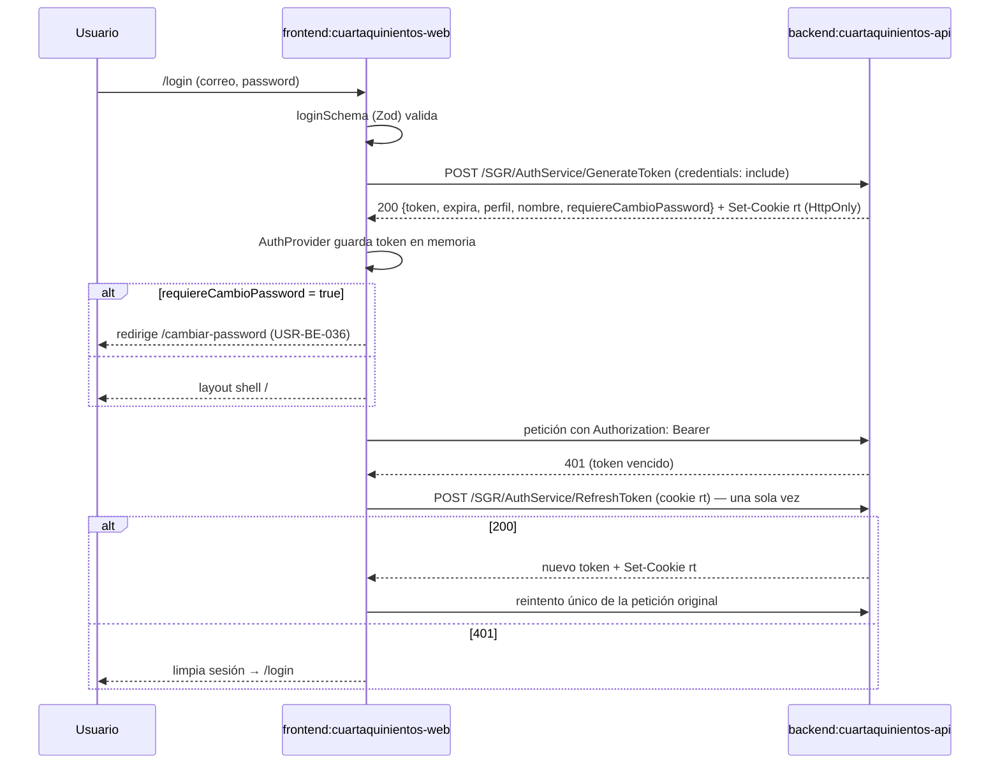

[← index](_index.md) | [← spec](spec.md)

# design.md — FE-030: Frontend — login y sesión JWT

> Generado por: **generador de contexto SDD** tras validar spec.md
> Consumido por: implementador (`implementer.tool` = cursor — `git-frontend` → `frontend-tester` → `desarrollador-react` → `auditor-codigo` → `auditor-seguridad`)

## Estrategia técnica

**Decisión central:** sesión web basada en un `AuthProvider` React que guarda el access token **solo en memoria** y delega el refresh token a la cookie `HttpOnly` del API; un único punto de renovación (`refreshOnce`, promesa compartida) usado tanto por `apiClient` (`fetch`) como por el `errorLink` de Apollo.

1. **Proyecto:** `Web/` (Vite + React 18 + TS estricto) de SETUP-000; base URL `VITE_API_URL` (REST) y `VITE_GRAPHQL_URL` (Apollo) desde `scaffolds/web/.env.example`.
2. **`AuthProvider` / `useAuth`** (`Web/src/features/auth/`): estado en memoria `{ token, expira, perfil, nombre, requiereCambioPassword }` + `login`, `logout`, `refreshOnce`. Prohibido `localStorage` y `sessionStorage`.
3. **`LoginPage`** + `loginSchema` (Zod + react-hook-form): mapeo `401` → "Credenciales inválidas", `429` → "Demasiados intentos, espera un momento", red/`5xx` → mensaje genérico `(asumido)`.
4. **`apiClient`** (`fetch`, `credentials: 'include'`) y Apollo `authLink` / `errorLink`: `Authorization: Bearer <token>`; ante `401`, un único reintento tras `refreshOnce()` (promesa compartida `(asumido)`); si falla → `logout()` local + `/login`.
5. **`PrivateRoute`** (SETUP-000, cambio mínimo): sin token → `/login`; `requiereCambioPassword` → `/cambiar-password`.
6. **Logout:** `POST /SGR/AuthService/Logout` + limpiar contexto + `/login`.
7. **Refresh silencioso al montar** `AuthProvider` `(asumido — Should)`.

**Alternativas descartadas:**

- Guardar el access token en `localStorage` / `sessionStorage`: expuesto a XSS; prohibido por `readme.md` §2.5.
- Refresh token accesible desde JS (cookie no `HttpOnly` o en el body): mismo riesgo; el API lo emite `HttpOnly` (USR-BE-007).
- TanStack Query para la mutation de login (mencionado como opcional en la versión previa del design): no está en `sdd.config.yaml` (`frontend.conventions`: Apollo `InMemoryCache`); un `fetch` directo basta (peldaño 1, YAGNI).
- `ProtectedRoute` nuevo: SETUP-000 ya entrega `PrivateRoute` (peldaño 4).
- Guardar la sesión en el `InMemoryCache` de Apollo: mezcla estado de sesión con datos del servidor; el contexto de React es más simple y testeable.

### Escalera de decisión (methodology.md regla 6) — recorrer ANTES de las tablas de objetos

| Capacidad pedida | Peldaño (1-5) | Objeto resultante | Por qué se descartaron los anteriores |
|---|---|---|---|
| Transporte del refresh token | 2 (nativo) | Cookie `HttpOnly` del navegador + `credentials: 'include'` | 1: es Must |
| Header `Authorization` en GraphQL | 2 (nativo) | `setContext` (`authLink`) de `@apollo/client` | 1: es Must |
| Reintento ante `401` en GraphQL | 2 (nativo) | `onError` (`errorLink`) de `@apollo/client` + `refreshOnce` | 1: es Must |
| Validación de formulario | 3 (reuso) | Zod + react-hook-form (SETUP-000) | 2: HTML5 no cubre mensajes/estado tipado |
| Ruta protegida + redirección a cambio de contraseña | 4 (cambio mínimo) | `PrivateRoute` (SETUP-000) extendido | 3: existe, pero no conoce `requiereCambioPassword` |
| Estado de sesión en memoria | 5 (nuevo) | `AuthProvider` + `useAuth` | 2: React no trae sesión; 3: no existe contexto previo; 4: nada que modificar |
| Pantalla de login | 5 (nuevo) | `LoginPage` + `loginSchema` | 2-4: no existe pantalla previa |
| Cliente REST con refresh | 5 (nuevo) | `apiClient` | 2: `fetch` no reintenta; 3: SETUP-000 no entrega cliente REST `(asumido)`; 4: nada que modificar |

## frontend:cuartaquinientos-web

| Componente/Vista | Acción | Contrato API que consume |
|---|---|---|
| `Web/src/features/auth/AuthProvider.tsx` + `useAuth.ts` | crear | `POST /SGR/AuthService/RefreshToken` (cookie `rt`) → `{ token, expira, perfil, nombre, requiereCambioPassword }` `(asumido shape)`; `POST /SGR/AuthService/Logout` → `204` `(asumido)` |
| `Web/src/features/auth/LoginPage.tsx` + `loginSchema.ts` | crear | `POST /SGR/AuthService/GenerateToken` `{ correo, password }` → `200 { token, expira, perfil, nombre, requiereCambioPassword }` · `400` · `401 INVALID_CREDENTIALS` · `429` |
| `Web/src/shared/lib/apiClient.ts` | crear | Todas las rutas REST `/{Dominio}/{Controller}` con `Authorization: Bearer`; `401` → `RefreshToken` una vez |
| `Web/src/shared/lib/apolloClient.ts` (`authLink`, `errorLink`) | modificar (SETUP-000) | `/graphql` con `Authorization: Bearer`; `401` / `UNAUTHENTICATED` → `refreshOnce` una vez |
| `PrivateRoute` (SETUP-000) | modificar | Ninguno (lee `useAuth`) |
| Layout shell — botón "Cerrar sesión" | crear/modificar | `POST /SGR/AuthService/Logout` |
| Rutas `/login` (pública) y `/cambiar-password` (destino; pantalla de USR-BE-036) | crear (registro de ruta) | — |

Ruta exacta de archivos de SETUP-000 `(asumido)`: se ajusta a la estructura real `feature-based` que entregue SETUP-000.

## Diagrama de flujo (Mermaid, opcional)

## Orden de implementación

| # | Paso | Target:Instancia | Entregable | Dependencia | Verificación |
|---|------|-------------------|------------|-------------|--------------|
| 1 | `git-frontend` crea rama `feature/FE-030-login-sesion`; confirma `Web/` de SETUP-000 | `frontend:cuartaquinientos-web` | Rama + scaffold | SETUP-000 | `npm run dev` arranca |
| 2 | `frontend-tester` escribe tests Vitest + Testing Library en ROJO (CA-1..CA-11, CA-R1..R2) con `fetch` mockeado según contrato §4 | `frontend:cuartaquinientos-web` | `Web/src/features/auth/__tests__/*` | 1 | `npm test` falla (Red phase) |
| 3 | `desarrollador-react` implementa `AuthProvider` + `useAuth` (memoria, `refreshOnce`) | `frontend:cuartaquinientos-web` | Contexto de sesión | 2 | Tests de contexto en verde |
| 4 | `desarrollador-react` implementa `LoginPage` + `loginSchema` y mapeo 401/429 | `frontend:cuartaquinientos-web` | Pantalla de login | 3 | CA-1, CA-7, CA-8 en verde |
| 5 | `desarrollador-react` implementa `apiClient` y `authLink`/`errorLink` con reintento único | `frontend:cuartaquinientos-web` | Clientes HTTP/GraphQL | 3 | CA-4, CA-5, CA-6 en verde |
| 6 | `desarrollador-react` extiende `PrivateRoute` + layout shell con logout | `frontend:cuartaquinientos-web` | Rutas protegidas | 3, 5 | CA-9, CA-10, CA-11 en verde |
| 7 | `desarrollador-react` ejecuta `tsc --noEmit` + `vite build`; prueba manual contra USR-BE-007 levantado; `auditor-codigo` → `auditor-seguridad` | `frontend:cuartaquinientos-web` | Build + veredictos | 4, 5, 6 + USR-BE-007 | CA-12; APROBADO |

## Plan de pruebas

| Prueba | Target | Tipo | Cubre CA |
|---|---|---|---|
| `TC-01` validación Zod bloquea envío | `cuartaquinientos-web` | componente | CA-1 |
| `TC-02` login exitoso guarda sesión en memoria | `cuartaquinientos-web` | componente | CA-2 |
| `TC-03` header Bearer en REST y GraphQL | `cuartaquinientos-web` | unitario | CA-4 |
| `TC-04` 401 → refresh → reintento único | `cuartaquinientos-web` | unitario | CA-5 |
| `TC-05` estados carga / error / credenciales | `cuartaquinientos-web` | componente | CA-8 |
| `TC-06` logout llama API y limpia | `cuartaquinientos-web` | componente | CA-11 |
| `TC-07` refresh compartido con 3 `401` | `cuartaquinientos-web` | unitario | CA-14 |
| `TC-08` refresh silencioso al montar | `cuartaquinientos-web` | componente | CA-13 |
| `TC-INV-1` sin tokens en almacenamiento web tras login/refresh/logout | `cuartaquinientos-web` | regresión | CA-3, CA-R1 (INV-1) |
| `TC-INV-2` `requiereCambioPassword` → `/cambiar-password` | `cuartaquinientos-web` | regresión | CA-9 (INV-2) |
| `TC-INV-3` peticiones sin `UsuarioID`/`perfil` en body/query; `403` mostrado | `cuartaquinientos-web` | regresión | CA-R2 (INV-3) |
| `TC-ERR-1` `401` del login → "Credenciales inválidas" | `cuartaquinientos-web` | negativo | CA-7 |
| `TC-ERR-2` `429` → "Demasiados intentos, espera un momento" | `cuartaquinientos-web` | negativo | CA-7 |
| `TC-ERR-3` `RefreshToken` `401` → `/login` sin segundo intento | `cuartaquinientos-web` | negativo | CA-6 |
| `TC-ERR-4` ruta protegida sin token → `/login` | `cuartaquinientos-web` | negativo | CA-10 |
| `TC-BUILD` `tsc --noEmit` + `vite build` | `cuartaquinientos-web` | estático | CA-12 |
| `TC-RB` | `cuartaquinientos-web` | rollback | Tras revertir el PR, `vite build` pasa y el API no requiere cambios |

### Ratio de pruebas (Testing Trophy)

- Integración (componente con Testing Library + `fetch` mockeado en la frontera HTTP): ~70 %
- Unitario (`refreshOnce`, `apiClient`, `loginSchema`): ~30 %
- Mocks: solo la frontera HTTP (API de USR-BE-007); E2E Playwright contra API real queda para el cierre de Fase 1 `(asumido)`

### Triangulación

| Comportamiento | Dataset A | Dataset B | Qué generaliza |
|---|---|---|---|
| Login exitoso | Residente, `requiereCambioPassword = false` → `/` | Administrador, `requiereCambioPassword = true` → `/cambiar-password` | que perfil y redirección no quedaron hardcodeados |
| Reintento ante `401` | una sola petición `401` | tres peticiones `401` concurrentes | que `refreshOnce` se comparte y reintenta cada petición una sola vez |
| Mensaje de error | `401` | `429` | que el mapeo es por status, no un texto fijo |

### Mutation

| Objeto | Técnica | Kill rate objetivo |
|---|---|---|
| `apiClient` / `refreshOnce` (condición de reintento único) | Stryker (TS) | ≥ 80 % paths críticos |
| `PrivateRoute` (gates token / `requiereCambioPassword`) | Stryker (TS) | ≥ 80 % paths críticos |

## Estrategia de rollback

Solo frontend: revertir el PR en `feature/entrega-2-AFS` y redeploy del Web (Vercel). No hay datos ni contrato del API que restaurar; las sesiones activas expiran solas (60 min) o se revocan desde USR-BE-007.

## Pre-mortem

- **Si esto falla en PROD, la causa más probable es:** la cookie `rt` no viaja (CORS sin `AllowCredentials`, dominio distinto o `SameSite=Strict` entre Vercel y el API) y todo `401` termina en `/login`, o rotaciones concurrentes revocan el token recién emitido.
- **Cómo lo detectamos:** usuarios expulsados a `/login` cada 60 min; en logs del API, `RefreshToken` con `401` inmediatamente después de un `200`.
- **Acción inmediata:** revertir el release del Web o ajustar CORS / dominio de cookie en USR-BE-007; avisar al dueño de FE-030 y USR-BE-007.

## Decisiones técnicas (auditoría)

| # | Decisión | Justificación |
|---|---|---|
| D-1 | `AuthProvider` + `useAuth` nuevos | 2: React no trae gestión de sesión; 3: no existe contexto previo; 4: nada que ampliar; nombre `useAuth` de `sdd.config.yaml` |
| D-2 | `LoginPage` + `loginSchema` nuevos | 2-4: no existe pantalla previa (Entrega 1 sin UI) |
| D-3 | `apiClient` nuevo | 2: `fetch` no reintenta; 3: SETUP-000 no declara cliente REST `(asumido)`; 4: no aplica |
| D-4 | Extender `PrivateRoute` en vez de crear `ProtectedRoute` | Peldaño 4: SETUP-000 ya lo entrega |
| D-5 | Promesa de refresh compartida `(asumido)` | Evita rotaciones concurrentes que revoquen el token recién emitido (rotación de USR-BE-007) |

## Autoverificación antes del handoff

**Consistencia con spec.md:**
- [x] Ningún objeto/tabla de este design.md implementa algo listado como `Won't` en spec.md (sin `/cambiar-password`, sin dashboards, sin cambios de API)
- [x] Cada fila de "Plan de pruebas" `TC-INV-x` corresponde a un invariante real de spec.md (INV-1..INV-3)

**Calidad del artefacto:**
- [x] Toda query/comando SQL verificado con MCP — no aplica (sin SQL en este ticket)
- [x] Orden de implementación: cada paso tiene Entregable + Dependencia explícita
- [x] Sin falsa agencia: cada paso nombra el actor real (`git-frontend`, `frontend-tester`, `desarrollador-react`, `auditor-*`, `AuthProvider`, `apiClient`)
- [x] Toda query/comando propuesto verificado antes de escribirlo — no aplica SQL; contrato verificado contra `readme.md` §4 y USR-BE-007
- [x] Spec sin CHAR-x (Tipo Feature) → no aplica `TC-CHAR-x`
- [x] Cada comportamiento nuevo tiene ≥ 2 datasets en la tabla de Triangulación
