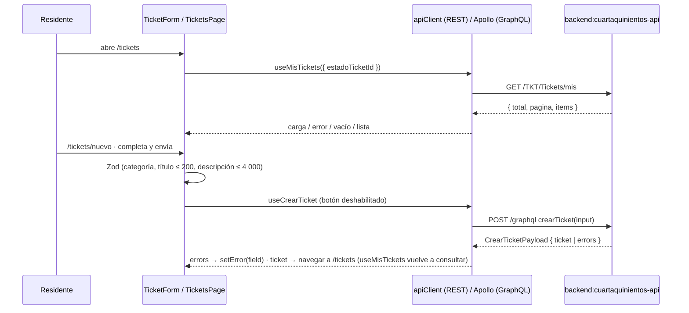

[← index](_index.md) | [← spec](spec.md)

# design.md — FE-031: Frontend: mis tickets (listar y crear)

> Generado por: **generador de contexto SDD** tras validar spec.md
> Consumido por: implementador (`implementer.tool` = cursor — `git-frontend` (rama) → `desarrollador-react` → `frontend-tester` → `auditor-codigo`)

## Estrategia técnica

Feature `src/features/tickets/` con dos páginas bajo el shell y `PrivateRoute` (SETUP-000, extendido por FE-030): `/tickets` (`TicketsPage`) y `/tickets/nuevo` (`NuevoTicketPage`) `(asumido)`. Datos del servidor (stack acordado: React 18 + Vite + Apollo Client; `sdd.config.yaml` → estado remoto = Apollo `InMemoryCache`; sin TanStack Query):
- **REST** (listado y catálogos) con el cliente tipado `Web/src/shared/lib/apiClient.ts` de FE-030 (`fetch`, `credentials: 'include'`, `Authorization: Bearer` con el access token en memoria, un reintento tras `refreshOnce()` ante `401`). Hooks propios con `useState`/`useEffect` que exponen `{ data, loading, error, refetch }`: `useMisTickets(filtro)` (vuelve a consultar al cambiar `filtro`) y `useCatalogosTicket()` (`GET /TKT/CategoriasTicket` + `GET /TKT/EstadosTickets` de TKT-BE-015, una vez al montar).
- **GraphQL** (alta) con Apollo `useMutation(CREAR_TICKET)` definida en `tickets.gql` (convención `graphql_files` de `sdd.config.yaml`); `loading` deshabilita el botón; `onCompleted` navega a `/tickets`, cuyo montaje vuelve a ejecutar `useMisTickets` `(asumido)`.

Formulario `TicketForm` con React Hook Form + `zodResolver` (readme §2.2): `categoria` requerida, `titulo` 1..200, `descripcion` 1..4 000, `prioridad` opcional (Baja | Media | Alta | Crítica). Los `UserError` del payload se mapean con `setError(field)`; sin `field` → error raíz del formulario. No se envían solicitante ni casa (INV-2); `canal` se omite y el API aplica WEB.

Alternativas descartadas:
- **`POST /TKT/Tickets` desde la web**: descartado; readme §4 y Ticket 31 asignan la web a la mutation GraphQL (el REST es del bot).
- **Query GraphQL de listado**: no existe en §4; el Ticket 31 consume `GET /TKT/Tickets/mis`.
- **Solo Apollo para REST (`apollo-link-rest`)**: descartado; agrega dependencia para dos lecturas simples que ya cubre `apiClient`.
- **TanStack Query para el REST**: descartado; no forma parte del stack acordado (`sdd.config.yaml`, readme §2.2) y dos lecturas sin caché compartida no justifican una dependencia nueva (peldaño 1, YAGNI).
- **Duplicar datos del servidor en un store global**: descartado; el listado vive en el estado local del hook y se vuelve a pedir al montar.
- **Lista fija de categorías/estados en el cliente**: descartado; duplica catálogos de BD y el filtro necesita `estadoTicketId`; los catálogos los expone TKT-BE-015.
- **Reordenar en cliente**: descartado por INV-6; se respeta el orden del API.

### Escalera de decisión (methodology.md regla 6) — recorrer ANTES de las tablas de objetos

| Capacidad pedida | Peldaño (1-5) | Objeto resultante | Por qué se descartaron los anteriores |
|---|---|---|---|
| Cliente HTTP / GraphQL autenticado | 3 (reuso) | `Web/src/shared/lib/apiClient.ts` + Apollo `authLink`/`errorLink` (FE-030) | — |
| Rutas protegidas y layout | 3 (reuso) | `PrivateRoute` (SETUP-000/FE-030) + shell | — |
| Estados de carga/error REST | 2 (nativo plataforma) | `useState`/`useEffect` de React dentro de `useMisTickets` / `useCatalogosTicket` | 1: Must (CA-4, CA-5); sin librería de caché (TanStack Query fuera del stack) |
| Estados de carga/error GraphQL | 2 (nativo plataforma) | Apollo `useMutation` (`loading`, `error`) | — |
| Validación de formulario | 2 (nativo plataforma) | React Hook Form + Zod | — |
| Listado de mis tickets | 5 (nuevo) | `useMisTickets`, `TicketsPage`, `TicketsList` | 3: no existe UI de tickets; 4: nada que modificar |
| Alta de ticket | 5 (nuevo) | `tickets.gql` (`CREAR_TICKET`), `useCrearTicket`, `NuevoTicketPage`, `TicketForm` | 3: no existe formulario; la mutation existe (TKT-BE-002) y se reusa |
| Catálogos para select/filtro | 3 (reuso) + 5 | `useCatalogosTicket` sobre `GET /TKT/CategoriasTicket` y `GET /TKT/EstadosTickets` (TKT-BE-015) | 3: los endpoints los provee TKT-BE-015 (readme §6 Ticket 15); 5: solo el hook de consumo |
| Estado accesible | 5 (nuevo) | `EstadoTicketBadge` (color + etiqueta) | 3: no hay componente base de badge aún |

## frontend:cuartaquinientos-web

| Componente/Vista | Acción | Contrato API que consume |
|---|---|---|
| `src/shared/types/tickets.ts` | crear | tipos `MiTicketItem`, `PaginaMisTickets`, `CrearTicketInput`, `CrearTicketPayload`, `UserError`, `CatalogoItem` |
| `src/features/tickets/tickets.gql` | crear | `mutation CrearTicket($input: CrearTicketInput!) { crearTicket(input: $input) { ticket { id titulo estado prioridad categoria canal fechaCreacion } errors { message code field } } }` (§4 Endpoint 2) |
| `useMisTickets(filtro)` | crear | vía `apiClient`: `GET /TKT/Tickets/mis?estadoTicketId=&pagina=&tamano=` → `{ total, pagina, items: [{ ticketId, titulo, estado, prioridad, categoria, fechaCreacion }] }` (TKT-BE-015); expone `{ data, loading, error, refetch }` |
| `useCatalogosTicket()` | crear | vía `apiClient`: `GET /TKT/CategoriasTicket` y `GET /TKT/EstadosTickets` → `200 [{ id, nombre }]` ordenados por nombre (TKT-BE-015) |
| `useCrearTicket()` | crear | Apollo `useMutation` `crearTicket` (TKT-BE-002); en éxito navega a `/tickets` |
| `TicketsPage` (`/tickets`) | crear | `useMisTickets` + filtro de estado; estados carga / error (+ Reintentar) / vacío "No has reportado incidencias aún." |
| `TicketsList` + `EstadoTicketBadge` | crear | items de `useMisTickets` (sin reordenar) |
| `NuevoTicketPage` (`/tickets/nuevo`) + `TicketForm` | crear | `useCrearTicket`, `useCatalogosTicket`; schema Zod 200 / 4 000 |
| Router de la app (FE-030) | modificar | registrar `/tickets` y `/tickets/nuevo` bajo `PrivateRoute` |

## Diagrama de flujo (Mermaid, opcional)

## Orden de implementación

| # | Paso | Target:Instancia | Entregable | Dependencia | Verificación |
|---|------|-------------------|------------|-------------|--------------|
| 1 | Rama `feature/FE-031-mis-tickets` desde `feature/entrega-2-AFS` | `frontend:cuartaquinientos-web` | rama creada (`git-frontend`) | FE-030 mergeado | `git status` limpio |
| 2 | Tipos + operación GraphQL | `frontend:cuartaquinientos-web` | `tickets.ts`, `tickets.gql` | 1 | `tsc --noEmit` |
| 3 | Hooks de datos | `frontend:cuartaquinientos-web` | `useMisTickets`, `useCatalogosTicket`, `useCrearTicket` | 2, TKT-BE-015 (listado + catálogos), TKT-BE-002 | tests de hook con respuestas mock |
| 4 | Listado con estados de UI | `frontend:cuartaquinientos-web` | `TicketsPage`, `TicketsList`, `EstadoTicketBadge` | 3 | tests de componente CA-1..CA-5 |
| 5 | Formulario de alta | `frontend:cuartaquinientos-web` | `NuevoTicketPage`, `TicketForm` | 3 | tests de componente CA-6..CA-9, CA-R1 |
| 6 | Rutas + build | `frontend:cuartaquinientos-web` | rutas registradas | 4, 5 | `node_modules\.bin\tsc --noEmit` + `node_modules\.bin\vite build --mode development` |

## Plan de pruebas

| Prueba | Target | Tipo | Cubre CA |
|---|---|---|---|
| `TicketsPage.test.tsx` — lista, carga, error, vacío | cuartaquinientos-web | componente | CA-1, CA-3, CA-4, CA-5 |
| `TicketsPage.filtro.test.tsx` | cuartaquinientos-web | componente | CA-2 |
| `TicketForm.test.tsx` — alta y `UserError` | cuartaquinientos-web | componente | CA-7, CA-9 |
| `useCatalogosTicket.test.tsx` — select y filtro desde catálogos | cuartaquinientos-web | componente | CA-14 |
| `TC-INV-1` | cuartaquinientos-web | regresión | CA-6 (INV-1: título 201 → no se llama la mutation) |
| `TC-INV-2` | cuartaquinientos-web | regresión | CA-R1 (INV-2: `variables.input` sin solicitante/casa) |
| `TC-INV-3` | cuartaquinientos-web | regresión | CA-7 (INV-3: sin prioridad ni canal → el input los omite) |
| `TC-INV-4` | cuartaquinientos-web | regresión | CA-8 (INV-4: doble clic → 1 llamada) |
| `TC-INV-5` | cuartaquinientos-web | regresión | CA-R2 (INV-5: storage sin token) |
| `TC-INV-6` | cuartaquinientos-web | regresión | CA-1, CA-3 (INV-6: orden del API, vacío explícito) |
| `TC-INV-7` | cuartaquinientos-web | regresión | CA-9 (INV-7: `FORBIDDEN` del API se muestra; la UI no decide permisos) |
| `TC-ERR-1` | cuartaquinientos-web | negativo | CA-6: descripción de 4 001 / sin categoría → error Zod, sin request |
| `TC-ERR-2` | cuartaquinientos-web | negativo | CA-5: `GET /TKT/Tickets/mis` 500 → mensaje de error + Reintentar |
| `TC-RB` | cuartaquinientos-web | rollback | tras revertir el PR, `vite build` pasa y las rutas de FE-030 siguen funcionando |
| `e2e/login-tickets.spec.ts` | cuartaquinientos-web | E2E (Playwright) | CA-10 `(Entrega Final)` |

### Ratio de pruebas (Testing Trophy)

- Integración: ~70 % (componente + hooks con respuestas REST/GraphQL simuladas en Vitest + Testing Library; E2E contra backend real en Entrega Final)
- Unitario: ~30 % (schema Zod y mapeo de `UserError`)
- Mocks: respuestas del API (REST y Apollo `MockedProvider`), porque el backend no está disponible en el test de componente

### Triangulación

| Comportamiento | Dataset A | Dataset B | Qué generaliza |
|---|---|---|---|
| Validación de título | 0 caracteres | 201 caracteres (y 200 válido) | que el límite viene del schema, no de un caso fijo |
| Mapeo de `UserError` | `field: "categoria"` | `field: null` con `code: "INTERNAL_ERROR"` | error por campo vs error general |
| Estados del listado | `items: []` | 3 items con estados distintos | vacío explícito y badge por estado |

## Estrategia de rollback

Solo código frontend: revertir el PR (`git revert` en `feature/entrega-2-AFS`) y redeploy en Vercel. Sin datos ni contratos modificados; FE-030 no se ve afectado (TC-RB).

## Decisiones técnicas (auditoría)

| # | Decisión | Justificación |
|---|---|---|
| 1 | Páginas, hooks y `TicketForm` nuevos (peldaño 5) | 2: React Hook Form/Zod/Apollo cubren validación y estado de la mutation, pero no la UI de dominio; 3: no existe UI de tickets; 4: nada que modificar salvo el router |
| 2 | REST con `apiClient` (FE-030) + hooks React; GraphQL con Apollo | contratos distintos (Ticket 15 REST, Ticket 2 GraphQL); stack acordado sin TanStack Query (`sdd.config.yaml`) |
| 3 | `useCatalogosTicket` sobre `GET /TKT/CategoriasTicket` y `GET /TKT/EstadosTickets` | endpoints provistos por TKT-BE-015 (readme §6 Ticket 15); lista fija descartada |
| 4 | Sin reordenar en cliente | INV-6; el orden lo garantiza TKT-BE-015 |

## Autoverificación antes del handoff

**Consistencia con spec.md:**
- [x] Ningún objeto/tabla de este design.md implementa algo listado como `Won't` en spec.md (sin adjuntos, sin `POST /TKT/Tickets`, sin detalle, sin cambios de backend)
- [x] Cada fila de "Plan de pruebas" `TC-INV-x` corresponde a un invariante real de spec.md (INV-1..INV-7)

**Calidad del artefacto:**
- [x] Toda query/comando SQL verificado con MCP — no aplica (sin SQL en frontend)
- [x] Orden de implementación: cada paso tiene Entregable + Dependencia explícita
- [x] Sin falsa agencia: cada paso nombra el actor real (`useMisTickets`, `useCrearTicket`, `TicketForm`, `git-frontend`)
- [x] Toda query/comando propuesto verificado antes de escribirlo — contratos REST cotejados con readme §6 Ticket 15 (listado + catálogos, TKT-BE-015) y GraphQL con §4 Endpoint 2
- [x] Si el spec tiene CHAR-x → hay una fila `TC-CHAR-x` por cada uno (no aplica: Feature)
- [x] Cada comportamiento nuevo tiene ≥ 2 datasets en la tabla de Triangulación
