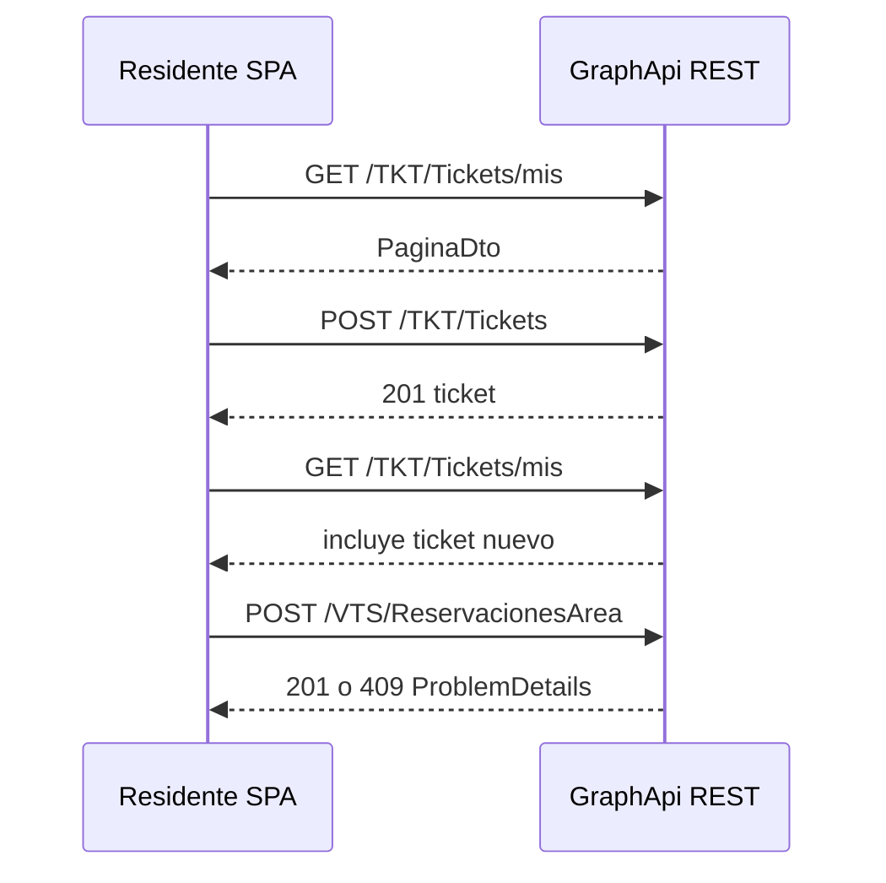

[← spec](spec.md) | [← index](_index.md)

# design.md — FE-CRUD-004: Residente — UX + CRUD propio

> Consumido por: `desarrollador-react`, `frontend-tester`, `auditor-codigo`

## Estrategia técnica

Endurecer **solo rutas residente** con un patrón visual único (**Tailwind + kit admin sin Bootstrap**) y **un solo canal HTTP autenticado** (`apiClient` / `getAccessToken` + `credentials: 'include'`). No tocar `/admin/*`.

**Decisión central:** extraer descarga binaria a `downloadAuthenticated` (mismo auth que `apiClient`) y **alinear creación de tickets a REST** (`POST /TKT/Tickets`) — hoy el listado ya usa REST (`GET …/mis`) pero `useCrearTicket` usa GraphQL; el spec CA-2 exige POST REST y reduce doble stack.

**Alternativa descartada:** carpeta `shared/components/resident/` con layout propio — peldaño 3: `PageHeader` + listas/cards Tailwind (`TicketsList`, `LoginPage`) ya cubren; solo crear subcarpeta si un layout diverge tras fase E.

### Escalera de decisión

| Capacidad pedida | Peldaño | Objeto resultante | Por qué no 2–4 |
|------------------|---------|-------------------|----------------|
| Descarga JWT de archivos | 4 | `shared/lib/downloadAuthenticated.ts` | 3: `apiGet` no devuelve blob; 2: fetch nativo sin wrapper duplica headers |
| Crear ticket residente | 4 | Refactor `useCrearTicket` → `apiPost('/TKT/Tickets', …)` | 3: GraphQL `crearTicket` existe pero incoherente con listado REST y CA-2 |
| Formularios reserva / perfil | 3 | `features/visitas/reservasSchemas.ts`, `features/usuario/perfilSchemas.ts` | Zod+RHF ya usado en tickets |
| UI cabecera residente | 3 | `PageHeader` + `AlertBanner` en cada página | No split admin |
| Layout residente nuevo | — | **No crear** (fase E) | Cards/listas actuales suficientes |

## Patrón UI residente (PATRON_RESIDENTE — convención de este ticket)

| Elemento | Uso |
|----------|-----|
| Contenedor | `mx-auto max-w-4xl px-4 py-6` o `max-w-3xl` en formularios |
| Cabecera | `PageHeader` (título, descripción opcional, acciones → link “Nuevo…”) |
| Errores API | `AlertBanner` con `problem.detail` |
| Listas | `TicketsList` o `<ul>`/cards Tailwind; `EmptyState` si vacío |
| Formularios | RHF + Zod; CTAs clases de `ui-referencia-visual.md` |
| Confirmaciones | `ConfirmDialog` (p. ej. cancelar reserva si API lo permite) |
| **Prohibido** | `import 'bootstrap/…'`, `window.confirm`, `localStorage` para token |

## Contratos API (consumo — sin cambios backend por defecto)

### Tickets

| Método | Ruta | Uso UI |
|--------|------|--------|
| GET | `/TKT/Tickets/mis` | `TicketsPage` |
| POST | `/TKT/Tickets` | `NuevoTicketPage` / `useCrearTicket` (migrar desde GraphQL) |
| GET | `/TKT/CategoriasTicket` | catálogos (existente) |

No usar `POST /TKT/Tickets/legacy` ni `GET /TKT/Tickets` con headers legacy.

### Reservas

| Método | Ruta | Uso UI |
|--------|------|--------|
| GET | `/VTS/AreasComunes` | selector área |
| GET | `/VTS/ReservacionesArea/mias` | listado |
| POST | `/VTS/ReservacionesArea` | crear (409/422 → `AlertBanner`) |

No usar `GET …/legacy`.

### Archivos

| Método | Ruta | Uso UI |
|--------|------|--------|
| GET | `/ARC/Archivos` | listado |
| GET | `/ARC/Archivos/{id}/descargar` | `downloadAuthenticated` |

### Anuncios

| Método | Ruta | Uso UI |
|--------|------|--------|
| GET | `/ANM/Anuncios` | listado residente |
| GET | `/ANM/Anuncios/{id}` | detalle |
| PATCH | `/ANM/Anuncios/{id}/visto` | al abrir detalle o botón explícito |

### Encuestas / Juntas / Finanzas

Consumir hooks REST/GraphQL **actuales**; normalizar solo manejo `{ data, problem, status }` y estados UI.

### Perfil

| Método | Ruta | Uso UI |
|--------|------|--------|
| GET | `/SGR/Usuarios/{id}` | `PerfilPage` (`id` = JWT `sub`) |
| PUT | `/SGR/Usuarios/{id}` | actualizar contacto; campos password según `ActualizarPerfilRequest` |

### Vehículos / Mascotas (residente)

Rutas residente existentes en `AutomovilesController` / mascotas — sin `/admin`.

## database:CuartaQuinientos

No aplica.

## backend:cuartaquinientos-api

No aplica (salvo bug bloqueante documentado en `impl.md`).

## frontend:cuartaquinientos-web

| Archivo / área | Acción | Notas |
|----------------|--------|-------|
| `shared/lib/downloadAuthenticated.ts` | **crear** | `getAccessToken`, `credentials: 'include'`, refresh vía mismo patrón que fetch en `apiClient`; test unitario |
| `shared/lib/downloadAuthenticated.test.ts` | **crear** | mock `fetch`, assert `Authorization` |
| `features/tickets/useCrearTicket.ts` | **modificar** | REST `apiPost`; navegar `/tickets`; invalidar/refetch vía callback opcional |
| `features/tickets/useMisTickets.ts` | **modificar** | dejar de exigir `session.token` en cada call — confiar en `apiClient` default |
| `features/visitas/reservasSchemas.ts` | **crear** | Zod fechas + `areaComunId` |
| `pages/AreasYReservacionesPage.tsx` | **modificar** | RHF+Zod, `FormModal`, `apiPost` con `problem` |
| `pages/ArchivosPage.tsx` | **modificar** | `downloadAuthenticated`; `PageHeader` |
| `pages/TicketsPage.tsx`, `NuevoTicketPage.tsx` | **modificar** | `PageHeader`, `AlertBanner`, enlaces |
| `pages/MisVehiculosPage.tsx`, `MisMascotasPage.tsx` | **modificar** | DoD estados + `ConfirmDialog` delete |
| `pages/AnunciosPage.tsx`, `AnuncioDetallePage.tsx` | **modificar** | `apiPatch` visto |
| `pages/EncuestasPage.tsx`, `EncuestaDetallePage.tsx` | **modificar** | errores API uniformes |
| `pages/JuntasPage.tsx`, `JuntaDetallePage.tsx` | **modificar** | `PageHeader` + empty/error |
| `pages/EstadoCuentaPage.tsx`, `PerfilPage.tsx` | **modificar** | kit + Zod perfil |
| `pages/*.test.tsx` (residente) | **ampliar** | matriz abajo |
| `features/tickets/tickets.gql.ts` | **evaluar** | mantener solo si otro consumidor; si `CREAR_TICKET` único uso → eliminar mutación en `/ejecutar` |

## Contenido configurable

| # | Contenido | Clase | Fuente |
|---|-----------|-------|--------|
| 1 | Títulos de pantalla (“Mis tickets”, “Áreas comunes”) | Marco UI | literales Tailwind / ARB futuro |
| 2 | Mensajes de error API | Error negocio | `problem.detail` del backend |
| 3 | Etiquetas estados reserva/ticket | Negocio | nombres catálogo API (no hardcodear IDs) |

Catálogos nuevos: no aplica.

## Valores nuevos y sus consumidores

No aplica (sin valores de dominio nuevos).

## Diagrama de flujo (residente — ticket + reserva)

## Orden de implementación

| # | Paso | Target | Entregable | Dep. | Verificación |
|---|------|--------|------------|------|--------------|
| 0 | Rama `feature/fe-crud-004-residente-ux` | git | branch Web | — | Pendiente (WIP otra rama) |
| 1 | `downloadAuthenticated` + test | frontend | helper + CA-3 base | 0 | ✓ Hecho |
| 2 | Tickets REST create + UI polish | frontend | `useCrearTicket`, páginas tickets | 1 | ✓ Hecho |
| 3 | Reservas Zod + `FormModal` + errores API | frontend | `AreasYReservacionesPage` | 1 | ✓ Hecho |
| 4 | Archivos descarga | frontend | `ArchivosPage` | 1 | ✓ Hecho |
| 5 | Vehículos + mascotas DoD | frontend | `MisVehiculosPage`, `MisMascotasPage` | — | ✓ Hecho |
| 6 | Comunidad lectura + visto | frontend | anuncios, encuestas, juntas | — | ✓ Hecho |
| 7 | Finanzas + perfil | frontend | `EstadoCuentaPage`, `PerfilPage` | — | ✓ Hecho |
| 8 | Regresión global | frontend | — | 1–7 | ✓ Hecho (186 tests, tsc, vite) |

## Plan de pruebas (Vitest — sin SQL)

> T-SQL: **No aplica**. La fase `/test` materializa expectativas en tests existentes; no se crea `*PruebasUnitarias.sql`.

### Contratos de escritura (REST)

| Contrato | Qué se aserta | TC |
|----------|---------------|-----|
| POST ticket válido | `apiPost` llamado; navegación o refetch | `TC-TKT-1` |
| POST ticket inválido | `problem.detail` visible | `TC-ERR-TKT-1` |
| POST reserva conflicto | status 409 + mensaje | `TC-ERR-RES-1` |
| PATCH anuncio visto | `apiPatch` ruta `/visto` | `TC-ANM-1` |

| Prueba | Target | Tipo | Cubre CA | Entrada | Expected |
|--------|--------|------|----------|---------|----------|
| `TC-TKT-1` | frontend | happy | CA-2 | submit form válido mock | `apiPost('/TKT/Tickets', …)` + redirect `/tickets` |
| `TC-ERR-TKT-1` | frontend | negativo | CA-2 | `apiPost` 400 | texto error en UI |
| `TC-RES-1` | frontend | happy | CA-1 | reserva OK mock | `refetch` / fila en lista |
| `TC-ERR-RES-1` | frontend | negativo | CA-1 | `apiPost` 409 | `AlertBanner` con detail |
| `TC-ARC-1` | frontend | happy | CA-3 | click descargar | `fetch` con `Authorization` Bearer (no `localStorage`) |
| `TC-ERR-ARC-1` | frontend | negativo | CA-3 | 401/404 descarga | mensaje error |
| `TC-INV-NAV-1` | frontend | regresión | CA-R1 | residente → `/admin/menus` | redirect `/403` (test existente o ampliar `NavMenuGuard`) |
| `TC-INV-ADM-1` | frontend | regresión | CA-R2 | suite admin | `npm test AdminCasasPage` (smoke) sin cambios |

### Triangulación

| Comportamiento | Dataset A | Dataset B |
|----------------|-----------|-----------|
| Listado tickets | 0 items | 2 items con títulos largos |
| Reserva | fechas mismo día | fin &lt; inicio (Zod rechaza) |

### Mutation

No aplica paths críticos SQL; para TS: 1 mutante manual en test (omitir header Authorization) debe fallar `TC-ARC-1`.

## Estrategia de rollback

Revertir commits en `Web/` por fase; sin migración BD. Si REST ticket rompe GraphQL consumers, restaurar `useCrearTicket` y escalar.

## Sondas canario

No aplica.

## Revisión adversarial (/abogado-del-diablo — diseño)

| Riesgo | Mitigación |
|--------|------------|
| GraphQL muerto rompe otro screen | Grep `CREAR_TICKET` antes de borrar `.gql` |
| `apiPost` devuelve objeto no throw (Areas hoy usa try/catch) | Unificar patrón `if (problem)` como admin |
| Residente con rol no `Residente` crea ticket | POST exige `[Authorize(Roles = "Residente")]` — test 403 |
| Fechas reserva timezone | Zod + ISO UTC como hoy; documentar en impl si bug |
| Scope creep en PerfilPage | Solo campos de `ActualizarPerfilRequest` residente |

**Veredicto:** diseño listo para ejecución por fases.

## Decisiones técnicas (auditoría)

| ID | Decisión | Evidencia |
|----|----------|-----------|
| D-1 | REST para crear ticket | CA-2 spec; `TicketsController.Create` JWT |
| D-2 | Helper descarga compartido | CA-3; paridad con `AdminArchivosPage` |
| D-3 | Sin Bootstrap en residente | spec M4; admin ya scoped |
