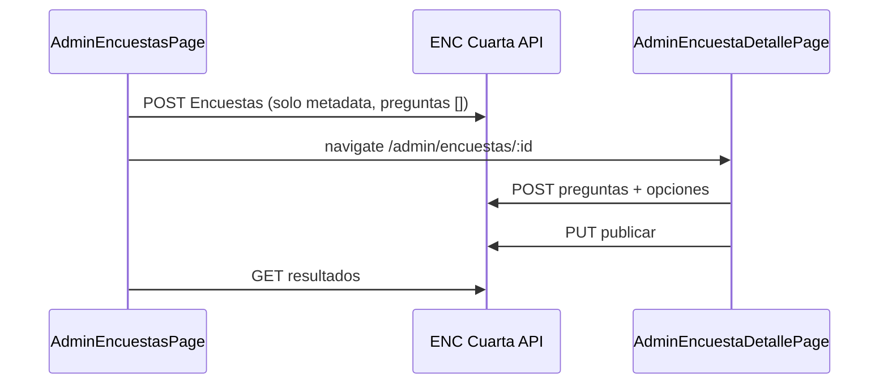

[← spec](spec.md) | [← index](_index.md)

# design.md — FE-MOD-ENC-001

## Estrategia

Reemplazar el flujo “CRUD-002 simplificado” por el **módulo en 3 rutas admin**, mapeando `Web_diseño` → componentes PAT actuales. Backend: extender **solo** `ICuartaEncuestasService` (sin exponer legacy a la SPA).

## Mapa UX (referencia → implementación)

| Web_diseño | React (nuevo/ajustado) | PAT |
|------------|-------------------------|-----|
| `Encuestas.cshtml` bandeja + panel metadata | `AdminEncuestasPage` (refactor) | `AdminListToolbar`, `AdminSplitLayout`, `AdminFilterableTable` |
| Hero `cq-reserva-hero` + stat strip | Card hero bajo toolbar (reutilizar clases `cq-reserva-*` en `cq-admin.css` o extraer `AdminSectionHero`) | Complemento PAT, no segundo h1 |
| `EncuestaDetalle.cshtml` | **`AdminEncuestaDetallePage`** `/admin/encuestas/:encuestaId` | `PageHeader` + paneles preguntas/opciones (stepper simplificado) |
| `ResultadosEncuesta.cshtml` | `ResultadosEncuestaPage` (refactor visual) | Solo lectura |
| `EncuestasResidente.cshtml` | `EncuestasPage` (ajuste menor) | Tailwind cards → alinear badges |
| `ResponderEncuesta.cshtml` | `EncuestaDetallePage` | Form por tipo |

## Rutas

```
/admin/encuestas                      → bandeja + panel metadata
/admin/encuestas/:encuestaId          → editor preguntas/opciones
/admin/encuestas/:encuestaId/resultados → resultados (existente)
/encuestas                            → residente lista
/encuestas/:id                        → residente responder
```

Registrar en `App.tsx`, `appNavigation.ts`, breadcrumbs (label “Detalle” / título encuesta vía loader o context).

## Flujo admin (secuencia)



**Nota:** Si `POST` actual exige ≥1 pregunta (validator), relajar validator o permitir `preguntas: []` en BE (cambio mínimo documentado en impl).

## Backend — delta propuesto

| Método | Ruta | Uso |
|--------|------|-----|
| PUT | `/ENC/Encuestas/{id}` | Actualizar título, descripción, fechas, `activa` (solo admin; publicar puede seguir endpoint dedicado) |
| DELETE | `/ENC/Encuestas/{id}` | Soft delete encuesta |
| GET | `/ENC/TiposPregunta` | Ya en servicio — exponer en controller si falta |
| POST | `/ENC/Encuestas/{encuestaId}/preguntas` | Alta pregunta |
| PUT | `/ENC/Preguntas/{preguntaId}` | Editar pregunta |
| DELETE | `/ENC/Preguntas/{preguntaId}` | Soft delete |
| POST | `/ENC/Preguntas/{preguntaId}/opciones` | Alta opción |
| PUT | `/ENC/OpcionesPregunta/{opcionId}` | Editar opción |
| DELETE | `/ENC/OpcionesPregunta/{opcionId}` | Soft delete |

Implementación: `CuartaEncuestasRepository` + transacciones; tipos por **nombre** (`TipoPregunta` string) como en `CrearAsync`. DTOs con `[JsonPropertyName]` camelCase.

**Orden sugerido BE:** TiposPregunta GET → PUT/DELETE encuesta → CRUD preguntas/opciones → tests `CuartaEncuestasServiceTests`.

## Frontend — estructura archivos

```
Web/src/features/admin/encuestas/
  encuestasAdminSchemas.ts      # metadata + pregunta + opcion (Zod)
  encuestasTableFilter.ts       # (ajustar columnas inicio/fin/estado)
  useEncuestasAdmin.ts          # (ya existe; fix apiGet si falta)
  useEncuestaDetalleAdmin.ts    # GET detalle + mutaciones preguntas
  useTiposPregunta.ts           # catálogo
  encuestaDetalleStyles.css     # opcional: barras resultados / stepper (scoped)

Web/src/pages/
  AdminEncuestasPage.tsx        # refactor
  AdminEncuestaDetallePage.tsx  # nuevo
  ResultadosEncuestaPage.tsx    # refactor UI
```

### AdminEncuestasPage (refactor)

- Quitar `preguntaTexto` / `opcionesTexto` del panel.
- Acciones: `mdi-format-list-bulleted` → detalle; `mdi-chart-bar` → resultados; `mdi-pencil` → edit panel; `mdi-delete` → `ConfirmDialog`.
- Filtro “Solo activas” en `filterSlot` (client-side o query si API lo soporta).
- **Publicar:** botón en fila o en detalle si aún no activa (llama `PUT .../publicar`).

### AdminEncuestaDetallePage

- Cargar `GET /ENC/Encuestas/{id}` (admin).
- Sección preguntas: cards por pregunta (tipo, requerida, chips de opciones).
- Panel lateral o sub-paneles para alta/edición pregunta y opción (patrón split como Casas).
- Tipos con opciones: única/múltiple/escala; texto/fecha sin opciones.

## Plan de pruebas

| Capa | Casos |
|------|--------|
| BE | Crear encuesta vacía; agregar pregunta+opciones; publicar sin preguntas → 422; registrar respuesta; resultados |
| FE Vitest | `AdminEncuestasPage`: sin campos pregunta en create; navegación a detalle; publicar mock |
| FE Vitest | `AdminEncuestaDetallePage`: agregar pregunta llama POST |
| FE Vitest | `ResultadosEncuestaPage`: render barras con fixture |
| E2E (opcional) | CA-1 manual checklist |

Materializar SQL/API tests en `/test` tras aprobación de este design.

## Fases de implementación

1. **BE-1:** PUT/DELETE encuesta + validator crear sin preguntas (si aplica).
2. **BE-2:** CRUD preguntas/opciones Cuarta + `JsonPropertyName` en DTOs ENC.
3. **FE-1:** Refactor `AdminEncuestasPage` (bandeja + metadata).
4. **FE-2:** `AdminEncuestaDetallePage` + rutas.
5. **FE-3:** `ResultadosEncuestaPage` visual; smoke residente.
6. **/revisar:** CA-1..CA-5, `tsc`, Vitest, deprecar texto en `encuestasAdminSchemas` antiguo.

## Riesgos

| Riesgo | Severidad | Nota |
|--------|-----------|------|
| Validator `EncuestaCrearRequest` exige preguntas | Alta | Ajustar antes de FE-1 |
| ENC DTOs sin camelCase | Media | Misma lección ARC/juntas |
| Alcance L | Media | Dividir PR: BE luego FE |

## Decisión pendiente (usuario)

- ¿Ruta detalle `/admin/encuestas/:id` vs `/admin/encuestas/:id/preguntas`? **Propuesta:** `/admin/encuestas/:id` (más corta; breadcrumb “Detalle”).

---

Estado design: **pendiente aprobación Luis** → luego `/test` automático y `LISTO PARA EJECUTAR`.
