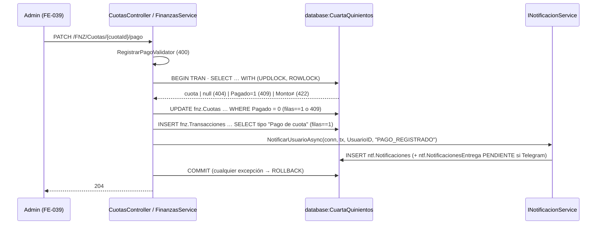

[← index](_index.md) | [← spec](spec.md)

# design.md — FNZ-BE-011: Registrar pago de cuota (Admin)

> Generado por: **generador de contexto SDD** tras validar spec.md
> Consumido por: implementador (`implementer.tool` = cursor — `desarrollador-tdd`, `desarrollador-api`, `api-tester`, `auditor-codigo`, `auditor-seguridad`)

## Estrategia técnica

`FinanzasService.RegistrarPagoAsync(cuotaId, RegistrarPagoInput, UsuarioActual)` sigue el fragmento del readme §6 Ticket 11: valida el input con FluentValidation, abre una `IDbTransaction`, lee la cuota con `WITH (UPDLOCK, ROWLOCK)` (serializa a los admins concurrentes sobre la misma fila), aplica los chequeos `404 → 409 → 422` `(asumido: orden)`, ejecuta `UPDATE … WHERE CuotaID = @id AND Pagado = 0` exigiendo `filas == 1`, inserta el abono con `INSERT … SELECT` desde `fnz.TiposMovimiento` (tipo por nombre) exigiendo `filas == 1`, y llama `INotificacionService.NotificarUsuarioAsync(conn, tx, …, "PAGO_REGISTRADO", …)` con la misma conexión/transacción. `Commit` al final; cualquier excepción → `Rollback`. El envío a Telegram queda fuera de la transacción (outbox `ntf.NotificacionesEntrega`, ADR-009).

Alternativas descartadas:
- **Stored procedure de pago** — prohibido por ADR-001.
- **Columna `rowversion` para concurrencia optimista** — requiere DDL; `UPDLOCK` + `WHERE Pagado = 0` (nativo) ya garantiza un único ganador.
- **`SERIALIZABLE` en toda la transacción** — bloqueo más amplio del necesario; el lock de fila basta.
- **Enviar Telegram dentro de la transacción** — descartado por ADR-009 (un fallo externo revertiría el pago).
- **Tabla `fnz.Pagos`** — viola finanzas INV-1.

### Escalera de decisión (methodology.md regla 6) — recorrer ANTES de las tablas de objetos

| Capacidad pedida | Peldaño (1-5) | Objeto resultante | Por qué se descartaron los anteriores |
|---|---|---|---|
| Marcar cuota pagada | 3 (reuso) | columnas existentes de `fnz.Cuotas` | 1: Must |
| Registrar abono contable | 3 (reuso) | `fnz.Transacciones` + `fnz.TiposMovimiento` "Pago de cuota" | 1: Must |
| Evitar doble pago concurrente | 2 (nativo) | `UPDLOCK, ROWLOCK` + `WHERE Pagado = 0` | 1: Must (CA-3) |
| Atomicidad | 2 (nativo) | `IDbTransaction` de Dapper/ADO.NET | 1: Must |
| Notificar al residente + encolar Telegram | 3 (reuso) | `INotificacionService.NotificarUsuarioAsync` (NTF-BE-013) | 2: no hay feature nativa; insertar directo en `ntf.*` viola notificaciones INV-7 |
| Endpoint `PATCH /FNZ/Cuotas/{cuotaId}/pago` | 4 (cambio mínimo) | nueva acción en `CuotasController` (FNZ-BE-010) | 3: no existe la acción; 5 innecesario: el controller ya existe |
| Lógica de pago | 4 (cambio mínimo) | método `RegistrarPagoAsync` en `FinanzasService` (FNZ-BE-010) | 3: no existe; servicio nuevo duplicaría conexión/DI |
| Input + reglas de validación | 5 (nuevo) | `RegistrarPagoInput` + `RegistrarPagoValidator` (FluentValidation) | 3: no existe DTO de pago; 4: no hay validador que extender |

## database:CuartaQuinientos

| Objeto | Tipo | Acción | Notas |
|---|---|---|---|
| `fnz.Cuotas` | tabla | reusar (UPDATE, sin DDL) | Requiere DB-001 (`MontoPagado`, `CuentaID`) |
| `fnz.Transacciones` | tabla | reusar (INSERT, sin DDL) | Auditoría + `bEliminado = 0` |
| `fnz.TiposMovimiento` | tabla (catálogo) | reusar (lectura) | "Pago de cuota" `bAbono = 1` sembrado por DB-002 |
| `ntf.Notificaciones`, `ntf.NotificacionesEntrega` | tablas | reusar (vía `INotificacionService`) | Nunca escritas directo por este ticket |

```sql
-- Sentencias Dapper dentro de la misma IDbTransaction (fragmento readme §6 Ticket 11)
-- ⏳ MCP pendiente Entrega 2 (BD no desplegada) — verificar con user-CQ500hub en TRAN + ROLLBACK
SELECT CuotaID, UsuarioID, CuentaID, Monto, Pagado, PeriodoInicio
FROM fnz.Cuotas WITH (UPDLOCK, ROWLOCK)
WHERE CuotaID = @CuotaId AND bEliminado = 0;               -- null → 404 ; Pagado = 1 → 409 ; Monto ≠ → 422

UPDATE fnz.Cuotas
SET Pagado = 1, FechaPago = @FechaPago, MontoPagado = @MontoPagado, MetodoPago = @MetodoPago,
    ReferenciaPago = @ReferenciaPago, Modificado = @ByCorreo, UsuarioModificacionID = @By,
    FechaModificacion = SYSUTCDATETIME()
WHERE CuotaID = @CuotaId AND Pagado = 0;                   -- filas != 1 → rollback + 409

INSERT INTO fnz.Transacciones (CuentaID, UsuarioID, TipoMovimientoID, Cargo, Abono, Motivo,
                               Creado, UsuarioCreacionID, FechaCreacion, bEliminado)
SELECT @CuentaId, @UsuarioId, tm.TipoMovimientoID, 0, @MontoPagado, @Motivo,
       @ByCorreo, @By, SYSUTCDATETIME(), 0
FROM fnz.TiposMovimiento tm
WHERE tm.TipoMovimiento = N'Pago de cuota' AND tm.bAbono = 1 AND tm.bEliminado = 0;  -- filas != 1 → rollback (asumido)
```

## backend:cuartaquinientos-api

| Endpoint | Verbo | Request | Response | Acción |
|---|---|---|---|---|
| `/FNZ/Cuotas/{cuotaId}/pago` | PATCH | `{ montoPagado: decimal, fechaPago: date, metodoPago?: string, referenciaPago: string }` | `204` `(asumido)` · `400 VALIDATION_ERROR` · `401` · `403 FORBIDDEN` · `404 NOT_FOUND` · `409 CONFLICT` · `422 VALIDATION_ERROR` | crear acción en `CuotasController` existente |

- Autorización: `[Authorize(Policy = "SoloAdministrador")]`; autor (`Modificado`, `UsuarioModificacionID`, `UsuarioCreacionID`) de `UsuarioActual` (JWT), nunca del body.
- `RegistrarPagoValidator`: `MontoPagado > 0` ("El monto debe ser mayor a cero"), `ReferenciaPago` no vacía (≤ 200, límite físico `nvarchar(200)`), `MetodoPago` ≤ 100, `FechaPago ≤ hoy (America/Mexico_City)`.
- Mapeo `Result` → HTTP de SETUP-000: `NOT_FOUND`→404, `CONFLICT`→409, `VALIDATION_ERROR`→400 (validador) / 422 (regla de negocio monto ≠ cuota, cuota sin cuenta).

## Diagrama de flujo (Mermaid, opcional)



## Orden de implementación

| # | Paso | Target:Instancia | Entregable | Dependencia | Verificación |
|---|------|-------------------|------------|-------------|--------------|
| 1 | Verificar columnas y catálogo: `fnz.Cuotas.MontoPagado/CuentaID`, "Pago de cuota" en `fnz.TiposMovimiento`, `PAGO_REGISTRADO` en `ntf.TiposNotificacion` | `database:CuartaQuinientos` | evidencia MCP en `impl.md` | DB-001, DB-002 | `SELECT` de catálogo vía MCP |
| 2 | Confirmar firma de `INotificacionService.NotificarUsuarioAsync` implementada | `backend:cuartaquinientos-api` | firma estable | NTF-BE-013 | `dotnet build` |
| 3 | `RegistrarPagoInput` + `RegistrarPagoValidator` + tests unitarios en rojo (monto 0, referencia vacía, fecha futura) | `backend:cuartaquinientos-api` | DTO + validador | — | tests rojo → verde |
| 4 | Tests de integración en rojo (éxito, 404, 409, 422, concurrente, rollback por notificación) | `backend:cuartaquinientos-api` | tests en `GraphApi.Tests` | 3 | tests en rojo |
| 5 | `FinanzasService.RegistrarPagoAsync` (transacción, locks, chequeos de filas) | `backend:cuartaquinientos-api` | método de servicio | 1, 2, 4 | tests del paso 4 en verde |
| 6 | Acción `PATCH` en `CuotasController` + swagger | `backend:cuartaquinientos-api` | endpoint | 5 | `/swagger` con 204/400/401/403/404/409/422 |
| 7 | `.http` de happy/error/auth (`api-tester`) + ejecución contra API levantada | `backend:cuartaquinientos-api` | `.http` | 6 | endpoint ejecutado al menos 1 vez (DoD rule 09) |

## Plan de pruebas

| Prueba | Target | Tipo | Cubre CA |
|---|---|---|---|
| `TC-1` pago exitoso: cuota, transacción y notificación | cuartaquinientos-api | integración | CA-1 |
| `TC-3` dos `Task` con conexiones distintas sobre la misma cuota → 1×204 + 1×409, 1 sola transacción | cuartaquinientos-api | integración (concurrencia) | CA-3 |
| `TC-9` `INotificacionService` falla → sin cambios en `fnz.*` | cuartaquinientos-api | integración | CA-9 |
| `TC-INV-1` pago en la misma fila + abono en la misma transacción; sin tabla Pago | cuartaquinientos-api | regresión | CA-1 (INV-1) |
| `TC-INV-2` monto ≠ cuota → 422 | cuartaquinientos-api | regresión | CA-5 (INV-2) |
| `TC-INV-3` segunda llamada sobre cuota pagada → 409, 0 filas nuevas | cuartaquinientos-api | regresión | CA-2 (INV-3) |
| `TC-INV-4` transacción creada con `Cargo = 0`, `Abono > 0`, tipo `bAbono = 1` | cuartaquinientos-api | regresión | CA-R2 (INV-4) |
| `TC-INV-5` existe `PAGO_REGISTRADO` para el `UsuarioID` de la cuota | cuartaquinientos-api | regresión | CA-1 (INV-5) |
| `TC-INV-6` residente con Telegram activo → 1 fila `PENDIENTE` en `ntf.NotificacionesEntrega`; sin llamada HTTP a Telegram | cuartaquinientos-api | regresión | CA-R1 (INV-6) |
| `TC-INV-7` ningún `DELETE` sobre `fnz.Transacciones` en el código del ticket (revisión + rollback de tx en tests) | cuartaquinientos-api | regresión | INV-7 |
| `TC-ERR-1` `montoPagado: 0` → 400 | cuartaquinientos-api | negativo | CA-4 |
| `TC-ERR-2` `CuotaID = 9999` → 404 | cuartaquinientos-api | negativo | CA-6 |
| `TC-ERR-3` referencia vacía / fecha futura → 400 | cuartaquinientos-api | negativo | CA-7 |
| `TC-ERR-4` Residente → 403 | cuartaquinientos-api | negativo | CA-8 |
| `TC-ERR-5` catálogo "Pago de cuota" ausente → rollback, cuota `Pagado = 0` | cuartaquinientos-api | negativo | CA-10 |
| `TC-ERR-6` cuota con `CuentaID = NULL` → 422 | cuartaquinientos-api | negativo | CA-11 |
| `TC-RB` revert del PR: la acción desaparece; datos de prueba revertidos con `ROLLBACK` | cuartaquinientos-api | rollback | estrategia de rollback |

### Ratio de pruebas (Testing Trophy)

- Integración: ~70 % (BD de test `CuartaQuinientos`; concurrencia solo es verificable con BD real)
- Unitario: ~30 % (`RegistrarPagoValidator` y orden de chequeos)
- Mocks: solo `INotificacionService` en el test de fallo (CA-9); Telegram no se toca en Fase 1

### Triangulación

| Comportamiento | Dataset A | Dataset B | Qué generaliza |
|---|---|---|---|
| Monto debe igualar la cuota | cuota 1 200.00 pagada con 1 200.00 | cuota 950.50 pagada con 950.50 / 950.49 (422) | que compara con `Monto` real, no con constante |
| Concurrencia | 2 llamadas paralelas | 5 llamadas paralelas | que siempre hay exactamente 1 ganador |

### Mutation

| Objeto | Técnica | Kill rate objetivo |
|---|---|---|
| `FinanzasService.RegistrarPagoAsync` | Stryker.NET + 3 mutantes manuales SQL: quitar `AND Pagado = 0`, `filas != 1` → `filas < 1`, quitar `tm.bAbono = 1` | ≥ 80 % paths críticos |

## Estrategia de rollback

- Código: revertir el PR `feature/FNZ-BE-011-registrar-pago` (quita la acción `PATCH`, el método y el validador; FNZ-BE-010 intacto).
- Datos: no hay DDL. Si en producción se registró un pago erróneo, la corrección es manual y auditada (sin endpoint de anulación en Fase 1, Won't): `UPDATE fnz.Cuotas SET Pagado = 0, FechaPago = NULL, MontoPagado = NULL …` + transacción de ajuste o `bEliminado = 1` en la transacción (nunca `DELETE`, INV-7), con `SELECT` previo y aprobación del Administrador.

## Pre-mortem

- **Si esto falla en PROD, la causa más probable es:** doble abono por un camino que no respeta `filas == 1`, o pago sin abono por catálogo "Pago de cuota" ausente.
- **Cómo lo detectamos:** `SELECT Motivo, COUNT(*) FROM fnz.Transacciones WHERE Motivo LIKE N'Pago cuota #%' AND bEliminado = 0 GROUP BY Motivo HAVING COUNT(*) > 1` y `SELECT c.CuotaID FROM fnz.Cuotas c WHERE c.Pagado = 1 AND NOT EXISTS (SELECT 1 FROM fnz.Transacciones t WHERE t.Motivo = CONCAT(N'Pago cuota #', c.CuotaID) AND t.bEliminado = 0)`.
- **Acción inmediata:** deshabilitar el botón de pago en FE-039 / revertir el PR, corregir datos con el procedimiento de rollback de datos y avisar al Administrador del fraccionamiento.

## Decisiones técnicas (auditoría)

| # | Decisión | Justificación |
|---|---|---|
| 1 | `UPDLOCK, ROWLOCK` + `WHERE Pagado = 0` con `filas == 1` | Peldaño 2 nativo; `rowversion` requiere DDL; `SERIALIZABLE` sobre-bloquea |
| 2 | Extender `CuotasController`/`FinanzasService` (no crear) | Peldaño 4: existen desde FNZ-BE-010 |
| 3 | `RegistrarPagoInput` + validador nuevos | Peldaño 5: no hay DTO/validador de pago; FluentValidation es la convención (finanzas.md Notas) |
| 4 | Notificación vía `INotificacionService` en la misma tx | Notificaciones INV-7 + ADR-009; insertar en `ntf.*` directo está prohibido |
| 5 | Verificar filas del `INSERT … SELECT` | El fragmento del readme no lo verifica; sin ello un catálogo ausente deja pago sin abono (viola INV-1) `(asumido)` |
| 6 | Orden `404 → 409 → 422` y `204` como éxito | `(asumido)` — en Preguntas abiertas del spec |

## Autoverificación antes del handoff

**Consistencia con spec.md:**
- [x] Ningún objeto/tabla de este design.md implementa algo listado como `Won't` en spec.md (sin anulación, sin pagos parciales, sin envío Telegram)
- [x] Cada fila de "Plan de pruebas" `TC-INV-x` corresponde a un invariante real de spec.md (INV-1..INV-7)

**Calidad del artefacto:**
- [ ] Toda query/comando SQL verificado con MCP — **pendiente Entrega 2** (BD no desplegada; paso 1 del orden)
- [x] Orden de implementación: cada paso tiene Entregable + Dependencia explícita
- [x] Sin falsa agencia: cada paso nombra el actor real (`FinanzasService`, `CuotasController`, `INotificacionService`, agente `api-tester`)
- [ ] Toda query/comando propuesto verificado antes de escribirlo — **pendiente Entrega 2** (tomado del fragmento readme §6 Ticket 11)
- [x] Cada comportamiento nuevo tiene ≥ 2 datasets en la tabla de Triangulación
