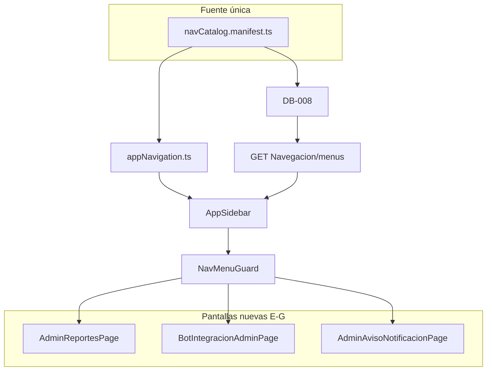

# design.md — NAV-ROOT-001 (alcance completo)

> **Ejecución 2026-11-04:** fases **E + G** (reportes, BI, aviso NTF) viven en [[BI-RPT-001]] **sin bot/IA**. Fase **F** permanece en backlog [[bot-ia]]. Este design sigue siendo referencia del epic; detalle implementación acotado en [tkt-bi-rpt-001/design.md](../tkt-bi-rpt-001/design.md).

[← spec](spec.md) | [← index](_index.md) | [matriz](MATRIZ_MODULOS.md)

## Estrategia técnica

**Fuente única:** `Web/src/shared/navigation/navCatalog.manifest.ts` exporta nodos con `{ clave, path, label, icon, groupKey, profiles[], order, implemented }`. Deriva:

- `APP_NAV` / `NAV_GROUPS` en `appNavigation.ts` (import manifest).
- Lista `DB_008_CLAVES` en comentario + tabla `@Nodes` en `SQL/DB-008_sgr_menus_nav_root.sql`.
- Test `navCatalogParity.test.ts` + test `db008Claves.test.ts` (claves esperadas).

**Cierre 15 módulos:** ver [MATRIZ_MODULOS.md](MATRIZ_MODULOS.md); fases E–G añaden superficie RPT/BI/BOT/NTF admin sin sustituir canal Telegram.

### Escalera de decisión (resumen)

| Capacidad | Peldaño | Entregable |
|-----------|---------|------------|
| Paridad menú | 4 | manifest + DB-008 + tests |
| Notificaciones página | 3 | `NotificacionesPage` |
| Trabajador/Guardia shell | 4 | `TrabajadorRoute`, seed perfiles |
| Admin reservas | 4–5 | `AdminAreasReservasPage` + `GET …/admin` Cuarta |
| BI tendencias | 5 | `BiTendenciasService` + `BiReportesPage` si no hay GET |
| BOT admin web | 4 | `BotIntegracionAdminPage` (lectura) |
| Aviso NTF admin | 3 | form → `POST /NTF/Notificaciones/aviso` |

## database:CuartaQuinientos

| Acción | Detalle |
|--------|---------|
| **DB-008** | MERGE nodos [spec fase A] + PerfilMenus Guardia/Trabajador + nodos E/F/G |
| **DML opcional E** | Seed mínimo `bi.KpiSnapshots` demo (1 condominio, 6 meses) si tabla existe — script `DB-009_bi_snapshots_demo.sql` *(solo si tabla ya creada en schema)* |

**Nodos adicionales fases E–G (manifest + DB-008 extensión misma script o DB-008 part 2):**

| Clave | Ruta | Perfiles |
|-------|------|----------|
| `admin-reportes` | `/admin/reportes` | Administrador |
| `admin-bot` | `/admin/integraciones/bot` | Administrador |
| `admin-ntf-aviso` | `/admin/notificaciones/aviso` | Administrador |

Deploy orden: `DB-002` → `DB-007` → **`DB-008`** → (opcional demo BI).

## backend:cuartaquinientos-api

| Endpoint | Fase | Acción |
|----------|------|--------|
| `GET /SGR/Navegacion/menus` | A | Sin cambio lógica |
| `GET /VTS/ReservacionesArea/admin` | D | **Nuevo** — listado paginado condominio JWT admin |
| `GET /VTS/ReservacionesArea/calendario` | D | Reusar |
| `GET /TKT/Tickets/asignados` o acción existente | C | Documentar ruta JWT trabajador en impl |
| `GET /Reports/Reportes/Morosos` | E | Reusar |
| `GET /Reports/Bi/tendencias?meses=N` | E | **Nuevo** `BiTendenciasController` + `IBiTendenciasService` leyendo `bi.KpiSnapshots` |
| `POST /NTF/Notificaciones/aviso` | G | Reusar; auth admin |
| `GET /SGR/Usuarios/telegram/resumen` | F | **Nuevo opcional** — conteo vinculados; si no hay tabla bot aún, 501 + UI placeholder |

Sin SPs; Dapper + transacciones en servicios Cuarta.

## frontend:cuartaquinientos-web

| Pantalla | Ruta | Fase |
|----------|------|------|
| `NotificacionesPage` | `/notificaciones` | B |
| `TrabajadorTicketsPage` + detalle reuse | `/trabajador/tickets`, `…/:id` | C |
| `AdminAreasReservasPage` | `/admin/areas-reservas` | D |
| `AdminReportesPage` (tabs: Morosos, BI) | `/admin/reportes` | E |
| `BotIntegracionAdminPage` | `/admin/integraciones/bot` | F |
| `AdminAvisoNotificacionPage` | `/admin/notificaciones/aviso` | G |

**Rutas `App.tsx`:** agrupar bajo `AdminRoute` / `PrivateRoute` / `TrabajadorRoute` / `GuardiaRoute` según matriz.

**Manifest groups:** mantener grupos actuales + `integraciones` bajo Gestión para BOT.

## integrations:cuartaquinientos-bot

| Acción | Detalle |
|--------|---------|
| Fase F | Actualizar `ContextoCuartaQuinientos/specs/bot-ia.md` § UI web con ruta admin |
| Sin cambio Python | Obligatorio en epic salvo link deep-link `t.me/...` en env |

## Contenido configurable

| # | Contenido | Clase | Fuente |
|---|-----------|-------|--------|
| 1 | Títulos menú seed | catálogo SGR | `sgr.Menus.TituloMenu` |
| 2 | Texto ayuda BOT en pantalla F | ARB / copy estático v1 | manifest labels |
| 3 | Tipos NTF aviso | catálogo | `AVISO_GENERAL` por nombre |

## Diagrama

## Orden de implementación (A→G)

| Paso | Fase | Entregable | Dep. |
|------|------|------------|------|
| 1–4 | A | manifest, tests, DB-008, smoke menus | — | ✓ Hecho |
| 5–8 | B | rutas B, NotificacionesPage, sidebar | A | ✓ Hecho |
| 9–11 | C | TrabajadorRoute, pages, seed | A | ✓ Hecho |
| 12–15 | D | API admin reservas, AdminAreasReservasPage | A | ✓ Hecho |
| 16–19 | E | Bi API, AdminReportesPage, menú | A |
| 20–21 | F | BotIntegracionAdminPage, menú | A |
| 22–24 | G | Aviso NTF, matriz OK, inventario | B,E |
| 25 | — | `/revisar`, delta, specs merge | all |

## Plan de pruebas (`/test`)

| ID | Capa | Caso |
|----|------|------|
| TC-NAV-01 | Vitest | Paridad manifest ↔ APP_NAV |
| TC-NAV-02 | Vitest | Claves DB-008 ⊆ manifest |
| TC-NAV-03 | Vitest | NavMenuGuard 403 |
| TC-NAV-04 | Vitest | NotificacionesPage |
| TC-NAV-05 | Vitest | TrabajadorRoute |
| TC-NAV-06 | Vitest | AdminReportesPage mock BI |
| TC-NAV-07 | Vitest | BotIntegracionAdminPage |
| TC-NAV-08 | `.http` | Menus × 4 perfiles post DB-008 |
| TC-NAV-09 | `.http` | Bi tendencias admin 200 / residente 403 |
| TC-NAV-10 | `.http` | POST aviso NTF admin |
| TC-NAV-11 | Manual | Matriz 15 filas verificadas (CA-G1) |

Artefacto: `NAV-ROOT-001_api_tests.http` (generado en `/test`).

T-SQL: smoke SELECT post DB-008 embebido en script; sin suite CHAR negocio.

## release.md (esqueleto `/completar`)

- Piezas: Web, GraphApi, SQL DB-008 (+ demo BI opcional).
- Orden: SQL → API → Web.
- Rollback: revert deploy Web; menús ocultos vía `bVisible` no destructivo.
- Canario: validar un perfil por ambiente antes de abrir BI.

## Pasada adversarial

| Punto | Respuesta |
|-------|-----------|
| BI sin tabla bi | Verificar schema; posponer E3 con spike 1h en impl |
| Epic no mergeable | PR por fase con `_index` log |
| Bot page vacía | Aceptable v1 con copy + roadmap BOT-BE |

## Estado

**LISTO PARA TEST** — ejecutar `/test nav-root-001` para materializar `.http` + checklist Vitest; luego **LISTO PARA EJECUTAR** fase A.
