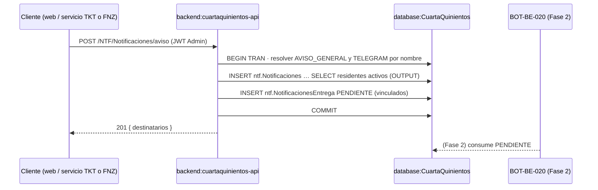

[← index](_index.md) | [← spec](spec.md)

# design.md — NTF-BE-013: Servicio de notificaciones in-app

> Generado por: **generador de contexto SDD** tras validar spec.md
> Consumido por: implementador (`implementer.tool` = cursor — agentes `desarrollador-api`, `api-tester`, `auditor-codigo`, `auditor-seguridad`)

## Estrategia técnica

`NotificacionesController` (`/NTF/Notificaciones`) → `NotificacionService : INotificacionService` → `NotificacionRepository` (Dapper, consultas parametrizadas). El servicio expone dos caras:

1. **Cara interna (consumida por TKT, FNZ, ENC, JNT, VTS):** `NotificarUsuarioAsync`, `NotificarAdministradoresAsync`, `AvisoGeneralAsync` reciben `IDbConnection` + `IDbTransaction` del llamador, resuelven el tipo por nombre e insertan en `ntf.Notificaciones` y, en la misma transacción, encolan `PENDIENTE` en `ntf.NotificacionesEntrega` para destinatarios con `bot.CuentasTelegram.Activo = 1` (ADR-009 outbox).
2. **Cara REST (bandeja):** lectura paginada con `totalNoLeidas` y marca de leído idempotente en `ntf.NotificacionesVisualizadas`.

Inserciones masivas (administradores, aviso general) con `INSERT … SELECT … OUTPUT INSERTED.NotificacionID, INSERTED.UsuarioID INTO @nuevas`, seguido de `INSERT ntf.NotificacionesEntrega … SELECT` desde `@nuevas` unido a `bot.CuentasTelegram` — dos sentencias en un mismo batch parametrizado y una sola transacción.

**Alternativas descartadas:**
- **Envío síncrono a Telegram dentro de la transacción de negocio** — descartado por ADR-009: un fallo de Telegram revertiría un pago o ticket.
- **Columna `ntf.Notificaciones.Leido`** — descartado por readme §3.2 (decisión: marca = fila en `ntf.NotificacionesVisualizadas`).
- **Stored procedures para el aviso masivo** — descartado por ADR-001 (sin SPs de negocio).
- **Bucle C# con un insert por residente** — descartado: readme Ticket 13 exige `INSERT … SELECT`; N round-trips innecesarios.
- **Trigger en `ntf.Notificaciones` que encole la entrega** — descartado: lógica oculta en BD, contraria a ADR-001 y a INV-7 (el servicio es el punto único).

### Escalera de decisión (methodology.md regla 6) — recorrer ANTES de las tablas de objetos

| Capacidad pedida | Peldaño (1-5) | Objeto resultante | Por qué se descartaron los anteriores |
|---|---|---|---|
| Marca de leído / badge | 3 (reuso) | `ntf.NotificacionesVisualizadas` (existente) | 1: Must de HU-NTF-01/02; 2: no hay feature nativa de SQL Server para "leído" |
| Catálogo de canal de entrega | 3 (reuso) | `tkt.CanalesTicket` (WEB/TELEGRAM) | 1: Must (outbox); 2: n/a |
| Outbox Telegram | 3 (reuso) | `ntf.NotificacionesEntrega` (creada por DB-001) | 1: Must (INV-7); 2: Service Broker/CDC descartados por complejidad y hosting Railway (asumido) |
| Destinatarios (residentes activos, administradores) | 3 (reuso) | `sgr.Usuarios` + `sgr.Perfiles` | 1: Must; 2: n/a |
| Resolución de tipo/canal por nombre | 3 (reuso) | `ICatalogoService` de TKT-BE-001 (si existe al implementar) | 1: Must (INV-8); 2: n/a |
| Punto único de inserción | 5 (nuevo) | `INotificacionService` / `NotificacionService` | 2: sin feature nativa; 3: no existe servicio de notificaciones en `GraphApi`; 4: no hay objeto previo que modificar |
| Acceso a datos NTF | 5 (nuevo) | `NotificacionRepository` | 3: no existe repositorio NTF; 4: n/a |
| Endpoints de bandeja y aviso | 5 (nuevo) | `NotificacionesController` | 3: no existe controller `/NTF`; 4: n/a |

## database:CuartaQuinientos

Sin DDL en este ticket (depende de DB-001: `TipoNotificacion`, `ntf.NotificacionesEntrega` con FK e índice único; DB-002: 9 tipos y canales sembrados).

| Objeto | Tipo | Acción | Notas |
|---|---|---|---|
| `ntf.Notificaciones` | tabla | leer/insertar | Nunca `Leido`; auditoría + `bEliminado = 0` |
| `ntf.NotificacionesVisualizadas` | tabla | leer/insertar | `INSERT … WHERE NOT EXISTS` (idempotente) |
| `ntf.TiposNotificacion` | tabla catálogo | leer | `WHERE TipoNotificacion = @Tipo` |
| `ntf.NotificacionesEntrega` | tabla (delta DB-001) | insertar | `Estado = 'PENDIENTE'`, `Reintentos = 0` |
| `bot.CuentasTelegram` | tabla | leer | `Activo = 1` |
| `tkt.CanalesTicket` | tabla catálogo | leer | `WHERE Canal = 'TELEGRAM'` |
| `sgr.Usuarios`, `sgr.Perfiles` | tablas | leer | Residentes activos / administradores activos |

```sql
-- Verificación MCP pendiente Entrega 2 (BD no desplegada): sin anotación ✓ MCP.
-- Bandeja (página) + total no leídas
SELECT n.NotificacionID, n.Titulo, n.Mensaje, t.TipoNotificacion, n.FechaCreacionNotificacion,
       CAST(CASE WHEN v.NotificacionID IS NULL THEN 0 ELSE 1 END AS BIT) AS Leida
FROM ntf.Notificaciones n
JOIN ntf.TiposNotificacion t ON t.TipoNotificacionID = n.TipoNotificacionID
OUTER APPLY (SELECT TOP 1 NotificacionID FROM ntf.NotificacionesVisualizadas
             WHERE NotificacionID = n.NotificacionID AND UsuarioID = @UsuarioID) v
WHERE n.UsuarioID = @UsuarioID AND n.bEliminado = 0
ORDER BY n.FechaCreacionNotificacion DESC
OFFSET (@Pagina - 1) * @Tamano ROWS FETCH NEXT @Tamano ROWS ONLY;

SELECT COUNT(*) FROM ntf.Notificaciones n
WHERE n.UsuarioID = @UsuarioID AND n.bEliminado = 0
  AND NOT EXISTS (SELECT 1 FROM ntf.NotificacionesVisualizadas v
                  WHERE v.NotificacionID = n.NotificacionID AND v.UsuarioID = @UsuarioID);

-- Marcar leída (idempotente; la propiedad se valida antes → 403/404)
INSERT ntf.NotificacionesVisualizadas (NotificacionID, UsuarioID, FechaLectura,
       Creado, UsuarioCreacionID, FechaCreacion, bEliminado)
SELECT @NotificacionID, @UsuarioID, SYSUTCDATETIME(), @ByCorreo, @UsuarioID, SYSUTCDATETIME(), 0
WHERE NOT EXISTS (SELECT 1 FROM ntf.NotificacionesVisualizadas
                  WHERE NotificacionID = @NotificacionID AND UsuarioID = @UsuarioID);

-- Aviso general: INSERT … SELECT + encolado outbox en la misma transacción
DECLARE @nuevas TABLE (NotificacionID INT, UsuarioID INT);
INSERT ntf.Notificaciones (UsuarioID, Titulo, Mensaje, TipoNotificacionID, FechaCreacionNotificacion,
       Creado, UsuarioCreacionID, FechaCreacion, bEliminado)
OUTPUT INSERTED.NotificacionID, INSERTED.UsuarioID INTO @nuevas
SELECT u.UsuarioID, @Titulo, @Mensaje, @TipoNotificacionID, SYSUTCDATETIME(),
       @ByCorreo, @By, SYSUTCDATETIME(), 0
FROM sgr.Usuarios u
JOIN sgr.Perfiles p ON p.PerfilID = u.PerfilID
WHERE p.Nombre = 'Residente' AND u.bActivo = 1 AND u.bEliminado = 0;

INSERT ntf.NotificacionesEntrega (NotificacionID, CanalID, Estado, Reintentos,
       Creado, UsuarioCreacionID, FechaCreacion, bEliminado)
SELECT x.NotificacionID, @CanalTelegramID, 'PENDIENTE', 0, @ByCorreo, @By, SYSUTCDATETIME(), 0
FROM @nuevas x
JOIN bot.CuentasTelegram c ON c.UsuarioID = x.UsuarioID AND c.Activo = 1;
```

`NotificarAdministradoresAsync` usa el mismo patrón con `p.bAdministrador = 1`; `NotificarUsuarioAsync` hace un `INSERT … OUTPUT INSERTED.NotificacionID` + encolado condicional. Auditoría de `ntf.NotificacionesEntrega` (asumido: columnas estándar según convención de `sdd.config.yaml`; confirmar con DDL de DB-001).

## backend:cuartaquinientos-api

| Endpoint | Verbo | Request | Response | Acción |
|---|---|---|---|---|
| `/NTF/Notificaciones?pagina=1&tamano=20` | GET | query `pagina` (≥1, def. 1), `tamano` (1..100, def. 20 — asumido máx.) | `200 { items: [{ notificacionId, titulo, mensaje, tipo, fechaCreacion, leida }], pagina, tamano, totalNoLeidas }` · `400` · `401` | crear |
| `/NTF/Notificaciones/{id}/leida` | PATCH | ruta `id` (>0); identidad del JWT | `204` (asumido) · `403 FORBIDDEN` · `404 NOT_FOUND` (asumido) · `401` | crear |
| `/NTF/Notificaciones/aviso` | POST | `{ titulo, mensaje }` (FluentValidation, no vacíos) | `201 { destinatarios }` (asumido) · `400` · `401` · `403` | crear |

Contrato interno (firmas propuestas; nombres del readme Ticket 13, parámetros alineados con [TKT-BE-001 design](../tkt-be-001/design.md)):

```csharp
public interface INotificacionService
{
    Task<int> NotificarUsuarioAsync(IDbConnection conn, IDbTransaction tx, int usuarioId,
        string tipoNotificacion, string titulo, string mensaje, Autor autor);
    Task<int> NotificarAdministradoresAsync(IDbConnection conn, IDbTransaction tx,
        string tipoNotificacion, string titulo, string mensaje, Autor autor);
    Task<int> AvisoGeneralAsync(IDbConnection conn, IDbTransaction tx,
        string titulo, string mensaje, Autor autor);   // tipo fijo 'AVISO_GENERAL'
}
// Autor = (UsuarioID, Correo) tomado del JWT (sub, correo). Retorno = filas insertadas en ntf.Notificaciones.
```

- Autorización: `[Authorize]` en el controller; `POST /aviso` con policy `bAdministrador = 1` (403 del middleware, readme §2.5).
- `PATCH /leida`: el servicio lee `UsuarioID`/`bEliminado` de la notificación → `404` si no existe o eliminada, `403` si `UsuarioID ≠ sub`, luego insert idempotente.
- `POST /aviso`: el controller abre conexión + transacción, llama `AvisoGeneralAsync`, `Commit`; ante excepción `Rollback`.
- Tipo inexistente en catálogo → `InvalidOperationException` (asumido) que el llamador propaga y revierte.
- Errores en `ProblemDetails` con `code` de negocio.

## integrations:cuartaquinientos-bot

- **Evento:** una fila `ntf.NotificacionesEntrega` por notificación y canal `TELEGRAM`, `Estado = 'PENDIENTE'`, `Reintentos = 0`, `FechaEnvio = NULL`, `MotivoError = NULL`.
- **Payload:** el consumidor (BOT-BE-020, `TelegramNotificadorWorker` en el backend) lee `Titulo`/`Mensaje` vía `NotificacionID`; este ticket no define el formato de mensaje Telegram.
- **Idempotencia:** índice único `(NotificacionID, CanalID)` (DB-001, INV-4); cada notificación nueva se encola una sola vez.
- **Fuera de este ticket:** envío, reintentos, transición `ENVIADA`/`FALLIDA` (Won't).

## Diagrama de flujo (Mermaid, opcional)



## Orden de implementación

| # | Paso | Target:Instancia | Entregable | Dependencia | Verificación |
|---|------|-------------------|------------|-------------|--------------|
| 1 | Confirmar DB-001/DB-002 aplicados (tipos y canal `TELEGRAM` sembrados) | `database:CuartaQuinientos` | Precondición verificada | — | `SELECT` de `ntf.TiposNotificacion` y `tkt.CanalesTicket` vía MCP (Entrega 2) |
| 2 | `NotificacionRepository` (bandeja, conteo, marca, inserts masivos, encolado) | `backend:cuartaquinientos-api` | Repositorio Dapper parametrizado | 1 | `dotnet build` |
| 3 | `INotificacionService` / `NotificacionService` + registro DI | `backend:cuartaquinientos-api` | Servicio con las 3 firmas | 2 | Tests unitarios del servicio (repositorio mockeado) |
| 4 | `NotificacionesController` + DTOs + validadores FluentValidation + policy Admin | `backend:cuartaquinientos-api` | 3 endpoints en `/swagger` | 3 | `dotnet build` + `.http` de `api-tester` |
| 5 | Tests de integración de endpoints (BD de test) | `backend:cuartaquinientos-api` | Suite en `GraphApi.Tests` verde | 4 | `dotnet test GraphApi.Tests` |
| 6 | Actualizar §4/`specs/notificaciones.md` en `/completar` si cambió contrato | `context:contexto-cuartaquinientos` | Delta documentado | 5 | N/A |

## Plan de pruebas

| Prueba | Target | Tipo | Cubre CA |
|---|---|---|---|
| `TC-01` bandeja propia paginada y ordenada | cuartaquinientos-api | integración | CA-1, CA-2 |
| `TC-02` bandeja vacía | cuartaquinientos-api | integración | CA-3 |
| `TC-03` marcar leída propia reduce `totalNoLeidas` | cuartaquinientos-api | integración | CA-4 |
| `TC-04` aviso masivo: 3 residentes activos, excluye inactivo y Guardia | cuartaquinientos-api | integración | CA-6 |
| `TC-05` encolado solo para vinculados activos | cuartaquinientos-api | integración | CA-8 |
| `TC-06` rollback del llamador no deja notificaciones ni entregas | cuartaquinientos-api | integración | CA-9 |
| `TC-07` auditoría poblada en inserts | cuartaquinientos-api | integración | CA-10 |
| `TC-INV-1` notificación con tipo y usuario válidos (FK) | CuartaQuinientos | regresión | INV-1 |
| `TC-INV-2` badge = sin fila de lectura, ignora `Leido` | cuartaquinientos-api | regresión | CA-R3 (INV-2) |
| `TC-INV-3` doble `PATCH` deja una sola fila | cuartaquinientos-api | regresión | CA-R1 (INV-3) |
| `TC-INV-4` segundo encolado del mismo `(NotificacionID, CanalID)` rechazado por índice único | CuartaQuinientos | regresión | INV-4 |
| `TC-INV-5` aviso en una sola transacción (fallo a mitad → 0 filas) | cuartaquinientos-api | regresión | INV-5 |
| `TC-INV-6` ninguna operación borra físicamente | cuartaquinientos-api | regresión | INV-6 |
| `TC-INV-7` búsqueda estática: `INSERT INTO ntf.Notificaciones` solo en `NotificacionRepository` | cuartaquinientos-api | regresión | CA-R2 (INV-7) |
| `TC-INV-8` tipo/canal resueltos por nombre (sin IDs literales) | cuartaquinientos-api | regresión | INV-8, CA-13 |
| `TC-INV-9` `UsuarioID` en body ignorado; se usa `sub` | cuartaquinientos-api | regresión | INV-9 |
| `TC-ERR-1` marcar leída ajena → `403` sin inserción | cuartaquinientos-api | negativo | CA-5 |
| `TC-ERR-2` `POST /aviso` como Residente/Guardia/Trabajador → `403` | cuartaquinientos-api | negativo | CA-7 |
| `TC-ERR-3` `tamano = 0`, `pagina = 0`, `titulo` vacío → `400` | cuartaquinientos-api | negativo | CA-11 |
| `TC-ERR-4` `id` inexistente → `404` | cuartaquinientos-api | negativo | CA-12 |
| `TC-ERR-5` tipo no sembrado → error y rollback | cuartaquinientos-api | negativo | CA-13 |
| `TC-RB` revert del PR deja BD intacta (sin DDL) | cuartaquinientos-api | rollback | estrategia de rollback |

### Ratio de pruebas (Testing Trophy)

- Integración: ~70 % (endpoints contra BD de test `CuartaQuinientos`; MCP `nesgotest` en Entrega 2)
- Unitario: ~30 % (reglas del servicio: propiedad, idempotencia, resolución de tipo)
- Mocks: solo el repositorio en unitarios; Telegram no se invoca en este ticket

### Triangulación

| Comportamiento | Dataset A | Dataset B | Qué generaliza |
|---|---|---|---|
| Aviso a residentes activos | 1 residente activo, 0 vinculados | 3 activos + 1 inactivo + 1 Guardia, 2 vinculados | que el filtro por perfil/`bActivo`/vínculo no quedó hardcodeado |
| `totalNoLeidas` | 0 notificaciones | 25 notificaciones, 3 leídas | que el conteo no depende de la página |

### Mutation

| Objeto | Técnica | Kill rate objetivo |
|---|---|---|
| `NotificacionService` (propiedad en `PATCH`, filtro de residentes, encolado condicional) | Stryker.NET o 3 mutantes manuales (`≠` → `=`, quitar `bActivo = 1`, quitar `Activo = 1`) | ≥ 80 % paths críticos |

## Estrategia de rollback

Sin DDL ni datos de catálogo: el rollback es revertir el PR de `feature/NTF-BE-013-notificaciones` (controller, servicio, repositorio, DI). Las filas creadas en `ntf.Notificaciones`/`ntf.NotificacionesVisualizadas`/`ntf.NotificacionesEntrega` durante pruebas en entornos no productivos se limpian con soft delete (`bEliminado = 1`), nunca borrado físico. Consumidores (TKT-BE-001, FNZ-BE-011) deben revertirse o usar mock si este ticket se revierte.

## Pre-mortem

- **Si esto falla en PROD, la causa más probable es:** un consumidor llama `INotificacionService` fuera de su transacción o con un tipo no sembrado y la operación de negocio (ticket/pago) falla o queda sin notificación.
- **Cómo lo detectamos:** Serilog con `CorrelationId` registra la excepción de catálogo; `SELECT COUNT(*) FROM ntf.NotificacionesEntrega WHERE Estado = 'PENDIENTE'` crece sin consumidor en Fase 1 (esperado) o no crece tras un aviso (anómalo).
- **Acción inmediata:** revertir el release según `release.md`; avisar al responsable de TKT-BE-001/FNZ-BE-011; verificar siembra de DB-002.

## Decisiones técnicas (auditoría)

| # | Decisión | Justificación |
|---|---|---|
| D1 | `NotificacionService` nuevo como punto único | 2: SQL Server no ofrece notificación de aplicación nativa aplicable (Service Broker descartado por hosting/complejidad, asumido); 3: no existe servicio NTF en `GraphApi`; 4: no hay objeto previo que modificar |
| D2 | Outbox en la misma transacción, sin envío | ADR-009; Won't de Fase 1 (readme §5) |
| D3 | Marca de leído con `INSERT … WHERE NOT EXISTS` | readme §3.2 + idempotencia de INV-3 sin DDL nuevo |
| D4 | Masivos con `INSERT … SELECT … OUTPUT INTO` | readme Ticket 13 (`INSERT … SELECT`) + necesidad de mapear `NotificacionID ↔ UsuarioID` para encolar |
| D5 | Tipos y canal por nombre | INV-8; CLAUDE.md |

## Autoverificación antes del handoff

**Consistencia con spec.md:**
- [x] Ningún objeto/tabla de este design.md implementa algo listado como `Won't` en spec.md
- [x] Cada fila de "Plan de pruebas" `TC-INV-x` corresponde a un invariante real de spec.md (INV-1..INV-9, uno por invariante)

**Calidad del artefacto:**
- [ ] Toda query/comando SQL verificado con MCP — pendiente Entrega 2 (BD no desplegada)
- [x] Orden de implementación: cada paso tiene Entregable + Dependencia explícita
- [x] Sin falsa agencia: cada paso nombra el actor real (`NotificacionesController`, `NotificacionService`, `NotificacionRepository`)
- [ ] Toda query/comando propuesto verificado antes de escribirlo — objetos declarados en readme §3.2/§2.5; verificación MCP pendiente Entrega 2
- [x] Cada comportamiento nuevo tiene ≥ 2 datasets en la tabla de Triangulación
