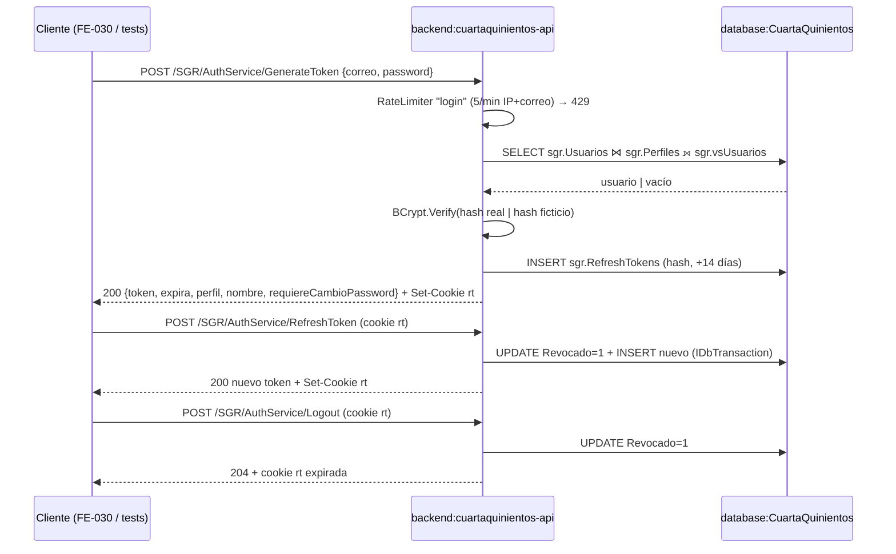

[← index](_index.md) | [← spec](spec.md)

# design.md — USR-BE-007: Autenticación JWT + refresh token

> Generado por: **generador de contexto SDD** tras validar spec.md
> Consumido por: implementador (`implementer.tool` = cursor — `git-api` → `desarrollador-api` → `api-tester` → `auditor-codigo` → `auditor-seguridad`)

## Estrategia técnica

**Decisión central:** un único flujo de autenticación en `SGR/AuthServiceController` sobre el API .NET 9 creado por SETUP-000, con servicios C# (`IAuthService`, `IJwtService`) y repositorios Dapper parametrizados (`IUserRepository`, `IRefreshTokenRepository`); sin SP ni EF (ADR-001).

1. **Controller** `Controllers/SGR/AuthServiceController.cs` (convenciones `readme.md` §2.2 y §4 Endpoint 1): `GenerateToken` (`[AllowAnonymous]`, `[EnableRateLimiting("login")]`), `RefreshToken` y `Logout`.
2. **Credenciales:** `IUserRepository.FindByCorreoAsync` lee `sgr.Usuarios` (`WHERE Correo = @Correo AND bEliminado = 0`) + `INNER JOIN sgr.Perfiles` (INV-5) + `LEFT JOIN sgr.vsUsuarios` para `CondominioID`. `AuthService` ejecuta `BCrypt.Verify` sobre `PasswordHash`; si no hay usuario, `BCrypt.Verify` contra un hash ficticio constante (tiempo constante). Usuario inexistente, contraseña incorrecta, `bActivo = 0` o `bEliminado = 1` → mismo `401 INVALID_CREDENTIALS`.
3. **JWT** HS256 (clave ≥ 32 bytes, `Jwt:*` en user-secrets / variables de entorno): claims `sub`, `correo`, `nombre`, `perfil` (`RoleClaimType`), `bAdministrador`, `condominioId`, `exp`; vida `Jwt:AccessTokenMinutes` (60).
4. **`condominioId`:** `sgr.vsUsuarios.CondominioID` (casa vigente en `sgr.CasaOcupantes`, DB-001); si es `NULL`, casa donde `sgr.Casas.PropietarioUsuarioID = UsuarioID` `(asumido)`; `null` para Admin sin casa `(asumido)` — spec P-1.
5. **Refresh token:** valor opaco aleatorio (`RandomNumberGenerator`, 32 bytes); en `sgr.RefreshTokens.Token` se guarda su hash SHA-256 `(asumido — spec P-2)`, `FechaExpira` = `SYSUTCDATETIME()` + 14 días, `Revocado = 0`, auditoría `Creado` = correo, `UsuarioCreacionID` = `UsuarioID`. Cookie `rt` `HttpOnly; Secure; SameSite=Strict`. `RefreshToken`: busca por hash, valida no revocado / no vencido, marca `Revocado = 1` e inserta uno nuevo en la misma `IDbTransaction` (rotación). `Logout`: `Revocado = 1` + borra la cookie.
6. **Rate limiting** nativo ASP.NET Core (`AddRateLimiter`, política `login`: 5/min por IP + correo) → `429`.
7. **Validación:** FluentValidation sobre `LoginInput` (correo con formato email, campos no vacíos) → `400 VALIDATION_ERROR` antes de tocar la BD.
8. **Serilog:** resultado, `UsuarioID`, IP; nunca contraseña, hash ni token.

**Alternativas descartadas:**

- Duplicar auth en `WMS/AuthService`: se unifica en `SGR` (`readme.md` §2).
- ASP.NET Core Identity: impone su propio esquema de tablas (`AspNetUsers`) y contradice ADR-008 (modelo §3 como contrato).
- Refresh token en claro en `sgr.RefreshTokens`: una fuga de BD permitiría secuestrar sesiones.
- Leer el hash desde `sgr.vsUsuarios`: DB-001 retira el hash de la vista a propósito; el login lee `sgr.Usuarios`.
- SP `prcLogin`: prohibido por ADR-001.

### Escalera de decisión (methodology.md regla 6) — recorrer ANTES de las tablas de objetos

| Capacidad pedida | Peldaño (1-5) | Objeto resultante | Por qué se descartaron los anteriores |
|---|---|---|---|
| Emitir y validar JWT | 2 (nativo) | `Microsoft.AspNetCore.Authentication.JwtBearer` + `JwtSecurityTokenHandler` envueltos en `JwtService` | 1: es Must |
| Hash de contraseñas | 3 (reuso) | `BCrypt.Net-Next` (`readme.md` §2.5) | 2: .NET no trae BCrypt nativo |
| Rate limiting 5/min | 2 (nativo) | `AddRateLimiter` política `login` (registrada en SETUP-000) | 1: es Must |
| Persistir refresh token | 3 (reuso) | `sgr.RefreshTokens` existente | 5 descartado: la tabla ya existe con índice único filtrado |
| Resolver `condominioId` | 3 (reuso) | `sgr.vsUsuarios` (DB-001) + respaldo `sgr.Casas` | 4/5 descartado: la vista ya resuelve casa vigente |
| Endpoints `GenerateToken` / `RefreshToken` / `Logout` | 5 (nuevo) | `SGR/AuthServiceController` | 2: no hay endpoint nativo con este contrato; 3: no existe controller previo (API nueva, SETUP-000); 4: nada que modificar |
| Lógica de autenticación | 5 (nuevo) | `IAuthService` / `AuthService` | 2-4: no existe servicio previo; Identity descartado (ver alternativas) |
| Acceso a datos | 5 (nuevo) | `IUserRepository`, `IRefreshTokenRepository` (Dapper) | 3: `IDbConnectionFactory` (SETUP-000) se reutiliza; no existen repositorios de usuario/token |

## database:CuartaQuinientos

| Objeto | Tipo | Acción | Notas |
|---|---|---|---|
| `sgr.Usuarios` (`UsuarioID`, `Correo`, `PasswordHash`, `Nombre`, `PerfilID`, `bActivo`, `bEliminado`, `bActualizarPassword`) | Table | lectura | Nombres lógicos §3.2 (tras DB-001); el login nunca escribe esta tabla |
| `sgr.Perfiles` (`Nombre`, `bAdministrador`) | Table | lectura (`INNER JOIN`) | INV-5 |
| `sgr.vsUsuarios` (`CondominioID`) | View | lectura (`LEFT JOIN`) | Ampliada por DB-001; no expone `PasswordHash` |
| `sgr.Casas` (`PropietarioUsuarioID`, `CondominioID`) | Table | lectura | Respaldo `(asumido)` para `condominioId` |
| `sgr.RefreshTokens` | Table | `INSERT` (login/refresh), `UPDATE Revocado` (refresh/logout) | Sin DDL; `UX_sgr_RefreshTokens_Token` ya existe |

Sin SP. Sin EF. Sin DDL.

```sql
-- Consulta de IUserRepository.FindByCorreoAsync (Dapper, parametrizada)
-- ⏳ MCP [nesgotest] pendiente Entrega 2 — BD no desplegada; sin resultado MCP todavía.
SELECT u.UsuarioID, u.Correo, u.Nombre, u.PasswordHash, u.bActivo, u.bActualizarPassword,
       p.Nombre AS Perfil, p.bAdministrador,
       COALESCE(v.CondominioID, c.CondominioID) AS CondominioID
FROM sgr.Usuarios AS u
INNER JOIN sgr.Perfiles AS p ON p.PerfilID = u.PerfilID
LEFT JOIN sgr.vsUsuarios AS v ON v.UsuarioID = u.UsuarioID
OUTER APPLY (SELECT TOP (1) ca.CondominioID
             FROM sgr.Casas AS ca
             WHERE ca.PropietarioUsuarioID = u.UsuarioID AND ca.bEliminado = 0
             ORDER BY ca.CasaID) AS c          -- respaldo (asumido, spec P-1)
WHERE u.Correo = @Correo
  AND u.bEliminado = 0;
```

```sql
-- Rotación en RefreshTokenRepository (misma IDbTransaction)
-- ⏳ MCP [nesgotest] pendiente Entrega 2
UPDATE sgr.RefreshTokens
   SET Revocado = 1, Modificado = @Correo, UsuarioModificacionID = @UsuarioID, FechaModificacion = SYSUTCDATETIME()
 WHERE Token = @TokenHashAnterior AND Revocado = 0 AND bEliminado = 0 AND FechaExpira > SYSUTCDATETIME();
-- @@ROWCOUNT = 0 → 401; si = 1 →
INSERT INTO sgr.RefreshTokens (UsuarioID, Token, FechaExpira, Revocado, Creado, UsuarioCreacionID)
VALUES (@UsuarioID, @TokenHashNuevo, DATEADD(DAY, 14, SYSUTCDATETIME()), 0, @Correo, @UsuarioID);
```

## backend:cuartaquinientos-api

| Endpoint | Verbo | Request | Response | Acción |
|---|---|---|---|---|
| `/SGR/AuthService/GenerateToken` | POST | `{ correo: string(email), password: string }` | `200 { token, expira, perfil, nombre, requiereCambioPassword }` + `Set-Cookie rt` · `400 VALIDATION_ERROR` · `401 INVALID_CREDENTIALS` · `429` | crear |
| `/SGR/AuthService/RefreshToken` | POST | cookie `rt` (sin body) | `200 { token, expira, perfil, nombre, requiereCambioPassword }` `(asumido)` + nueva `Set-Cookie rt` · `401` | crear |
| `/SGR/AuthService/Logout` | POST | cookie `rt` (sin body) | `204` `(asumido)` + cookie `rt` expirada | crear |

| Componente | Acción | Notas |
|---|---|---|
| `Controllers/SGR/AuthServiceController.cs` | crear | Snippet de referencia en `readme.md` §6 Ticket 7 |
| `IAuthService` / `AuthService` | crear | `AutenticarAsync`, `RenovarAsync`, `RevocarAsync`; devuelve `Result<T>` (SETUP-000) |
| `IJwtService` / `JwtService` + `JwtOptions` | crear | `Jwt:Key`, `Jwt:Issuer`, `Jwt:Audience`, `Jwt:AccessTokenMinutes` |
| `IUserRepository` / `UserRepository` | crear | `FindByCorreoAsync` (Dapper) |
| `IRefreshTokenRepository` / `RefreshTokenRepository` | crear | `InsertAsync`, `RotateAsync`, `RevokeAsync` con `IDbTransaction` |
| `LoginInputValidator` (FluentValidation) | crear | Formato email + no vacíos |
| `Program.cs` | modificar | Registrar servicios; confirmar `RoleClaimType = "perfil"` y política `login` de SETUP-000 |

## Diagrama de flujo (Mermaid, opcional)



## Orden de implementación

| # | Paso | Target:Instancia | Entregable | Dependencia | Verificación |
|---|------|-------------------|------------|-------------|--------------|
| 1 | `git-api` crea rama `feature/USR-BE-007-auth-jwt`; BD con DB-000 + DB-001 + DB-002 aplicados | `database:CuartaQuinientos` | BD con nombres lógicos + admin inicial | SETUP-000, DB-001, DB-002 | `SELECT TOP 0 Correo, PasswordHash, bActivo FROM sgr.Usuarios` compila |
| 2 | `api-tester` / `desarrollador-api` escriben `AuthServiceTests` e integración en ROJO (CA-1..CA-14, CA-R1..R2) | `backend:cuartaquinientos-api` | `GraphApi.Tests/SGR/AuthServiceTests.cs` + `.http` | 1 | `dotnet test` falla (Red phase) |
| 3 | `desarrollador-api` implementa `JwtOptions`, `JwtService`, `AuthService` (hash ficticio) | `backend:cuartaquinientos-api` | Servicios | 2 | Tests unitarios de servicio en verde |
| 4 | `desarrollador-api` implementa `UserRepository` + `RefreshTokenRepository` (Dapper parametrizado sobre `Correo` / `Token`) | `backend:cuartaquinientos-api` | Repositorios | 2 | Tests de integración de repositorio (Testcontainers) en verde |
| 5 | `desarrollador-api` implementa `AuthServiceController` (3 endpoints) + cookie + `[EnableRateLimiting("login")]` + validador | `backend:cuartaquinientos-api` | Controller | 3, 4 | `dotnet build`; `.http` ejecutado contra API levantado |
| 6 | `desarrollador-api` confirma policy base `[Authorize]`, claim `sub` y `RoleClaimType = perfil` | `backend:cuartaquinientos-api` | `Program.cs` | 3 | CA-14 en verde |
| 7 | `auditor-codigo` → `auditor-seguridad` | `backend:cuartaquinientos-api` | Veredictos | 5, 6 | APROBADO / sin BLOQUEAR |

## Plan de pruebas

| Prueba | Target | Tipo | Cubre CA |
|---|---|---|---|
| `TC-01` login residente | `cuartaquinientos-api` | integración | CA-1, CA-3, CA-7 |
| `TC-02` login admin | `cuartaquinientos-api` | integración | CA-2 |
| `TC-03` `bActualizarPassword = 1` | `cuartaquinientos-api` | integración | CA-6 |
| `TC-04` refresh válido rota | `cuartaquinientos-api` | integración | CA-8 |
| `TC-05` logout revoca | `cuartaquinientos-api` | integración | CA-10 |
| `TC-06` log sin secretos (sink en memoria) | `cuartaquinientos-api` | unitario | CA-13 |
| `TC-INV-1` hash intacto y sin contraseña en logs | `cuartaquinientos-api` | regresión | CA-R2 (INV-1) |
| `TC-INV-2` usuario inactivo con historial | `cuartaquinientos-api` | regresión | CA-R1 (INV-2) |
| `TC-INV-3` `requiereCambioPassword` refleja `bActualizarPassword` | `cuartaquinientos-api` | regresión | CA-6 (INV-3) |
| `TC-INV-4` claim `perfil` como `RoleClaimType` | `cuartaquinientos-api` | regresión | CA-3 (INV-4) |
| `TC-INV-5` `INNER JOIN sgr.Perfiles` devuelve perfil para todo usuario activo | `cuartaquinientos-api` | regresión | CA-1, CA-2 (INV-5) |
| `TC-INV-6` `sub` = `UsuarioID` | `cuartaquinientos-api` | regresión | CA-3 (INV-6) |
| `TC-INV-7` sin `CommandType.StoredProcedure` | `cuartaquinientos-api` | estático | CA-R3 (INV-7) |
| `TC-ERR-1` contraseña incorrecta / inexistente / inactivo / eliminado → 401 idéntico | `cuartaquinientos-api` | negativo | CA-4, CA-5 |
| `TC-ERR-2` correo inválido / vacío → 400 | `cuartaquinientos-api` | negativo | CA-12 |
| `TC-ERR-3` 6.º intento en 1 min → 429 | `cuartaquinientos-api` | negativo | CA-11 |
| `TC-ERR-4` refresh revocado / vencido → 401 | `cuartaquinientos-api` | negativo | CA-9 |
| `TC-ERR-5` JWT expirado en endpoint `[Authorize]` → 401 | `cuartaquinientos-api` | negativo | CA-14 |
| `TC-RB` | `cuartaquinientos-api` | rollback | Tras revertir el PR, `UPDATE sgr.RefreshTokens SET Revocado = 1` deja 0 sesiones activas y el esquema no cambia |

### Ratio de pruebas (Testing Trophy)

- Integración: ~70 % (`WebApplicationFactory` + Testcontainers SQL Server con DB-000/001/002, SETUP-000)
- Unitario: ~30 % (`AuthService` con repositorios mockeados, `JwtService`)
- Mocks: solo repositorios en tests unitarios de servicio; nada externo

### Triangulación

| Comportamiento | Dataset A | Dataset B | Qué generaliza |
|---|---|---|---|
| Login exitoso | Residente con casa vigente (`condominioId` ≠ null) | Administrador sin casa (`condominioId` null `(asumido)`) | que perfil, `bAdministrador` y `condominioId` no quedaron hardcodeados |
| 401 genérico | correo inexistente | usuario con `bActivo = 0` | que ambos caminos producen el mismo cuerpo (PBT-1) |
| Rotación | primer refresh tras login | segundo refresh encadenado | que cada rotación revoca exactamente el token previo |

### Mutation

| Objeto | Técnica | Kill rate objetivo |
|---|---|---|
| `AuthService` (chequeo `bActivo` / `bEliminado`, hash ficticio) | Stryker.NET | ≥ 80 % paths críticos |
| `RefreshTokenRepository.RotateAsync` (condiciones `Revocado = 0`, `FechaExpira > ahora`) | Stryker.NET | ≥ 80 % paths críticos |

## Estrategia de rollback

Sin DDL: rollback = revertir el PR en `feature/entrega-2-AFS`. Para invalidar sesiones emitidas por la versión revertida: `UPDATE sgr.RefreshTokens SET Revocado = 1 WHERE Revocado = 0` y rotar `Jwt:Key` en user-secrets / variables de entorno (invalida todos los access tokens vigentes).

## Pre-mortem

- **Si esto falla en PROD, la causa más probable es:** el administrador inicial no puede entrar (hash de `$(AdminPasswordHash)` no BCrypt o `bActivo = 0`) o la cookie `rt` no viaja por CORS / `Secure` en un origen sin HTTPS.
- **Cómo lo detectamos:** log Serilog de `AuthService` con resultado `INVALID_CREDENTIALS` para el `UsuarioID` del admin; `RefreshToken` devolviendo 401 sistemático tras login exitoso.
- **Acción inmediata:** re-ejecutar DB-002 con un hash BCrypt válido; revisar configuración CORS (`AllowCredentials`, origen explícito); avisar al dueño de USR-BE-007 y FE-030.

## Decisiones técnicas (auditoría)

| # | Decisión | Justificación |
|---|---|---|
| D-1 | `SGR/AuthServiceController` nuevo | 2: ASP.NET Core no trae endpoint de login con este contrato; 3: API nueva (SETUP-000), no hay controller previo; 4: nada que modificar |
| D-2 | `AuthService` + `JwtService` nuevos | 2: Identity descartado (esquema propio, contradice ADR-008); 3: no existe servicio de auth; 4: no aplica |
| D-3 | `UserRepository` + `RefreshTokenRepository` nuevos | 3: se reutiliza `IDbConnectionFactory` y `sgr.RefreshTokens`; no existen repositorios; SP prohibido (ADR-001) |
| D-4 | Hash SHA-256 del refresh token `(asumido)` | Mismo patrón que `bot.TokensVinculacion` (`readme.md` §2.5); BCrypt no sirve para búsqueda por igualdad sobre índice |
| D-5 | Hash ficticio constante en `AuthService` | `readme.md` §2.5: no revelar cuentas por tiempo de respuesta |

## Autoverificación antes del handoff

**Consistencia con spec.md:**
- [x] Ningún objeto/tabla de este design.md implementa algo listado como `Won't` en spec.md (sin registro, sin `CambiarPassword`, sin UI, sin OAuth)
- [x] Cada fila de "Plan de pruebas" `TC-INV-x` corresponde a un invariante real de spec.md (INV-1..INV-7)

**Calidad del artefacto:**
- [ ] Toda query/comando SQL verificado con MCP — **pendiente Entrega 2** (BD no desplegada); snippets anotados `⏳ MCP [nesgotest] pendiente`
- [x] Orden de implementación: cada paso tiene Entregable + Dependencia explícita
- [x] Sin falsa agencia: cada paso nombra el actor real (`git-api`, `desarrollador-api`, `api-tester`, `auditor-*`, rate limiter, middleware JWT)
- [ ] Toda query/comando propuesto verificado antes de escribirlo — columnas verificadas contra `SQL/cuartaquinientos_schema.sql` + diccionario §3.2; MCP pendiente Entrega 2
- [x] Spec sin CHAR-x (Tipo Feature) → no aplica `TC-CHAR-x`
- [x] Cada comportamiento nuevo tiene ≥ 2 datasets en la tabla de Triangulación
