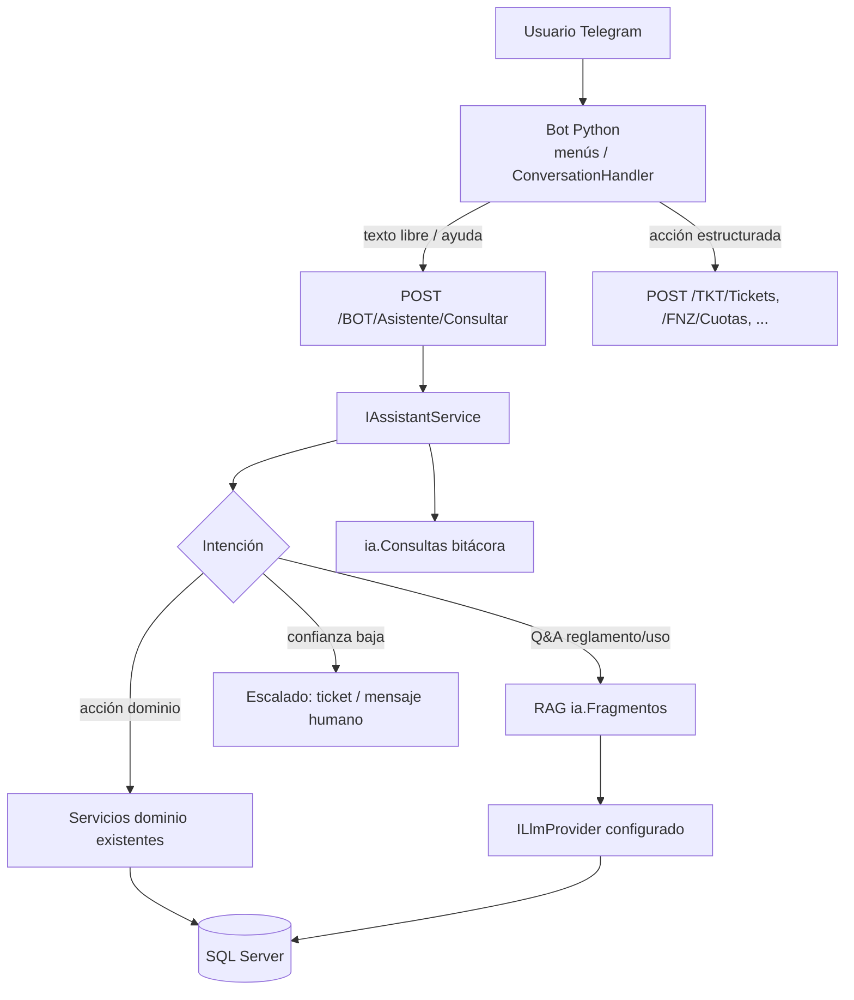

# Configuración — C500 Asiste (bot inteligente + proveedor IA)

> **Fuente de verdad** para implementar `IAssistantService`, RAG y el cliente Python.  
> Spec de dominio: [../specs/bot-ia.md](../specs/bot-ia.md) · Tickets: **IA-BE-005**, **BOT-BE-004**, **TKT-BOT-003**.

## Principio: el bot no es un chat con API key

| Incorrecto | Correcto |
|------------|----------|
| Python llama a Claude/OpenAI directamente | Python llama al **backend** REST con JWT del usuario |
| Lógica de negocio en handlers del bot | Bot orquesta UI; **servicios C#** ejecutan y validan |
| Respuestas inventadas sin fuente | RAG sobre `ia.Fragmentos` + **escalado** si `confianza < umbral` |

El proceso Python es un **cliente delgado** (como la web). La **inteligencia** vive en .NET: `IAssistantService` + proveedor LLM **inyectado por configuración**.

---

## Arquitectura de decisión (runtime)



---

## Configurador de IA (backend .NET 9)

### Patrón de código (Entrega 2)

- `ILlmProvider` — contrato único: `CompleteAsync`, `EmbedAsync` (o servicio de embeddings separado).
- Implementaciones: `AnthropicLlmProvider`, `OpenAiLlmProvider`, `AzureOpenAiLlmProvider` (añadir según necesidad).
- `IAssistantService` — usa `ILlmProvider` + repositorio RAG; **no** referencia SDKs en controllers.
- Selección de proveedor por configuración (`Assistant:Provider`), no por `if` dispersos en el bot Python.

### `appsettings.json` (estructura — valores sensibles vacíos)

```json
{
  "Assistant": {
    "Provider": "Anthropic",
    "DefaultModel": "claude-sonnet-4-20250514",
    "FallbackModel": "claude-haiku-4-20250514",
    "MinConfidenceToAnswer": 0.72,
    "EscalateOnLowConfidence": true,
    "MaxOutputTokens": 1024,
    "Temperature": 0.2,
    "Rag": {
      "TopK": 5,
      "MinSimilarity": 0.75,
      "MaxContextChars": 12000
    },
    "Intents": {
      "UseLlmClassifier": true,
      "DeterministicCommandsFirst": true
    }
  },
  "Telegram": {
    "BotToken": "",
    "WebhookUrl": "",
    "WebhookSecret": ""
  }
}
```

### Variables de entorno (producción — obligatorio)

| Variable | Uso |
|----------|-----|
| `Assistant__Provider` | `Anthropic` \| `OpenAI` \| `AzureOpenAI` |
| `Assistant__DefaultModel` | Modelo chat |
| `ANTHROPIC_API_KEY` | Si Provider = Anthropic |
| `OPENAI_API_KEY` | Si Provider = OpenAI |
| `AZURE_OPENAI_ENDPOINT` / `AZURE_OPENAI_API_KEY` | Si Azure |
| `TELEGRAM_BOT_TOKEN` | Notificador saliente + validación webhook (backend); el bot Python usa el mismo token vía `.env` |
| `Assistant__MinConfidenceToAnswer` | Umbral escalado (override opcional) |

> **Regla:** ninguna API key de LLM en el repo ni en el `.env` del bot Python.

### Registro DI (esquema)

```csharp
// Program.cs — patrón objetivo
builder.Services.Configure<AssistantOptions>(builder.Configuration.GetSection("Assistant"));
builder.Services.AddSingleton<ILlmProvider>(sp =>
{
    var opt = sp.GetRequiredService<IOptions<AssistantOptions>>().Value;
    return opt.Provider switch
    {
        "Anthropic" => sp.GetRequiredService<AnthropicLlmProvider>(),
        "OpenAI" => sp.GetRequiredService<OpenAiLlmProvider>(),
        _ => throw new InvalidOperationException($"Assistant:Provider no soportado: {opt.Provider}")
    };
});
builder.Services.AddScoped<IAssistantService, AssistantService>();
```

### Comportamiento obligatorio (`IAssistantService`)

1. **Comandos deterministas primero** (`/tickets`, `/cuotas`, `/tarea`) — no pasan por LLM.
2. **Texto libre** → clasificar intención; si es acción → delegar a servicio de dominio (misma regla que web).
3. **Pregunta normativa / uso del sistema** → RAG (`ia.Fragmentos`) + respuesta con **fuentes** citadas.
4. Si `confianza < Assistant:MinConfidenceToAnswer` → `escalado: true`, mensaje al usuario, opcional crear ticket; registrar en `ia.Consultas`.
5. **Nunca** persistir secretos en `bot.Mensajes` ni en logs.

---

## Cliente Python (bot Telegram)

### `.env` del bot (solo conectividad)

```env
TELEGRAM_TOKEN=
API_BASE_URL=https://localhost:7001
BOT_WEBHOOK_URL=          # prod
BOT_WEBHOOK_SECRET=       # prod
LOG_LEVEL=INFO
```

### Cuándo llama a qué

| Entrada usuario | Destino |
|-----------------|--------|
| Comando `/inicio`, botones de menú | Handlers locales → REST de dominio |
| Flujo ticket (prioridad, título…) | `POST /TKT/Tickets` |
| Pregunta abierta, “¿puedo…?”, reglamento | `POST /BOT/Asistente/Consultar` |
| `/bi` (Admin) | `POST /BOT/Asistente/Consultar` con contexto BI o endpoint Reports + redacción vía asistente |

Almacenar JWT por `chat_id` (memoria/redis `(asumido)`); renovar con refresh token cuando exista `sgr.RefreshTokens`.

---

## RAG — puesta en marcha

1. Cargar documentos en `ia.Documentos` (`reglamento`, `ayuda-sistema`, `faq`).
2. Job o comando admin: fragmentar → calcular embeddings vía `ILlmProvider.EmbedAsync` → `ia.Fragmentos`.
3. En consulta: top-K por similitud → prompt con fragmentos → LLM → guardar `ia.Consultas`.

Sin fragmentos indexados, el asistente debe **escalar**, no inventar.

---

## “Configurador” para administración (producto)

| Entrega | Qué hay |
|---------|---------|
| **Entrega 2 (mínimo)** | `appsettings` + variables de entorno; cambio de proveedor = redeploy/config del host |
| **Entrega Final (opcional)** | Pantalla Admin “Asistente” que persiste en BD `(asumido)` tabla `ia.ConfiguracionAsistente` — **fuera de scope Entrega 1**; no implementar sin ticket |

Para el implementador: **no esperar UI de configuración** en Fase 2; usar la sección `Assistant` de configuración.

---

## Tickets relacionados

| ID | Entrega |
|----|---------|
| BOT-BE-004 | Vinculación Telegram |
| TKT-BOT-003 | Handlers ticket |
| IA-BE-005 | `IAssistantService` + `ILlmProvider` + `/BOT/Asistente/Consultar` |
| BOT-BE-006 | Worker sugerencias |
| BOT-BE-019..022 | Flujos bot |

---

## Checklist antes de dar por listo el módulo IA

- [ ] Provider cambiable solo con config/env (sin recompilar para cambiar de Anthropic a OpenAI)
- [ ] Python sin API keys de LLM
- [ ] Consulta de prueba registrada en `ia.Consultas`
- [ ] Caso confianza baja → escalado verificable
- [ ] Acción “crear ticket” vía `ITicketService`, no SQL en el bot
