# CuartaQuinientos — Portal de Administración Condominial

Proyecto final del máster **AI4Devs (LIDR)** · Ariel Fonseca Sandoval

| | |
|---|---|
| **Portal web** | https://cuartaquinientosresidencial.runasp.net |
| **API (Swagger)** | https://apicuartaquinientos.runasp.net/swagger |
| **GraphQL** | https://apicuartaquinientos.runasp.net/graphql |
| **Salud** | https://apicuartaquinientos.runasp.net/health |
| **Repositorio** | https://github.com/afonsecanice/ProyectoFinalLIDR_AFS · rama **`final-project-AFS`** (entrega final) |
| **Uso de IA** | [`prompts.md`](prompts.md) |
| **Diseño detallado** | [`documentacion/`](documentacion/) |

> **Credenciales de prueba:** se entregan en el formulario de entrega (Typeform); no se publican en el repositorio.

---

## Índice

0. [Ficha del proyecto](#0-ficha-del-proyecto)
1. [Descripción general del producto](#1-descripción-general-del-producto)
2. [Arquitectura del sistema](#2-arquitectura-del-sistema)
3. [Modelo de datos](#3-modelo-de-datos)
4. [Especificación de la API](#4-especificación-de-la-api)
5. [Historias de usuario](#5-historias-de-usuario)
6. [Tickets de trabajo](#6-tickets-de-trabajo)
7. [Pull Requests](#7-pull-requests)

---

## 0. Ficha del proyecto

**0.1. Nombre completo:** Ariel Fonseca Sandoval

**0.2. Nombre del proyecto:** CuartaQuinientos — Portal de Administración Condominial

**0.3. Descripción breve:** primera plataforma digital del fraccionamiento CuartaQuinientos, donde vive el autor. Hoy la operación se lleva por WhatsApp, recibos en papel y hojas de cálculo; el sistema la centraliza en un portal web para residentes y administración, sobre una API única (REST + GraphQL) en .NET 9 y SQL Server.

**0.4. URL del proyecto:** https://cuartaquinientosresidencial.runasp.net (API en https://apicuartaquinientos.runasp.net).

**0.5. Repositorio:** https://github.com/afonsecanice/ProyectoFinalLIDR_AFS (privado; acceso de lectura para el equipo de LIDR).

**Alcance de esta entrega.** Implementados los dominios web + API documentados, incluyendo **reportes operativos (RPT)**, **tablero BI con snapshots** (`/admin/reportes`) y **aviso general** a residentes (`/admin/notificaciones/aviso`). **Fuera de alcance (v2):** bot de Telegram «C500 Asiste», resumen BI por IA (`/bi` + RAG) e integración BOT en menú. El diseño extendido se conserva en [`documentacion/`](documentacion/) y [`ContextoCuartaQuinientos/specs/reportes-bi.md`](ContextoCuartaQuinientos/specs/reportes-bi.md).

---

## 1. Descripción general del producto

### 1.1. Objetivo

Que residentes y administración dejen de depender de canales informales: los reportes de fallas tienen seguimiento, el estado de cuenta es consultable por cada residente y los avisos llegan a todos. Perfiles dinámicos en `sgr.Perfiles`: **Administrador**, **Residente**, **Guardia** y **Trabajador**.

### 1.2. Funcionalidades principales

| Dominio | Qué resuelve |
|---|---|
| **SGR** — usuarios, casas, perfiles y menús | Login JWT con refresh token, cambio de contraseña obligatorio, padrón de residentes, menú dinámico por perfil |
| **TKT** — tickets | El residente reporta incidencias; el admin asigna, cambia estado y comenta |
| **FNZ** — finanzas | Generación de cuotas, registro de pagos, estado de cuenta, morosos |
| **ANM** — anuncios | Comunicados con vigencia y marca de leído |
| **ENC** — encuestas | Encuestas con preguntas y resultados |
| **JNT** — juntas | Convocatorias, orden del día y acuerdos |
| **VTS** — visitas y áreas comunes | Pases de visita con QR y reservas de áreas comunes |
| **USR** — vehículos y mascotas | Registro por residente con catálogos administrables |
| **ARC** — archivos | Documentos del fraccionamiento por tipo |
| **WMS** — almacén | Inventario y préstamos de artículos |
| **NTF** — notificaciones | Bandeja in-app; aviso general admin a residentes del condominio |
| **BI / RPT** — reportes | Snapshots KPI (`bi.KpiSnapshots`), tendencias, exports PDF/Excel y morosos (`/admin/reportes`) |
| **Dashboard** | KPIs para admin y resumen para residente |

Detalle por módulo y visión del bot: [`documentacion/01-producto.md`](documentacion/01-producto.md).

### 1.3. Diseño y experiencia de usuario

SPA responsiva con sidebar colapsable, modo claro/oscuro, tablas admin que pasan a tarjetas en móvil y notificaciones tipo toast. Evolución del diseño: tickets `FE-UX-001` a `FE-UX-006` en `ContextoCuartaQuinientos/.planning/`.

#### Capturas del portal en producción

| Vista | Captura |
|---|---|
| **Login** — landing con JWT | 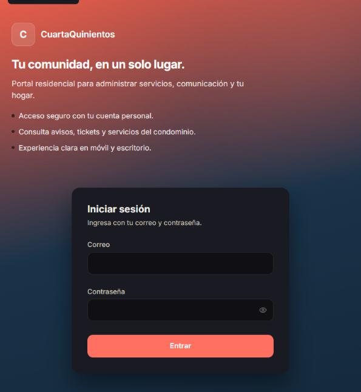 |
| **Dashboard Admin** — KPIs, accesos rápidos y notificaciones | 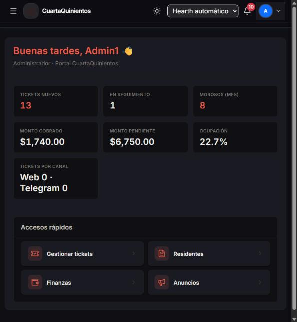 |
| **Reportes BI** — tendencias, morosos y exports PDF/Excel | 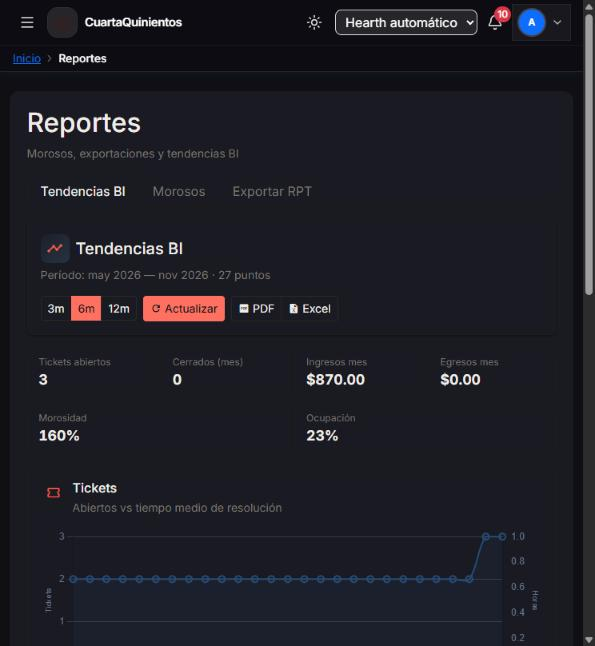 |
| **Gestión de Tickets** — listado admin con filtros y estados | 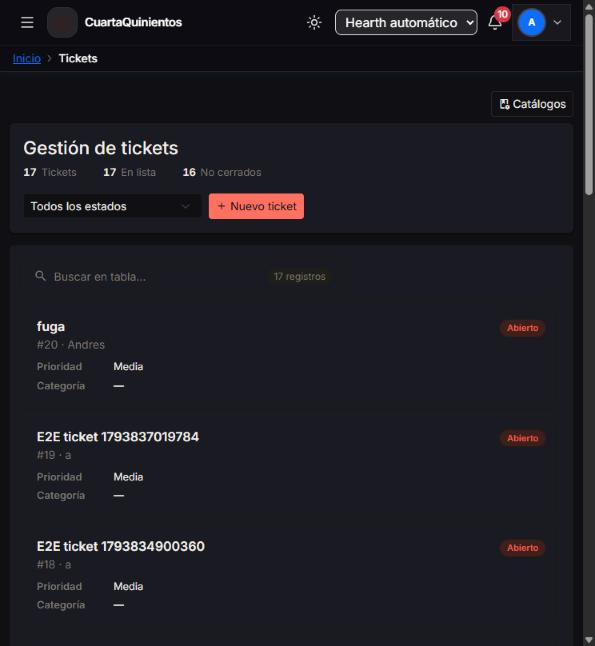 |
| **Finanzas** — cuotas por residente, morosos, cuentas contables | 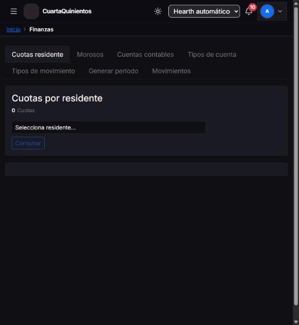 |
| **Residentes / Usuarios** — 13 usuarios con perfiles y roles | 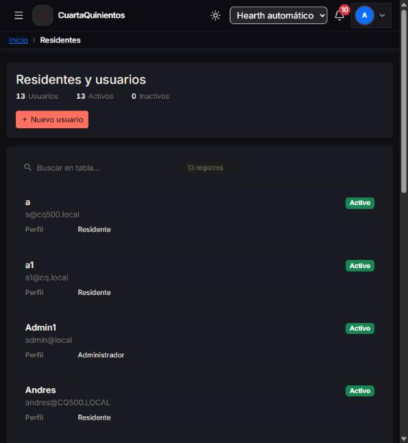 |
| **Anuncios** — publicaciones con vigencia y tipo | 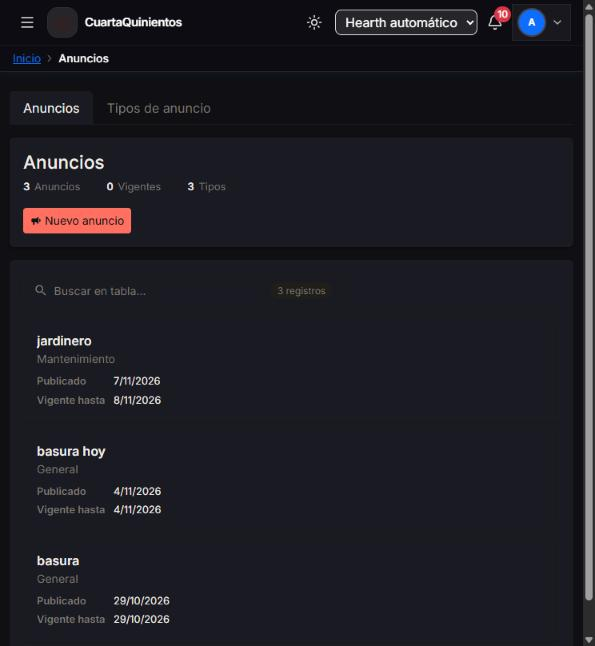 |
| **Aviso General** — notificación masiva a residentes | 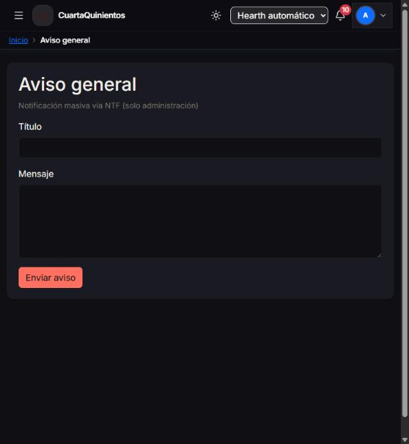 |
| **Casas** — 22 unidades con propietario asignado | 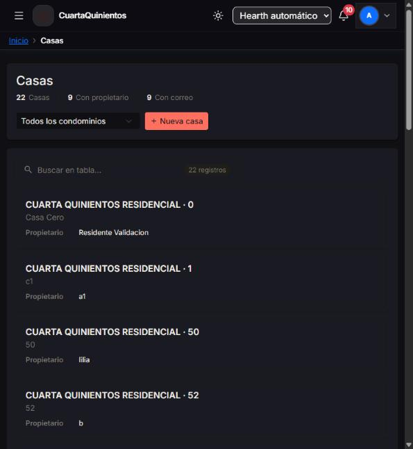 |
| **Encuestas** — votaciones activas con fechas | 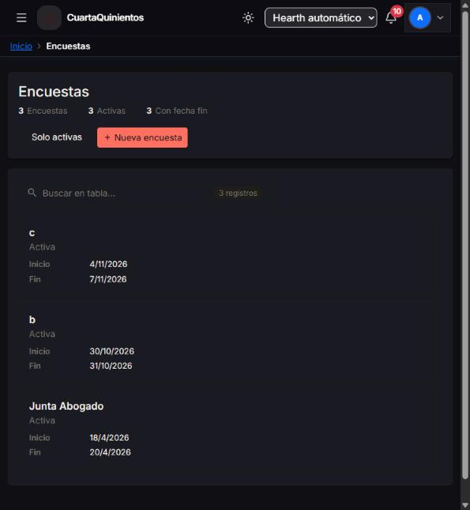 |
| **Juntas** — asambleas programadas con ubicación | 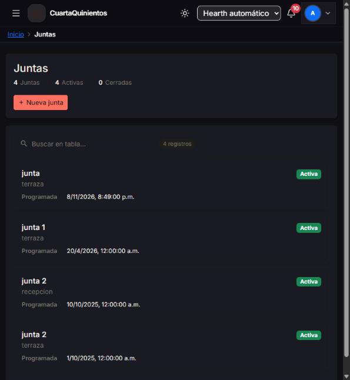 |
| **Almacén** — inventario, préstamos y categorías | 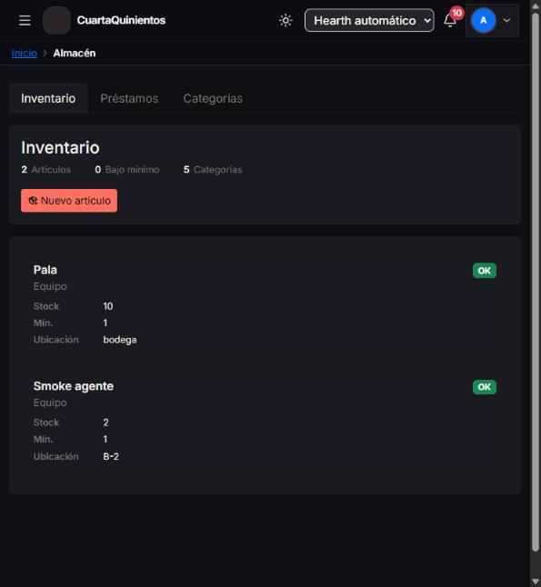 |
| **Archivos** — repositorio documental del condominio | 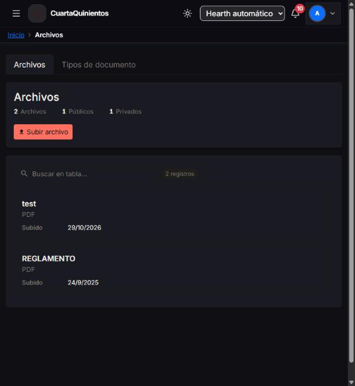 |

> Portal live: [cuartaquinientosresidencial.runasp.net](https://cuartaquinientosresidencial.runasp.net)

### 1.4. Instalación y ejecución local

**Requisitos:** .NET 9 SDK, Node.js 20+, SQL Server 2019+ (o Express).

**1. Base de datos**

```powershell
sqlcmd -S localhost -E -d master -Q "IF DB_ID('CuartaQuinientos') IS NULL CREATE DATABASE CuartaQuinientos;"
sqlcmd -S localhost -E -d CuartaQuinientos -b -I -i SQL/cuartaquinientos_schema.sql
sqlcmd -S localhost -E -d CuartaQuinientos -b -I -i SQL/DB-001_alineacion_modelo.sql
$hash = dotnet run -c Release --project SQL/tools/hash_password -- "TuPasswordSeguro"
sqlcmd -S localhost -E -d CuartaQuinientos -b -I -i SQL/DB-002_seeds_catalogos.sql -v AdminCorreo="admin@local" AdminPasswordHash="$hash" Demo=0
```

Seeds adicionales (`DB-003` … `DB-008`) y orden completo: [`SQL/README.md`](SQL/README.md).

**2. API (.NET 9)**

```powershell
cd GraphApi
copy ..\scaffolds\api\appsettings.Development.example.json appsettings.Development.json
dotnet user-secrets set "ConnectionStrings:Default" "<cadena de conexión>"
dotnet user-secrets set "JwtSettings:Key" "<32+ caracteres aleatorios>"
dotnet run --launch-profile https      # https://localhost:7242/swagger
```

**3. Web (React + Vite)**

```powershell
cd Web
copy .env.example .env.local           # VITE_API_URL=http://localhost:5180
npm ci
npm run dev                            # http://localhost:5173
```

Atajos: `start-api.bat`, `start-web.bat`. **Secretos solo en user-secrets o variables de entorno**, nunca en el repositorio.

**4. Tests**

```powershell
dotnet test GraphApi/GraphApi.Tests --filter "Category!=Smoke"   # unitarios
cd Web; npx vitest run
```

---

## 2. Arquitectura del sistema

### 2.1. Diagrama

```mermaid
graph LR
    U["Residente / Admin<br/>navegador"] -->|HTTPS| WEB["SPA React + TypeScript<br/>cuartaquinientosresidencial.runasp.net"]
    WEB -->|REST /{Dominio}/{Controller}<br/>GraphQL /graphql + JWT| API["API ASP.NET Core .NET 9<br/>apicuartaquinientos.runasp.net"]
    API -->|Dapper parametrizado<br/>IDbTransaction| DB[("SQL Server<br/>db24572.public.databaseasp.net")]
    API --> LOG["Serilog"]
    TG["Bot Telegram (v2)"] -. "mismo API, mismo JWT" .-> API
```

**Patrón:** monolito modular API-first. Un solo backend sirve a la web y, en v2, al bot, sin duplicar reglas de negocio. Capas por dominio: `Controllers → Services → Repositories` (Dapper), validación con FluentValidation, errores como `ProblemDetails` con `code` de negocio.

### 2.2. Componentes principales

| Componente | Tecnología |
|---|---|
| API | ASP.NET Core .NET 9 · HotChocolate 15 (GraphQL) · Swashbuckle · Dapper · FluentValidation · BCrypt · Serilog · QuestPDF / ClosedXML |
| Web | React 19 · TypeScript · Vite 8 · Apollo Client 4 · React Hook Form + Zod · Tailwind 4 + Bootstrap 5 |
| Datos | SQL Server · esquemas por dominio (`sgr`, `tkt`, `fnz`, …) · vistas `vs*` |
| Tests | xUnit + Moq · Vitest + Testing Library · suites T-SQL en `SQL/pruebas/` |

### 2.3. Estructura del repositorio

| Ruta | Contenido |
|---|---|
| `GraphApi/` | API .NET 9 y `GraphApi.Tests/` |
| `Web/` | SPA React |
| `SQL/` | Esquema (`cuartaquinientos_schema.sql`), migraciones `DB-00x`, pruebas y herramientas |
| `ContextoCuartaQuinientos/` | Specs por dominio y `.planning/tkt-*` (spec, design, impl y log de cada ticket SDD) |
| `documentacion/` | Diseño detallado de la Entrega 1 (producto, arquitectura, modelo, API, historias, tickets) |
| `scripts/` | `Deploy-Produccion.ps1` y smoke de Fase 1 |
| `CLAUDE.md`, `.claude/`, `.cursor/`, `sdd-toolkit/` | Convenciones y configuración de los agentes de IA |

### 2.4. Infraestructura y despliegue

Hosting en **MonsterASP / runasp.net**: API y SPA en sitios separados, SQL Server gestionado. Despliegue con un solo comando que corre tests, compila y publica por Web Deploy:

```powershell
.\scripts\Deploy-Produccion.ps1            # o -Solo Api / -Solo Web
```

Las credenciales se leen de los `.publishSettings` locales (excluidos de git). CI en GitHub Actions (`.github/workflows/ci.yml`): build y tests de API y Web.

### 2.5. Seguridad

- JWT con `sub` = `UsuarioID`; la identidad **siempre** sale del token, nunca del body.
- Refresh token en cookie `HttpOnly` + `Secure`, guardado como hash en `sgr.RefreshTokens` y revocable.
- Contraseñas con BCrypt; cambio obligatorio en el primer acceso.
- Rate limiting: login por IP y límite global.
- CORS restringido al origen del portal; cabeceras `X-Content-Type-Options`, `X-Frame-Options`, HSTS.
- Consultas Dapper siempre parametrizadas; secretos solo en user-secrets o variables de entorno.

**Decisiones de arquitectura (ADR):** Dapper + vistas sin SPs de negocio · GraphQL + REST API-first · archivos fuera de la BD detrás de `IFileStorage` · notificaciones por outbox. Registro completo: [`documentacion/02-arquitectura.md`](documentacion/02-arquitectura.md).

### 2.6. Tests

| Nivel | Herramienta | Volumen |
|---|---|---|
| Unitarios API | xUnit + Moq | ~52 archivos · **188** casos (runner Entrega 3, sin integración SQL) |
| Unitarios Web | Vitest + Testing Library | **104** archivos · **325** casos (+ gate `entrega3ModulosTdd`) |
| SQL | Suites `SQL/pruebas/*.sql` (`BEGIN TRAN … ROLLBACK`) | 1 suite por ticket de BD |
| Smoke | `Fase1SmokeApiIntegrationTests` (`Category=Smoke`) y `scripts/Invoke-Fase1Smoke.ps1` | Requiere API y BD levantadas |
| **Matriz Entrega 3** | [`MATRIZ_TDD_ENTREGA3.md`](ContextoCuartaQuinientos/MATRIZ_TDD_ENTREGA3.md) + gates `ModulosTddCoverageTests` / `entrega3ModulosTdd.test.ts` | `scripts/Invoke-Entrega3Tests.ps1` |

**CI vs runner Entrega 3:** GitHub Actions (`.github/workflows/ci.yml`) ejecuta `dotnet test` y `npm test` completos. `Invoke-Entrega3Tests.ps1` aplica el mismo Vitest y un subconjunto xUnit (**188** casos) que excluye `Category=Smoke` e integración HTTP+SQL (`Authorization`, `AuthServiceController`, `SetupDiagnostics`, `ReservacionesAdminEndpoint`). Los gates TDD comprueban que **exista** al menos un archivo de test por módulo, no sustituyen E2E ni smoke de API.

#### 2.6.1. E2E Playwright (smoke manual, opt-in)

No corre en CI por defecto (`E2E_SMOKE` unset → specs en skip). **Evidencia local recomendada** antes de Typeform: API + Web levantados, contraseña seed en env (no commitear).

```powershell
$env:E2E_SMOKE='1'
$env:FASE1_SMOKE_PASSWORD='<password seed local>'
# opcional: $env:E2E_BASE_URL='http://localhost:5173'
cd Web
npm run test:e2e
```

Atajo (carga `fase1-smoke.env` + `-Target Prod|Local`):

```powershell
.\scripts\Invoke-E2ESmoke.ps1 -Target Prod
```

**Nota:** las credenciales de `fase1-smoke.env` deben ser las mismas que funcionan contra **db24572** (login API 200). Si el login devuelve 401, actualiza el `.env` antes de E2E. El helper E2E usa `#password` (toggle «Mostrar contraseña» en login).

**Evidencia Entrega 3 (7 specs críticos + extra BI):** [`EVIDENCIA_E2E_ENTREGA3.md`](ContextoCuartaQuinientos/evidencia/20261104_E2E_CRITICO/EVIDENCIA_E2E_ENTREGA3.md) · entregables [`20261104_ENTREGA3_Entregables.md`](ContextoCuartaQuinientos/20261104_ENTREGA3_Entregables.md).

---

### 2.7. Limitaciones conocidas y deuda técnica

| Área | Detalle | Mitigación actual |
|---|---|---|
| **E2E no automatizados en CI** | Los 7 specs Playwright requieren API + BD levantadas (`E2E_SMOKE=1`); no corren en GitHub Actions | Runner local `Invoke-E2ESmoke.ps1` con evidencia en [`EVIDENCIA_E2E_ENTREGA3.md`](ContextoCuartaQuinientos/evidencia/20261104_E2E_CRITICO/EVIDENCIA_E2E_ENTREGA3.md) |
| **Cobertura de líneas no medida** | Gates TDD verifican presencia de tests por módulo, no porcentaje de cobertura | Matriz [`MATRIZ_TDD_ENTREGA3.md`](ContextoCuartaQuinientos/MATRIZ_TDD_ENTREGA3.md) asegura que ningún dominio quede sin tests |
| **Historial Git con secretos rotados** | Commits antiguos contienen credenciales de producción (ya rotadas e inválidas) | Password SQL y JWT key rotadas; `appsettings.Production.json` fuera del índice; incidente documentado en [`INCIDENTE_SECRETOS_PRODUCCION.md`](ContextoCuartaQuinientos/evidencia/20261109_SEGURIDAD_SECRETOS_GIT/INCIDENTE_SECRETOS_PRODUCCION.md) |
| **Bot Telegram (v2)** | Diseñado pero no implementado; carpeta `Bot/` sin código funcional | Arquitectura API-first permite agregarlo sin cambios al backend |
| **BI con RAG e IA (v2)** | Resumen inteligente de KPIs y chat con datos diferidos | Snapshots `bi.KpiSnapshots` y exports PDF/Excel ya operativos como base |
| **Hosting académico (MonsterASP)** | Tier gratuito con límites de recursos y sin SLA; deploy manual por Web Deploy | Script `Deploy-Produccion.ps1` reproducible; CI valida build y tests |

## 3. Modelo de datos

**Fuente única de verdad:** [`SQL/cuartaquinientos_schema.sql`](SQL/cuartaquinientos_schema.sql), más las migraciones `SQL/DB-00x_*.sql` en el orden de [`SQL/README.md`](SQL/README.md). Este README no duplica el DDL.

| Esquema | Entidades principales |
|---|---|
| `sgr` | Usuarios, Perfiles, Casas, CasaOcupantes, Menus, PerfilMenus, RefreshTokens |
| `tkt` | Tickets, ComentariosTicket, DocumentosTicket, catálogos de estado, prioridad y categoría |
| `fnz` | Cuotas, Cuentas, Transacciones, TiposMovimiento |
| `anm` · `enc` · `jnt` | Anuncios · Encuestas, Preguntas, Respuestas · Juntas y acuerdos |
| `vts` · `usr` | Visitas, VisitasGeneradas, AreasComunes, Reservaciones · Automóviles, Mascotas y catálogos |
| `arc` · `wms` · `ntf` | Archivos · Artículos y Préstamos · Notificaciones y su outbox de entrega |
| `bi` | KPIs mensuales (`bi.KpiSnapshots`, worker + reportes admin — **BI-RPT-001**, Entrega 3) |
| `bot` · `ia` | Diseñados para v2 (Telegram, RAG); sin carpeta `Bot/` en esta entrega |

Convenciones: auditoría (`Creado`, `Modificado`, `UsuarioCreacionID`, `FechaCreacion`, …) y borrado lógico `bEliminado` en todas las tablas; catálogos resueltos por nombre, nunca por ID fijo. Diagrama ER y descripción de entidades: [`documentacion/03-modelo-datos.md`](documentacion/03-modelo-datos.md).

---

## 4. Especificación de la API

- **REST:** `/{Dominio}/{Controller}`, sin prefijo `/api`. Contrato vivo en [`/swagger`](https://apicuartaquinientos.runasp.net/swagger).
- **GraphQL:** `/graphql` (HotChocolate), con explorador en la misma URL.
- **Errores:** `ProblemDetails` con `code` de negocio (`VALIDATION_ERROR`, `FORBIDDEN`, `CONFLICT`, …).

**Autenticación:**

```http
POST /SGR/AuthService/GenerateToken
Content-Type: application/json

{ "correo": "usuario@dominio.com", "password": "********" }
```

Responde `{ token, expira, perfil, nombre, requiereCambioPassword }` y deja el refresh token en cookie. Las demás llamadas usan `Authorization: Bearer <token>`.

**Endpoints representativos:**

| Método | Ruta | Uso |
|---|---|---|
| GraphQL | `mutation crearTicket` | Residente crea un ticket |
| `GET` | `/TKT/Tickets/mis` | Tickets del residente |
| `GET` | `/FNZ/Cuotas/mis` | Estado de cuenta del residente |
| `PATCH` | `/FNZ/Cuotas/{cuotaId}/pago` | Admin registra un pago |
| `GET` | `/Dashboard/Resumen` | KPIs (admin) o resumen (residente) |
| `GET` | `/SGR/Navegacion/menus` | Menú permitido para el perfil del JWT |

Inventario por dominio y ejemplos completos (REST y GraphQL): [`documentacion/04-api.md`](documentacion/04-api.md). Colecciones `.http` por ticket en `ContextoCuartaQuinientos/.planning/tkt-*/`.

---

## 5. Historias de usuario

Núcleo que funciona de punta a punta (web + API + BD):

| # | Historia | Resumen |
|---|---|---|
| 1 | **HU-USR-01** | Login con JWT y perfil |
| 2 | **HU-TKT-01** | Residente crea una incidencia |
| 3 | **HU-TKT-03** | Admin asigna y resuelve tickets |
| 4 | **HU-FNZ-01** | Residente consulta su estado de cuenta |
| 5 | **HU-FNZ-02** | Admin registra el pago de una cuota |

Habilitadores: cambio de contraseña obligatorio (HU-USR-03), alta de residentes (HU-USR-04) y generación de cuotas (HU-FNZ-06). Catálogo completo por dominio con criterios de aceptación y poke-holes: [`documentacion/05-historias-usuario.md`](documentacion/05-historias-usuario.md).

---

## 6. Tickets de trabajo

El trabajo se ejecutó con **Spec-Driven Development**: cada ticket pasa por `/definir → /diseñar → /ejecutar → /revisar → /completar`, con una revisión adversarial obligatoria. Cada uno deja su rastro en `ContextoCuartaQuinientos/.planning/tkt-<id>/` (`spec.md`, `design.md`, `impl.md` y un log de estados) y en [`_sdd_evolution.md`](ContextoCuartaQuinientos/_sdd_evolution.md).

Ejemplos con trazabilidad completa:

- **SGR-BE-030** — API JWT de navegación y permisos (3 pasadas de `/revisar`).
- **FE-043** — Anuncios para residente y admin (2 ciclos `REQUIERE CAMBIOS`).
- **FE-UX-001 … FE-UX-006** — rediseño de UX integral.
- **BI-RPT-001** — reportes admin, tendencias BI, exports RPT y aviso NTF (cierre Entrega 3 en `final-project-AFS`).

Los 40 tickets planificados en la Entrega 1 están en [`documentacion/06-tickets-trabajo.md`](documentacion/06-tickets-trabajo.md). El uso de IA en cada fase se documenta en [`prompts.md`](prompts.md).

---

## 7. Pull Requests

| Entrega | Rama | Contenido |
|---|---|---|
| 1 | `feature/entrega-1-AFS` (PR #1) | Diseño y documentación |
| 2 | `feature/entrega-2-AFS` | Implementación API + Web, despliegue y documentación de uso de IA |
| 3 (final) | **`final-project-AFS`** ([PR #2](https://github.com/afonsecanice/ProyectoFinalLIDR_AFS/pull/2)) | Cierre BI-RPT, portal UX, matriz TDD, E2E, Typeform (rama de entrega académica) |

Plantilla y pasos: [`documentacion/07-pull-requests-entrega-3.md`](documentacion/07-pull-requests-entrega-3.md).

Detalle de la PR de la Entrega 1: [`documentacion/07-pull-requests-entrega-1.md`](documentacion/07-pull-requests-entrega-1.md).
