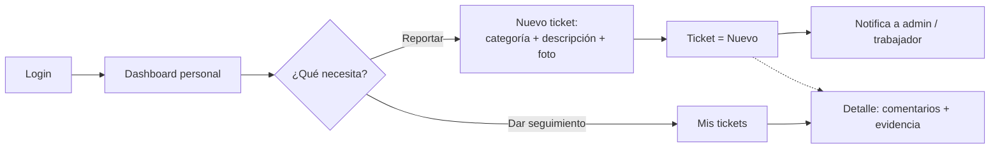
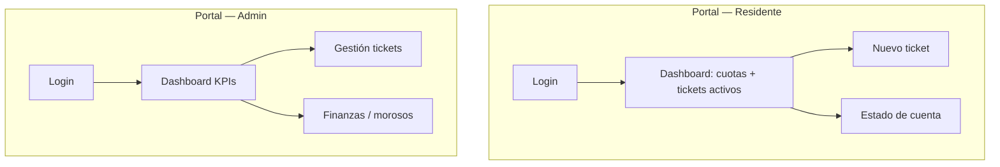
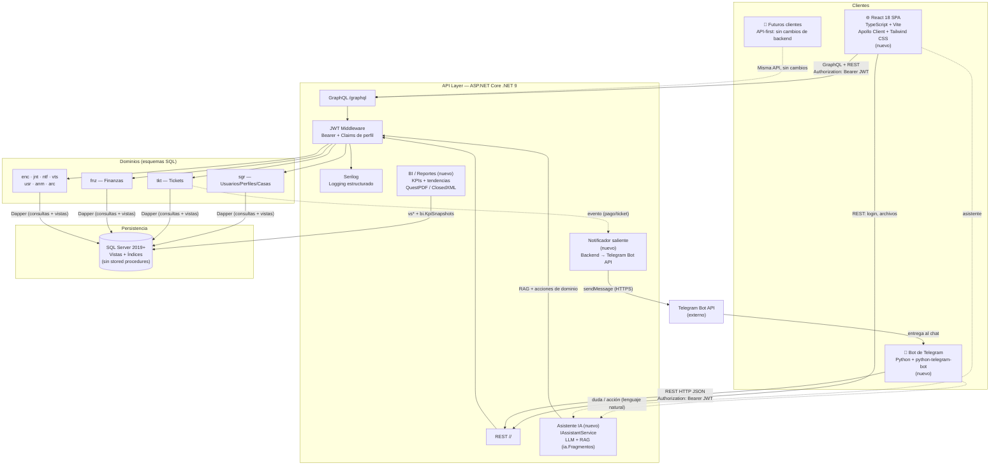
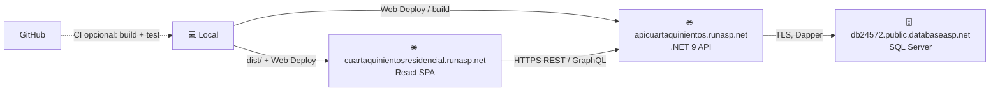

## Índice

1. [Ficha del proyecto](#0-ficha-del-proyecto)
2. [Descripción general del producto](#1-descripción-general-del-producto)
3. [Arquitectura del sistema](#2-arquitectura-del-sistema)
4. [Modelo de datos](#3-modelo-de-datos)
5. [Especificación de la API](#4-especificación-de-la-api)
6. [Historias de usuario](#5-historias-de-usuario)
7. [Tickets de trabajo](#6-tickets-de-trabajo)
8. [Pull Requests (Entrega 1)](#7-pull-requests-entrega-1)

---

## 0. Ficha del proyecto

### **0.1. Tu nombre completo:**

Ariel Fonseca Sandoval

### **0.2. Nombre del proyecto:**

CuartaQuinientos — Portal de Administración Condominial

### **0.3. Descripción breve del proyecto:**

CuartaQuinientos es un sistema web de gestión condominial para el fraccionamiento donde vive el autor, cuya administración hoy se lleva de forma manual (hojas de cálculo, grupos de WhatsApp y papelería física). **Es la primera plataforma digital del fraccionamiento**: sustituye la operación manual por un sistema diseñado con buenas prácticas desde su concepción. Cubre 15 módulos: usuarios y viviendas, tickets de mantenimiento, cuotas y pagos, notificaciones, dashboard, anuncios, encuestas, juntas, visitas y áreas comunes, archivos, reportes y BI, vehículos, mascotas y almacén, más **«C500 Asiste»**, un bot de Telegram con IA que permite operar todo el sistema desde el chat, resuelve dudas del reglamento y envía recordatorios proactivos (detalle en §1.2). La solución se compone de una SPA en React 18 + TypeScript, una API en ASP.NET Core .NET 9 (REST + GraphQL) sobre SQL Server, y un **bot de Telegram** como canal adicional que comparte la misma API sin duplicar lógica de negocio.

> **Nota de alcance (Entrega 1).** Documentación del **diseño** de la plataforma, antes de escribir código. Lo pendiente de definir se marca `(asumido)`. Telegram, IA, BI y almacén forman parte del diseño objetivo.

> **Alcance entrega final (implementación).** Se implementan todos los dominios documentados en este repositorio **excepto** el bot de Telegram, el asistente con IA (RAG) y reportes/BI avanzados, reservados para **v2**. La API expone **REST y GraphQL** según §4.


### **0.4. URL del proyecto:**

> **Entrega Final — URLs de hosting (MonsterASP / runasp.net):** API `https://apicuartaquinientos.runasp.net`, portal web `https://cuartaquinientosresidencial.runasp.net`. SQL Server gestionado en `db24572.public.databaseasp.net` (detalle §2.4). Secretos y cadenas de conexión solo en el panel del proveedor o variables de entorno, nunca en el repositorio.


### **0.5. URL o archivo comprimido del repositorio**

> [https://github.com/afonsecanice/ProyectoFinalLIDR_AFS](https://github.com/afonsecanice/ProyectoFinalLIDR_AFS) — repositorio **privado** del autor, rama de entrega `feature/entrega-1-AFS`. Se otorga acceso de lectura al equipo de LIDR (TA) mediante invitación al repositorio; la URL se envía en el formulario oficial (Typeform).
>
> **Lectura complementaria:** `prompts.md` (flujo de trabajo con IA).


### **0.6. Documentación técnica — cuatro capas (Módulo 5 AI4Devs)**


| Capa                 | Contenido en este repo                                   | Mantenimiento                   |
| -------------------- | -------------------------------------------------------- | ------------------------------- |
| **Arquitectura**     | `readme.md` §2 (Mermaid, trade-offs, §2.5.1 ADR inline)  | Cambia con decisiones de diseño |
| **API**              | `readme.md` §4 (OpenAPI + GraphQL)                       | Cambia con cada endpoint nuevo  |
| **Código / agentes** | Diseño en `readme.md` §5–§6 (Entrega 2+: repo de código) | Trazabilidad HU → ticket        |
| **Operacional + IA** | `prompts.md`                                             | Flujo humano–IA documentado     |


El eje de evaluación **“Uso de la IA”** se demuestra en `prompts.md` (plantilla AI-Ready, seis flujos completos, configuración de contexto —reglas, skills, subagentes— y poke-holes) y, en este archivo, un **máximo de tres prompts por sección** con el texto enviado, la herramienta usada y el artefacto que quedó en el repo — sin repetir conversaciones enteras.

### **0.7. Mapa del repositorio y punto de arranque (listo para programar)**


| Ruta                                                      | Qué contiene                                                                                                 | Estado Entrega 1                                                         |
| --------------------------------------------------------- | ------------------------------------------------------------------------------------------------------------ | ------------------------------------------------------------------------ |
| `readme.md`                                               | Contrato del producto: arquitectura, modelo, API, historias y tickets (**fuente de verdad del diseño**)      | Completo                                                                 |
| `prompts.md`                                              | Flujo de trabajo con IA, prompts representativos y supervisión humana                                        | Completo                                                                 |
| `CLAUDE.md`                                               | Contexto mínimo para agentes (convenciones, dónde vive cada verdad, comandos)                                | Completo                                                                 |
| `SQL/cuartaquinientos_schema.sql`                         | Esquema físico (DDL, sin datos): 16 esquemas, 73 tablas, 18 vistas `vs*`                                     | Borrador físico; se alinea al readme en **DB-000 → DB-001**              |
| `ContextoCuartaQuinientos/`                               | Handoff (`INICIO_IMPLEMENTACION.md`), `specs/` por dominio, `.planning/` SDD por ticket (`FASE1_ROADMAP.md`) | Fase 1 planificada                                                       |
| `Bot/`                                                    | Bot Python (`python-telegram-bot` 21)                                                                        | **Entrega 2** — se crea en el ticket del bot (§6); Entrega 1 = 0% código |
| `scaffolds/`                                              | Plantillas `appsettings` (API) y `.env` (Web)                                                                | Plantillas                                                               |
| `.cursor/`, `.claude/`, `sdd-toolkit/`, `sdd.config.yaml` | Metodología SDD: reglas, subagentes, comandos, skills, hooks y plantillas                                    | Operativo                                                                |

**Primer paso para programar (Entrega 2):** leer `ContextoCuartaQuinientos/INICIO_IMPLEMENTACION.md` y ejecutar en orden `SETUP-000 → DB-000 → DB-001 → DB-002 → USR-BE-007` (§6).

---


## 1. Descripción general del producto

**Prompt 1:** *(Claude · Sonnet/Opus · descubrimiento de dominio)*

```
Vivo en el fraccionamiento CuartaQuinientos. Hoy la administración no tiene ningún
sistema: todo se maneja por WhatsApp, recibos en papel y hojas de Excel, y los reportes
de fallas, los pagos y los avisos se pierden.

Quiero diseñar la primera plataforma digital del fraccionamiento, con buenas prácticas,
que cubra 15 módulos:
- Usuarios y viviendas, tickets de mantenimiento, cuotas y pagos, notificaciones y dashboard.
- Anuncios, encuestas, juntas, visitas y áreas comunes, archivos, y reportes/BI.
- Vehículos, mascotas y almacén.
- «C500 Asiste»: un bot de Telegram con IA para usar todo el sistema desde el chat.

Tecnología prevista:
- Backend: API en ASP.NET Core .NET 9 (REST + GraphQL), login con JWT, Dapper y SQL Server.
- Frontend: React 18 con Vite y Apollo.
- Bot: Python 3.11 con python-telegram-bot 21.

Para la Entrega 1 del máster AI4Devs necesito solo documentación, sin código:
descripción del producto, stack justificado, arquitectura y backlog (historias y
tickets), siguiendo Spec-Driven Development (primero la especificación, después el código).
```

*Fijó §0–§1: problema real del fraccionamiento, visión de plataforma completa (no MVP de tres módulos sin justificar) y bot como canal API-first.*

> **Respuesta del asistente:** Plataforma API-first, 15 módulos, perfiles `sgr.Perfiles`, Entrega 1 solo documentación (SDD). — [Registro completo](prompts.md#p1-producto)

**Prompt 2:** *(Claude · misma fase · decisión de stack)*

```
Genera trade-offs honestos para evaluadores: SQL Server vs PostgreSQL; GraphQL+REST
vs REST puro con ~15 dominios; Dapper+vistas vs EF Core; Apollo vs fetch manual;
bot Python aparte vs extensión .NET. Máx. ~150 palabras por punto. Incluye costos
y riesgos reales, no solo ventajas.
```

*Primer borrador proponía stored procedures y rutas `/api/`*; el refinamiento humano fijó **Dapper + vistas** `vs`* **+ servicios C#**, REST `/{Dominio}/{Controller}` y el orden de arranque de §1.4.*

> **Respuesta del asistente:** Tabla de trade-offs SQL Server / GraphQL+REST / Dapper / Apollo / bot Python; rechazo explícito de SPs y `/api/USR/login`. — `prompts.md` [Prompt 2 §1](prompts.md#p1-producto)

**Prompt 3:** *(Claude · alineación Módulos 4–5 del máster)*

```
Revisa la tabla de módulos §1.2: ANM = anuncios/comunicados (no mascotas);
VTS = visitas y áreas comunes (no vehículos); mascotas y vehículos en esquema usr.
Integra bot, ia, bi y wms como módulos del diseño con paridad web ↔ Telegram.
Marca (asumido) lo no cerrado con el administrador del fraccionamiento.
```

*Corrigió la confusión típica de la IA entre siglas de dominio; la nota de §1.2 y la matriz §5.0 reflejan el modelo acordado.*

> **Respuesta del asistente:** ANM/VTS/usr corregidos; WMS + «C500 Asiste» con esquemas `bot`, `ia`, `bi`; paridad web ↔ Telegram. — `prompts.md` [Prompt 3 §1](prompts.md#p1-producto)
>
> *Revisión posterior del autor (`prompts.md` §1 Prompt 4):* descripción general y detallada de cada módulo (§1.2.1) y de lo que hace el bot por perfil (§1.2.2).

---


### **1.1. Objetivo:**

El fraccionamiento CuartaQuinientos no cuenta con ningún sistema digital para su operación diaria: la interacción real de residentes y administración ocurre por WhatsApp, recibos en papel y hojas de cálculo. Los reportes de fallas se pierden sin seguimiento, el estado de cuenta no es consultable por el residente, y las convocatorias a juntas no siempre llegan a todos. Diseñaremos e implementaremos el sistema con un modelo de datos organizado por dominios funcionales.

CuartaQuinientos resuelve el problema **centralizando la operación condominial en una sola plataforma digital**: los residentes reportan incidencias, consultan su estado de cuenta y participan en encuestas; la administración obtiene visibilidad en tiempo real del estado financiero, los tickets abiertos y la ocupación. El canal de Telegram extiende estas capacidades a quienes prefieren no navegar un portal web, usando una interfaz de mensajería que ya usan a diario. Además, ese canal es un **asistente inteligente**: cubre todos los dominios del residente, **resuelve dudas** consultando el reglamento con IA (RAG), hace **sugerencias proactivas** (p. ej. pagar un adeudo vencido o renovar vacunas), permite **reservar la terraza y otras áreas comunes** por chat, y entrega a la administración un **resumen de BI** con los indicadores del fraccionamiento.

El público objetivo son principalmente **residentes** (reporte de incidencias, consulta de estado de cuenta, trámites, bot de Telegram) y **administradores del fraccionamiento** (gestión de todos los dominios, reportes, dashboard de KPIs y notificaciones), con dos perfiles operativos de apoyo: **Guardia** (control de acceso) y **Trabajador** (atención de tickets asignados). Los perfiles se gestionan de forma dinámica en `sgr.Perfiles` (con la bandera `bAdministrador`); el diseño define los perfiles **Administrador, Residente, Guardia** y **Trabajador** (personal de mantenimiento) — **Administrador** con `bAdministrador = 1`.

### **1.2. Características y funcionalidades principales:**

El sistema cubre 15 módulos funcionales. Cada uno se mapea a un esquema SQL en el diseño acordado.

> **Refinamiento con IA.** Una primera pasada confundió dominios: `ANM` **no** es Mascotas (es **Anuncios/comunicados**, esquema `anm`), y `VTS` **no** es Vehículos (es **Visitas y Áreas Comunes**, esquema `vts`). Los vehículos y las mascotas viven en el esquema `usr`. La tabla siguiente refleja el diseño acordado.


| #   | Módulo                                                 | Esquema real                                                                                                                 | Descripción                                                                                                                                                                                                                                                                                                                                                                                                                                                                                                                                                                                                                                |
| --- | ------------------------------------------------------ | ---------------------------------------------------------------------------------------------------------------------------- | ------------------------------------------------------------------------------------------------------------------------------------------------------------------------------------------------------------------------------------------------------------------------------------------------------------------------------------------------------------------------------------------------------------------------------------------------------------------------------------------------------------------------------------------------------------------------------------------------------------------------------------------ |
| 1   | **USR — Usuarios, Perfiles y Residencias**             | `sgr.Usuarios`, `sgr.Perfiles`, `sgr.Casas`, `sgr.Condominios`                                                               | Autenticación y autorización por perfil. El residente **es** un `Usuario` con `PerfilID`; su vivienda se modela en `sgr.Casas` (ligada al condominio y al usuario propietario vía `PropietarioUsuarioID`). Perfil editable y cambio de contraseña (`bActualizarPassword`).                                                                                                                                                                                                                                                                                                                                                                 |
| 2   | **TKT — Tickets de Servicio**                          | `tkt.Tickets` (+ `EstadosTickets`, `PrioridadesTicket`, `ComentariosTicket`, `DocumentosTicket`, `TicketsUsuariosAsignados`) | Reportes de incidencias. Estado y prioridad son **catálogos** (no enums en línea). Ciclo real: **Nuevo → En seguimiento → Resuelto → Cerrado**. Asignación N:M a personal, comentarios y **documentos adjuntos**.                                                                                                                                                                                                                                                                                                                                                                                                                          |
| 3   | **FNZ — Finanzas**                                     | `fnz.Cuotas`, `fnz.Cuentas`, `fnz.Transacciones`, `fnz.TiposMovimiento`                                                      | Cuotas por casa/usuario con período, vencimiento y estado de pago (`Pagado`, `FechaPago`, `MetodoPago`, `ReferenciaPago`). Cuentas y transacciones (cargo/abono) para contabilidad básica y reporte de morosos.                                                                                                                                                                                                                                                                                                                                                                                                                            |
| 4   | **ANM — Anuncios / Comunicados**                       | `anm.Anuncios`, `anm.TiposAnuncio`, `anm.LogVisualizacionAnuncios`                                                           | Comunicados generales del fraccionamiento, con tipos y bitácora de quién los vio.                                                                                                                                                                                                                                                                                                                                                                                                                                                                                                                                                          |
| 5   | **VTS — Visitas y Áreas Comunes**                      | `vts.Visitas`, `vts.AreasComunes`, `vts.ReservacionesArea`, `vts.ReservacionesEstados`                                       | Bitácora de control de acceso de visitantes y **reserva de amenidades** (salón, etc.) por horario y estado.                                                                                                                                                                                                                                                                                                                                                                                                                                                                                                                                |
| 6   | **ENC — Encuestas**                                    | `enc.Encuestas`, `enc.Preguntas`, `enc.OpcionesPregunta`, `enc.Respuestas`, `enc.TiposPregunta`                              | Encuestas **estructuradas**: preguntas tipadas con opciones ordenadas; respuestas por opción o texto libre → resultados consolidables.                                                                                                                                                                                                                                                                                                                                                                                                                                                                                                     |
| 7   | **JNT — Juntas**                                       | `jnt.Juntas`, `jnt.JuntaDetalle`, `jnt.JuntaDetalleArchivos`                                                                 | Convocatoria, contenido/acuerdos y archivos de asambleas.                                                                                                                                                                                                                                                                                                                                                                                                                                                                                                                                                                                  |
| 8   | **NTF — Notificaciones**                               | `ntf.Notificaciones`, `ntf.TiposNotificacion`, `ntf.NotificacionesVisualizadas`                                              | Avisos al usuario, tipados, con marca de leído. **La entrega por Telegram es una extensión planificada** (ver §2.5).                                                                                                                                                                                                                                                                                                                                                                                                                                                                                                                       |
| 9   | **Dashboard — KPIs**                                   | Vistas `vs`*                                                                                                                 | Panel del administrador: tickets abiertos/en seguimiento, morosos del mes, monto cobrado/pendiente y ocupación.                                                                                                                                                                                                                                                                                                                                                                                                                                                                                                                            |
| 10  | **ARC — Archivos**                                     | `arc.Archivos`, `arc.TiposArchivo`, `arc.LogVisualizacionArchivos`                                                           | Repositorio de documentos (reglamentos, actas) con tipos y bitácora de descarga.                                                                                                                                                                                                                                                                                                                                                                                                                                                                                                                                                           |
| 11  | **RPT — Reportes**                                     | Vistas `vs`* + servicios C# (QuestPDF/ClosedXML)                                                                             | Reportes de finanzas, tickets y operación, export a PDF/Excel.                                                                                                                                                                                                                                                                                                                                                                                                                                                                                                                                                                             |
| 12  | **VEH — Vehículos**                                    | `usr.Automoviles` (+ `Marcas`, `Modelos`)                                                                                    | Padrón de vehículos por usuario, con catálogos de marca/modelo y placas para control de acceso.                                                                                                                                                                                                                                                                                                                                                                                                                                                                                                                                            |
| 13  | **MAS — Mascotas**                                     | `usr.Mascotas` (+ `TiposMascota`, `RazasMascota`)                                                                            | Padrón de mascotas por usuario con catálogos de tipo/raza.                                                                                                                                                                                                                                                                                                                                                                                                                                                                                                                                                                                 |
| 14  | **WMS — Almacén**                                      | esquema nuevo `wms` (ver §2.5)                                                                                               | Inventario de herramientas y materiales, y préstamos a trabajadores (`wms.Articulos`, `wms.Prestamos`); modelado desde cero.                                                                                                                                                                                                                                                                                                                                                                                                                                                                                                               |
| 15  | **BOT — «C500 Asiste» (asistente de todo el sistema)** | esquemas nuevos `bot`, `ia` (ver §2.5)                                                                                       | Asistente conversacional **conciso y al punto** (pide solo lo mínimo, usa botones y el contexto del usuario). Cubre **todo el sistema según el perfil**: el residente opera tickets, cuotas, encuestas, juntas, anuncios, mascotas, vehículos, visitas/pases, reservas y perfil; el **trabajador** recibe su próxima tarea, la resuelve y **sube evidencia**; el **administrador administra desde el chat** (registrar pagos, publicar avisos/encuestas, gestionar tickets, `/bi`) sin entrar a la web. Es **inteligente**: resuelve dudas con RAG del reglamento (`ia.`*) y hace **sugerencias proactivas** (cobros, vacunas, encuestas). |


> **Módulos ampliados.** **WMS — Almacén** y **asistente + BI** usan esquemas propios (`wms`, `bot`, `ia`, `bi` — §2.5).

> **Paridad total web ↔ bot.** «C500 Asiste» expone **los mismos 15 módulos** que la web, según el perfil — no es un subconjunto: es *la misma funcionalidad, en formato conversacional y potenciada con IA*. Todo lo que se hace en la web se puede hacer en el bot (levantar/atender tickets con evidencia, cuotas y pagos, encuestas, juntas, anuncios, mascotas, vehículos, visitas/pases QR, reservas, archivos, reportes/BI, perfil y administración), y el asistente añade valor encima: resuelve dudas del **uso del sistema** y del reglamento, guía paso a paso, sugiere de forma proactiva y automatiza tareas repetitivas.


#### **1.2.1. Detalle por módulo**

Cada módulo se describe en dos niveles: **general** (qué problema resuelve) y **detallado** (qué hace cada perfil y las reglas clave). La fase indica cuándo se construye (roadmap §5); las historias están en §5 y los tickets en §6.

**1. USR — Usuarios, Perfiles y Residencias** · *Fase 1 · HU-USR-01..04*
- **General:** puerta de entrada al sistema. Identifica a cada persona, su perfil y la vivienda que ocupa, para que cada quien vea y haga solo lo que le corresponde.
- **Detallado:**
  - Login con correo y contraseña; sesión con JWT y renovación segura (refresh token en cookie `HttpOnly`); bloqueo temporal tras 5 intentos fallidos.
  - Todo usuario nuevo inicia con contraseña temporal y **debe cambiarla** en su primer acceso.
  - El residente consulta y edita sus datos de contacto; no puede cambiar su perfil ni su vivienda.
  - El administrador da de alta, edita y desactiva usuarios y los liga a su casa (`sgr.CasaOcupantes`); **no hay auto-registro público**.
  - Perfiles: Administrador, Residente, Guardia y Trabajador; los permisos por pantalla salen del menú dinámico por perfil.

**2. TKT — Tickets de Servicio** · *Fase 1 (adjuntos en Fase 2) · HU-TKT-01..05*
- **General:** sustituye los reportes de fallas por WhatsApp por un ticket con seguimiento, responsable y fecha de cierre.
- **Detallado:**
  - El residente levanta un ticket (título, descripción, categoría como Agua, Electricidad o Seguridad, y prioridad) desde la web o el bot; el ticket queda ligado a su casa y al canal de origen.
  - Consulta sus tickets con filtro por estado, del más reciente al más antiguo, y ve comentarios y evidencia.
  - El administrador ve todos los tickets del condominio, los **asigna a un trabajador**, cambia su estado y agrega comentarios internos que el residente no ve.
  - Ciclo de vida controlado: **Nuevo → En seguimiento → Resuelto → Cerrado**; transiciones inválidas se rechazan y reabrir limpia la fecha de cierre.
  - Cada cambio relevante (ticket nuevo, asignación, cambio de estado) genera una notificación.
  - Comentarios del residente (Should), calificación de la resolución (Could) y fotos adjuntas (Fase 2).

**3. FNZ — Finanzas** · *Fase 1 · HU-FNZ-01..06*
- **General:** transparenta las cuotas de mantenimiento: cuánto debe cada casa, qué pagó y quién está en mora, sin recibos en papel ni hojas de cálculo.
- **Detallado:**
  - El administrador **genera las cuotas del período** para todas las casas ocupadas (sin duplicar si se repite la operación).
  - El residente consulta su estado de cuenta: cuotas pendientes, vencidas y pagadas, con montos y fechas.
  - El administrador **registra el pago** de una cuota (fecha, método y referencia); en Fase 1 no hay pagos parciales y se evita el doble registro.
  - Reporte de **morosos** del mes para cobranza.
  - Registro de movimientos contables de cargo/abono (Should) y exportación del estado de cuenta en PDF (Could).
  - Cada pago registrado notifica al residente.

**4. ANM — Anuncios / Comunicados** · *Fase 2 · HU-ANM-01..02*
- **General:** canal oficial de comunicados, en lugar de mensajes que se pierden en el grupo de WhatsApp.
- **Detallado:** el administrador publica comunicados clasificados por tipo (catálogo `anm.TiposAnuncio`); los residentes los consultan en la web o el bot, y el sistema registra quién los vio.

**5. VTS — Visitas y Áreas Comunes** · *Fase 3 · HU-VTS-01..03, HU-BOT-08*
- **General:** controla quién entra al fraccionamiento y ordena el uso de las amenidades.
- **Detallado:**
  - El guardia registra visitantes (nombre, identificación, casa que visita y autorización) con su hora de entrada y de salida; el residente puede generar pases de visita con QR.
  - El residente reserva áreas comunes (terraza, salón) por horario; la reserva pasa por estados y se confirma con notificación.
  - El administrador consulta la bitácora de accesos.

**6. ENC — Encuestas** · *Fase 2 · HU-ENC-01..03, HU-BOT-13*
- **General:** permite consultar la opinión de los vecinos de forma ordenada y con resultados medibles.
- **Detallado:** el administrador crea encuestas con título, vigencia, preguntas tipadas y opciones, y al publicarlas los residentes reciben notificación; el residente responde una sola vez desde la web o el chat; el administrador ve los resultados consolidados.

**7. JNT — Juntas** · *Fase 3 · HU-JNT-01..02*
- **General:** asegura que las convocatorias a asamblea y sus acuerdos lleguen a todos y queden registrados.
- **Detallado:** el administrador publica la convocatoria (fecha, ubicación y descripción), después los acuerdos y los archivos del acta; los residentes reciben notificación (portal y Telegram) y las consultan.

**8. NTF — Notificaciones** · *Fase 1 (envío por Telegram en Fase 2) · HU-NTF-01..03*
- **General:** avisa a cada usuario de lo que le importa sin que tenga que estar revisando el sistema.
- **Detallado:**
  - Notificaciones internas por evento (ticket nuevo, asignado o con cambio de estado, pago registrado, cuota vencida, encuesta, junta, reserva, aviso general), con *badge* de no leídas y opción de marcarlas como leídas.
  - El administrador envía **avisos generales** a todos los residentes activos.
  - Toda notificación se genera en un único servicio; para los usuarios vinculados a Telegram se encola su entrega (outbox) y en Fase 2 el bot la envía sin duplicados.

**9. Dashboard — KPIs** · *Fase 1 · HU-DASH-01..02*
- **General:** muestra el estado del fraccionamiento de un vistazo.
- **Detallado:** el **administrador** ve tickets abiertos y en seguimiento, morosos del mes, monto cobrado y pendiente, ocupación de casas y tickets por canal (web/Telegram); el **residente** ve su resumen personal: cuota del mes, tickets activos y notificaciones sin leer.

**10. ARC — Archivos** · *Fase 2 · HU-ARC-01..02*
- **General:** un solo lugar para los documentos oficiales del fraccionamiento.
- **Detallado:** el administrador sube y clasifica documentos oficiales (reglamento, actas) por tipo; los residentes los descargan y queda bitácora de consulta. Los archivos se guardan fuera de la BD (almacenamiento de objetos, ADR-006).

**11. RPT — Reportes y BI** · *Fase 3 · HU-RPT-01..02, HU-BI-01..03*
- **General:** convierte la operación diaria en información para decidir.
- **Detallado:** reporte financiero mensual y de tickets por período exportables a PDF/Excel; **tablero BI** con tendencias (cobranza, morosidad, tiempos de resolución, ocupación) a partir de cortes periódicos de KPIs, y resumen BI enviado por Telegram al administrador.

**12. VEH — Vehículos** · *Fase 3 · HU-VEH-01..02*
- **General:** padrón de vehículos para apoyar el control de acceso.
- **Detallado:** el residente registra sus vehículos (marca, modelo, placas); el administrador y la vigilancia los consultan para identificar vehículos autorizados.

**13. MAS — Mascotas** · *Fase 3 · HU-MAS-01..02*
- **General:** padrón de mascotas del fraccionamiento.
- **Detallado:** el residente registra sus mascotas (tipo, raza, vacunas al día); el administrador consulta el padrón; el vencimiento de vacunas alimenta las sugerencias del bot.

**14. WMS — Almacén** · *Fase 3 · HU-WMS-01..03*
- **General:** controla herramientas y materiales de mantenimiento para que no se pierdan.
- **Detallado:** el administrador da de alta y ajusta artículos del inventario; registra el **préstamo** de herramienta a un trabajador y su devolución.

**15. BOT — «C500 Asiste»** · *Fase 2 (canal) y Fase 3 (IA) · HU-BOT-01..13* — ver §1.2.2.

#### **1.2.2. «C500 Asiste» — qué hace el bot de Telegram**

- **General:** es la misma plataforma dentro de Telegram, la aplicación que los vecinos ya usan a diario. Permite operar el sistema **sin entrar a la web**, con mensajes cortos y botones, y añade un asistente inteligente que resuelve dudas y se adelanta a lo que el usuario necesita.
- **Cómo funciona:** el bot es solo un **cliente del mismo API** que usa la web: no consulta la base de datos, no guarda claves de IA y no duplica reglas de negocio. El usuario vincula su cuenta con un **token de un solo uso** generado en la web (nunca escribe su contraseña en el chat) y puede desvincularla cuando quiera. Detalle técnico en §2.8.

**Qué puede hacer cada perfil desde el chat:**

| Perfil | Acciones principales |
|---|---|
| **Residente** | Levantar un ticket en segundos (`/tickets`) y ver su estado; consultar su estado de cuenta (`/cuotas`); recibir notificaciones al momento (pago registrado, ticket resuelto, cuota por vencer); responder encuestas; reservar la terraza u otra área común; consultar anuncios, juntas y documentos; registrar visitas, vehículos y mascotas. |
| **Trabajador** | Ver su **próxima tarea** asignada, ordenada por prioridad (`/tarea`); subir foto de evidencia y marcarla como resuelta. |
| **Administrador** | Registrar pagos, publicar avisos y encuestas, gestionar tickets y recibir el **resumen BI** (`/bi`) sin abrir la web. |
| **Guardia** | Registrar la entrada de visitantes y validar pases (Fase 3). |

**Lo que lo hace inteligente (Fase 3, salvo las sugerencias de cobro en Fase 2):**
- **Resuelve dudas** del reglamento y del uso del sistema con IA (RAG sobre el reglamento y la guía de uso). Si no está seguro, **no inventa**: lo dice, registra la consulta y ofrece abrir un ticket.
- **Sugerencias proactivas:** recuerda adeudos vencidos, vacunas de mascotas por renovar, encuestas pendientes y reservas próximas.
- **Guía paso a paso** y usa el contexto del usuario (quién es, su casa, su historial) para no volver a preguntar lo que ya sabe: una acción por mensaje, confirmación de un toque.

### **1.3. Diseño y experiencia de usuario:**

> **Entrega 1:** aún no hay UI implementada; las **wireframes conceptuales** (wireframes) están en Mermaid abajo. Capturas del producto real y videotutorial se publican en la **Entrega Final**.

La interfaz web se construye con Tailwind CSS siguiendo un sistema de diseño consistente, con objetivo de accesibilidad **WCAG 2.1 AA**, tipografía legible y navegación por sidebar. La navegación y los permisos por pantalla se apoyan en el menú dinámico por perfil (`sgr.Menus`, `sgr.MenusBotones`, `sgr.PerfilMenus`, `sgr.PerfilMenuBotones`), lo que permite una autorización granular por pantalla y acción. El flujo del residente: login → dashboard personal (estado de cuenta y tickets activos) → acción (reportar ticket / ver cuotas). El flujo del administrador: login → dashboard de KPIs → gestión de cualquier dominio.

El asistente **C500 Asiste** (Telegram) es **conciso y directo**: pide únicamente el dato mínimo indispensable, prefiere **botones inline** a texto libre y aprovecha el contexto (usuario autenticado, historial) para no volver a preguntar lo que ya sabe — una acción por mensaje, confirmación de un toque. Presenta **menús por perfil** (residente / trabajador / admin) con comandos como `/inicio`, `/tickets`, `/tarea`, `/cuotas`, `/bi`, `/ayuda`.

**Sistema de diseño (decisiones):** color primario + estados semánticos (éxito / alerta / error), tipografía de sistema legible, escala de espaciado de 4 px, componentes base reutilizables (botón, tabla, modal, toast, *badge* de estado, tarjeta KPI), tema claro/oscuro y foco visible. Los tokens viven en `tailwind.config.js`. Todos los estados (ticket, cuota) se muestran con **color + etiqueta** (nunca solo color) para cumplir WCAG 2.1 AA.

**Mapa de navegación por perfil:**

- **Residente:** Inicio (resumen) · Mis tickets · Estado de cuenta · Encuestas · Anuncios · Mi vivienda (mascotas / vehículos / visitas) · Perfil.
- **Trabajador:** Mis tareas (cola priorizada) · Detalle + subir evidencia.
- **Administrador:** Dashboard KPIs · Tickets · Finanzas · Residentes · Encuestas / Juntas / Anuncios · Almacén · Reportes / BI · Configuración.

**Flujo principal — el residente levanta y da seguimiento a un ticket:**




> El **mismo flujo** está disponible en «C500 Asiste» (Telegram), por chat y con los pasos mínimos.

**Wireframes conceptuales (Entrega 1):**




### **1.4. Instrucciones de instalación:**

**Requisitos previos:**

- Node.js 20+
- .NET 9 SDK (backend objetivo `net9.0`)
- SQL Server 2019+ (o SQL Server Express)
- Python 3.11+ (bot de Telegram, `python-telegram-bot` 21.x)
- Token de bot de Telegram (obtenido desde @BotFather)
- Git

> Las carpetas `GraphApi/` y `Web/` se crean en **SETUP-000** (Entrega 2); los nombres coinciden con `sdd.config.yaml`, que usan los agentes SDD. `Bot/` también llega en Entrega 2; en Entrega 1 solo existe `SQL/` (esquema de diseño). Los pasos siguientes describen el arranque **objetivo**.

**1. Base de datos (SQL Server):**

```bash
# Crear la BD (una vez)
sqlcmd -S localhost -E -d master -Q "IF DB_ID('CuartaQuinientos') IS NULL CREATE DATABASE CuartaQuinientos;"
# Esquema (solo estructura, idempotente tras DB-000) + alineación al modelo (DB-001) + catálogos y admin inicial (DB-002)
sqlcmd -S localhost -E -d CuartaQuinientos -i SQL/cuartaquinientos_schema.sql
sqlcmd -S localhost -E -d CuartaQuinientos -i SQL/DB-001_alineacion_modelo.sql      # Entrega 2 (script aún no existe)
sqlcmd -S localhost -E -d CuartaQuinientos -i SQL/DB-002_seeds_catalogos.sql -v AdminCorreo="admin@local" AdminPasswordHash="<hash BCrypt>"   # Entrega 2 (script aún no existe)
# Detalle: SQL/README.md · suites de prueba SQL/pruebas/ también llegan en Entrega 2
```

**2. Backend (.NET 9):**

```bash
cd GraphApi
cp ../scaffolds/api/appsettings.Development.example.json appsettings.Development.json
# Secretos SOLO en user-secrets / variables de entorno (nunca en git):
dotnet user-secrets set "Jwt:SecretKey" "<≥32 caracteres aleatorios>"
dotnet user-secrets set "Telegram:BotToken" "<token @BotFather>"      # notificador saliente (Fase 2)
dotnet user-secrets set "Telegram:BotServiceSecret" "<secreto compartido con el bot>"
dotnet user-secrets set "Assistant:ApiKey" "<clave del proveedor LLM>"   # Fase 3
dotnet restore
dotnet run
# API: https://localhost:7001/graphql (GraphQL), /{Dominio}/{Controller} (REST), /swagger, /health
dotnet test ../GraphApi.Tests
```

**3. Bot de Telegram (Python) — Entrega 2:**

```bash
cd Bot
python -m venv .venv
source .venv/bin/activate          # Windows: .\.venv\Scripts\Activate.ps1
pip install -r requirements.txt    # python-telegram-bot 21.x, httpx, python-dotenv
cp .env.example .env
# .env — SOLO conectividad, sin claves de LLM:
# TELEGRAM_TOKEN=<token de @BotFather>
# API_BASE_URL=https://localhost:7001
# BOT_SERVICE_SECRET=<mismo valor que Telegram:BotServiceSecret del backend>
# BOT_WEBHOOK_URL / BOT_WEBHOOK_SECRET (solo producción; en local se usa polling)
python -m bot.main
```

**4. Frontend (React 18 + Vite):**

```bash
cd Web
cp ../scaffolds/web/.env.example .env.local
# VITE_GRAPHQL_URL=https://localhost:7001/graphql
# VITE_API_URL=https://localhost:7001   (REST por dominio: /{Dominio}/{Controller}, sin prefijo /api)
npm install
npm run dev       # http://localhost:5173
npm test          # Vitest + Testing Library
```

**Orden de arranque local:** SQL Server → API → Web → Bot (el bot requiere la API en marcha).

---


## 2. Arquitectura del Sistema


### **2.1. Diagrama de arquitectura:**

**Prompt 1:** *(Claude · arquitectura)*

```
Diagrama Mermaid (graph TB): React SPA, bot Telegram, API .NET 9 (GraphQL + REST + JWT),
SQL Server (vistas vs*, sin SPs de negocio), notificador saliente, IAssistantService (RAG),
módulo BI. Despliegue: Vercel + Railway. Los clientes consumen la misma API (API-first).
```

*Generó el diagrama de §2.1 y la narrativa de trade-offs (atomicidad de negocio en un solo despliegue, GraphQL para dashboards compuestos).*

> **Respuesta del asistente:** Diagrama §2.1 con PUSH, IA, BI; justificación API-first y monolito .NET. — `prompts.md` [§2](prompts.md#p2-arquitectura)

**Prompt 2:** *(Claude · infraestructura)*

```
Añade diagrama Mermaid de despliegue: GitHub Actions → Railway (API+BD), Vercel (SPA),
segundo servicio bot (webhook HTTPS). Explica webhook vs polling en dev/prod.
```

*Quedó §2.4; se añadió explícitamente el **notificador saliente** backend → Telegram Bot API (componente que el primer borrador trataba como opcional).*

> **Respuesta del asistente:** CI → Railway + Vercel + bot webhook; idempotencia en `ntf.NotificacionesEntrega`. — `prompts.md` [§2](prompts.md#p2-arquitectura)

**Prompt 3:** *(Claude · revisión adversarial — ver también §5.0.1)*

```
Revisa el diseño de auth del bot: ¿es seguro pedir correo y contraseña en el chat?
Propón alternativa y tablas mínimas en esquema bot.* sin duplicar lógica de SGR.
```

*Disparó ADR-004, §2.5 (vinculación por token de un solo uso,* `bot.TokensVinculacion`*,* `bot.CuentasTelegram`*) y la regla de que el bot usa el **mismo JWT y permisos** que la web.*

> **Respuesta del asistente:** Login en chat **rechazado**; flujo token efímero + deep link (ADR-004). — `prompts.md` [§2](prompts.md#p2-arquitectura)




**Justificación de la arquitectura:**

**¿Por qué GraphQL sobre REST puro?** Con más de una docena de dominios interconectados, las vistas del portal necesitan datos cruzados —el dashboard de un residente muestra tickets, cuotas y notificaciones en una sola pantalla—. GraphQL permite solicitar exactamente esos campos en un único request, eliminando over-fetching. El bot y **cualquier futuro cliente** consumen el mismo endpoint sin versiones distintas: es un diseño **API-first** deliberado, para dejar el sistema encaminado a otros canales (p. ej. móvil) más adelante sin rehacer el backend. REST y GraphQL conviven: REST por dominio y GraphQL para las vistas compuestas del portal.

**¿Por qué Dapper + vistas (y no un ORM pesado)?** El acceso a datos usa Dapper con **consultas parametrizadas** sobre tablas y **18 vistas** `vs`* desnormalizadas (`sgr.vsUsuarios`, `tkt.vsTickets`, `fnz.vsTransacciones`, `vts.vsReservacionesArea`, … —) que resuelven los joins de lectura. La lógica de negocio y las validaciones viven en la **capa de servicios C#** (con FluentValidation); el diseño **no usa stored procedures de negocio** — la atomicidad se maneja con transacciones de conexión (Dapper `IDbTransaction`) y las consultas parametrizadas previenen la inyección SQL. Es el patrón de acceso a datos acordado.

**¿Por qué el bot de Telegram como canal adicional?** WhatsApp es el canal informal real del fraccionamiento. El bot ofrece una alternativa estructurada: comandos claros, respuestas inmediatas y notificaciones automáticas. Reutiliza el mismo backend REST del portal —sin lógica duplicada—, de modo que un ticket abierto desde el bot aparece de inmediato en la administración.

**Trade-offs asumidos:**

- SQL Server tiene costo de licencia en producción (mitigado con Azure SQL serverless o SQL Server Express para el MVP).
- El esquema y las vistas se versionan con scripts SQL numerados por ticket (`DB-000`, `DB-001`, …), idempotentes; no hay migraciones automáticas tipo EF.
- **Railway no ofrece SQL Server gestionado:** se despliega la imagen oficial `mcr.microsoft.com/mssql/server` (edición Express/Developer, ≥ 2 GB de RAM, volumen persistente). Alternativa evaluada: Azure SQL Database en su oferta gratuita `(asumido — validar costo/límites al desplegar)`.
- El bot de Telegram introduce un proceso Python adicional que debe desplegarse y monitorearse por separado.
- La notificación proactiva a Telegram exige un **componente saliente nuevo** (backend → Telegram Bot API): es un componente nuevo del diseño.


### **2.2. Descripción de componentes principales:**

**ASP.NET Core (.NET 9) + GraphQL:** Backend con endpoints REST por dominio y una capa GraphQL. Genera el schema desde tipos C#, soporta queries/mutations y evita el problema N+1 con DataLoaders.

**Dapper:** Micro-ORM que ejecuta consultas parametrizadas sobre tablas y vistas y mapea los resultados a objetos C#. La validación de entrada se hace con **FluentValidation** en la capa de servicios; no hay stored procedures de negocio en runtime.

**JWT:** Tokens firmados con claims estándar del proyecto: `sub` (`UsuarioID`), `correo` (se usa para las columnas de auditoría `Creado`/`Modificado`), `nombre` (nombre para mostrar), `perfil` (nombre del perfil en `sgr.Perfiles`, configurado como `RoleClaimType` para que `[Authorize(Roles=…)]` funcione), `bAdministrador` (`0`/`1`), `condominioId` y `exp`. Vida del access token: **60 min**; renovación con refresh token (14 días) guardado con hash en `sgr.RefreshTokens`. El middleware valida el token y expone los claims como `ClaimsPrincipal` en controladores y resolvers.

> **Auth:** `POST /SGR/AuthService/GenerateToken`; JWT `sub` = `UsuarioID` (USR-BE-007).

**Bot de Telegram (Python, nuevo):** `python-telegram-bot` 21.x en modo webhook (producción) o polling (desarrollo). Actúa como **cliente REST** del mismo API: nunca consulta la BD ni instancia servicios del backend. Para cada `chat_id` vinculado obtiene un JWT del usuario con `POST /SGR/Usuarios/telegram/sesion` (autenticado con el secreto de servicio `X-Bot-Secret`) y lo cachea en memoria hasta su expiración; si el proceso reinicia, lo vuelve a pedir. Ver §2.5 para el flujo de vinculación seguro.

**Notificador saliente (nuevo):** Servicio que, ante eventos del backend (pago registrado, cambio de estado de ticket, encuesta publicada), llama a la Telegram Bot API (`sendMessage`) para el chat vinculado del usuario. Registra la entrega para garantizar idempotencia (extensión `ntf.NotificacionesEntrega` en §2.5).

**React 18 + Apollo Client 3, Vite, Tailwind CSS, Serilog:** Frontend SPA que construiremos de cero (formularios con React Hook Form + Zod, gráficas BI con Chart.js vía `react-chartjs-2`, pruebas con Vitest + Testing Library y Playwright para E2E); Serilog para el logging estructurado del backend.

**Almacenamiento de archivos (adjuntos, evidencias, reglamento):** los binarios **no** se guardan en SQL Server. `arc.Archivos.Ruta` guarda la clave del objeto en un almacenamiento abstraído por `IFileStorage`: disco local (`./storage`) en desarrollo y almacenamiento de objetos compatible S3 en producción `(asumido — proveedor a elegir en Entrega Final)`. Límite: imágenes JPG/PNG/WebP y PDF, máx. 5 MB, validando tipo real (magic bytes), no solo la extensión. Ver ADR-006.

**IAssistantService (nuevo — IA):** Servicio del backend que da la capa inteligente del bot. Delega en un proveedor LLM configurable (p. ej. Claude API) para detección de intención, **Q&A con RAG** sobre `ia.Fragmentos` (reglamento, FAQ y **ayuda de uso del sistema**) y redacción de resúmenes BI. Registra cada respuesta en `ia.Consultas` y **escala** (crea ticket / deriva a humano) cuando la confianza es baja, en vez de inventar. Para **ejecutar** acciones (crear ticket, reservar área, consultar cuotas, registrar pago según perfil) reutiliza los endpoints de dominio: no duplica lógica. El asistente se llama **C500 Asiste** y su diseño es **minimalista**: una acción por mensaje, confirma con un toque y no pide datos que pueda inferir del contexto o del perfil.

**Módulo BI (nuevo):** Alimentado por las vistas `vs`* + snapshots periódicos (`bi.KpiSnapshots`) para KPIs con tendencia (cobranza, morosidad, tiempo de resolución de tickets, ocupación, adopción del bot). Exporta PDF (QuestPDF) y Excel (ClosedXML); el resumen se puede pedir por el bot (`/bi`).

**Worker de sugerencias proactivas (nuevo):** Job programado que detecta adeudos vencidos, vacunas por renovar o encuestas abiertas y genera `bot.Sugerencias` que el notificador saliente envía por Telegram, de forma idempotente y sin repetir lo descartado.

### **2.3. Descripción de alto nivel del proyecto y estructura de ficheros**

El frontend nuevo sigue el patrón **feature-based** (organización por dominio funcional), que escala mejor con múltiples módulos:

```
Web/                                 # Frontend React (nuevo — SETUP-000)
├── src/
│   ├── main.tsx                    # ApolloProvider + RouterProvider
│   ├── App.tsx
│   ├── apollo/client.ts            # uri, auth headers, cache policy
│   ├── shared/                     # components, hooks, types compartidos
│   ├── features/
│   │   ├── auth/                   # login, contexto JWT + claims
│   │   ├── dashboard/
│   │   ├── tickets/
│   │   ├── finanzas/
│   │   ├── anuncios/
│   │   ├── visitas/                # visitas + reserva de áreas comunes
│   │   ├── encuestas/
│   │   ├── juntas/
│   │   ├── notificaciones/
│   │   ├── archivos/
│   │   ├── reportes/
│   │   ├── vehiculos/
│   │   └── mascotas/
│   └── router/PrivateRoute.tsx     # Guard: redirige a /login sin JWT válido
├── tests/                          # Vitest + Testing Library; e2e/ con Playwright
├── vite.config.ts
└── tailwind.config.js

Bot/                                 # Bot de Telegram (Entrega 2)
├── bot/
│   ├── main.py                     # Entrypoint (python -m bot.main)
│   ├── config.py                   # Variables de entorno
│   ├── api_client.py               # httpx → backend REST con JWT por chat
│   └── handlers/                   # start (vinculación), tickets, cuotas, tarea, bi
├── tests/                          # pytest + pytest-asyncio
├── .env.example
└── requirements.txt

GraphApi/                            # Backend ASP.NET Core .NET 9 (SETUP-000)
├── Controllers/                    # REST por dominio: /{Dominio}/{Controller}
├── GraphQL/                        # Queries / Mutations / Types (HotChocolate)
├── Repositories/                   # Dapper: consultas parametrizadas + vistas vs*
├── Services/                       # Lógica de negocio, validaciones (FluentValidation)
├── Infrastructure/                 # IFileStorage, ITelegramNotifier, ILlmProvider, workers
└── Program.cs                      # JWT, CORS, Serilog, ProblemDetails, rate limiting, /health
GraphApi.Tests/                      # xUnit + Moq (unitarias) y Testcontainers SQL Server (integración)

SQL/                                 # Scripts de base de datos
├── cuartaquinientos_schema.sql     # Esquema completo (tablas, vistas, extensiones — sin datos)
├── DB-001_alineacion_modelo.sql    # Entrega 2: renombres + columnas del modelo §3
├── DB-002_seeds_catalogos.sql      # Entrega 2: catálogos + administrador inicial
└── pruebas/                        # Suites BEGIN TRAN … ROLLBACK por ticket

ContextoCuartaQuinientos/            # Contexto SDD: specs por dominio, .planning por ticket, handoff
```


### **2.4. Infraestructura y despliegue**

> **Hosting confirmado (Entrega Final).** [MonsterASP](https://www.monsterasp.net/) / **runasp.net**: API ASP.NET Core en un sitio, SPA React estática en otro, **SQL Server** en `*.databaseasp.net`. El bot de Telegram (**v2**) no se despliega en esta entrega. Perfiles Web Deploy locales (`*.publishSettings`) y contraseñas viven fuera del repositorio (ver `.gitignore`).



**Despliegue manual (fase inicial):** publicar la API con MSDeploy desde Visual Studio o `dotnet publish` + perfil del sitio `apicuartaquinientos`. Publicar la web con `npm run build` y subir el contenido de `dist/` al sitio `cuartaquinientosresidencial`. Aplicar scripts `SQL/DB-*.sql` en orden contra la BD del hosting (SSMS o administrador SQL del proveedor) **antes** de exponer endpoints que dependan del esquema.

**Pipeline CI/CD (objetivo):** en cada Pull Request → `dotnet build` + `dotnet test`, `npm ci && npm test && npm run build`; el merge no sustituye la configuración de secretos en el panel. El despliegue a runasp puede automatizarse después con GitHub Actions + Web Deploy si se desea.

**Configuración y secretos por entorno** (panel MonsterASP / variables de entorno del sitio API; plantillas sin secretos en `scaffolds/api/appsettings.Production.example.json` y `scaffolds/web/.env.production.example`):


| Variable                                                                                        | Servicio | Uso                                          |
| ----------------------------------------------------------------------------------------------- | -------- | -------------------------------------------- |
| `ConnectionStrings__DefaultConnection`                                                          | API      | SQL Server (`Encrypt=True`, `TrustServerCertificate=True`) |
| `Jwt__SecretKey`, `Jwt__Issuer`, `Jwt__Audience`                                                | API      | Firma y validación del JWT                   |
| `Cors__AllowedOrigins`                                                                          | API      | `https://cuartaquinientosresidencial.runasp.net` (+ localhost en dev) |
| `Telegram__*`, `Assistant__*`                                                                   | API      | **v2** — no requeridos en esta entrega       |
| `Storage__Provider`, `Storage__Bucket`                                                          | API      | Almacenamiento de archivos                   |
| `VITE_GRAPHQL_URL`, `VITE_API_URL`                                                              | Web      | Base `https://apicuartaquinientos.runasp.net` (+ `/graphql`) |


**Observabilidad mínima:** Serilog con `CorrelationId` por request, endpoint `/health` (API + conexión a BD) y registro de fallos del notificador en `ntf.NotificacionesEntrega` cuando el módulo esté implementado.

### **2.5. Seguridad**

**Autenticación JWT:** Tokens firmados (HMAC-SHA256), expiración configurable, clave en variables de entorno. El frontend envía `Authorization: Bearer <token>` en cada request de Apollo Client.

**Autorización por perfil:** Cada endpoint REST y resolver GraphQL declara los perfiles permitidos; el middleware rechaza con HTTP 403 antes del controlador. La autorización granular por pantalla/acción se apoya en `sgr.Perfiles` + `sgr.Menus`/`MenusBotones` + `PerfilMenus`/`PerfilMenuBotones`. El bot **usa el mismo JWT y las mismas reglas de perfil** que la web (residente, trabajador, administrador); no hay permisos “ampliados” por Telegram.

**Prevención de inyección SQL:** El acceso a datos usa exclusivamente **consultas parametrizadas** con Dapper sobre tablas y vistas; nunca se concatena SQL con input del usuario. La cuenta SQL de la aplicación se restringe a lectura/escritura sobre sus esquemas, sin permisos DDL.

**Hash de contraseñas:** Las contraseñas se almacenan en `sgr.Usuarios.PasswordHash` con hash **BCrypt** (`BCrypt.Net-Next`); nunca en claro.

**CORS por whitelist:** Solo orígenes configurados explícitamente (localhost en desarrollo, dominio de Vercel en producción).

**Protección contra fuerza bruta:** `POST /SGR/AuthService/GenerateToken` usa el *rate limiter* nativo de ASP.NET Core (5 intentos por minuto por IP + correo → HTTP 429). La respuesta de error es idéntica para usuario inexistente, contraseña incorrecta o cuenta inactiva, y se ejecuta `BCrypt.Verify` aun cuando el usuario no existe, para no revelar cuentas por tiempo de respuesta.

**Sesión en la web:** el access token vive **en memoria** (contexto de React), nunca en `localStorage`; el refresh token viaja en cookie `HttpOnly; Secure; SameSite=Strict` y se renueva con `POST /SGR/AuthService/RefreshToken`. Cerrar sesión revoca el refresh token (`sgr.RefreshTokens.Revocado = 1`).

**Formato de errores:** REST responde con `ProblemDetails` (RFC 7807) — `type`, `title`, `status`, `detail`, `errors` — y un `code` de negocio (`VALIDATION_ERROR`, `FORBIDDEN`, `NOT_FOUND`, `CONFLICT`, `INVALID_TRANSITION`). GraphQL responde en el campo `errors` del payload con los mismos códigos.

**Archivos:** validación de tipo real y tamaño (máx. 5 MB), nombre aleatorio en almacenamiento, descarga siempre a través del API con autorización (sin URLs públicas permanentes).

**Webhook y bot:** el webhook de Telegram valida el encabezado `X-Telegram-Bot-Api-Secret-Token`; el bot se autentica ante el API con `X-Bot-Secret` **solo** para canjear `chat_id` → JWT del usuario vinculado; todas las demás llamadas usan ese JWT y sus permisos.

**Vinculación segura del bot de Telegram.** Un diseño ingenuo pedía que el residente escribiera su correo y contraseña **dentro del chat de Telegram**. Esto se descarta: teclear credenciales en un chat las expone al historial y a los servidores de Telegram, y entrena al usuario al patrón que usa el phishing. El flujo correcto es **vinculación por token de un solo uso**:

1. El residente, ya autenticado en el portal web, pulsa "Vincular Telegram". El backend genera un **token efímero** (un solo uso, expiración corta) asociado a su `UsuarioID`.
2. El portal muestra un deep-link `https://t.me/<bot>?start=<token>` (o un código para pegar en `/start`).
3. Al abrir el bot, este envía el token al backend, que lo valida, lo consume y **vincula el** `chat_id` de Telegram con el `UsuarioID`. El bot recibe entonces un JWT de sesión.
4. La contraseña **nunca** transita por el chat. Un token filtrado caduca solo (10 minutos) y no es reutilizable; en BD se guarda su **hash SHA-256**, no el valor.


#### Extensiones del modelo y resolución de supuestos

Esquemas nuevos `bot`, `ia`, `bi`, `wms` y ampliaciones a tablas existentes (diagrama en §3.3):

**Resolución de supuestos (decisiones tomadas):**

- **Perfiles:** el catálogo `sgr.Perfiles` define `Administrador`, `Residente`, `Guardia`, `Trabajador` en `sgr.Perfiles` (`Administrador` con `bAdministrador = 1`; `Trabajador` = personal de mantenimiento que atiende tickets).
- **Propietario vs arrendatario:** nueva tabla `sgr.CasaOcupantes (CasaOcupanteID, CasaID FK, UsuarioID FK, TipoResidencia [Propietario|Arrendatario], FechaInicio, FechaFin, Vigente)` — soporta varios ocupantes por unidad; `sgr.Casas.PropietarioUsuarioID` sigue marcando al dueño.
- **Categoría de ticket:** catálogo `tkt.CategoriasTicket (Agua, Electricidad, Jardinería, Seguridad, Limpieza, Otro)` + columna `tkt.Tickets.CategoriaTicketID FK`.
- **Comentario interno:** columna `tkt.ComentariosTicket.EsInterno BIT` (visible solo a Administrador).
- **Vacunas de mascota:** columnas `usr.Mascotas.VacunasAlDia BIT` + `FechaUltimaVacuna DATE`.
- **Canal del ticket:** catálogo `tkt.CanalesTicket (WEB, TELEGRAM)` + `tkt.Tickets.CanalID FK` (métricas de adopción por canal).
- **Tipos de notificación:** catálogo `ntf.TiposNotificacion` con tipos (`TICKET_NUEVO`, `TICKET_ESTADO`, `TICKET_ASIGNADO`, `PAGO_REGISTRADO`, `CUOTA_VENCIDA`, `ENCUESTA_PUBLICADA`, `JUNTA_CONVOCADA`, `RESERVA_CONFIRMADA`, `AVISO_GENERAL`).
- **Sesión/tokens:** `sgr.RefreshTokens (TokenID, UsuarioID FK, Token, FechaExpira, Revocado)` para renovar el JWT sin re-login (clave para el bot).
- **Almacén (WMS):** esquema nuevo `wms` — `wms.Articulos (ArticuloID, Nombre, CategoriaID, Stock, StockMinimo, Ubicacion)`, `wms.Prestamos (PrestamoID, ArticuloID FK, UsuarioID FK, Cantidad, FechaPrestamo, FechaDevolucion, Estado)`.

**Canal Telegram + entrega:**

- `bot.CuentasTelegram (CuentaTelegramID, UsuarioID FK, ChatId BIGINT, FechaVinculacion, Activo)` — vinculación 1:1 (reemplaza guardar el chatId en `Preferencias`; más limpio y consultable).
- `bot.TokensVinculacion (Token, UsuarioID FK, FechaExpira, Usado)` — vinculación segura por token de un solo uso.
- `ntf.NotificacionesEntrega (NotificacionEntregaID, NotificacionID FK, CanalID FK → tkt.CanalesTicket, Estado [PENDIENTE|ENVIADA|FALLIDA], FechaEnvio, Reintentos, MotivoError)` — idempotencia del notificador saliente; índice único `(NotificacionID, CanalID)` para que un reintento nunca genere un segundo envío. El catálogo `tkt.CanalesTicket` (WEB|TELEGRAM) se reutiliza como catálogo único de canales.
- **Unidad del ticket:** columna `tkt.Tickets.CasaID FK` (nuevo) — el servicio la infiere de `sgr.CasaOcupantes` vigente del solicitante; la necesitan el trabajador (HU-BOT-10) y el filtro por condominio del admin.

**Asistente inteligente (IA / RAG) — el bot cubre TODO el sistema, no solo tickets:**

- `bot.Conversaciones (ConversacionID, ChatId, UsuarioID FK, EstadoFlujo, ContextoJSON, FechaInicio, FechaUltimaActividad)` — estado del `ConversationHandler` y contexto del asistente.
- `bot.Mensajes (MensajeID, ConversacionID FK, Rol [usuario|bot], Texto, IntentDetectado, FechaHora)` — historial + analítica de intención.
- `bot.Sugerencias (SugerenciaID, UsuarioID FK, Tipo [COBRO|RESERVA|ENCUESTA|VACUNAS|DOCUMENTO], PayloadJSON, Estado [PENDIENTE|ENVIADA|ATENDIDA|DESCARTADA], FechaGenerada, FechaAtendida)` — **nudges proactivos inteligentes** (sugerir pagar un adeudo vencido, recordar renovar vacunas, invitar a responder una encuesta, avisar de una reserva).
- `ia.Documentos (DocumentoID, Titulo, Fuente [reglamento|faq|aviso|ayuda-sistema], Contenido)` — base de conocimiento: el `reglamentocuarta500.pdf` **y** la guía de uso del sistema (cómo hacer cada cosa), para que el asistente resuelva dudas de operación además de normativas.
- `ia.Fragmentos (FragmentoID, DocumentoID FK, Texto, Embedding VARBINARY/JSON)` — chunks + embeddings para **RAG** (resolver dudas citando el reglamento).
- `ia.Consultas (ConsultaID, UsuarioID FK, Pregunta, Respuesta, FragmentosUsados, Confianza, Escalado BIT, FechaHora)` — bitácora de Q&A (auditoría y mejora continua).

**BI para administración:**

- `bi.KpiSnapshots (SnapshotID, CondominioID, Fecha, TicketsAbiertos, TicketsCerrados, TiempoMedioResolucionHoras, IngresosMXN, EgresosMXN, ResidentesMorosos, CasasTotales, CasasOcupadas, TicketsWeb, TicketsTelegram, FechaCreacion)` — foto periódica de KPIs para **tendencias** (cobranza, morosidad, tickets abiertos y tiempo de resolución, ocupación, adopción del bot). El módulo BI se alimenta de las vistas `vs`* + estos snapshots y exporta a PDF (QuestPDF) / Excel (ClosedXML); el admin puede pedir el resumen BI también por el bot (`/bi`).

**Integración de IA:** el backend expone un `IAssistantService` que delega en un proveedor LLM configurable (p. ej. Claude API) para (1) detección de intención, (2) Q&A con RAG sobre `ia.Fragmentos`, y (3) redacción de los resúmenes BI. Las claves viven en variables de entorno; cada respuesta del asistente se registra en `ia.Consultas` y, si su confianza es baja, se **escala** a un ticket/humano en vez de inventar.

### **2.5.1 Registro de decisiones (ADR inline — MADR)**

Decisiones que un desarrollador nuevo cuestionaría; formato resumido MADR (alternativas → decisión → consecuencias). Prompts que las produjeron/refinaron: `prompts.md` Flujos 1–3.


| ID          | Decisión                                                                                         | Alternativas consideradas                                                      | Consecuencias                                                                                     |
| ----------- | ------------------------------------------------------------------------------------------------ | ------------------------------------------------------------------------------ | ------------------------------------------------------------------------------------------------- |
| **ADR-001** | Persistencia con **Dapper + vistas** `vs`*; sin SPs de negocio                                   | EF Core migrations; SPs por operación                                          | Lógica en servicios C# testeables; scripts SQL versionados a mano                                 |
| **ADR-002** | **GraphQL + REST** API-first (mismo backend para web, bot, futuros clientes)                     | Solo REST; BFF por cliente                                                     | Menos over-fetching en dashboard; más superficie de schema que mantener                           |
| **ADR-003** | `POST /SGR/AuthService/GenerateToken`, JWT `sub` = `UsuarioID`                                   | Email en `sub` bajo otro dominio                                               | Contrato único web + bot                                                                          |
| **ADR-004** | Telegram: **token de un solo uso** (nunca password en chat)                                      | Login conversacional con credenciales                                          | Menor riesgo phishing; tabla `bot.TokensVinculacion`                                              |
| **ADR-005** | Backlog en readme §5–§6 + tickets numerados                                                      | Solo issues sin doc                                                            | Trazabilidad HU → ticket → API                                                                    |
| **ADR-006** | Archivos fuera de la BD, detrás de `IFileStorage` (local en dev, objetos S3-compatible en prod)  | `VARBINARY` en SQL Server; disco del contenedor                                | BD ligera y respaldable; Railway no garantiza disco persistente sin volumen                       |
| **ADR-007** | Bot autenticado con **secreto de servicio** solo para canjear `chat_id` → JWT del usuario        | Bot con cuenta de servicio con permisos globales; guardar JWT en BD del bot    | El bot nunca tiene más permisos que el usuario; reinicios sin re-vincular                         |
| **ADR-008** | **Nombres lógicos del readme §3 = contrato**; el esquema físico se alinea con el script `DB-001` | Documentar los nombres físicos heredados (`CorreoUsuario`, `TipoNotiicfacion`) | Código y documentación hablan el mismo idioma; costo: un script de renombre antes de programar    |
| **ADR-009** | Notificaciones Telegram por **outbox** (`ntf.NotificacionesEntrega`) + worker con reintentos     | Envío síncrono dentro de la transacción de negocio                             | Un fallo de Telegram nunca revierte un pago o un ticket; entrega *at-least-once* con índice único |


### **2.6. Tests**

**Estrategia (pirámide) y metas:**


| Nivel               | Herramienta                                                   | Qué cubre                                                                          | Meta                                      |
| ------------------- | ------------------------------------------------------------- | ---------------------------------------------------------------------------------- | ----------------------------------------- |
| Unitarias backend   | xUnit + Moq                                                   | Servicios C# con repositorios mockeados (reglas, permisos, transiciones de estado) | ≥ 80 % de líneas en `Services/`           |
| Integración backend | xUnit + `WebApplicationFactory` + Testcontainers (SQL Server) | Endpoints REST/GraphQL contra BD real efímera con `DB-000..002` aplicados          | Todos los endpoints del núcleo §5.0       |
| SQL                 | Suites `SQL/pruebas/*.sql` (`BEGIN TRAN … ROLLBACK`)          | FK, idempotencia, vistas                                                           | 1 suite por ticket de BD                  |
| Frontend            | Vitest + Testing Library                                      | Componentes y estados vacío / carga / error                                        | Pantallas del núcleo                      |
| E2E                 | Playwright                                                    | Login → crear ticket → admin lo resuelve; admin registra pago → residente lo ve    | 2 flujos del núcleo (Entrega Final)       |
| Bot                 | pytest + pytest-asyncio (API mockeada con `respx`)            | Handlers y `ConversationHandler` sin cuenta real                                   | Flujos `/tickets`, `/cuotas`, vinculación |


**Ejemplo de test unitario** (el servicio recibe un `UsuarioActual` construido a partir del JWT, así la regla de permiso se prueba sin HTTP):

```csharp
[Fact]
public async Task CrearTicket_PerfilNoResidente_RetornaForbidden_YNoInserta()
{
    var repo = new Mock<ITicketRepository>();
    var notif = new Mock<INotificacionService>();
    var service = new TicketService(repo.Object, notif.Object, new CrearTicketInputValidator());
    var input = new CrearTicketInput { Titulo = "Fuga", Descripcion = "Fuga en calle norte", Categoria = "Agua" };
    var admin = new UsuarioActual(UsuarioId: 10, Correo: "admin@local", Perfil: "Administrador");

    var result = await service.CrearTicketAsync(input, admin);

    Assert.False(result.Success);
    Assert.Equal("FORBIDDEN", result.ErrorCode);
    repo.Verify(r => r.InsertarAsync(It.IsAny<Ticket>(), It.IsAny<IDbTransaction>()), Times.Never);
}
```

---


### **2.7. Metodología de construcción**

La **Entrega 1** concentra el diseño en este `readme.md`. La **Entrega 2+** implementa por fases ([roadmap por fases, §5](#roadmap-por-fases-alcance-completo-secuenciado)) con apoyo de IA en codificación, pruebas y revisión adversarial (poke-holes, §5.0.1).

- **Backlog:** historias §5 (INVEST, Given/When/Then, MoSCoW) y tickets técnicos §6.
- **Convenciones:** Dapper + vistas `vs`* (sin SPs de negocio), `bEliminado`, catálogos, perfiles por catálogo, rutas `/{Dominio}/{Controller}`, JWT.
- **Calidad prevista:** tests de servicios (xUnit + Moq), smoke de API y pruebas del bot (Entrega 2+).

Mapa dominio → tamaño estimado de implementación:


| Dominio                | Target(s) SDD                   | Tamaño |
| ---------------------- | ------------------------------- | ------ |
| USR / SGR              | database, backend, frontend     | M      |
| TKT                    | database, backend, frontend     | L      |
| FNZ                    | database, backend, frontend     | L      |
| ENC                    | database, backend, frontend     | M      |
| JNT                    | database, backend, frontend     | S      |
| NTF                    | database, backend, integrations | M      |
| VTS                    | database, backend, frontend     | M      |
| MAS / VEH              | database, backend, frontend     | S      |
| ANM                    | database, backend, frontend     | S      |
| ARC                    | database, backend, frontend     | S      |
| Dashboard              | backend, frontend               | M      |
| RPT / BI               | database, backend, frontend     | M      |
| WMS                    | database, backend, frontend     | S      |
| BOT «C500 Asiste» / IA | integrations, backend, database | XL     |


### **2.8. C500 Asiste — asistente inteligente (no es un chat plano)**

«C500 Asiste» combina **tres capas**; el error típico es poner el LLM en Python y duplicar reglas ahí.


| Capa                  | Dónde                              | Qué hace                                                                                   |
| --------------------- | ---------------------------------- | ------------------------------------------------------------------------------------------ |
| **Presentación**      | Bot Python (`python-telegram-bot`) | Menús, botones, `ConversationHandler`, comandos (`/tickets`, `/tarea`, `/cuotas`, `/bi`)   |
| **Orquestación + IA** | Backend .NET — `IAssistantService` | Intención, RAG (`ia.Fragmentos`), redacción BI, **escalado**; llama a servicios de dominio |
| **Datos**             | SQL Server                         | Negocio (`tkt`, `fnz`, …) + `bot.`* + `ia.*`                                               |


**Flujo resumido**

1. Comando o botón conocido → handler Python → **REST de dominio** (igual que la web), con JWT del usuario vinculado.
2. Texto libre / duda de reglamento o uso → `POST /BOT/Asistente/Consultar` → `IAssistantService` → proveedor LLM **configurable** + RAG.
3. Confianza baja → no inventar: `escalado`, bitácora en `ia.Consultas`, opción de abrir ticket.

**Configurador de proveedor IA (implementación):** sección `Assistant` en `appsettings` + variables de entorno (`Assistant:Provider`, `Assistant:ApiKey`, `Assistant:DefaultModel`, umbrales RAG/confianza). Patrón `ILlmProvider` inyectado en DI; los identificadores de modelo se validan contra la documentación del proveedor al implementar IA-BE-005. **El bot Python no almacena ni usa claves de LLM.**

**Almacenamiento de embeddings:** SQL Server 2019 no tiene tipo vectorial; `ia.Fragmentos.Embedding` guarda el vector serializado y la similitud coseno se calcula en el servicio C# sobre el corpus en memoria (reglamento + guía de uso ≈ cientos de fragmentos, suficiente para un fraccionamiento). Si el corpus crece, se migra a un índice vectorial dedicado `(asumido)`.

> UI Admin para cambiar proveedor/modelo en runtime: **opcional Entrega Final** `(asumido)`; en Fase 2 basta configuración de despliegue.

---


## 3. Modelo de Datos

**Prompt 1:** *(Claude · modelado)*

```
ERD Mermaid del modelo acordado en readme §1.2: esquemas sgr, tkt, fnz, enc, jnt, ntf,
vts, usr, anm, arc. Residente = sgr.Usuarios + Casas; cobros = fnz.Cuotas.
Catálogos para estado/prioridad de ticket (no enums en línea). Auditoría + bEliminado.
Sin stored procedures de negocio en el diseño.
```

*Primer borrador en inglés (*`Resident`*,* `IsActive`*); segunda pasada en español por esquema → §3.1.*

**Prompt 2:** *(Claude · extensiones Telegram / IA / BI / WMS)*

```
Subgraph adicional: bot.* (vinculación, conversaciones, sugerencias), ia.* (RAG),
bi.KpiSnapshots, wms.Articulos/Prestamos. FKs coherentes con §2.5.
```

*Consolidó §3 con las tablas de extensión documentadas en §2.5 (entrega idempotente, fragmentos RAG, KPIs).*

**Prompt 3:** *(Claude · cierre de coherencia doc)*

```
Cruza entidades §3 con historias HU-TKT-01 y HU-FNZ-01: ¿faltan columnas para canal
WEB|TELEGRAM, categoría de ticket, comentario interno, vacunas de mascota?
Responde solo con deltas al modelo, no reescribas todo el ERD.
```

*Añadió catálogos* `tkt.CategoriasTicket`*,* `tkt.CanalesTicket`*,* `ComentariosTicket.EsInterno`*, columnas de vacunas en* `usr.Mascotas` *— listados en §2.5.*

> **Respuestas del asistente (§3):** ERD §3.1 en español por esquemas; extensiones `bot`/`ia`/`bi`/`wms`; deltas categoría/canal/vacunas/`CasaOcupantes`. — `prompts.md` [§3](prompts.md#p3-modelo-datos)

> **Modelo de datos propuesto** (Entrega 1). Esquemas `bot`, `ia`, `bi`, `wms` y ampliaciones se detallan en §2.5 y §3; scripts SQL en Entrega 2.
>
> **Convención de nombres:** en diagramas, contratos y código usamos los nombres **lógicos** del modelo limpio (`Correo`, `PasswordHash`, `bActivo`, …), que son el contrato del proyecto (ADR-008); el script **DB-001** alinea el esquema físico heredado a estos nombres (ver diccionario al final de §3.2). Todas las tablas comparten el patrón de auditoría del sistema (`Creado`, `Modificado`, `UsuarioCreacionID`, `UsuarioModificacionID`, `FechaCreacion`, `FechaModificacion`) y **soft delete** con `bEliminado`. `Creado`/`Modificado` son `NVARCHAR(100)` y guardan el **correo** del autor (claim `correo`); `UsuarioCreacionID`/`UsuarioModificacionID` guardan su `UsuarioID`. En los fragmentos de código, `@By`/`@AdminId` representan el `UsuarioID` y `@ByCorreo` el correo. Por legibilidad, esos campos de auditoría **y las tablas de catálogo/secundarias** (`vts.ReservacionesEstados`, `jnt.JuntaDetalleArchivos`, `usr.Marcas`, `usr.Modelos`, `usr.TiposMascota`, `usr.RazasMascota`, `enc.TiposPregunta`, `vts.TipoIdentificacion`, `ntf.TiposNotificacion`, `fnz.TiposMovimiento`, `tkt.DocumentosComentarioTicket`) se omiten del diagrama; existen en el esquema y resuelven las FK de catálogo (p. ej. `ReservacionArea.ReservacionEstadoID`). Los prefijos de esquema (`sgr`, `tkt`, `fnz`, …) se anotan en cada entidad. Los elementos marcados **(nuevo)** son los cambios aditivos de este proyecto.


### **3.1. Diagrama del modelo de datos:**

```mermaid
erDiagram
    Condominio {
        INT CondominioID PK
        NVARCHAR Nombre
        NVARCHAR Direccion
    }
    Casa {
        INT CasaID PK
        INT CondominioID FK
        NVARCHAR Direccion
        NVARCHAR Numero
        INT PropietarioUsuarioID FK
    }
    Perfil {
        INT PerfilID PK
        NVARCHAR Nombre
        NVARCHAR Descripcion
        BIT bAdministrador
    }
    Usuario {
        INT UsuarioID PK
        NVARCHAR Correo UK
        INT PerfilID FK
        NVARCHAR PasswordHash
        NVARCHAR Nombre
        NVARCHAR Telefono
        NVARCHAR Preferencias "JSON de preferencias del usuario"
        BIT bActivo
        BIT bActualizarPassword
    }
    Ticket {
        INT TicketID PK
        NVARCHAR Titulo
        NVARCHAR Descripcion
        INT UsuarioSolicitanteID FK
        INT PrioridadTicketID FK
        INT EstadoTicketID FK
        INT CategoriaTicketID FK "→ tkt.CategoriasTicket"
        INT CanalID FK "→ tkt.CanalesTicket (WEB|TELEGRAM)"
        INT CasaID FK "unidad del solicitante"
        DATETIME FechaCreacionTicket
        DATETIME FechaCierre
    }
    EstadoTicket {
        INT EstadoTicketID PK
        NVARCHAR EstadoTicket "Nuevo|En seguimiento|Resuelto|Cerrado"
    }
    PrioridadTicket {
        INT PrioridadTicketID PK
        NVARCHAR PrioridadTicket "Baja|Media|Alta|Crítica"
        TINYINT Orden "1..4 (orden de prioridad)"
    }
    ComentarioTicket {
        INT ComentarioTicketID PK
        INT TicketID FK
        INT UsuarioID FK
        NVARCHAR Comentario
        BIT EsInterno "solo visible a Administrador"
        DATETIME FechaComentario
    }
    DocumentoTicket {
        INT DocumentoTicketID PK
        INT TicketID FK
        INT ArchivoID FK "→ arc.Archivos"
    }
    TicketUsuarioAsignado {
        INT TicketsUsuariosAsignadosID PK
        INT TicketID FK
        INT UsuarioID FK
        BIT Terminado
    }
    Cuenta {
        INT CuentaID PK
        NVARCHAR Nombre
        NVARCHAR Tipo
        DECIMAL Saldo
        INT ResponsableUsuarioID FK
    }
    Cuota {
        INT CuotaID PK
        INT UsuarioID FK
        INT CasaID FK
        INT CuentaID FK "cuenta que recibe el pago"
        DECIMAL Monto
        DECIMAL MontoPagado
        DATETIME PeriodoInicio
        DATETIME PeriodoFin
        DATETIME FechaVencimiento
        BIT Pagado
        DATETIME FechaPago
        NVARCHAR MetodoPago
        NVARCHAR ReferenciaPago
    }
    Transaccion {
        INT TransaccionID PK
        INT CuentaID FK
        INT UsuarioID FK
        INT TipoMovimientoID FK
        DECIMAL Cargo
        DECIMAL Abono
        NVARCHAR Motivo
    }
    Encuesta {
        INT EncuestaID PK
        NVARCHAR Titulo
        NVARCHAR Descripcion
        DATETIME FechaInicio
        DATETIME FechaFin
        BIT bActivo
    }
    Pregunta {
        INT PreguntaID PK
        INT EncuestaID FK
        NVARCHAR Texto
        INT TipoPreguntaID FK
        INT Orden
        BIT Requerida
    }
    OpcionPregunta {
        INT OpcionPreguntaID PK
        INT PreguntaID FK
        NVARCHAR Texto
        NVARCHAR Valor
        INT Orden
    }
    Respuesta {
        INT RespuestaID PK
        INT EncuestaID FK
        INT PreguntaID FK
        INT UsuarioID FK
        INT OpcionPreguntaID FK
        NVARCHAR RespuestaTexto
        DATETIME FechaRespuesta
    }
    Junta {
        INT JuntaID PK
        NVARCHAR Titulo
        NVARCHAR Descripcion
        DATETIME FechaProgramada
        NVARCHAR Ubicacion
        BIT bActivo
    }
    JuntaDetalle {
        INT JuntaDetalleID PK
        INT JuntaID FK
        NVARCHAR Contenido
        DATETIME FechaRegistro
    }
    Notificacion {
        INT NotificacionID PK
        INT UsuarioID FK
        NVARCHAR Titulo
        NVARCHAR Mensaje
        INT TipoNotificacionID FK
        DATETIME FechaCreacionNotificacion
    }
    NotificacionVisualizada {
        INT NotificacionVisualizadaID PK
        INT NotificacionID FK
        INT UsuarioID FK
        DATETIME FechaLectura "marca de leído"
    }
    Visita {
        INT VisitaID PK
        NVARCHAR VisitanteNombre
        INT UsuarioVisitadoID FK
        INT CasaID FK
        INT TipoIdentificacionID FK
        DATETIME FechaEntrada
        DATETIME FechaSalida
        BIT Autorizado
    }
    AreaComun {
        INT AreaID PK
        NVARCHAR Nombre
        INT Capacidad
        BIT RequiereReservacion
    }
    ReservacionArea {
        INT ReservacionAreaID PK
        INT AreaID FK
        INT UsuarioID FK
        DATETIME FechaInicio
        DATETIME FechaFin
        INT ReservacionEstadoID FK
    }
    Automovil {
        INT AutomovilID PK
        INT UsuarioID FK
        INT MarcaID FK
        INT ModeloID FK
        NVARCHAR ModeloLibre "si el modelo no está en catálogo"
        NVARCHAR Placas UK "normalizada, única por condominio"
        NVARCHAR Color
    }
    Mascota {
        INT MascotaID PK
        INT UsuarioID FK
        NVARCHAR Nombre
        INT TipoMascotaID FK
        INT RazaMascotaID FK
        NVARCHAR RazaLibre
        DATETIME FechaNacimiento
        BIT VacunasAlDia
        DATE FechaUltimaVacuna
    }
    Archivo {
        INT ArchivoID PK
        NVARCHAR Nombre
        NVARCHAR Ruta "clave en IFileStorage"
        INT TipoArchivoID FK
        BIT EsPrivado
    }
    Anuncio {
        INT AnuncioID PK
        NVARCHAR Titulo
        NVARCHAR Contenido
        DATETIME FechaPublicacion
        DATETIME VigenteHasta
        INT TipoAnuncioID FK
    }

    Condominio ||--o{ Casa : "agrupa"
    Perfil ||--o{ Usuario : "clasifica"
    Usuario ||--o{ Casa : "es propietario"
    Usuario ||--o{ Ticket : "solicita"
    EstadoTicket ||--o{ Ticket : "clasifica"
    PrioridadTicket ||--o{ Ticket : "prioriza"
    Ticket ||--o{ ComentarioTicket : "tiene"
    Usuario ||--o{ ComentarioTicket : "escribe"
    Ticket ||--o{ DocumentoTicket : "adjunta"
    Archivo ||--o{ DocumentoTicket : "se adjunta como"
    Casa ||--o{ Ticket : "ubica"
    Cuenta ||--o{ Cuota : "recibe"
    Ticket ||--o{ TicketUsuarioAsignado : "se asigna"
    Usuario ||--o{ TicketUsuarioAsignado : "atiende"
    Usuario ||--o{ Cuota : "debe"
    Casa ||--o{ Cuota : "genera"
    Cuenta ||--o{ Transaccion : "registra"
    Usuario ||--o{ Transaccion : "asociada"
    Encuesta ||--o{ Pregunta : "contiene"
    Pregunta ||--o{ OpcionPregunta : "ofrece"
    Encuesta ||--o{ Respuesta : "recibe"
    Pregunta ||--o{ Respuesta : "responde"
    OpcionPregunta ||--o{ Respuesta : "elegida en"
    Usuario ||--o{ Respuesta : "responde"
    Junta ||--o{ JuntaDetalle : "detalla"
    Usuario ||--o{ Notificacion : "recibe"
    Notificacion ||--o{ NotificacionVisualizada : "se marca leída"
    Usuario ||--o{ Visita : "recibe"
    Casa ||--o{ Visita : "en"
    AreaComun ||--o{ ReservacionArea : "se reserva"
    Usuario ||--o{ ReservacionArea : "reserva"
    Usuario ||--o{ Automovil : "registra"
    Usuario ||--o{ Mascota : "registra"
    Usuario ||--o{ Anuncio : "publica"
```




> **Nota de diseño.** El residente **no** es una tabla aparte: es un `Usuario` con `PerfilID`. La vivienda se modela con `sgr.Casas.PropietarioUsuarioID` (dueño) **y** con la tabla nueva `sgr.CasaOcupantes` (propietarios **y** arrendatarios, varios por unidad) — así queda resuelto el caso del arrendatario. El estado y la prioridad de un ticket son **catálogos** (`EstadoTicket`, `PrioridadTicket`) con valores sembrados (Nuevo/En seguimiento/Resuelto/Cerrado y Baja/Media/Alta/Crítica), no enums en línea; la categoría y el canal también pasan a catálogo (`CategoriasTicket`, `CanalesTicket`). Las entidades y campos **nuevos** del proyecto (esquemas `bot`, `ia`, `bi`, `wms`, `sgr.CasaOcupantes`, `sgr.RefreshTokens`, catálogos y columnas añadidas) se detallan en §2.5 y §3.3.


### **3.2. Descripción de entidades principales:**

**Usuario (**`sgr.Usuarios`**):** Entidad central de identidad. `Correo` único, `PasswordHash` (BCrypt), `PerfilID` que determina permisos, `Preferencias` (JSON de preferencias), `bActivo` para soft-disable y `bActualizarPassword` para forzar cambio. Ancla la actividad operativa (tickets, cuotas, vehículos, mascotas, reservaciones).

**Perfil (**`sgr.Perfiles`**):** Catálogo de roles con la bandera `bAdministrador`. La autorización fina por pantalla/acción se resuelve con los menús (`sgr.Menus`, `MenusBotones`, `PerfilMenus`, `PerfilMenuBotones`).

**Casa / Condominio (**`sgr.Casas` **/** `sgr.Condominios`**):** La vivienda como entidad de primera clase (número, condominio y usuario propietario). Es lo que ancla cuotas y visitas a una unidad concreta.

**Ticket (**`tkt.Tickets`**):** Núcleo operativo. `UsuarioSolicitanteID` es quien reporta; `EstadoTicketID` y `PrioridadTicketID` son FK a catálogos; `FechaCierre` se registra al cerrar. Comentarios (`tkt.ComentariosTicket`), adjuntos (`tkt.DocumentosTicket` → `arc.Archivos`) y asignación N:M a personal (`tkt.TicketsUsuariosAsignados`, con bandera `Terminado`).

**Máquina de estados del ticket** (la valida `TicketService`; cualquier otra transición → `422 INVALID_TRANSITION`):


| Desde          | Hacia          | Quién                               | Efecto                                                                           |
| -------------- | -------------- | ----------------------------------- | -------------------------------------------------------------------------------- |
| *(alta)*       | Nuevo          | Residente (web / bot)               | `FechaCreacionTicket`; notifica a administradores                                |
| Nuevo          | En seguimiento | Administrador o trabajador asignado | Notifica al solicitante                                                          |
| En seguimiento | Resuelto       | Administrador o trabajador asignado | Registra `FechaCierre` (base del tiempo de resolución) y notifica al solicitante |
| Resuelto       | En seguimiento | Administrador (reapertura)          | Limpia `FechaCierre` y notifica al solicitante                                   |
| Resuelto       | Cerrado        | Administrador                       | Cierre administrativo; `FechaCierre` no cambia; notifica al solicitante          |

Toda transición notifica al solicitante con el tipo `TICKET_ESTADO` (vía `INotificacionService`).


**Cuota (**`fnz.Cuotas`**):** Cargo periódico por casa/usuario. `PeriodoInicio`/`PeriodoFin` y `FechaVencimiento` definen el período; `Pagado`, `FechaPago`, `MontoPagado`, `MetodoPago` y `ReferenciaPago` registran la conciliación; `CuentaID` indica la cuenta de `fnz.Cuentas` que recibe el abono. En Fase 1 un pago liquida la cuota completa (sin pagos parciales). Las cuotas se generan por período con HU-FNZ-06 (una por casa ocupada, idempotente por `CasaID` + `PeriodoInicio`). El reporte de morosos se calcula sobre `Pagado = 0` y `FechaVencimiento < hoy`. La contabilidad general vive en `fnz.Cuentas` + `fnz.Transacciones` (cargo/abono).

**Encuesta (**`enc.`***):** Modelo estructurado —`Preguntas` tipadas y ordenadas, `OpcionesPregunta`, y `Respuestas` que apuntan a una opción (`OpcionPreguntaID`) o a texto libre (`RespuestaTexto`)—. Esto **sí** permite consolidar resultados por opción.

**Notificación (**`ntf.Notificaciones`**):** Aviso al usuario, tipado (`TipoNotificacionID`). **Decisión:** la marca de leído es una fila en `ntf.NotificacionesVisualizadas` (`NotificacionID`, `UsuarioID`, `FechaLectura`), tabla que ya existe en el físico; "no leída" = sin fila en esa tabla. La columna física heredada `ntf.Notificaciones.Leido` no se lee ni se escribe (no se elimina en Fase 1). La entrega por Telegram se rastrea en la tabla nueva `ntf.NotificacionesEntrega` (nuevo) para idempotencia.

**Visita / Área Común (**`vts.`***):** Bitácora de control de acceso (`Visitas`, con entrada/salida y autorización) y reserva de amenidades (`AreasComunes` + `ReservacionesArea` + `ReservacionesEstados`).

**Diccionario lógico ↔ físico (lo aplica DB-001).** El esquema físico `SQL/cuartaquinientos_schema.sql` proviene de un diseño previo con nombres distintos. El contrato es el nombre lógico (ADR-008); DB-001 renombra (`sp_rename`) y agrega columnas de forma idempotente **antes** de escribir código:


| Tabla                       | Físico actual                                                                            | Lógico (contrato)                                                                                                                                                  | Acción DB-001                                                                                                        |
| --------------------------- | ---------------------------------------------------------------------------------------- | ------------------------------------------------------------------------------------------------------------------------------------------------------------------ | -------------------------------------------------------------------------------------------------------------------- |
| `sgr.Usuarios`              | `CorreoUsuario`, `PasswordUsuario`, `NombreUsuario`, `TelefonoUsuario`, `bActivoUsuario` | `Correo`, `PasswordHash`, `Nombre`, `Telefono`, `bActivo`                                                                                                          | Renombrar + quitar el `UNIQUE` heredado sobre el correo + índice único filtrado en `Correo` (`WHERE bEliminado = 0`) |
| `sgr.Usuarios`              | —                                                                                        | `Preferencias NVARCHAR(MAX) NULL` (JSON)                                                                                                                           | Agregar                                                                                                              |
| `sgr.Perfiles`              | `Perfil`                                                                                 | `Nombre`                                                                                                                                                           | Renombrar                                                                                                            |
| `sgr.Condominios`           | `NombreCondominio`, `DireccionCondominio`                                                | `Nombre`, `Direccion`                                                                                                                                              | Renombrar                                                                                                            |
| `sgr.Casas`                 | `DireccionCasa`, `NumeroExtCasa`                                                         | `Direccion`, `Numero`                                                                                                                                              | Renombrar                                                                                                            |
| `fnz.Cuentas`               | `Cuenta`                                                                                 | `Nombre`                                                                                                                                                           | Renombrar                                                                                                            |
| `fnz.Cuotas`                | —                                                                                        | `CuentaID INT NULL FK`, `MontoPagado DECIMAL(18,2) NULL`, índice único `(CasaID, PeriodoInicio) WHERE bEliminado = 0 AND CasaID IS NOT NULL`                       | Agregar                                                                                                              |
| `tkt.CategoriasTicket`      | `CategoriaTicket`                                                                        | `Categoria`                                                                                                                                                        | Renombrar                                                                                                            |
| `vts.AreasComunes`          | `AreasComunesID`, `AreasComunes`                                                         | `AreaID`, `Nombre`                                                                                                                                                 | Renombrar                                                                                                            |
| `vts.ReservacionesArea`     | `AreasComunesID`                                                                         | `AreaID` (FK → `vts.AreasComunes`)                                                                                                                                 | Renombrar                                                                                                            |
| `tkt.Tickets`               | `TituloTicket`, `DescripcionTicket`                                                      | `Titulo`, `Descripcion`                                                                                                                                            | Renombrar                                                                                                            |
| `tkt.Tickets`               | —                                                                                        | `FechaCreacion DATETIME NOT NULL` (auditoría faltante), `CasaID INT NULL FK`                                                                                       | Agregar                                                                                                              |
| `tkt.PrioridadEstickets`    | nombre de tabla con errata                                                               | `tkt.PrioridadesTicket`                                                                                                                                            | Renombrar tabla                                                                                                      |
| `tkt.PrioridadesTicket`     | —                                                                                        | `Orden TINYINT NULL` + índice único filtrado `(Orden) WHERE bEliminado = 0 AND Orden IS NOT NULL` (Baja=1 … Crítica=4; ordenar por prioridad nunca depende del ID) | Agregar                                                                                                              |
| `vts.VisitasGeneradas`      | `Column_20`, `Column_21` (columnas basura sin uso)                                       | —                                                                                                                                                                  | Eliminar (`DROP COLUMN` solo si todas las filas son `NULL`)                                                          |
| `tkt.DocumentosTicket`      | `DocumentoID`                                                                            | `ArchivoID FK → arc.Archivos`                                                                                                                                      | Renombrar + FK                                                                                                       |
| `ntf.TiposNotificacion`     | `TipoNotiicfacion` (errata)                                                              | `TipoNotificacion`                                                                                                                                                 | Renombrar                                                                                                            |
| `ntf.NotificacionesEntrega` | `CanalID` sin FK                                                                         | FK → `tkt.CanalesTicket`, `MotivoError NVARCHAR(500) NULL`, índice único `(NotificacionID, CanalID)`                                                               | Agregar                                                                                                              |
| `usr.Mascotas`              | `NombreMascota`                                                                          | `Nombre`                                                                                                                                                           | Renombrar                                                                                                            |
| `bi.KpiSnapshots`           | —                                                                                        | `TiempoMedioResolucionHoras`, `CasasTotales`, `CasasOcupadas`, `TicketsWeb`, `TicketsTelegram`                                                                     | Agregar                                                                                                              |


Las vistas `vs*` afectadas se recrean con `CREATE OR ALTER VIEW` en el mismo script; además DB-001 amplía `tkt.vsTickets` (categoría, canal, casa), `sgr.vsUsuarios` (casa/condominio vigente, sin `PasswordHash`) y `tkt.vsTicketsUsuariosAsignados` (prioridad y fecha). En `ntf.NotificacionesEntrega` la columna `CanalID` conserva su nombre (solo gana FK).


**Tablas heredadas sin historia en el MVP.** El esquema físico incluye 8 tablas del diseño previo que se despliegan con DB-000 pero **no tienen historia de usuario ni ticket en Fase 1**; no se describen en el diagrama y se conservan para no romper el esquema heredado:

| Tabla | Propósito | Situación en el MVP |
| ----- | --------- | ------------------- |
| `sgr.RecuperacionPassword` | Token de un solo uso para restablecer contraseña | Fuera de alcance (Non-goals USR — Fase 1: sin recuperación por correo) |
| `usr.Parientes` / `usr.Parentescos` | Familiares y contactos de emergencia del residente (con catálogo de parentesco) | Solo en el inventario del API (§4, `/USR`); sin historia — candidata a Fase 3 `(asumido)` |
| `vts.LogUsoVisitas` | Bitácora de accesos con pase de visita (fecha, IP, resultado) | La reutiliza la «bitácora de accesos» de VTS-BE-026 (Fase 3) |
| `fnz.DocumentosTransaccion` | Relación transacción ↔ documento (comprobantes adjuntos) | Solo en el inventario del API (§4, `/FNZ`); FNZ-BE-011 registra solo `ReferenciaPago` (texto), sin adjuntar comprobantes en Fase 1 |
| `api.UsuariosAPI` | Credenciales de integración de un diseño anterior | **No se usa**: la autenticación es JWT sobre `sgr.Usuarios` (§2.5) y el bot usa `BOT_SERVICE_SECRET`; su columna `Password` no se lee ni se escribe `(asumido: retirar en un delta posterior)` |
| `dbo.descripciontablas` / `dbo.descrpcionescampos` | Diccionario de datos (descripción de tablas y columnas); el segundo nombre conserva la errata del original | Metadatos de documentación, sin lógica de negocio |

---


### **3.3. Modelo de extensiones (bot inteligente, IA/RAG, BI y módulos nuevos)**

> **Extensiones del diseño** (esquemas `bot`, `ia`, `bi`, `wms` y ampliaciones a `sgr`/`tkt`). Se muestran por separado del ER principal por legibilidad; comparten el patrón de auditoría + `bEliminado`.

```mermaid
erDiagram
    Usuario ||--o| CuentaTelegram : "vincula"
    Usuario ||--o{ TokenVinculacion : "genera"
    Usuario ||--o{ CasaOcupante : "ocupa"
    Casa ||--o{ CasaOcupante : "alberga"
    Usuario ||--o{ RefreshToken : "renueva"
    Usuario ||--o{ ConversacionBot : "conversa"
    ConversacionBot ||--o{ MensajeBot : "contiene"
    Usuario ||--o{ SugerenciaBot : "recibe"
    Notificacion ||--o{ NotificacionEntrega : "se entrega"
    DocumentoIA ||--o{ FragmentoIA : "se divide"
    Usuario ||--o{ ConsultaIA : "pregunta"
    CategoriaTicket ||--o{ Ticket : "clasifica"
    CanalTicket ||--o{ Ticket : "origen"
    CanalTicket ||--o{ NotificacionEntrega : "canal"
    ArticuloWMS ||--o{ PrestamoWMS : "se presta"
    Usuario ||--o{ PrestamoWMS : "toma"

    CuentaTelegram { INT CuentaTelegramID PK
        INT UsuarioID FK
        BIGINT ChatId
        DATETIME FechaVinculacion
        BIT Activo }
    TokenVinculacion { NVARCHAR Token PK "hash SHA-256 del token"
        INT UsuarioID FK
        DATETIME FechaExpira
        BIT Usado }
    CasaOcupante { INT CasaOcupanteID PK
        INT CasaID FK
        INT UsuarioID FK
        NVARCHAR TipoResidencia "Propietario|Arrendatario"
        DATE FechaInicio
        DATE FechaFin
        BIT Vigente }
    RefreshToken { INT TokenID PK
        INT UsuarioID FK
        NVARCHAR Token
        DATETIME FechaExpira
        BIT Revocado }
    ConversacionBot { INT ConversacionID PK
        BIGINT ChatId
        INT UsuarioID FK
        NVARCHAR EstadoFlujo
        NVARCHAR ContextoJSON
        DATETIME FechaUltimaActividad }
    MensajeBot { INT MensajeID PK
        INT ConversacionID FK
        NVARCHAR Rol "usuario|bot"
        NVARCHAR Texto
        NVARCHAR IntentDetectado
        DATETIME FechaHora }
    SugerenciaBot { INT SugerenciaID PK
        INT UsuarioID FK
        NVARCHAR Tipo "COBRO|RESERVA|ENCUESTA|VACUNAS|DOCUMENTO"
        NVARCHAR PayloadJSON
        NVARCHAR Estado "PENDIENTE|ENVIADA|ATENDIDA|DESCARTADA"
        DATETIME FechaGenerada }
    NotificacionEntrega { INT NotificacionEntregaID PK
        INT NotificacionID FK
        INT CanalID FK
        NVARCHAR Estado "PENDIENTE|ENVIADA|FALLIDA"
        DATETIME FechaEnvio
        INT Reintentos
        NVARCHAR MotivoError }
    DocumentoIA { INT DocumentoID PK
        NVARCHAR Titulo
        NVARCHAR Fuente "reglamento|faq|aviso|ayuda-sistema"
        NVARCHAR Contenido }
    FragmentoIA { INT FragmentoID PK
        INT DocumentoID FK
        NVARCHAR Texto
        VARBINARY Embedding }
    ConsultaIA { INT ConsultaID PK
        INT UsuarioID FK
        NVARCHAR Pregunta
        NVARCHAR Respuesta
        DECIMAL Confianza
        BIT Escalado
        DATETIME FechaHora }
    KpiSnapshot { INT SnapshotID PK
        INT CondominioID FK
        DATE Fecha
        INT TicketsAbiertos
        INT TicketsCerrados
        DECIMAL TiempoMedioResolucionHoras
        DECIMAL IngresosMXN
        DECIMAL EgresosMXN
        INT ResidentesMorosos
        INT CasasTotales
        INT CasasOcupadas
        INT TicketsWeb
        INT TicketsTelegram
        DATETIME FechaCreacion }
    CategoriaTicket { INT CategoriaTicketID PK
        NVARCHAR Categoria }
    CanalTicket { INT CanalID PK
        NVARCHAR Canal "WEB|TELEGRAM" }
    ArticuloWMS { INT ArticuloID PK
        NVARCHAR Nombre
        INT CategoriaID
        INT Stock
        INT StockMinimo
        NVARCHAR Ubicacion }
    PrestamoWMS { INT PrestamoID PK
        INT ArticuloID FK
        INT UsuarioID FK
        INT Cantidad
        DATETIME FechaPrestamo
        DATETIME FechaDevolucion
        NVARCHAR Estado }
```




**Trazabilidad de extensiones de esquema (Entrega 2)**


| Objeto (nuevo)                                                                          | Incluido en diseño | Notas                                                  |
| --------------------------------------------------------------------------------------- | ------------------ | ------------------------------------------------------ |
| Esquemas `bot`, `ia`, `bi`, `wms`                                                       | Sí                 | Idempotente; aplicar tras esquema base                 |
| `bot.CuentasTelegram`, `TokensVinculacion`, `Conversaciones`, `Mensajes`, `Sugerencias` | Sí                 | Vinculación Telegram + analítica                       |
| `ia.Documentos`, `Fragmentos`, `Consultas`                                              | Sí                 | RAG + auditoría Q&A                                    |
| `bi.KpiSnapshots`                                                                       | Sí                 | Tendencias BI                                          |
| `ntf.NotificacionesEntrega`                                                             | Sí                 | Idempotencia envío Telegram                            |
| `wms.CategoriasArticulo`, `Articulos`, `Prestamos`                                      | Sí                 | Inventario (HU-WMS, Fase 3)                            |
| `sgr.CasaOcupantes`, `sgr.RefreshTokens`                                                | Sí                 | Ocupantes y refresh tokens                             |
| `tkt.CategoriasTicket`, `tkt.CanalesTicket`, FK en `tkt.Tickets`                        | Sí                 | Catálogos (tablas; carga en Entrega 2)                 |
| `tkt.ComentariosTicket.EsInterno`                                                       | Sí                 | Comentarios solo admin                                 |
| `usr.Mascotas` — `VacunasAlDia`, `FechaUltimaVacuna`                                    | Sí                 | Control de vacunas                                     |
| Vistas `wms.vsArticulos`, `wms.vsPrestamos`                                             | Sí                 | Lecturas de almacén                                    |
| Renombres y columnas del diccionario lógico ↔ físico (§3.2)                             | Sí                 | Script `DB-001` (Entrega 2, antes del primer endpoint) |
| Catálogos y administrador inicial                                                       | Sí                 | Script `DB-002` (sin datos personales)                 |


Fuente de verdad física: `SQL/cuartaquinientos_schema.sql` + `DB-001` + `DB-002` (Entrega 2). Fuente de verdad del diseño: este readme (ADR-008).

---


## 4. Especificación de la API

**Prompt 1:** *(Claude · contrato REST auth)*

```
OpenAPI 3.0 YAML para login: POST /SGR/AuthService/GenerateToken; BCrypt en PasswordHash;
JWT HMAC-SHA256 con sub=UsuarioID, claims perfil, bAdministrador, condominioId.
Errores genéricos en login (no revelar si falló correo o contraseña).
```

*Reemplazó borradores con* `POST /api/USR/login`*; contrato alineado a ADR-003 y §4 Endpoint 1.*

**Prompt 2:** *(Claude · GraphQL + REST tickets)*

```
Mutation crearTicket + POST /TKT/Tickets: estados y prioridad desde catálogos tkt.*;
UsuarioSolicitanteID del JWT; canal WEB|TELEGRAM opcional para métricas.
Documenta errores 401/422 y ejemplo desde web y desde bot.
```

*Alimentó el inventario* `/TKT` *y los ejemplos GraphQL de §4; la ejecución real del bot reutiliza REST, no duplica reglas.*

**Prompt 3:** *(Claude · dashboard y asistente)*

```
GET /Dashboard/Resumen (morosos vía fnz.Cuotas, tickets abiertos) y
POST /BOT/Asistente/Consultar (RAG sobre ia.Fragmentos, escalado si confianza baja).
YAML/OpenAPI solo para los endpoints representativos; tabla resumen para el resto.
```

*Definió los 3 endpoints principales de §4 (+1 complementario RAG) y la fila BOT/IA en la tabla de dominios.*

> **Respuestas del asistente (§4):** `GenerateToken` + BCrypt; `POST /TKT/Tickets` / GraphQL sin `usuarioSolicitanteId` en body; `/Dashboard/Resumen` y `/BOT/Asistente/Consultar` con escalado RAG. — `prompts.md` [§4](prompts.md#p4-api)

> **Endpoints principales (plantilla: máximo 3):** Endpoint 1 (login JWT), Endpoint 2 (crear ticket) y Endpoint 3 (dashboard) cubren el núcleo §5.0. El **Endpoint 4** se incluye como **complementario** (diferenciador IA/RAG, Fase 3) y no forma parte del núcleo evaluable.


### **Inventario de endpoints por dominio (mapa del API)**

> Convención REST acordada: `/{Dominio}/{Controller}` (OpenAPI/Swashbuckle); GraphQL en `/graphql` (HotChocolate).


| Dominio                       | Base                             | Controladores / endpoints clave                                                                                                                                                                                                                                             |
| ----------------------------- | -------------------------------- | --------------------------------------------------------------------------------------------------------------------------------------------------------------------------------------------------------------------------------------------------------------------------- |
| SGR — auth/identidad/config   | `/SGR`                           | `AuthService/GenerateToken`, `AuthService/RefreshToken`, `AuthService/Logout`, `AuthService/CambiarPassword`, `Usuarios`, `Perfiles`, `Casas`, `Condominios`, `Menus`, `MenusBotones`, `PerfilMenus`, `PerfilMenuBotones`, `RecuperacionPassword`                           |
| TKT — tickets                 | `/TKT`                           | `Tickets` (`POST`, `GET /mis`, `GET` admin, `PATCH /{ticketID}/estado/{estadoId}`, `POST /{ticketID}/Documentos`), `ComentariosTicket`, `DocumentosTicket`, `TicketsUsuariosAsignados`, `EstadosTickets`, `PrioridadesTicket`, `CategoriasTicket`, `CanalesTicket` (nuevos) |
| FNZ — finanzas                | `/FNZ`                           | `Cuotas` (`GET /mis`, `GET ?usuarioId=` admin, `POST /generar`, `PATCH /{cuotaId}/pago`), `Cuentas`, `Transacciones`, `TiposMovimiento`, `DocumentosTransaccion`                                                                                                            |
| ENC — encuestas               | `/ENC`                           | `Encuestas`, `Preguntas`, `OpcionesPregunta`, `Respuestas`, `TiposPregunta`                                                                                                                                                                                                 |
| JNT — juntas                  | `/JNT`                           | `Juntas`, `JuntaDetalle`, `JuntaDetalleArchivos`                                                                                                                                                                                                                            |
| NTF — notificaciones          | `/NTF`                           | `Notificaciones`, `NotificacionesVisualizadas`, `TiposNotificacion`                                                                                                                                                                                                         |
| VTS — visitas y áreas comunes | `/VTS`                           | `Visitas`, `VisitasGeneradas`, `AreasComunes`, `ReservacionesArea`, `ReservacionesEstados`, `TipoIdentificacion`, `LogUsoVisitas`                                                                                                                                           |
| USR — datos del residente     | `/USR`                           | `Automoviles`, `Mascotas`, `Marcas`, `Modelos`, `TiposMascota`, `RazasMascota`, `Parientes`, `Parentescos`                                                                                                                                                                  |
| ANM — anuncios                | `/ANM`                           | `Anuncios`, `TiposAnuncio`, `LogVisualizacionAnuncios`                                                                                                                                                                                                                      |
| ARC — archivos                | `/ARC`                           | `Archivos`, `TiposArchivo`, `LogVisualizacionArchivos`                                                                                                                                                                                                                      |
| Dashboard — KPIs              | `/Dashboard`                     | `Resumen`                                                                                                                                                                                                                                                                   |
| RPT / BI — reportes           | `/Reports`                       | `Reportes/Morosos` (lista morosos; datos `fnz.Cuotas`), reportes financiero/tickets/ocupación + export PDF/Excel; `Bi/tendencias` (KPIs con tendencia vía `bi.KpiSnapshots`)                                                                                                |
| WMS — almacén (nuevo)         | `/WMS`                           | `Articulos`, `Prestamos`                                                                                                                                                                                                                                                    |
| BOT / IA (nuevo)              | `/BOT`, `/SGR/Usuarios/telegram` | `Asistente/Consultar` (RAG), `Sugerencias`; `telegram/token` (portal), `telegram/vincular` y `telegram/sesion` (bot, con `X-Bot-Secret`), `DELETE telegram` (desvincular)                                                                                                   |
| Salud                         | `/health`                        | Estado del API y de la conexión a BD (sin autenticación)                                                                                                                                                                                                                    |


A continuación, cuatro endpoints detallados como ejemplos representativos (login, mutation GraphQL, KPIs y asistente IA); el resto sigue la convención de la tabla. **Contrato vivo:** en Entrega 2 Swashbuckle publica el OpenAPI completo en `/swagger` y HotChocolate el schema en `/graphql`; la herramienta `sdd-toolkit/tools/check_api_drift.py` compara ese contrato contra esta sección para detectar divergencias.

---


### **Endpoint 1 — POST /SGR/AuthService/GenerateToken (REST)**

```yaml
openapi: 3.0.3
info:
  title: CuartaQuinientos API
  version: 1.0.0

paths:
  /SGR/AuthService/GenerateToken:
    post:
      summary: Autenticar usuario
      description: Valida credenciales contra sgr.Usuarios y retorna un JWT con claims de perfil. Usado por el portal web y el bot de Telegram.
      tags: [Autenticación]
      requestBody:
        required: true
        content:
          application/json:
            schema:
              type: object
              required: [correo, password]
              properties:
                correo:
                  type: string
                  format: email
                  example: residente@cuartaquinientos.mx
                password:
                  type: string
                  format: password
                  example: "MiPassword123!"
      responses:
        '200':
          description: Login exitoso
          content:
            application/json:
              schema:
                type: object
                properties:
                  token:
                    type: string
                    description: JWT Bearer token
                    example: eyJhbGciOiJIUzI1NiIsInR5cCI6IkpXVCJ9...
                  perfil:
                    type: string
                    example: Residente
                  nombre:
                    type: string
                    example: Ariel Fonseca
                  expira:
                    type: string
                    format: date-time
                    example: "2026-09-22T06:00:00Z"
                  requiereCambioPassword:
                    type: boolean
                    description: true si bActualizarPassword = 1; el cliente redirige a cambio de contraseña (HU-USR-03)
                    example: false
          headers:
            Set-Cookie:
              description: "refresh token (HttpOnly; Secure; SameSite=Strict; 14 días)"
              schema: { type: string }
        '400':
          description: Datos inválidos (correo con formato incorrecto o campos vacíos)
          content:
            application/problem+json:
              schema: { $ref: '#/components/schemas/ProblemDetails' }
        '401':
          description: Credenciales inválidas (mismo mensaje para usuario inexistente, contraseña incorrecta o cuenta inactiva)
          content:
            application/problem+json:
              schema: { $ref: '#/components/schemas/ProblemDetails' }
              example: { type: "about:blank", title: "Credenciales inválidas", status: 401, code: "INVALID_CREDENTIALS" }
        '429':
          description: Demasiados intentos (5 por minuto por IP + correo)

components:
  schemas:
    ProblemDetails:
      type: object
      properties:
        type:   { type: string }
        title:  { type: string }
        status: { type: integer }
        detail: { type: string }
        code:   { type: string, example: VALIDATION_ERROR }
        errors: { type: object, additionalProperties: { type: array, items: { type: string } } }
```

> Renovación: `POST /SGR/AuthService/RefreshToken` (lee la cookie, rota el refresh token y devuelve un nuevo access token). Cierre de sesión: `POST /SGR/AuthService/Logout` (revoca el refresh token).

> El claim `sub` del JWT es el `UsuarioID` (no un `ResidenteID` — esa entidad no existe). Todo endpoint que necesite identificar al solicitante usa `sub` = `UsuarioID`.


### **Endpoint 2 — GraphQL: Mutation crearTicket**

```graphql
# Schema types
type Ticket {
  id: ID!
  titulo: String!
  descripcion: String!
  estado: String!        # nombre desde tkt.EstadosTickets (Nuevo, En seguimiento, ...)
  prioridad: String!     # nombre desde tkt.PrioridadesTicket (Baja, Media, Alta, Crítica)
  categoria: String!     # nombre desde tkt.CategoriasTicket
  canal: String!         # WEB | TELEGRAM (tkt.CanalesTicket)
  fechaCreacion: DateTime!
  fechaCierre: DateTime
  solicitante: Usuario!
  comentarios: [ComentarioTicket!]!
}

input CrearTicketInput {
  titulo:      String!  # max 200 caracteres
  descripcion: String!  # máx. 4 000 (columna NVARCHAR(MAX))
  categoria:   String!  # catálogo tkt.CategoriasTicket: Agua | Electricidad | Jardinería | Seguridad | Limpieza | Otro (ver §2.5)
  prioridad:   String   # Baja | Media | Alta | Crítica (default Media)
  canal:       String   # WEB (default) | TELEGRAM; se valida contra tkt.CanalesTicket
}

type Mutation {
  crearTicket(input: CrearTicketInput!): CrearTicketPayload!
}

type CrearTicketPayload {
  ticket: Ticket
  errors: [UserError!]
}

type UserError {
  message: String!
  code: String!  # FORBIDDEN | VALIDATION_ERROR | INTERNAL_ERROR
  field: String  # campo del input que falló (si aplica)
}
```

> **Web** usa esta mutation; el **bot** usa el equivalente REST `POST /TKT/Tickets` (mismo cuerpo JSON, respuesta `201 Created` con el ticket o `ProblemDetails`). Ambos delegan en `ITicketService`, así la regla de negocio existe una sola vez. Los adjuntos se suben después con `POST /TKT/Tickets/{ticketId}/Documentos` (multipart, Fase 2).

> **Nota.** Además de estado y prioridad, el diseño **incluye** la categoría como catálogo `tkt.CategoriasTicket` (Agua, Electricidad, Jardinería, Seguridad, Limpieza, Otro) + columna `tkt.Tickets.CategoriaTicketID` (ver §2.5), en vez de dejarla como texto.

**Ejemplo de request y response:**

```json
// POST /graphql — Authorization: Bearer <token>
{
  "query": "mutation($input: CrearTicketInput!) { crearTicket(input: $input) { ticket { id titulo estado canal fechaCreacion } errors { message code } } }",
  "variables": {
    "input": {
      "titulo": "Fuga de agua en calle principal",
      "descripcion": "Fuga visible desde las 8am en esquina norte. Afecta el paso peatonal.",
      "categoria": "Agua",
      "prioridad": "Alta",
      "canal": "WEB"
    }
  }
}

// Response 200
{
  "data": {
    "crearTicket": {
      "ticket": {
        "id": "142",
        "titulo": "Fuga de agua en calle principal",
        "estado": "Nuevo",
        "canal": "WEB",
        "fechaCreacion": "2026-09-21T14:30:00Z"
      },
      "errors": null
    }
  }
}
```


### **Endpoint 3 — GET /Dashboard/Resumen (REST)**

```yaml
  /Dashboard/Resumen:
    get:
      summary: Resumen del tablero según el perfil del usuario autenticado
      description: >
        Administrador (bAdministrador = 1) → KPIs del fraccionamiento del período.
        Residente → resumen personal. Morosos = cuotas con Pagado = 0 y FechaVencimiento < hoy.
        En Fase 1 la UI siempre pide el mes en curso (los parámetros existen para BI/pruebas).
      tags: [Dashboard]
      security:
        - bearerAuth: []
      parameters:
        - name: mes
          in: query
          required: false
          description: Por defecto, mes en curso (America/Mexico_City)
          schema: { type: integer, minimum: 1, maximum: 12 }
          example: 9
        - name: anio
          in: query
          required: false
          schema: { type: integer, minimum: 2024 }
          example: 2026
      responses:
        '200':
          description: Resumen del período
          content:
            application/json:
              schema:
                oneOf:
                  - $ref: '#/components/schemas/ResumenAdmin'
                  - $ref: '#/components/schemas/ResumenResidente'
        '401':
          description: No autenticado
        '403':
          description: Perfil sin tablero (p. ej. Guardia)

components:
  schemas:
    ResumenAdmin:
      type: object
      properties:
        tipo:                 { type: string, enum: [ADMIN] }
        ticketsNuevos:        { type: integer, example: 12 }
        ticketsEnSeguimiento: { type: integer, example: 5 }
        morososMes:           { type: integer, example: 8 }
        montoCobrado:         { type: number, example: 47500.00 }
        montoPendiente:       { type: number, example: 12500.00 }
        ocupacion:            { type: number, example: 87.5, description: "% de casas con al menos un ocupante vigente (sgr.CasaOcupantes)" }
        ticketsPorCanal:
          type: object
          properties:
            web:      { type: integer, example: 9 }
            telegram: { type: integer, example: 3 }
    ResumenResidente:
      type: object
      properties:
        tipo:                   { type: string, enum: [RESIDENTE] }
        ticketsActivos:         { type: integer, example: 2 }
        estadoCuotaMes:
          type: object
          properties:
            monto:            { type: number, example: 1200.00 }
            fechaVencimiento: { type: string, format: date }
            estado:           { type: string, enum: [Pagada, Pendiente, Vencida] }
        notificacionesNoLeidas: { type: integer, example: 3 }
        avisoVencida:           { type: boolean, example: false }
  securitySchemes:
    bearerAuth:
      type: http
      scheme: bearer
      bearerFormat: JWT
```

---


### **Anexo (fuera de los 3 endpoints principales) — POST /BOT/Asistente/Consultar (REST) — Asistente inteligente (RAG, Fase 3)**

> *Complementario, fuera de los 3 endpoints principales: documenta el diferenciador del bot «C500 Asiste».*

```yaml
  /BOT/Asistente/Consultar:
    post:
      summary: Resolver una duda del residente con IA (RAG sobre el reglamento y datos del sistema)
      description: >
        Recibe una pregunta en lenguaje natural, detecta intención, recupera fragmentos
        relevantes de `ia.Fragmentos` (reglamento/FAQ) y datos del usuario, y responde con
        el LLM configurado. Registra todo en `ia.Consultas`. Si la confianza es baja, escala
        (crea ticket / deriva a humano) en vez de inventar.
      tags: [Bot / IA]
      security:
        - bearerAuth: []
      requestBody:
        required: true
        content:
          application/json:
            schema:
              type: object
              required: [pregunta]
              properties:
                pregunta: { type: string, example: "¿Puedo apartar la terraza el sábado y cuánto cuesta?" }
                canal:    { type: string, enum: [WEB, TELEGRAM], example: TELEGRAM }
      responses:
        '200':
          description: Respuesta generada
          content:
            application/json:
              schema:
                type: object
                properties:
                  respuesta:   { type: string, example: "Sí. La terraza se aparta desde el portal o por aquí; el sábado 14 está libre. Según el reglamento (art. 12) el uso no tiene costo pero requiere reserva previa." }
                  intent:      { type: string, example: "RESERVA_AREA_COMUN" }
                  fuentes:     { type: array, items: { type: string }, example: ["reglamentocuarta500.pdf §12"] }
                  confianza:   { type: number, example: 0.86 }
                  escalado:    { type: boolean, example: false }
                  accionSugerida: { type: string, example: "reservar_area:Terraza" }
        '401': { description: No autenticado }
```

> El asistente reutiliza los mismos endpoints de dominio para **ejecutar** acciones (crear ticket, reservar área, consultar cuotas): no duplica lógica, solo orquesta con IA. Las sugerencias proactivas se emiten desde un worker que consulta `fnz.Cuotas` vencidas, `usr.Mascotas` con vacunas por renovar, encuestas activas, etc., y las registra en `bot.Sugerencias`.

---


## 5. Historias de Usuario

**Prompt 1:** *(Claude · backlog AI-Ready — Módulo 4)*

```
Rol: PO Senior. Contexto: readme §1.2 (15 módulos). Salida: historias Como/quiero/para,
AC Given/When/Then (≥3 por historia Must), MoSCoW [M/S/C], labels module:/type:/size:.
Non-goals: sin auto-registro público; sin SPs. Trazabilidad a tablas y rutas §3–§4.
```

*Catálogo completo en el cuerpo de §5; núcleo académico explicitado en §5.0 (cinco historias end-to-end).*

**Prompt 2:** *(Claude · suficiencia del backlog)*

```
Antes de cerrar Entrega 1: ¿hay huecos de cadena (login sin HU, ticket sin asignación admin,
cuotas sin registro de pago)? Añade solo historias imprescindibles con AC de error, no happy path solo.
```

*Refinó HU-USR-04, HU-TKT-03, HU-FNZ-02 y DoD por tipo de trabajo (§5, bloque posterior a la matriz).*

**Prompt 3:** *(Claude · poke-holes — patrón «AI as Poke-Holes»)*

```
Actúa como revisor adversarial sobre HU-TKT-01 (web + bot). Lista supuestos implícitos,
edge cases y seguridad. Formato: Hallazgo | Riesgo | Corrección. Máx. 12 ítems accionables.
```

*Resultado integrado en §5.0.1 (token Telegram, empty states, orden de listados, idempotencia ntf); prompt completo y tabla ampliada en* `prompts.md`*.*

> **Respuestas del asistente (§5):** Backlog + núcleo §5.0; cierre de huecos HU-TKT-03/HU-FNZ-02/HU-USR-04; poke-holes **7 en §5.0.1** + **5 (filas 8–12)** en `[prompts.md](prompts.md#poke-holes)`.

Las etiquetas **[M]** Must-have, **[S]** Should-have y **[C]** Could-have indican **prioridad de producto** (qué debe existir en el MVP del fraccionamiento). El **orden de implementación** por sprint se define en el [roadmap por fases](#roadmap-por-fases-alcance-completo-secuenciado) (Fase 1 = demo end-to-end web; Fases 2–3 = Telegram, participación e inteligencia). Una historia puede ser `[M]` en producto y ejecutarse en Fase 2 o 3 sin contradicción.

### **5.0. Núcleo del proyecto (5 historias — requisito académico y demo Entrega Final)**

Estas cinco historias son el **hilo conductor** que debe quedar operativo de punta a punta (web + API + BD) antes de la Entrega Final; el resto del catálogo (15 módulos) amplía el producto real del fraccionamiento.


| #   | Historia      | Una línea                           | Tickets §6                                            |
| --- | ------------- | ----------------------------------- | ----------------------------------------------------- |
| 1   | **HU-USR-01** | Login con JWT y perfil              | SETUP-000, DB-000, DB-001, DB-002, USR-BE-007, FE-030 |
| 2   | **HU-TKT-01** | Residente crea incidencia           | TKT-BE-001, TKT-BE-002, FE-031                        |
| 3   | **HU-TKT-03** | Admin asigna y resuelve tickets     | TKT-BE-016, FE-038                                    |
| 4   | **HU-FNZ-01** | Residente consulta estado de cuenta | FNZ-BE-010, FE-032                                    |
| 5   | **HU-FNZ-02** | Admin registra pago de cuota        | FNZ-BE-011, FE-039                                    |


**Habilitadores del núcleo** (sin ellos el flujo no se puede demostrar): HU-USR-03 cambio de contraseña obligatorio en primer acceso (USR-BE-036), HU-USR-04 alta de residentes (USR-BE-009) y HU-FNZ-06 generación de cuotas del período (FNZ-BE-037).

**Diferenciador (visión completa, fuera del núcleo mínimo):** bot «C500 Asiste», RAG, BI y WMS — documentados con el mismo rigor y priorizados en Fases 2–3 del roadmap.

### **5.0.1. Poke-holes (revisión adversarial — patrón Módulo 4/5)**

Hallazgos no triviales aplicados al diseño (más allá del happy path):

1. **Auth en Telegram:** nunca pedir contraseña en el chat → vinculación por **token de un solo uso** (`bot.TokensVinculacion`).
2. **Empty states:** listas vacías explícitas en AC (p. ej. sin tickets, sin morosos, bandeja sin notificaciones).
3. **Orden y filtros:** listados de tickets con orden **fecha descendente** y filtro por estado en AC (no asumir orden por defecto).
4. **Seguridad de registro:** sin auto-registro público; alta de residentes solo Admin (HU-USR-04); login con error genérico.
5. **Idempotencia notificaciones salientes:** `ntf.NotificacionesEntrega` para no duplicar mensajes Telegram ante reintentos.
6. **RAG / reglamento:** el asistente no inventa normas; confianza baja → escalar a humano/ticket y registrar en `ia.Consultas` (§2.5, HU-BOT-06).
7. **Categoría e internos:** incidencias clasificadas vía `tkt.CategoriasTicket`; comentarios de admin con `ComentariosTicket.EsInterno` (§2.5, HU-TKT-04).

> **Validación (2026-09-23):** los ítems 1–5 responden directamente a HU-TKT-01 web+bot; 6–7 cierran huecos del mismo poke-holes ya reflejados en §2.5 y HUs BOT/TKT. Ítems 8–12 (adjuntos, `/cancelar`, refresh JWT, doble submit, etc.) están en `prompts.md` [— tabla completa](prompts.md#poke-holes) con columna **Estado** (`§5.0.1` | `§2.5` | ticket | `(asumido)`).

Detalle del flujo IA que produjo estas correcciones: `prompts.md` (sección *Poke-holes*).

**Matriz de trazabilidad (módulo ↔ historias ↔ datos ↔ API ↔ SDD).** Cada módulo enlaza sus historias con las tablas/vistas que toca, su base REST y su *source of truth* SDD:


| Módulo                 | Historias                    | Datos (esquema / tablas · vistas)                                                                                                                                              | API base                         | Doc.         |
| ---------------------- | ---------------------------- | ------------------------------------------------------------------------------------------------------------------------------------------------------------------------------ | -------------------------------- | ------------ |
| USR / SGR              | HU-USR-01..04                | `sgr.Usuarios/Perfiles/Casas/Condominios` (+ `CasaOcupantes`, `RefreshTokens` extensión) · `sgr.vsUsuarios`                                                                    | `/SGR`                           | readme §5–§6 |
| TKT                    | HU-TKT-01..05                | `tkt.Tickets/EstadosTickets/PrioridadesTicket/ComentariosTicket/DocumentosTicket/TicketsUsuariosAsignados` (+ `CategoriasTicket`, `CanalesTicket` extensión) · `tkt.vsTickets` | `/TKT`                           | readme §5–§6 |
| FNZ                    | HU-FNZ-01..06                | `fnz.Cuotas/Cuentas/Transacciones/TiposMovimiento/DocumentosTransaccion` · `fnz.vsTransacciones`                                                                               | `/FNZ`                           | readme §5–§6 |
| ENC                    | HU-ENC-01..03                | `enc.Encuestas/Preguntas/OpcionesPregunta/Respuestas/TiposPregunta`                                                                                                            | `/ENC`                           | readme §5–§6 |
| JNT                    | HU-JNT-01..02                | `jnt.Juntas/JuntaDetalle/JuntaDetalleArchivos`                                                                                                                                 | `/JNT`                           | readme §5–§6 |
| NTF                    | HU-NTF-01..03                | `ntf.Notificaciones/NotificacionesVisualizadas/TiposNotificacion` (+ `NotificacionesEntrega` extensión)                                                                        | `/NTF`                           | readme §5–§6 |
| VTS                    | HU-VTS-01..03                | `vts.Visitas/VisitasGeneradas/AreasComunes/ReservacionesArea/ReservacionesEstados/TipoIdentificacion` · `vts.vsReservacionesArea`                                              | `/VTS`                           | readme §5–§6 |
| MAS                    | HU-MAS-01..02                | `usr.Mascotas/TiposMascota/RazasMascota` (+ `VacunasAlDia` extensión) · `usr.vsMascotas`                                                                                       | `/USR`                           | readme §5–§6 |
| VEH                    | HU-VEH-01..02                | `usr.Automoviles/Marcas/Modelos` · `usr.vsAutomoviles`                                                                                                                         | `/USR`                           | readme §5–§6 |
| ANM                    | HU-ANM-01..02                | `anm.Anuncios/TiposAnuncio/LogVisualizacionAnuncios` · `anm.vsAnuncios`                                                                                                        | `/ANM`                           | readme §5–§6 |
| ARC                    | HU-ARC-01..02                | `arc.Archivos/TiposArchivo/LogVisualizacionArchivos` · `arc.vsArchivos`                                                                                                        | `/ARC`                           | readme §5–§6 |
| Dashboard              | HU-DASH-01..02               | vistas `vs*` (sin tablas propias)                                                                                                                                              | `/Dashboard`                     | readme §5–§6 |
| RPT / BI               | HU-RPT-01..02 · HU-BI-01..03 | vistas `vs*` (+ `bi.KpiSnapshots` extensión)                                                                                                                                   | `/Reports`                       | readme §5–§6 |
| WMS                    | HU-WMS-01..03                | `wms.Articulos/Prestamos` (extensión, nuevo)                                                                                                                                   | `/WMS`                           | readme §5–§6 |
| BOT «C500 Asiste» / IA | HU-BOT-01..13                | `bot.*`, `ia.*` (nuevo) · reutiliza todo lo anterior                                                                                                                           | `/bot`, `/SGR/Usuarios/telegram` | readme §5–§6 |


---


### Definition of Done y Non-goals (Fase 1 — MVP)

> Esta subsección aplica a las historias **[M]** de la Fase 1 (USR, TKT, FNZ, NTF, Dashboard). La **Definition of Done (DoD)** se declara por *tipo de trabajo* (regla de planificación: DoD diferenciada por tipo de tarea) y los **Non-goals** se declaran por módulo para acotar explícitamente qué **no** debe tocar el agente en esta fase.

**Definition of Done — por tipo de trabajo**

- **Feature backend (servicio + repositorio Dapper):** AC en Given/When/Then verificados; consultas **parametrizadas** y escrituras dentro de **transacción** (commit/rollback); estados y prioridades **resueltos por catálogo** (no hardcode); `UsuarioSolicitanteID`/autor tomados del **JWT**, nunca del input; auditoría por columnas (`Creado`, `UsuarioCreacionID`, `FechaCreacion`, `bEliminado`); **tests unitarios** del servicio (repositorio mockeado) en verde; respuesta leída desde la **vista** `vs`* correspondiente.
- **Feature frontend (React 18 + Apollo):** happy path y estados **vacío / carga / error** cubiertos; validación de formulario **antes** de enviar; consumo tipado de GraphQL/REST; el rol se valida en el backend (nada sensible confiado al cliente); layout responsive básico; probado contra backend real o mock.
- **Endpoint API (REST/GraphQL):** contrato documentado en §4 y visible en `/swagger` (request/response y códigos que apliquen: 200/201/204/400/401/403/404/409/422/429); errores en `ProblemDetails` con `code` de negocio; **autorización por perfil** aplicada; validación con FluentValidation; test de integración del endpoint.
- **Cambio de esquema:** script `SQL/DB-NNN_*.sql` idempotente (segunda ejecución sin errores), con su suite `SQL/pruebas/`; coherente con §2.5 y §3.
- **Cierre de historia (todos los tipos):** todos los AC validados y marcados en la descripción del PR; CI en verde (build + tests); las suites SQL cumplen el hook `.claude/hooks/check-tests-green.ps1` (caso negativo + evidencia de ejecución); documentación de §3/§4 actualizada si cambió el modelo o el contrato; sin romper tests existentes.


### USR — Usuarios y Residencias

**HU-USR-01 [M] — Login de usuario**

> Como usuario registrado, quiero iniciar sesión con mi correo y contraseña para acceder al portal con mi perfil correspondiente.

- **Given** credenciales correctas → **Then** recibo JWT (con claim `perfil`) y accedo a mi dashboard.
- **Given** contraseña incorrecta → **Then** veo "Credenciales inválidas" sin revelar cuál campo falló.
- **Given** sesión expirada y refresh token vencido o revocado → **Then** soy redirigido al login automáticamente.
- **Given** mi cuenta tiene `bActualizarPassword = 1` (primer acceso) → **Then** tras el login se me obliga a cambiar la contraseña antes de ver el dashboard.
- **Given** 5 intentos fallidos en un minuto → **Then** veo "Demasiados intentos, espera un momento" (HTTP 429).

**HU-USR-02 [M] — Ver y editar perfil**

> Como residente, quiero ver y actualizar mis datos de contacto para mantener mi información vigente.

- **Given** que accedo a Mi Perfil → **Then** veo nombre, unidad (casa), teléfono y correo.
- **Given** que cambio mi teléfono y guardo → **Then** el dato se actualiza inmediatamente.
- **Given** que intento registrar un correo ya usado → **Then** veo "El correo ya está en uso".

**HU-USR-03 [M] — Cambio de contraseña** *(habilitador: todo usuario nuevo inicia con contraseña temporal)*

> Como usuario, quiero cambiar mi contraseña para mantener la seguridad de mi cuenta.

- **Given** contraseña actual correcta + nueva válida → **Then** contraseña actualizada, `bActualizarPassword = 0` y mis demás sesiones (refresh tokens) revocadas.
- **Given** nueva contraseña menor a 8 caracteres o igual a la actual → **Then** error de validación antes de enviar.
- **Given** contraseña actual incorrecta → **Then** "La contraseña actual no es correcta" y no se modifica nada.

**HU-USR-04 [M] — Gestión de usuarios/residentes (Admin)**

> Como administrador, quiero registrar, editar y desactivar usuarios para mantener el padrón.

- **Given** registro nuevo usuario con correo y perfil Residente y lo ligo a una casa → **Then** cuenta creada con `bActualizarPassword=1` y el sistema me muestra **una sola vez** la contraseña temporal para entregarla en persona.
- **Given** el correo ya existe → **Then** "El correo ya está en uso".
- **Given** desactivo un usuario (`bActivo=0`) → **Then** no puede iniciar sesión pero su historial permanece íntegro.

---

**Non-goals (USR — Fase 1):** sin registro self-service de residentes (el alta la realiza el Admin — HU-USR-04); sin recuperación de contraseña por correo ni verificación de email; sin SSO/OAuth externos ni MFA; sin gestión granular de roles/permisos más allá de los perfiles ya sembrados (`bAdministrador`); refactor del esquema `sgr` fuera de alcance salvo los deltas declarados.

### TKT — Tickets de Servicio

**HU-TKT-01 [M] — Crear ticket desde el portal web**

> Como residente, quiero reportar una incidencia desde el portal para que la administración la atienda con seguimiento formal.

- **Given** completo categoría, título y descripción (prioridad opcional, *Media* por defecto) → **Then** ticket creado en estado **Nuevo**, ligado a mi casa, con canal WEB; los administradores reciben notificación.
- **Given** título vacío o mayor a 200 caracteres, o sin categoría → **Then** error de validación antes de enviar.
- **Given** pulso "Enviar" dos veces seguidas → **Then** se crea un solo ticket (botón deshabilitado mientras la petición está en curso).
- **(Fase 2)** **Given** adjunto una foto (JPG/PNG ≤ 5 MB) → **Then** el archivo queda ligado al ticket (`tkt.DocumentosTicket` → `arc.Archivos`).

**HU-TKT-02 [M] — Consultar mis tickets**

> Como residente, quiero ver mis tickets y su estado actual para saber si mis reportes están siendo atendidos.

- **Given** accedo a Mis Tickets → **Then** lista del más reciente al más antiguo con título, prioridad, estado y fecha.
- **Given** filtro por estado "En seguimiento" → **Then** solo veo tickets en ese estado.
- **Given** no tengo tickets → **Then** mensaje "No has reportado incidencias aún."

**HU-TKT-03 [M] — Gestionar tickets (Admin)**

> Como administrador, quiero ver todos los tickets, asignarlos a personal y cambiar su estado.

- **Given** accedo a gestión de tickets → **Then** veo todos con filtros por estado y prioridad.
- **Given** asigno el ticket a un técnico → **Then** se crea el registro en `tkt.TicketsUsuariosAsignados` y el técnico recibe notificación.
- **Given** marco el ticket como **Resuelto** → **Then** se registra `FechaCierre` y el solicitante es notificado.
- **Given** intento una transición no permitida (p. ej. Nuevo → Cerrado) → **Then** "Transición de estado no permitida" (ver máquina de estados §3.2).
- **Given** busco a quién asignar → **Then** solo aparecen usuarios activos con perfil Trabajador.

**HU-TKT-04 [S] — Comentar en ticket**

> Como residente o administrador, quiero agregar comentarios a un ticket para mantener la comunicación centralizada.

- **Given** agrego un comentario → **Then** queda en `tkt.ComentariosTicket`, visible para los involucrados.
- **Definido (buenas prácticas):** el comentario interno se soporta con la columna nueva `tkt.ComentariosTicket.EsInterno BIT` (ver §2.5); visible solo para Administrador.

**HU-TKT-05 [C] — Calificar resolución**

> Como residente, quiero calificar la resolución de mi ticket para dar retroalimentación al equipo de mantenimiento. **(extensión — requiere modelado nuevo)**

---

**Non-goals (TKT — Fase 1):** sin SLA ni escalamiento/tiempos de respuesta automáticos; sin calificación de resolución (HU-TKT-05 es `[C]`/extensión); sin edición/borrado de comentarios; sin notificaciones push nativas (solo `ntf.Notificaciones`; Telegram llega en Fase 2); **sin adjuntos en Fase 1** (llegan en Fase 2 con ARC-BE-028, limitados a imagen/PDF ≤ 5 MB). Categoría y canal **sí** están en Fase 1 (catálogos sembrados por DB-002).

### FNZ — Finanzas

**HU-FNZ-01 [M] — Consultar estado de cuenta**

> Como residente, quiero ver mi historial de cuotas y saldos pendientes para conocer mi situación con el fraccionamiento.

- **Given** accedo a Mi Estado de Cuenta → **Then** tabla de cuotas: período, monto, vencimiento, estado (Pagado / Pendiente / Vencida).
- **Given** tengo cuotas vencidas (`Pagado=0` y `FechaVencimiento < hoy`) → **Then** aparecen destacadas con el total a regularizar.

**HU-FNZ-02 [M] — Registrar pago de cuota (Admin)**

> Como administrador, quiero registrar el pago de una cuota para actualizar el estado de cuenta del residente.

- **Given** selecciono la cuota y registro monto, fecha y referencia → **Then** `Pagado=1`, `FechaPago` y `ReferenciaPago` quedan grabados y el residente recibe notificación (portal y Telegram si está vinculado).
- **Given** monto igual a cero → **Then** error "El monto debe ser mayor a cero".
- **Given** el monto no coincide con el de la cuota → **Then** "El monto debe coincidir con la cuota (pagos parciales fuera de alcance)".
- **Given** la cuota ya estaba pagada (o dos administradores la registran al mismo tiempo) → **Then** solo el primer registro procede; el segundo ve "Cuota ya registrada como pagada".

**HU-FNZ-03 [M] — Reporte de morosos (Admin)**

> Como administrador, quiero ver la lista de residentes con adeudos para gestionar la cobranza mensual.

- **Given** accedo al reporte de morosos → **Then** lista con casa, nombre, cuotas adeudadas y monto total pendiente.
- **Given** todos al corriente → **Then** "Sin morosos en el período seleccionado."

**HU-FNZ-04 [S] — Registro de movimientos contables (Admin)**

> Como administrador, quiero registrar cargos y abonos en las cuentas del fraccionamiento (`fnz.Transacciones`) para llevar la contabilidad básica.

**HU-FNZ-05 [C] — Exportar estado de cuenta en PDF**

> Como residente, quiero descargar mi estado de cuenta en PDF para tener un comprobante.

**HU-FNZ-06 [M] — Generar cuotas del período (Admin)** *(habilitador: sin cuotas no hay estado de cuenta ni morosos)*

> Como administrador, quiero generar las cuotas de mantenimiento de un período para todas las casas ocupadas.

- **Given** indico período (mes/año), monto y fecha de vencimiento → **Then** se crea una cuota por cada casa con ocupante vigente, a nombre de su responsable (propietario o, si no vive ahí, el arrendatario vigente).
- **Given** ya existen cuotas de ese período para una casa → **Then** esa casa se omite (idempotente) y el resumen indica cuántas se crearon y cuántas se omitieron.
- **Given** monto menor o igual a cero o vencimiento anterior al inicio del período → **Then** error de validación.

---

**Non-goals (FNZ — Fase 1):** sin pasarela de pago en línea (el Admin **registra** el pago, el sistema no lo cobra); sin conciliación bancaria automática; sin facturación fiscal/CFDI; sin cálculo automático de recargos o intereses por mora; sin pagos parciales ni abonos a cuenta; export a PDF (HU-FNZ-05) y contabilidad de transacciones (HU-FNZ-04) quedan como `[S]/[C]`, fuera de la Fase 1.

### MAS — Mascotas

**HU-MAS-01 [M] — Registrar mascota**

> Como residente, quiero registrar mis mascotas para cumplir con el reglamento del fraccionamiento.

- **Given** registro mascota con nombre, tipo y raza (catálogos) → **Then** queda asociada a mi usuario (`usr.Mascotas`).
- **Definido (buenas prácticas):** el control de vacunas se soporta con columnas nuevas `usr.Mascotas.VacunasAlDia BIT` + `FechaUltimaVacuna DATE` (ver §2.5); el bot puede recordar la renovación de forma proactiva.

**HU-MAS-02 [S] — Padrón de mascotas (Admin)**

> Como administrador, quiero consultar el padrón de mascotas para verificar cumplimiento del reglamento.

- **Given** accedo al padrón → **Then** lista con nombre, tipo, raza y usuario/casa.

---


### VEH — Vehículos

**HU-VEH-01 [M] — Registrar vehículo**

> Como residente, quiero registrar mis vehículos para facilitar el control de acceso.

- **Given** registro vehículo con marca, modelo (catálogos), placas y color → **Then** asociado a mi usuario (`usr.Automoviles`).
- **Given** placas ya registradas → **Then** error "Las placas ya están registradas."

**HU-VEH-02 [S] — Consultar vehículos (Admin / Vigilancia)**

> Como administrador o guardia, quiero buscar vehículos por placa para validar accesos.

- **Given** busco por placa registrada → **Then** veo usuario y casa asociados.
- **Given** placa no registrada → **Then** "Vehículo no registrado."

---


### VTS — Visitas y Áreas Comunes

**HU-VTS-01 [S] — Registrar visitante (Vigilancia)**

> Como guardia, quiero registrar la entrada de visitantes con identificación para mantener la bitácora de acceso.

- **Given** registro visitante con nombre, identificación, casa a visitar y autorización → **Then** `FechaEntrada` registrada.
- **Given** registro la salida → **Then** `FechaSalida` registrada.

**HU-VTS-02 [S] — Reservar área común**

> Como residente, quiero reservar una amenidad (p. ej. el salón de eventos) por fecha para uso privado.

- **Given** el área requiere reservación (`RequiereReservacion=1`) y está libre en el horario → **Then** creo la reserva en estado inicial (`vts.ReservacionesArea`).
- **Given** el horario ya está reservado → **Then** "El área no está disponible en ese horario."

**HU-VTS-03 [S] — Consultar bitácora de accesos (Admin)**

> Como administrador, quiero consultar entradas y salidas para investigar incidencias.

---


### ENC — Encuestas

**HU-ENC-01 [S] — Participar en encuesta**

> Como residente, quiero responder encuestas activas para participar en decisiones del fraccionamiento.

- **Given** hay encuesta activa (`bActivo=1`, dentro de vigencia) → **Then** veo aviso en dashboard y puedo responder cada pregunta.
- **Given** ya respondí la encuesta → **Then** "Ya participaste. Tu respuesta fue registrada."
- **Given** encuesta fuera de vigencia → **Then** no puedo responderla.

**HU-ENC-02 [S] — Crear y publicar encuesta (Admin)**

> Como administrador, quiero crear encuestas con preguntas y opciones para consultar a los residentes.

- **Given** creo encuesta con título, vigencia, preguntas tipadas y opciones → **Then** queda inactiva hasta publicar.
- **Given** la publico (`bActivo=1`) → **Then** los residentes activos reciben notificación (portal y Telegram).

**HU-ENC-03 [S] — Ver resultados consolidados (Admin)**

> Como administrador, quiero ver los resultados agregados por opción para tomar decisiones.

- **Given** una pregunta de opción múltiple → **Then** veo el conteo y porcentaje por `OpcionPregunta` (viable porque `Respuestas.OpcionPreguntaID` referencia la opción elegida).
- **Given** una pregunta de texto libre → **Then** veo el listado de `RespuestaTexto`.

---


### JNT — Juntas

**HU-JNT-01 [S] — Ver convocatoria y acuerdos de junta**

> Como residente, quiero ver las convocatorias y el contenido de las juntas para estar informado.

- **Given** hay junta programada (`bActivo=1`) → **Then** veo fecha, ubicación y descripción.
- **Given** junta con detalle registrado → **Then** puedo leer los acuerdos (`jnt.JuntaDetalle`) y descargar archivos adjuntos (`jnt.JuntaDetalleArchivos`).

**HU-JNT-02 [S] — Publicar convocatoria (Admin)**

> Como administrador, quiero publicar convocatorias para notificar a todos los residentes.

- **Given** publico la convocatoria → **Then** los residentes activos reciben notificación (portal y Telegram).

---


### NTF — Notificaciones

**HU-NTF-01 [M] — Recibir notificaciones del sistema**

> Como usuario, quiero recibir notificaciones automáticas sobre eventos relevantes.

- **Given** se crea un ticket que me corresponde → **Then** notificación con título y estado.
- **Given** se registra mi pago → **Then** notificación con monto y período.
- **Given** tengo notificaciones sin leer (sin fila en `ntf.NotificacionesVisualizadas`) → **Then** badge con el número.

**HU-NTF-02 [S] — Marcar notificaciones como leídas**

> Como usuario, quiero marcar mis notificaciones como leídas para mantener limpia mi bandeja.

**HU-NTF-03 [S] — Enviar aviso general (Admin)**

> Como administrador, quiero enviar un aviso a todos los residentes (portal + Telegram).

- **Given** redacto y envío un aviso → **Then** todos los residentes activos lo reciben en el portal; los vinculados también en Telegram (vía el notificador saliente, registrado en `ntf.NotificacionesEntrega`).

---

**Non-goals (NTF — Fase 1):** solo notificación interna in-app (`ntf.Notificaciones`); para Telegram, en Fase 1 `INotificacionService` solo **encola** la entrega (fila `PENDIENTE` en `ntf.NotificacionesEntrega`, NTF-BE-013) y el envío real a Telegram lo hace el notificador de Fase 2 (BOT-BE-020); email no se implementa; sin preferencias por usuario (canales/silenciado); sin plantillas configurables; sin digest ni agrupación de avisos.

### Dashboard

**HU-DASH-01 [M] — KPIs del fraccionamiento (Admin)**

> Como administrador, quiero ver los indicadores clave para tomar decisiones operativas.

- **Given** accedo al dashboard → **Then** veo: tickets nuevos, tickets en seguimiento, morosos del mes, monto cobrado, monto pendiente y ocupación.
- **Given** existen tickets del mes → **Then** veo también el desglose de tickets por canal (WEB vs TELEGRAM, `tkt.Tickets.CanalID`).
- **Given** no hay datos en el período → **Then** los KPI muestran 0 (no error).

**HU-DASH-02 [M] — Resumen personal (Residente)**

> Como residente, quiero ver un resumen de mi actividad al iniciar sesión.

- **Given** accedo a mi dashboard → **Then** veo mis tickets activos, estado de mi cuota del mes y últimas notificaciones.
- **Given** tengo una cuota vencida → **Then** aviso destacado con monto a regularizar.

---

**Non-goals (Dashboard — Fase 1):** KPIs de **solo lectura** sobre vistas `vs`*, sin drill-down interactivo ni exportación; período fijo al **mes actual** en la UI (sin rango de fechas configurable); sin gráficas históricas ni tendencias (quedan para RPT/BI en Fase 3).

### ARC — Archivos

**HU-ARC-01 [S] — Descargar documentos del fraccionamiento**

> Como residente, quiero descargar el reglamento y documentos oficiales.

- **Given** accedo a Archivos → **Then** lista con nombre, tipo y fecha (`arc.Archivos`, `arc.TiposArchivo`).
- **Given** descargo un documento → **Then** se registra en `arc.LogVisualizacionArchivos`.

**HU-ARC-02 [S] — Gestionar documentos (Admin)**

> Como administrador, quiero subir y organizar documentos oficiales.

---


### ANM — Anuncios

**HU-ANM-01 [S] — Ver anuncios del fraccionamiento**

> Como residente, quiero ver los comunicados publicados para estar al día.

- **Given** hay anuncios activos → **Then** los veo por tipo y fecha (`anm.Anuncios`, `anm.TiposAnuncio`); mi lectura se registra en `anm.LogVisualizacionAnuncios`.

**HU-ANM-02 [S] — Publicar anuncio (Admin)**

> Como administrador, quiero publicar comunicados generales para los residentes.

---


### RPT — Reportes

**HU-RPT-01 [S] — Reporte financiero mensual (Admin)**

> Como administrador, quiero generar un reporte del mes con cuotas cobradas, pendientes y morosos.

**HU-RPT-02 [C] — Reporte de tickets por período (Admin)**

> Como administrador, quiero exportar un reporte de tickets para evaluar tiempos de resolución y carga.

---


### WMS — Almacén

**HU-WMS-01 [C] — Consultar inventario (Admin)**

> Como administrador, quiero ver el inventario de herramientas y materiales con su stock.

- **Given** accedo a Almacén → **Then** veo los artículos con stock actual, stock mínimo y ubicación (`wms.Articulos`); los que están bajo mínimo se destacan.

**HU-WMS-02 [C] — Alta y ajuste de artículos (Admin)**

> Como administrador, quiero registrar artículos y ajustar existencias.

- **Given** registro un artículo con nombre, categoría, stock, stock mínimo y ubicación → **Then** queda disponible en el inventario, con auditoría (`Creado/UsuarioCreacionID/...`).
- **Given** ajusto el stock → **Then** el cambio queda registrado.

**HU-WMS-03 [C] — Préstamo y devolución de herramienta**

> Como administrador, quiero registrar el préstamo de una herramienta a un trabajador y su devolución para controlar existencias.

- **Given** presto un artículo a un trabajador con cantidad → **Then** se crea el préstamo (`wms.Prestamos`, estado PRESTADO) y el stock disponible baja.
- **Given** registro la devolución → **Then** el préstamo pasa a DEVUELTO y el stock se restablece.
- **(bot)** El trabajador puede consultar sus préstamos y solicitar herramienta desde «C500 Asiste».

---


### BOT — Bot de Telegram

**HU-BOT-01 [M] — Vincular cuenta de Telegram (por token, seguro)**

> Como residente con cuenta en el portal, quiero vincular mi cuenta al bot **sin escribir mi contraseña en el chat**.

- **Given** en el portal pulso "Vincular Telegram" → **Then** el backend genera un token de un solo uso (10 min) y me muestra un deep-link `t.me/<bot>?start=<token>` (equivale a enviar `/start <token>` al bot).
- **Given** abro el bot con ese enlace → **Then** el bot envía el token al backend, que lo valida y vincula mi `chat_id`; el bot confirma la vinculación.
- **Given** el token expiró o ya se usó → **Then** el bot responde "Enlace no válido o expirado. Genera uno nuevo desde el portal."

**HU-BOT-02 [M] — Abrir ticket desde Telegram**

> Como residente vinculado, quiero reportar una incidencia desde Telegram sin abrir el portal.

- **Given** envío `/tickets` → **Then** el bot muestra un menú con botones: "Ver mis tickets" y "Reportar incidencia".
- **Given** selecciono "Reportar incidencia" → **Then** el bot pide solo la categoría (botones) y una descripción corta (flujo rápido de HU-BOT-11); la prioridad queda *Media* y el administrador la ajusta.
- **Given** confirmo → **Then** el bot llama a `POST /TKT/Tickets` con mi JWT, crea el ticket con canal TELEGRAM y responde con el número y estado (**Nuevo**); los botones de confirmación desaparecen para evitar un doble envío.
- **Given** escribo `/cancelar` en cualquier paso → **Then** el flujo termina sin crear nada.
- **Given** no estoy vinculado → **Then** "Primero vincula tu cuenta desde el portal."

**HU-BOT-03 [M] — Consultar estado de cuenta desde Telegram**

> Como residente vinculado, quiero consultar mis cuotas desde Telegram.

- **Given** envío `/cuotas` → **Then** el bot responde con las últimas cuotas: período, monto y estado (Pagado/Pendiente/Vencida).
- **Given** tengo cuotas vencidas → **Then** el bot destaca el total adeudado.

**HU-BOT-04 [M] — Recibir notificaciones proactivas en Telegram**

> Como residente vinculado, quiero recibir notificaciones automáticas en Telegram.

- **Given** la administración registra mi pago → **Then** el notificador saliente me envía "✅ Tu pago de $X del período [..] fue registrado." y lo marca en `ntf.NotificacionesEntrega`.
- **Given** mi ticket cambia de estado → **Then** recibo "📋 Tu ticket #142 pasó a En seguimiento."
- **Given** falla el envío a Telegram → **Then** la entrega queda en estado FALLIDA y se reintenta sin duplicar (idempotencia por `NotificacionEntrega`).

**HU-BOT-05 [S] — Desvincular cuenta**

> Como residente, quiero desvincular mi Telegram sin eliminar mi cuenta del portal.

- **Given** envío `/desvincular` y confirmo → **Then** se desactiva mi vínculo en `bot.CuentasTelegram` y el bot confirma que ya no recibiré notificaciones.

---

**HU-BOT-06 [M] — Resolver dudas del sistema y del reglamento (RAG)**

> Como cualquier perfil, quiero preguntarle al bot en lenguaje natural tanto **cómo usar el sistema** (dónde veo mis cuotas, cómo subo evidencia, cómo aparto la terraza) como **reglas del reglamento** (mascotas, horarios, cuotas), y recibir una respuesta correcta que además me lleve a la acción.

- **Given** pregunto por el **uso del sistema** → **Then** el bot responde con la guía (base `ia.Documentos` fuente `ayuda-sistema`) y **ofrece el atajo** para hacerlo ahí mismo (botón directo a la acción).
- **Given** pregunto por el **reglamento/FAQ** → **Then** responde citando la fuente y registra la interacción en `ia.Consultas`.
- **Given** la confianza es baja o la duda excede lo documentado → **Then** lo dice y **escala** (abre ticket o deriva a administración), no inventa.

**HU-BOT-07 [S] — Sugerencias proactivas (cobro de adeudos y recordatorios)**

> Como residente, quiero que el bot me avise de adeudos, vacunas por renovar o encuestas abiertas, con la acción a un toque.

- **Given** tengo una cuota vencida → **Then** recibo "Tienes $X vencido del período [..]. ¿Ver cómo pagar?" con botón; queda registrado en `bot.Sugerencias`.
- **Given** atiendo o descarto la sugerencia → **Then** su estado se actualiza y no se repite (sin spam).

**HU-BOT-08 [S] — Reservar la terraza / área común por chat**

> Como residente, quiero apartar la terraza (u otra amenidad) desde el bot.

- **Given** pido reservar y el área/horario está libre (`vts.AreasComunes`, `RequiereReservacion=1`) → **Then** el bot crea la reserva (`vts.ReservacionesArea`) y confirma; si el reglamento fija aforo/costo, el asistente lo cita.
- **Given** el horario está ocupado → **Then** el bot ofrece alternativas.

**HU-BOT-09 [S] — El bot cubre todo el sistema**

> Como residente vinculado, quiero operar todo desde el bot: mascotas y vehículos, responder encuestas, ver anuncios y convocatorias de junta, generar mi pase de visita (QR) y editar mi perfil.

- **Given** elijo una acción del menú (o la pido en lenguaje natural) → **Then** el bot la resuelve llamando al endpoint de dominio correspondiente, con la misma autorización por perfil.
- **Given** no estoy vinculado → **Then** el bot me guía a vincular por token.

---

**HU-BOT-10 [M] — Trabajador: mi próxima tarea + evidencia (desde el chat)**

> Como trabajador de mantenimiento, quiero recibir mi próxima tarea en el chat, atenderla y subir la evidencia, sin entrar a la web.

- **Given** envío `/tarea` (o el bot me la ofrece) → **Then** veo el ticket asignado más prioritario (`tkt.TicketsUsuariosAsignados`) con lo mínimo: unidad, categoría y descripción.
- **Given** la comienzo → **Then** el ticket pasa a **En seguimiento** con un toque.
- **Given** la termino y **subo una foto** → **Then** la evidencia queda en `tkt.DocumentosTicket`, el ticket pasa a **Resuelto**, se notifica al residente y el bot me ofrece la siguiente tarea.

**HU-BOT-11 [M] — Levantar un ticket en segundos**

> Como residente, quiero levantar un ticket con el mínimo de pasos.

- **Given** toco «Reportar» → **Then** el bot pide solo la categoría (botones) y una descripción (foto opcional), y crea el ticket; el resto (unidad, solicitante) lo infiere del perfil, sin preguntarlo.

**HU-BOT-12 [S] — Administrador: administrar desde el chat**

> Como administrador del fraccionamiento, quiero operar el sistema desde el chat sin abrir la web.

- **Given** mi perfil es Administrador → **Then** puedo registrar un pago, publicar un aviso o una encuesta, asignar o cerrar tickets y pedir `/bi`, cada acción con confirmación de un toque y pidiendo solo lo indispensable.
- **Given** un residente intenta una acción de administración → **Then** el bot la rechaza por perfil.

**HU-BOT-13 [S] — Responder encuestas en el chat**

> Como residente, quiero responder las encuestas dentro del chat.

- **Given** hay una encuesta activa → **Then** el bot la presenta pregunta por pregunta con botones (opción múltiple) y registra mis respuestas (`enc.Respuestas`), sin pedir nada extra.

---


### BI — Inteligencia de negocio (Administrador)

**HU-BI-01 [M] — Tablero BI con tendencias**

> Como administrador, quiero un tablero con KPIs y su tendencia para decidir con datos.

- **Given** accedo al BI → **Then** veo cobranza y morosidad del período, tickets abiertos y tiempo medio de resolución, ocupación y adopción del bot (WEB vs TELEGRAM), con comparativa vs períodos anteriores (`bi.KpiSnapshots`).

**HU-BI-02 [S] — Exportar BI (PDF/Excel)**

> Como administrador, quiero exportar el reporte BI para la asamblea.

- **Given** genero el reporte → **Then** obtengo PDF (QuestPDF) y/o Excel (ClosedXML) con los KPIs y gráficas del período.

**HU-BI-03 [S] — Resumen BI por Telegram**

> Como administrador del fraccionamiento, quiero pedir `/bi` al bot y recibir un resumen ejecutivo redactado por el asistente.

- **Given** envío `/bi` con perfil Administrador → **Then** el bot responde con los indicadores clave y 2–3 hallazgos en lenguaje natural (IA sobre `bi.KpiSnapshots` + vistas), con opción de recibir el PDF.
- **Given** un residente intenta `/bi` → **Then** el bot lo rechaza por perfil insuficiente.

---


### Roadmap por fases (alcance completo, secuenciado)

Se conservan los 15 módulos; para que el backlog "quepa en un sprint con presupuesto y buffer" (y no sea "todo MVP"), se ordena en fases con un corte demo-able al final de la Fase 1. **MoSCoW** `[M]` marca importancia de negocio; **Fase N** marca secuencia de construcción (ver §5.0).

- **Fase 0 (habilitadores, inicio de Entrega 2):** SETUP-000 (scaffolds API/Web + CI), DB-000 (esquema idempotente), DB-001 (alineación al modelo), DB-002 (catálogos + admin inicial).
- **Fase 1 (MVP demo-able, end-to-end):** USR (login, cambio de contraseña, perfil, alta de residentes), TKT (crear/consultar/gestionar/resolver), FNZ (generar cuotas + estado de cuenta + registrar pago + morosos), NTF (avisos internos), Dashboard. Es el corte que se demuestra funcionando de punta a punta.
- **Fase 2 (canal Telegram + participación):** BOT (vinculación por token, `/tickets`, `/cuotas`, `/tarea`, notificaciones proactivas y **sugerencias de cobro**), adjuntos de tickets y ARC (archivos), ENC (encuestas + resultados), ANM (anuncios).
- **Fase 3 (operación ampliada + inteligencia):** JNT (juntas), VTS (visitas/pases QR + reserva de áreas comunes por bot), VEH, MAS (con vacunas), RPT, **WMS — Almacén** (modelado nuevo), el **asistente IA/RAG** (HU-BOT-06/09) y el **BI para admin** (HU-BI-01/03).

> Nota de estimación: las estimaciones por historia se calibran contra el presupuesto de puntos del sprint con un buffer (~30%), en lugar de marcar todo como MVP. Las extensiones de esquema que antes eran condicionales (categoría y canal de ticket, comentario interno, vacunas) ya forman parte del modelo (§3.3) y quedan disponibles tras DB-001/DB-002; las historias de Telegram dependen explícitamente de BOT-BE-004.

---


## 6. Tickets de Trabajo

**Prompt 1:** *(Claude · descomposición HU → ticket técnico)*

```
Historia HU-TKT-01: genera ticket backend TKT-BE-001 — servicio C# + Dapper + transacción,
POST /TKT/Tickets, estados desde catálogo, notificación a admins, lectura tkt.vsTickets.
Prohibido: SP prcCreateTicket. AC técnicos verificables para Entrega 2.
```

*Plantilla del Ticket 1 en §6; el humano rechazó el borrador con stored procedure (coherente con ADR-001).*

**Prompt 2:** *(Claude · paralelismo front / GraphQL)*

```
Deriva TKT-BE-002 (GraphQL mutation + [Authorize]) y FE-031 (captura ticket, estados vacío/carga/error)
desde los mismos AC de HU-TKT-01. Dependencias explícitas entre tickets.
```

*Índice 0–40 y criterios de FE-031/FE-030 al final del readme.*

**Prompt 3:** *(Claude · secuenciación por fases)*

```
Ordena tickets en Fase 1 (demo web: auth, ticket, finanzas, dashboard) vs Fase 2–3
(Telegram, ENC, BI, WMS). Buffer ~30% para revisión humana; no marcar todo como sprint 1.
```

*Roadmap §5 (Fases 1–3) y columna «Fase» del índice de tickets.*

> *Registro ampliado:* planificación **DB-000** con `/definir` + `/diseñar` — `prompts.md` §6 **Prompt 4** (no duplicado aquí; el readme evaluable lleva máx. 3 prompts por sección).

> **Respuestas del asistente (§6):** TKT-BE-001 (5 h, servicio+Dapper, SP rechazado); cadena TKT-BE-002/FE-031; fases 0–3 e índice **0–40**; **DB-000** vía SDD (`prompts.md` §6 Prompt 4). Habilitadores 33–40 tras Flujo 6. — [Registro completo](prompts.md#p6-tickets)

> **Gestión con Spec-Driven Development (SDD).** Cada ticket de esta sección es el **contrato resumido**; su planificación completa vive en [`ContextoCuartaQuinientos/.planning/`](ContextoCuartaQuinientos/.planning/FASE1_ROADMAP.md), una carpeta por ticket (`tkt-<id>/`) con `_index.md` (estado, dependencias y bitácora), `spec.md` (historia, alcance MoSCoW, invariantes, criterios de aceptación Given/When/Then, Definition of Ready) y `design.md` (estrategia, escalera de decisión, objetos por capa, riesgos y pruebas), generados con las plantillas de `sdd-toolkit/templates/`. El orden de ejecución y el estado de cada ticket están en [`FASE1_ROADMAP.md`](ContextoCuartaQuinientos/.planning/FASE1_ROADMAP.md); el contexto por dominio en [`ContextoCuartaQuinientos/specs/`](ContextoCuartaQuinientos/specs/_index.md). Ciclo por ticket: `/definir` → `/diseñar` → `/ejecutar` → `/revisar` → `/completar`.

> **Convención REST (todos los tickets):** rutas `/{Dominio}/{Controller}/...` sin prefijo `/api`, coherente con §4 del diseño. Extensiones de esquema: §3.3; vinculación Telegram en **BOT-BE-004**; el bot se crea en `Bot/` (Entrega 2).

**Índice de tickets (0–40)** — escala única de estimación: **horas ideales** (sin buffer; el roadmap aplica ~30 %).


| #   | ID          | Fase | Historias / foco                     | Capa                |
| --- | ----------- | ---- | ------------------------------------ | ------------------- |
| 33  | SETUP-000   | 0    | Habilitador (scaffolds + CI)         | Transversal         |
| 0   | DB-000      | 0    | Núcleo §5.0 (habilitador)            | Base de datos       |
| 34  | DB-001      | 0    | Alineación físico ↔ modelo (ADR-008) | Base de datos       |
| 35  | DB-002      | 0    | Catálogos + admin inicial            | Base de datos       |
| 1   | TKT-BE-001  | 1    | HU-TKT-01, HU-BOT-02                 | Backend             |
| 2   | TKT-BE-002  | 1    | HU-TKT-01                            | Backend GraphQL     |
| 3   | TKT-BOT-003 | 2    | HU-BOT-02                            | Bot                 |
| 4   | BOT-BE-004  | 2    | HU-BOT-01, HU-BOT-05                 | Backend + `bot.*`   |
| 5   | IA-BE-005   | 3    | HU-BOT-06                            | Backend IA / RAG    |
| 6   | BOT-BE-006  | 2    | HU-BOT-07                            | Backend worker      |
| 7   | USR-BE-007  | 1    | HU-USR-01                            | Backend auth        |
| 8   | USR-BE-008  | 1    | HU-USR-02                            | Backend + FE perfil |
| 9   | USR-BE-009  | 1    | HU-USR-04                            | Backend Admin       |
| 10  | FNZ-BE-010  | 1    | HU-FNZ-01                            | Backend             |
| 11  | FNZ-BE-011  | 1    | HU-FNZ-02                            | Backend             |
| 12  | FNZ-BE-012  | 1    | HU-FNZ-03                            | Backend             |
| 13  | NTF-BE-013  | 1    | HU-NTF-01..03                        | Backend             |
| 14  | DASH-BE-014 | 1    | HU-DASH-01..02                       | Backend             |
| 15  | TKT-BE-015  | 1    | HU-TKT-02                            | Backend             |
| 16  | TKT-BE-016  | 1    | HU-TKT-03                            | Backend             |
| 17  | MAS-BE-017  | 3    | HU-MAS-01..02                        | Backend             |
| 18  | VEH-BE-018  | 3    | HU-VEH-01..02                        | Backend             |
| 19  | BOT-BE-019  | 2    | HU-BOT-03                            | Bot + API           |
| 20  | BOT-BE-020  | 2    | HU-BOT-04                            | Bot + notificador   |
| 21  | BOT-BE-021  | 2    | HU-BOT-10                            | Bot trabajador      |
| 22  | BOT-BE-022  | 2    | HU-BOT-11                            | Bot                 |
| 23  | BI-BE-023   | 3    | HU-BI-01                             | Backend + FE BI     |
| 24  | ENC-BE-024  | 2    | HU-ENC-01..03                        | Backend             |
| 25  | JNT-BE-025  | 3    | HU-JNT-01..02                        | Backend             |
| 26  | VTS-BE-026  | 3    | HU-VTS-01..03                        | Backend             |
| 27  | ANM-BE-027  | 2    | HU-ANM-01..02                        | Backend             |
| 28  | ARC-BE-028  | 2    | HU-ARC-01..02                        | Backend             |
| 29  | WMS-BE-029  | 3    | HU-WMS-01..03                        | Backend + SQL `wms` |
| 30  | FE-030      | 1    | HU-USR-01                            | Frontend            |
| 31  | FE-031      | 1    | HU-TKT-01..02                        | Frontend            |
| 32  | FE-032      | 1    | HU-FNZ-01                            | Frontend            |
| 36  | USR-BE-036  | 1    | HU-USR-03                            | Backend + Frontend  |
| 37  | FNZ-BE-037  | 1    | HU-FNZ-06                            | Backend             |
| 38  | FE-038      | 1    | HU-TKT-03                            | Frontend            |
| 39  | FE-039      | 1    | HU-FNZ-02, 03, 06                    | Frontend            |
| 40  | FE-040      | 1    | HU-DASH-01..02, HU-NTF-01..02        | Frontend            |


**Esfuerzo estimado Fase 0 + Fase 1:** 106 h ideales (tickets 0–2, 7–16, 30–40) → **≈ 138 h con buffer del 30 %**. Fase 2 y Fase 3 se re-estiman al cerrar la Fase 1 con la velocidad real.

### **Ticket 0 — Base de datos: esquema base desplegable e idempotente (solo estructura)**

**ID:** DB-000
**Dominio:** Transversal (16 esquemas: `sgr`, `tkt`, `fnz`, `ntf`, `usr`, `vts`, `enc`, `jnt`, `anm`, `arc`, `api`, `dbo`, `bot`, `ia`, `bi`, `wms`)
**Tipo:** Base de datos (SQL Server / T-SQL)
**Historia:** habilitador de las 5 historias del núcleo §5.0 (HU-USR-01, HU-TKT-01, HU-TKT-03, HU-FNZ-01, HU-FNZ-02)
**Estimación:** 3 horas
**Prioridad:** Alta (bloquea DB-001, DB-002, USR-BE-007 y el resto de la Fase 1)
**SDD:** `ContextoCuartaQuinientos/.planning/tkt-db-000/` (`spec.md` + `design.md`)

**Descripción:** Convertir `SQL/cuartaquinientos_schema.sql` (fuente única del modelo §3 + extensiones §3.3) en un script **solo de estructura** que cualquier integrante del equipo pueda ejecutar con **un solo comando** sobre una BD vacía y **las veces que haga falta**. El proyecto está en construcción: el script **no contiene datos** (sin `INSERT`/`UPDATE`); la carga de catálogos se define en un ticket posterior de Entrega 2. No se agregan tablas ni columnas de negocio; **sí** forman parte del alcance mecánico crear los esquemas faltantes y deduplicar vistas. Los renombres y columnas faltantes del diccionario §3.2 **no** se hacen aquí sino en DB-001, para que este ticket sea puramente mecánico. Se eliminan los `USE [db24572]` fijos, se agregan guardas `IF OBJECT_ID(...) IS NULL` al bloque baseline (las extensiones ya las tienen) y las vistas pasan a `CREATE OR ALTER VIEW`. Además:

- **Esquemas base:** hoy el script solo crea `bot`, `ia`, `bi`, `wms`; se crean al inicio, de forma idempotente (`IF SCHEMA_ID(N'x') IS NULL EXEC (N'CREATE SCHEMA [x]')`), los 11 esquemas base que usa el baseline: `sgr`, `tkt`, `fnz`, `ntf`, `usr`, `vts`, `enc`, `jnt`, `anm`, `arc`, `api` (`dbo` ya existe).
- **Vistas duplicadas:** `usr.vsMascotas` y `usr.vsAutomoviles` están definidas dos veces (bloque `20260425_alter_views_mascotas_automoviles.sql` con `LEFT JOIN`, sin `GO` entre ambas, y bloque `vistas_relacionadas.sql` con `INNER JOIN`). Se conserva **una sola** definición de cada una, la versión `LEFT JOIN` (no pierde filas con FK de catálogo `NULL`), cada vista en su propio batch terminado en `GO`.

**Criterios de aceptación técnicos:**

- [ ] `sqlcmd -S <srv> -d CuartaQuinientos -i SQL/cuartaquinientos_schema.sql` termina sin errores sobre BD vacía; el script no contiene `USE` con nombre de BD fijo y aborta si se ejecuta en `master`/`model`/`msdb`/`tempdb`
- [ ] Segunda ejecución sobre la misma BD: sin errores (idempotente)
- [ ] Inventario post-despliegue: **16 esquemas, 73 tablas, 18 vistas** `vs`*
- [ ] Sobre una BD vacía (solo `dbo`), el script crea los 11 esquemas base antes de la primera tabla; `SELECT name FROM sys.schemas` devuelve los 16 esquemas del dominio y una segunda ejecución no falla por esquema existente
- [ ] El script contiene exactamente **una** sentencia `CREATE OR ALTER VIEW` para `usr.vsMascotas` y una para `usr.vsAutomoviles` (versión `LEFT JOIN`), cada una seguida de `GO`; ninguna vista del script aparece definida dos veces
- [ ] `usr.vsMascotas` devuelve una mascota cuyo `RazaMascotaID` es `NULL` (con `RazaLibre`) y `usr.vsAutomoviles` un vehículo con `ModeloID` `NULL` (con `ModeloLibre`) — caso de prueba en la suite dentro de `BEGIN TRAN … ROLLBACK`
- [ ] **Sin datos:** el script no contiene `INSERT`, `UPDATE`, `MERGE` ni `IDENTITY_INSERT`; tras desplegar, todas las tablas tienen 0 filas
- [ ] Todas las FK habilitadas y ninguna tabla de negocio sin PK
- [ ] Suite `SQL/pruebas/DB-000_PruebasIntegracion.sql` (plantilla SDD, `BEGIN TRAN … ROLLBACK`) con al menos un caso negativo: `INSERT` en `tkt.Tickets` con `UsuarioSolicitanteID` inexistente falla por FK (error 547)
- [ ] Smoke de contrato: `SELECT TOP 0` sobre `tkt.vsTickets` y `sgr.vsUsuarios` sin error
- [ ] **Non-goals:** sin datos ni catálogos cargados, sin stored procedures de negocio (ADR-001), sin EF/migraciones automáticas, sin renombres de columnas (los aplica DB-001)

```sql
-- Patrón de idempotencia aplicado a cada tabla del baseline (ya usado en extensiones §3.3)
IF DB_NAME() IN (N'master', N'model', N'msdb', N'tempdb')
    RAISERROR(N'Ejecutar sobre la BD de CuartaQuinientos (sqlcmd -d), no en una BD de sistema.', 16, 1);
GO
IF SCHEMA_ID(N'tkt') IS NULL EXEC (N'CREATE SCHEMA [tkt]');
GO
IF OBJECT_ID(N'[tkt].[EstadosTickets]', N'U') IS NULL
BEGIN
    CREATE TABLE [tkt].[EstadosTickets] ( /* columnas sin cambios respecto a §3 */ );
END;
GO
-- Sin INSERT: la tabla queda vacía; los catálogos se cargan en un ticket posterior.
```

---


### **Ticket 1 — Backend: crear ticket (repositorio Dapper + servicio + REST)**

**ID:** TKT-BE-001
**Dominio:** TKT — Tickets
**Tipo:** Backend (servicio + acceso a datos + endpoint REST)
**Historia:** HU-TKT-01, HU-BOT-02
**Estimación:** 5 horas
**Prioridad:** Alta
**Bloqueado por:** USR-BE-007, DB-002 (catálogos sembrados), NTF-BE-013 (`INotificacionService`; puede desarrollarse en paralelo con un mock)

**Descripción:** Implementar `ITicketService.CrearTicketAsync` en la capa de **servicios C# + repositorio Dapper** (sin stored procedures) y exponerlo por REST en `POST /TKT/Tickets` (cliente: bot y web). El servicio valida con FluentValidation, comprueba que el perfil sea Residente, resuelve estado inicial ("Nuevo"), prioridad, categoría y canal desde sus catálogos, infiere la casa del solicitante (`sgr.CasaOcupantes` vigente), inserta en `tkt.Tickets` y notifica a los administradores vía `INotificacionService`, todo dentro de **una transacción** (`IDbTransaction`). Devuelve el ticket leído desde `tkt.vsTickets`. El solicitante viene del JWT (`sub`), nunca del input.

**Criterios de aceptación técnicos:**

- [ ] `POST /TKT/Tickets` con `[Authorize(Roles = "Residente")]` → `201 Created` + `Location: /TKT/Tickets/{id}`; errores en `ProblemDetails` (`400 VALIDATION_ERROR`, `403 FORBIDDEN`)
- [ ] Validaciones: `Titulo` requerido ≤ 200; `Descripcion` requerida ≤ 4 000; `Categoria` existente en `tkt.CategoriasTicket`; `Prioridad` válida o default "Media"; `Canal` WEB (default) o TELEGRAM
- [ ] Estado, prioridad, categoría y canal se **resuelven por catálogo** (nada hardcodeado por ID)
- [ ] `UsuarioSolicitanteID` = claim `sub`; `CasaID` = casa vigente del solicitante (null si no tiene)
- [ ] Insert del ticket + notificaciones a administradores activos en **la misma transacción**; si algo falla, rollback completo
- [ ] Consultas **parametrizadas**; auditoría por columnas (`Creado` = correo, `UsuarioCreacionID`, `FechaCreacion`) + `bEliminado = 0`
- [ ] La respuesta se lee desde `tkt.vsTickets` **después** del commit
- [ ] Tests unitarios: éxito, perfil no residente (`FORBIDDEN`, sin insert), categoría inexistente (`VALIDATION_ERROR`); test de integración del endpoint

```csharp
// Services/TicketService.cs — Dapper + vistas + servicios, sin SPs
public async Task<Result<TicketDto>> CrearTicketAsync(CrearTicketInput input, UsuarioActual solicitante)
{
    if (solicitante.Perfil != Perfiles.Residente)
        return Result<TicketDto>.Fail("FORBIDDEN", "Solo un residente puede reportar incidencias.");

    var validacion = await _validator.ValidateAsync(input);                 // FluentValidation
    if (!validacion.IsValid) return Result<TicketDto>.Fail("VALIDATION_ERROR", validacion.Errors);

    using var conn = _connectionFactory.Create();                           // Microsoft.Data.SqlClient
    await conn.OpenAsync();
    int ticketId;
    using (var tx = conn.BeginTransaction())
    {
        try
        {
            var ids = await _catalogos.ResolverTicketAsync(conn, tx,
                estado: "Nuevo", prioridad: input.Prioridad ?? "Media",
                categoria: input.Categoria, canal: input.Canal ?? "WEB");   // lanza ValidationException si no existe
            var casaId = await _ocupantes.CasaVigenteAsync(conn, tx, solicitante.UsuarioId);

            ticketId = await conn.QuerySingleAsync<int>(@"
                INSERT INTO tkt.Tickets (Titulo, Descripcion, UsuarioSolicitanteID, CasaID, PrioridadTicketID,
                       EstadoTicketID, CategoriaTicketID, CanalID, FechaCreacionTicket,
                       Creado, UsuarioCreacionID, FechaCreacion, bEliminado)
                OUTPUT INSERTED.TicketID
                VALUES (@Titulo, @Descripcion, @By, @CasaId, @PrioridadId, @EstadoId, @CategoriaId, @CanalId,
                        SYSUTCDATETIME(), @ByCorreo, @By, SYSUTCDATETIME(), 0)",
                new { input.Titulo, input.Descripcion, By = solicitante.UsuarioId, ByCorreo = solicitante.Correo,
                      CasaId = casaId, ids.PrioridadId, ids.EstadoId, ids.CategoriaId, ids.CanalId }, tx);

            await _notificaciones.NotificarAdministradoresAsync(conn, tx, "TICKET_NUEVO",
                titulo: $"Nuevo ticket #{ticketId}", mensaje: input.Titulo, autor: solicitante);

            tx.Commit();
        }
        catch { tx.Rollback(); throw; }
    }
    var dto = await conn.QuerySingleAsync<TicketDto>(
        "SELECT * FROM tkt.vsTickets WHERE TicketID = @id", new { id = ticketId });
    return Result<TicketDto>.Ok(dto);
}
```

---


### **Ticket 2 — Backend: GraphQL Mutation crearTicket**

**ID:** TKT-BE-002
**Dominio:** TKT — Tickets
**Tipo:** Backend
**Historia:** HU-TKT-01
**Estimación:** 3 horas
**Bloqueado por:** TKT-BE-001

**Descripción:** Implementar el resolver GraphQL `crearTicket` (HotChocolate) que usa la **web**. Construye `UsuarioActual` desde el JWT (`sub`, `correo`, `perfil`) y delega en el mismo `ITicketService.CrearTicketAsync` que usa `POST /TKT/Tickets` (bot), traduciendo `Result` a `CrearTicketPayload` (`ticket` o `errors`). No contiene reglas de negocio propias.

**Criterios de aceptación técnicos:**

- [ ] Mutation con `[Authorize(Roles = new[] { "Residente" })]` (requiere `RoleClaimType = "perfil"`, SETUP-000)
- [ ] `UsuarioSolicitanteID` = claim `sub` del JWT (`UsuarioID`), **nunca** del input — y **no** se confunde con un `ResidenteID` (esa entidad no existe)
- [ ] `PrioridadTicketID` se resuelve por catálogo `tkt.PrioridadesTicket` a partir del nombre (Baja/Media/Alta/Crítica), default "Media"
- [ ] Si el servicio devuelve error (validación/negocio) → `CrearTicketPayload` con `ticket: null` y `errors`
- [ ] Validaciones fail-fast: `titulo` max 200, `descripcion` max 4 000 (columna `NVARCHAR(MAX)`; mismo límite que TKT-BE-001), prioridad válida
- [ ] `canal` por defecto WEB
- [ ] Cubierto por 3 tests de integración: éxito, validación (título > 200), perfil no autorizado

```csharp
[MutationType]
public class TicketMutation
{
    [Authorize(Roles = new[] { "Residente" })]
    public async Task<CrearTicketPayload> CrearTicketAsync(
        CrearTicketInput input,
        [Service] ITicketService ticketService,
        ClaimsPrincipal claimsPrincipal)
    {
        // sub = UsuarioID (no existe ResidenteID)
        var solicitante = UsuarioActual.DesdeClaims(claimsPrincipal);
        var result = await ticketService.CrearTicketAsync(input, solicitante);
        return CrearTicketPayload.Desde(result);
    }
}
```

---


### **Ticket 3 — Bot Telegram: menú /tickets → ver y reportar**

**ID:** TKT-BOT-003
**Dominio:** BOT — Telegram
**Tipo:** Bot / Integración
**Historia:** HU-BOT-02
**Estimación:** 5 horas
**Bloqueado por:** TKT-BE-001 (`POST /TKT/Tickets`), TKT-BE-015 (`GET /TKT/Tickets/mis`), BOT-BE-004 (vinculación y sesión)

**Descripción:** Handler `/tickets` en el bot (Python, `python-telegram-bot` 21). Menú con botones inline "Ver mis tickets" y "Reportar incidencia". Reportar: categoría (botones) → descripción → resumen con Confirmar/Cancelar → `POST /TKT/Tickets` con el JWT del usuario vinculado. Si el chat no está vinculado, lo guía al flujo por token (nunca pide contraseña).

**Criterios de aceptación técnicos:**

- [ ] Obtiene el JWT del chat con `ApiClient.sesion(chat_id)` (`POST /SGR/Usuarios/telegram/sesion`); si responde 404 → "Primero vincula tu cuenta desde el portal."
- [ ] Categorías con `InlineKeyboardMarkup` a partir de `GET /TKT/CategoriasTicket` (cacheadas 10 min)
- [ ] Descripción 5–200 caracteres; el título se deriva de los primeros 60 caracteres
- [ ] Resumen con "✅ Confirmar" / "❌ Cancelar"; al primer toque se editan el mensaje y los botones (sin doble envío)
- [ ] Cuerpo: `{ titulo, descripcion, categoria, canal: "TELEGRAM" }`; en éxito → "✅ Ticket #[ID] creado. Estado: Nuevo."
- [ ] Error del API → "❌ No se pudo crear el ticket. Intenta de nuevo o usa el portal." (se registra el `ProblemDetails` en el log, no se muestra al usuario)
- [ ] `ConversationHandler` con `/cancelar` como *fallback* y *timeout* de 10 min
- [ ] Tests con pytest + `respx`: flujo feliz, no vinculado, cancelar, error 400

```python
# bot/handlers/tickets.py
from telegram import InlineKeyboardButton, InlineKeyboardMarkup, Update
from telegram.ext import CallbackQueryHandler, CommandHandler, ContextTypes, ConversationHandler, MessageHandler, filters

CATEGORIA, DESCRIPCION, CONFIRMACION = range(3)

async def tickets_start(update: Update, context: ContextTypes.DEFAULT_TYPE) -> int:
    api = context.bot_data["api"]
    if not await api.sesion(update.effective_chat.id):
        await update.effective_message.reply_text("Primero vincula tu cuenta desde el portal.")
        return ConversationHandler.END
    categorias = await api.categorias_ticket(update.effective_chat.id)
    botones = [[InlineKeyboardButton(c["nombre"], callback_data=f"cat:{c['nombre']}")] for c in categorias]
    await update.effective_message.reply_text("¿Qué tipo de problema es?", reply_markup=InlineKeyboardMarkup(botones))
    return CATEGORIA

def build_handler() -> ConversationHandler:
    return ConversationHandler(
        entry_points=[CommandHandler("tickets", tickets_start)],
        states={
            CATEGORIA: [CallbackQueryHandler(elegir_categoria, pattern=r"^cat:")],
            DESCRIPCION: [MessageHandler(filters.TEXT & ~filters.COMMAND, recibir_descripcion)],
            CONFIRMACION: [CallbackQueryHandler(confirmar, pattern=r"^(ok|cancel)$")],
        },
        fallbacks=[CommandHandler("cancelar", cancelar)],
        conversation_timeout=600,
    )
```

---


### **Ticket 4 — Backend: vinculación de Telegram por token y sesión del bot (nuevo)**

**ID:** BOT-BE-004
**Dominio:** BOT / SGR
**Tipo:** Backend
**Historia:** HU-BOT-01, HU-BOT-05
**Estimación:** 5 horas
**Prioridad:** Alta (bloquea toda la Fase 2)
**Bloqueado por:** USR-BE-007

**Descripción:** Vinculación segura por token de un solo uso (sin contraseña en el chat) y canje `chat_id` → JWT para el bot (ADR-004, ADR-007). El portal genera el token; el bot lo canjea; el backend guarda el vínculo en `bot.CuentasTelegram` (1:1 con `sgr.Usuarios`).

**Criterios de aceptación técnicos:**

- [ ] `POST /SGR/Usuarios/telegram/token` (JWT del usuario) → token aleatorio de 32 bytes (Base64Url), expira en 10 min; en `bot.TokensVinculacion` se guarda **solo su hash SHA-256**; responde `{ deepLink: "https://t.me/<bot>?start=<token>", expira }`
- [ ] `POST /SGR/Usuarios/telegram/vincular` (encabezado `X-Bot-Secret`) recibe `{ token, chatId }`: valida hash, vigencia y `Usado = 0`; marca `Usado = 1`; crea o reactiva el vínculo; todo en una transacción. Token inválido/expirado/usado → `410 Gone`
- [ ] Un `chatId` ya vinculado a otro usuario → `409 Conflict`
- [ ] `POST /SGR/Usuarios/telegram/sesion` (encabezado `X-Bot-Secret`) recibe `{ chatId }` → JWT del usuario vinculado (mismos claims y vida que la web); `404` si no hay vínculo activo o el usuario está inactivo
- [ ] `DELETE /SGR/Usuarios/telegram` (JWT) desactiva el vínculo (`Activo = 0`); lo usa `/desvincular` y el portal
- [ ] `X-Bot-Secret` se compara en tiempo constante (`CryptographicOperations.FixedTimeEquals`); sin él → `401`
- [ ] La contraseña nunca aparece en la ruta de vinculación; tokens y secretos nunca se registran en logs
- [ ] Tests: vinculación feliz, reuso, expiración, secreto inválido, chat ya vinculado, sesión de usuario desactivado

---


### **Ticket 5 — Backend/IA: asistente RAG (**`IAssistantService`**)**

**ID:** IA-BE-005
**Dominio:** BOT / IA
**Tipo:** Backend + IA
**Historia:** HU-BOT-06
**Estimación:** 8 horas
**Prioridad:** Alta

**Descripción:** Implementar el asistente inteligente. Ingesta el reglamento (`reglamentocuarta500.pdf`) y las FAQ a `ia.Documentos`/`ia.Fragmentos` con embeddings; expone `POST /BOT/Asistente/Consultar` que detecta intención, recupera los fragmentos más relevantes (RAG) y responde con el LLM configurable, citando fuentes. Registra en `ia.Consultas` y **escala** si la confianza es baja.

**Criterios de aceptación técnicos:**

- [ ] Ingesta + chunking del reglamento/FAQ; embeddings almacenados en `ia.Fragmentos`
- [ ] Recuperación top-k por similitud antes de llamar al LLM
- [ ] El prompt incluye las fuentes; la respuesta las cita (`fuentes[]`)
- [ ] Umbral de confianza: por debajo → `escalado = true` (crea ticket / deriva), **no inventa**
- [ ] `ILlmProvider` + sección `Assistant` en `appsettings` (`Provider`, `DefaultModel`, `MinConfidenceToAnswer`, `Rag:TopK`) — ver `readme.md §2.8`
- [ ] Claves LLM solo en variables de entorno del **backend**; el proceso Python **no** referencia SDKs de IA
- [ ] Acciones de dominio (crear ticket, etc.) vía servicios existentes, no SQL ni LLM “alucinando” el INSERT
- [ ] Toda consulta queda en `ia.Consultas` (auditoría)
- [ ] Tests con un set de preguntas de ejemplo (respuesta esperada / debe escalar)

---


### **Ticket 6 — Backend: worker de sugerencias proactivas**

**ID:** BOT-BE-006
**Dominio:** BOT
**Tipo:** Backend (worker programado)
**Historia:** HU-BOT-07
**Estimación:** 5 horas
**Bloqueado por:** BOT-BE-004 (vinculación) + notificador saliente

**Descripción:** Job programado que detecta adeudos vencidos (`fnz.Cuotas` `Pagado=0` y `FechaVencimiento<hoy`), vacunas por renovar (`usr.Mascotas`) y encuestas activas, genera `bot.Sugerencias` y las despacha por el notificador saliente a los usuarios con Telegram vinculado.

**Criterios de aceptación técnicos:**

- [ ] Query de cuotas vencidas por usuario con Telegram vinculado
- [ ] Deduplicación por `(UsuarioID, Tipo, período)` — no repetir la misma sugerencia
- [ ] Ciclo de estado `PENDIENTE → ENVIADA → ATENDIDA | DESCARTADA`; una descartada no se reenvía
- [ ] Frecuencia del job configurable; idempotente ante reejecución
- [ ] Registro de entrega en `ntf.NotificacionesEntrega`
- [ ] Tests: genera sugerencia correcta, respeta descarte, no duplica

---


### **Ticket 7 — Backend: autenticación, JWT y refresh token**

**ID:** USR-BE-007
**Dominio:** USR — Usuarios
**Tipo:** Backend (seguridad / acceso a datos)
**Historia:** HU-USR-01
**Estimación:** 5 horas
**Prioridad:** Alta
**Bloqueado por:** SETUP-000, DB-001, DB-002

**Descripción:** Implementar `POST /SGR/AuthService/GenerateToken`, `RefreshToken` y `Logout`. Valida credenciales contra `sgr.Usuarios` (BCrypt en `PasswordHash`), rechaza usuarios inactivos o eliminados con el **mismo** error genérico, emite un JWT (60 min) con los claims `sub`, `correo`, `nombre`, `perfil`, `bAdministrador`, `condominioId`, `exp`, y un refresh token (14 días) guardado con hash en `sgr.RefreshTokens` y enviado en cookie `HttpOnly`.

**Criterios de aceptación técnicos:**

- [ ] Contraseña validada con `BCrypt.Verify` contra `PasswordHash`; si el usuario no existe se verifica contra un hash ficticio (tiempo de respuesta constante)
- [ ] Credenciales inválidas, `bActivo = 0` o `bEliminado = 1` → `401` con `ProblemDetails` "Credenciales inválidas" (`INVALID_CREDENTIALS`), sin distinguir el motivo
- [ ] JWT HS256 con clave ≥ 32 bytes desde configuración; `perfil` mapeado como `RoleClaimType`; vida configurable (`Jwt:AccessTokenMinutes`, default 60)
- [ ] Respuesta `200`: `{ token, expira, perfil, nombre, requiereCambioPassword }` + cookie de refresh token
- [ ] `RefreshToken` rota el token (revoca el anterior); un refresh revocado o vencido → `401`. `Logout` lo revoca
- [ ] Rate limiting: 5 intentos/min por IP + correo → `429`
- [ ] Cada intento se registra con Serilog (resultado, `UsuarioID` si existe, IP; **nunca** la contraseña ni el token)
- [ ] Tests: login residente, login admin, contraseña incorrecta, usuario inactivo (mismo 401), token expirado rechazado, refresh rotado, 429

```csharp
// Controllers/SGR/AuthServiceController.cs
[HttpPost("GenerateToken")]
[AllowAnonymous]
[EnableRateLimiting("login")]
public async Task<IActionResult> GenerateToken([FromBody] LoginInput input)
{
    var resultado = await _authService.AutenticarAsync(input.Correo, input.Password, HttpContext.Connection.RemoteIpAddress);
    if (!resultado.Success)
        return Problem(title: "Credenciales inválidas", statusCode: 401, extensions: new() { ["code"] = "INVALID_CREDENTIALS" });

    Response.Cookies.Append("rt", resultado.RefreshToken, new CookieOptions
        { HttpOnly = true, Secure = true, SameSite = SameSiteMode.Strict, Expires = resultado.RefreshExpira });

    return Ok(new
    {
        token = resultado.AccessToken,
        expira = resultado.AccessExpira,
        perfil = resultado.Usuario.Perfil,
        nombre = resultado.Usuario.Nombre,
        requiereCambioPassword = resultado.Usuario.bActualizarPassword
    });
}
```

---


### **Ticket 8 — Backend + Frontend: ver y editar perfil del residente**

**ID:** USR-BE-008
**Dominio:** USR — Usuarios
**Tipo:** Backend + Frontend
**Historia:** HU-USR-02
**Estimación:** 3 horas
**Bloqueado por:** USR-BE-007 (JWT requerido)

**Descripción:** Implementar `GET /SGR/Usuarios/{id}` (lectura desde `sgr.vsUsuarios`) y `PUT /SGR/Usuarios/{id}` (actualización de teléfono y correo). El usuario solo puede editar su propio perfil; el Admin puede editar cualquiera. El frontend muestra el formulario de perfil con nombre, unidad (casa), teléfono y correo.

**Criterios de aceptación técnicos:**

- [ ] `GET` devuelve datos desde la vista `sgr.vsUsuarios` (join con `sgr.Casas`, `sgr.Condominios`)
- [ ] `PUT` permite actualizar `Telefono` y `Correo`; el `Nombre` solo lo edita el Admin
- [ ] Correo único: si el nuevo correo ya existe en otro usuario activo → HTTP 409 "El correo ya está en uso"
- [ ] El residente solo accede a su propio `UsuarioID` (claim `sub`); un Admin puede acceder a cualquiera
- [ ] Auditoría: `Modificado`, `UsuarioModificacionID`, `FechaModificacion` actualizados en cada `PUT`
- [ ] Frontend: formulario con validación client-side (correo formato válido, teléfono numérico) antes de enviar
- [ ] Si cambia el `Correo`, los refresh tokens se revocan y el usuario vuelve a iniciar sesión (el correo es su identificador de acceso)
- [ ] Tests: GET propio exitoso, PUT correo duplicado, PUT de otro usuario sin ser Admin (HTTP 403)

---


### **Ticket 9 — Backend: gestión de usuarios y residentes (Admin)**

**ID:** USR-BE-009
**Dominio:** USR — Usuarios
**Tipo:** Backend
**Historia:** HU-USR-04
**Estimación:** 5 horas
**Bloqueado por:** USR-BE-007
**Prioridad:** Alta

**Descripción:** CRUD de usuarios para el Admin: alta de residente (con asignación a casa), edición de datos y desactivación. Al crear un usuario el **servidor** genera una contraseña temporal aleatoria, guarda su hash, activa `bActualizarPassword = 1` y la devuelve **una sola vez** en la respuesta para que el Admin la entregue en persona (Fase 1 sin correo). La asignación a casa crea el registro en `sgr.CasaOcupantes`.

**Criterios de aceptación técnicos:**

- [ ] `POST /SGR/Usuarios` requiere `bAdministrador = 1`; crea el usuario con `bActualizarPassword = 1`; responde `201` con `{ usuarioId, passwordTemporal }` (12 caracteres aleatorios; nunca se registra en logs)
- [ ] Si viene `casaId`: inserta en `sgr.CasaOcupantes` con `TipoResidencia` (`Propietario` si la casa no tiene propietario vigente, si no `Arrendatario`), `FechaInicio = hoy`, `Vigente = 1`; si es propietario actualiza `sgr.Casas.PropietarioUsuarioID`
- [ ] `PUT /SGR/Usuarios/{id}` permite cambiar perfil, casa asignada y datos de contacto
- [ ] `PATCH /SGR/Usuarios/{id}/desactivar` → `bActivo = 0` (reversible con `/activar`); `DELETE /SGR/Usuarios/{id}` → `bEliminado = 1` (baja definitiva). En ambos casos el login queda bloqueado, sus refresh tokens se revocan y su historial (tickets, pagos) queda intacto
- [ ] Un usuario inactivo no aparece en listas de asignación de tickets ni en conteos de residentes activos
- [ ] Correo único validado en alta (`409` si ya existe)
- [ ] Tests: alta con casa (propietario y arrendatario), desactivación con login bloqueado, correo duplicado

```csharp
// Services/UsuarioService.cs (fragmento)
public async Task<Result<UsuarioCreadoDto>> CrearResidenteAsync(CrearUsuarioInput input, UsuarioActual admin)
{
    await _validator.ValidateAndThrowAsync(input);
    if (await _repo.ExisteCorreoAsync(input.Correo))
        return Result<UsuarioCreadoDto>.Fail("CONFLICT", "El correo ya está en uso.");

    var passwordTemporal = _passwordGenerator.Generar(longitud: 12);
    var hash = BCrypt.Net.BCrypt.HashPassword(passwordTemporal);

    using var conn = _connectionFactory.Create();
    await conn.OpenAsync();
    using var tx = conn.BeginTransaction();
    try
    {
        var usuarioId = await conn.QuerySingleAsync<int>(@"
            INSERT INTO sgr.Usuarios (Nombre, Correo, Telefono, PasswordHash, PerfilID,
                bActivo, bActualizarPassword, bEliminado, Creado, UsuarioCreacionID, FechaCreacion)
            OUTPUT INSERTED.UsuarioID
            VALUES (@Nombre, @Correo, @Telefono, @Hash, @PerfilID, 1, 1, 0, @ByCorreo, @By, SYSUTCDATETIME())",
            new { input.Nombre, input.Correo, input.Telefono, Hash = hash, input.PerfilID,
                  ByCorreo = admin.Correo, By = admin.UsuarioId }, tx);

        if (input.CasaID.HasValue)
            await conn.ExecuteAsync(@"
                INSERT INTO sgr.CasaOcupantes (CasaID, UsuarioID, TipoResidencia, FechaInicio, Vigente,
                    Creado, UsuarioCreacionID, FechaCreacion, bEliminado)
                VALUES (@CasaID, @UsuarioID,
                    CASE WHEN EXISTS (SELECT 1 FROM sgr.CasaOcupantes
                                      WHERE CasaID = @CasaID AND TipoResidencia = 'Propietario' AND Vigente = 1 AND bEliminado = 0)
                         THEN 'Arrendatario' ELSE 'Propietario' END,
                    CAST(SYSUTCDATETIME() AS DATE), 1, @ByCorreo, @By, SYSUTCDATETIME(), 0)",
                new { input.CasaID, UsuarioID = usuarioId, ByCorreo = admin.Correo, By = admin.UsuarioId }, tx);

        tx.Commit();
        return Result<UsuarioCreadoDto>.Ok(new(usuarioId, passwordTemporal));
    }
    catch { tx.Rollback(); throw; }
}
```

---


### **Ticket 10 — Backend: consulta de estado de cuenta del residente**

**ID:** FNZ-BE-010
**Dominio:** FNZ — Finanzas
**Tipo:** Backend (acceso a datos)
**Historia:** HU-FNZ-01
**Estimación:** 3 horas
**Bloqueado por:** USR-BE-007

**Descripción:** Implementar `GET /FNZ/Cuotas/mis` (residente, usa `sub`) y `GET /FNZ/Cuotas?usuarioId={id}` (Admin) que devuelven el estado de cuenta desde `fnz.Cuotas`, con clasificación automática de estado: Pagada, Pendiente o Vencida (`Pagado=0` y `FechaVencimiento < hoy`). El residente solo ve sus propias cuotas.

**Criterios de aceptación técnicos:**

- [ ] Query parametrizada sobre `fnz.Cuotas` con join a `sgr.Casas` (dirección/número) y `fnz.Cuentas` (vía `CuentaID`)
- [ ] Clasificación de estado calculada en servicio C# (no en SQL): `Pagado=1` → "Pagada"; `Pagado=0 AND FechaVencimiento >= hoy` → "Pendiente"; `Pagado=0 AND FechaVencimiento < hoy` → "Vencida"
- [ ] El residente usa `/mis` (siempre `UsuarioID = sub`); `?usuarioId=` exige `bAdministrador = 1`
- [ ] "Hoy" se calcula en zona `America/Mexico_City` (una cuota que vence hoy sigue *Pendiente*)
- [ ] La respuesta incluye: `{ cuotas: [...], totalPendiente, totalVencido }` para facilitar el dashboard
- [ ] Cuotas vencidas marcadas con `esVencida: true` para que el frontend las destaque visualmente
- [ ] Tests: residente sin deudas, residente con mezcla de estados, acceso cruzado de residente a cuotas ajenas (HTTP 403)

---


### **Ticket 11 — Backend: registrar pago de cuota (Admin)**

**ID:** FNZ-BE-011
**Dominio:** FNZ — Finanzas
**Tipo:** Backend (acceso a datos + transacción)
**Historia:** HU-FNZ-02
**Estimación:** 4 horas
**Bloqueado por:** FNZ-BE-010, NTF-BE-013
**Prioridad:** Alta

**Descripción:** Implementar `PATCH /FNZ/Cuotas/{cuotaId}/pago`: marca la cuota como pagada (`Pagado = 1`, `FechaPago`, `MontoPagado`, `MetodoPago`, `ReferenciaPago`), registra el abono en `fnz.Transacciones` (tipo "Pago de cuota", `bAbono = 1`) en la cuenta `CuentaID` de la cuota y notifica al residente vía `INotificacionService` (que además encola la entrega Telegram si está vinculado). Todo en una transacción atómica y a prueba de doble registro concurrente.

**Criterios de aceptación técnicos:**

- [ ] Solo accesible con `bAdministrador = 1` (política `SoloAdministrador`)
- [ ] `404` si la cuota no existe; `409` "Cuota ya registrada como pagada" si ya lo estaba **o** si otro administrador la pagó en paralelo (el `UPDATE … WHERE Pagado = 0` debe afectar exactamente 1 fila)
- [ ] `MontoPagado` > 0 e igual a `Monto` de la cuota (`422` si difiere — sin pagos parciales en Fase 1); `ReferenciaPago` requerida; `FechaPago` ≤ hoy
- [ ] En la misma transacción: `UPDATE fnz.Cuotas`, `INSERT fnz.Transacciones` (`Abono = MontoPagado`, `Cargo = 0`, `Motivo = "Pago cuota #id"`), notificación `PAGO_REGISTRADO`
- [ ] Si falla cualquier paso → rollback; un fallo posterior de Telegram **no** afecta el pago (outbox, ADR-009)
- [ ] Auditoría: `Modificado`, `UsuarioModificacionID`, `FechaModificacion` en `fnz.Cuotas`
- [ ] Tests: pago exitoso, ya pagada (409), concurrente (409 en el segundo), monto cero (400), monto distinto (422), inexistente (404)

```csharp
// Services/FinanzasService.cs (fragmento)
public async Task<Result> RegistrarPagoAsync(int cuotaId, RegistrarPagoInput input, UsuarioActual admin)
{
    await _validator.ValidateAndThrowAsync(input);   // MontoPagado > 0, ReferenciaPago no vacía, FechaPago <= hoy

    using var conn = _connectionFactory.Create();
    await conn.OpenAsync();
    using var tx = conn.BeginTransaction();
    try
    {
        var cuota = await conn.QuerySingleOrDefaultAsync<CuotaDto>(
            "SELECT * FROM fnz.Cuotas WITH (UPDLOCK, ROWLOCK) WHERE CuotaID = @CuotaId AND bEliminado = 0",
            new { CuotaId = cuotaId }, tx);
        if (cuota is null) { tx.Rollback(); return Result.Fail("NOT_FOUND", "Cuota no encontrada."); }
        if (cuota.Monto != input.MontoPagado) { tx.Rollback(); return Result.Fail("VALIDATION_ERROR", "El monto debe coincidir con la cuota."); }

        var filas = await conn.ExecuteAsync(@"
            UPDATE fnz.Cuotas
            SET Pagado = 1, FechaPago = @FechaPago, MontoPagado = @MontoPagado, MetodoPago = @MetodoPago,
                ReferenciaPago = @ReferenciaPago, Modificado = @ByCorreo, UsuarioModificacionID = @By,
                FechaModificacion = SYSUTCDATETIME()
            WHERE CuotaID = @CuotaId AND Pagado = 0",
            new { CuotaId = cuotaId, input.FechaPago, input.MontoPagado, input.MetodoPago, input.ReferenciaPago,
                  ByCorreo = admin.Correo, By = admin.UsuarioId }, tx);
        if (filas != 1) { tx.Rollback(); return Result.Fail("CONFLICT", "Cuota ya registrada como pagada."); }

        await conn.ExecuteAsync(@"
            INSERT INTO fnz.Transacciones (CuentaID, UsuarioID, TipoMovimientoID, Cargo, Abono, Motivo,
                Creado, UsuarioCreacionID, FechaCreacion, bEliminado)
            SELECT @CuentaId, @UsuarioId, tm.TipoMovimientoID, 0, @MontoPagado, @Motivo,
                   @ByCorreo, @By, SYSUTCDATETIME(), 0
            FROM fnz.TiposMovimiento tm
            WHERE tm.TipoMovimiento = N'Pago de cuota' AND tm.bAbono = 1 AND tm.bEliminado = 0",
            new { CuentaId = cuota.CuentaID, UsuarioId = cuota.UsuarioID, input.MontoPagado,
                  Motivo = $"Pago cuota #{cuotaId}", ByCorreo = admin.Correo, By = admin.UsuarioId }, tx);

        await _notificaciones.NotificarUsuarioAsync(conn, tx, cuota.UsuarioID, "PAGO_REGISTRADO",
            titulo: "Pago registrado",
            mensaje: $"Pago de ${input.MontoPagado:N2} MXN registrado. Período: {cuota.PeriodoInicio:MMMM yyyy}",
            autor: admin);                               // también encola la entrega Telegram (ntf.NotificacionesEntrega)

        tx.Commit();
        return Result.Ok();
    }
    catch { tx.Rollback(); throw; }
}
```

---


### **Ticket 12 — Backend: reporte de morosos (Admin)**

**ID:** FNZ-BE-012
**Dominio:** FNZ — Finanzas
**Tipo:** Backend (consulta de datos)
**Historia:** HU-FNZ-03
**Estimación:** 2 horas
**Bloqueado por:** FNZ-BE-010

**Descripción:** Implementar `GET /Reports/Reportes/Morosos` que devuelve la lista de residentes con cuotas vencidas (`Pagado=0` y `FechaVencimiento < hoy`) agrupados por usuario y casa, con el total adeudado (consulta sobre `fnz.Cuotas`; expuesto bajo dominio RPT, coherente con §4). Solo accesible para Admin.

**Criterios de aceptación técnicos:**

- [ ] Solo accesible con perfil Admin (`bAdministrador=1`)
- [ ] Query parametrizada sobre `fnz.Cuotas` con join a `sgr.vsUsuarios` y `sgr.Casas`; agrupa por `UsuarioID, CasaID` (usuario y casa, como indica la descripción) sumando `Monto` de cuotas vencidas no pagadas
- [ ] Respuesta: `[{ usuarioId, nombre, casa, cuotasVencidas: N, totalAdeudado }]`
- [ ] Si no hay morosos → lista vacía `[]` (HTTP 200, no 404)
- [ ] Filtro opcional por período (`?mes=9&anio=2026`, misma convención que `/Dashboard/Resumen`) para acotar el reporte a cuotas de ese período
- [ ] Tests: fraccionamiento con morosos mezclados con pagados, todos al corriente (lista vacía), filtro por mes

---


### **Ticket 13 — Backend: servicio de notificaciones in-app**

**ID:** NTF-BE-013
**Dominio:** NTF — Notificaciones
**Tipo:** Backend (acceso a datos)
**Historia:** HU-NTF-01, HU-NTF-02, HU-NTF-03
**Estimación:** 3 horas
**Bloqueado por:** USR-BE-007
**Prioridad:** Alta

**Descripción:** Implementar los tres endpoints del módulo NTF: `GET /NTF/Notificaciones` (bandeja del usuario autenticado), `PATCH /NTF/Notificaciones/{id}/leida` (marcar como leída) y `POST /NTF/Notificaciones/aviso` (Admin: aviso masivo a todos los residentes activos). Las operaciones son sobre `ntf.Notificaciones`; la marca de leído vive en `ntf.NotificacionesVisualizadas` (§3.2) y el conteo de no leídas (notificaciones sin fila en esa tabla) alimenta el badge del frontend.

**Criterios de aceptación técnicos:**

- [ ] `GET` filtra por `UsuarioID = sub` del JWT y `bEliminado=0`; ordena por `FechaCreacionNotificacion DESC`; devuelve también `totalNoLeidas` para el badge
- [ ] `PATCH /{id}/leida` valida que la notificación pertenece al usuario autenticado antes de insertar su fila en `ntf.NotificacionesVisualizadas` (`FechaLectura` = ahora; si ya existe no inserta otra — idempotente) (HTTP 403 si no es suya)
- [ ] `POST /aviso` requiere `bAdministrador=1`; genera un insert por cada residente activo (perfil Residente, `bActivo = 1`) dentro de una única transacción (`INSERT … SELECT`)
- [ ] Expone `INotificacionService` (`NotificarUsuarioAsync`, `NotificarAdministradoresAsync`, `AvisoGeneralAsync`) que reciben la conexión/transacción del llamador: es el **único** punto que inserta en `ntf.Notificaciones` y, para usuarios con `bot.CuentasTelegram.Activo = 1`, encola una fila `PENDIENTE` en `ntf.NotificacionesEntrega` (canal TELEGRAM) — lo consume BOT-BE-020 en Fase 2
- [ ] El `TipoNotificacionID` para aviso general se resuelve por catálogo (`ntf.TiposNotificacion WHERE TipoNotificacion = 'AVISO_GENERAL'` — sembrado en DB-002)
- [ ] Auditoría estándar en cada insert
- [ ] Paginación en `GET`: parámetros `?pagina=1&tamano=20` (default 20)
- [ ] Tests: bandeja propia, marcar leída ajena (403), aviso masivo verifica que todos los residentes activos lo reciben

---


### **Ticket 14 — Backend: Dashboard — KPIs Admin y resumen residente**

**ID:** DASH-BE-014
**Dominio:** Dashboard
**Tipo:** Backend (consultas de lectura sobre vistas)
**Historia:** HU-DASH-01, HU-DASH-02
**Estimación:** 3 horas
**Bloqueado por:** USR-BE-007, FNZ-BE-010, NTF-BE-013
**Prioridad:** Alta

**Descripción:** Implementar `GET /Dashboard/Resumen` que detecta el perfil del usuario autenticado y devuelve el payload correspondiente: KPIs operativos para Admin (`ticketsNuevos`, `ticketsEnSeguimiento`, `morososMes`, `montoCobrado`, `montoPendiente`, `ocupacion`) o resumen personal para el residente (`ticketsActivos`, `estadoCuotaMes`, `notificacionesNoLeidas`, `avisoVencida`). Todas las métricas se calculan con queries sobre las vistas `vs`* existentes; **no hay tablas propias del Dashboard**.

**Criterios de aceptación técnicos:**

- [ ] Un único endpoint detecta el perfil por el claim `bAdministrador`; devuelve `ResumenAdmin` o `ResumenResidente` (campo `tipo`) según §4 Endpoint 3; perfiles Guardia/Trabajador → `403`
- [ ] **Admin — métricas del mes en curso (sin rango configurable en Fase 1):**
  - `ticketsNuevos`: `COUNT` sobre `tkt.vsTickets WHERE EstadoTicket='Nuevo'`
  - `ticketsEnSeguimiento`: `COUNT WHERE EstadoTicket='En seguimiento'`
  - `morososMes`: `COUNT DISTINCT UsuarioID FROM fnz.Cuotas WHERE Pagado=0 AND FechaVencimiento<hoy`
  - `montoCobrado` y `montoPendiente`: suma sobre `fnz.Cuotas` del mes en curso
  - `ocupacion`: casas con al menos un `sgr.CasaOcupantes.Vigente = 1` / total de casas del condominio × 100
  - `ticketsPorCanal`: `{ web, telegram }` agrupando tickets del mes por `CanalID`
- [ ] **Residente:**
  - `ticketsActivos`: tickets con estado ≠ 'Cerrado' del usuario autenticado
  - `estadoCuotaMes`: cuota del período actual con el contrato de §4 (`monto`, `fechaVencimiento`, `estado` ∈ Pagada | Pendiente | Vencida, derivado de `Pagado` y `FechaVencimiento`); `null` si no hay cuota del período
  - `notificacionesNoLeidas`: `COUNT` de notificaciones del usuario sin fila en `ntf.NotificacionesVisualizadas`
  - `avisoVencida`: `true` si hay al menos una cuota vencida (`Pagado=0 AND FechaVencimiento<hoy`)
- [ ] Todas las queries son parametrizadas; ninguna toca tablas propias del Dashboard (solo `vs*` o las tablas base ya usadas en otros módulos)
- [ ] Tests: Admin con datos mixtos (verificar cada KPI), Admin sin datos (ceros), Residente con cuota vencida, Residente al corriente

---


### Ticket 15 — TKT-BE-015: Consultar mis tickets (residente)


| Campo             | Valor                                |
| ----------------- | ------------------------------------ |
| **ID**            | TKT-BE-015                           |
| **Dominio**       | Tickets                              |
| **Tipo**          | Backend + API                        |
| **Historia(s)**   | HU-TKT-02                            |
| **Estimación**    | 5 h                                  |
| **Prioridad**     | Must-have                            |
| **Bloqueado por** | TKT-BE-001 (service base de tickets) |


**Descripción**
Exponer `GET /TKT/Tickets/mis` para el residente autenticado, con filtros opcionales por `estadoTicketId`, `categoriaTicketId` y paginación. La consulta usa `tkt.vsTickets` filtrada por `UsuarioSolicitanteID` (solicitante del ticket, no el usuario de auditoría). Incluye también los catálogos de solo lectura que consumen la web (FE-031) y el bot (TKT-BOT-003): `GET /TKT/CategoriasTicket` y `GET /TKT/EstadosTickets`.

**Criterios de aceptación técnicos**

- [ ] `GET /TKT/Tickets/mis` extrae `UsuarioID` del claim `sub`
- [ ] Acepta query params: `?estadoTicketId=2&categoriaTicketId=1&pagina=1&tamano=20` (IDs de catálogo `tkt.EstadosTickets` / `tkt.CategoriasTicket`)
- [ ] Consulta `SELECT ... FROM tkt.vsTickets WHERE UsuarioSolicitanteID = @uid AND bEliminado = 0 ORDER BY FechaCreacionTicket DESC OFFSET @offset ROWS FETCH NEXT @size ROWS ONLY`
- [ ] Retorna `200 OK` con `{ total, pagina, items: [{ ticketId, titulo, estado, prioridad, categoria, fechaCreacion }] }`
- [ ] Si el residente no tiene tickets retorna `200 OK` con `items: []`
- [ ] `GET /TKT/CategoriasTicket` y `GET /TKT/EstadosTickets` (`[Authorize]`, cualquier perfil) retornan `200 OK` con `[{ id, nombre }]` de los registros con `bEliminado = 0`, ordenados por nombre
- [ ] Test unitario: `GetMisTicketsAsync_ReturnsOnlyOwnTickets`

```csharp
[HttpGet("mis")]
[Authorize]
public async Task<IActionResult> GetMisTickets([FromQuery] TicketFiltroDto filtro)
{
    var uid = int.Parse(User.FindFirst("sub")!.Value);
    var resultado = await _ticketService.GetMisTicketsAsync(uid, filtro);
    return Ok(resultado);
}
```

---


### Ticket 16 — TKT-BE-016: Gestión de tickets por Administrador


| Campo             | Valor         |
| ----------------- | ------------- |
| **ID**            | TKT-BE-016    |
| **Dominio**       | Tickets       |
| **Tipo**          | Backend + API |
| **Historia(s)**   | HU-TKT-03     |
| **Estimación**    | 8 h           |
| **Prioridad**     | Must-have     |
| **Bloqueado por** | TKT-BE-015    |


**Descripción**
Endpoints de administración: listar tickets del condominio (`GET /TKT/Tickets`), cambiar estado (`PATCH /TKT/Tickets/{ticketID}/estado/{estadoId}`) y asignar personal (`POST /TKT/TicketsUsuariosAsignados`). Solo perfiles con `bAdministrador = 1`. Al pasar a **Resuelto** se setea `FechaCierre`; cada cambio de estado puede dejar traza en `tkt.ComentariosTicket` (comentario de sistema).

**Criterios de aceptación técnicos**

- [ ] `GET /TKT/Tickets` filtra por `condominioId` del JWT (vía `tkt.Tickets.CasaID → sgr.Casas.CondominioID`) y acepta `?estadoTicketId=&prioridadTicketId=&pagina=&tamano=`
- [ ] `PATCH /TKT/Tickets/{ticketID}/estado/{estadoId}` valida el catálogo y la **máquina de estados de §3.2** (`422 INVALID_TRANSITION` si no aplica); al pasar a Resuelto registra `FechaCierre`, al reabrir la limpia; inserta comentario de sistema (`EsInterno = 1`) y notifica al solicitante — todo en una transacción
- [ ] Política `AdminOAsignado` en el `PATCH`: el Administrador o el trabajador asignado al ticket (solo transiciones Nuevo → En seguimiento → Resuelto); asignar y listar todo sigue siendo `SoloAdministrador`
- [ ] `POST /TKT/TicketsUsuariosAsignados` crea la fila N:M (`TicketID`, `UsuarioID` del técnico, `Terminado=0`) y notifica al asignado vía `ntf.Notificaciones`
- [ ] Los `PATCH`/`POST` de administración retornan `204 No Content` o `201 Created` según corresponda
- [ ] `[Authorize(Policy = "SoloAdministrador")]` en listar y asignar; `AdminOAsignado` en cambio de estado; solo se puede asignar a usuarios activos con perfil Trabajador (`422` si no)
- [ ] Test: `CambiarEstadoAsync_ActualizaEstadoYFechaCierre` y `AsignarTicket_InsertaTicketsUsuariosAsignados`

```csharp
[HttpPatch("{ticketID}/estado/{estadoId}")]
[Authorize(Policy = "AdminOAsignado")]
public async Task<IActionResult> CambiarEstado(int ticketID, int estadoId)
{
    await _ticketService.CambiarEstadoAsync(ticketID, estadoId, GetUsuarioId());
    return NoContent();
}
```

---


### Ticket 17 — MAS-BE-017: Registrar y consultar mascotas


| Campo             | Valor                 |
| ----------------- | --------------------- |
| **ID**            | MAS-BE-017            |
| **Dominio**       | Mascotas              |
| **Tipo**          | Backend + API         |
| **Historia(s)**   | HU-MAS-01             |
| **Estimación**    | 5 h                   |
| **Prioridad**     | Must-have             |
| **Bloqueado por** | USR-BE-007 (JWT Auth) |


**Descripción**
CRUD básico de mascotas para residentes vía controlador `USR/Mascotas`. `POST /USR/Mascotas` registra en `usr.Mascotas` con catálogos `TipoMascotaID` y `RazaMascotaID` (o `RazaLibre` si no hay catálogo). `GET /USR/Mascotas` lista las del residente. `DELETE /USR/Mascotas/{id}` aplica soft-delete (`bEliminado = 1`).

**Criterios de aceptación técnicos**

- [ ] `POST /USR/Mascotas` valida con FluentValidation: `Nombre` requerido (max 100), `TipoMascotaID` requerido, `RazaMascotaID` o `RazaLibre` (al menos uno)
- [ ] Inserta en `usr.Mascotas` con `UsuarioID` del claim `sub` (sin columna `CasaID` en la tabla)
- [ ] `GET /USR/Mascotas` retorna solo mascotas del residente con `bEliminado = 0` (lectura desde `usr.vsMascotas` si aplica)
- [ ] `DELETE /USR/Mascotas/{id}` verifica que la mascota pertenece al residente antes de borrar
- [ ] Test: `RegistrarMascota_Valida_InsertaCorrectamente` y `EliminarMascota_AjenaNoPermitida`

```csharp
await conn.ExecuteAsync(@"
    INSERT INTO usr.Mascotas (UsuarioID, Nombre, TipoMascotaID, RazaMascotaID, RazaLibre,
        VacunasAlDia, FechaUltimaVacuna, Creado, UsuarioCreacionID, FechaCreacion, bEliminado)
    VALUES (@UsuarioID, @Nombre, @TipoMascotaID, @RazaMascotaID, @RazaLibre,
        @VacunasAlDia, @FechaUltimaVacuna, @ByCorreo, @By, SYSUTCDATETIME(), 0)",
    new { UsuarioID = usuario.UsuarioId, input.Nombre, input.TipoMascotaID, input.RazaMascotaID, input.RazaLibre,
          input.VacunasAlDia, input.FechaUltimaVacuna, ByCorreo = usuario.Correo, By = usuario.UsuarioId });
```

---


### Ticket 18 — VEH-BE-018: Registrar y consultar vehículos


| Campo             | Valor                 |
| ----------------- | --------------------- |
| **ID**            | VEH-BE-018            |
| **Dominio**       | Vehículos             |
| **Tipo**          | Backend + API         |
| **Historia(s)**   | HU-VEH-01             |
| **Estimación**    | 5 h                   |
| **Prioridad**     | Must-have             |
| **Bloqueado por** | USR-BE-007 (JWT Auth) |


**Descripción**
CRUD básico de vehículos para residentes vía `USR/Automoviles`. `POST /USR/Automoviles` registra en `usr.Automoviles` con `MarcaID`, `ModeloID` (catálogos) y `ModeloLibre` opcional. `GET /USR/Automoviles` lista los del residente. `DELETE /USR/Automoviles/{id}` aplica soft-delete. Campo de placa: `Placas` (normalizada).

**Criterios de aceptación técnicos**

- [ ] `POST /USR/Automoviles` valida: `Placas` requerida (max 50), `MarcaID` y `ModeloID` requeridos (o `ModeloLibre` si aplica), `Color` requerido
- [ ] `Placas` se normaliza: `dto.Placas.ToUpperInvariant().Replace(" ", "").Replace("-", "")`
- [ ] Unicidad por condominio: join `usr.Automoviles` → `sgr.Usuarios` → `sgr.CasaOcupantes` → `sgr.Casas` filtrando `Placas` y `CondominioID`; si existe → `409 Conflict`
- [ ] `GET /USR/Automoviles` retorna solo vehículos del residente con `bEliminado = 0`
- [ ] `DELETE /USR/Automoviles/{id}` verifica propiedad antes del soft-delete
- [ ] Test: `RegistrarAutomovil_PlacaDuplicada_Retorna409` y `NormalizaPlacasAntesDePersistir`

```csharp
request.Placas = request.Placas.ToUpperInvariant().Replace(" ", "").Replace("-", "");
var existe = await conn.QuerySingleAsync<int>(@"
    SELECT COUNT(*) FROM usr.Automoviles a
    INNER JOIN sgr.Usuarios u ON u.UsuarioID = a.UsuarioID
    INNER JOIN sgr.CasaOcupantes co ON co.UsuarioID = u.UsuarioID AND co.bEliminado = 0
    INNER JOIN sgr.Casas c ON c.CasaID = co.CasaID
    WHERE a.Placas = @p AND c.CondominioID = @cond AND a.bEliminado = 0",
    new { p = request.Placas, cond = condominioId });
if (existe > 0) throw new ConflictException("Las placas ya están registradas en este condominio");
```

---


### Ticket 19 — BOT-BE-019: Consultar estado de cuenta desde Telegram


| Campo             | Valor                                                            |
| ----------------- | ---------------------------------------------------------------- |
| **ID**            | BOT-BE-019                                                       |
| **Dominio**       | Bot Telegram                                                     |
| **Tipo**          | Bot                                                              |
| **Historia(s)**   | HU-BOT-03                                                        |
| **Estimación**    | 4 h                                                              |
| **Prioridad**     | Must-have                                                        |
| **Bloqueado por** | BOT-BE-004 (vinculación y sesión), FNZ-BE-010 (estado de cuenta) |


**Descripción**
Comando `/cuotas`. El bot obtiene el JWT del chat, llama al **mismo endpoint REST que la web** (`GET /FNZ/Cuotas/mis`) y responde con las últimas cuotas y el total vencido. El bot no consulta la BD ni instancia servicios del backend.

**Criterios de aceptación técnicos**

- [ ] `CommandHandler("cuotas", ...)` registrado en `bot/handlers/cuotas.py`
- [ ] Sin vínculo (sesión 404) → "Tu cuenta no está vinculada. Genera tu enlace en el portal → Perfil → Vincular Telegram."
- [ ] Muestra las últimas 3 cuotas (período, monto, estado Pagada/Pendiente/Vencida) y, si `totalVencido > 0`, lo destaca con botón "¿Cómo pago?"
- [ ] Mensaje con `ParseMode.HTML` escapando datos con `html.escape` (evita errores de formato con caracteres especiales)
- [ ] Montos en MXN con separador de miles
- [ ] Tests (pytest + `respx`): vinculado con vencidas, al corriente, sin vínculo, API caída

```python
# bot/handlers/cuotas.py
import html
from telegram import Update
from telegram.constants import ParseMode
from telegram.ext import ContextTypes

async def cmd_cuotas(update: Update, context: ContextTypes.DEFAULT_TYPE) -> None:
    api = context.bot_data["api"]
    chat_id = update.effective_chat.id
    if not await api.sesion(chat_id):
        await update.effective_message.reply_text(
            "Tu cuenta no está vinculada. Genera tu enlace en el portal → Perfil → Vincular Telegram.")
        return
    estado = await api.get(chat_id, "/FNZ/Cuotas/mis")
    lineas = ["💰 <b>Estado de cuenta</b>"]
    for c in estado["cuotas"][:3]:
        lineas.append(f"• {html.escape(c['periodo'])} — ${c['monto']:,.2f} MXN — {html.escape(c['estado'])}")
    if estado["totalVencido"] > 0:
        lineas.append(f"\n⚠️ Vencido: <b>${estado['totalVencido']:,.2f} MXN</b>")
    await update.effective_message.reply_text("\n".join(lineas), parse_mode=ParseMode.HTML)
```

---


### Ticket 20 — BOT-BE-020: Notificaciones proactivas push a Telegram


| Campo             | Valor                                                                                   |
| ----------------- | --------------------------------------------------------------------------------------- |
| **ID**            | BOT-BE-020                                                                              |
| **Dominio**       | Notificaciones / Bot Telegram                                                           |
| **Tipo**          | Backend (Worker)                                                                        |
| **Historia(s)**   | HU-BOT-04                                                                               |
| **Estimación**    | 8 h                                                                                     |
| **Prioridad**     | Must-have                                                                               |
| **Bloqueado por** | NTF-BE-013 (`INotificacionService` crea las filas de entrega), BOT-BE-004 (vinculación) |


**Descripción**
`BackgroundService` (`TelegramNotificadorWorker`) en el **backend** que procesa el *outbox* `ntf.NotificacionesEntrega` (ADR-009): toma entregas `PENDIENTE` —o `FALLIDA` con `Reintentos < 3`— del canal TELEGRAM, las envía con la Telegram Bot API (`Telegram.Bot`, token en `Telegram:BotToken`) y marca el resultado. El bot Python no participa en el envío.

**Criterios de aceptación técnicos**

- [ ] `TelegramNotificadorWorker : BackgroundService` registrado con `AddHostedService`; intervalo configurable (default 30 s)
- [ ] Selección en lotes de 50 con `WITH (UPDLOCK, READPAST, ROWLOCK)` para que dos instancias no envíen la misma entrega
- [ ] `ChatId` desde `bot.CuentasTelegram WHERE UsuarioID = @uid AND Activo = 1`; si no existe → `FALLIDA`, `MotivoError = 'SIN_VINCULO'`, sin reintento
- [ ] Envío con `ParseMode.Html` y texto escapado
- [ ] Éxito → `Estado = 'ENVIADA'`, `FechaEnvio = SYSUTCDATETIME()`
- [ ] Error transitorio (429/5xx/timeout) → `Estado = 'FALLIDA'`, `Reintentos += 1`, `MotivoError`; reintento con espera exponencial (1, 5, 15 min); tras 3 intentos queda `FALLIDA` definitiva
- [ ] Error permanente (chat bloqueado / `403`) → `FALLIDA` definitiva y vínculo `Activo = 0`
- [ ] El índice único `(NotificacionID, CanalID)` impide encolar dos veces la misma notificación
- [ ] Tests: pendiente → enviada, reintento tras 5xx, chat bloqueado desactiva vínculo, sin vínculo

```csharp
protected override async Task ExecuteAsync(CancellationToken stoppingToken)
{
    while (!stoppingToken.IsCancellationRequested)
    {
        var lote = await _entregas.TomarLotePendienteAsync(canal: "TELEGRAM", tamano: 50, stoppingToken);
        foreach (var e in lote)
        {
            try
            {
                await _botClient.SendMessage(e.ChatId, HtmlEscape(e.Mensaje), parseMode: ParseMode.Html,
                                             cancellationToken: stoppingToken);
                await _entregas.MarcarEnviadaAsync(e.NotificacionEntregaID);
            }
            catch (ApiRequestException ex) when (ex.ErrorCode == 403)
            {
                await _entregas.MarcarFallidaDefinitivaAsync(e.NotificacionEntregaID, "CHAT_BLOQUEADO");
                await _vinculos.DesactivarAsync(e.UsuarioID);
            }
            catch (Exception ex) when (ex is ApiRequestException or HttpRequestException or TaskCanceledException)
            {
                _logger.LogWarning(ex, "Entrega {EntregaId} falló (intento {Intento})", e.NotificacionEntregaID, e.Reintentos + 1);
                await _entregas.MarcarFallidaAsync(e.NotificacionEntregaID, ex.Message);
            }
        }
        await Task.Delay(_opciones.Intervalo, stoppingToken);
    }
}
```

---


### Ticket 21 — BOT-BE-021: Trabajador — próxima tarea y evidencia desde Telegram


| Campo             | Valor                                                                                          |
| ----------------- | ---------------------------------------------------------------------------------------------- |
| **ID**            | BOT-BE-021                                                                                     |
| **Dominio**       | Bot Telegram / Tickets                                                                         |
| **Tipo**          | Bot + Backend                                                                                  |
| **Historia(s)**   | HU-BOT-10                                                                                      |
| **Estimación**    | 8 h                                                                                            |
| **Prioridad**     | Must-have                                                                                      |
| **Bloqueado por** | BOT-BE-004, TKT-BE-016 (transiciones + política `AdminOAsignado`), ARC-BE-028 (`IFileStorage`) |


**Descripción**
Flujo para el perfil **Trabajador**: `/tarea` muestra el ticket asignado más prioritario (`GET /TKT/Tickets/asignados?terminado=false`), botón "▶️ Comenzar" (→ En seguimiento) y, al terminar, el trabajador envía una foto que se sube con `POST /TKT/Tickets/{id}/Documentos`; el ticket pasa a **Resuelto**, se notifica al residente y el bot ofrece la siguiente tarea.

**Criterios de aceptación técnicos**

- [ ] Backend: `GET /TKT/Tickets/asignados` (perfil Trabajador) desde `tkt.vsTicketsUsuariosAsignados`, filtrado por `UsuarioID = sub` y `Terminado = 0`, orden `OrdenPrioridad DESC, FechaCreacionTicket ASC`
- [ ] Backend: `POST /TKT/Tickets/{id}/Documentos` (multipart; solicitante, asignado o admin) guarda en `IFileStorage`, inserta `arc.Archivos` + `tkt.DocumentosTicket` en una transacción; valida tipo y ≤ 5 MB
- [ ] Bot: `/tarea` muestra unidad (casa), categoría y descripción — solo lo mínimo
- [ ] "▶️ Comenzar" → `PATCH /TKT/Tickets/{id}/estado/{EnSeguimiento}`; foto recibida → sube evidencia y `PATCH` a Resuelto; marca `Terminado = 1` en la asignación
- [ ] El estado del flujo vive en `context.user_data` del `ConversationHandler` (no en un diccionario global)
- [ ] Un usuario sin perfil Trabajador que usa `/tarea` → "Este comando es para personal de mantenimiento."
- [ ] Tests: sin tareas, flujo completo con foto, archivo demasiado grande, perfil incorrecto

```python
# bot/handlers/tarea.py
async def cmd_tarea(update: Update, context: ContextTypes.DEFAULT_TYPE) -> int:
    api = context.bot_data["api"]
    chat_id = update.effective_chat.id
    tareas = await api.get(chat_id, "/TKT/Tickets/asignados", params={"terminado": "false"})
    if not tareas:
        await update.effective_message.reply_text("No tienes tareas pendientes. 🎉")
        return ConversationHandler.END
    t = tareas[0]
    context.user_data["ticket_id"] = t["ticketId"]
    texto = f"🔧 Ticket #{t['ticketId']} · {t['casa']} · {t['categoria']}\n{t['descripcion']}"
    botones = InlineKeyboardMarkup([[InlineKeyboardButton("▶️ Comenzar", callback_data="comenzar")]])
    await update.effective_message.reply_text(texto, reply_markup=botones)
    return EN_CURSO
```

---


### Ticket 22 — BOT-BE-022: Levantar ticket en segundos desde el bot


| Campo             | Valor                               |
| ----------------- | ----------------------------------- |
| **ID**            | BOT-BE-022                          |
| **Dominio**       | Bot Telegram                        |
| **Tipo**          | Bot                                 |
| **Historia(s)**   | HU-BOT-11                           |
| **Estimación**    | 4 h                                 |
| **Prioridad**     | Must-have                           |
| **Bloqueado por** | TKT-BOT-003 (flujo base de reporte) |


**Descripción**
Atajo sobre el flujo de TKT-BOT-003: botón «📝 Reportar» fijo en el menú principal (`/inicio`) y comando `/reportar` que entran directo al paso de categoría; la descripción puede ir acompañada de una **foto opcional** que se adjunta al ticket recién creado.

**Criterios de aceptación técnicos**

- [ ] `/reportar` y el botón «📝 Reportar» reutilizan los estados del `ConversationHandler` de TKT-BOT-003 (sin duplicar código)
- [ ] Las 6 categorías del catálogo se muestran en 2 filas de 3 botones
- [ ] Si el usuario envía foto con pie de foto, el pie es la descripción y la foto se sube con `POST /TKT/Tickets/{id}/Documentos` después de crear el ticket
- [ ] Unidad, solicitante y canal se infieren (JWT + `canal: "TELEGRAM"`); el bot no pregunta nada más
- [ ] Máximo 3 interacciones del usuario de principio a fin (categoría → descripción/foto → confirmar)
- [ ] Tests: con foto, sin foto, descripción demasiado larga pide reintento

---


### Ticket 23 — BI-BE-023: Tablero BI con tendencias y KPIs


| Campo             | Valor                                                                       |
| ----------------- | --------------------------------------------------------------------------- |
| **ID**            | BI-BE-023                                                                   |
| **Dominio**       | Business Intelligence                                                       |
| **Tipo**          | Backend + API + Frontend                                                    |
| **Historia(s)**   | HU-BI-01                                                                    |
| **Estimación**    | 13 h                                                                        |
| **Prioridad**     | Must-have                                                                   |
| **Bloqueado por** | DASH-BE-014 (KPIs base), FNZ-BE-012 (morosos), TKT-BE-016 (gestión tickets) |


**Descripción**
Módulo BI completo para el Administrador: `IBiService.GetKpiTendenciasAsync(condominioId, meses)` consulta `bi.KpiSnapshots` para los últimos N meses. `BiSnapshotWorker` persiste KPIs una vez al día (00:05 `America/Mexico_City`) y al arrancar si falta el del día. `GET /Reports/Bi/tendencias?meses=6` expone los datos. Frontend React renderiza 3 gráficas Chart.js con exportación a PNG.

**Criterios de aceptación técnicos**

- [ ] `bi.KpiSnapshots` (con columnas agregadas en DB-001) contiene: `SnapshotID`, `CondominioID`, `Fecha DATE`, `TicketsAbiertos`, `TicketsCerrados`, `TiempoMedioResolucionHoras`, `IngresosMXN`, `EgresosMXN`, `ResidentesMorosos`, `CasasTotales`, `CasasOcupadas`, `TicketsWeb`, `TicketsTelegram`, `FechaCreacion` — cubre todos los KPI de HU-BI-01
- [ ] `BiSnapshotWorker : BackgroundService` ejecuta al iniciar si no existe snapshot del día y cada 24h
- [ ] `GET /Reports/Bi/tendencias?meses=6` retorna array de snapshots ordenado por `Fecha ASC`, protegido por `SoloAdministrador`
- [ ] Frontend renderiza 4 gráficas (Chart.js): "Tickets y tiempo de resolución", "Flujo financiero MXN", "Morosidad % (morosos / casas ocupadas)", "Adopción del bot (web vs Telegram)"
- [ ] Cada gráfica permite exportar a PNG
- [ ] Test: `GetKpiTendencias_RetornaUltimosNMeses` y `BiSnapshotWorker_NoCreaSnapshotDuplicado`

```csharp
var hoy = DateOnly.FromDateTime(DateTime.UtcNow);
var existente = await conn.QuerySingleAsync<int>(
    "SELECT COUNT(*) FROM bi.KpiSnapshots WHERE CondominioID = @c AND Fecha = @f AND bEliminado = 0",
    new { c = condominioId, f = hoy });
if (existente == 0)
{
    var kpi = await _biService.CalcularKpiAsync(condominioId, hoy);
    await conn.ExecuteAsync(
        @"INSERT INTO bi.KpiSnapshots
          (CondominioID, Fecha, TicketsAbiertos, TicketsCerrados, TiempoMedioResolucionHoras,
           IngresosMXN, EgresosMXN, ResidentesMorosos, CasasTotales, CasasOcupadas, TicketsWeb, TicketsTelegram,
           Creado, UsuarioCreacionID, FechaCreacion, bEliminado)
          VALUES (@CondominioID, @Fecha, @TicketsAbiertos, @TicketsCerrados, @TiempoMedioResolucionHoras,
           @IngresosMXN, @EgresosMXN, @ResidentesMorosos, @CasasTotales, @CasasOcupadas, @TicketsWeb, @TicketsTelegram,
           N'sistema', 0, SYSUTCDATETIME(), 0)",
        kpi);   // UsuarioCreacionID = 0 → proceso del sistema
}
```

---


### Ticket 24 — ENC-BE-024: Encuestas (participar y administrar)


| Campo             | Valor         |
| ----------------- | ------------- |
| **ID**            | ENC-BE-024    |
| **Dominio**       | Encuestas     |
| **Tipo**          | Backend + API |
| **Historia(s)**   | HU-ENC-01..03 |
| **Estimación**    | 8 h           |
| **Prioridad**     | Should-have   |
| **Bloqueado por** | USR-BE-007    |


**Descripción**
CRUD y flujos sobre `enc.Encuestas`, `enc.Preguntas`, `enc.OpcionesPregunta`, `enc.Respuestas`: residente responde encuesta activa; Admin crea/publica y consulta resultados agregados. Lecturas vía Dapper; sin SPs.

**Criterios de aceptación técnicos (stub Entrega 2)**

- [ ] `GET /ENC/Encuestas/activas` — encuestas abiertas para el condominio del JWT
- [ ] `POST /ENC/Respuestas` — una respuesta por pregunta/opción; valida que la encuesta siga abierta
- [ ] `POST /ENC/Encuestas` + publicación — solo Admin; seeds de `enc.TiposPregunta`
- [ ] `GET /ENC/Encuestas/{id}/resultados` — agregación por opción (Admin)
- [ ] Tests: residente responde; intento doble en encuesta cerrada → 422

---


### Ticket 25 — JNT-BE-025: Juntas (convocatorias y acuerdos)


| Campo             | Valor                                        |
| ----------------- | -------------------------------------------- |
| **ID**            | JNT-BE-025                                   |
| **Dominio**       | Juntas                                       |
| **Tipo**          | Backend + API                                |
| **Historia(s)**   | HU-JNT-01..02                                |
| **Estimación**    | 5 h                                          |
| **Prioridad**     | Should-have                                  |
| **Bloqueado por** | USR-BE-007, ARC-BE-028 (adjuntos opcionales) |


**Descripción**
Listar juntas publicadas (`jnt.Juntas`, `jnt.JuntaDetalle`); Admin publica convocatoria con detalle y archivos ligados (`jnt.JuntaDetalleArchivos` → `arc.Archivos`).

**Criterios de aceptación técnicos (stub Entrega 2)**

- [ ] `GET /JNT/Juntas` — residente ve convocatorias del condominio; orden por fecha descendente
- [ ] `POST /JNT/Juntas` — Admin; crea junta + detalle en transacción
- [ ] Adjuntos opcionales vía IDs de `arc.Archivos` ya subidos
- [ ] Tests: listado vacío; publicación Admin

---


### Ticket 26 — VTS-BE-026: Visitas, pases y reservas de áreas comunes


| Campo             | Valor                    |
| ----------------- | ------------------------ |
| **ID**            | VTS-BE-026               |
| **Dominio**       | Visitas y áreas comunes  |
| **Tipo**          | Backend + API            |
| **Historia(s)**   | HU-VTS-01..03, HU-BOT-08 |
| **Estimación**    | 8 h                      |
| **Prioridad**     | Should-have              |
| **Bloqueado por** | USR-BE-007               |


**Descripción**
Registro de visitantes (`vts.Visitas`, `vts.VisitasGeneradas`), reservas (`vts.ReservacionesArea` + `vts.vsReservacionesArea`), bitácora de accesos. Validar solapamiento de horario en reservas.

**Criterios de aceptación técnicos (stub Entrega 2)**

- [ ] `POST /VTS/Visitas` — Guardia; asocia visita a casa
- [ ] `POST /VTS/ReservacionesArea` — residente; rechaza horario ocupado con 409
- [ ] `GET /VTS/Visitas` — Admin; filtros por fecha y casa
- [ ] Tests: reserva solapada; visita registrada

---


### Ticket 27 — ANM-BE-027: Anuncios y comunicados


| Campo             | Valor                    |
| ----------------- | ------------------------ |
| **ID**            | ANM-BE-027               |
| **Dominio**       | Anuncios                 |
| **Tipo**          | Backend + API            |
| **Historia(s)**   | HU-ANM-01..02, HU-BOT-12 |
| **Estimación**    | 5 h                      |
| **Prioridad**     | Should-have              |
| **Bloqueado por** | USR-BE-007               |


**Descripción**
Bandeja de anuncios para residentes (`anm.vsAnuncios`); Admin publica con tipo (`anm.TiposAnuncio`); bitácora `anm.LogVisualizacionAnuncios`.

**Criterios de aceptación técnicos (stub Entrega 2)**

- [ ] `GET /ANM/Anuncios` — lista activos del condominio
- [ ] `POST /ANM/Anuncios` — Admin; notificación opcional vía `ntf.Notificaciones`
- [ ] `PATCH /ANM/Anuncios/{id}/visto` — marca visualización del residente
- [ ] Tests: publicación + listado residente

---


### Ticket 28 — ARC-BE-028: Archivos y documentos del fraccionamiento


| Campo             | Valor         |
| ----------------- | ------------- |
| **ID**            | ARC-BE-028    |
| **Dominio**       | Archivos      |
| **Tipo**          | Backend + API |
| **Historia(s)**   | HU-ARC-01..02 |
| **Estimación**    | 5 h           |
| **Prioridad**     | Should-have   |
| **Bloqueado por** | USR-BE-007    |


**Descripción**
Subida/descarga de documentos (`arc.Archivos`, `arc.TiposArchivo`); Admin gestiona; residente descarga; log en `arc.LogVisualizacionArchivos`.

**Criterios de aceptación técnicos (stub Entrega 2)**

- [ ] `GET /ARC/Archivos` — lista por tipo/condominio
- [ ] `POST /ARC/Archivos` — Admin; metadatos + almacenamiento (blob/ruta `(asumido)`)
- [ ] `GET /ARC/Archivos/{id}/descargar` — stream con auth
- [ ] Tests: descarga autorizada; 403 sin permiso

---


### Ticket 29 — WMS-BE-029: Almacén (inventario y préstamos)


| Campo             | Valor                         |
| ----------------- | ----------------------------- |
| **ID**            | WMS-BE-029                    |
| **Dominio**       | Almacén (extensión `wms`)     |
| **Tipo**          | Backend + API + SQL extensión |
| **Historia(s)**   | HU-WMS-01..03                 |
| **Estimación**    | 8 h                           |
| **Prioridad**     | Could-have                    |
| **Bloqueado por** | Esquema `wms` + USR-BE-007    |


**Descripción**
Inventario `wms.Articulos` y préstamos `wms.Prestamos`; stock no negativo; devolución restablece existencias. Depende del esquema `wms` documental.

**Criterios de aceptación técnicos (stub Entrega 2)**

- [ ] `GET /WMS/Articulos` — Admin; destaca bajo mínimo
- [ ] `POST /WMS/Prestamos` — Admin; baja stock en transacción
- [ ] `PATCH /WMS/Prestamos/{id}/devolver` — restablece stock
- [ ] Tests: préstamo deja stock en cero; devolución suma

---


### Ticket 30 — FE-030: Frontend — login y sesión JWT


| Campo             | Valor                      |
| ----------------- | -------------------------- |
| **ID**            | FE-030                     |
| **Dominio**       | USR / SGR                  |
| **Tipo**          | Frontend (React 18 + Vite) |
| **Historia(s)**   | HU-USR-01                  |
| **Estimación**    | 5 h                        |
| **Prioridad**     | Must-have                  |
| **Bloqueado por** | USR-BE-007                 |


**Descripción**
Pantalla de login: `POST /SGR/AuthService/GenerateToken`; access token **en memoria** (contexto de auth) y refresh en cookie `HttpOnly` (§2.5, nunca `localStorage`); Apollo y `fetch` con `Authorization`; ante `401` intenta una vez `RefreshToken` y, si falla, redirige a `/login`; si `requiereCambioPassword` → `/cambiar-password` (USR-BE-036).

**Criterios de aceptación técnicos (stub Entrega 2)**

- [ ] Formulario con validación Zod antes de enviar; mensaje genérico en 401 y "Demasiados intentos" en 429
- [ ] Estados carga / error / credenciales inválidas
- [ ] Ruta protegida redirige a `/login` si no hay token
- [ ] `tsc --noEmit` y `vite build` sin errores

---


### Ticket 31 — FE-031: Frontend — mis tickets (listar y crear)


| Campo             | Valor                          |
| ----------------- | ------------------------------ |
| **ID**            | FE-031                         |
| **Dominio**       | TKT                            |
| **Tipo**          | Frontend                       |
| **Historia(s)**   | HU-TKT-01, HU-TKT-02           |
| **Estimación**    | 8 h                            |
| **Prioridad**     | Must-have                      |
| **Bloqueado por** | FE-030, TKT-BE-002, TKT-BE-015 |


**Descripción**
Vistas residente: listado `GET /TKT/Tickets/mis` con filtros; formulario crear ticket con la mutation `crearTicket` (GraphQL, §4 Endpoint 2) — categoría, título, descripción, prioridad; empty state. Adjuntos en Fase 2.

**Criterios de aceptación técnicos (stub Entrega 2)**

- [ ] Listado ordenado; filtro por estado
- [ ] Crear ticket con validación (categoría requerida, título ≤ 200); botón deshabilitado mientras la petición está en curso (sin doble envío)
- [ ] Empty state "No has reportado incidencias aún."
- [ ] Tests de componente o E2E mínimo en login+tickets `(Entrega Final)`

---


### Ticket 32 — FE-032: Frontend — estado de cuenta y cuotas


| Campo             | Valor              |
| ----------------- | ------------------ |
| **ID**            | FE-032             |
| **Dominio**       | FNZ                |
| **Tipo**          | Frontend           |
| **Historia(s)**   | HU-FNZ-01          |
| **Estimación**    | 5 h                |
| **Prioridad**     | Must-have          |
| **Bloqueado por** | FE-030, FNZ-BE-010 |


**Descripción**
Pantalla "Mi estado de cuenta": tabla de cuotas del residente; resalta vencidas; totales adeudados; consume endpoint de FNZ-BE-010.

**Criterios de aceptación técnicos (stub Entrega 2)**

- [ ] Tabla período / monto / vencimiento / estado
- [ ] Destacar filas vencidas (`Pagado=0` y vencimiento anterior a hoy)
- [ ] Empty state si no hay cuotas
- [ ] Responsive básico (Tailwind)

---


### Ticket 33 — SETUP-000: Scaffolds API + Web + CI


| Campo             | Valor                                  |
| ----------------- | -------------------------------------- |
| **ID**            | SETUP-000                              |
| **Dominio**       | Transversal                            |
| **Tipo**          | Infraestructura / scaffolding          |
| **Historia(s)**   | Habilitador del núcleo §5.0            |
| **Estimación**    | 5 h                                    |
| **Prioridad**     | Must-have (primer ticket de Entrega 2) |
| **Bloqueado por** | —                                      |


**Descripción**
Crear `GraphApi/` (.NET 9), `GraphApi.Tests/` y `Web/` (Vite + React 18 + TS) con la configuración transversal que todos los tickets asumen, y el pipeline de CI.

**Criterios de aceptación técnicos**

- [ ] `GraphApi`: `Program.cs` con autenticación JWT (`RoleClaimType = "perfil"`), políticas `SoloAdministrador` y `AdminOAsignado`, CORS por configuración, Serilog + `CorrelationId`, `ProblemDetails` global, rate limiter `login`, Swagger en desarrollo, HotChocolate en `/graphql`, `/health` con chequeo de BD
- [ ] `IDbConnectionFactory`, `UsuarioActual` (desde claims), `Result<T>` y mapeo `Result` → HTTP (`FORBIDDEN`→403, `NOT_FOUND`→404, `CONFLICT`→409, `VALIDATION_ERROR`→400/422)
- [ ] `GraphApi.Tests`: xUnit + Moq + `WebApplicationFactory`; Testcontainers SQL Server aplicando `SQL/cuartaquinientos_schema.sql` + DB-001 + DB-002
- [ ] `Web`: Vite + TS estricto, Tailwind con tokens del §1.3, Apollo Client, React Router con `PrivateRoute`, Vitest + Testing Library, ESLint
- [ ] `.github/workflows/ci.yml`: build + test de API, lint + test + build de Web, `pytest` del Bot; corre en cada PR
- [ ] `.editorconfig` desde `sdd-toolkit/setup/editorconfig`
- [ ] `dotnet run`, `npm run dev` y `python -m bot.main` arrancan siguiendo §1.4 sin pasos adicionales

---


### Ticket 34 — DB-001: Alinear el esquema físico al modelo del readme


| Campo             | Valor                 |
| ----------------- | --------------------- |
| **ID**            | DB-001                |
| **Dominio**       | Transversal (SQL)     |
| **Tipo**          | Base de datos         |
| **Historia(s)**   | Habilitador (ADR-008) |
| **Estimación**    | 4 h                   |
| **Prioridad**     | Must-have             |
| **Bloqueado por** | DB-000                |


**Descripción**
Script `SQL/DB-001_alineacion_modelo.sql` que aplica **todas** las filas del diccionario lógico ↔ físico de §3.2 (renombres con `sp_rename`, columnas nuevas, FK e índices) y recrea con `CREATE OR ALTER VIEW` las vistas `vs`* que referencian columnas renombradas (incluidas `sgr.vsCasas` y `vts.vsReservacionesArea`). Además redefine las vistas de lectura que consumen los tickets de backend:

- `tkt.vsTickets`**:** agrega `CategoriaTicketID` + `Categoria` (`LEFT JOIN tkt.CategoriasTicket`), `CanalID` + `Canal` (`LEFT JOIN tkt.CanalesTicket`) y `CasaID` (columnas `NULL` en tickets previos a la extensión).
- `sgr.vsUsuarios`**:** agrega la unidad del usuario — `CasaID`, `Numero`, `CondominioID` y `Condominio` (= `sgr.Condominios.Nombre`) — vía `sgr.CasaOcupantes` vigente (`Vigente = 1`, `bEliminado = 0`) → `sgr.Casas` → `sgr.Condominios`, con `LEFT JOIN`/`OUTER APPLY` (una fila por usuario; usuarios sin casa también aparecen). **No** expone `PasswordHash` (hoy expone `PasswordUsuario`); el login lee el hash directamente de `sgr.Usuarios`.
- `tkt.vsTicketsUsuariosAsignados`**:** agrega `PrioridadTicketID`, `PrioridadTicket`, `EstadoTicket`, `CategoriaTicketID`, `CasaID` y `FechaCreacionTicket` y `OrdenPrioridad` (= `tkt.PrioridadesTicket.Orden`) para ordenar "prioridad desc + fecha asc" (BOT-BE-021): `ORDER BY OrdenPrioridad DESC, FechaCreacionTicket ASC`. Nunca se ordena por `PrioridadTicketID`.
- `tkt.PrioridadesTicket`**:** agrega `Orden TINYINT NULL`, puebla por nombre las filas existentes (Baja=1, Media=2, Alta=3, Crítica=4) y crea el índice único filtrado `(Orden) WHERE bEliminado = 0 AND Orden IS NOT NULL`. DB-002 siembra el mismo `Orden` en su `MERGE`; DB-002 no altera el esquema.
- `vts.VisitasGeneradas`**:** elimina `Column_20` y `Column_21` (basura del modelador) solo si no contienen datos; si alguna fila tiene valor, el script aborta con mensaje y no borra.
- `sgr.Usuarios`**:** antes de crear el índice único filtrado sobre `Correo`, elimina el `UNIQUE` heredado sobre el correo (`UQ__Usuarios__60695A19B63DE1D0`; se localiza por `sys.key_constraints` + `sys.index_columns`, no por nombre fijo); si se conservara, un correo dado de baja (`bEliminado = 1`) impediría reutilizarlo.
- `fnz.Cuotas`**:** índice único `(CasaID, PeriodoInicio) WHERE bEliminado = 0 AND CasaID IS NOT NULL` — respalda la idempotencia de HU-FNZ-06 (§3.2).

**Criterios de aceptación técnicos**

- [ ] Idempotente: cada renombre se protege con `IF COL_LENGTH('<tabla>', '<columna_vieja>') IS NOT NULL`; cada columna nueva con `IF COL_LENGTH(...) IS NULL`
- [ ] Tras ejecutarlo, **ningún** nombre físico de la columna "Físico actual" del diccionario sigue existiendo (consulta de verificación sobre `sys.columns` incluida en la suite). **Excepción:** `ntf.NotificacionesEntrega.CanalID` se conserva con el mismo nombre (solo se le agrega FK); la verificación la excluye
- [ ] `tkt.Tickets.FechaCreacion` se agrega `NOT NULL` con `DEFAULT SYSUTCDATETIME()`; índice único filtrado en `sgr.Usuarios(Correo) WHERE bEliminado = 0`; índice único `ntf.NotificacionesEntrega(NotificacionID, CanalID)`
- [ ] Renombres adicionales aplicados: `sgr.Condominios.NombreCondominio`→`Nombre`, `DireccionCondominio`→`Direccion`; `tkt.CategoriasTicket.CategoriaTicket`→`Categoria`; `vts.AreasComunes.AreasComunesID`→`AreaID`, `AreasComunes`→`Nombre`; `vts.ReservacionesArea.AreasComunesID`→`AreaID` (la FK `FK_vts_ReservacionesArea_1` sigue habilitada y apunta a `vts.AreasComunes(AreaID)`)
- [ ] `sgr.Usuarios` ya no tiene ningún `UNIQUE` constraint sobre `Correo`; existe solo el índice único filtrado. Caso de suite: dos usuarios con el mismo correo, uno con `bEliminado = 1` → se permite; ambos con `bEliminado = 0` → falla (error 2601)
- [ ] `fnz.Cuotas`: segunda cuota con el mismo `(CasaID, PeriodoInicio)` y `bEliminado = 0` falla (error 2601); con `bEliminado = 1` en la previa se permite
- [ ] `SELECT TOP 0 CategoriaTicketID, Categoria, CanalID, Canal, CasaID FROM tkt.vsTickets` compila; un ticket con `CategoriaTicketID`/`CanalID`/`CasaID` `NULL` sigue apareciendo en la vista
- [ ] `sgr.vsUsuarios` devuelve `CasaID`, `Numero`, `CondominioID` y `Condominio`; `COL_LENGTH('sgr.vsUsuarios', 'PasswordHash') IS NULL` y `COL_LENGTH('sgr.vsUsuarios', 'PasswordUsuario') IS NULL`; un usuario sin `CasaOcupantes` vigente aparece con columnas de casa `NULL` y sin duplicados
- [ ] `SELECT TOP 0 PrioridadTicketID, PrioridadTicket, OrdenPrioridad, FechaCreacionTicket FROM tkt.vsTicketsUsuariosAsignados` compila
- [ ] `COL_LENGTH('tkt.PrioridadesTicket', 'Orden') IS NOT NULL`; `COL_LENGTH('vts.VisitasGeneradas', 'Column_20') IS NULL` y `COL_LENGTH('vts.VisitasGeneradas', 'Column_21') IS NULL`
- [ ] Las 18 vistas compilan (`SELECT TOP 0` sobre cada una en la suite `SQL/pruebas/DB-001_PruebasIntegracion.sql`)
- [ ] Segunda ejecución sin errores ni cambios

---


### Ticket 35 — DB-002: Catálogos y administrador inicial


| Campo             | Valor                                          |
| ----------------- | ---------------------------------------------- |
| **ID**            | DB-002                                         |
| **Dominio**       | Transversal (SQL)                              |
| **Tipo**          | Base de datos (datos de referencia)            |
| **Historia(s)**   | Habilitador de HU-USR-01, HU-TKT-01, HU-FNZ-02 |
| **Estimación**    | 3 h                                            |
| **Prioridad**     | Must-have                                      |
| **Bloqueado por** | DB-001                                         |


**Descripción**
Script `SQL/DB-002_seeds_catalogos.sql` con `MERGE` idempotente de los catálogos que el código resuelve **por nombre**, más un condominio, un administrador inicial y datos de demostración **opcionales** (solo si se ejecuta con `-v Demo=1`). Sin datos personales reales: el correo y el hash del administrador llegan como variables `sqlcmd`.

**Criterios de aceptación técnicos**

- [ ] `sgr.Perfiles`: Administrador (`bAdministrador = 1`), Residente, Guardia, Trabajador
- [ ] `tkt.EstadosTickets` (Nuevo, En seguimiento, Resuelto, Cerrado), `tkt.PrioridadesTicket` (Baja `Orden=1`, Media `2`, Alta `3`, Crítica `4`), `tkt.CategoriasTicket` (Agua, Electricidad, Jardinería, Seguridad, Limpieza, Otro), `tkt.CanalesTicket` (WEB, TELEGRAM)
- [ ] `ntf.TiposNotificacion` (TICKET_NUEVO, TICKET_ESTADO, TICKET_ASIGNADO, PAGO_REGISTRADO, CUOTA_VENCIDA, ENCUESTA_PUBLICADA, JUNTA_CONVOCADA, RESERVA_CONFIRMADA, AVISO_GENERAL)
- [ ] `fnz.TiposMovimiento` ("Pago de cuota" `bAbono = 1`, "Gasto" `bCargo = 1`) y una cuenta `fnz.Cuentas` "Cuenta de mantenimiento"
- [ ] Administrador inicial con `bActualizarPassword = 1` a partir de `$(AdminCorreo)` y `$(AdminPasswordHash)`; el script falla si no se proporcionan
- [ ] Modo `Demo=1`: 10 casas, 6 residentes, 1 trabajador y cuotas de 3 meses con datos ficticios (dominio `@example.com`), para la demo y los E2E
- [ ] Segunda ejecución: 0 filas nuevas

---


### Ticket 36 — USR-BE-036: Cambio de contraseña (backend + frontend)


| Campo             | Valor              |
| ----------------- | ------------------ |
| **ID**            | USR-BE-036         |
| **Dominio**       | USR — Usuarios     |
| **Tipo**          | Backend + Frontend |
| **Historia(s)**   | HU-USR-03          |
| **Estimación**    | 3 h                |
| **Prioridad**     | Must-have          |
| **Bloqueado por** | USR-BE-007, FE-030 |


**Descripción**
`POST /SGR/AuthService/CambiarPassword` (JWT) y pantalla `/cambiar-password`, a la que FE-030 redirige cuando `requiereCambioPassword = true`.

**Criterios de aceptación técnicos**

- [ ] Verifica la contraseña actual con BCrypt; nueva ≥ 8 caracteres y distinta de la actual (FluentValidation + Zod)
- [ ] Actualiza `PasswordHash`, pone `bActualizarPassword = 0` y revoca los demás refresh tokens del usuario
- [ ] Mientras `requiereCambioPassword = true`, el frontend solo permite la ruta de cambio
- [ ] Tests: cambio exitoso, actual incorrecta (400), nueva igual a la actual (400)

---


### Ticket 37 — FNZ-BE-037: Generar cuotas del período


| Campo             | Valor                                    |
| ----------------- | ---------------------------------------- |
| **ID**            | FNZ-BE-037                               |
| **Dominio**       | FNZ — Finanzas                           |
| **Tipo**          | Backend + API                            |
| **Historia(s)**   | HU-FNZ-06                                |
| **Estimación**    | 3 h                                      |
| **Prioridad**     | Must-have                                |
| **Bloqueado por** | USR-BE-009 (casas con ocupantes), DB-002 |


**Descripción**
`POST /FNZ/Cuotas/generar` (Admin) con `{ anio, mes, monto, fechaVencimiento, cuentaId }`: crea una cuota por casa con ocupante vigente, en una transacción e idempotente por `(CasaID, PeriodoInicio)`.

**Criterios de aceptación técnicos**

- [ ] Responsable de la cuota: propietario vigente que habita la casa o, si no, el arrendatario vigente (`sgr.CasaOcupantes`)
- [ ] `PeriodoInicio` = día 1 del mes, `PeriodoFin` = último día; `INSERT … SELECT … WHERE NOT EXISTS` para no duplicar
- [ ] Respuesta `{ creadas, omitidas }`; `400` si monto ≤ 0 o vencimiento anterior al inicio del período
- [ ] Tests: primera generación, segunda generación del mismo período (0 creadas), casa sin ocupantes omitida

---


### Ticket 38 — FE-038: Frontend — gestión de tickets (Admin)


| Campo             | Valor              |
| ----------------- | ------------------ |
| **ID**            | FE-038             |
| **Dominio**       | TKT                |
| **Tipo**          | Frontend           |
| **Historia(s)**   | HU-TKT-03          |
| **Estimación**    | 6 h                |
| **Prioridad**     | Must-have          |
| **Bloqueado por** | FE-030, TKT-BE-016 |


**Descripción**
Pantalla de administración: tabla de tickets con filtros por estado, prioridad y categoría; detalle con cambio de estado (solo transiciones permitidas por §3.2) y asignación a trabajador.

**Criterios de aceptación técnicos**

- [ ] Tabla paginada consumiendo `GET /TKT/Tickets`; estados con color + etiqueta (WCAG)
- [ ] Botones de transición visibles solo para los estados destino válidos; el `422` del API se muestra como toast
- [ ] Selector de trabajador con usuarios activos de perfil Trabajador
- [ ] Estados vacío / carga / error; tests de componente de la tabla y del cambio de estado

---


### Ticket 39 — FE-039: Frontend — registrar pago y morosos (Admin)


| Campo             | Valor                                      |
| ----------------- | ------------------------------------------ |
| **ID**            | FE-039                                     |
| **Dominio**       | FNZ                                        |
| **Tipo**          | Frontend                                   |
| **Historia(s)**   | HU-FNZ-02, HU-FNZ-03, HU-FNZ-06            |
| **Estimación**    | 6 h                                        |
| **Prioridad**     | Must-have                                  |
| **Bloqueado por** | FE-030, FNZ-BE-011, FNZ-BE-012, FNZ-BE-037 |


**Descripción**
Pantallas de finanzas del administrador: buscar residente/casa y ver sus cuotas, modal "Registrar pago", reporte de morosos del mes y formulario "Generar cuotas del período".

**Criterios de aceptación técnicos**

- [ ] Modal de pago con monto precargado (no editable en Fase 1), fecha, método y referencia; validación Zod
- [ ] `409` → mensaje "Cuota ya registrada como pagada" y refresco de la tabla
- [ ] Morosos con empty state "Sin morosos en el período seleccionado."
- [ ] Generar cuotas muestra el resumen `{ creadas, omitidas }`
- [ ] Tests de componente del modal (éxito, 409, validación)

---


### Ticket 40 — FE-040: Frontend — dashboards y bandeja de notificaciones


| Campo             | Valor                                        |
| ----------------- | -------------------------------------------- |
| **ID**            | FE-040                                       |
| **Dominio**       | Dashboard / NTF                              |
| **Tipo**          | Frontend                                     |
| **Historia(s)**   | HU-DASH-01, HU-DASH-02, HU-NTF-01, HU-NTF-02 |
| **Estimación**    | 6 h                                          |
| **Prioridad**     | Must-have                                    |
| **Bloqueado por** | FE-030, DASH-BE-014, NTF-BE-013              |


**Descripción**
Página de inicio según el campo `tipo` de `GET /Dashboard/Resumen`: tarjetas KPI (admin) o resumen personal con aviso de cuota vencida (residente). Campana con *badge* de no leídas y bandeja con "marcar como leída".

**Criterios de aceptación técnicos**

- [ ] Renderiza `ResumenAdmin` o `ResumenResidente` sin lógica de rol en el cliente (el shape lo decide el API)
- [ ] Badge con `totalNoLeidas`; se actualiza al marcar una notificación como leída
- [ ] Estados vacío / carga / error; tests de componente de ambos dashboards

---


## 7. Pull Requests (Entrega 1)

> **Entrega 1 (lo que evalúa el máster):** **una sola PR** (o la rama de entrega) con **documentación del diseño** — no PRs de código. Repo privado (§0.5); el TA recibe acceso de lectura y la URL en el formulario.

**Prompt 1:** *(Claude · cierre Entrega 1 — qué va en la PR pública de documentación)*

```
Redacta la sección §7 Pull Requests para Entrega 1 AI4Devs: una única PR que integra readme.md,
prompts.md, SQL de diseño y contexto SDD (rama feature/entrega-1-AFS). Alcance: §0–§6, 0% código
obligatorio. Incluye checklist de revisión (coherencia readme ↔ SQL ↔ tickets) y enlace gh pr
cuando exista. No listes varias PRs futuras como si fueran entregables de esta entrega.
```

*Una PR de documentación evita confundir al evaluador con placeholders de código que aún no existe.*

> **Respuesta del asistente (§7):** PR única Entrega 1 = diseño completo (readme + prompts + SQL/contexto); rama `feature/entrega-1-AFS`; sin split en 3 PRs para esta entrega. — `prompts.md` [§7](prompts.md#p7-prs)

**Pull Request — Entrega 1 (documentación):** *(integración del diseño SDD — enlace `gh pr` cuando se abra contra la rama base del curso)*

| Incluye | Excluye (Entrega 2+) |
|---------|----------------------|
| `readme.md`, `prompts.md`, `CLAUDE.md`, `SQL/` (esquema), `ContextoCuartaQuinientos/` | API/Web/Bot implementados, tests de producto, despliegue productivo |

**Checklist antes de merge (Entrega 1):** coherencia §3 ↔ `cuartaquinientos_schema.sql`; §4 ↔ tickets §6; poke-holes §5.0.1 reflejados; `prompts.md` alineado con extractos de este readme.

> **Nota (solo planificación interna — Entrega 2+):** cuando haya código, el equipo *puede* trocear en PRs pequeñas (backend → web → e2e) para revisión; eso **no** forma parte del entregable §7 de Entrega 1. Detalle opcional en `prompts.md` §7 Prompt 2.

**Prompt 2:** *(Entrega 2+ · metodología interna, no entregable Entrega 1)*

```
Si en Entrega 2 implementamos código: ¿cómo fragmentar PRs para revisión en equipo sin mezclar capas?
Respuesta en una nota breve (no sustituir la PR única de documentación de Entrega 1).
```

*Quedó la nota al pie de esta sección; no sustituye la PR única de Entrega 1.*

> **Respuesta del asistente (P2):** Troceo opcional backend → web → e2e (+ bot después); solo plan interno. — `prompts.md` [§7 Prompt 2](prompts.md#p7-prs)

**Prompt 3:** *(Entrega 2+ · calidad en PRs de código)*

```
En cada PR de código (Entrega 2+): test plan en la descripción (`dotnet test`, smoke §4) +
revisión IA diff ↔ §4/§6 (prompts.md Flujo 5). No aplica a la PR única de documentación Entrega 1.
```

> **Respuesta del asistente (P3):** — (Entrega 2+; no ejecutado en Entrega 1). — `prompts.md` [§7 Prompt 3](prompts.md#p7-prs)