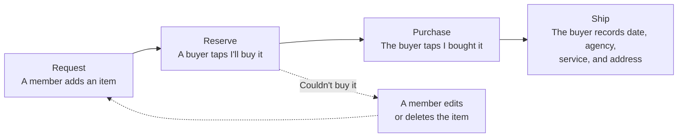

# Product Requirements Document: Assisted Shopping Platform (MVP)

**Version:** 1.5 · **Date:** October 18, 2026  
**Project Manager and Product owner:** Odalys Jordan Enriquez  
**Product Name:** ComproParaTi ("I buy for you", [section 16](#16-product-decisions))

## How to read this document

- This PRD defines **what** the product does and **why**. **How** it is built is in the technical documents listed below.
- **Part 1: Overview (sections 1 to 10)** explains what the product is, who it is for, and how it will be built and released. It takes a few minutes to read and contains no rules or limits.
- **Part 2: Product specification (sections 11 to 19)** holds the glossary, business rules, requirements, epics and user stories, acceptance criteria, decisions, and the traceability table.
- **One source of truth.** Every rule, number, and limit appears once across the documentation. Other sections and documents refer to it by its ID or link to it instead of repeating it.
- **IDs** are defined only in this document: `BR` business rules (section 12), `FR` functional requirements (section 13), `E` epics and `US` user stories (section 14), `AC` acceptance criteria (section 17).
- Interface text is shown in English. The product ships in Spanish and English; the Spanish strings are in [UX design §2.10](02-UX-DESIGN.md#210-spanish-interface-strings).

**Documents**

| Document | Contents |
| --- | --- |
| [01-PRD.md](01-PRD.md) | This document: product overview and specification |
| [02-UX-DESIGN.md](02-UX-DESIGN.md) | User flows, screens, wireframes, statuses, messages, and Spanish strings |
| [03-ARCHITECTURE.md](03-ARCHITECTURE.md) | C4 diagrams, components, technology stack, project structure, and technical decisions |
| [04-DATA-MODEL.md](04-DATA-MODEL.md) | Entity diagram, entities, and seed data |
| [05-API.md](05-API.md) | API conventions, endpoints, errors, and OpenAPI definitions |
| [06-INFRASTRUCTURE.md](06-INFRASTRUCTURE.md) | Environments, deployment, scheduled jobs, backups, and configuration |
| [07-SECURITY-AND-TESTING.md](07-SECURITY-AND-TESTING.md) | Security practices, rate limits, and testing strategy |
| [08-WORK-TICKETS.md](08-WORK-TICKETS.md) | Work tickets for milestone 1 and their tracking in GitHub Issues |

---

# Part 1: Overview

## 1. Product summary

**Problem.** Many people, often immigrants, buy products for relatives in countries where those products are hard to find or cannot be bought online. Requests arrive scattered across emails, phone calls, and WhatsApp messages: sizes and preferences get lost, two relatives buy the same product, and nobody is sure what was bought, what was shipped, or how it was sent.

**Solution.** A web application where a family keeps shared lists of what they need, along with each person's sizes and preferences. The buyers they invite reserve items, buy them, and record each shipment, so everyone can see where each item stands, from the request to the shipment. Conversations stay on WhatsApp, one tap away from any item, while the vital information lives in one place. Payment and shipping happen outside the platform.

**Goal of the MVP:** make it simpler to buy products and ship them, with custom lists and a workflow for tracking.

**What it must achieve:**

- Request a product.
- Let the buyer know who the item is for and what to keep in mind (sizes, preferences, notes) without asking.
- Prevent the same item from being bought twice when there are several buyers.
- Let everyone see whether an item is pending, reserved, purchased, or shipped, and when, how, and where it was shipped.
- Make talking about an item on WhatsApp take one tap.

## 2. Users

| Role | Who they are | What they do |
| --- | --- | --- |
| **Member** | Relatives who need products. They belong to a group with full access. | Request products, keep each person's details, manage lists, delivery addresses, and invitations. Members can also buy for their group. |
| **Buyer** | Relatives or friends who purchase and ship, invited by the group. | Reserve items, buy them, and record shipments. |
| **Recipient** | The person an item is for. Has no account and can be a minor. | Nothing in the app; members keep their details. |

- **Launch countries:** the United States, Cuba, and Central and South America.
- **Languages:** Spanish and English.
- **Digital experience:** many users may be older adults with little digital experience. This shapes the design principles ([UX design §2.1](02-UX-DESIGN.md#21-design-principles)) and the usability requirements ([section 15](#15-non-functional-requirements)).

## 3. Main features

| Feature | What it does | Details |
| --- | --- | --- |
| Groups and invitations | A shared space for a family, joined through a link shared on WhatsApp. | 13.2 |
| People | Each recipient's sizes, preferences, and notes, written as free-form details. | 13.3 |
| Lists and items | A name is enough to request something. A pasted store link fills in the title and image. | 13.4 |
| Reservation | "I'll buy it" claims an item so nobody else buys it. | 13.6 |
| Shipping | Delivery addresses for each group, and a record of when, how, and where items were sent. | 13.7 |
| Status and timeline | Every item shows its status and who changed it, with an undo for mistakes. | 13.8 |
| WhatsApp and email | One tap to message the right person about an item, and a daily email summary for members. | 13.9 |
| Spanish and English | The whole interface, emails, and messages in both languages. | 13.10 |

## 4. Experience at a glance

The product is built around one cycle:

- **One interface for everyone.** There are no modes to switch. Each person sees only the screens and buttons their role allows.
- **Mobile first,** with large text and buttons, and short flows.
- **WhatsApp one tap away** from any item. The app holds the list and the status; conversations stay where people already talk.

The full interface design is in [UX design §2](02-UX-DESIGN.md#2-interface-design), and the user flows are in [UX design §1](02-UX-DESIGN.md#1-user-flows).

## 5. Scope

**In scope:** everything in the business rules, functional requirements, and user stories (sections 12 to 14), and in the [UX design](02-UX-DESIGN.md).

**Simplification rule.** A feature is in the MVP only if the cycle **request → reserve → purchase → ship** cannot be completed without it. Anything that a note or a WhatsApp message can solve does not get its own feature.

**Out of scope:** payments and reimbursements, shipping logistics and package tracking, native apps, a public buyer directory or marketplace, customs and taxes, integration with store shopping carts, and the future features in [section 18](#18-future-features).

## 6. Success metrics

| Metric | Target |
| --- | --- |
| **Activation:** new users who add their first item in their first session | At least 80% |
| **Full cycle:** active groups that complete one request → reserve → purchase → ship cycle within 30 days | At least 60% |
| **Retention:** groups still active in their second month | At least 50% |
| **Duplicates:** reported cases of the same item bought twice | None |

All metrics are calculated from the app's own data (status history and sign-in dates). No analytics tool is used. The metrics are reviewed monthly after launch.

## 7. Architecture at a glance

A single Next.js application serves the interface and a REST API, and runs on free hosting plans. The system context diagram and the full architecture are in [Architecture §1](03-ARCHITECTURE.md#1-system-architecture), the technology stack and dependencies in [Architecture §1.5](03-ARCHITECTURE.md#15-technology-stack) and [§1.6](03-ARCHITECTURE.md#16-dependencies), and deployment in [Infrastructure](06-INFRASTRUCTURE.md).

## 8. Release plan and launch criteria

The product is delivered in two milestones. **Milestone 1** builds the core cycle end to end, deployed, and is the scope of the course deliverables. **Milestone 2** completes the MVP, followed by the pilot and the launch. Each acceptance criterion in [section 17](#17-acceptance-criteria) is tagged M1 or M2, so each milestone has a testable definition of done.

### 8.1 Milestone 1: Core cycle end to end

Flows A, B, C, E, and F ([UX design §1](02-UX-DESIGN.md#1-user-flows)) work from start to finish: a new user signs up, adds an item, and invites a buyer; the buyer reserves the item, buys it, and ships it; the member sees each status change.

| Phase | Deadline | Course deliverable | Content |
| --- | --- | --- | --- |
| Documentation | Thursday, October 22, 2026 | Delivery 1: technical documentation | This documentation, the work tickets ([08-WORK-TICKETS.md](08-WORK-TICKETS.md)), and the AI usage record ([prompts.md](../prompts.md)) |
| Build, part 1 | Thursday, November 19, 2026 | Delivery 2: working code | Increments 1 and 2, and the parts of increments 3 and 4 that complete the main flow: items, reserve, and purchase |
| Build, part 2 | Sunday, December 6, 2026 | Delivery 3: final delivery | The rest of increments 3 to 5, the full test suite with an end-to-end test of the core cycle, deployment evidence, and the complete AI usage record |

**Build increments:**

| # | Increment | Covers |
| --- | --- | --- |
| 1 | Foundation | Project setup, one-command local setup with seed data, CI, data model and migrations, sign-in, onboarding, and basic profile, both languages, baseline security (authorization, validation, rate limits, security headers), and deployment |
| 2 | Groups and buyer invitations | The automatic group and first list, buyer invitations, permissions |
| 3 | Requests | Lists, items (quick add and full form), people with their details |
| 4 | Buying | To buy, reserve and release, purchase, couldn't buy it, status and timeline |
| 5 | Shipping | Delivery addresses, marking items as shipped |

**Features complete at the final course delivery:** groups and buyer invitations; lists and items; people with their details; reservation and purchase; shipping with delivery addresses.

**If time runs short,** cut delivery addresses first (shipments can be recorded without one, BR-28), then people's details. Three complete features remain.

### 8.2 Milestone 2: Complete MVP

**Deadline:** Thursday, December 31, 2026. Milestone 2 tickets are written when milestone 1 is delivered ([work tickets](08-WORK-TICKETS.md)).

| # | Increment | Covers |
| --- | --- | --- |
| 6 | Requests and groups, complete | Link lookup, renaming, archiving, and deleting lists, several groups, member invitations, ownership transfer, editing reserved items, deleting people |
| 7 | Buying and shipping, complete | Undo and shipment editing |
| 8 | Communication | WhatsApp buttons, Notify buyer, daily email |
| 9 | Account lifecycle | Leaving and removing, account deletion, Report a problem, accessibility review |

**Pilot entry criteria:**

- Access from every launch country is confirmed ([section 10](#10-open-questions), question 1).
- The domain is registered ([section 10](#10-open-questions), question 2).
- The Privacy Policy is published.
- Backups are running, and a restore has been tested.

**Pilot.** A private pilot with 3 to 5 groups of family and friends for 4 weeks, collecting feedback through WhatsApp and the "Report a problem" link.

**Launch criteria:**

- All acceptance criteria pass in automated tests.
- A usability test with 5 older adults is completed, using flows A, B, E, and F, and the issues it finds are resolved.
- The Terms of Service are published.

## 9. Risks and dependencies

| Risk | Impact | Mitigation |
| --- | --- | --- |
| Google sign-in or US-based providers are restricted from Cuba | Members in Cuba cannot use the app | Confirm access before building ([section 10](#10-open-questions), question 1); sign-in is built to add other providers (FR-01) |
| Slow or expensive mobile data in some launch countries | Screens load slowly | Mobile-first design, small thumbnails, and no live updates |
| Free plan limits: non-commercial use only, daily scheduled jobs, storage caps | The app stops or must move to a paid plan | Monthly usage review; a paid plan is required if the project becomes commercial ([Architecture §3](03-ARCHITECTURE.md#3-technical-decisions)) |
| Stores block link lookups | Items show no title or image | The item is always saved with its link (BR-21) |
| Users with little digital experience struggle with the app | Low activation | Design principles ([UX design §2.1](02-UX-DESIGN.md#21-design-principles)) and the usability test before launch ([section 8](#8-release-plan-and-launch-criteria)) |
| Recipient details may include health data and data about minors | Privacy exposure | Visible only inside the group (BR-12); covered by the Privacy Policy |

**Dependencies** that need manual setup or a decision before launch: the Google OAuth consent screen and client, a domain and the Resend sending domain, the Terms of Service and Privacy Policy, and the support email address.

## 10. Open questions

1. **Access from launch countries:** confirm that Google sign-in and the hosting, database, and email providers can be used from every launch country, especially Cuba.
2. **Domain:** confirm availability and register `comproparati.com` (preferred) or `comproparati.app`.
3. **Terms of Service and Privacy Policy:** who writes them.
4. **Support email address** for "Report a problem" (FR-20).
5. **Backup storage:** where the daily encrypted database backups are kept ([Infrastructure §5](06-INFRASTRUCTURE.md#5-backups)).
6. **Error tracking:** whether to add an error tracking service, such as Sentry's free plan, since the hosting plan keeps logs only briefly ([Infrastructure §6](06-INFRASTRUCTURE.md#6-monitoring)).

---

# Part 2: Product specification

## 11. Glossary

| Term | Definition | In the interface |
| --- | --- | --- |
| **Group** | Shared space where people keep their lists and recipients. Members of a group do not need to live in the same home. | "Group" |
| **Member** | Person who belongs to a group with full access: requests products, manages lists, recipients, delivery addresses, and invitations, and can also buy for the group. | "Member" |
| **Owner** | The member who created the group, or who received ownership from the previous owner. | |
| **Buyer** | Person invited to a group to purchase and ship its items. | "Buyer" |
| **Item's buyer** | Whoever reserved the item, whether a buyer or a member. | |
| **Recipient** | Person an item is for. Does not need an account. | "Person" |
| **List** | Group of items (for example, "Anthony's birthday" or "Medicine"). | |
| **Item** | Product to buy. Minimum: a name. | |
| **Reservation** | A buyer or member states that they will take care of an item. | "I'll buy it" |
| **Delivery address** | Place where a group's items can be sent, with the person who receives them. A group can have several. | |
| **Shipment** | Record of when, how, and where one or more purchased items were shipped: date, agency, service, and delivery address. | |
| **Former user** | How a person who deleted their account is shown in the group's history. | "Former user" |

---

## 12. Business rules

Business rules are enforced on the server. The interface reflects them, but never replaces the server check.

### 12.1 Accounts and sessions

- **BR-01 Age.** Only people aged 18 or older can create an account. The user declares it with one checkbox that also accepts the terms; it is not verified. Minors exist only as recipients.
- **BR-02 Identity.** Each user can have one identity per sign-in provider, identified by the provider's stable user ID, never by email. Any provider must supply a verified email address.
- **BR-03 Session.** The session renews each time the user uses the app, so the user stays signed in until 30 days pass without any use. It is not a fixed 30 days from sign-in. Signing out ends the session. If the session expires during an action, after signing in again the user returns to the same screen with what they typed still filled in.
- **BR-04 WhatsApp number.** Every account has a WhatsApp number, entered during onboarding. It can be changed but not removed. It is visible only to the members and buyers of the groups the user belongs to.
- **BR-05 Account deletion.** When a user deletes their account:
  - Their reservations are released, and items they purchased but did not ship return to `Pending`, with the buyer note cleared.
  - Their personal data (name, email, WhatsApp number, sign-in identities) is erased, and they are shown as "Former user" wherever their name appears (items, timelines, shipments).
  - In each group they own that has other members, they must first transfer ownership (BR-07). Groups where they are the only member are deleted.

### 12.2 Groups, membership, and invitations

- **BR-06 Getting started.** A user who signs up without an invitation gets a new group, named "{First name}'s group", of which they are the owner, and a list called "My list". A user who signs up through an invitation joins that group with the invitation's type and does not get a group of their own.
- **BR-07 Ownership.** Any user can create a group and own several groups. The owner can transfer ownership to any other member of the group. To leave the group, the owner must first transfer ownership; if they are the only member, leaving deletes the group and everything in it, after a confirmation.
- **BR-08 Invitations.** Any member can invite people. An invitation is either *member* or *buyer*. Each invitation link can be used once, expires after 7 days, and can be cancelled. A used, expired, or cancelled link shows a message asking for a new invitation.
- **BR-09 Existing users and invitations.** If the person opening an invitation already has the access it grants (a member opening either type, or a buyer opening a buyer invitation), they are told they already belong to the group, and the invitation stays valid. A buyer who accepts a member invitation becomes a member.
- **BR-10 Removing and leaving.** Only the owner can remove members. Any member can remove a buyer. Any member or buyer can leave a group; the owner follows BR-07.
- **BR-11 When access ends.** When a member or buyer leaves or is removed, their reservations are released, and they keep access only to items they already purchased, until they mark them as shipped. Account deletion follows BR-05 instead.

### 12.3 Access and permissions

- **BR-12 Permissions.** Permissions are evaluated on the server, per group, from the user's membership in that group:

  | Action | Member | Buyer |
  | --- | --- | --- |
  | Create, edit, and delete lists, items, recipients, and delivery addresses; rename, archive, and restore lists; rename the group | ✔ | ✖ |
  | Invite members and buyers; cancel invitations | ✔ | ✖ |
  | Remove members; transfer ownership | Owner only | ✖ |
  | Remove a buyer | ✔ | ✖ |
  | Leave the group | ✔ (BR-07 for the owner) | ✔ |
  | View lists, items, delivery addresses, and the recipient details on each item | ✔ | ✔ |
  | Browse and manage the group's recipients | ✔ | ✖ |
  | Reserve items | ✔ | ✔ |
  | Release; mark as purchased, unavailable, or shipped; undo; edit the shipment | Items they reserved | Items they reserved |
  | Message on WhatsApp | ✔ | ✔ |

- **BR-13 Unavailable content.** Opening anything the user cannot access, or that was deleted or is in an archived list, shows "This page isn't available." The response is the same in every case, so a link never reveals whether something exists in another group.
- **BR-14 Items reserved by someone else.** Other users see who reserved the item but cannot act on it, except members editing it under BR-19.

### 12.4 Recipients

- **BR-15 Deleting a recipient.** A recipient cannot be deleted while any of their items is not shipped, including items in archived lists; the message names the lists involved. Shipped items keep showing the recipient's name after the recipient is deleted.
- **BR-16 Notes win.** If an item's notes contradict a recipient detail, the item's notes take precedence, and the interface shows them first.

### 12.5 Lists and items

- **BR-17 Archiving a list.** A list can be archived when it has no items that are reserved, or purchased and not yet shipped. An archived list and all its items are hidden from every screen, and the list can be restored.
- **BR-18 Deleting a list.** A list can be deleted only when all its items are `Pending` or `Unavailable`; deleting it deletes those items. Otherwise deletion is refused, and archiving is offered when BR-17 allows it.
- **BR-19 Editing and deleting items.** Members can edit an item while it is `Pending`, `Reserved`, or `Unavailable`, and delete it only while it is `Pending` or `Unavailable`.
  - Editing a reserved item keeps the reservation, and the item's buyer sees an "Updated" marker on the item until they open it.
  - Editing an unavailable item returns it to `Pending` and clears its buyer.
- **BR-20 Simultaneous edits.** If an item changed after the member opened it, their save is refused with "This item changed. Showing the latest.", and what they typed is kept so they can apply it again.
- **BR-21 Data from a link.** The lookup of a link's title, image, and store name never overwrites what the user already typed. If the lookup fails, the item is still saved with its link, and no technical error is shown.

### 12.6 Statuses

- **BR-22 Status transitions.** Items have four main statuses (`Pending`, `Reserved`, `Purchased`, `Shipped`) and one alternate (`Unavailable`). Only these transitions are allowed:

  | From | To | Who | Condition |
  | --- | --- | --- | --- |
  | Pending | Reserved | Any member or buyer | First one wins (BR-23) |
  | Reserved | Pending | The item's buyer | Releases the reservation; also automatic under BR-05 and BR-11 |
  | Reserved | Purchased | The item's buyer | Optional buyer note |
  | Reserved | Unavailable | The item's buyer | Required note (BR-25) |
  | Purchased | Shipped | The item's buyer | Shipping details required (BR-28) |
  | Unavailable | Pending | A member | When the item is edited (BR-19) |
  | Purchased | Pending | System | Account deletion (BR-05) |
  | Purchased | Reserved | The item's buyer | Undo (BR-24) |
  | Shipped | Purchased | The item's buyer | Undo (BR-24) |
  | Unavailable | Reserved | The item's buyer | Undo (BR-24) |

- **BR-23 Reservation.** A reservation is exclusive. If two people try to reserve the same item at the same time, the first one wins and the second gets a notice.
- **BR-24 Undo.** Only the item's buyer can undo, and only the last step:
  - Undoing `Purchased` keeps the buyer note.
  - Undoing `Shipped` removes only that item from its shipment; a shipment left with no items is deleted.
  - Undoing `Unavailable` is possible only until a member edits the item.
  - Undo is not available to a person whose access to the group has ended (BR-11).
- **BR-25 Notes on status changes.** "Couldn't buy it" requires a note. The buyer note when marking an item as purchased is optional.
- **BR-26 Timeline.** Every item records its creation and every status change, with the author and date, including undos.

### 12.7 Shipping

- **BR-27 Delivery addresses.** A group can have up to 10 delivery addresses. When a group has addresses, exactly one is the default. The default address cannot be deleted while the group has other addresses; a member first makes another one the default.
- **BR-28 Shipments.**
  - Ship date, agency, and service (Maritime or Air) are required, and the ship date cannot be later than today.
  - All items in a shipment are purchased items reserved by the same buyer, belong to the same group, and go to the same delivery address.
  - The shipment keeps a copy of the delivery address as it was when shipped, so later edits to the address do not change past shipments.
  - If the group has no delivery address, the items can still be marked as shipped without one.
- **BR-29 Editing a shipment.** Only the buyer who recorded a shipment can edit it. They can change the ship date, agency, service, and delivery address; changes apply to every item in the shipment, and a new delivery address replaces the saved copy.

### 12.8 Communication

- **BR-30 Who receives a WhatsApp message.**
  - From an item, the item's buyer writes to the member who added the item, or chooses among the group's members if that person no longer has access.
  - From an item, a member writes to the item's buyer, or chooses among the group's buyers if nobody has reserved it.
  - "Notify buyer" goes to the group's buyer, or the member chooses who if the group has several.
- **BR-31 Email.**
  - Members with email notifications on receive an email when an item changes to `Purchased`, `Shipped`, or `Unavailable`, except for changes they made themselves.
  - Changes are grouped into one email per group per day, sent around 9:00 am US Eastern time.
  - A change undone before the email is sent is left out, and undoing a change does not send an email.
  - Emails are in the recipient's language.
  - Buyers who are not members receive no status emails.

### 12.9 Field limits

- **BR-32 Field limits.** Fields are validated on the server and in the interface. A value outside its limit is not saved, and the field is indicated.

  | Field | Limit |
  | --- | --- |
  | Names of items, lists, groups, and recipients; address label; receiver's name | 1 to 100 characters |
  | Item notes, recipient notes, buyer note, "Couldn't buy it" note | Up to 1,000 characters |
  | Quantity | 1 to 99 |
  | Recipient details | Up to 20 per recipient; name up to 40 characters, value up to 150 |
  | Link | A valid http or https URL, up to 2,000 characters |
  | Shipping agency | 1 to 80 characters |
  | Delivery address | 1 to 500 characters |
  | WhatsApp number, receiver's phone | A valid international phone number |

---

## 13. Functional requirements

Each requirement describes what users can do. The rules that apply are referenced by ID.

### 13.1 Account

- **FR-01 Sign-in with Google.** Users sign in with their Google account; the platform has no passwords of its own. Sign-in is built so that other providers, such as Apple or Facebook, can be added later without affecting existing accounts (BR-02). Sessions follow BR-03.
- **FR-02 Onboarding.** On first sign-in the user confirms or changes their language, prefilled with the one chosen on Welcome, checks the age and terms box (FR-03), and enters their WhatsApp number (BR-04).
- **FR-03 Age declaration.** Onboarding includes the "I am 18 or older and accept the terms" checkbox, and the user cannot continue without it (BR-01).
- **FR-04 Profile.** The user can change their language and WhatsApp number (BR-04), turn email notifications on or off, sign out, and delete their account (BR-05).

### 13.2 Groups and invitations

- **FR-05 Getting started and creating groups.** New users start with a group and a list, or join the group that invited them (BR-06). Any user can create a group from their profile (BR-07).
- **FR-06 Invitations.** A member creates a member or buyer invitation and shares its link on WhatsApp or copies it. Members can see pending invitations and cancel them (BR-08, BR-09).
- **FR-07 Members.** Members view and edit the group's lists, items, recipients, and delivery addresses, and can also buy for their own group without a separate invitation. Members can rename the group. The owner can remove members and transfer ownership (BR-07, BR-10, BR-12).
- **FR-08 Single interface.** The app has no mode switch. It shows each user the screens and actions their memberships allow (BR-12): someone who only buys sees the items to buy and their purchases; a member sees lists, recipients, and the group, plus their purchases once they reserve an item. A user with no remaining access to any group sees "You're not in any group yet." with a **Create a group** button and a note to ask for an invitation.

### 13.3 Recipients

- **FR-09 Recipients.** Each group defines the people it buys for, with a name and optional notes. Recipients do not need an account, can be minors, and can be a member themselves. Members can edit and delete recipients (BR-15).
- **FR-10 Recipient details.** Each recipient has a free-form list of details, each a name and a value (for example "Shoe: 4", "Shirt: M", "Hair dye: brown 5.3", "Allergy: penicillin"). There are no fixed fields (BR-32).

### 13.4 Lists and items

- **FR-11 Lists.** A group can have several lists. Lists are the only way to organize items; there are no categories.
- **FR-12 Managing lists.** Members can create, rename, archive, restore, and delete lists (BR-17, BR-18).
- **FR-13 Item fields.** An item has a required name and optional recipient, link, quantity (default 1), and notes (BR-32). Notes is a single free-text field for everything specific to the request: size, color, brand, dose, flavor, maximum price, or urgency. **Quick add:** typing only the name in the list creates the item.
- **FR-14 Data from the link.** When a member pastes a link, the system tries to obtain the title, image, and store name from the page's public metadata, in the background (BR-21). The image is stored as the platform's own thumbnail.
- **FR-15 Item notes first.** On the item page, the item's notes are shown before the recipient's details (BR-16).
- **FR-16 Editing items.** Members can edit and delete items, including moving an item to another list (BR-19, BR-20).

### 13.5 Buyers

- **FR-17 Invitation only.** A group adds buyers only by invitation (FR-06). There is no search, directory, or public profile.
- **FR-18 Buyer's view.** A buyer sees only the groups they were invited to (BR-12, BR-13).
- **FR-19 Removing and leaving.** Members remove buyers and the owner removes members from the Group screen; members and buyers leave from their profile (BR-10, BR-11).
- **FR-20 Report a problem.** A "Report a problem" link in the profile opens the user's email app with a message addressed to the support team. Since only invited people can see a group, the main protection against abuse is removing the person.

### 13.6 Purchasing

- **FR-21 To buy.** Buyers see the pending items of their groups, grouped by recipient, with filters by group and list. Items with no recipient appear under "No person". Items they reserved or purchased appear in My purchases.
- **FR-22 Recipient details on items.** On every item, buyers see the item's notes and the details of the recipient it is for. Buyers who are not members see recipient details only inside items (BR-12).
- **FR-23 Store link.** If the item has a link, "Open in store" opens it in a new tab.
- **FR-24 Reserve and release.** The buyer taps "I'll buy it" and the item is reserved in their name (BR-23). The item's buyer can release the reservation.
- **FR-25 Buyer note.** When marking an item as purchased, the buyer can leave a note, for example "Bought the generic brand" (BR-25).
- **FR-26 Couldn't buy it.** The buyer marks the item as `Unavailable` with a note (BR-25). A member then edits or deletes it (BR-19). Alternatives are discussed on WhatsApp.

### 13.7 Shipping

- **FR-27 Delivery addresses.** Members add, edit, and delete the group's delivery addresses and choose the default (BR-27). Each address has a label (for example "Grandma's house"), the receiver's name, a phone number, the address as free text, and the country. Members and buyers of the group can see them.
- **FR-28 Ship-to address.** When marking items as shipped, the buyer chooses the delivery address, with the default preselected, and can copy it with one tap to fill in the agency's form. If the group has no address, the buyer is told so and offered a button to message a member on WhatsApp (BR-28).
- **FR-29 Mark as shipped.** The buyer records the ship date (defaults to today), the shipping agency (free text), the service (Maritime or Air), and the delivery address. They can select several purchased items and mark them as shipped in one step; the details apply to all of them. The form starts with the agency and service the buyer used last. The buyer can later edit the shipment (BR-28, BR-29).
- **FR-30 Shipping details.** Every shipped item shows its ship date, agency, service, and delivery address to the group's members and buyers, along with the other items in the same shipment.

### 13.8 Statuses

- **FR-31 Status changes and undo.** Users change an item's status through the actions in [UX design §2.5](02-UX-DESIGN.md#25-item-statuses-and-actions), within the transitions of BR-22. The item's buyer can undo the last step (BR-24).
- **FR-32 Timeline.** Each item shows its status and a short timeline of who added it and who changed each status, with the date (BR-26).

### 13.9 Communication and notifications

- **FR-33 WhatsApp number visibility.** Group members and buyers can see each other's WhatsApp numbers through the WhatsApp buttons (BR-04).
- **FR-34 Message on WhatsApp.** Each item has a button that opens WhatsApp (`wa.me` link) with a prefilled message in the user's language: item name, recipient, and a link to the item (BR-30).
- **FR-35 Notify on WhatsApp.** From a list, a member taps "Notify buyer" and WhatsApp opens with a message such as "I added things to the Medicine list: {link}" (BR-30). This replaces automatic notifications to buyers.
- **FR-36 Email.** Members receive the daily email described in BR-31, with what was purchased, shipped, and unavailable. Shipped items include the ship date, agency, service, and delivery address. The platform has no chat of its own: conversation happens on WhatsApp, and whatever is agreed gets written in the item's notes.

### 13.10 Languages

- **FR-37 Spanish and English.** All interface text, emails, and prefilled WhatsApp messages come from translation files, in Spanish and English.
- **FR-38 Formatting.** Dates and numbers follow the user's language. User-written content is not translated.

### 13.11 Validation

- **FR-39 Field validation.** Every form validates its fields against BR-32 as the user types and on save, and the server validates them again.

---

## 14. Epics and user stories

### 14.1 Epics

Epics group the user stories into the product's main capabilities. Each epic shows what milestone 1 delivers and what waits for milestone 2 ([section 8](#8-release-plan-and-launch-criteria)).

| ID | Epic | Goal | User stories | Milestone 1 | Milestone 2 |
| --- | --- | --- | --- | --- | --- |
| E-01 | Accounts and sign-in | Anyone can join with Google and choose how the app reaches them | US-01 to US-03 | Sign-in, onboarding, and profile | Account deletion |
| E-02 | Groups, invitations, and access | A family shares one space, invites buyers, and each person sees only what their role allows | US-04 to US-08 | The automatic group, buyer invitations, and permissions | Member invitations, ownership transfer, leaving and removing, and several groups |
| E-03 | People | Members keep each recipient's sizes and preferences | US-09 | Recipients and their details | Deleting people |
| E-04 | Requests | Members request items in seconds and keep their lists in order | US-10 to US-13 | Lists, quick add, the item form, and editing and deleting items | Link lookup, list management, and editing reserved items |
| E-05 | Buying | Buyers find what to buy, and nobody buys the same item twice | US-14 to US-17 | To buy, reserve and release, purchase, couldn't buy it, and the timeline | Undo |
| E-06 | Shipping | Everyone sees when, how, and where items were sent | US-18 to US-21 | Delivery addresses and marking items as shipped | Shipment editing |
| E-07 | Communication | Conversations and updates reach people without checking the app | US-22 to US-24 | None | WhatsApp buttons, Notify buyer, and the daily email |
| E-08 | Platform | Both languages, security, and the foundation every other epic runs on | US-25, US-26 | Project setup, data model, API foundation and security, app shell and translations, deployment, and the end-to-end test | Report a problem and the accessibility review |

**How the epics set priorities.** E-04, E-05, and E-06 are the core cycle and carry most of milestone 1. E-01, E-02, and E-08 deliver only what the cycle needs to run, be tested, and be deployed. E-03 and the delivery addresses in E-06 are in milestone 1 but are the planned cuts if time runs short ([section 8.1](#81-milestone-1-core-cycle-end-to-end)). E-07 waits for milestone 2: conversations already happen on WhatsApp, so the cycle works without it.

### 14.2 User stories

Each story links to the requirements that implement it and the acceptance criteria that verify it.

| ID | As a… | I want to… | So that… | Requirements | Acceptance criteria |
| --- | --- | --- | --- | --- | --- |
| US-01 | new user | sign in with Google and find a group and a list ready | I can add my first request right away | FR-01 to FR-03, FR-05 | AC-01 to AC-03, AC-05 to AC-07, AC-98 |
| US-02 | user | change my language, WhatsApp number, and email settings | the app reaches me the way I prefer | FR-04, FR-33, FR-37 | AC-04, AC-90 |
| US-03 | user | delete my account | my personal data is erased without breaking my group's history | FR-04 | AC-08, AC-09 |
| US-04 | member | invite relatives as members or buyers with a link I send on WhatsApp | they can join without searching for anything | FR-06, FR-17 | AC-10 to AC-16, AC-26 |
| US-05 | owner | transfer ownership, remove members, and leave the group | the group keeps working when I step away | FR-07, FR-19 | AC-17, AC-19 to AC-21, AC-31 |
| US-06 | user | create another group | I can keep separate groups for different parts of my family | FR-05 | AC-22 |
| US-07 | user | see only the screens and actions my role allows | I never have to understand modes or permissions | FR-08, FR-18 | AC-18, AC-23 to AC-25, AC-27, AC-32 |
| US-08 | member | remove a buyer from the group | people who should no longer see our lists lose access | FR-19 | AC-28 to AC-30 |
| US-09 | member | keep each person's sizes and preferences as free-form details | buyers don't have to ask | FR-09, FR-10, FR-22 | AC-33 to AC-37 |
| US-10 | member | add an item by typing only its name | requesting something takes seconds | FR-13, FR-39 | AC-38, AC-40, AC-41 |
| US-11 | member | paste a store link and see the product's title and image | the item is easy to recognize, with less typing | FR-14 | AC-42 to AC-45 |
| US-12 | member | organize items in lists, and rename, archive, or delete lists | requests stay tidy over time | FR-11, FR-12 | AC-39, AC-52 to AC-55 |
| US-13 | member | edit or delete a request, even while a buyer is working on it | requests stay correct without confusing the buyer | FR-16, FR-26 | AC-46 to AC-51 |
| US-14 | buyer | see pending items grouped by person, with the notes and the person's details | I buy the right thing without asking | FR-15, FR-21 to FR-23 | AC-56 to AC-58 |
| US-15 | buyer | reserve an item | nobody else buys it too | FR-24 | AC-59 to AC-61, AC-67, AC-68 |
| US-16 | buyer | mark an item as purchased with a note, or say I couldn't buy it | the family knows what happened | FR-25, FR-26, FR-32 | AC-62, AC-63 |
| US-17 | buyer | undo a step I took by mistake | I can fix errors without asking a member | FR-31 | AC-64 to AC-66, AC-80, AC-81 |
| US-18 | member | keep the group's delivery addresses | buyers know where to send things | FR-27 | AC-77 to AC-79 |
| US-19 | buyer | record one shipment for several items, with the address ready to copy | shipping a box takes one step | FR-28, FR-29 | AC-69 to AC-76 |
| US-20 | buyer | edit a shipment I recorded | mistakes in the shipping details can be corrected | FR-29 | AC-82, AC-83 |
| US-21 | member | see when, how, and where each item was shipped | I know what to expect and from which agency | FR-30, FR-32 | AC-69, AC-72, AC-74 |
| US-22 | member or buyer | message the right person about an item in one tap | conversations start with the context already there | FR-33, FR-34 | AC-84 to AC-86 |
| US-23 | member | let the buyer know I added items | they don't have to keep checking the app | FR-35 | AC-87 |
| US-24 | member | get a daily email with what was purchased, shipped, or unavailable | I stay informed without opening the app | FR-36 | AC-88 to AC-93 |
| US-25 | user | use the app in Spanish or English | I understand everything on the screen | FR-37, FR-38 | AC-94, AC-99 |
| US-26 | user | have my group's data protected and a way to report problems | I can trust the app with my family's information | FR-20, [Security and testing §1](07-SECURITY-AND-TESTING.md#1-security) and [section 15](#15-non-functional-requirements) | AC-95 to AC-97 |

---

## 15. Non-functional requirements

- **Platform:** web application designed mobile-first, from 360 px wide, with a desktop layout ([UX design §2.2](02-UX-DESIGN.md#22-navigation)).
- **Usability:** short flows, readable text, and large buttons for users with little digital experience; WCAG 2.1 AA ([UX design §2.8](02-UX-DESIGN.md#28-accessibility-language-and-responsive-behavior)).
- **Security:** the practices in [Security and testing §1](07-SECURITY-AND-TESTING.md#1-security).
- **Privacy:** collect the minimum. Recipient data (including data about minors) and delivery addresses are visible only to the group's members and buyers (BR-12). Account deletion erases personal data (BR-05). Data export is handled on request by email.
- **Data from the link:** obtaining data from every store is not guaranteed. The lookup runs on the server under the limits in [Security and testing §1](07-SECURITY-AND-TESTING.md#1-security).
- **Performance:** lists of up to 200 items load in under 2 seconds.
- **Updates:** screens load fresh data when opened and when the user taps Refresh. There are no live updates; conflicting actions are refused on the server and the screen refreshes (BR-20, BR-23).
- **Operations:** daily backups with tested restores, error logging, versioned migrations, and automated tests for every acceptance criterion ([Infrastructure](06-INFRASTRUCTURE.md) and [Security and testing §2](07-SECURITY-AND-TESTING.md#2-testing-strategy)).
- **Local setup:** one command sets up the app locally, including a local database and seed data, so a developer can clone the repository and run it. A setup checklist in the repository documents the steps that cannot be automated ([Infrastructure](06-INFRASTRUCTURE.md)).

---

## 16. Product decisions

| Topic | Decision | Reason |
| --- | --- | --- |
| Sign-in | Google only, built to add more providers | One provider keeps setup simple, and Android phones already come with a Google account. |
| Interface | One interface that adapts to each user's memberships; no mode switch | Users with little digital experience should not have to understand modes. Each person sees only what they can do. |
| Shared space | Called a "group" | People who share lists may live in different homes. |
| Item details | A single **Notes** field | Size and color only apply to clothing; notes work for any product. |
| Recipient details | Free-form list of detail and value, no fixed fields | Each person and each kind of product needs different details. |
| Organization | Lists only, no categories | Lists and recipients already sort the items. A third axis adds steps to the form. |
| Statuses | No "received by buyer" status | Members care whether an item was purchased and whether it was shipped. |
| Shipping | Date, agency, service, and delivery address; no tracking number | Members need to know when, how, and where items were sent. Following the package is done with the agency. |
| Delivery addresses | A short list per group, with a default; the buyer chooses one when shipping | Members of a group may live in different homes, so one address per group would not fit. |
| Address format | Free text plus country | Address formats vary by country and often do not fit street, city, and postal code fields. |
| Receiver ID number | Not stored | Storing government ID numbers raises security and privacy requirements. If an agency asks for it, the buyer gets it over WhatsApp. |
| Chat | No in-platform chat, "need information" flag, quick messages, or short item ID | WhatsApp is the channel people already use, and agreements go in the item's notes. |
| Buyer assignment | Reservation only | Most groups will have one or two buyers, and they coordinate on WhatsApp. |
| Recipient details for buyers | Visible to every buyer of the group, on every item | Buyers are invited by the group. This keeps permissions simple and lets the buyer decide before reserving. |
| Money | Entirely outside the platform | Settled between the people involved. If needed, the amount goes in the buyer note. |
| Notifications to buyers | Manual, with "Notify on WhatsApp" (FR-35) | Avoids an automatic email for every new item. |
| Email frequency | One email per group per day (FR-36) | The free hosting plan runs scheduled jobs at most once a day. Items take days or weeks to ship, so a daily summary loses little. |
| Data from the link | Title, image, and store only | Saves typing and makes the item recognizable. |
| Blocking users | Not included; remove the person and use the report link | Nobody outside a group can see it or contact its members. |
| Invitations | Any member invites, and each link works once | Members already have full access to the group. A single-use link cannot be reused by others in a WhatsApp chat. |
| Mistakes | The item's buyer can undo the last step and edit shipment details | Users will tap the wrong button; fixing it should not need a member. |
| Updates | Fresh data on open and a Refresh button; no live updates | Avoids real-time infrastructure and its cost. The reservation rule (BR-23) already prevents duplicates. |
| Group ownership | A user can own several groups | Ownership can be transferred to any member, and a person can run separate groups for different parts of their family. |
| Deleted accounts | Shown as "Former user" | Personal data is erased while the group's history stays readable. |
| Product name | **ComproParaTi** ("Compro para ti": I buy for you), one name in both languages | It describes a relative doing a favor, not a store, has one clear meaning, no accents, and is easy to spell over the phone. English speakers see the same name, explained as "I buy for you", so there is one brand to register and protect. When checked (October 2026), no US trademark used it in either spelling and no website used the domain. The other finalists were set aside: TeLoMando because "mando" has other meanings, and ListaParaTi because it names the list rather than the favor. Telotraigo, Telocompro, Yolocompro, and Loapunto were already in use by businesses. |

---

## 17. Acceptance criteria

Each criterion has at least one automated test ([Security and testing §2](07-SECURITY-AND-TESTING.md#2-testing-strategy)). The requirement IDs lead to the rules that apply.

### 17.1 Account

| # | Milestone | Given | When | Then |
| --- | --- | --- | --- | --- |
| AC-01 | M1 | A new user with no invitation | Completes first sign-in | A group they own and an initial list are created (FR-05) |
| AC-02 | M1 | A new user on the "One last step" screen | Tries to continue without checking the 18-or-older box | They cannot continue (FR-03) |
| AC-03 | M1 | A new user on the "One last step" screen | Enters a WhatsApp number that is not a valid international number | It is not saved, and the field is indicated (FR-02, FR-39) |
| AC-98 | M1 | A new user who chose Spanish on Welcome | Reaches "One last step", changes the language to English, and continues | The language field showed Spanish; the screen switches to English, and English is saved as their language (FR-02) |
| AC-04 | M1 | A signed-in user | Tries to remove their WhatsApp number in Profile | It is not allowed; the number can only be changed (FR-04, FR-33) |
| AC-05 | M1 | A user who signed in 45 days ago and last used the app 20 days ago | Opens the app | They are still signed in, and the 30 days start again (FR-01) |
| AC-06 | M1 | A user who last used the app 31 days ago | Opens the app | They are asked to sign in again (FR-01) |
| AC-07 | M2 | A member filling in the item form whose session has expired | Taps Save and signs in again | They return to the form with what they typed still filled in (FR-01) |
| AC-08 | M2 | A user with one reserved item and one purchased, unshipped item | Deletes their account | Both items return to `Pending`, and timelines show "Former user" (FR-04) |
| AC-09 | M2 | An owner whose group has other members | Tries to delete their account | They are asked to transfer ownership first (FR-04, FR-07) |

### 17.2 Groups, invitations, and access

| # | Milestone | Given | When | Then |
| --- | --- | --- | --- | --- |
| AC-10 | M1 | A new user with a buyer invitation | Completes first sign-in and accepts | They join that group as a buyer and no group of their own is created (FR-05) |
| AC-11 | M1 | An invitation link older than 7 days | Someone opens it | They see a message asking for a new invitation (FR-06) |
| AC-12 | M1 | An invitation already accepted | Someone else opens the same link | They see a message asking for a new invitation (FR-06) |
| AC-13 | M1 | A cancelled invitation | Someone opens it | They see a message asking for a new invitation (FR-06) |
| AC-14 | M2 | A buyer of the group | Accepts a member invitation to the same group | They become a member (FR-06) |
| AC-15 | M1 | A member of the group | Opens a buyer invitation to the same group | They are told they already belong to the group, and the invitation stays valid (FR-06) |
| AC-16 | M1 | A buyer of the group | Sends a request to create an invitation | It is rejected (FR-06, BR-12) |
| AC-17 | M2 | A member who is not the owner | Sends a request to remove a member or to transfer ownership | It is rejected (FR-07, BR-12) |
| AC-18 | M2 | A buyer of the group | Sends a request to rename the group | It is rejected (FR-07, BR-12) |
| AC-19 | M2 | An owner whose group has other members | Tries to leave the group | They are asked to transfer ownership first (FR-07) |
| AC-20 | M2 | An owner who is the only member | Leaves the group and confirms | The group is deleted (FR-07) |
| AC-21 | M2 | An owner and a member who already owns another group | The owner transfers ownership to that member | The member owns both groups (FR-05, FR-07) |
| AC-22 | M2 | A user who already owns a group | Creates a group from their profile | They own both groups and can switch between them with the group selector (FR-05) |
| AC-23 | M1 | A member of a group with pending items | Opens an item | They see the member actions (edit, delete) and "I'll buy it" together, with no mode switch (FR-07, FR-08) |
| AC-24 | M1 | A user who is only a buyer | Signs in | They see only the items to buy and their purchases, with no lists or recipients to edit (FR-08) |
| AC-25 | M1 | A buyer of group A | Opens a link to an item from group B | They see "This page isn't available." (FR-18, BR-13) |
| AC-26 | M1 | A user in two groups | Sends a request for the lists, items, or members of a group they don't belong to | It is rejected; there is no search or directory of groups or people (FR-17, FR-18) |
| AC-27 | M1 | A link to an item that was deleted | A member of the group opens it | They see "This page isn't available." (BR-13) |
| AC-28 | M2 | A buyer with one reserved item and one purchased item | A member removes them | The reservation is released and they keep access only to the purchased item, until it is shipped (FR-19) |
| AC-29 | M2 | A buyer who was removed while the To buy screen was open | Taps "I'll buy it" | It is rejected, and they see "This page isn't available." (FR-19, BR-13) |
| AC-30 | M2 | A removed buyer with one purchased item | Marks it as shipped | It changes to `Shipped`, and they lose access to it (FR-19) |
| AC-31 | M2 | A member with a reserved item | Leaves the group | The reservation is released (FR-19) |
| AC-32 | M2 | A buyer whose only group removes them | Opens the app | They see "You're not in any group yet." with Create a group and a note to ask for an invitation (FR-08) |

### 17.3 Recipients

| # | Milestone | Given | When | Then |
| --- | --- | --- | --- | --- |
| AC-33 | M2 | Anthony has a pending item | A member tries to delete Anthony | It is not allowed, and the message names the list (FR-09) |
| AC-34 | M2 | Anthony has only shipped items | A member deletes Anthony | His shipped items still show "Anthony" (FR-09) |
| AC-35 | M1 | A member on Anthony's page | Adds the detail "Hair dye: brown 5.3" | It is saved and shown with Anthony's details on his items (FR-10, FR-22) |
| AC-36 | M1 | Anthony has 20 details | A member adds another detail | It is not allowed (FR-39) |
| AC-37 | M1 | A user who is only a buyer | Sends a request to view or edit the group's recipients | It is rejected; they see recipient details only inside items (FR-22, BR-12) |

### 17.4 Lists and items

| # | Milestone | Given | When | Then |
| --- | --- | --- | --- | --- |
| AC-38 | M1 | A member inside a list | Types only a name and saves | The item is created as `Pending` (FR-13) |
| AC-39 | M1 | A group with the list "Birthday" | A member creates the list "Medicine" and moves an item to it by editing the item | The item appears in "Medicine" and no longer in "Birthday" (FR-11, FR-16) |
| AC-40 | M1 | A member on the item form | Saves with an empty name | It is not saved, and the name field is indicated (FR-13, FR-39) |
| AC-41 | M1 | A member on the item form | Types a name longer than 100 characters, or a quantity of 0 or 100 | It is not saved, and the field is indicated (FR-39) |
| AC-42 | M2 | A member who already typed the name | Pastes a link with metadata | The image and store appear, and the typed name does not change (FR-14) |
| AC-43 | M2 | A link that returns no data | The member saves the item | It is saved with the link, with no technical error (FR-14) |
| AC-44 | M2 | A link to an internal address, such as http://localhost or a private IP address | The member saves the item | No lookup is made, and the item is saved with the link (FR-14, [Security and testing §1](07-SECURITY-AND-TESTING.md#1-security)) |
| AC-45 | M1 | Text in the link field that is not a valid http or https URL | The member saves the item | It is not saved, and the link field is indicated (FR-39) |
| AC-46 | M2 | An item reserved by Juan | A member edits its notes | It stays reserved by Juan, and Juan sees "Updated" on it until he opens it (FR-16) |
| AC-47 | M1 | A reserved item | A member tries to delete it | It is not allowed (FR-16) |
| AC-48 | M1 | A purchased item | A member tries to delete it | It is not allowed (FR-16) |
| AC-49 | M2 | Two members with the same item open | Both edit it and the second one saves after the first | The second save is rejected with "This item changed. Showing the latest.", and their typed text is kept (FR-16) |
| AC-50 | M1 | An unavailable item | A member edits it | It returns to `Pending` (FR-31) |
| AC-51 | M1 | A buyer of the group | Sends a request to edit or delete an item | It is rejected (BR-12) |
| AC-52 | M2 | A list with pending items | A member archives it | Its items disappear from Lists and To buy, and return when the list is restored (FR-12) |
| AC-53 | M2 | A list with a reserved item | A member tries to archive it | It is not allowed, and the message explains why (FR-12) |
| AC-54 | M2 | A list with a shipped item | A member tries to delete it | It is not allowed, and archiving is offered (FR-12) |
| AC-55 | M2 | A list with only pending and unavailable items | A member deletes it and confirms | The list and its items are deleted (FR-12) |

### 17.5 Buying

| # | Milestone | Given | When | Then |
| --- | --- | --- | --- | --- |
| AC-56 | M1 | Anthony has the detail "Shoe: 4" and an item for him says "in white" in its notes | A buyer of the group opens the item | They see the item's notes first and Anthony's details after (FR-15, FR-22) |
| AC-57 | M1 | An item with a link | A buyer taps "Open in store" | The store page opens in a new tab (FR-23) |
| AC-58 | M1 | A buyer with pending items for Anthony and one item with no recipient | Opens To buy | The items are grouped by person, the item with no recipient appears under "No person", and they can filter by group and list (FR-21) |
| AC-59 | M1 | A pending item and two buyers | Both tap "I'll buy it" almost at the same time | It is reserved for the first, and the second gets a notice (FR-24) |
| AC-60 | M1 | An item reserved by Juan | Juan releases the reservation | It returns to `Pending` and someone else can reserve it (FR-24) |
| AC-61 | M1 | An item reserved by Juan | Another buyer sends a request to mark it as purchased | It is rejected (FR-31, BR-12) |
| AC-62 | M1 | A reserved item | The buyer marks it as purchased with the note "Bought the generic brand" | It changes to `Purchased`, appears in the timeline, and members see the buyer note on the item (FR-25, FR-31, FR-32) |
| AC-63 | M1 | A reserved item | The buyer taps "Couldn't buy it" without writing a note | It is not saved; with a note it changes to `Unavailable` and a member can edit or delete it (FR-26) |
| AC-64 | M2 | A purchased item | Its buyer taps "Undo" and confirms | It returns to `Reserved`, keeps the buyer note, and the timeline shows the undo (FR-31, FR-32) |
| AC-65 | M2 | An unavailable item that a member has since edited | The buyer who marked it unavailable opens it | No "Undo" is shown, and the item is `Pending` (FR-31) |
| AC-66 | M2 | A removed buyer with a purchased item | Sends a request to undo the purchase | It is rejected (FR-31) |
| AC-67 | M1 | A screen showing a pending item that another buyer has since reserved | The user taps Refresh | The item shows "Reserved by {name}" ([section 15](#15-non-functional-requirements)) |
| AC-68 | M1 | A screen showing an item that a member has since deleted | A buyer taps "I'll buy it" | They see "This item changed. Showing the latest.", and the screen refreshes ([section 15](#15-non-functional-requirements)) |

### 17.6 Shipping

| # | Milestone | Given | When | Then |
| --- | --- | --- | --- | --- |
| AC-69 | M1 | A purchased item | The buyer marks it as shipped on October 10 with agency "Express Cargo" and service Maritime | It changes to `Shipped`, and members see the date, agency, and service on the item (FR-29, FR-30) |
| AC-70 | M1 | A purchased item | The buyer tries to mark it as shipped without choosing a service | It is not saved and the missing field is indicated (FR-29) |
| AC-71 | M1 | A purchased item | The buyer enters a ship date later than today | It is not saved, and the date field is indicated (FR-29) |
| AC-72 | M1 | Three purchased items in the same group | The buyer selects all three and marks them as shipped with one set of details | All three change to `Shipped` with the same date, agency, and service, and each shows the other two as part of the shipment (FR-29, FR-30) |
| AC-73 | M1 | A buyer with purchased items in two groups | Tries to select items from both groups for one shipment | It is not allowed (FR-29) |
| AC-74 | M1 | A group with the addresses "Grandma's house" (default) and "Mom's house" | The buyer marks two purchased items as shipped and chooses "Mom's house" | Both items show "Mom's house" as the delivery address (FR-28, FR-30) |
| AC-75 | M1 | A shipment sent to "Grandma's house" | A member later edits that address | The shipment still shows the address as it was when shipped (FR-28) |
| AC-76 | M1 | A group with no delivery address | The buyer opens the shipping sheet | They see that the group has no address and a button to message a member on WhatsApp, and can still mark the items as shipped (FR-28) |
| AC-77 | M1 | A buyer of the group | Sends a request to edit a delivery address | It is rejected (FR-27, BR-12) |
| AC-78 | M1 | A group with 10 delivery addresses | A member tries to add another | It is not allowed (FR-27) |
| AC-79 | M1 | A group with two addresses | A member tries to delete the default address | It is not allowed until another address is made the default (FR-27) |
| AC-80 | M2 | A shipment of three items | The buyer undoes one of them | That item returns to `Purchased`; the other two stay `Shipped` and each shows one other item in the shipment (FR-31) |
| AC-81 | M2 | A shipment with one item | The buyer undoes it | The item returns to `Purchased`, and the shipment is deleted (FR-31) |
| AC-82 | M2 | A shipment of two items sent with "Express Cargo" | The buyer edits the agency to "Island Cargo" | Both items show "Island Cargo" (FR-29) |
| AC-83 | M2 | A shipment recorded by Juan | Another buyer sends a request to edit it | It is rejected (FR-29, BR-12) |

### 17.7 WhatsApp

| # | Milestone | Given | When | Then |
| --- | --- | --- | --- | --- |
| AC-84 | M2 | A member and a buyer with WhatsApp numbers | One taps "Message on WhatsApp" on an item | WhatsApp opens with the right recipient and a message with the name, person, and link (FR-34) |
| AC-85 | M2 | An item added by a member who has since left the group | The buyer taps "Message on WhatsApp" | They choose among the group's members (FR-34) |
| AC-86 | M2 | A pending item in a group with two buyers | A member taps "Message on WhatsApp" | They choose which buyer to write to (FR-34) |
| AC-87 | M2 | A list in a group with two buyers | A member taps "Notify buyer" | They choose which buyer to notify (FR-35) |

### 17.8 Email

| # | Milestone | Given | When | Then |
| --- | --- | --- | --- | --- |
| AC-88 | M2 | Three items in one group marked purchased or shipped during the day | The daily email is sent | Each member with emails on receives one email listing the three changes, and shipped items show date, agency, service, and address (FR-36) |
| AC-89 | M2 | A member who reserved an item and marked it as purchased | The daily email is sent | That member's email does not include the change; other members' emails do (FR-36) |
| AC-90 | M2 | A member who turned email notifications off | Items in their group change | They receive no email (FR-04, FR-36) |
| AC-91 | M2 | An item marked as purchased and then undone before the daily email | The daily email is sent | The change is not included (FR-36) |
| AC-92 | M2 | A buyer who is not a member | Items in the group change status | They receive no status email (FR-36) |
| AC-93 | M2 | A member whose language is Spanish | Receives the daily email | It is in Spanish (FR-36, FR-37) |

### 17.9 Languages, security, and support

| # | Milestone | Given | When | Then |
| --- | --- | --- | --- | --- |
| AC-94 | M2 | A user whose language is Spanish | Uses the app and taps "Message on WhatsApp" | The interface and the prefilled message are in Spanish, dates use the Spanish format, and text written by other users is shown as written (FR-37, FR-38) |
| AC-99 | M1 | A user whose language is English | Uses any milestone 1 screen | All interface text is in English, and dates and numbers use the English format (FR-37, FR-38) |
| AC-95 | M1 | Item notes that contain HTML or script tags | Another user opens the item | The notes are shown as plain text, and nothing runs ([Security and testing §1](07-SECURITY-AND-TESTING.md#1-security)) |
| AC-96 | M2 | A signed-in user | Taps "Report a problem" in Profile | Their email app opens with a message addressed to the support team (FR-20) |
| AC-97 | M1 | A user sending requests faster than the rate limit | They send another request | It is rejected with a friendly message asking them to try again shortly ([Security and testing §1](07-SECURITY-AND-TESTING.md#1-security)) |

---

## 18. Future features

| Feature | Consider when |
| --- | --- |
| "Order again" | Medicine and food requests start repeating. |
| Apple and Facebook sign-in | People without a Google account want to join. |
| "Urgent" priority | Buyers handle many items at once. |
| Search and summary counters | Lists grow. |
| Group by store | A buyer purchases many items per session. |
| Categories | Lists are not enough to organize. |
| "Received by buyer" status | Buyers ask to track what has arrived. |
| Assign an item to a buyer | Groups with several buyers appear. |
| Per-item chat, "need information" flag, quick messages, short item ID | Agreements get lost because they live only in WhatsApp. |
| Price, reimbursement, and balance | Groups ask to keep accounts. |
| Delivery confirmation and shipment photos | Members want to confirm arrival in the app. |
| Preferred delivery address per person | People in the same group often live apart and the default address is frequently wrong. |
| Substitutions with approval | Unavailable items become frequent. |
| Photos of recipients and products | Members ask for them. |
| In-app and WhatsApp API notifications | Email and manual WhatsApp messages are not enough. |
| More frequent emails (for example, every 15 minutes) | Members ask for faster updates, or the project moves to a paid hosting plan. |
| Terraform for Vercel and Neon | A second environment, such as staging, is added, or the setup must be rebuilt often. |
| In-app data export, blocking users | There is demand. |

---

## 19. Traceability

Each functional requirement, with the user stories, business rules, API endpoints, data entities, and build increment that implement it (increments 1 to 5 are milestone 1; 6 to 9 are milestone 2). Endpoints are detailed in the [API](05-API.md#2-endpoints), entities in the [data model](04-DATA-MODEL.md#2-entities), and increments in [section 8](#8-release-plan-and-launch-criteria).

| Requirement | User stories | Business rules | API (`/api/v1`) | Data | Increment |
| --- | --- | --- | --- | --- | --- |
| FR-01 Sign-in with Google | US-01 | BR-02, BR-03 | `/api/auth/*` (Better Auth) | users, accounts, sessions, verifications | 1 |
| FR-02 Onboarding | US-01 | BR-04 | `/me/onboarding` | users | 1 |
| FR-03 Age declaration | US-01 | BR-01 | `/me/onboarding` | users | 1 |
| FR-04 Profile | US-02, US-03 | BR-04, BR-05 | `/me` | users, accounts, sessions | 1 (account deletion: 9) |
| FR-05 Getting started and creating groups | US-01, US-06 | BR-06, BR-07 | `/groups` | groups, memberships, lists | 2 (more groups: 6) |
| FR-06 Invitations | US-04 | BR-08, BR-09 | `/groups/{groupId}/invitations`, `/invitations/{invitationId}`, `/invitations/by-code/{code}`, `…/accept` | invitations, memberships | 2 (member invitations: 6) |
| FR-07 Members | US-05 | BR-07, BR-10, BR-12 | `/groups/{groupId}`, `…/owner`, `…/memberships/{userId}` | groups, memberships | 2 (rename and transfer: 6; removing: 9) |
| FR-08 Single interface | US-07 | BR-12 | `/me` | memberships | 2 |
| FR-09 Recipients | US-09 | BR-15 | `/groups/{groupId}/recipients`, `/recipients/{recipientId}` | recipients, items | 3 (deleting: 6) |
| FR-10 Recipient details | US-09 | BR-32 | `/recipients/{recipientId}` | recipient_details | 3 |
| FR-11 Lists | US-12 | None | `/groups/{groupId}/lists`, `/lists/{listId}/items` | lists | 3 |
| FR-12 Managing lists | US-12 | BR-17, BR-18 | `/groups/{groupId}/lists`, `/lists/{listId}` | lists, items | 3 (rename, archive, delete: 6) |
| FR-13 Item fields | US-10 | BR-32 | `/lists/{listId}/items` | items | 3 |
| FR-14 Data from the link | US-11 | BR-21 | `/link-previews` | items | 6 |
| FR-15 Item notes first | US-14 | BR-16 | `/items/{itemId}` | items, recipient_details | 3 |
| FR-16 Editing items | US-13 | BR-19, BR-20 | `/items/{itemId}`, `…/seen` | items, status_history | 3 (reserved items: 6) |
| FR-17 Invitation only | US-04 | None | `/groups/{groupId}/invitations` | invitations | 2 |
| FR-18 Buyer's view | US-07 | BR-12, BR-13 | All group endpoints | memberships | 2 |
| FR-19 Removing and leaving | US-05, US-08 | BR-10, BR-11 | `/groups/{groupId}/memberships/{userId}` | memberships, items | 9 |
| FR-20 Report a problem | US-26 | None | None (email link) | None | 9 |
| FR-21 To buy | US-14 | None | `/me/to-buy`, `/me/purchases` | items | 4 |
| FR-22 Recipient details on items | US-09, US-14 | BR-12 | `/items/{itemId}` | recipients, recipient_details | 4 |
| FR-23 Store link | US-14 | None | None (link on the item) | items | 4 |
| FR-24 Reserve and release | US-15 | BR-23 | `/items/{itemId}/reservation` | items, status_history | 4 |
| FR-25 Buyer note | US-16 | BR-25 | `/items/{itemId}/purchase` | items | 4 |
| FR-26 Couldn't buy it | US-13, US-16 | BR-19, BR-25 | `/items/{itemId}/unavailable` | items, status_history | 4 |
| FR-27 Delivery addresses | US-18 | BR-27 | `/groups/{groupId}/delivery-addresses`, `/delivery-addresses/{addressId}` | delivery_addresses | 5 |
| FR-28 Ship-to address | US-19 | BR-28 | `/groups/{groupId}/shipments` | delivery_addresses, shipments | 5 |
| FR-29 Mark as shipped | US-19, US-20 | BR-28, BR-29 | `/groups/{groupId}/shipments`, `/shipments/{shipmentId}` | shipments, items | 5 (editing: 7) |
| FR-30 Shipping details | US-21 | None | `/items/{itemId}` | shipments | 5 |
| FR-31 Status changes and undo | US-17 | BR-22, BR-24 | `/items/{itemId}/reservation`, `…/purchase`, `…/unavailable`, `…/undo` | items, status_history, shipments | 4 (undo: 7) |
| FR-32 Timeline | US-16, US-21 | BR-26 | `/items/{itemId}` | status_history | 4 |
| FR-33 WhatsApp number visibility | US-02, US-22 | BR-04 | `/items/{itemId}` | users | 8 |
| FR-34 Message on WhatsApp | US-22 | BR-30 | `/items/{itemId}` | users, memberships | 8 |
| FR-35 Notify on WhatsApp | US-23 | BR-30 | `/groups/{groupId}` | memberships | 8 |
| FR-36 Email | US-24 | BR-31 | `/api/cron/daily-email` | status_history, job_runs | 8 |
| FR-37 Spanish and English | US-02, US-25 | None | None (translation files) | users | 1 |
| FR-38 Formatting | US-25 | None | None (translation files) | users | 1 |
| FR-39 Field validation | US-10 | BR-32 | All endpoints that change data | All | 1 |
