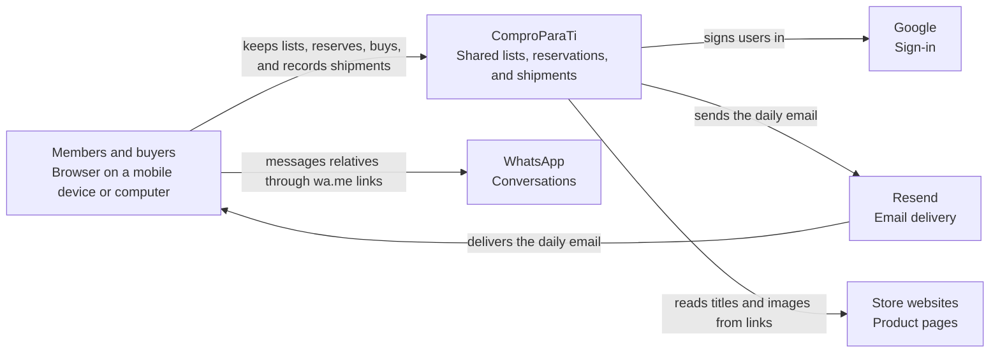
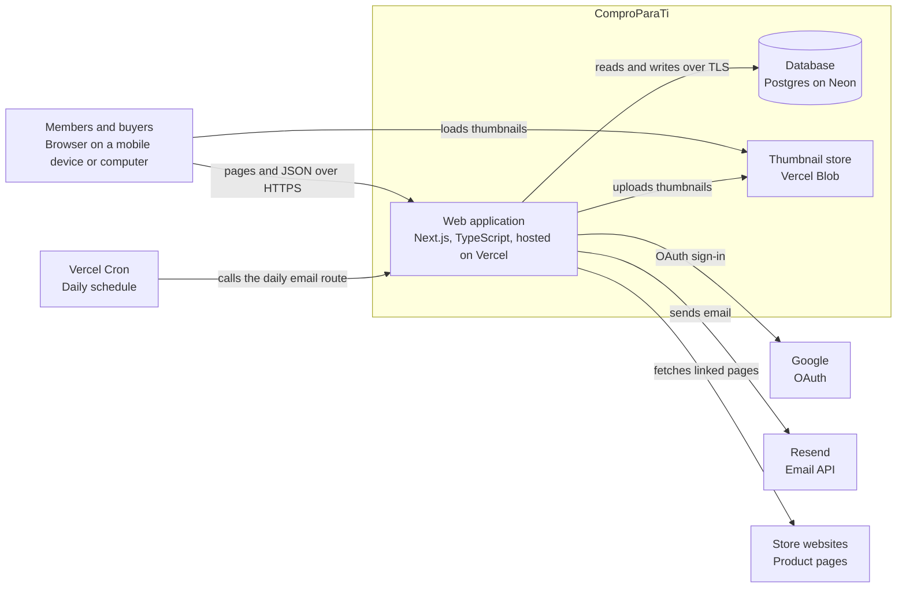
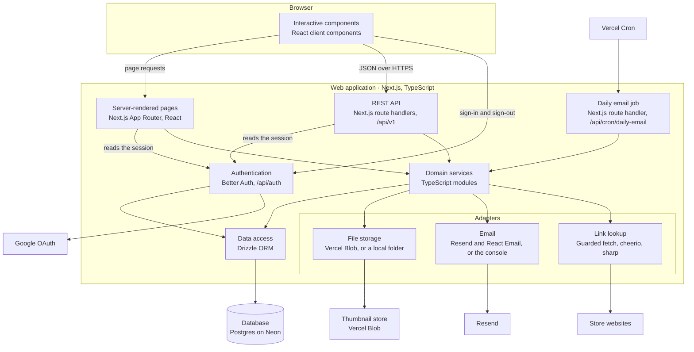

# Architecture

**Assisted Shopping Platform: ComproParaTi** · **Version:** 1.5 · **Date:** October 18, 2026

Part of the project documentation ([readme](../readme.md)). IDs (`BR`, `FR`, `E`, `US`, `AC`) are defined in the [PRD](01-PRD.md).

---

## 1. System architecture

### 1.1 Architecture and pattern

The platform is a **modular monolith**: one Next.js application, written in TypeScript, that serves the interface and a REST API from the same codebase and deployment. Inside it, the code follows a **layered architecture**:

1. **Presentation:** pages and interface components, built with React and served by the Next.js App Router.
2. **API:** REST route handlers under `/api/v1` that authenticate the request, validate input, and translate results into HTTP responses.
3. **Domain services:** one module per capability (groups, items, shipping, and so on). Services enforce the business rules ([PRD §12](01-PRD.md#12-business-rules)), including authorization, and run each change in a database transaction.
4. **Data access:** Drizzle schema and queries against Postgres.
5. **Adapters:** narrow interfaces to outside services (file storage, email, link lookup), each with a production version and a local version.

The front end (pages and components) and the back end (REST API and domain services) are separate layers of one application, connected to the Postgres database; they are deployed together rather than as two projects.

Pages read data by calling the domain services directly on the server, and the browser changes data through the REST API. Because authorization lives in the services, both paths apply the same rules.

**Why this architecture:**

| Benefits | Trade-offs |
| --- | --- |
| One codebase and one deployment for the interface and the API, which suits a small team and AI-assisted development | The interface and the API scale together; acceptable at this size |
| Runs entirely on free hosting plans | Free plans limit scheduled jobs and storage ([section 3](#3-technical-decisions)) |
| Business rules live in one layer and can be tested without the interface | The layering takes discipline: pages and handlers must not query the database directly |
| A REST API can be documented in OpenAPI, tested directly for permissions, and reused by a native app later | More code than Next.js Server Actions |
| Adapters keep the app runnable locally without accounts for Blob, Resend, or Google | Each adapter has two implementations to maintain |

**How the diagrams are drawn.** Sections 1.2 to 1.4 follow the C4 model from the outside in: the system with the people and services around it (level 1), the parts of the system that run separately (level 2), and the components inside the web application (level 3). Level 1 shows the system as a single box without technology. From level 2 on, each box shows its name and, on a second line, its technology, named with one rule:

- **Next.js** names what the framework provides: the deployed application, routing, server rendering, and route handlers.
- **React** names the interface components that pages are built from.
- An element that uses both lists both. Server-rendered pages are React components that Next.js routes and renders, so they are labeled "Next.js App Router, React". The interactive parts of the interface run in the browser as React code, so they are labeled "React client components".

### 1.2 System context (C4 level 1)

Who uses the system and which outside services it depends on.



### 1.3 Containers (C4 level 2)

The parts of the system that run separately, and the technology of each. The database and the thumbnail store are managed services, but they hold the system's own data, so they are containers of the system rather than outside services.



### 1.4 Components (C4 level 3)

The components inside the web application, by layer ([section 1.1](#11-architecture-and-pattern)).



**Main components:**

| Component | Technology | Responsibility |
| --- | --- | --- |
| Web interface | Next.js App Router, React, TypeScript, Tailwind CSS, shadcn/ui | Screens in [UX design §2](02-UX-DESIGN.md#2-interface-design), mobile first. Server-rendered pages with small React client components for forms and actions. |
| REST API | Next.js route handlers, Zod | The endpoints in [API](05-API.md). Input validation, error format, rate limits, and the generated OpenAPI document. |
| Authentication | Better Auth with the Google provider and the Drizzle adapter | Sign-in, identities (BR-02), and database sessions that expire after 30 days and are extended on use, at most once a day (BR-03). |
| Domain services | TypeScript modules | Business rules ([PRD §12](01-PRD.md#12-business-rules)), authorization (BR-12), transactions, and the status history (BR-26). |
| Data access | Drizzle ORM with node-postgres, and drizzle-kit migrations | Schema ([Data model](04-DATA-MODEL.md)), queries, and versioned migrations. |
| Link lookup | Guarded server-side fetch, ipaddr.js, cheerio, sharp | Reads the Open Graph data and page title of a link, under the limits in [Security and testing §1](07-SECURITY-AND-TESTING.md#1-security). ipaddr.js classifies each resolved address before a request is made, cheerio parses the HTML, and sharp checks the image and stores a thumbnail at most 480 pixels wide in WebP format. Runs after the response is sent, so saving is never delayed. |
| File storage | Storage interface: Vercel Blob, or a local folder | Stores item thumbnails. |
| Email | Email interface: Resend with React Email templates, console output locally, or in-memory capture in tests | Sends the daily email (BR-31), with text from the translation files. |
| Daily email job | Vercel Cron calling a protected route | Builds and sends one email per group per day. Records each run so a late or repeated run neither skips nor repeats changes. |
| Translations | next-intl with Spanish and English message files | All interface text, emails, and WhatsApp messages (FR-37), and formatting by language (FR-38). |
| Rate limiter | Counters stored in Postgres | Limits requests per user and per action ([Security and testing §1](07-SECURITY-AND-TESTING.md#1-security)). |

### 1.5 Technology stack

| Layer | Choice | Notes |
| --- | --- | --- |
| Frontend and backend | Next.js with TypeScript | One codebase for the interface and the server. |
| Interface | React, Tailwind CSS, and shadcn/ui | Accessible components that can be adjusted to the design principles ([UX design §2.1](02-UX-DESIGN.md#21-design-principles)). |
| Database | Postgres on Neon (Free plan), with Drizzle | The database pauses when idle; the delay on the first request after a pause is accepted for the MVP. |
| Sign-in | Better Auth with the Google provider | Supports adding providers later (FR-01) and the renewing session (BR-03). |
| Hosting and scheduled jobs | Vercel (Hobby plan) with Vercel Cron | Deploys from GitHub. The Hobby plan allows only non-commercial use and runs scheduled jobs at most once a day. |
| Email | Resend | Sends the daily email. |
| Thumbnails | Vercel Blob (public store) | In local development, thumbnails are saved to a local folder. |
| Task runner | npm scripts in package.json | `setup` and `dev` cover local setup and running the app. |

### 1.6 Dependencies

Every package the project installs. Milestone 1 packages are installed with the project scaffold (T-01); milestone 2 packages are added by the ticket that first uses them. A package that is not listed here is added only after this section is updated, in the same pull request.

**Platform:** Node.js (the current LTS release) with npm, Docker for the local Postgres, and GitHub Actions for CI and backups.

**Used by the application:**

| Package | Purpose | Milestone |
| --- | --- | --- |
| `next`, `react`, `react-dom` | Framework, routing, server rendering, and interface components | 1 |
| `better-auth` | Google sign-in, identities, and database sessions, through its Drizzle adapter | 1 |
| `drizzle-orm` | Schema and type-safe queries | 1 |
| `pg` | Postgres driver for every environment ([section 3](#3-technical-decisions)) | 1 |
| `zod` | Validation schemas shared by the browser and the server | 1 |
| `@asteasolutions/zod-to-openapi` | Generates `docs/openapi.yaml` from the Zod schemas | 1 |
| `next-intl` | Message files, plural rules, and date and number formatting by language | 1 |
| `tailwindcss` | Mobile-first styling with consistent spacing and sizes | 1 |
| shadcn/ui, with `radix-ui`, `class-variance-authority`, `clsx`, `tailwind-merge`, and `lucide-react` | Accessible dialogs, menus, and form controls styled with Tailwind. The shadcn command copies each component's code into `src/components/ui`; the listed packages are what that code uses. | 1 |
| `libphonenumber-js` | Validates and formats international phone numbers (BR-32) | 1 |
| `@vercel/blob` | Stores thumbnails in Vercel Blob | 2 |
| `cheerio` | Parses the HTML that link lookup downloads | 2 |
| `ipaddr.js` | Classifies resolved addresses for the link lookup guard, including IPv6 and IPv4-mapped forms | 2 |
| `sharp` | Resizes thumbnails and checks the image format from the file contents | 2 |
| `resend` | Sends email through Resend | 2 |
| `react-email` | Email templates built from React components, with a local preview | 2 |

**Used to build, check, and test:**

| Package | Purpose | Milestone |
| --- | --- | --- |
| `typescript` | Type checking in strict mode | 1 |
| `drizzle-kit` | Generates and applies migrations | 1 |
| `tsx` | Runs the TypeScript scripts: seed data and OpenAPI generation | 1 |
| `@tailwindcss/postcss` | Builds Tailwind CSS in Next.js | 1 |
| `eslint`, `eslint-config-next` | Linting, including the accessibility rules in `eslint-plugin-jsx-a11y` | 1 |
| `prettier`, `prettier-plugin-tailwindcss` | Formatting, including a consistent order of Tailwind classes | 1 |
| `vitest` | Unit and integration tests | 1 |
| `@vitest/coverage-v8` | Line coverage for the domain services ([Security and testing §2.6](07-SECURITY-AND-TESTING.md#26-coverage-targets)) | 1 |
| `@playwright/test` | Browser tests | 1 |
| `@axe-core/playwright` | Automated accessibility checks in the browser tests | 1 |

Type definitions (`@types/*`) are added for packages that don't include their own.

**Versions.** T-01 installs the current stable release of each package, and `package-lock.json` pins the exact versions. Zod must be version 4, which zod-to-openapi requires. Dependency updates and audits follow [Security and testing §1](07-SECURITY-AND-TESTING.md#1-security).

---

## 2. Project structure

Planned layout of the repository:

```
.
├── src/
│   ├── app/                      Next.js App Router
│   │   ├── (public)/             Welcome, invitation, onboarding
│   │   ├── (app)/                Lists, people, group, to-buy, purchases, items, profile
│   │   └── api/
│   │       ├── v1/               REST route handlers, one folder per resource
│   │       ├── auth/[...all]/    Better Auth
│   │       └── cron/daily-email/ Daily email job
│   ├── components/               Shared interface components
│   │   └── ui/                   shadcn/ui components
│   ├── server/
│   │   ├── services/             Domain services, one per capability
│   │   ├── db/                   Drizzle schema, client, and migrations
│   │   ├── auth/                 Better Auth configuration
│   │   ├── adapters/             storage/, email/ (with React Email templates), link-lookup/; production and local versions
│   │   └── http/                 Error format, authorization guard, rate limiter
│   ├── shared/                   Zod schemas, types, and limits (BR-32) used by browser and server
│   └── i18n/                     es.json and en.json message files
├── tests/
│   ├── unit/                     Business rules
│   ├── integration/              API endpoints against a real database
│   └── e2e/                      Browser tests of the main flows
├── scripts/                      Setup, seed, OpenAPI generation, and GitHub issue setup scripts
├── docs/                         This documentation, the setup checklist, and the generated openapi.yaml
├── openspec/                     OpenSpec specs and changes, one change per work ticket
├── docker-compose.yml            Local Postgres
├── drizzle.config.ts
├── vercel.json                   Cron schedule
└── package.json                  setup, dev, test, lint, db:migrate, and db:seed scripts
```

The structure groups code by layer first and by capability second, matching [section 1.1](#11-architecture-and-pattern). Code under `src/server` never runs in the browser.

---

## 3. Technical decisions

| Topic | Decision | Reason |
| --- | --- | --- |
| Hosting plan | Free plans: Vercel Hobby and Neon Free | The project is non-commercial: no paid development and no revenue expected at first. Vercel Hobby allows only non-commercial use, so a paid plan is required if that changes. |
| Repository | A personal GitHub account | Vercel's Hobby plan deploys from repositories owned by a personal account; whether it can deploy from an organization's repository was not confirmed. |
| Authentication library | Better Auth, not Auth.js | Since September 2025 the Better Auth team maintains Auth.js for security and urgent fixes only, and recommends Better Auth for new projects. Better Auth covers what the PRD requires: Google identities keyed by the provider's user ID (BR-02), database sessions with a set lifetime and renewal interval (BR-03), and a Drizzle adapter. |
| Database driver | node-postgres (`pg`) in every environment | One driver connects to Postgres in Docker, the CI service container, and Neon's pooled connection, so tests run the same data access code as production. Neon's serverless driver needs a WebSocket proxy to reach a local Postgres. |
| Interface components | shadcn/ui on Tailwind CSS | Accessible building blocks save build time before the course deadlines. The code is copied into the repository, so components can be adjusted to the design principles, such as larger text and buttons, without forking a library. |
| Thumbnail storage | Vercel Blob, not the database | The database's free plan includes 0.5 GB and suspends the project when that is exceeded; images would use that space and make backups larger and slower. Blob is built for files and serves them through Vercel's cache. A storage interface with a local-folder version keeps the app runnable locally. |
| Scheduled jobs | Vercel Cron only; no outside scheduler | An outside scheduler calling the app more often than the free plan allows adds a service to run, and Vercel's guidelines prohibit circumventing plan limits. FR-36 was set to a daily email instead. |
| Task runner | package.json scripts, not Make or Just | Node is already required, and scripts work the same on macOS, Linux, and Windows. Make is not installed on Windows by default, and Just must be installed on every machine. Just becomes a reasonable wrapper if non-Node tooling, such as Terraform, is added. |
| Infrastructure as code | Not used for the MVP; a setup checklist instead | Vercel has an official Terraform provider, and Neon has a community provider it sponsors but does not maintain. Resend has no official provider, and Google's OAuth consent screen and web client cannot be fully configured with Terraform, so those steps stay manual either way. For one project, one database, and one file store, Terraform's state, tokens, and extra toolchain cost more than they save. |
| API style | REST endpoints (Next.js route handlers), not Server Actions | Can be documented in OpenAPI, permission rules can be tested with direct requests, and a native app could reuse it later. |
| Where authorization lives | In the domain services | Server-rendered pages and the REST API apply exactly the same checks. |
| Preview environment | None for the MVP | Google sign-in requires fixed redirect addresses, and a second environment needs its own database and setup. Revisit with Terraform ([PRD §18](01-PRD.md#18-future-features)). |
| Local sign-in | A development-only sign-in as a seed user, through a small Better Auth plugin | Developers can run the app without creating Google credentials. The plugin is registered only when the app runs locally with an explicit setting ([Infrastructure §2](06-INFRASTRUCTURE.md#2-environments)), and the app refuses to start if that setting is on and the app is not served from localhost, so a wrong environment variable cannot expose it. Browser tests sign in with it, locally and in CI. |
| Build approach | Spec-driven development with OpenSpec and Claude Code | Each work ticket becomes one OpenSpec change, generated from the ticket and the documents it references, and reviewed before any code is written ([Work tickets §1](08-WORK-TICKETS.md#1-how-tickets-work)). Reviewing the plan first catches gaps in the documentation before they turn into code, and the specs record what each ticket built. `CLAUDE.md` gives Claude Code the project rules. |
| Rate limit storage | Postgres | No extra service; request volume is low. |
| Concurrency | A version number on items, and conditional updates for status changes | Enforces BR-20 and BR-23 without database locks. |
