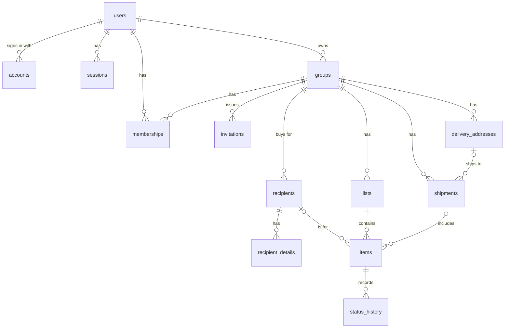
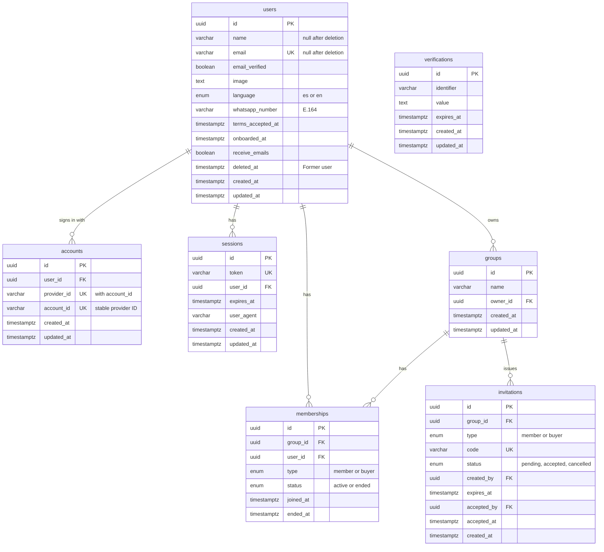
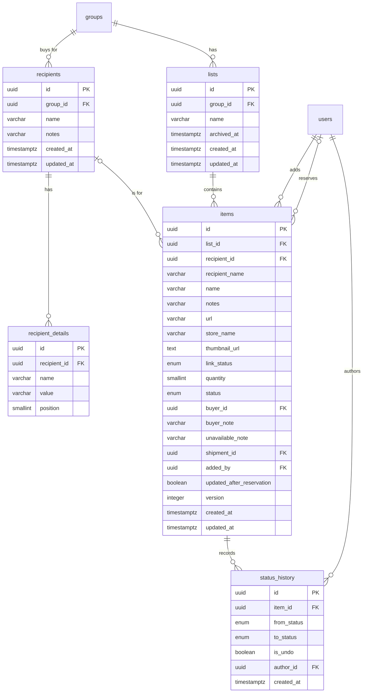
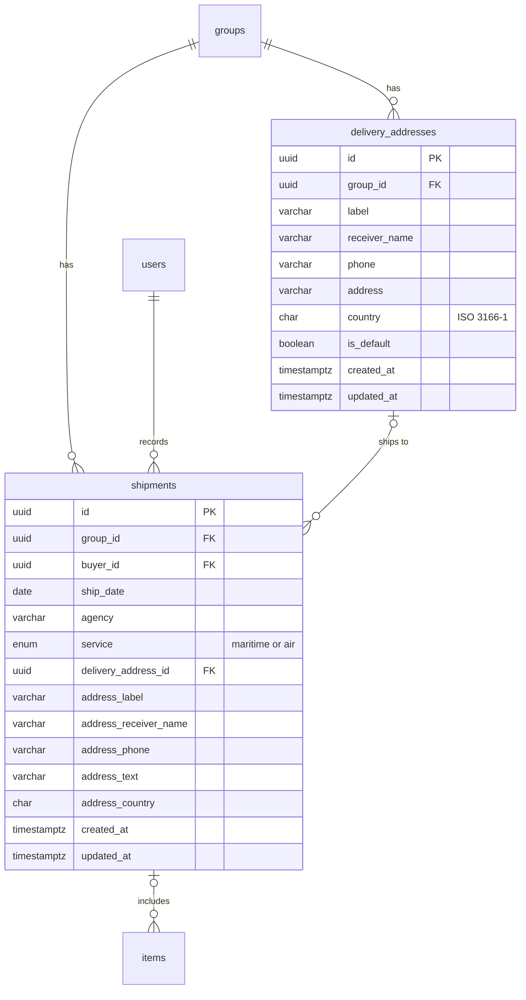

# Data model

**Assisted Shopping Platform: ComproParaTi** · **Version:** 1.5 · **Date:** October 18, 2026

Part of the project documentation ([readme](../readme.md)). IDs (`BR`, `FR`, `E`, `US`, `AC`) are defined in the [PRD](01-PRD.md).

---

## 1. Data model diagram

The model is shown in four diagrams so that each one stays readable: an overview of the entities and how the data is owned, then one diagram per area with each entity's attributes and all its relationships. In the area diagrams, entities that belong to another area appear by name only. Each entity is defined in [section 2](#2-entities). Two supporting tables are not shown: `job_runs` and `rate_limits`.

### 1.1 Overview

All entities and how the data is owned: each user's sign-in records and groups, each group's content, and each item's history. To keep the overview compact, the links that record which user added, reserved, shipped, or changed an item are shown in [section 1.3](#13-requests-and-buying) and [section 1.4](#14-shipping). `verifications` has no relationships and appears in [section 1.2](#12-accounts-groups-and-access).

### 1.2 Accounts, groups, and access

### 1.3 Requests and buying

### 1.4 Shipping

## 2. Entities

All tables use `uuid` primary keys generated by the database unless stated otherwise, and `timestamptz` values in UTC. Text limits match BR-32. Business rules that span rows, such as the 10-address limit, are enforced in the domain services.

**Enumerations:** `language` (es, en) · `membership_type` (member, buyer) · `membership_status` (active, ended) · `invitation_status` (pending, accepted, cancelled) · `item_status` (pending, reserved, purchased, shipped, unavailable) · `link_status` (none, pending, done, failed) · `shipping_service` (maritime, air).

**Sign-in tables:** `users`, `accounts`, `sessions`, and `verifications` follow Better Auth's schema, configured with plural table names, snake_case columns, and database-generated `uuid` IDs. The app adds its own columns to `users`.

**users:** a person with an account. Rows are never physically deleted, so history keeps working after account deletion (BR-05).

| Attribute | Type | Constraints | Description |
| --- | --- | --- | --- |
| id | uuid | PK | |
| name | varchar(100) | Null after deletion | Name from Google |
| email | varchar(320) | Unique when not null; null after deletion | Verified email from the provider |
| email_verified, image | boolean, text | email_verified not null; image nullable | Required by Better Auth; image is the avatar in the header |
| language | language | Null until onboarding | Interface and email language (FR-02) |
| whatsapp_number | varchar(16) | Null until onboarding; E.164 format | BR-04 |
| terms_accepted_at | timestamptz | Null until onboarding | When the age and terms box was checked (BR-01) |
| onboarded_at | timestamptz | Nullable | Onboarding complete; the app is unusable until set |
| receive_emails | boolean | Not null, default true | FR-04 |
| deleted_at | timestamptz | Nullable | Set on deletion; the user is shown as "Former user" |
| created_at, updated_at | timestamptz | Not null | |

Better Auth treats `name` and `email` as required. They are null only for deleted users, who have no identities or sessions, so Better Auth never reads those rows.

**accounts:** sign-in identities (BR-02).

| Attribute | Type | Constraints | Description |
| --- | --- | --- | --- |
| id | uuid | PK | |
| provider_id, account_id | varchar(50), varchar(255) | Not null; unique together | Provider name and its stable user ID |
| user_id | uuid | FK users, not null, on delete cascade; unique with provider_id | One identity per provider per user |
| created_at, updated_at | timestamptz | Not null | |

Better Auth also defines nullable columns for the provider's tokens and for passwords, which the app does not use. Identities are deleted on account deletion, so signing in again creates a new account.

**sessions:** active sessions (BR-03).

| Attribute | Type | Constraints | Description |
| --- | --- | --- | --- |
| id | uuid | PK | |
| token | varchar(255) | Unique, not null | Identifies the session; sent signed in the session cookie |
| user_id | uuid | FK users, not null, on delete cascade | |
| expires_at | timestamptz | Not null | Extended on use |
| user_agent | varchar(500) | Nullable | Browser that started the session |
| created_at, updated_at | timestamptz | Not null | |

Better Auth also defines an `ip_address` column. IP address recording is turned off, so it stays null.

**verifications:** short-lived values that Better Auth stores during sign-in.

| Attribute | Type | Constraints | Description |
| --- | --- | --- | --- |
| id | uuid | PK | |
| identifier | varchar(255) | Not null | What the value belongs to |
| value | text | Not null | |
| expires_at | timestamptz | Not null | |
| created_at, updated_at | timestamptz | Not null | |

**groups**

| Attribute | Type | Constraints | Description |
| --- | --- | --- | --- |
| id | uuid | PK | |
| name | varchar(100) | Not null | |
| owner_id | uuid | FK users, not null | Must be an active member (BR-07) |
| created_at, updated_at | timestamptz | Not null | |

Deleting a group deletes its memberships, invitations, recipients, lists, items, delivery addresses, and shipments.

**memberships:** a user's access to a group.

| Attribute | Type | Constraints | Description |
| --- | --- | --- | --- |
| id | uuid | PK | |
| group_id | uuid | FK groups, not null, on delete cascade; unique with user_id | |
| user_id | uuid | FK users, not null | |
| type | membership_type | Not null | Member or buyer |
| status | membership_status | Not null, default active | `ended` when the person leaves or is removed (BR-11) |
| joined_at | timestamptz | Not null | |
| ended_at | timestamptz | Nullable | |

**invitations**

| Attribute | Type | Constraints | Description |
| --- | --- | --- | --- |
| id | uuid | PK | |
| group_id | uuid | FK groups, not null, on delete cascade | |
| type | membership_type | Not null | |
| code | varchar(43) | Unique, not null | 256 random bits, URL-safe; the secret part of the link |
| status | invitation_status | Not null, default pending | An invitation past `expires_at` is treated as expired |
| created_by | uuid | FK users, not null | Shown on the invitation screen |
| expires_at | timestamptz | Not null | Creation plus 7 days (BR-08) |
| accepted_by, accepted_at | uuid, timestamptz | FK users; nullable | Single use (BR-08) |
| created_at | timestamptz | Not null | |

**recipients**

| Attribute | Type | Constraints | Description |
| --- | --- | --- | --- |
| id | uuid | PK | |
| group_id | uuid | FK groups, not null, on delete cascade | |
| name | varchar(100) | Not null | |
| notes | varchar(1000) | Nullable | |
| created_at, updated_at | timestamptz | Not null | |

**recipient_details:** free-form details (FR-10); up to 20 per recipient (BR-32).

| Attribute | Type | Constraints | Description |
| --- | --- | --- | --- |
| id | uuid | PK | |
| recipient_id | uuid | FK recipients, not null, on delete cascade | |
| name | varchar(40) | Not null | For example "Shoe" |
| value | varchar(150) | Not null | For example "4" |
| position | smallint | Not null | Display order |

**lists**

| Attribute | Type | Constraints | Description |
| --- | --- | --- | --- |
| id | uuid | PK | |
| group_id | uuid | FK groups, not null, on delete cascade | |
| name | varchar(100) | Not null | |
| archived_at | timestamptz | Nullable | Archived when set (BR-17) |
| created_at, updated_at | timestamptz | Not null | |

**delivery_addresses** (BR-27)

| Attribute | Type | Constraints | Description |
| --- | --- | --- | --- |
| id | uuid | PK | |
| group_id | uuid | FK groups, not null, on delete cascade | |
| label | varchar(100) | Not null | For example "Grandma's house" |
| receiver_name | varchar(100) | Not null | |
| phone | varchar(16) | Not null; E.164 | |
| address | varchar(500) | Not null | Free text |
| country | char(2) | Not null; ISO 3166-1 alpha-2 | |
| is_default | boolean | Not null, default false; at most one true per group (partial unique index) | |
| created_at, updated_at | timestamptz | Not null | |

**items**

| Attribute | Type | Constraints | Description |
| --- | --- | --- | --- |
| id | uuid | PK | |
| list_id | uuid | FK lists, not null, on delete cascade | |
| recipient_id | uuid | FK recipients, nullable, on delete set null | |
| recipient_name | varchar(100) | Nullable | Copy of the recipient's name, set when the recipient is deleted (BR-15) |
| name | varchar(100) | Not null | The only required field |
| notes | varchar(1000) | Nullable | |
| url | varchar(2000) | Nullable; http or https | |
| store_name | varchar(100) | Nullable | From the link lookup |
| thumbnail_url | text | Nullable | Stored thumbnail |
| link_status | link_status | Not null, default none | Progress of the link lookup |
| quantity | smallint | Not null, default 1, check 1 to 99 | |
| status | item_status | Not null, default pending | BR-22 |
| buyer_id | uuid | FK users; null only when status is pending | The item's buyer |
| buyer_note | varchar(1000) | Nullable | FR-25 |
| unavailable_note | varchar(1000) | Required when status is unavailable | BR-25 |
| shipment_id | uuid | FK shipments, on delete set null; not null only when status is shipped | |
| added_by | uuid | FK users, not null | |
| updated_after_reservation | boolean | Not null, default false | The "Updated" marker (BR-19) |
| version | integer | Not null, default 1 | Increases on every change; used to refuse stale edits (BR-20) |
| created_at, updated_at | timestamptz | Not null | |

Indexes: (list_id, status), (buyer_id, status), and (recipient_id). A reservation is a single conditional update (`status = 'pending'`), so only the first of two simultaneous reservations succeeds (BR-23).

**shipments** (BR-28, BR-29)

| Attribute | Type | Constraints | Description |
| --- | --- | --- | --- |
| id | uuid | PK | |
| group_id | uuid | FK groups, not null, on delete cascade | |
| buyer_id | uuid | FK users, not null | The buyer who recorded it |
| ship_date | date | Not null; not later than today | |
| agency | varchar(80) | Not null | |
| service | shipping_service | Not null | |
| delivery_address_id | uuid | FK delivery_addresses, nullable, on delete set null | The address chosen, if any |
| address_label, address_receiver_name, address_phone, address_text, address_country | varchar(100), varchar(100), varchar(16), varchar(500), char(2) | Nullable | Copy of the address as shipped; null when the group had no address |
| created_at, updated_at | timestamptz | Not null | |

**status_history** (BR-26): one row for each item's creation and each status change.

| Attribute | Type | Constraints | Description |
| --- | --- | --- | --- |
| id | uuid | PK | |
| item_id | uuid | FK items, not null, on delete cascade | |
| from_status | item_status | Nullable | Null for the creation row |
| to_status | item_status | Not null | |
| is_undo | boolean | Not null, default false | |
| author_id | uuid | FK users, not null | |
| created_at | timestamptz | Not null | Indexed, for the daily email |

**job_runs:** one row per scheduled job: `name` (varchar, PK), `last_started_at`, and `last_completed_at`. The daily email covers changes since the last completed run (BR-31).

**rate_limits:** `key` (varchar, PK, combining user, action, and time window), `count` (integer), and `expires_at` (timestamptz). Expired rows are removed by the daily job.

## 3. Seed data

The seed script loads the same data for local development and automated tests. It covers every status and every permission case:

- **García Group**, owned by Ana (member, English). Rosa is a member (Spanish), and Juan and Luis are buyers.
- **Recipients:** Anthony (Shoe: 4, Shirt: M), Grandma (Allergy: penicillin), and Mom.
- **Lists:** "Anthony's birthday" and "Medicine", plus one archived list.
- **Items in every status:** pending, reserved by Juan, purchased by Juan with a buyer note, shipped in a two-item shipment, and unavailable with a note. One item has no recipient.
- **Delivery addresses:** "Grandma's house" (default) and "Mom's house".
- **Pérez Group**, owned by Luis, with one item, for cross-group access tests.
- **Invitations:** one pending, one expired, and one already accepted.
