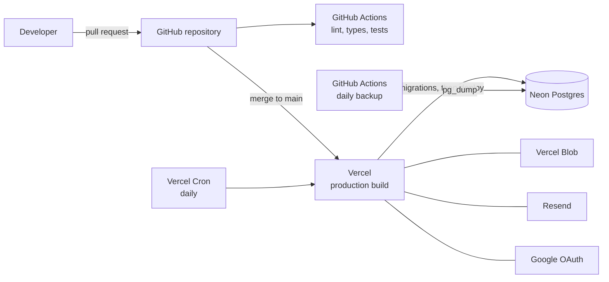

# Infrastructure and deployment

**Assisted Shopping Platform: ComproParaTi** · **Version:** 1.5 · **Date:** October 18, 2026

Part of the project documentation ([readme](../readme.md)). IDs (`BR`, `FR`, `E`, `US`, `AC`) are defined in the [PRD](01-PRD.md).

---

## 1. Infrastructure diagram

## 2. Environments

| Environment | Database | Files | Email | Sign-in |
| --- | --- | --- | --- | --- |
| Local | Postgres in Docker, with seed data ([Data model §3](04-DATA-MODEL.md#3-seed-data)) | Local folder | Printed to the console | Google with a development OAuth client, or a development-only sign-in as a seed user |
| Production | Neon | Vercel Blob | Resend | Google |

There is no preview environment for the MVP ([Architecture §3](03-ARCHITECTURE.md#3-technical-decisions)). The development-only sign-in exists only when the app runs locally with an explicit setting, and is never available in production, so a developer can run the app without creating Google credentials.

## 3. Deployment process

1. A developer opens a pull request.
2. GitHub Actions installs dependencies and runs linting, type checks, unit tests, integration tests against a Postgres service container with the coverage target ([Security and testing §2.6](07-SECURITY-AND-TESTING.md#26-coverage-targets)), browser tests in Chromium and WebKit against a production build with the local adapters, a check that the generated OpenAPI document is up to date, and a link check across the documentation.
3. Branch protection requires all checks to pass and a review before merging to `main`.
4. Vercel builds `main`. The build applies database migrations to production and then builds the app. Migrations must be backward compatible, because the previous version keeps serving until the new one is live.
5. After the deployment, a quick check confirms that the home page and sign-in load.

## 4. Scheduled jobs

Vercel Cron calls the daily email route at 13:00 UTC, which is 9:00 am US Eastern time during daylight saving time and 8:00 am in winter. Vercel may run it up to an hour late. The route rejects any call without the cron secret.

## 5. Backups

A scheduled GitHub Actions workflow runs `pg_dump` daily, encrypts the file, and stores it outside Neon (location: [PRD §10](01-PRD.md#10-open-questions), question 5). A restore into a separate database is tested before launch and then monthly.

## 6. Monitoring

Errors are logged to the Vercel runtime logs, which the Hobby plan keeps only briefly ([PRD §10](01-PRD.md#10-open-questions), question 6). Free plan usage (database storage, Blob storage and transfer, and email volume) is reviewed monthly.

## 7. Configuration

Secrets are stored as environment variables in Vercel and GitHub, never in the repository: `DATABASE_URL`, `BETTER_AUTH_SECRET`, `GOOGLE_CLIENT_ID`, `GOOGLE_CLIENT_SECRET`, `BLOB_READ_WRITE_TOKEN`, `RESEND_API_KEY`, `EMAIL_FROM`, `CRON_SECRET`, `APP_URL` (also Better Auth's base address), and `SUPPORT_EMAIL`. The repository includes an `.env.example` with every variable and a setup checklist for the steps that cannot be automated: the Google OAuth consent screen and client, and the Resend sending domain.
