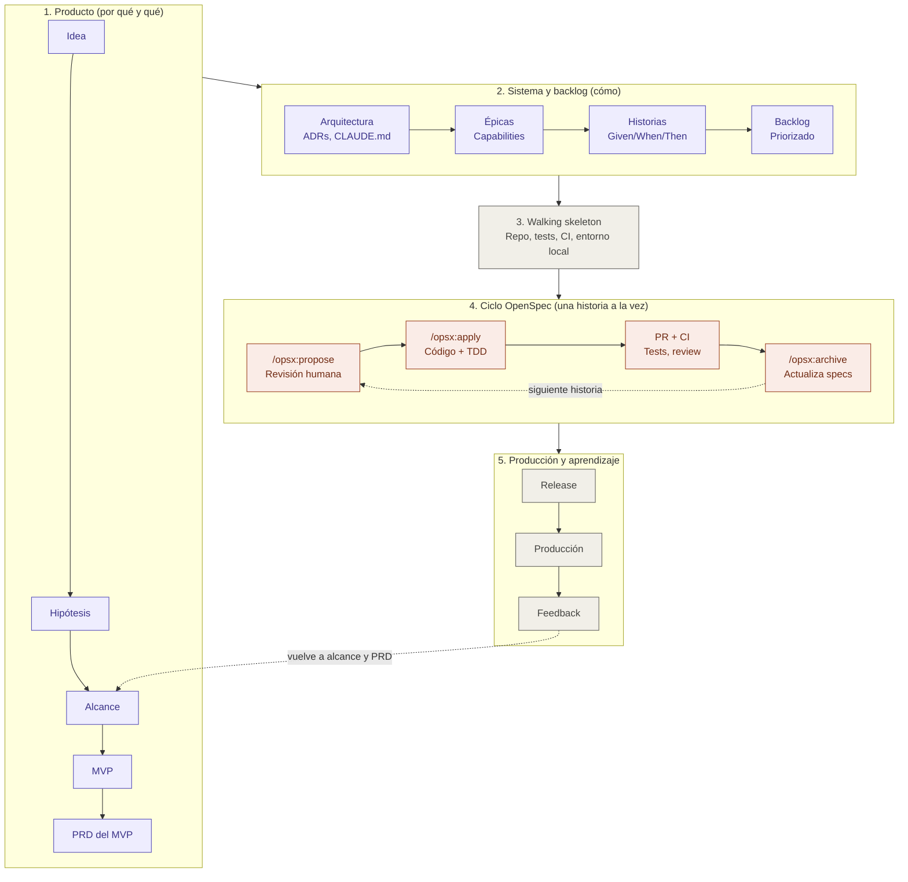

# AI SDLC con Claude Code y OpenSpec — Guía de contexto

> Documento de referencia para usar como contexto en otros chats. Describe un ciclo de vida de desarrollo asistido por IA (AI SDLC) para construir una aplicación desde cero usando **Claude Code** como agente de desarrollo y **OpenSpec** como framework de desarrollo guiado por especificaciones (spec-driven development).

## Diagrama general

Vista de alto nivel del flujo completo. Los pasos 1 y 2 se hacen al inicio y se revisan con el feedback; el paso 3 se hace una vez; el paso 4 se repite por cada historia; el paso 5 retroalimenta el alcance y el PRD.


> La imagen requiere que `ai-sdlc-diagrama.png` (o el `.svg`) esté en la misma carpeta que este documento. La versión Mermaid de abajo es equivalente y no depende de archivos externos.



## 1. Idea central

OpenSpec **no reemplaza** al PRD ni a la arquitectura. Es la capa que convierte cada unidad de trabajo en un *cambio especificado* que Claude Code implementa y que, al cerrarse, actualiza la "fuente de verdad" del comportamiento del sistema.

Modelo de cuatro capas, de lo más estable a lo más volátil:

| Capa | Pregunta | Artefactos |
| --- | --- | --- |
| Producto | ¿Por qué y qué? | Visión, alcance, PRD, MVP |
| Sistema | ¿Cómo, a grandes rasgos? | Arquitectura, ADRs, stack, convenciones (`CLAUDE.md`) |
| Cambios | ¿Qué se hace ahora? | OpenSpec (`openspec/changes/`, `openspec/specs/`) |
| Ejecución | ¿Funciona y está en producción? | Código, pruebas, CI/CD, despliegue |

## 2. Alcance, PRD y MVP

- **Alcance**: el perímetro total del producto. Incluye lo que podría llegar a hacer y lo que explícitamente **no** hará.
- **PRD (Product Requirements Document)**: problema, usuarios, objetivos, requisitos funcionales y no funcionales, métricas de éxito. Cubre el alcance de forma priorizada.
- **MVP**: un *corte* del PRD. El subconjunto mínimo de requisitos que valida la hipótesis principal. En la práctica, cada requisito del PRD se etiqueta como `MVP`, `v1.1` o `futuro`.

Relación con OpenSpec:

- Cada requisito o épica del MVP se convierte en **uno o varios cambios de OpenSpec**.
- El PRD es humano y orientado a negocio; las specs de OpenSpec son verificables y orientadas al comportamiento del sistema.
- Trazabilidad buscada: **PRD → requisito → escenario (spec) → test → código**.

## 3. Orden de los artefactos: de la idea al código

El orden va de lo más incierto y estratégico a lo más concreto y verificable. Cada paso reduce incertidumbre y da insumos al siguiente.

```text
Idea → Problema/hipótesis → Visión y alcance → MVP → PRD del MVP
     → Arquitectura base → Épicas → Historias + criterios de aceptación
     → Backlog priorizado → Walking skeleton → Cambios OpenSpec (1 por historia/grupo)
     → Implementación + pruebas → Release → Feedback → (vuelve a alcance/PRD)
```

### Paso a paso

1. **Idea**: una frase ("una app para X"). Todavía no es accionable.
2. **Problema e hipótesis**: quién tiene el problema, qué tan grave es y qué crees que lo resuelve, de forma verificable. Ejemplo: "Los freelancers pierden horas cobrando facturas; creemos que recordatorios automáticos reducen el tiempo de cobro 30%". Si no puedes escribir la hipótesis, no estás listo para el alcance.
3. **Visión y alcance**: perímetro completo del producto a mediano plazo. Qué hará, para quién y, sobre todo, qué **no** hará. Lista amplia de capacidades sin detalle; evita diseñar algo que no pueda crecer.
4. **MVP**: corte del alcance con el mínimo de capacidades para validar la hipótesis. Pregunta clave: "¿qué necesito para aprender si esto funciona?", no "¿qué necesito para que esté completo?". Va antes del PRD detallado porque no vale la pena especificar a fondo lo que aún no se construirá.
5. **PRD del MVP**: detalle solo de lo del MVP: personas, flujos principales, requisitos funcionales y no funcionales, métricas de éxito, riesgos. Lo que quedó fuera aparece solo como "futuro" (una línea cada cosa).
6. **Arquitectura base**: después del PRD, porque este aporta los NFRs (escala, seguridad, integraciones) que la condicionan. Stack, estilo, modelo de datos inicial y ADRs clave. Diseñada para el MVP sin cerrar puertas al alcance.
7. **Épicas**: agrupan requisitos del PRD en bloques de valor ("Autenticación", "Gestión de facturas", "Recordatorios"). Suelen mapear a una capability de OpenSpec.
8. **Historias de usuario + criterios de aceptación**: cada épica se rompe en historias ("Como freelancer quiero programar un recordatorio para…") con criterios Given/When/Then. Es BDD y es el puente directo a OpenSpec: los criterios se convierten en escenarios de las specs.
9. **Backlog priorizado / plan de releases**: historias ordenadas por dependencia y valor. La primera siempre es infraestructura.
10. **Walking skeleton**: primer cambio de OpenSpec (repo, tests, CI, entorno local, despliegue trivial).
11. **Ciclo OpenSpec por historia**: cada historia (o 2-3 muy relacionadas) es un cambio: `/opsx:propose` → revisión → `/opsx:apply` → PR → `/opsx:archive`.

> Variante válida para el paso 5: un único PRD del producto con requisitos etiquetados `MVP / v1.1 / futuro`. Lo importante es que el detalle fino solo exista para el MVP.

### Mapeo ágil ↔ OpenSpec

| Artefacto ágil | Equivalente en OpenSpec |
| --- | --- |
| Épica | Capability (`openspec/specs/<capability>/`) |
| Historia de usuario | Un cambio (`openspec/changes/<id>/proposal.md`) |
| Criterios de aceptación | Escenarios en los deltas de spec |
| Notas técnicas / spike | `design.md` |
| Subtareas | `tasks.md` |
| "Done" | Cambio archivado, specs actualizadas |

### Matices

- **No es cascada estricta.** Escribir historias suele revelar huecos en el PRD, y la arquitectura puede forzar recortar el MVP. Volver uno o dos pasos atrás es normal; saltarse pasos hacia adelante (historias sin MVP definido) no lo es.
- **Arquitectura e historias se retroalimentan.** Épicas antes de la arquitectura; historias detalladas después, para que reflejen restricciones técnicas reales.
- **El detalle es proporcional a la cercanía.** Historias del próximo sprint: muy detalladas. Historias del final del MVP: apenas un título. Igual con OpenSpec: generar propuestas solo para lo que se implementará pronto, porque las specs cambian conforme se aprende.
- **Decisiones humanas clave**: la hipótesis (paso 2), el corte del MVP (paso 4), los ADRs (paso 6) y la aprobación de cada propuesta de OpenSpec.

## 4. OpenSpec en resumen

- Framework open source de Fission AI para spec-driven development con asistentes de IA.
- Instalación (requiere Node.js 20.19+):

```bash
npm install -g @fission-ai/openspec@latest
cd my-app
openspec init       # crea openspec/ e instala los slash commands en el agente
openspec update     # regenera instrucciones/comandos tras actualizar
```

- Comandos `openspec ...` → se ejecutan en la terminal.
- Comandos `/opsx:...` → se ejecutan en el chat del agente (Claude Code).

### Ciclo principal (perfil core)

| Paso | Comando | Qué pasa | Rol humano |
| --- | --- | --- | --- |
| Explorar | `/opsx:explore` | Pensar la idea antes de comprometerse | Aclarar dudas y alternativas |
| Proponer | `/opsx:propose <cambio>` | Genera proposal, deltas de specs, design y tasks | **Revisar y aprobar** (gate humano) |
| Implementar | `/opsx:apply` | El agente ejecuta `tasks.md` | Revisar el PR |
| Sincronizar | `/opsx:sync` | Sincroniza deltas con las specs | Verificar |
| Archivar | `/opsx:archive` | Fusiona deltas en `openspec/specs/` y archiva el cambio | Confirmar tras merge/deploy |

Flujo extendido (se activa con `openspec config profile` y luego `openspec update`): `/opsx:new`, `/opsx:continue`, `/opsx:ff`, `/opsx:verify`, `/opsx:bulk-archive`, `/opsx:onboard`.

### Estructura de un cambio

```text
openspec/changes/<change-id>/
├── proposal.md     # por qué y qué cambia
├── specs/          # deltas de requisitos y escenarios
├── design.md       # enfoque técnico (arquitectura de la feature)
└── tasks.md        # checklist de implementación
```

- `openspec/specs/` = verdad del comportamiento **actual** del sistema.
- `openspec/changes/` = cambios **en curso**; al archivar pasan a `openspec/changes/archive/<fecha>-<change-id>/`.

## 5. Fases del AI SDLC

### Fase 0 — Descubrimiento (fuera de OpenSpec)

- Problema, usuarios, competencia, hipótesis.
- Claude como copiloto de investigación y cuestionamiento.
- Salida: `docs/vision.md`.

### Fase 1 — Producto

- PRD + definición del MVP + criterios de aceptación de alto nivel.
- Claude ayuda a redactar y detectar huecos; las decisiones son humanas.
- Salida: `docs/prd.md`.

### Fase 2 — Arquitectura base

- Estilo arquitectónico, stack, modelo de datos inicial, integraciones, NFRs (seguridad, rendimiento, costo, observabilidad).
- Decisiones relevantes como ADRs.
- Salidas: `docs/architecture.md`, `docs/adr/*.md`, `CLAUDE.md` (comandos de build/test, estructura, estilo, definition of done).

### Fase 3 — Inicializar repo y OpenSpec

- `openspec init`.
- Completar el contexto del proyecto de OpenSpec (p. ej. `openspec/project.md` o la configuración equivalente de la versión instalada) con stack y convenciones, apuntando al PRD y a los ADRs.

### Fase 4 — Walking skeleton (primer cambio de OpenSpec)

Antes de cualquier feature, un cambio que deje el sistema funcionando de punta a punta:

- Hola-mundo desplegable.
- Framework de pruebas (unitarias y de aceptación).
- Linter/formatter.
- Entorno local con Docker Compose / `Makefile`.
- Pipeline de CI mínimo.

Así toda feature posterior nace probada e integrada.

### Fase 5 — Iterar el MVP con el ciclo de OpenSpec

Aquí vive la mayor parte del trabajo. Por cada requisito del MVP:

1. `/opsx:explore` (opcional).
2. `/opsx:propose` → revisión y aprobación humana.
3. Rama nueva → `/opsx:apply` en sesión con contexto limpio.
4. PR → CI verde → code review → merge.
5. `/opsx:archive`.

### Fase 6 — Hardening y release del MVP

- Seguridad, observabilidad, pruebas de carga, documentación.
- También como cambios de OpenSpec, aunque toquen poco comportamiento funcional.

### Fase 7 — Producción y feedback

- Métricas y feedback de usuarios → actualizar el PRD → nuevos cambios de OpenSpec.
- El ciclo vuelve a la Fase 5.

## 6. Dónde vive cada cosa

| Tema | Dónde se define | Dónde se ejecuta / verifica |
| --- | --- | --- |
| Alcance, PRD, MVP | `docs/prd.md` | Revisión humana |
| Arquitectura global | `docs/architecture.md` + `docs/adr/` | `CLAUDE.md` la hace visible al agente |
| Arquitectura de una feature | `design.md` del cambio | Code review |
| Comportamiento (fuente de verdad) | `openspec/specs/` | Pruebas de aceptación |
| Plan de implementación | `tasks.md` del cambio | `/opsx:apply` |
| Pruebas | Escenarios en deltas de spec + tareas de test | CI |
| CI/CD | Cambio OpenSpec dedicado (walking skeleton) | GitHub Actions o similar |
| Despliegue local | Docker Compose, `Makefile`, documentado en `CLAUDE.md` | `make dev` |
| Despliegue a producción | Cambio OpenSpec de infra (IaC: Terraform, etc.) + ADR | Pipeline con aprobación manual |

## 7. BDD y TDD: se encadenan, no compiten

- **BDD vive en las specs**: los escenarios de OpenSpec (estilo *WHEN… THEN…*) son los criterios de aceptación. Regla en `CLAUDE.md`: cada escenario se traduce en una prueba de aceptación (Gherkin con Cucumber/Behave, o tests de integración nombrados por escenario).
- **TDD vive en `tasks.md`**: ordenar las tareas para escribir primero la prueba que falla y luego el código.
- **Refuerzo automático**: un hook de Claude Code que ejecute lint y tests después de cada edición.

## 8. Estructura de repositorio sugerida

```text
my-app/
├── CLAUDE.md               # convenciones, comandos, definition of done
├── docs/
│   ├── vision.md
│   ├── prd.md              # alcance + MVP marcado
│   ├── architecture.md
│   └── adr/
├── openspec/
│   ├── specs/              # verdad del comportamiento actual
│   └── changes/            # cambios en curso + archive/
├── src/
├── tests/
│   ├── acceptance/         # 1:1 con escenarios de specs
│   └── unit/
├── infra/                  # IaC para producción
├── docker-compose.yml      # entorno local
└── .github/workflows/      # CI/CD
```

## 9. Buenas prácticas con Claude Code

- **Un cambio de OpenSpec = una rama = un PR.** Archivar solo después de mergear (o desplegar).
- **Contexto limpio antes de `/opsx:apply`**: iniciar una sesión nueva para que el agente trabaje desde la propuesta, no desde el historial de discusión.
- **Cambios pequeños**: si `tasks.md` supera ~15 tareas, dividir el cambio.
- **Dos gates humanos**: aprobar la propuesta y aprobar el PR. El resto puede ser altamente autónomo.
- **Cambios arquitectónicos siempre vía propuesta + ADR**, nunca como edición ad-hoc, para evitar deriva.
- **Subagentes** para revisión (p. ej. uno que verifique que cada escenario tiene su test).
- **Hooks** para lint/test automáticos.
- **`CLAUDE.md` como contrato**: comandos exactos, estructura, convenciones, definition of done.

## 10. Definition of done sugerida (por cambio)

- [ ] Propuesta aprobada por un humano.
- [ ] Todas las tareas de `tasks.md` completadas.
- [ ] Cada escenario nuevo o modificado tiene prueba de aceptación.
- [ ] Tests unitarios relevantes escritos (TDD).
- [ ] CI en verde (lint, tests, build).
- [ ] ADR creado si hubo una decisión arquitectónica.
- [ ] PR revisado y mergeado.
- [ ] Cambio archivado con `/opsx:archive` y specs actualizadas.

## 11. Fuentes

- [Fission-AI/OpenSpec (GitHub)](https://github.com/Fission-AI/OpenSpec)
- [OpenSpec — Getting Started](https://openspec.dev/docs/getting-started)

> Nota: los comandos de OpenSpec evolucionan entre versiones. Verificar con `openspec --help` y la documentación oficial antes de usar.
