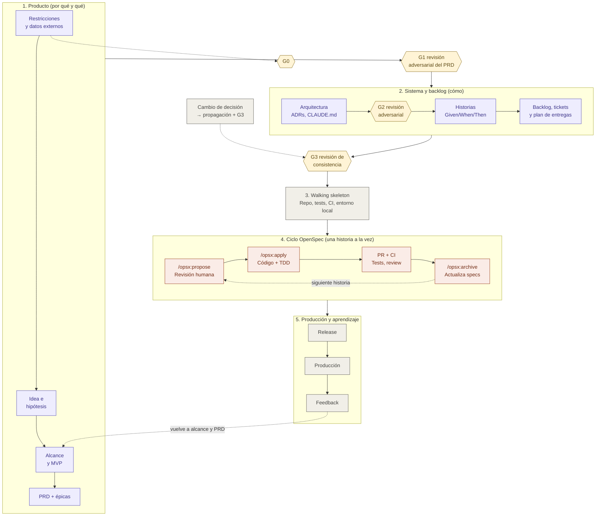

# AI SDLC con Claude Code y OpenSpec — Guía de contexto

> Documento de referencia para usar como contexto en otros chats. Describe un ciclo de vida de desarrollo asistido por IA (AI SDLC) para construir una aplicación desde cero usando **Claude Code** como agente de desarrollo y **OpenSpec** como framework de desarrollo guiado por especificaciones (spec-driven development).

## Diagrama general

Vista de alto nivel del flujo completo. Los pasos 1 y 2 se hacen al inicio y se revisan con el feedback; el paso 3 se hace una vez; el paso 4 se repite por cada historia; el paso 5 retroalimenta el alcance y el PRD. Las compuertas G0 a G3 (sección 3.1) impiden avanzar con pasos incompletos.


> La imagen requiere que `ai-sdlc-diagrama.png` (o el `.svg`) esté en la misma carpeta que este documento y puede no reflejar las compuertas. La versión Mermaid de abajo es la vigente.



## 1. Idea central

OpenSpec **no reemplaza** al PRD ni a la arquitectura. Es la capa que convierte cada unidad de trabajo en un *cambio especificado* que Claude Code implementa y que, al cerrarse, actualiza la "fuente de verdad" del comportamiento del sistema.

Modelo de cuatro capas, de lo más estable a lo más volátil:

| Capa | Pregunta | Artefactos |
| --- | --- | --- |
| Producto | ¿Por qué y qué? | Visión, alcance, PRD, MVP |
| Sistema | ¿Cómo, a grandes rasgos? | Arquitectura, ADRs, stack, convenciones (`CLAUDE.md`) |
| Cambios | ¿Qué se hace ahora? | OpenSpec (`openspec/changes/`, `openspec/specs/`) |
| Ejecución | ¿Funciona y está en producción? | Código, pruebas, CI/CD, despliegue |

## 2. Alcance, PRD y MVP

- **Alcance**: el perímetro total del producto. Incluye lo que podría llegar a hacer y lo que explícitamente **no** hará.
- **PRD (Product Requirements Document)**: problema, usuarios, objetivos, requisitos funcionales y no funcionales, métricas de éxito. Cubre el alcance de forma priorizada.
- **MVP**: un *corte* del PRD. El subconjunto mínimo de requisitos que valida la hipótesis principal. En la práctica, cada requisito del PRD se etiqueta como `MVP`, `v1.1` o `futuro`.

Relación con OpenSpec:

- Cada requisito o épica del MVP se convierte en **uno o varios cambios de OpenSpec**.
- El PRD es humano y orientado a negocio; las specs de OpenSpec son verificables y orientadas al comportamiento del sistema.
- Trazabilidad buscada: **PRD → requisito → escenario (spec) → test → código**.

## 3. Orden de los artefactos: de la idea al código

El orden va de lo más incierto y estratégico a lo más concreto y verificable. Cada paso reduce incertidumbre y da insumos al siguiente.

```text
Restricciones y datos externos → Idea → Problema/hipótesis → Visión y alcance → MVP   [G0]
     → PRD del MVP + épicas → Revisión adversarial del PRD                          [G1]
     → Arquitectura base + ADRs → Revisión adversarial de la arquitectura          [G2]
     → Historias + criterios de aceptación → Backlog, tickets y plan de entregas
     → Revisión de consistencia                                                     [G3]
     → Walking skeleton → Cambios OpenSpec (1 por historia)
     → Implementación + pruebas → Release → Feedback → (vuelve a alcance/PRD)
```

### Paso a paso

0. **Restricciones y datos externos**: tiempo disponible y holgura aceptada, fechas de entrega, presupuesto (incluida la API de IA) y datos de dominio que condicionan el diseño (por ejemplo, la lista de empresas objetivo). Si el producto depende de datos externos, un spike corto verifica qué APIs existen y qué permiten sus términos de uso, antes de escribir requisitos que dependan de ellas.
1. **Idea**: una frase ("una app para X"). Todavía no es accionable.
2. **Problema e hipótesis**: quién tiene el problema, qué tan grave es y qué crees que lo resuelve, de forma verificable. Ejemplo: "Los freelancers pierden horas cobrando facturas; creemos que recordatorios automáticos reducen el tiempo de cobro 30%". Si no puedes escribir la hipótesis, no estás listo para el alcance.
3. **Visión y alcance**: perímetro completo del producto a mediano plazo. Qué hará, para quién y, sobre todo, qué **no** hará. Lista amplia de capacidades sin detalle; evita diseñar algo que no pueda crecer.
4. **MVP**: corte del alcance con el mínimo de capacidades para validar la hipótesis. Pregunta clave: "¿qué necesito para aprender si esto funciona?", no "¿qué necesito para que esté completo?". Va antes del PRD detallado porque no vale la pena especificar a fondo lo que aún no se construirá.
5. **PRD del MVP + épicas**: detalle solo de lo del MVP: personas, flujos principales, requisitos funcionales y no funcionales, métricas de éxito, riesgos y un log de decisiones. Lo que quedó fuera aparece solo como "futuro" (una línea cada cosa). Cada decisión entra al **log de decisiones** con un identificador `D-xx` (sección 5.1). El PRD termina con las **épicas** (3 a 5): bloques de valor que agrupan los requisitos y que mapean cada uno a una capability de OpenSpec. Cada métrica indica qué evento o campo la registra.
   - **Revisión adversarial del PRD (G1)**: la IA, en el rol de revisor de producto adversarial, busca requisitos ambiguos o no comprobables, suposiciones que tumban el MVP, alcance escondido y métricas que no se pueden medir. Plantilla: `docs/prompts/adversarial-prd.md`. Salida: `docs/prd-review.md` con la resolución de cada hallazgo.
6. **Arquitectura base**: después del PRD, porque este aporta los NFRs (escala, seguridad, integraciones) que la condicionan. Stack, estilo, modelo de datos inicial, ADRs clave y el mapeo de cada épica a sus módulos. Diseñada para el MVP sin cerrar puertas al alcance.
   - **Revisión adversarial de la arquitectura (G2)**: qué ADR depende de una suposición no verificada, qué no se puede probar en CI, qué cuesta más de lo presupuestado. Plantilla: `docs/prompts/adversarial-architecture.md`.
7. **Épicas**: ya definidas en el PRD (paso 5). Aquí solo se verifica que la arquitectura las soporte; si una épica cambia, se aplica la propagación de cambios (sección 5.1).
8. **Historias de usuario + criterios de aceptación**: cada épica se rompe en historias ("Como freelancer quiero programar un recordatorio para…") con criterios Given/When/Then. Es BDD y es el puente directo a OpenSpec: los criterios se convierten en escenarios de las specs.
9. **Backlog priorizado, tickets y plan de entregas**: historias ordenadas por dependencia y valor (la primera siempre es infraestructura), tickets técnicos con estimación, un **contrato** por ticket (qué expone y qué consume) y un plan que asigna historias a cada entrega o release. El orden de construcción se deriva de las dependencias de los tickets: nada se construye antes que aquello que consume. Incluye las **tareas que no son código** (medir la línea base de las métricas, etiquetar golden sets antes de ver la IA, confirmar plazos) como tickets con dependencias. Después de dividir o fusionar historias, se revisan las prioridades: ningún must-have debe ser lo primero que se recorte.
   - **Revisión de consistencia (G3)**: trazabilidad completa, referencias válidas, totales calculados y ADRs vigentes. Plantilla: `docs/prompts/consistency-review.md`; script `scripts/check_docs.py`.
10. **Walking skeleton**: primer cambio de OpenSpec (repo, tests, CI, entorno local, despliegue trivial).
11. **Ciclo OpenSpec por historia**: cada historia (o 2-3 muy relacionadas) es un cambio: `/opsx:propose` → revisión → `/opsx:apply` → PR → `/opsx:archive`.

> Variante válida para el paso 5: un único PRD del producto con requisitos etiquetados `MVP / v1.1 / futuro`. Lo importante es que el detalle fino solo exista para el MVP.

### Mapeo ágil ↔ OpenSpec

| Artefacto ágil | Equivalente en OpenSpec |
| --- | --- |
| Épica | Capability (`openspec/specs/<capability>/`) |
| Historia de usuario | Un cambio (`openspec/changes/<id>/proposal.md`) |
| Criterios de aceptación | Escenarios en los deltas de spec |
| Notas técnicas / spike | `design.md` |
| Subtareas | `tasks.md` |
| "Done" | Cambio archivado, specs actualizadas |

### Matices

- **No es cascada estricta.** Escribir historias suele revelar huecos en el PRD, y la arquitectura puede forzar recortar el MVP. Volver uno o dos pasos atrás es normal; saltarse pasos hacia adelante (historias sin MVP definido) no lo es.
- **Arquitectura e historias se retroalimentan.** Épicas antes de la arquitectura; historias detalladas después, para que reflejen restricciones técnicas reales.
- **El detalle es proporcional a la cercanía.** Historias del próximo sprint: muy detalladas. Historias del final del MVP: apenas un título. Igual con OpenSpec: generar propuestas solo para lo que se implementará pronto, porque las specs cambian conforme se aprende.
- **Decisiones humanas clave**: las restricciones (paso 0), la hipótesis (paso 2), el corte del MVP (paso 4), la resolución de cada hallazgo adversarial (G1, G2), los ADRs (paso 6) y la aprobación de cada propuesta de OpenSpec.

### 3.1 Compuertas

Una compuerta es una lista de verificación con criterios de salida. No se inicia la fase siguiente con una compuerta abierta. Las listas completas están en [`docs/sdlc-checklist.md`](./sdlc-checklist.md).

| Compuerta | Cierra | Criterio de salida principal |
| --- | --- | --- |
| G0 | Descubrimiento | Restricciones, hipótesis medible y spike de datos externos documentados |
| G1 | PRD | Épicas definidas y revisión adversarial del PRD resuelta |
| G2 | Arquitectura | ADRs aceptados, épicas mapeadas a módulos y revisión adversarial resuelta |
| G3 | Backlog y cada entrega | `scripts/check_docs.py` en verde, decisiones cambiadas revisadas por su `D-xx` y una lectura completa (criterio de parada, sección 5.3) |

## 4. OpenSpec en resumen

- Framework open source de Fission AI para spec-driven development con asistentes de IA.
- Instalación (requiere Node.js 20.19+):

```bash
npm install -g @fission-ai/openspec@latest
cd my-app
openspec init       # crea openspec/ e instala los slash commands en el agente
openspec update     # regenera instrucciones/comandos tras actualizar
```

- Comandos `openspec ...` → se ejecutan en la terminal.
- Comandos `/opsx:...` → se ejecutan en el chat del agente (Claude Code).

### Ciclo principal (perfil core)

| Paso | Comando | Qué pasa | Rol humano |
| --- | --- | --- | --- |
| Explorar | `/opsx:explore` | Pensar la idea antes de comprometerse | Aclarar dudas y alternativas |
| Proponer | `/opsx:propose <cambio>` | Genera proposal, deltas de specs, design y tasks | **Revisar y aprobar** (gate humano) |
| Implementar | `/opsx:apply` | El agente ejecuta `tasks.md` | Revisar el PR |
| Sincronizar | `/opsx:sync` | Sincroniza deltas con las specs | Verificar |
| Archivar | `/opsx:archive` | Fusiona deltas en `openspec/specs/` y archiva el cambio | Confirmar tras merge/deploy |

Flujo extendido (se activa con `openspec config profile` y luego `openspec update`): `/opsx:new`, `/opsx:continue`, `/opsx:ff`, `/opsx:verify`, `/opsx:bulk-archive`, `/opsx:onboard`.

### Estructura de un cambio

```text
openspec/changes/<change-id>/
├── proposal.md     # por qué y qué cambia
├── specs/          # deltas de requisitos y escenarios
├── design.md       # enfoque técnico (arquitectura de la feature)
└── tasks.md        # checklist de implementación
```

- `openspec/specs/` = verdad del comportamiento **actual** del sistema.
- `openspec/changes/` = cambios **en curso**; al archivar pasan a `openspec/changes/archive/<fecha>-<change-id>/`.

## 5. Fases del AI SDLC

### Fase 0 — Descubrimiento (fuera de OpenSpec)

- Restricciones: tiempo y holgura, fechas de entrega, presupuesto de IA y datos de dominio que condicionan el diseño.
- Problema, usuarios, competencia, hipótesis con métricas medibles.
- Spike de datos externos si el producto depende de ellos (APIs disponibles y términos de uso).
- Claude como copiloto de investigación y cuestionamiento.
- Salida: `docs/vision.md`. Compuerta: **G0**.

### Fase 1 — Producto

- PRD + definición del MVP + criterios de aceptación de alto nivel + épicas (3 a 5, cada una con su capability).
- Log de decisiones dentro del PRD.
- Revisión adversarial del PRD con la plantilla `docs/prompts/adversarial-prd.md`.
- Claude ayuda a redactar, detectar huecos y criticar; las decisiones son humanas.
- Salidas: `docs/prd.md`, `docs/prd-review.md`. Compuerta: **G1**.

### Fase 2 — Arquitectura base

- Estilo arquitectónico, stack, modelo de datos inicial, integraciones, NFRs (seguridad, rendimiento, costo, observabilidad).
- Decisiones relevantes como ADRs.
- Mapeo de épicas a módulos.
- Revisión adversarial con la plantilla `docs/prompts/adversarial-architecture.md`.
- Salidas: `docs/architecture.md`, `docs/adr/*.md`, `CLAUDE.md` (comandos de build/test, estructura, estilo, definition of done). Compuerta: **G2**.

### Fase 2b — Historias, tickets y plan de entregas

- Historias por épica con criterios Given/When/Then (cada historia del tamaño de un cambio de OpenSpec).
- Tickets técnicos y de producto con estimación y dependencias.
- Plan de entregas o releases.
- Revisión de prioridades tras dividir o fusionar historias.
- Revisión de consistencia con `docs/prompts/consistency-review.md` y `scripts/check_docs.py`.
- Salidas: `docs/user-stories.md`, `docs/tickets.md`. Compuerta: **G3** (se repite antes de cada entrega).

### Fase 3 — Inicializar repo y OpenSpec

- `openspec init`.
- Completar el contexto del proyecto de OpenSpec (p. ej. `openspec/project.md` o la configuración equivalente de la versión instalada) con stack y convenciones, apuntando al PRD y a los ADRs.

### Fase 4 — Walking skeleton (primer cambio de OpenSpec)

Antes de cualquier feature, un cambio que deje el sistema funcionando de punta a punta:

- Hola-mundo desplegable.
- Framework de pruebas (unitarias y de aceptación).
- Linter/formatter.
- Entorno local con Docker Compose / `Makefile`.
- Pipeline de CI mínimo.

Así toda feature posterior nace probada e integrada.

### Fase 5 — Iterar el MVP con el ciclo de OpenSpec

Aquí vive la mayor parte del trabajo. Por cada requisito del MVP:

1. `/opsx:explore` (opcional).
2. `/opsx:propose` → revisión y aprobación humana.
3. Rama nueva → `/opsx:apply` en sesión con contexto limpio.
4. PR → CI verde → code review → merge.
5. `/opsx:archive`.

### Fase 6 — Hardening y release del MVP

- Seguridad, observabilidad, pruebas de carga, documentación.
- También como cambios de OpenSpec, aunque toquen poco comportamiento funcional.

### Fase 7 — Producción y feedback

- Métricas y feedback de usuarios → actualizar el PRD → nuevos cambios de OpenSpec.
- El ciclo vuelve a la Fase 5.

### 5.1 Propagación de cambios

Cuando una decisión cambia en cualquier fase (alcance, prioridad, técnica):

1. Registrarla en el log de decisiones del PRD con un identificador `D-xx` y fecha. Si reemplaza a otra, el estado de la anterior pasa a "reemplazada por D-xx".
2. Buscar todos los artefactos que la mencionan: `grep` del `D-xx` (cada frase que aplica una decisión la cita entre paréntesis) y de los identificadores afectados (RF, HU, épica, ADR o ticket).
3. Actualizarlos en el mismo commit, **hacia abajo** (historias, tickets, `readme.md`) y **hacia arriba** (PRD y visión). Revisar primero el documento más antiguo de la cadena: es el que más se desactualiza.
4. Ejecutar la revisión de consistencia (G3).

| Si cambia… | Revisar |
| --- | --- |
| Alcance o prioridad | Visión, PRD, historias, tickets, plan de entregas, `readme.md` |
| Decisión técnica | ADR (sección 5.2), arquitectura, tickets, `CLAUDE.md` |
| Historia o épica | Escenarios, tickets, plan de entregas, capabilities de OpenSpec, `readme.md` |
| Métrica | PRD, visión, requisitos de medición y tickets de producto |
| Decisión de arquitectura que cambia alcance, riesgo o costo | PRD y visión (hacia arriba), además de tickets y `CLAUDE.md` |
| Dependencia o contrato de un ticket | Tickets que lo consumen, orden de construcción y plan de entregas |

### 5.2 Ciclo de vida de los ADR

- Estados: `propuesta` → `aceptada` → `reemplazada por ADR-X` (total o parcialmente) u `obsoleta`.
- Un ADR aceptado **no se reescribe**. Una decisión nueva va en un ADR nuevo con "Reemplaza a: ADR-X", y el estado del anterior cambia a "reemplazada".
- Una aclaración de alcance que no cambia la decisión se anota en una sección "Historial de cambios" del ADR, con fecha.
- G2 y G3 verifican que ningún ADR aceptado contradiga al PRD vigente.

### 5.3 Criterio de parada de la revisión de consistencia

La revisión manual no converge por sí sola: cada pasada encuentra errores nuevos. G3 se da por cerrada cuando se cumplen las tres condiciones:

1. `python3 scripts/check_docs.py` sin errores.
2. Cada decisión cambiada desde la última entrega se revisó buscando su `D-xx`.
3. Una sola lectura completa de cada documento, empezando por el que lleva más tiempo sin actualizarse, con un foco distinto por documento.

Si la lectura encuentra un tipo de error que se puede detectar con un script, el siguiente paso es automatizarlo (sección 5.5), no hacer otra pasada manual.

### 5.4 Contratos de ticket

- Cada ticket declara `Expone` (endpoints, tablas, trabajos, servicios y pantallas que crea) y `Consume` (lo que usa de otros), con los mismos nombres entre comillas invertidas.
- Todo lo consumido lo expone el propio ticket o una de sus dependencias, directa o indirecta; cada elemento lo expone un solo ticket.
- El orden de construcción respeta las dependencias. Un contrato que no cumple revela una dependencia oculta o un ticket que hay que dividir.

### 5.5 Verificar el verificador

- Cada comprobación automática tiene una prueba que introduce el error a propósito y confirma que se detecta (prueba de mutación).
- Una comprobación nueva se escribe con TDD: primero la prueba que falla, después la implementación.

### 5.6 Una sola fuente para cada número

- Horas, totales y conteos se calculan desde su fuente (`docs/tickets.md`) con un script; nunca se escriben a mano en otros documentos.
- Los documentos de entrega que repiten contenido (por ejemplo, `readme.md`) se generan desde `docs/` con `scripts/check_docs.py --build-readme`; los conteos (escenarios, tickets) también se calculan.

## 6. Dónde vive cada cosa

| Tema | Dónde se define | Dónde se ejecuta / verifica |
| --- | --- | --- |
| Restricciones, visión e hipótesis | `docs/vision.md` | G0 |
| Alcance, PRD, MVP, épicas y log de decisiones | `docs/prd.md` | Revisión humana + G1 |
| Revisiones adversariales | `docs/prd-review.md`, `docs/architecture-review.md` | Resolución humana de cada hallazgo |
| Historias, tickets y plan de entregas | `docs/user-stories.md`, `docs/tickets.md` | G3 |
| Compuertas | `docs/sdlc-checklist.md`, `.claude/rules/sdlc-gates.md` | Revisión humana + `scripts/check_docs.py` |
| Arquitectura global | `docs/architecture.md` + `docs/adr/` | `CLAUDE.md` la hace visible al agente |
| Arquitectura de una feature | `design.md` del cambio | Code review |
| Comportamiento (fuente de verdad) | `openspec/specs/` | Pruebas de aceptación |
| Plan de implementación | `tasks.md` del cambio | `/opsx:apply` |
| Pruebas | Escenarios en deltas de spec + tareas de test | CI |
| CI/CD | Cambio OpenSpec dedicado (walking skeleton) | GitHub Actions o similar |
| Despliegue local | Docker Compose, `Makefile`, documentado en `CLAUDE.md` | `make dev` |
| Despliegue a producción | Cambio OpenSpec de infra (IaC: Terraform, etc.) + ADR | Pipeline con aprobación manual |

## 7. BDD y TDD: se encadenan, no compiten

- **BDD vive en las specs**: los escenarios de OpenSpec (estilo *WHEN… THEN…*) son los criterios de aceptación. Regla en `CLAUDE.md`: cada escenario se traduce en una prueba de aceptación (Gherkin con Cucumber/Behave, o tests de integración nombrados por escenario).
- **TDD vive en `tasks.md`**: ordenar las tareas para escribir primero la prueba que falla y luego el código.
- **Refuerzo automático**: un hook de Claude Code que ejecute lint y tests después de cada edición.

## 8. Estructura de repositorio sugerida

```text
my-app/
├── CLAUDE.md               # convenciones, comandos, definition of done
├── docs/
│   ├── vision.md
│   ├── prd.md              # alcance + MVP marcado
│   ├── prd-review.md       # revisión adversarial del PRD (G1)
│   ├── architecture.md
│   ├── adr/
│   ├── user-stories.md     # épicas, historias y plan de entregas
│   ├── tickets.md
│   ├── sdlc-checklist.md   # compuertas G0-G3
│   └── prompts/            # plantillas de revisiones adversariales y de consistencia
├── scripts/check_docs.py   # totales, referencias y generación del readme
├── openspec/
│   ├── specs/              # verdad del comportamiento actual
│   └── changes/            # cambios en curso + archive/
├── src/
├── tests/
│   ├── acceptance/         # 1:1 con escenarios de specs
│   └── unit/
├── infra/                  # IaC para producción
├── docker-compose.yml      # entorno local
└── .github/workflows/      # CI/CD
```

## 9. Buenas prácticas con Claude Code

- **Un cambio de OpenSpec = una rama = un PR.** Archivar solo después de mergear (o desplegar).
- **Contexto limpio antes de `/opsx:apply`**: iniciar una sesión nueva para que el agente trabaje desde la propuesta, no desde el historial de discusión.
- **Cambios pequeños**: si `tasks.md` supera ~15 tareas, dividir el cambio.
- **Dos gates humanos**: aprobar la propuesta y aprobar el PR. El resto puede ser altamente autónomo.
- **Cambios arquitectónicos siempre vía propuesta + ADR**, nunca como edición ad-hoc, para evitar deriva.
- **Subagentes** para revisión (p. ej. uno que verifique que cada escenario tiene su test).
- **Hooks** para lint/test automáticos.
- **`CLAUDE.md` como contrato**: comandos exactos, estructura, convenciones, definition of done.
- **Compuertas como regla del agente**: `.claude/rules/sdlc-gates.md` hace que el agente verifique la compuerta anterior antes de iniciar una fase, sin que el usuario lo pida.
- **Revisar con un sombrero distinto**: después de producir un artefacto clave, pedir a la IA que lo critique como revisor adversarial antes de construir encima.
- **Cambios tardíos con propagación**: nunca editar un solo documento cuando cambia una decisión; aplicar la sección 5.1, con su `D-xx`, hacia abajo y hacia arriba.
- **Automatizar antes de repetir**: si una revisión manual encuentra un tipo de error que un script puede detectar, se agrega la comprobación con su prueba de mutación antes de la siguiente pasada.

## 10. Definition of done sugerida (por cambio)

- [ ] Propuesta aprobada por un humano.
- [ ] Todas las tareas de `tasks.md` completadas.
- [ ] Cada escenario nuevo o modificado tiene prueba de aceptación.
- [ ] Tests unitarios relevantes escritos (TDD).
- [ ] CI en verde (lint, tests, build).
- [ ] ADR creado si hubo una decisión arquitectónica.
- [ ] PR revisado y mergeado.
- [ ] Cambio archivado con `/opsx:archive` y specs actualizadas.
- [ ] Si cambió una decisión: propagación aplicada (sección 5.1) y `scripts/check_docs.py` en verde.

## 11. Fuentes

- [Fission-AI/OpenSpec (GitHub)](https://github.com/Fission-AI/OpenSpec)
- [OpenSpec — Getting Started](https://openspec.dev/docs/getting-started)

> Nota: los comandos de OpenSpec evolucionan entre versiones. Verificar con `openspec --help` y la documentación oficial antes de usar.
