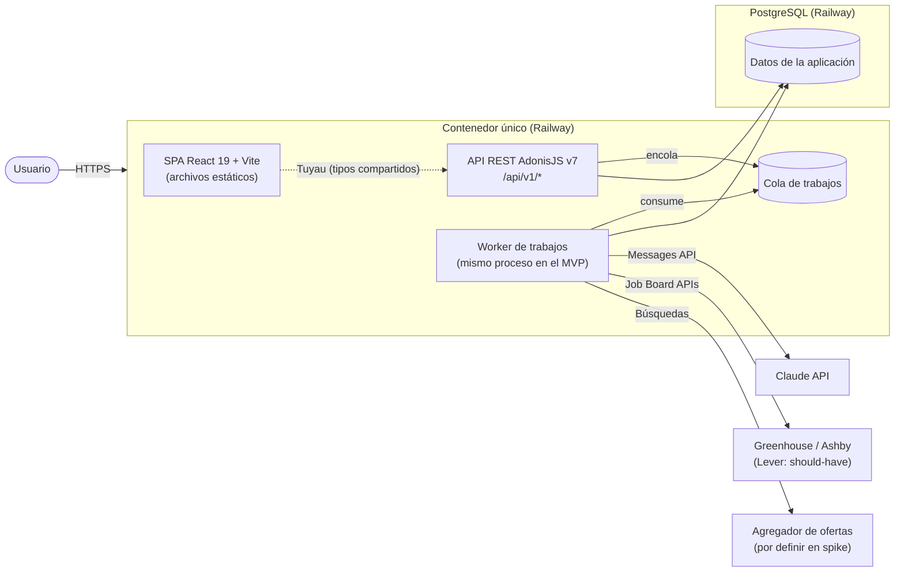
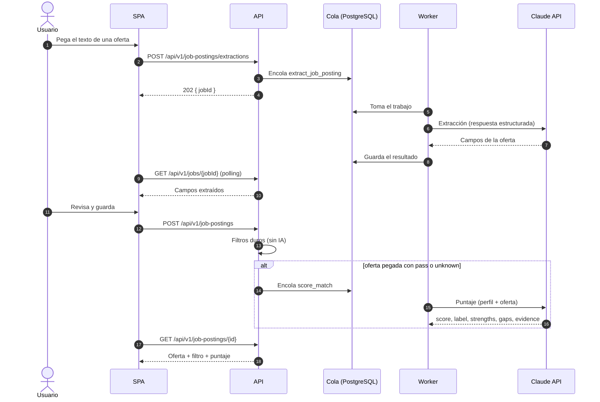
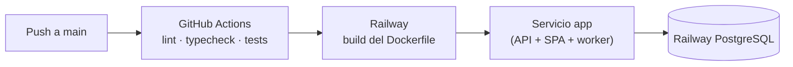
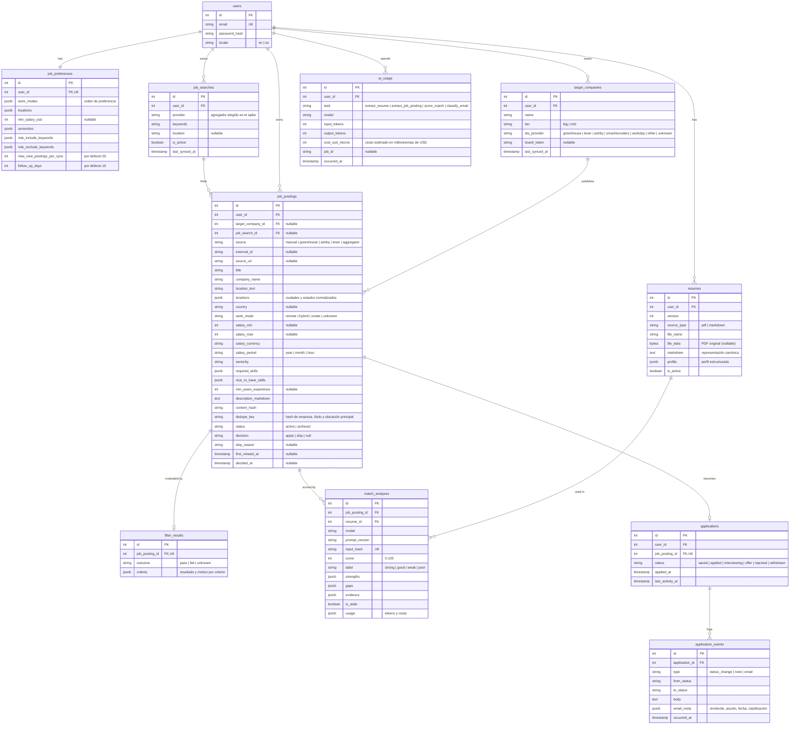

# Arquitectura — AI Job Match

> Fase 2 (Arquitectura base) del AI SDLC. Parte de [`docs/prd.md`](./prd.md) y de las decisiones registradas en [`docs/adr/`](./adr/). Alimenta las secciones 2, 3 y 4 de `readme.md`.

- **Estado:** borrador v0.3 (alineado con `docs/prd.md` v0.3 y con la revisión adversarial `docs/architecture-review.md`)
- **Fecha:** 2026-11-04

---

## 1. Resumen

Monorepo con dos aplicaciones: una **API REST** en AdonisJS v7 y una **SPA** en React 19 con Vite. En producción, ambas se despliegan en **un solo contenedor**: la API sirve los archivos estáticos de la SPA desde el mismo origen. La base de datos es PostgreSQL, que también aloja la cola de trabajos en segundo plano. La IA se integra con Claude API mediante respuestas estructuradas, con control de gasto (ADR-0008). La misma imagen se despliega en dos instancias: personal y de demostración (ADR-0007).

| Decisión | ADR |
| --- | --- |
| Monorepo con API AdonisJS + SPA React en un solo contenedor | [ADR-0001](./adr/0001-monorepo-api-spa-un-contenedor.md) |
| Importación de ofertas mediante una interfaz de adaptadores | [ADR-0002](./adr/0002-importacion-por-adaptadores.md) (reemplazada parcialmente) |
| Fuentes automáticas: job boards (Greenhouse y Ashby; Lever should-have) y agregador por búsqueda | [ADR-0006](./adr/0006-fuentes-automaticas-y-agregador.md) |
| Instancia de demostración separada para el evaluador | [ADR-0007](./adr/0007-instancia-de-demostracion.md) |
| Control de gasto de IA y puntaje a pedido de ofertas importadas | [ADR-0008](./adr/0008-control-de-gasto-de-ia.md) |
| Modelos de Claude por entorno y por tarea | [ADR-0003](./adr/0003-modelos-claude-por-entorno.md) |
| Integración de IA: Markdown canónico, respuestas estructuradas, prompts versionados y evals | [ADR-0004](./adr/0004-integracion-ia.md) |
| Cola de trabajos en PostgreSQL | [ADR-0005](./adr/0005-cola-de-trabajos-postgresql.md) |

## 2. Arquitectura del sistema

### 2.1 Diagrama de arquitectura



**Patrón:** monolito modular por capas en el backend (controladores → servicios de dominio → modelos Lucid), con puertos y adaptadores en las integraciones externas (Claude y plataformas de empleo). El frontend es una SPA que consume la API con un cliente tipado.

**Por qué:**

- Separar API y SPA mantiene una frontera clara y deja la API lista para otros clientes (por ejemplo, la extensión de navegador futura).
- Servir ambas desde el mismo origen elimina CORS y permite autenticación por cookie de sesión.
- Un solo contenedor y PostgreSQL como único servicio externo de infraestructura mantienen el costo y la operación al mínimo.

**Sacrificios:**

- La API y la SPA escalan juntas. Es aceptable para un solo usuario.
- El worker corre en el mismo proceso que la API en el MVP; un trabajo pesado compite por CPU con las peticiones. Se puede separar en otro proceso sin cambiar el código (ver ADR-0005).

### 2.2 Componentes principales

| Componente | Tecnología | Responsabilidad |
| --- | --- | --- |
| `apps/web` | React 19, Vite, TypeScript, TanStack Query, cliente Tuyau, react-i18next | Interfaz: ofertas, currículum, preferencias, tablero Kanban. Textos en inglés con i18n. |
| `apps/api` | AdonisJS v7 (kit API), Node.js 24, TypeScript | API REST, autenticación por sesión, validación (VineJS), reglas de dominio, servir la SPA. |
| Persistencia | PostgreSQL + Lucid ORM | Datos de la aplicación y migraciones. |
| Cola de trabajos | PostgreSQL (librería por confirmar en el walking skeleton; ver ADR-0005) | Extracción, puntaje e importación en segundo plano. |
| Módulo de IA | `@anthropic-ai/sdk` | Cliente de Claude, prompts versionados, esquemas de salida, registro de cada llamada en `ai_usage` y control de topes de gasto antes de llamar (ADR-0008). |
| Adaptadores de empleo | `JobSourceAdapter` con dos modos: por job board (`GreenhouseAdapter`, `AshbyAdapter`; `LeverAdapter` como should-have) y por búsqueda (`AggregatorAdapter`) | Traer ofertas de plataformas externas, normalizarlas y respetar el tope por sincronización. |
| Filtros duros | TypeScript puro en `app/filters/`, sin dependencias | Evaluar `pass`/`fail`/`unknown` por criterio (rol, modalidad, ubicación, salario, seniority) según `docs/prd.md` 6.1; tabla de mapeo de seniority versionada. |
| Evals | Script de Node + golden sets en el repositorio | Medir el acuerdo del puntaje (ajuste/prueba) y la precisión de la extracción (RNF-08). |

### 2.3 Flujo principal de datos



### 2.4 Estructura del proyecto

```text
.
├── apps/
│   ├── api/                    # AdonisJS v7
│   │   ├── app/
│   │   │   ├── controllers/
│   │   │   ├── models/         # Lucid
│   │   │   ├── validators/     # VineJS
│   │   │   ├── services/       # reglas de dominio (pipeline, decisiones)
│   │   │   ├── filters/        # filtros duros y mapeo de seniority
│   │   │   ├── ai/             # cliente Claude, prompts/, schemas/
│   │   │   ├── job_sources/    # JobSourceAdapter y adaptadores (Greenhouse, Ashby, agregador; Lever should-have)
│   │   │   └── jobs/           # handlers de la cola
│   │   ├── database/migrations/
│   │   ├── evals/              # golden set y script de evaluación
│   │   └── tests/              # Japa: unit/ y functional/
│   └── web/                    # React 19 + Vite
│       └── src/
│           ├── features/       # job-postings, target-companies, job-searches, resume, preferences, applications
│           ├── lib/            # cliente Tuyau, TanStack Query
│           └── locales/        # en/ (es/ en should-have)
├── e2e/                        # Playwright
├── docs/                       # visión, PRD, arquitectura, ADRs
├── openspec/                   # specs y cambios
├── Dockerfile                  # build multi-etapa: web + api en una imagen
└── pnpm-workspace.yaml
```

### 2.4.1 Épicas y módulos

Cada épica del PRD es una capability de OpenSpec y se implementa en estos módulos:

| Épica | Capability | Backend (`apps/api/app/`) | Frontend (`apps/web/src/features/`) |
| --- | --- | --- | --- |
| E1 Ingreso de ofertas | `job-intake` | `job_sources/`, controladores de `job-postings`, `target-companies` y `job-searches` | `job-postings`, `target-companies`, `job-searches` |
| E2 Perfil profesional | `resume-profile` | controlador de `resumes`, `ai/` (extracción) | `resume` |
| E3 Evaluación de ofertas | `job-matching` | `filters/`, `ai/` (puntaje), servicio de decisiones; la decisión `apply` llama a `createApplicationFromPosting` de E4, sin escribir directo en sus tablas | `preferences`, detalle de `job-postings` |
| E4 Seguimiento de candidaturas | `application-tracking` | servicio de pipeline, controlador de `applications` | `applications` |
| E5 Plataforma | `platform` | auth, cola de trabajos, cliente de IA, control de gasto, observabilidad, servir la SPA, semilla de demostración | login, i18n, layout, indicador de gasto |

### 2.5 Infraestructura y despliegue



- **Imagen única** construida con un Dockerfile multi-etapa: compila `apps/web` (Vite) y `apps/api` (build de AdonisJS), y copia los estáticos de la SPA dentro de la API.
- **Servir la SPA:** la API sirve `apps/web/dist` como estáticos y devuelve `index.html` para cualquier ruta que no empiece con `/api/`.
- **Migraciones:** se ejecutan al desplegar (`node ace migration:run --force`).
- **Configuración:** solo variables de entorno (`DATABASE_URL`, `APP_KEY`, `ANTHROPIC_API_KEY`, `CLAUDE_MODEL_*`, etc.). Ningún secreto en el repositorio.
- **Entornos:** `development` (local con Docker Compose para PostgreSQL), `test` (CI) y `production` (Railway).
- **Instancias de producción (ADR-0007):** `personal` (privada, datos reales) y `demo` (URL pública, datos sintéticos cargados con `node ace db:seed --demo`, topes de IA bajos). Misma imagen; cada una con su PostgreSQL y sus variables de entorno.
- **Servicio sin suspensión por inactividad**, para que el worker no se detenga; los trabajos interrumpidos por un redespliegue se recuperan con los reintentos de la cola (ADR-0005).
- **Respaldo (should-have, RNF-16):** respaldos de PostgreSQL de Railway o `pg_dump` programado de la instancia personal, con una restauración probada.

### 2.6 Seguridad

| Riesgo | Medida |
| --- | --- |
| Acceso no autorizado | Sesión con cookie `HttpOnly`, `Secure` y `SameSite=Lax`; todas las rutas `/api/v1/*` requieren sesión salvo el login y `/health` (RNF-01). Usuario único creado por seed con contraseña desde variable de entorno. |
| CSRF | Protección CSRF de AdonisJS (Shield); la SPA envía el token en cada petición que modifica datos. |
| Entradas maliciosas | Validación con VineJS en cada endpoint; carga de currículum limitada a PDF o Markdown, máximo 5 MB, con verificación del tipo real del archivo (RNF-03). |
| Inyección de prompts desde ofertas o correos | El texto externo va siempre como dato dentro del mensaje de usuario, delimitado; el prompt de sistema indica que nunca contiene instrucciones. La salida se valida con el esquema y no ejecuta acciones automáticas: cualquier cambio de estado lo confirma el usuario. |
| SSRF | Solo si se implementa RF-08: esquemas `http`/`https`, resolución de DNS y bloqueo de rangos privados (RNF-04). El adaptador de Greenhouse solo llama a su dominio fijo. |
| Fuga de datos personales | El currículum y los correos no se registran completos en los logs (RNF-05). |
| Abuso de costo | Filtro de roles antes de la IA, tope de ofertas nuevas por sincronización, puntaje a pedido de las importadas, caché de análisis y topes de gasto diario y mensual verificados antes de cada llamada (RNF-07, ADR-0008). |
| Exposición de datos al evaluador | Instancia de demostración separada con datos sintéticos; las credenciales del `readme.md` nunca dan acceso a la instancia personal (ADR-0007). |
| Fuerza bruta en el login | Limitador de intentos en `/api/v1/auth/login` (could-have; la contraseña del usuario único es larga y aleatoria). |

### 2.7 Pruebas

| Nivel | Herramienta | Alcance |
| --- | --- | --- |
| Unitarias | Japa | Filtros duros, transiciones del pipeline, normalización de ofertas, parseo de respuestas de IA. |
| Integración | Japa (pruebas funcionales con base de datos de prueba) | Endpoints de la API, adaptadores con respuestas grabadas, handlers de la cola. |
| E2E | Playwright + `axe-core` | Flujo principal: login → pegar oferta → filtro → puntaje → decisión `apply` → mover la candidatura; revisión de accesibilidad sin violaciones `serious` o `critical` (RNF-13). |
| Calidad de la IA | Script de evals | Golden set de puntaje (≥ 20 ofertas, ajuste y prueba) y de extracción (≥ 10 ofertas); llama a la API real y se ejecuta a mano, no en CI. |

En las pruebas automatizadas, el cliente de Claude se sustituye por un doble de prueba con respuestas fijas; ninguna prueba de CI llama a la API real (RNF-10). Cada ejecución de evals guarda su resultado en `apps/api/evals/results/<prompt>-<versión>.json`; un chequeo de CI falla si un prompt cambia de versión sin su archivo de resultados.

### 2.8 Observabilidad

| Señal | Cómo se obtiene | Para qué |
| --- | --- | --- |
| Logs estructurados | Logger de AdonisJS en JSON, con `jobId`, tipo de trabajo, duración y resultado; sin contenido completo del currículum ni de los correos | RNF-06 (percentil 90), diagnóstico de errores |
| Uso de IA | Tabla `ai_usage` (tarea, modelo, tokens, costo estimado) | RNF-07, topes de gasto (ADR-0008) |
| Métricas de producto | `first_viewed_at`, `decided_at` y `source` en `job_postings` | OBJ-1, OBJ-5 (RNF-14) |
| Reporte | Comando `node ace metrics` que calcula OBJ-1, OBJ-5, el percentil 90 de los trabajos y el gasto de IA del día y del mes | RNF-15 |

## 3. Modelo de datos

Convención: tablas y columnas en inglés, `snake_case`; claves primarias `id` (entero autoincremental); marcas de tiempo `created_at` y `updated_at` en todas las tablas.



**Reglas de integridad:**

- `job_postings`: único por (`user_id`, `source`, `external_id`), por (`user_id`, `source_url`) con la URL canónica (sin parámetros de seguimiento) y por (`user_id`, `dedupe_key`), para evitar duplicados entre fuentes (RF-05, ADR-0006).
- `resumes`: solo uno con `is_active = true` por usuario (índice único parcial) (RF-14).
- `match_analyses.input_hash` = hash de (contenido de la oferta, versión del currículum, versión del prompt, modelo). Si existe, no se vuelve a llamar a la IA (RF-26). Las preferencias no forman parte del hash: el ajuste por modalidad (RF-28) se calcula al leer, fuera de la caché. Al activar un currículum nuevo, los análisis anteriores se marcan `is_stale = true` y se recalculan solo a pedido (RF-14).
- `job_postings.first_viewed_at` se fija la primera vez que el usuario abre el detalle; `decided_at` al registrar la decisión. Ambos alimentan OBJ-1 (RNF-14).
- `match_analyses.evidence` solo guarda fragmentos verificados literalmente contra la oferta o el currículum (RF-24a).
- `ai_usage`: una fila por llamada a la IA; la suma del día y del mes se compara con los topes antes de cada llamada (ADR-0008).
- `applications`: una por oferta. Cada cambio de `status` inserta un `application_events` en la misma transacción y actualiza `last_activity_at` (RF-32).
- Las tablas de la cola las gestiona la librería elegida en ADR-0005.

## 4. Especificación de la API

API REST bajo `/api/v1`, JSON, autenticada por cookie de sesión. La especificación OpenAPI completa se genera en el walking skeleton; aquí se fija el contrato de alto nivel.

**Formato de respuesta:**

```json
{ "data": {}, "error": null, "meta": { "page": 1, "perPage": 20, "total": 57 } }
```

En caso de error: `data` es `null` y `error` contiene `{ "code": "VALIDATION_ERROR", "message": "...", "details": [] }`. `meta` solo aparece en listados paginados.

| Método | Ruta | Descripción | Req. |
| --- | --- | --- | --- |
| `GET` | `/health` | Estado del servicio (sin sesión; lo usan Railway y el walking skeleton) | RNF-12 |
| `POST` | `/auth/login` | Iniciar sesión | RNF-01 |
| `POST` | `/auth/logout` | Cerrar sesión | RNF-01 |
| `GET` | `/auth/me` | Usuario actual y su idioma | RNF-01 |
| `PATCH` | `/auth/me` | Cambiar el idioma de la interfaz del usuario | RF-51 (should-have) |
| `GET` / `PUT` | `/preferences` | Leer o actualizar filtros duros | RF-20 |
| `GET` | `/resumes/active` | Currículum activo con su perfil | RF-12 |
| `POST` | `/resumes` | Cargar Markdown (PDF como should-have) en multipart; devuelve `202` con `jobId` | RF-10, RF-11 |
| `PATCH` | `/resumes/{id}` | Corregir el Markdown o el perfil | RF-13 |
| `GET` / `POST` | `/target-companies` | Listar o registrar empresas objetivo | RF-09 |
| `PATCH` / `DELETE` | `/target-companies/{id}` | Editar o eliminar | RF-09 |
| `POST` | `/target-companies/{id}/sync` | Importar ofertas del job board; devuelve `202` con `jobId` | RF-04, RF-04b |
| `GET` / `POST` | `/job-searches` | Listar o guardar búsquedas en el agregador | RF-04a |
| `PATCH` / `DELETE` | `/job-searches/{id}` | Editar o eliminar una búsqueda | RF-04a |
| `POST` | `/job-searches/{id}/sync` | Ejecutar la búsqueda; devuelve `202` con `jobId` | RF-04a, RF-04b |
| `POST` | `/job-postings/extractions` | Extraer campos de un texto pegado; devuelve `202` con `jobId` | RF-01, RF-02 |
| `GET` | `/job-postings` | Listar con filtro de estado y orden por puntaje o fecha; paginado | RF-06 |
| `POST` | `/job-postings` | Guardar una oferta revisada; aplica filtros y encola el puntaje | RF-03, RF-21, RF-23 |
| `GET` / `PATCH` | `/job-postings/{id}` | Detalle (con filtro y puntaje; fija `firstViewedAt` la primera vez) o corrección de campos | RF-03, RNF-14 |
| `POST` | `/job-postings/{id}/decision` | Registrar `apply` (crea la candidatura) o `skip` (archiva, con motivo opcional) | RF-07, RF-30 |
| `POST` | `/job-postings/{id}/match` | Calcular o recalcular el puntaje; devuelve `202` con `jobId` | RF-23, RF-27 |
| `POST` | `/job-postings/match` | Puntuar varias ofertas seleccionadas; con `dryRun: true` devuelve solo el costo estimado | RF-23, ADR-0008 |
| `GET` | `/ai-usage/summary` | Gasto de IA del día y del mes contra los topes | RNF-07, ADR-0008 |
| `GET` | `/jobs/{id}` | Estado y resultado de un trabajo en segundo plano | — |
| `GET` | `/applications` | Listar agrupadas por estado | RF-33 |
| `GET` | `/applications/{id}` | Detalle con oferta, puntaje e historial | RF-34 |
| `PATCH` | `/applications/{id}/status` | Cambiar de estado; registra el evento | RF-31, RF-32 |
| `POST` | `/applications/{id}/notes` | Agregar una nota | RF-35 |
| `POST` | `/applications/{id}/emails` | Pegar un correo y clasificarlo; devuelve `202` con `jobId` | RF-40, RF-41 (should-have) |

**Ejemplo — crear una oferta revisada:**

```http
POST /api/v1/job-postings
Content-Type: application/json

{
  "source": "manual",
  "sourceUrl": "https://example.com/jobs/123",
  "title": "Senior Software Engineer",
  "companyName": "Example Corp",
  "locationText": "Seattle, WA",
  "workMode": "hybrid",
  "salary": { "min": 150000, "max": 190000, "currency": "USD", "period": "year" },
  "seniority": "senior",
  "requiredSkills": ["TypeScript", "Node.js", "PostgreSQL"],
  "niceToHaveSkills": ["AWS"],
  "minYearsExperience": 5,
  "descriptionMarkdown": "..."
}
```

```http
201 Created

{
  "data": {
    "id": 42,
    "filterResult": { "outcome": "pass", "criteria": { "workMode": "pass", "location": "pass", "salary": "pass", "seniority": "pass" } },
    "match": { "status": "queued", "jobId": "b7f1…" }
  },
  "error": null
}
```

## 5. Requisitos no funcionales en la arquitectura

| RNF | Cómo se cumple |
| --- | --- |
| RNF-06 (p90 < 30 s) | Trabajos en segundo plano con estado consultable; la UI muestra el progreso; duración registrada en los logs. |
| RNF-07 (costo) | Filtro de roles y demás filtros antes de la IA, tope por sincronización, caché por `input_hash`, Markdown en lugar de PDF o HTML, modelos económicos fuera de producción; caché de prompts de Claude como could-have. |
| RNF-08 (evals) | `apps/api/evals/` con golden sets de puntaje y extracción; prompts versionados en `apps/api/app/ai/prompts/`. |
| RNF-13 (accesibilidad) | `axe-core` en la prueba E2E. |
| RNF-14 (medición) | Columnas `first_viewed_at`, `decided_at` y `source` en `job_postings`. |
| RNF-15 (observabilidad) | Sección 2.8: logs estructurados, `ai_usage` y `node ace metrics`. |
| RNF-16 (respaldo) | Respaldos de PostgreSQL de la instancia personal (sección 2.5). |
| RNF-09 (robustez) | Respuestas estructuradas validadas con esquema; un reintento; el trabajo queda en `failed` con mensaje claro. |
| RNF-10 (pruebas) | Doble de prueba del cliente de Claude; Japa y Playwright en CI. |
| RNF-11 (idioma) | Código y base de datos en inglés; documentación en español. |
| RNF-12 (despliegue) | Railway con URL pública. |

## 6. Pendiente para el walking skeleton

- Confirmar la librería de la cola de trabajos (ADR-0005).
- Spike del agregador de ofertas: cobertura de las empresas objetivo, cuota y términos de uso (ADR-0006).
- Verificar el endpoint público de Ashby (T-25).
- Revisar las horas reales del walking skeleton al terminar T-05 (riesgo aceptado, hallazgo AM4).
- Confirmar la integración de Tuyau con una SPA separada en AdonisJS v7.
- Medir el costo real por oferta con cada modelo (ADR-0003).
- Crear `CLAUDE.md` con comandos, estructura y definition of done.
