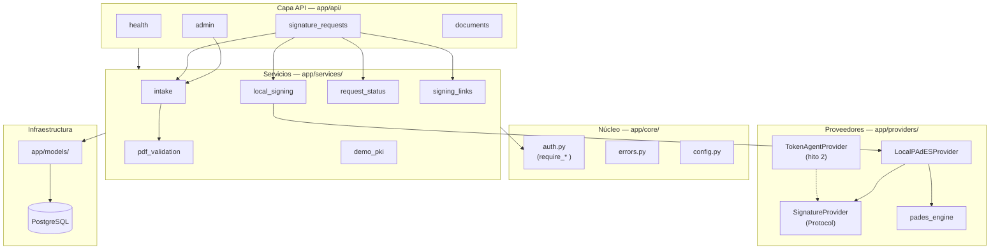

# C3 — Diagrama de componentes (C4)

Componentes **dentro del contenedor Firmadoc API** (`backend/`). Patrón **hexagonal**: núcleo + puerto `SignatureProvider`.

## Frontends (referencia C3 fuera del API)

| Contenedor | Componentes clave |
|---|---|
| `widget/` | `App`, `DocumentCard`, `SigningMethods`, cliente API |
| `frontend/` | `access`, `sign-document`, `authInterceptor`, `signing-upload.service` |
| `agent/` | `create_app`, `OriginGuard`, rutas `/health`, `/certificates`, `/sign` |

## Extensiones previstas

- **Ticket 1c:** validación de confianza enlazada a `prepare` (`token`).
- **Ticket 1d:** emisión de `audit_event` y cliente de webhook desde servicios de firma.