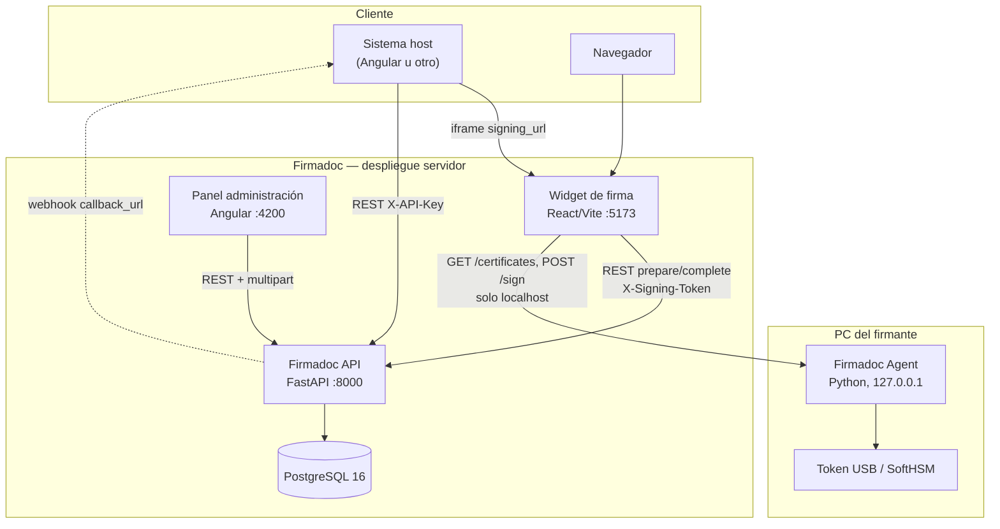

# C2 — Diagrama de contenedores (C4)

Contenedores **desplegables** del MVP y su comunicación. Equivalente refinado al diagrama de [readme §2.1](../../readme.md#21-diagrama-de-arquitectura).

## Responsabilidades por contenedor

| Contenedor | Tecnología | Responsabilidad |
|---|---|---|
| Firmadoc API | FastAPI, Python 3.12 | Intake, firma diferida, versionado, auth, (futuro) auditoría/webhook |
| Widget | React + Vite | UI de firma embebible; orquesta API y agente |
| Panel | Angular 21 + PrimeNG 21 | Carga desde navegador, token admin, iframe del widget |
| Firmadoc Agent | FastAPI + PKCS#11 | Listar certs y firmar hashes; PIN solo en desktop |
| PostgreSQL | 16 | Datos transaccionales, PDF en `bytea`, auditoría append-only |

## Autenticación entre contenedores

| Origen → API | Mecanismo |
|---|---|
| Integrador → API | `X-API-Key` |
| Panel → API | `Authorization: Bearer` |
| Widget → API | `X-Signing-Token` (fragmento `#t=` del enlace) |
| Widget → Agent | Solo orígenes permitidos; sin credenciales de servidor |

Contrato HTTP: [openapi.yaml](../openapi.yaml).