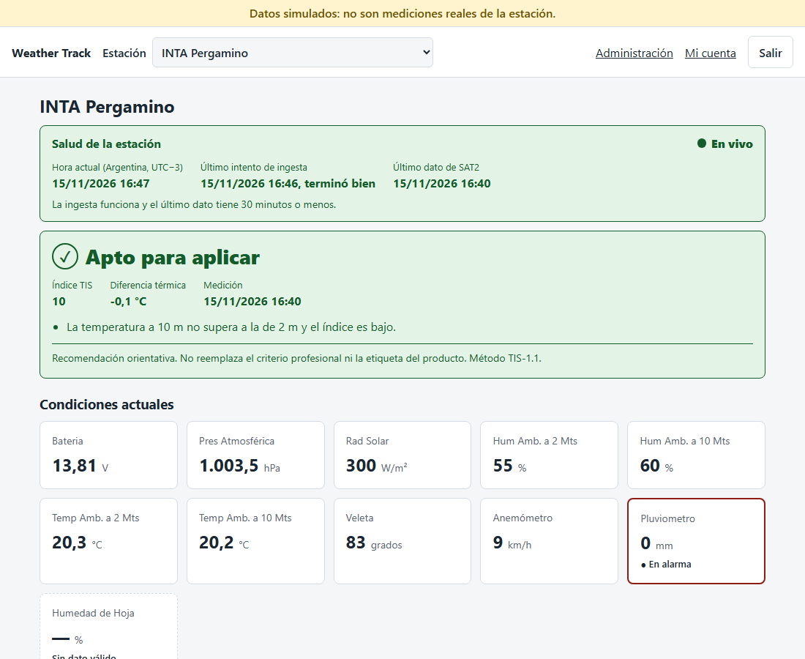
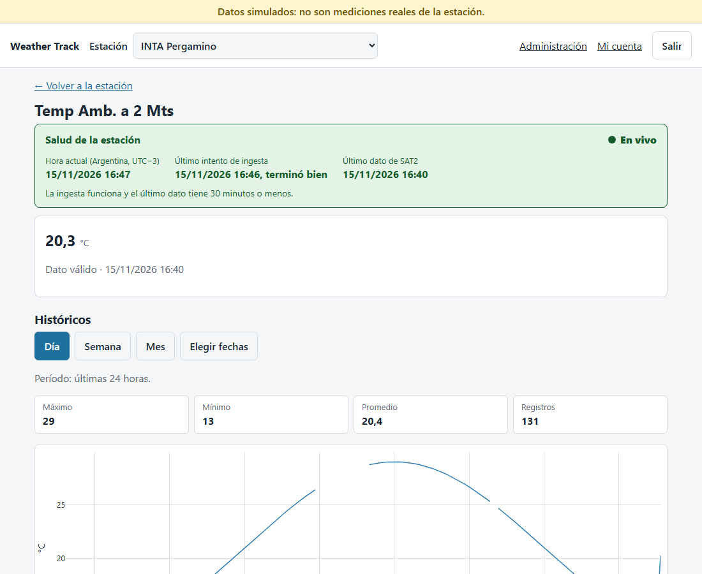

# 2. Lo que ven los usuarios

[← Volver al índice](README.md)

Este capítulo resume las pantallas para que puedas responder las consultas de los usuarios. Todas las cuentas confirmadas ven todas las estaciones.

## La pantalla de la estación

De arriba hacia abajo:

1. **Selector de estación**, en el encabezado. Cada estación es un equipo de SAT2. Hoy hay una: INTA Pergamino.
2. **Salud de la estación.** Muestra la hora actual de Argentina, el último intento de ingesta, el último dato que tenía SAT2 y un semáforo. Si el semáforo no está en verde, la decisión puede no estar al día. El [capítulo 5](05-monitoreo-y-avisos.md#semáforo-de-salud-de-la-estación) explica cada color.
3. **La decisión**, con un color, un ícono y un texto:

| Decisión | Qué le dice al usuario |
|---|---|
| ✓ Apto para aplicar | Las condiciones son favorables |
| ! Precaución | Se puede aplicar con cuidado: hay una inversión térmica leve o un dato dudoso |
| ▲ Riesgo de deriva | Las condiciones favorecen la deriva |
| ✕ No aplicar | Inversión térmica con poco viento, o un índice muy alto |
| ? Datos insuficientes | Falta un dato necesario o el último tiene más de 30 minutos. No es una falla del cálculo: Weather Track prefiere no decidir antes que decidir con datos viejos |

4. **Los motivos** de la decisión, en palabras, y el aviso de que la recomendación es orientativa.
5. **Las condiciones actuales**: una tarjeta por sensor con su valor, su unidad y la calidad del dato. Las unidades son métricas: °C, km/h, W/m², % y mm.

La pantalla se actualiza sola cada minuto. Si se corta la conexión con el servidor, avisa «Sin conexión» y muestra el último estado conocido, sin presentarlo como vigente.

## El detalle de un sensor

Al tocar una tarjeta se abre el detalle, con la misma franja de salud, el valor actual y los históricos.

- **Rangos:** las últimas 24 horas, 7 días o 31 días, o fechas elegidas en el calendario: hasta un mes, dentro del último año.
- **Huecos:** si faltan mediciones, la línea del gráfico se corta. Weather Track no inventa valores.
- **Resumen:** máximo, mínimo, promedio y cantidad de mediciones del período.

## Una estación inactiva

Si un equipo deja de aparecer en SAT2, la estación queda **inactiva**: muestra solo sus históricos, sin decisión ni franja de salud, porque ya no se leen datos nuevos.

## «Mi cuenta»

Cada usuario corrige su nombre, cambia su contraseña o se da de baja. **La baja borra la cuenta con todos sus datos** y no se puede deshacer. También puede darse de baja desde el enlace de cualquier correo de Weather Track.

## Preguntas que suelen llegar

| Pregunta | Respuesta |
|---|---|
| «Dice Datos insuficientes desde hace un rato» | Mirá el semáforo de salud y seguí el [capítulo 5](05-monitoreo-y-avisos.md) |
| «¿Por qué no da Apto si el viento está bien?» | Los motivos lo explican. Lo más común es una inversión térmica: la temperatura a 10 m es mayor que a 2 m |
| «No me llegó el correo de confirmación» | Revisá la carpeta de correo no deseado. El enlace vence a las 48 horas: después hay que registrarse de nuevo |
| «Me bloqueó al ingresar» | Tras 5 intentos fallidos el acceso se bloquea 15 minutos. Hay que esperar, o recuperar la contraseña |
| «Olvidé la contraseña» | Desde «¿Olvidó su contraseña?», en la pantalla de acceso. Si no recibe el correo, un administrador puede generarle una nueva ([capítulo 3](03-cuentas-y-administradores.md#restablecer-clave)) |
