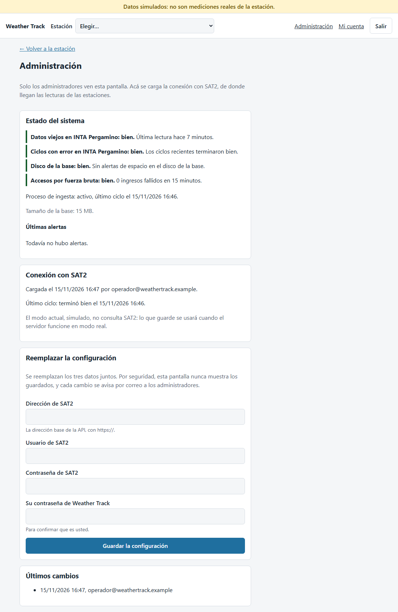

# 4. SAT2 y sus claves

[← Volver al índice](README.md)

Weather Track lee la estación desde SAT2 con una cuenta de servicio: una dirección, un usuario y una contraseña. Esos datos se cargan en «Administración» y quedan **cifrados** en la base. Solo el proceso de ingesta, el worker, puede leerlos.

## Cargar o cambiar las credenciales

1. Ingresá con una cuenta de administrador y abrí **Administración**, en el encabezado.
2. En **Reemplazar la configuración**, completá la dirección de SAT2, el usuario y la contraseña de SAT2.
3. Confirmá con **tu contraseña de Weather Track** y guardá.



El cambio se usa desde el ciclo siguiente, en menos de 10 minutos, sin reiniciar nada. En **Conexión con SAT2** vas a ver quién cargó la configuración, cuándo y el resultado del último ciclo. La pantalla **nunca vuelve a mostrar** la dirección, el usuario ni la contraseña: para cambiarlos, cargalos de nuevo completos.

Cada cambio se avisa por correo a todos los administradores y queda en **Últimos cambios**. Si recibís ese correo y no reconocés el cambio, revisá la pantalla y cambiá tu contraseña.

Cuando SAT2 te cambie la contraseña de la cuenta de servicio, cargala acá el mismo día. Mientras tanto, los ciclos fallan y llega la alerta de ciclos con error ([capítulo 5](05-monitoreo-y-avisos.md#ciclos_fallidos-ciclos-con-error)).

## Las claves de cifrado

La configuración se cifra con un par de claves que vive en el archivo `.env`:

| Clave | Quién la usa |
|---|---|
| `SAT2_CLAVE_PUBLICA` | La aplicación, para guardar la configuración. Con ella no se puede leer |
| `SAT2_CLAVE_PRIVADA` | Solo el worker, para leerla |

El par se genera una vez, en la puesta en marcha ([guía, sección 4, paso 1](../despliegue/instalacion-local.md#4-usar-datos-reales-de-sat2-opcional)), con el comando `generar-claves-sat2`.

**Guardá una copia del `.env` fuera de la computadora**, en un lugar seguro. Un respaldo de la base sin la misma clave privada trae la configuración de SAT2, pero no se puede leer.

### Si se pierde la clave privada

No hay forma de recuperar lo cifrado, pero se arregla en pocos minutos:

1. Generá un par nuevo:

   ```bash
   docker compose run --rm --no-deps worker python -m app.administracion generar-claves-sat2
   ```

2. Reemplazá `SAT2_CLAVE_PUBLICA` y `SAT2_CLAVE_PRIVADA` en el `.env` por las dos líneas nuevas.
3. Reiniciá los servicios para que tomen el `.env`:

   ```bash
   docker compose up -d --wait
   ```

4. Volvé a cargar las credenciales en «Administración».

Hacé lo mismo si creés que alguien vio la clave privada.

## Si SAT2 cambia sus respuestas

SAT2 es un servicio de un tercero y puede cambiar sin aviso. Una vez por mes, o cuando aparezcan errores raros en los ciclos, comprobá si cambió la forma de sus respuestas, como explica la [guía de instalación](../despliegue/instalacion-local.md#saber-si-sat2-cambió-sus-respuestas). Si informa diferencias, avisale a quien mantiene Weather Track.

## Lo que nunca hay que hacer

- Mandar el `.env`, la clave privada o las credenciales de SAT2 por correo o chat.
- Subir el `.env` a un repositorio.
- Cargar credenciales de SAT2 en una instalación de prueba que no sea tuya.
