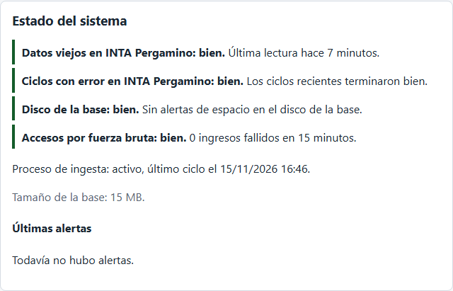

# 5. Monitoreo y avisos

[← Volver al índice](README.md)

Weather Track se vigila solo. Cada 10 minutos, el worker (el proceso que lee SAT2) evalúa cuatro controles. Cuando uno falla, abre una **alerta** y manda un correo a cada administrador. Cuando se normaliza, la cierra y avisa de nuevo. Mientras la alerta sigue abierta, el aviso no se repite.

Hay tres lugares donde mirar:

| Dónde | Quién lo ve | Qué muestra |
|---|---|---|
| Franja «Salud de la estación» | Todas las cuentas | Si la decisión está al día |
| «Administración», panel «Estado del sistema» | Administradores | Los cuatro controles, el estado del worker y el historial de alertas |
| Correo | Administradores | Cada alerta, al empezar y al normalizarse |



Los comandos de este capítulo se ejecutan desde la carpeta `weather-track`. Los registros del worker nunca muestran contraseñas.

## Semáforo de salud de la estación

| Semáforo | Qué significa |
|---|---|
| «En vivo» (verde) | El último ciclo terminó bien hace 20 minutos o menos y el último dato tiene 30 minutos o menos. Todo bien |
| «Con demoras» (amarillo) | Hay ciclos, pero el último falló o SAT2 no trae datos nuevos hace más de 30 minutos |
| «Caído» (rojo) | No hubo ningún ciclo en más de 20 minutos: el worker está detenido |
| «Modo prueba» (gris) | La instalación está en modo prueba, que no lee SAT2. No es una falla |

### «Con demoras»

- **Causas probables:** SAT2 no responde, las credenciales cambiaron o la estación dejó de transmitir. Después de un apagado, también aparece mientras Weather Track recupera los datos que faltan.
- **Qué revisar:**
  1. En «Administración», el resultado del último ciclo.
  2. El registro del worker:

     ```bash
     docker compose logs worker --tail 50
     ```

  3. Si el registro habla de credenciales o de acceso denegado, cargalas de nuevo ([capítulo 4](04-sat2-y-sus-claves.md)). Si los ciclos terminan bien pero el dato es viejo, el problema está en la estación o en SAT2: consultá con quien la mantiene.
- **Cómo se normaliza:** solo, en el primer ciclo que termina bien con un dato reciente.

### «Caído»

- **Causas probables:** el worker se detuvo, Docker se cerró o la computadora se reinició.
- **Qué revisar:**
  1. El estado de los servicios:

     ```bash
     docker compose ps
     ```

  2. Si el worker no está en `running`, encendelo:

     ```bash
     docker compose up -d --wait
     ```

  3. Si se vuelve a detener, mirá por qué:

     ```bash
     docker compose logs worker --tail 50
     ```

- **Cómo se normaliza:** en menos de 10 minutos después de que el worker vuelve, con su primer ciclo. Con el worker detenido **no llegan correos**, porque los envía el propio worker. Para recibir un aviso en ese caso, activá Grafana (al final de este capítulo).

### «Modo prueba»

La instalación arrancó con `SAT2_MODO=prueba`, que muestra casos ficticios y no lee SAT2. Para usar la estación real, seguí la [guía, sección 4](../despliegue/instalacion-local.md#4-usar-datos-reales-de-sat2-opcional).

## Alertas por correo

Los correos llegan con el asunto «Alerta de Weather Track: …» al empezar y «Se normalizó: …» al cerrarse.

### `DATOS_VIEJOS`: datos viejos

- **Qué significa:** la última lectura de una estación activa tiene más de 30 minutos. Es el mismo límite de la regla de vigencia: desde ese momento, la decisión queda en «Datos insuficientes».
- **Causas probables:** las mismas de «Con demoras» o «Caído».
- **Qué revisar:** el semáforo de la estación y lo que indica su sección, más arriba.
- **Cómo se normaliza:** cuando llega una lectura reciente.

### `CICLOS_FALLIDOS`: ciclos con error

- **Qué significa:** los últimos 3 ciclos de una estación terminaron con error, unos 30 minutos seguidos.
- **Causas probables:** credenciales vencidas o cambiadas, SAT2 caído o sin conexión a internet.
- **Qué revisar:**
  1. El registro del worker:

     ```bash
     docker compose logs worker --tail 50
     ```

  2. Que la computadora tenga internet.
  3. Las credenciales en «Administración».
  4. Si nada de eso explica el error, si SAT2 cambió sus respuestas ([capítulo 4](04-sat2-y-sus-claves.md#si-sat2-cambia-sus-respuestas)).
- **Cómo se normaliza:** con el primer ciclo que termina bien.

### `DISCO_CASI_LLENO`: disco de la base casi lleno

- **Qué significa:** queda menos del 10 % libre en el disco donde Docker guarda la base.
- **Causas probables:** imágenes viejas de Docker acumuladas, respaldos guardados en la misma computadora u otros programas.
- **Qué revisar:**
  1. Cuánto ocupa Docker:

     ```bash
     docker system df
     ```

  2. Borrá las imágenes que ya no usa ningún servicio. No toca los datos:

     ```bash
     docker image prune
     ```

  3. Mové los respaldos viejos a otro disco.
  4. En Docker Desktop, podés ampliar el límite de disco en la configuración de recursos.

  **Nunca** liberes espacio con `docker volume prune` ni `docker compose down -v`: borran la base.
- **Cómo se normaliza:** en el ciclo siguiente a superar el 10 % libre.

### `FUERZA_BRUTA`: posibles accesos por fuerza bruta

- **Qué significa:** hubo 20 o más ingresos fallidos en 15 minutos, o una dirección quedó bloqueada por superar su límite de intentos.
- **Causas probables:** alguien que olvidó su contraseña e insiste, un programa que prueba contraseñas o una prueba de seguridad.
- **Qué revisar:**
  1. En «Estado del sistema», cuándo empezó.
  2. Si coincide con alguien conocido, ayudalo a recuperar la contraseña ([capítulo 3](03-cuentas-y-administradores.md#restablecer-clave)).
  3. Si no lo reconocés, avisá a los usuarios que usen contraseñas únicas y revisá quiénes son administradores.

  Weather Track ya bloquea solo: una cuenta queda bloqueada 15 minutos tras 5 errores, y cada dirección tiene su límite de intentos. El correo nunca incluye correos de cuentas ni direcciones IP.
- **Cómo se normaliza:** cuando en los últimos 15 minutos hubo menos de 20 fallos y ninguna dirección sigue por encima de su límite. Según el límite, eso puede tardar hasta una hora.

## Aviso de Grafana: worker detenido (opcional)

Si activaste el perfil de monitoreo ([guía, monitoreo](../despliegue/instalacion-local.md#monitoreo)), Grafana manda un correo a la dirección de `ALERTAS_CORREO` con el título:

> El worker de Weather Track dejó de publicar métricas

- **Qué significa:** el worker no publica sus mediciones desde hace 5 minutos. Es el único aviso que llega con el worker detenido.
- **Qué revisar:** lo mismo que en «Caído».
- **Cómo se normaliza:** cuando el worker vuelve, Grafana manda otro correo, marcado como resuelto. Mientras siga detenido, repite el aviso cada 12 horas.

El tablero de Grafana está en <http://localhost:3000>, solo desde esa computadora, con el usuario `admin` y la contraseña de `GRAFANA_CLAVE_ADMIN`.
