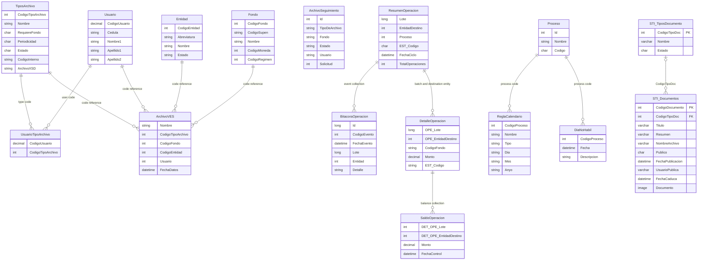

# VES Data Model

> **Active document — VES data contracts (API/MAPI).** Describes the DTOs and containers used to exchange information. This is not a physical SQL schema, a foreign-key map, or an EF migration specification. The API and MAPI solutions maintain independent `Abstracciones` projects. For tables, procedures, constraints, and verification provenance, consult [SCHEMA.md](../VES/Bccr.Supen.Ves.Mapi/Documentacion/SCHEMA.md). Technical discrepancies are retained in [pending verifications](./VERIFICACIONES_PENDIENTES_MODELOS.md), without predetermining their resolution.

This document describes the data contracts exposed and used by `Bccr.Supen.Ves.Api`, based on the classes in `Bccr.Supen.Ves.Abstracciones.Contenedores`, as well as the reported SQL schema and contract for STI documents in [`SCHEMA.md`](../VES/Bccr.Supen.Ves.Mapi/Documentacion/SCHEMA.md). These contracts are transfer models between the API and its services. Except for the STI document tables detailed below, diagram relationships are conceptual references based on shared codes and properties, not an ORM schema or guarantees of referential integrity.

## Model Descriptions

### 1. ArchivoNuevoVes and STIArchivoVes
These represent information about files registered or processed in VES.

**Fields (`ArchivoNuevoVes`):**
- `Usuario`: associated user code
- `Nombre`: file name
- `CodigoTipoArchivo`: file type code
- `CodigoFondo`: fund code
- `Estado`: record status
- `UsuarioRegistra`: registering user
- `FechaRegistro`: registration date

**Fields (`STIArchivoVes`):**
- `Nombre`: file name
- `CodigoTipoArchivo`: file type code
- `CodigoFondo`: optional fund code (`int?`)
- `CodigoEntidad`: entity code
- `FechaDatos`: data date
- `Usuario`: user code

**Validation Rules:**
- The classes declare property types but do not specify additional validation rules.

**Relationships:**
- User, file type, fund, and entity codes are references by value; the classes do not declare navigation properties.

### 2. ArchivoRecibido, ArchivoEnviado, ArchivoPorEnviar, and ArchivoEliminado
These represent files according to their stage or condition in the receiving, sending, scheduling, and deletion processes.

**Fields (`ArchivoRecibido`):**
- `Entidad`: related entity
- `Id`: record identifier
- `TipoDeArchivo`: file type
- `Fondo`: related fund
- `FechaEnvio`: submission date
- `FechaDatos`: data date
- `Estado`: file status
- `Usuario`: related user
- `Solicitud`: request number

**Fields (`ArchivoEnviado`):**
- `Id`: record identifier
- `TipoDeArchivo`: file type
- `Fondo`: related fund
- `FechaEnvio`: submission date
- `FechaDatos`: data date
- `Estado`: file status
- `Usuario`: related user
- `Solicitud`: request number

**Fields (`ArchivoPorEnviar` and `ArchivoEliminado`):**
- `Id`: record identifier
- `TipoDeArchivo`: file type
- `Fondo`: related fund
- `FechaEjecucion`: execution date
- `FechaDatos`: data date
- `Estado`: file status
- `Usuario`: related user

**Validation Rules:**
- The contracts do not declare length, required-field, uniqueness, or date-validation constraints.

**Relationships:**
- `TipoDeArchivo`, `Fondo`, `Entidad`, `Usuario`, and `Solicitud` are file reference data; these contracts do not define foreign keys.

### 3. TiposArchivo
Describes the configuration of a file type and its associated users.

**Fields:**
- `CodigoTipoArchivo`: file type code
- `Nombre`: file type name
- `RequiereFondo`: indicator of whether a fund is required
- `Periodicidad`: file type frequency
- `Estado`: file type status
- `Abreviatura`: abbreviation
- `FondoDefecto`: default fund
- `CodigoInterno`: internal code
- `ArchivoXSD`: XSD schema reference
- `LaListaDeUsuarios`: list of associated users

**Validation Rules:**
- The contract does not declare additional validation rules.

**Relationships:**
- `LaListaDeUsuarios` represents an association with users in the contract response.
- `UsuarioTipoArchivo` can represent the association through `CodigoUsuario` and `CodigoTipoArchivo`.

### 4. Usuario and UsuarioAutenticado
These represent user identity and authenticated-user data used by the API.

**Fields (`Usuario`):**
- `CodigoUsuario`: user code (`decimal`)
- `Cedula`: identification number
- `Nombre1`: first name
- `Apellido1`: first surname
- `Apellido2`: second surname
- `AbreviaturaDeLaEntidadYNombreCompleto`: entity abbreviation and full name

**Fields (`UsuarioAutenticado`):**
- `CodigoUsuario`: user code (`decimal`)
- `CodigoRol`: role code
- `CodigoEntidad`: entity code
- `Directorio`: associated directory
- `Nombre`, `Nombre1`, `Apellido1`: name and personal details
- `CodigoInterno`: internal code

**Validation Rules:**
- The contract does not declare format or uniqueness constraints.

**Relationships:**
- A user may be associated with file types through `UsuarioTipoArchivo`.
- File contracts include user codes or values without declaring a navigation property to `Usuario`.

### 5. UsuarioTipoArchivo
Represents the association between a user and a file type.

**Fields:**
- `CodigoUsuario`: user code (`decimal`)
- `CodigoTipoArchivo`: file type code (`int`)

**Validation Rules:**
- The contract does not declare additional rules.

**Relationships:**
- Conceptually references `Usuario` through `CodigoUsuario` and `TiposArchivo` through `CodigoTipoArchivo`.

### 6. Entidad and Fondo
These represent entities and funds used by VES processes.

**Fields (`Entidad`):**
- `CodigoEntidad`: entity code
- `Abreviatura`: abbreviation
- `Nombre`: entity name
- `Estado`: entity status

**Fields (`Fondo`):**
- `CodigoFondo`: fund code
- `CodigoSupen`: SUPEN code
- `Nombre`: fund name
- `Ley`: associated law
- `CodigoMoneda`: currency code
- `CodigoRegimen`: pension scheme code
- `Descripcion`: description

**Validation Rules:**
- The contracts do not specify required-field or format constraints.

**Relationships:**
- Entity and fund codes are used by file, operation, and reporting contracts.
- These references do not, by themselves, establish a physical relationship or database cardinality.

### 7. OperacionSEC, ResumenOperacion, DetalleOperacionConSaldos, and SaldoOperacion
These represent SEC operations, their summaries, details, and balances.

**Fields (`OperacionSEC`):**
- `Lote`: optional batch identifier (`Int64?`)
- `EntidadDestino`: optional destination entity code (`int?`)
- `AbreviaturaEntidad`: entity abbreviation
- `CodigoProceso`: optional process code (`int?`)
- `ESTCodigo`: status code
- `FechaCiclo`: optional cycle date
- `TotalOperaciones`: total number of operations
- `FechaGeneracionArchivo`: optional file generation date
- `NumeroEnvio`: optional submission number (`Int64?`)
- `MotivoRechazo`: rejection reason
- `Proceso` and `Estado`: process and status descriptions
- `Total`, `CantidadOperaciones`, `CantidadRechazadas`, `CantidadPendientes`: counters
- `TipoMovimiento`: transaction type

**Fields (`ResumenOperacion`):**
- `Lote`, `EntidadDestino`, and `Proceso`: batch, destination entity, and process identifiers
- `EST_Codigo`: status code
- `FechaCiclo`, `FechaGeneracionArchivo`: cycle and generation dates
- `NumeroEnvio`: optional submission number
- `TotalOperaciones`: total number of operations
- `FechaOficializacion`, `UsuarioOficializacion`: optional formalization data
- `CantidadActualizacionesSaldo`, `UltimaFechaActualizacionesSaldo`, `UltimoUsuarioActualizacionesSaldo`: balance update data
- `FechaRechazo`, `UsuarioRechazo`, `MotivoRechazo`: rejection data
- `UsuarioRegistra`, `FechaRegistro`, `UsuarioModificacion`, `FechaModificacion`: audit data
- `Bitacora`: collection of `BitacoraOperacion` events

**Fields (`DetalleOperacionConSaldos`):**
- `OPE_Lote`, `OPE_EntidadDestino`: batch and destination entity references
- `TipoIdentificacion`, `Identificacion`: identification details
- `TipoFondo`, `CodigoFondo`: fund data
- `EST_Codigo`: status code
- `Moneda`, `Monto`: currency and amount
- `MotivoRechazo`: rejection reason
- `NumeroContratoIndividual`, `IncentivoFiscal`, `TipoIdAfiliadoOrigen`, `IdAfiliadoOrigen`, `NumeroFormulario`: operation detail data
- `Saldos`: collection of `SaldoOperacion`

**Fields (`SaldoOperacion`):**
- `DET_OPE_Lote`, `DET_OPE_EntidadDestino`: references to the detail's batch and destination entity
- `NumeroPatrono`, `Monto`, `SubMonto1`, `MontoAcumulado`: amount data
- `FechaControl`, `TipoFecha`: control date and date type
- `NumeroContratoDesacumulacion`: contract number
- `TipoIdentificacionCausante`, `NumeroIdentificacionCausante`: originator identification
- `TipoBeneficiarioROP`: beneficiary type
- `FechaRevisionPension`: optional pension review date

**Validation Rules:**
- The contracts do not define business rules for statuses, amounts, or dates.

**Relationships:**
- `ResumenOperacion` contains an audit-log collection.
- `DetalleOperacionConSaldos` contains a balance collection.
- Batch and destination entity identifiers provide conceptual links between summaries and details; no foreign keys are declared.

### 8. Bitacora and Rastro
These represent request and operation tracking and audit information.

**Fields (`Bitacora`):**
- `Solicitud`: request number (`decimal`)
- `Reporte`, `Entidad`, `Fecha`, `Fondo`, `Usuario`, `Proceso`, `Ejecucion`, `Estado`: contextual data
- `Registros`: record count (`decimal`)
- `Inicio`, `UltProceso`: process timing data
- `Procesados`, `Errores`: counters

**Fields (`Rastro`):**
- `Usuario`: user performing the action
- `Proceso`: related process
- `DireccionIp`: IP address

**Fields (`BitacoraOperacion`):**
- `Id`: event identifier (`long`)
- `CodigoEvento`: event code
- `FechaCiclo`, `FechaEvento`: cycle and event dates
- `Lote`, `Entidad`, `TotalOperaciones`: optional references and total
- `Detalle`, `Usuario`, `Proceso`, `IP`: event details and context
- `CodigoInternoEntidad`, `AbreviaturaEntidad`: descriptive entity references

**Validation Rules:**
- The contracts do not specify retention, format, or audit rules.

**Relationships:**
- `BitacoraOperacion` is exposed as a collection in `ResumenOperacion`.
- `Rastro` carries user, process, and IP context data without declaring persistence relationships.

### 9. Proceso, DiaNoHabil, and ReglaCalendario
These represent processes and calendar data used to execute rules and operations.

**Fields (`Proceso`):**
- `Id`: process identifier
- `Nombre`: process name
- `Codigo`: process code (`char`)

**Fields (`DiaNoHabil`):**
- `CodigoProceso`: process code
- `Fecha`: non-business date
- `Descripcion`: description

**Fields (`ReglaCalendario`):**
- `Nombre`, `NombreProceso`, `Descripcion`, `Tipo`: rule identification and description
- `CodigoProceso`: process code
- `UsarTodos`: indicator
- `Dia`, `Mes`, `Anyo`: calendar components

**Validation Rules:**
- These contracts do not specify formats or rules for calendar values.

**Relationships:**
- `DiaNoHabil` and `ReglaCalendario` include `CodigoProceso` as a process reference.

### 10. ParametroSEC, STIArchivo, and ModeloValidacion
These include SEC parameters, metadata for files processed by STI, and the common validation result.

**Fields (`ParametroSEC`):**
- `Parametro`: parameter name
- `Valor`: parameter value
- `EsPublico`: indicator (`char`)

**Fields (`STIArchivo`):**
- `FechaDatos`: data date
- `Registros`: record count (`decimal`)
- `Fondo`, `Tipo`, `Entidad`, `Archivo`: references and file name
- `RequiereFecha`: indicator (`bool`)
- `RequiereFondo`: indicator (`char`)
- `NumeroSolicitud`: request number

**Fields (`ModeloValidacion`):**
- `EsValido`: validation result (`bool`)
- `Mensaje`: associated message

**Validation Rules:**
- `ModeloValidacion` initializes the result as valid; the constructor that receives a message initializes it as invalid.

**Relationships:**
- `STIArchivo` combines file, entity, type, and fund information in a single contract.
- `ModeloValidacion` is used as a validation result; it does not represent a persistent entity.

### 11. ReporteErrorArchivo
Represents the error report associated with processing a file.

**Fields:**
- `NombreArchivo`: file name
- `ArchivoExcel`: Excel file reference or name
- `CodigoEntidad`: entity code
- `CodigoFondo`: fund code
- `FechaDeDatos`: data date
- `CodigoInterno`: internal code
- `ModeloValidacion`: validation result

**Validation Rules:**
- No additional constraints are declared in the contract.

**Relationships:**
- Contains a `ModeloValidacion` and reference codes for the entity, fund, and internal code.

## STI Document Query Contracts

The API response contracts and MAPI contracts have equivalent names and fields, but belong to separate `Abstracciones` projects. The MAPI data-access model also projects only the query fields. These transfer types do not represent the SQL schema.

### `TipoDocumentoConsulta`

| Property | C# type | Description |
|---|---|---|
| `CodigoTipoDoc` | `int` | Document type code. |
| `Nombre` | `string` | Document type name. |

### `DocumentoConsulta`

| Property | C# type | Description |
|---|---|---|
| `Codigo` | `int` | Document code. |
| `NombreArchivo` | `string` | Associated file name. |
| `Tipo` | `string` | Associated document type name. |
| `Titulo` | `string` | Document title. |
| `FechaPublicacion` | `string` | Publication date serialized as `yyyy-MM-dd`. |

`DocumentoConsulta` does not declare a `Documento` property: binary content is used solely as an eligibility criterion in the query and is neither mapped nor returned in the result.

## STI Document Persistence

> **Documentary synopsis of the reported SQL definitions, not a second canonical source.** To modify, validate, or corroborate physical objects, consult the [MAPI SCHEMA.md](../VES/Bccr.Supen.Ves.Mapi/Documentacion/SCHEMA.md) and obtain DBA evidence for the corresponding environment. The data in this section are retained without resolving the technical reconciliation items pending verification (V).

### `STI_Documentos`

| Column | SQL type | Nullability | Description |
|---|---|---|---|
| `CodigoDocumento` | `int` | NOT NULL | Primary key. |
| `CodigoTipoDoc` | `int` | NULL | Document type; references `STI_TiposDocumento.CodigoTipoDoc`. |
| `Titulo` | `varchar(100)` | NOT NULL | Document title. |
| `Resumen` | `varchar(255)` | NOT NULL | Document summary. |
| `NombreArchivo` | `varchar(30)` | NULL | Associated file name. |
| `Publico` | `char(1)` | NOT NULL | Indicator restricted to `N` or `S`. |
| `FechaPublicacion` | `datetime` | NOT NULL | Publication date. |
| `UsuarioPublica` | `varchar(50)` | NOT NULL | User publishing the document. |
| `FechaCaduca` | `datetime` | NULL | Optional expiration date. |
| `Documento` | `image` | NULL | Binary file content. |

### `STI_TiposDocumento`

| Column | SQL type | Nullability | Description |
|---|---|---|---|
| `CodigoTipoDoc` | `int` | NOT NULL | Primary key. |
| `Nombre` | `varchar(40)` | NOT NULL | Document type name. |
| `Estado` | `char(1)` | NOT NULL | Status restricted to `I` (inactive) or `A` (active). |

**Relationship:** The foreign key `FK_Documentos_TiposDoc` links `STI_Documentos.CodigoTipoDoc` to `STI_TiposDocumento.CodigoTipoDoc`. Each document may have zero or one type (`CodigoTipoDoc` allows `NULL`); a type may be associated with multiple documents.

### Documented Stored Procedures

- `ListarTiposDocumentos` returns only types with status `A`.
- According to the DBA-reported contract in [`SCHEMA.md`](../VES/Bccr.Supen.Ves.Mapi/Documentacion/SCHEMA.md), `ListarDocumentos` accepts a positive type code or `-1`; includes only documents with non-null file names and binary content; does not filter by `FechaCaduca` (expired documents remain listed, per requester decision dated 2026-10-22); excludes documents without a type from the **All** view; sorts by publication date in descending order; and does not project binary content. This confirmation relates to a non-production environment and does not constitute independent verification or evidence of production state.
- `ObtenerDocumento` returns document metadata by code, excluding the binary `Documento` column. The application exposes `codigoDocumento`, `codigoTipoDoc`, `titulo`, `resumen`, `nombreArchivo`, `fechaPublicacion`, `usuarioPublica`, and `fechaCaduca` (plus the calculated `archivoDisponible`); `Publico` is not exposed, and expired documents can still be opened; expiration is used only to filter the listing. Tested locally in a non-production environment; production behavior has not been verified.
- `GuardarDocumento` attempts to insert or update metadata. On insertion it assigns `MAX(CodigoDocumento) + 1`, so the script cannot obtain a usable code when the table is empty. On update it simultaneously requires `Titulo`, `Resumen`, `FechaPublicacion`, and `FechaCaduca` to differ from the supplied values; comparisons with `NULL` do not evaluate to true in SQL, and the procedure returns the code even if the `UPDATE` affects no rows.
- `SubirArchivo` assigns the file name and binary content. Code `1` selects the highest existing code; if `NombreArchivo` is `NULL`, the procedure deletes the target row.
- `BajarArchivo` returns binary content by code, and `EliminarDocumento` deletes the row by code.

The script declares `NombreArchivo` as `varchar(30)` in the table and `varchar(50)` in the `SubirArchivo` parameter; the column limits the persisted length. `BajarArchivo` is labeled in the script itself as a reference procedure provided by the user, so its presence and signature in the target database require verification.

## Entity Relationship Diagram

The following diagram combines conceptual associations among API contracts with the physical relationship declared in the supplied SQL for STI document tables. It does not imply that these tables are currently deployed.

## Key Design Principles

1. **Transfer contracts**: Container classes define the data exchanged between the API and services.

2. **Code-based references**: Several contracts are related through scalar codes, without navigation properties or declared guarantees of referential integrity.

3. **Traceability**: Operation, file, and audit-log models carry statuses, requests, dates, users, and processing counters.

4. **Result composition**: Some contracts group related collections, such as users by file type, audit-log events by summary, and balances by operation detail.

5. **Explicit contract validation**: `ModeloValidacion` exposes the validation result and message; additional rules MUST NOT be inferred solely from the shape of its properties.

## Notes

- The documented names and types correspond to the public properties of the containers reviewed in `Bccr.Supen.Ves.Abstracciones.Contenedores`.
- Types explicitly marked nullable in C# are described as optional; a non-nullable property does not, by itself, establish a database constraint.
- The identifiers `CodigoEntidad`, `CodigoFondo`, `CodigoTipoArchivo`, `CodigoUsuario`, `Solicitud`, and `Lote` are reference values carried by the contracts.
- STI document columns, keys, and SQL contracts are documented in `VES/Bccr.Supen.Ves.Mapi/Documentacion/SCHEMA.md`; DBA verification is recorded as a reported confirmation for a non-production environment, not as evidence of production state.
- `ArchivoSEC` represents file-system metadata (`Nombre`, `Creacion`, `UltimoAcceso`, `UltimaEscritura`, `NombreCompleto`); it is not the same contract as VES file records.
- This file documents VES contracts. Historical references to recruitment models are not part of this version; any legacy models are maintained separately in `docs/historical/`.
