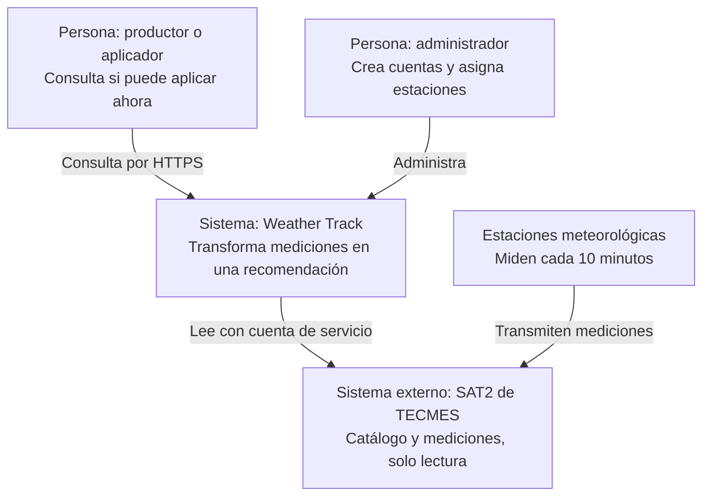
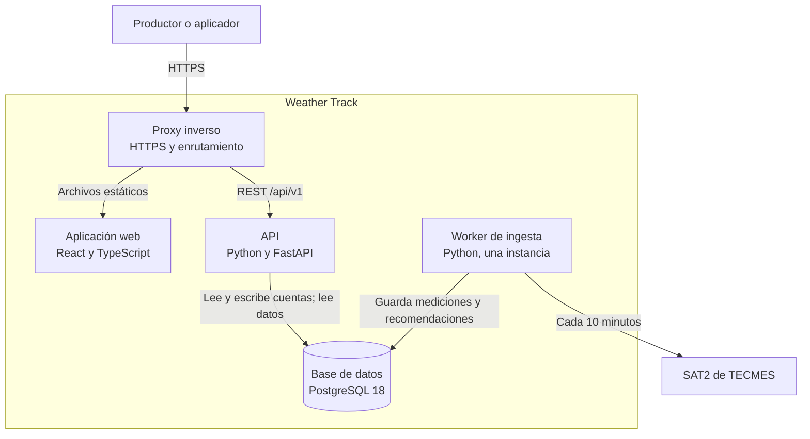
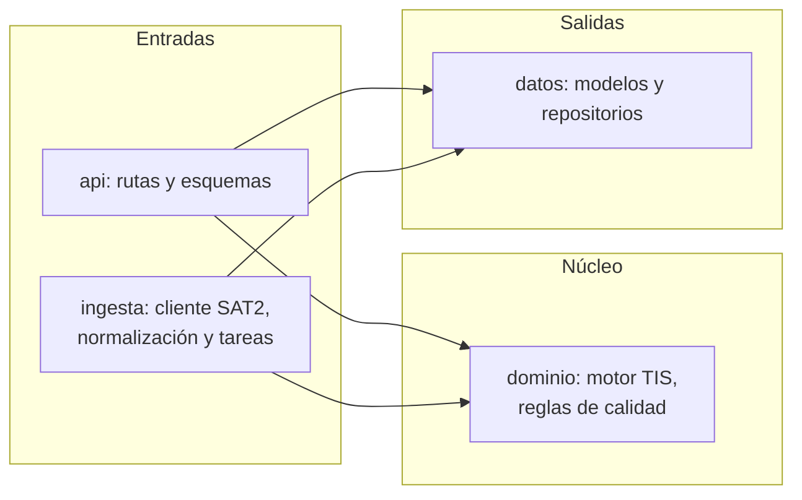

# ADR-0001: Monolito modular con worker dedicado como arquitectura destino de Weather Track

| | |
|---|---|
| **Estado** | Aceptado por el responsable el 1 de noviembre de 2026. Las actividades están en el [plan](../plan/plan-implementacion-entrega-2.md). |
| **Alcance** | MVP de la Entrega 2, con fecha objetivo 19 de noviembre de 2026. |
| **Fuera de alcance** | Evaluación de las etapas y herramientas del pipeline, tanto de entrega continua como de datos. Se decidirá en el proceso final, en otro ADR. Aquí la ingesta se trata como un único componente y el despliegue, como una actividad mínima. |

## Contexto y problema

La lógica y la interfaz de Weather Track se validaron con un prototipo en R Shiny. Ese prototipo cumplió su función, pero no es la base adecuada para el producto, por tres motivos:

- **Los datos dependen de la sesión.** Solo se consultan cuando hay una persona conectada, y sin persistencia propia no hay históricos ni evaluación continua.
- **El acceso a la fuente pasa por el usuario.** Cada persona entra con credenciales de la plataforma SAT2, de TECMES, lo que ata la seguridad y las cuentas a un tercero.
- **Las reglas de seguridad deben poder probarse.** El índice TIS orienta una decisión con consecuencias reales, así que debe ser verificable de forma aislada.

**Problema a resolver:** ¿a qué arquitectura se migra para entregar un MVP funcional y mantenible antes del 19 de noviembre, con una sola persona asistida por IA, y que además pueda evolucionar a un entorno empresarial?

## Factores de decisión

| Factor | Exigencia |
|---|---|
| Plazo | MVP funcional el 19 de noviembre de 2026 |
| Equipo | Una persona con asistencia de IA |
| Vigencia del dato | Obtener datos cada 10 minutos, haya o no alguien conectado |
| Seguridad | Credenciales de SAT2 solo en el servidor y cuentas propias |
| Verificabilidad | Motor de recomendación probado sin red ni base de datos |
| Portabilidad | Componentes estándar, migrables a un entorno empresarial sin reescritura |
| Dependencia externa | SAT2 es de solo lectura y no se puede modificar |

### Objetivos de calidad

Son objetivos de diseño. Aún no están medidos.

| Atributo | Escenario | Objetivo |
|---|---|---|
| Vigencia | Se genera una medición nueva en SAT2 | Disponible en la API en menos de 10 minutos desde el ciclo siguiente |
| Seguridad funcional | La medición tiene más de 30 minutos | La API nunca la presenta como vigente |
| Rendimiento | Consulta de la recomendación con una estación y 31 días de datos | Respuesta p95 menor a 500 ms |
| Resiliencia | SAT2 no responde | La API sigue operando e informa la antigüedad del dato |
| Volumen | 11 sensores cada 10 minutos | Unas 578.000 filas por estación y año, sin extensiones especiales |
| Mantenibilidad | Cambio de pesos del TIS | Sin tocar API, ingesta ni frontend |

## Opciones consideradas

1. **Evolucionar el prototipo R Shiny**, con base de datos y tareas programadas externas.
2. **Monolito modular con worker dedicado**: React, FastAPI, PostgreSQL y un proceso de ingesta.
3. **Microservicios con eventos**: servicios separados y mensajería.
4. **Backend como servicio**: autenticación, base y funciones gestionadas por una plataforma.

## Decisión

**Se elige la opción 2: monolito modular con worker dedicado.** Es la opción más simple que resuelve los tres problemas de origen y conserva una salida clara a producción.

| Elemento | Decisión | Motivo |
|---|---|---|
| Estilo | Monolito modular con capas | Velocidad inicial y fronteras claras, extraíbles más adelante |
| Frontend | SPA con React y TypeScript | Experiencia adaptable y contrato tipado con la API |
| API | Python y FastAPI | Genera OpenAPI y permite compartir el dominio con el worker |
| Worker | Proceso Python separado, con una sola instancia | No depende de las sesiones; el planificador no se comparte entre procesos |
| Persistencia | PostgreSQL 18 con migraciones | Con soporte hasta noviembre de 2030; el volumen no justifica una base de series temporales |
| Dominio | Funciones puras, sin dependencias de red ni base | Permite probar las reglas R1 a R4 de forma aislada |
| Identidad | Cuentas propias y una cuenta de servicio para SAT2 | La credencial de terceros nunca llega al navegador ni a la API |
| Configuración | Variables de entorno | Mismos artefactos en todos los entornos, según The Twelve-Factor App |
| Ejecución | Contenedores | Paridad entre desarrollo y producción |

Las versiones exactas de FastAPI, React y demás dependencias se fijan al iniciar el proyecto, con archivos de bloqueo y la última versión estable de cada una.

### Vista de contexto (C4, nivel 1)

### Vista de contenedores (C4, nivel 2)

### Vista de componentes del backend (C4, nivel 3)

La API y el worker son dos procesos sobre el mismo código. El dominio no depende de ninguna otra capa.

### Estrategia de migración

Se aplica un **reemplazo por capacidades en paralelo**, inspirado en el patrón Strangler Fig. El prototipo sigue disponible mientras se construye el MVP y se retira cuando el MVP cubra sus funciones. No se usa una fachada común, porque el prototipo no tiene datos propios que migrar: los históricos se recuperan desde SAT2.

| Capacidad del prototipo | Destino | Tratamiento |
|---|---|---|
| Acceso con credenciales de SAT2 | Cuentas propias y cuenta de servicio | Se reemplaza |
| Consulta de equipos, sensores y mediciones | Cliente SAT2 dentro del worker | Se reescribe |
| Clasificación de sensores | Catálogo con magnitud y altura | Se reescribe |
| Estado por sensor | Calidad del dato y estado de ingesta | Se rediseña |
| Estadísticas de históricos | Resumen en la API | Se reescribe |
| Índice TIS | Motor de dominio con reglas R1 a R4 | Se porta y corrige |
| Pantallas y gráficos | React y Plotly.js | Se reescriben usando la interfaz validada |
| Comparación entre varios sensores | Evolución futura | No se migra en el MVP |
| Modelo canónico y reglas del proceso SDD previo | Modelo de datos y normalización | Se reutiliza como especificación |
| Persistencia en Parquet y DuckDB propuesta en ese proceso | PostgreSQL | Se descarta |

## Consecuencias

**Lo que mejora:**

- Las recomendaciones se calculan sin depender de que alguien tenga la pantalla abierta.
- La credencial de SAT2 queda aislada en un solo componente.
- Las reglas de seguridad del TIS se prueban sin infraestructura.
- Cada componente es estándar y portable a un entorno empresarial.

**Lo que empeora:**

- Se reescribe lógica ya probada en R y hay que volver a verificarla.
- Se agregan responsabilidades nuevas: gestión de cuentas, base de datos y copias de seguridad.
- Un solo servidor es un punto único de falla, aceptable para un MVP.
- Si SAT2 no responde, no hay datos nuevos. La regla R2 evita mostrar datos viejos como vigentes, pero no resuelve la falta de datos.

**Decisiones que habrá que revisar:**

- Pipeline de entrega continua y su herramienta: proceso final.
- Proveedor del servidor: tratado en el [ADR-0002](0002-proveedor-del-servidor.md).
- Extracción de servicios o base de series temporales: solo si crecen las estaciones o el equipo.

## Confirmación

La implementación cumple esta decisión si:

- [ ] Una prueba automática verifica que `dominio` no importa `api`, `ingesta` ni `datos`.
- [ ] Los casos de referencia de la sección 2.6 del [README](../../readme.md) pasan sin red ni base de datos.
- [ ] La configuración de la API no incluye la credencial de SAT2.
- [ ] El sistema sigue obteniendo datos con todas las sesiones cerradas.
- [ ] Una medición de más de 30 minutos nunca se muestra como vigente.
- [ ] Solo corre una instancia del worker y repetir un ciclo no duplica datos.

## Ventajas y desventajas de las opciones

### Opción 1: evolucionar el prototipo R Shiny

| Dimensión | Evaluación |
|---|---|
| Complejidad | Baja al inicio; alta al agregar persistencia, ingesta y cuentas |
| Costo | Bajo |
| Escalabilidad | Limitada: la sesión está ligada a la conexión |
| Conocimiento del equipo | Alto |
| Riesgo hasta el 19/11 | Medio |

- **Ventaja:** reutiliza código e interfaz ya validados, y es lo más rápido para mostrar pantallas.
- **Desventaja:** en shinyapps.io el almacenamiento local es efímero, así que igual necesita una base externa y un proceso aparte.
- **Desventaja:** al sumar esas piezas, se pierde la simplicidad que la justificaba y queda lejos del destino empresarial.

### Opción 2: monolito modular con worker dedicado (elegida)

| Dimensión | Evaluación |
|---|---|
| Complejidad | Media |
| Costo | Bajo: un servidor y componentes de código abierto |
| Escalabilidad | Suficiente para el MVP; la API escala y los módulos se pueden extraer |
| Conocimiento del equipo | Medio, compensado con asistencia de IA |
| Riesgo hasta el 19/11 | Medio: hay que reescribir |

- **Ventaja:** resuelve datos, credenciales y verificabilidad con un único despliegue.
- **Ventaja:** Python reutiliza conocimiento del dominio y su ecosistema de datos facilita la evolución futura.
- **Desventaja:** exige reescribir y operar más componentes que el prototipo.

### Opción 3: microservicios con eventos

| Dimensión | Evaluación |
|---|---|
| Complejidad | Alta |
| Costo | Medio a alto por la operación |
| Escalabilidad | Alta |
| Conocimiento del equipo | Bajo para operar esta escala |
| Riesgo hasta el 19/11 | Alto |

- **Ventaja:** permite desplegar y escalar cada parte por separado.
- **Desventaja:** agrega red, mensajería y operación sin una necesidad real a esta escala.
- **Desventaja:** obliga a fijar fronteras antes de conocerlas, justo lo que la estrategia MonolithFirst busca evitar.

### Opción 4: backend como servicio

| Dimensión | Evaluación |
|---|---|
| Complejidad | Baja a media |
| Costo | Bajo al inicio; depende del proveedor al crecer |
| Escalabilidad | Alta, gestionada por el proveedor |
| Conocimiento del equipo | Medio |
| Riesgo hasta el 19/11 | Bajo a medio |

- **Ventaja:** reduce el trabajo de autenticación e infraestructura.
- **Desventaja:** ata la lógica central y las tareas programadas a las capacidades de un proveedor.
- **Desventaja:** dificulta la portabilidad a un entorno empresarial, un factor explícito de esta decisión.

## Análisis de compromisos

- **Velocidad frente a destino:** Shiny es lo más rápido hoy, pero la migración seguiría pendiente después de la entrega. Se acepta reescribir ahora a cambio de no rehacerlo más tarde.
- **Simplicidad frente a escala:** un monolito modular renuncia a escalar por servicio, algo que hoy no se necesita, y deja el camino abierto con módulos bien separados.
- **Control frente a esfuerzo:** a diferencia de un backend gestionado, implica operar más piezas, pero conserva la portabilidad.

## Acciones

1. [x] Aprobar este ADR y cambiar su estado a `accepted`.
2. [x] Crear las specs de OpenSpec del MVP a partir de esta decisión: cambio `weather-track-mvp-nucleo`.
3. [ ] Medir los límites de rango y antigüedad de SAT2 y consultarlos con TECMES. Las credenciales ya están disponibles (A02).
4. [x] Definir si la alarma que informa SAT2 por sensor se guarda en `OBSERVACION`: se guarda y se muestra, sin afectar la recomendación.
5. [x] Elegir el proveedor del servidor antes de iniciar A13: ver el [ADR-0002](0002-proveedor-del-servidor.md).
6. [ ] Abrir un ADR propio para el pipeline en el proceso final.

## Más información

Esta decisión se apoya en las siguientes referencias:

- **Formato de este ADR:** [MADR 4.0.0](https://adr.github.io/madr/).
- **Vistas de arquitectura:** [modelo C4](https://c4model.com/), que no impone una notación. La [FAQ de arc42](https://faq.arc42.org/questions/B-17/) lo trata como complementario.
- **Estilo arquitectónico:** [MonolithFirst](https://martinfowler.com/bliki/MonolithFirst.html), de Martin Fowler.
- **Migración:** [Strangler Fig Application](https://martinfowler.com/bliki/StranglerFigApplication.html), de Martin Fowler.
- **Configuración y procesos:** [The Twelve-Factor App](https://12factor.net/).
- **Base de datos:** [política de versiones de PostgreSQL](https://www.postgresql.org/support/versioning/).
- **Límite del prototipo:** [almacenamiento en shinyapps.io](https://docs.posit.co/shinyapps.io/guide/storage/).
- **Planificador:** [FAQ de APScheduler](https://apscheduler.readthedocs.io/en/3.x/faq.html), que desaconseja compartir un almacén de tareas entre procesos.
- **Revisión de seguridad:** [OWASP ASVS 5.0.0](https://asvs.owasp.org/).
- **Documentos relacionados:** [README](../../readme.md) y [plan de implementación](../plan/plan-implementacion-entrega-2.md).
