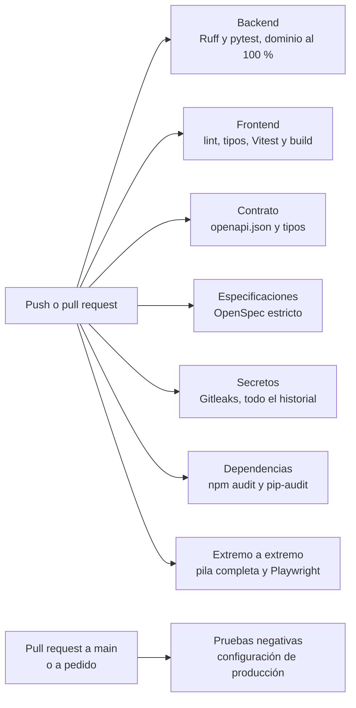

# ADR-0003: Pipeline de integración continua con GitHub Actions

| | |
|---|---|
| **Estado** | Aceptado el 7 de noviembre de 2026, tras revisar el flujo el responsable. Implementado y verificado en GitHub ese mismo día. |
| **Alcance** | Pendiente D4 de la devolución de la Entrega 1 y punto 6 del [ADR-0001](0001-arquitectura-destino-weather-track.md). Diseño en el cambio de OpenSpec [`weather-track-pipeline-ci`](../../openspec/changes/archive/2026-11-07-weather-track-pipeline-ci/design.md). |
| **Fuera de alcance** | Despliegue continuo y registro de imágenes (línea B de la [hoja de ruta](../plan/hoja-de-ruta-entrega-final.md)), revisión de pull requests con IA (D5), tests basados en propiedades (D6) y datos con la forma de SAT2 (D7). |

## Contexto y problema

Hasta el 6 de noviembre de 2026 todas las verificaciones se ejecutaban a mano en la computadora del responsable: pytest, Vitest, lint, extremo a extremo, pruebas negativas y la revisión de secretos antes de cada commit. Nada impedía que llegara a una rama un cambio que rompe una prueba o sube una credencial. Además, si PostgreSQL no respondía, las pruebas de base se salteaban y el resultado parecía verde.

## Decisión

Un flujo de **GitHub Actions**, [`.github/workflows/integracion.yml`](../../.github/workflows/integracion.yml), que se ejecuta en cada push a `main` y a `feature/**`, en cada pull request a `main` y a pedido.

| Trabajo | Qué verifica | Falla si |
|---|---|---|
| Backend | Ruff y pytest contra PostgreSQL 18, con `EXIGIR_BASE_PRUEBAS=1` | Una prueba falla, falta la base o el dominio baja del 100 % de cobertura |
| Frontend | oxlint, `tsc`, Vitest y `vite build` | Hay errores de lint, de tipos, de pruebas o de build |
| Contrato | Exporta `openapi.json` y regenera los tipos | Alguno de los dos difiere de lo versionado |
| Especificaciones | `openspec validate --all --strict` | Una spec o un cambio están mal formados |
| Secretos | Gitleaks 8.30.1 sobre todo el historial | Aparece un secreto que no está en `.gitleaksignore` |
| Dependencias | `npm audit --audit-level=high` y `pip-audit` sobre `uv.lock` | Hay una vulnerabilidad alta o crítica |
| Extremo a extremo | `npm run e2e`, con la pila en modo prueba | Falla una prueba; guarda las trazas 7 días |
| Pruebas negativas | `pruebas_negativas.py` sobre la configuración de producción | Falla alguna comprobación |

### Seguridad del propio pipeline

- **Sin secretos:** las pruebas usan los modos sin SAT2 y generan sus contraseñas. El flujo no lee ningún secreto del repositorio.
- **Permisos mínimos:** `contents: read` y `persist-credentials: false` al clonar.
- **Sin `pull_request_target`:** un pull request desde un fork no puede ejecutar código con permisos del repositorio.
- **Acciones fijadas por SHA** y Gitleaks por digest. Dependabot propone las actualizaciones de las acciones una vez por semana.
- **Tiempos máximos** en cada trabajo.

## Opciones consideradas

| Opción | Evaluación |
|---|---|
| **GitHub Actions** | Ya habilitado, sin costo en un repositorio público, integrado con los pull requests. Es lo que anticipaba la sección 2.4 del README. **Elegida** |
| GitLab CI | Exige espejar el repositorio en otra plataforma, sin ventaja para este proyecto |
| Servidor propio (Jenkins, Woodpecker) | Otra máquina que mantener y asegurar, para un equipo de una persona |
| Seguir a mano | Sin costo, pero depende de la disciplina de cada commit y no deja evidencia |

## Consecuencias

- **Positivas:** cada cambio queda verificado con las mismas pruebas que se corrían a mano, con evidencia pública en cada ejecución. Un fallo de la base de pruebas ya no pasa como verde. Las credenciales nuevas y las dependencias vulnerables se detectan solas.
- **Negativas:** una vulnerabilidad nueva puede frenar un cambio que no la tocó; se corrige actualizando la dependencia o registrando la excepción con fecha. La E2E tarda unos 6 minutos.
- **Sin cambios** en la aplicación, la API ni la base de datos. Se sumó Ruff al backend, con ajustes de forma.

## Confirmación

Verificado en GitHub el 7 de noviembre de 2026, en el repositorio de entrega:

| Ejecución | Qué mostró |
|---|---|
| 42331137052 | Primera ejecución: 6 trabajos en verde y una carrera en la E2E de recupero, que se corrigió en la prueba |
| [42331724077](https://github.com/dinannopabloguillermo/AI4Devs-finalproject-temp/actions/runs/42331724077) | Push: todos los trabajos en verde |
| [42332086713](https://github.com/dinannopabloguillermo/AI4Devs-finalproject-temp/actions/runs/42332086713) | A pedido: todos en verde, incluidas las pruebas negativas |
| [42332106660](https://github.com/dinannopabloguillermo/AI4Devs-finalproject-temp/actions/runs/42332106660) | Rama descartable con una prueba rota a propósito: falló solo el backend, señalando la prueba. La rama se borró |

## Proteger `main` (lo hace el responsable)

Para que GitHub impida fusionar sin los controles en verde:

1. En el repositorio, **Settings → Rules → Rulesets → New branch ruleset**.
2. Nombre: `main protegida`. **Enforcement status:** Active. **Target branches:** `main`.
3. Marcar **Require a pull request before merging** y **Require status checks to pass**.
4. En los controles exigidos, agregar los trabajos del flujo *Integración*: Backend, Frontend, Contrato de la API, Especificaciones de OpenSpec, Secretos en el historial, Dependencias vulnerables, Extremo a extremo y Pruebas negativas.
5. Marcar **Block force pushes** y guardar.

Es un ajuste de la cuenta: el asistente no lo cambia.

**Estado al 7 de noviembre de 2026.** El responsable creó el conjunto de reglas `main proteccion`, activo sobre la rama por defecto (`main`). Exige pull request, impide borrar la rama, bloquea el force push y exige los 8 trabajos del flujo en verde antes de fusionar. Verificado leyendo el conjunto de reglas con la API de GitHub.

## Revisión automática con Copilot (lo hace el responsable)

El cambio `weather-track-revision-y-documentacion-viva` suma una revisión de GitHub Copilot a cada pull request a `main`. Copilot comenta sobre líneas concretas; no aprueba ni bloquea, así que **no se agrega como control exigido**. Fusionar sigue dependiendo de los 8 trabajos en verde y de la decisión del responsable.

Copilot lee, desde la rama del pull request:

- `CLAUDE.md`, con el stack, la arquitectura y las reglas del proyecto;
- `.github/copilot-instructions.md`, que dice cómo revisar y qué señalar primero;
- `.github/instructions/*.instructions.md`, con criterios por zona según su campo `applyTo`: dominio, migraciones, flujos, API y frontend.

Para activarla:

1. Requiere un plan de Copilot que incluya la revisión de código (Pro, Pro+, Max, Business o Enterprise).
2. En el repositorio, **Settings → Rules → Rulesets** y abrir `main proteccion`.
3. En **Branch rules**, marcar **Automatically request Copilot code review**.
4. Dentro de esa opción, marcar **Review new pushes**, para que vuelva a revisar con cada push al pull request.
5. Guardar. No marcar a Copilot como revisor obligatorio ni cambiar los controles exigidos.

Sin el plan, la revisión se puede pedir a mano desde el pull request (**Reviewers → Copilot**), y las mismas instrucciones aplican.

Un comentario de Copilot se atiende con un commit o se descarta con un motivo en la conversación. La plantilla `.github/pull_request_template.md` lo pide en su lista de control.

Es un ajuste de la cuenta: el asistente no lo cambia.

## Más información

- **Formato de este ADR:** [MADR 4.0.0](https://adr.github.io/madr/).
- [Endurecimiento de seguridad de GitHub Actions](https://docs.github.com/actions/security-for-github-actions/security-guides/security-hardening-for-github-actions): permisos mínimos, acciones fijadas por SHA y riesgos de `pull_request_target`.
- [Gitleaks](https://github.com/gitleaks/gitleaks), [pip-audit](https://github.com/pypa/pip-audit) y [Ruff](https://docs.astral.sh/ruff/).
- [Configuring automatic code review by GitHub Copilot](https://docs.github.com/en/copilot/how-tos/use-copilot-agents/request-a-code-review/configure-automatic-review) y [Support for different types of custom instructions](https://docs.github.com/en/copilot/reference/custom-instructions-support): archivos que lee Copilot code review, incluido `CLAUDE.md`.
