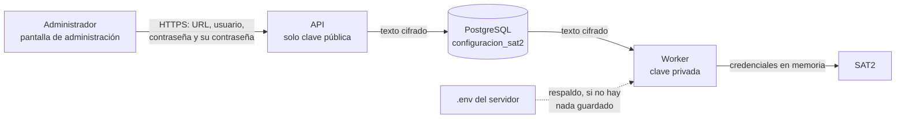

# ADR-0004: Credenciales de SAT2 gestionadas por un administrador, cifradas con clave pública

| | |
|---|---|
| **Estado** | Aceptado el 9 de noviembre de 2026. Implementado en el cambio de OpenSpec [`weather-track-administracion-sat2`](../../openspec/changes/weather-track-administracion-sat2/design.md). Falta la verificación del responsable con las credenciales reales. |
| **Alcance** | Dónde viven la URL y las credenciales de SAT2, quién puede cambiarlas y cómo llegan al worker. Es el requisito previo de D7 en la [hoja de ruta](../plan/hoja-de-ruta-entrega-final.md). |
| **Fuera de alcance** | Roles por estación o niveles de usuario, rotación automática de claves y elegir el modo de datos desde la aplicación. |

## Contexto y problema

Hasta el 8 de noviembre de 2026, la URL, el usuario y la contraseña de SAT2 vivían solo en el `.env` del servidor. Cambiarlos exigía entrar al servidor, editar el archivo y reiniciar el worker. El requisito «Protección de credenciales de SAT2» exigía además que la API nunca las tuviera: solo las usa el worker.

El 7 de noviembre de 2026 el responsable pidió un administrador de la aplicación que gestione esa configuración desde la propia aplicación, que la configuración quede guardada hasta un nuevo cambio y que el resto de las cuentas no vea esa opción.

La pregunta es dónde guardarla para que la cambie un usuario de la web sin que la API, una copia de la base o un registro alcancen para leerla.

## Opciones consideradas

1. **Seguir solo con el `.env`.** Lo más simple, pero no resuelve el pedido: cambiar las credenciales sigue exigiendo entrar al servidor.
2. **Base de datos sin cifrar.** Cualquiera con acceso a la base o a una copia de respaldo vería la contraseña de SAT2.
3. **Base cifrada con una clave simétrica.** La API necesitaría la clave para cifrar, y con la misma clave podría descifrar. La API dejaría de cumplir el requisito vigente.
4. **Base cifrada con una clave pública (elegida).** La API cifra con la clave pública y no puede descifrar. Solo el worker tiene la clave privada.

## Decisión

Opción 4, con `SealedBox` de PyNaCl (libsodium: X25519 con XSalsa20-Poly1305), una construcción ya probada en lugar de una combinación propia.

- **El rol se otorga solo desde el servidor:** `python -m app.administracion hacer-administrador`. Ninguna ruta de la API ni pantalla lo cambia.
- **Invisible para el resto:** para cualquier cuenta sin el rol, y sin sesión, todo `/api/v1/administracion` responde lo mismo que una ruta inexistente (404), con cualquier método. La pantalla muestra «Esta página no existe.».
- **Se guarda cifrado y nunca vuelve:** la URL, el usuario y la contraseña se cifran juntos. La pantalla indica quién y cuándo los cargó, pero nunca los muestra. Reemplazarlos exige la contraseña de Weather Track del administrador, que cuenta para el bloqueo de la cuenta.
- **Cada cambio deja rastro:** se avisa por correo a cada administrador activo y queda en un registro, siempre sin los valores.
- **El worker recarga sin reiniciar:** antes de cada tarea compara el contenido cifrado. Si cambió, abre una sesión nueva con SAT2. Si no puede descifrarlo, no consulta SAT2 ni vuelve al `.env`, y deja el ciclo en error con el motivo.
- **Transición:** mientras nadie cargue una configuración, el worker sigue usando el `.env`.

Las claves se generan con `python -m app.administracion generar-claves-sat2`. `SAT2_CLAVE_PUBLICA` va a la API y `SAT2_CLAVE_PRIVADA` solo al worker.

## Consecuencias

**Mejora:**

- Cambiar las credenciales ya no exige entrar al servidor ni reiniciar.
- Ni la API, ni una copia de la base, ni los registros alcanzan para leerlas.
- Cada cambio queda registrado y avisado.

**Empeora o cuesta:**

- **La clave privada es crítica.** Si se pierde, la configuración guardada no se puede leer: se genera un par nuevo y el administrador la vuelve a cargar. Si se filtra junto con la base, las credenciales quedan expuestas.
- **La API recibe las credenciales en claro durante el pedido.** Viajan por HTTPS, se cifran en memoria y nunca se registran.
- **La pantalla no muestra la URL guardada.** Es el costo de cifrarla junto con las credenciales; el administrador la vuelve a escribir al reemplazar.
- **El primer arranque necesita alguna configuración.** En modo real, sin nada guardado ni un `.env` completo, el worker termina y explica qué falta; la primera carga desde la aplicación necesita volver a levantarlo. En el servidor lo hace la política de reinicio.
- **Una dependencia nueva**, PyNaCl, que entra en la auditoría de dependencias del pipeline.
- **El requisito «Protección de credenciales de SAT2» cambia:** las credenciales pueden venir de la base, pero la API sigue sin poder leerlas.

## Confirmación

- Pruebas del cifrado, de la API (incluido el 404 igual a una ruta inexistente con nueve tipos de pedido), del worker con una SAT2 falsa, del frontend y de extremo a extremo, todas con valores ficticios.
- [Pruebas negativas](../../backend/herramientas/pruebas_negativas.py) sobre la configuración de producción: 18 comprobaciones nuevas, entre ellas que la base guarda solo texto cifrado y que la API no recibe la clave privada.
- Prueba de Compose: la API recibe la clave pública y nunca la privada.
- **Pendiente:** el responsable genera las claves, carga las credenciales reales en la pantalla y confirma que el ciclo siguiente termina bien. El asistente no carga credenciales reales ni ejecuta el modo real.

## Más información

- **Formato de este ADR:** [MADR 4.0.0](https://adr.github.io/madr/).
- [PyNaCl: Sealed Box](https://pynacl.readthedocs.io/en/latest/public/#nacl-public-sealedbox) y [libsodium: Sealed boxes](https://doc.libsodium.org/public-key_cryptography/sealed_boxes).
- [OWASP: Secrets Management Cheat Sheet](https://cheatsheetseries.owasp.org/cheatsheets/Secrets_Management_Cheat_Sheet.html).
