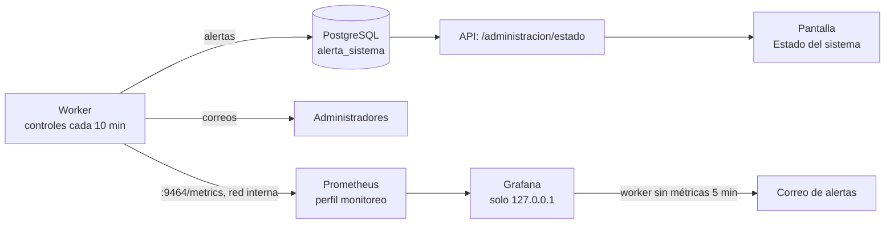

# ADR-0005: Monitoreo en dos capas, la aplicación y un perfil con Prometheus y Grafana

| | |
|---|---|
| **Estado** | Aceptado el 11 de noviembre de 2026. Implementado en el cambio de OpenSpec [`weather-track-monitoreo`](../../openspec/changes/weather-track-monitoreo/design.md) y probado en un proyecto aislado. Falta la revisión del responsable en su instalación. |
| **Alcance** | Línea C de la [hoja de ruta](../plan/hoja-de-ruta-entrega-final.md): enterarse de un problema sin entrar a mirar. |
| **Fuera de alcance** | Publicar Grafana o Prometheus en internet (línea B, en pausa), vigilar los correos que no salen y Alertmanager. |

## Contexto y problema

Hasta el 10 de noviembre de 2026, Weather Track no avisaba a nadie cuando algo fallaba:

- `/api/v1/salud` solo comprobaba que la base respondiera.
- Docker sabía si el contenedor del worker estaba vivo, pero no si la ingesta traía datos.
- La pantalla de administración mostraba el último ciclo, pero había que entrar a mirarla.

El 9 de noviembre la instalación del responsable estuvo apagada una semana sin que nada lo advirtiera, y la decisión quedó en «datos insuficientes».

El 11 de noviembre el responsable eligió:

- **Qué vigilar:** la ingesta y la frescura de los datos, la base y el disco, y los accesos sospechosos.
- **Cómo avisar:** en pantalla y por correo.
- **Herramientas:** Prometheus y Grafana.

Hay un problema de fondo: los correos de la aplicación los envía el worker. Si el worker se detiene, la aplicación no puede avisar por correo.

## Opciones consideradas

1. **Solo dentro de la aplicación.** No suma servicios y sirve en cualquier instalación. Pero no puede avisar por correo si el worker se detiene, y no guarda la historia de las mediciones.
2. **Solo Prometheus, Grafana y Alertmanager.** Es lo estándar en la industria. Pero suma tres servicios a toda instalación, y las alertas no ven a los administradores de la base ni aparecen en la pantalla de la aplicación.
3. **Dos capas (elegida).** La aplicación vigila y avisa siempre. Prometheus y Grafana, en un perfil opcional, guardan la historia y cubren el único aviso que la aplicación no puede dar: el worker detenido.

## Decisión

Opción 3.

| Capa | Siempre activa | Qué hace |
|---|---|---|
| Aplicación | Sí | Cada 10 minutos el worker evalúa cuatro controles, abre y cierra alertas en `alerta_sistema` y avisa por correo a cada administrador activo. La pantalla de administración muestra el estado, y calcula el del worker desde la API |
| Perfil `monitoreo` | No: `docker compose --profile monitoreo up -d` | Prometheus guarda 30 días de las métricas del worker. Grafana muestra un tablero y avisa por correo si el worker deja de publicar métricas durante 5 minutos |

**Controles**, con sus umbrales en un único lugar, `app/monitoreo/umbrales.py`:

| Control | Alerta cuando |
|---|---|
| Datos viejos | La última lectura de una estación activa tiene más de 30 minutos. Es el umbral de la regla R2, tomado de `vigencia.py` |
| Ciclos fallidos | Los últimos 3 ciclos de una estación activa terminaron en error |
| Disco casi lleno | Queda menos del 10 % libre en el disco de la base, que el worker monta en modo solo lectura |
| Fuerza bruta | Hay 20 o más ingresos fallidos en 15 minutos, o una dirección IP bloqueada por superar su límite |

**Salud de la estación, para todas las cuentas.** Pedida en la revisión del responsable del 11 de noviembre. `condiciones-actuales` suma el último intento de ingesta y un semáforo que se calcula al leer, con los mismos umbrales: 20 minutos sin ciclos (`umbrales.py`) y 30 minutos de la regla R2 (`vigencia.py`). La pantalla de la estación y el detalle de un sensor lo muestran en una franja, siempre con texto además del color:

| Semáforo | Cuándo |
|---|---|
| En vivo | El último ciclo terminó bien hace 20 minutos o menos y el dato tiene 30 minutos o menos |
| Con demoras | Hubo un ciclo en los últimos 20 minutos, pero falló o el dato tiene más de 30 minutos |
| Caído | No hubo ningún ciclo en más de 20 minutos |
| Modo prueba | El modo `prueba` no ejecuta ciclos |

**Sin repetir avisos.** Una restricción única parcial permite una sola alerta abierta por control y estación. El correo sale al abrirse y al cerrarse, nunca mientras sigue abierta.

**Seguridad:**

- Las métricas se publican en un puerto interno que no se publica ni pasa por Caddy.
- Grafana escucha solo en `127.0.0.1`, no arranca sin `GRAFANA_CLAVE_ADMIN` y no admite registro ni acceso anónimo.
- Ninguna alerta, correo ni métrica lleva correos de cuentas, direcciones IP ni credenciales.

**Versiones fijas:** `prom/prometheus:v3.15.1` y `grafana/grafana:13.3.0`. La configuración de Prometheus, la fuente de datos, el tablero y la alerta están versionados en [`monitoreo/`](../../monitoreo/).

## Consecuencias

**Mejora:**

- Un apagado, una caída de SAT2, un disco que se llena o un ataque de fuerza bruta llegan por correo y se ven en la pantalla sin tener que buscarlos.
- El productor sabe, junto a la decisión, si los datos están al día, sin ser administrador.
- La instalación de siempre no suma servicios.
- La historia de las mediciones queda en Prometheus, y el tablero viene armado.

**Empeora o cuesta:**

- **Dos lugares que configurar:** el aviso de worker caído va a una dirección fija, `ALERTAS_CORREO`, porque Grafana no lee la base de la aplicación.
- **Sin el perfil, un worker detenido solo se ve en la pantalla:** no llega correo.
- **El perfil suma dos servicios**, con su memoria y unos 30 días de métricas en disco.
- **En Windows, Grafana no detecta los cambios del tablero** en el montaje: hay que reiniciarlo con `docker compose restart grafana`.
- **Un falso positivo de fuerza bruta**, por ejemplo durante las pruebas negativas, manda un correo. Es uno solo por alerta.

## Confirmación

- Pruebas de los controles con sus límites, las transiciones, la API, el panel, las métricas, Compose y la configuración: 812 pruebas del backend y 115 del frontend.
- Salud de la estación: 22 pruebas nuevas del backend con los límites del semáforo, 8 de Vitest con cada estado y el reloj, y una de extremo a extremo. En total, 834 del backend, 127 del frontend y 25 de extremo a extremo.
- [Pruebas negativas](../../backend/herramientas/pruebas_negativas.py): 10 comprobaciones nuevas, entre ellas que las métricas no se alcanzan desde afuera y que una ráfaga abre una sola alerta con un solo aviso.
- **Proyecto aislado `wt-mon`, el 11 de noviembre de 2026:**
  - Prometheus leyó las métricas, con un disco libre del 93,6 %.
  - Grafana respondió 401 sin ingreso y mostró el tablero.
  - Con el worker detenido a las 17:08:39, el aviso llegó a Mailpit a las 17:15:40.
- **Pendiente:** la revisión del responsable en su instalación.

## Más información

- **Formato de este ADR:** [MADR 4.0.0](https://adr.github.io/madr/).
- [Prometheus: buenas prácticas de nombres de métricas](https://prometheus.io/docs/practices/naming/).
- [Grafana: aprovisionamiento de alertas desde archivos](https://grafana.com/docs/grafana/latest/alerting/set-up/provision-alerting-resources/file-provisioning/).
- [Google SRE: Monitoring Distributed Systems](https://sre.google/sre-book/monitoring-distributed-systems/), sobre avisar por síntomas y no repetir avisos.
