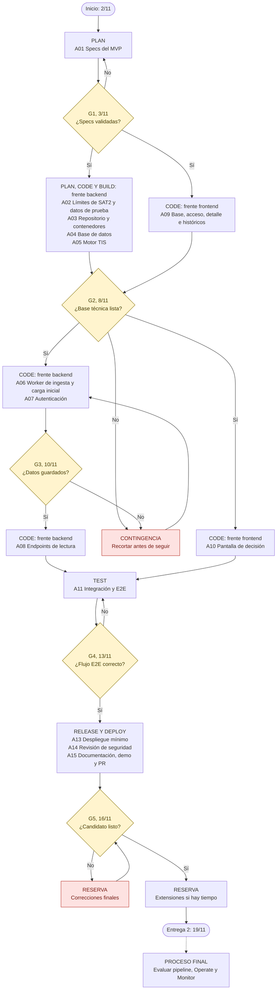
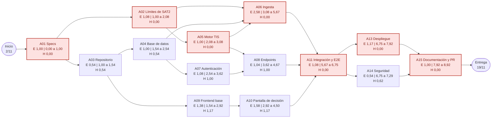
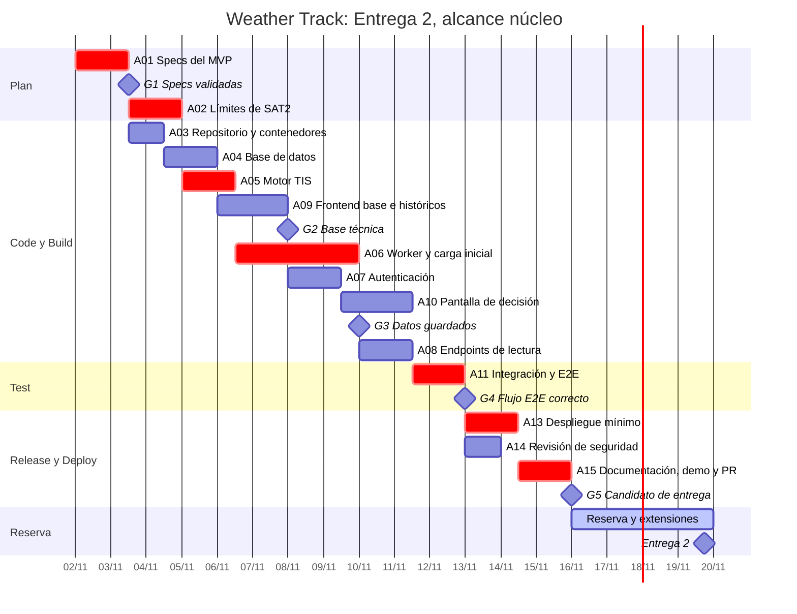

# Plan de implementación de la Entrega 2

| | |
|---|---|
| **Proyecto** | Weather Track |
| **Objetivo** | MVP funcional desplegado, con pruebas y documentación |
| **Inicio** | Lunes 2 de noviembre de 2026 |
| **Fecha objetivo** | Jueves 19 de noviembre de 2026 |
| **Capacidad** | 5 horas por día, de lunes a domingo: 90 horas en 18 días |
| **Arquitectura** | [ADR-0001](../decisions/0001-arquitectura-destino-weather-track.md), aceptado |
| **Responsable** | Pablo Guillermo Di Nanno |
| **Versión** | 1.3, 1 de noviembre de 2026 |

## 1. Resumen ejecutivo

- **Se compromete un alcance núcleo.** El alcance completo requiere unas 119 horas y hay 90 disponibles. El alcance núcleo requiere unas 96,5 horas y conserva acceso, ingesta, recomendación, reglas R1 a R4, históricos y despliegue.
- **Sigue haciendo falta trabajar en paralelo.** Ni siquiera el alcance núcleo entra en serie. Con 1,5 frentes, es decir, dos líneas de trabajo con sesiones de IA y supervisión humana, tiene 94 % de probabilidad de llegar, o 61 % si todas las estimaciones se desvían a la vez.
- **El resto se agrega solo si sobra tiempo.** Las extensiones se deciden el 10 de noviembre, según la reserva disponible.
- **La ruta crítica pasa por SAT2 y la ingesta.** Son A01, A02, A05, A06, A11, A13 y A15. Las credenciales ya están disponibles y las pruebas contra la API real confirmaron consultas de hasta 4 años y datos desde el alta de la estación, lo que reduce el riesgo de la carga histórica.

> **Nota sobre "lead time".** En este plan, la fecha objetivo es el plazo total del proyecto. Es distinto del *change lead time* de DORA, que mide cuánto tarda un cambio desde el commit hasta producción. Esa métrica se tratará junto con el pipeline, en el proceso final.

## 2. Método

| Práctica | Aplicación en este plan |
|---|---|
| Ciclo DevOps | Las actividades se ordenan según la convención Plan, Code, Build, Test, Release, Deploy, Operate y Monitor |
| PERT | Tres estimaciones por actividad: `E = (O + 4M + P) / 6` y `σ = (P − O) / 6` |
| Ruta crítica (CPM) | Cálculo hacia adelante y hacia atrás para obtener holguras |
| Simulación de Monte Carlo | 20.000 iteraciones con duraciones beta-PERT. Evita subestimar el plazo cuando convergen caminos paralelos |
| Gantt | Calendario con recursos nivelados y una reserva visible al final |

**Supuestos:**

- Un día ideal son 6 horas efectivas con asistencia de IA. Con 5 horas diarias, los 18 días equivalen a **15 días ideales**. Las estimaciones son juicio experto; todavía no hay datos históricos del proyecto.
- No se consideran feriados, porque se trabaja de lunes a domingo.
- La evaluación del pipeline queda fuera de este plan. A13 es un despliegue mínimo y se automatiza más adelante.
- Las etapas Operate y Monitor corresponden a la Entrega 3.

## 3. Flujo del proceso

Esta es la vista general por fases DevOps; las dependencias exactas están en la [red PERT](#6-red-pert). Los rombos son puntos de control: si uno no se cumple, el trabajo se corrige o se aplica la contingencia.

## 4. Carga inicial desde SAT2

La base se construye con dos procesos. La **carga inicial** usa el endpoint de históricos por sensor para traer el pasado. El **ciclo de 10 minutos** usa las lecturas instantáneas, que entregan todos los sensores en una consulta y con una misma hora de medición, lo que necesita el índice TIS. Los históricos también sirven para rellenar huecos.

### Límites medidos

Se midieron el 1 de noviembre de 2026 contra la API real, sobre el sensor de temperatura a 2 m, con una consulta por vez. Las credenciales se leyeron del entorno y no aparecen en ningún resultado.

| Tema | Resultado | Fuente |
|---|---|---|
| Rango por consulta | Al menos 4 años, con 51 segundos y 6 MB | Prueba manual |
| Ventana de 365 días | Completa, en 13,25 segundos | Script de la tarea 1.3 |
| Ventana de 31 días | Completa, en 1,65 segundos | Script de la tarea 1.3 |
| Datos más antiguos | Hay datos el 21/09/2022, la fecha de alta | Script de la tarea 1.3 |
| Completitud | 99,5 %: 52.283 de 52.560 registros en 365 días | Script de la tarea 1.3 |
| Límite de consultas | **Desconocido**: no está en la parte legible del manual | |
| Vida de la sesión | Token de 300 segundos | Capturas reales |

**Volumen máximo de toda la historia:** 1.503 días, 11 sensores y 144 registros diarios por sensor dan unos **2,38 millones de filas**, un máximo teórico porque hay huecos. Con ventanas de 365 días son unas 55 consultas y, extrapolando estas mediciones, unos 15 minutos de carga. PostgreSQL maneja ese volumen sin extensiones especiales.

### Diseño de la carga

| Propiedad | Cómo se logra |
|---|---|
| Ventana adaptable | Empieza con 365 días como máximo, aunque la fuente acepte más; si falla, la reduce a la mitad hasta llegar a un día |
| Reanudable | Avanza del presente al pasado, sensor por sensor, y registra el progreso; retoma donde quedó |
| Idempotente | Repetir una ventana no duplica datos, gracias a la clave `(sensor_id, medido_en)` |
| Prudente con el proveedor | Una consulta por vez, con pausa entre consultas, y detención ante errores repetidos |
| Sesión vigente | Se reautentica antes de que venza el token |
| Separada del ciclo | La carga no retrasa el ciclo de 10 minutos, que siempre tiene prioridad |

El alcance núcleo exige solo los **últimos 31 días**, lo que la interfaz necesita. Traer toda la historia es la extensión X1: una vez escrita la carga, la mayor parte es tiempo de máquina.

## 5. Actividades y estimaciones

Valores en días ideales del alcance núcleo. *Ruta crítica* significa holgura cero sin limitar recursos.

| ID | Fase | Actividad | Depende de | O | M | P | E | σ | Holgura | Ruta crítica |
|---|---|---|---|---|---|---|---|---|---|---|
| A01 | Plan | Specs de OpenSpec del MVP | Ninguna | 0,5 | 1 | 1,5 | 1,00 | 0,17 | 0,00 | Sí |
| A02 | Plan | Límites de SAT2 (medidos), datos de prueba sin credenciales y modo simulado | A01 | 0,5 | 1 | 2 | 1,08 | 0,25 | 0,00 | Sí |
| A03 | Code | Estructura del repositorio, Docker Compose y configuración | A01 | 0,25 | 0,5 | 1 | 0,54 | 0,12 | 0,54 | |
| A04 | Code | WT-DB-01: esquema y migraciones | A03 | 0,5 | 1 | 1,5 | 1,00 | 0,17 | 0,54 | |
| A05 | Code | WT-BE-01: motor de recomendación TIS | A02 | 0,5 | 1 | 1,5 | 1,00 | 0,17 | 0,00 | Sí |
| A06 | Code | WT-BE-03: worker, carga inicial de 31 días y reglas de calidad | A02, A04, A05 | 1,5 | 2,5 | 4 | 2,58 | 0,42 | 0,00 | Sí |
| A07 | Code | WT-BE-04: autenticación y autorización | A04 | 0,5 | 1 | 2 | 1,08 | 0,25 | 1,00 | |
| A08 | Code | WT-BE-01 y WT-BE-02: endpoints de lectura | A05, A07 | 0,5 | 1 | 1,75 | 1,04 | 0,21 | 1,00 | |
| A09 | Code | WT-FE-02: base, acceso, detalle e históricos de 7 y 31 días | A03 | 0,75 | 1,25 | 2,5 | 1,38 | 0,29 | 1,17 | |
| A10 | Code | WT-FE-01: pantalla de decisión | A09 | 1 | 1,5 | 2,5 | 1,58 | 0,25 | 1,17 | |
| A11 | Test | Integración, E2E de HU1 y HU2, y prueba básica de HU3 | A06, A08, A10 | 0,5 | 1 | 2 | 1,08 | 0,25 | 0,00 | Sí |
| A13 | Deploy | WT-OPS-01: despliegue mínimo del MVP | A11 | 0,5 | 1 | 2,5 | 1,17 | 0,33 | 0,00 | Sí |
| A14 | Release | Revisión corta de seguridad: secretos, autorización y sesión | A11 | 0,25 | 0,5 | 1 | 0,54 | 0,12 | 0,62 | |
| A15 | Release | Documentación, demo y PR de la Entrega 2 | A13, A14 | 0,5 | 1 | 1,5 | 1,00 | 0,17 | 0,00 | Sí |
| | | **Total de esfuerzo** | | | | | **16,08** | | | |

El identificador A12 se reserva para la extensión X2.

## 6. Red PERT

Cada nodo muestra el tiempo esperado (E), el inicio y fin más tempranos y la holgura (H). La ruta crítica está resaltada y dura **8,92 días ideales**, con σ = 0,70.

Esta ruta no considera límites de personal. Con dos frentes, el recurso también condiciona el orden: en el Gantt, A10 espera a que se libere un frente.

## 7. Cronograma

Se calculó con dos frentes, 5 horas diarias todos los días y duraciones esperadas convertidas a calendario y redondeadas hacia arriba a medio día. Termina el 15 de noviembre y deja **4 días de reserva**. Si la capacidad real es de 1,5 frentes, las barras se alargan y consumen buena parte de esa reserva. En rojo, las actividades de la ruta crítica.

## 8. Probabilidad de cumplir el plazo

Resultado de 20.000 simulaciones contra los 15 días ideales disponibles. Se compara el alcance núcleo, comprometido, con el alcance completo, que suma las extensiones y la carga de toda la historia.

- **1 frente:** una sola línea de trabajo en serie.
- **1,5 frentes:** dos líneas con sesiones de IA, descontando el tiempo de supervisión humana. Es el escenario más realista.
- **2 frentes:** dos líneas sin pérdida por supervisión.
- **Desvío común:** todas las actividades se atrasan o adelantan a la vez, con un factor de 0,9 a 1,25. Refleja que las estimaciones pueden fallar en conjunto.

| Alcance | Capacidad | Días P50 | Días P80 | Probabilidad de llegar |
|---|---|---|---|---|
| Núcleo (96,5 h) | 1 frente | 16,1 | 16,9 | 13,9 % |
| Núcleo | 1,5 frentes | 13,5 | 14,3 | **94,0 %** |
| Núcleo | 1,5 frentes con desvío común | 14,5 | 16,1 | **60,7 %** |
| Núcleo | 2 frentes | 10,1 | 10,7 | 100 % |
| Núcleo | 2 frentes con desvío común | 10,9 | 12,1 | 100 % |
| Completo (119 h) | 1 frente | 19,8 | 20,8 | 0,0 % |
| Completo | 1,5 frentes | 15,6 | 16,5 | 28,1 % |
| Completo | 1,5 frentes con desvío común | 16,7 | 18,5 | 19,8 % |
| Completo | 2 frentes | 11,7 | 12,4 | 100 % |
| Completo | 2 frentes con desvío común | 12,5 | 13,9 | 94,9 % |

**Cómo leer esta tabla:** la simulación ayuda a decidir, pero no predice. Sus resultados dependen de estimaciones de juicio experto y de la capacidad supuesta.

## 9. Puntos de control, extensiones y contingencia

| Punto | Fecha | Criterio de salida | Si no se cumple |
|---|---|---|---|
| G1 | 3/11 | Specs validadas con OpenSpec | Resolver antes de escribir código |
| G2 | 8/11 | A01 a A05 y A09 terminadas; límites de SAT2 medidos | Aplicar la contingencia |
| G3 | 10/11 | Ciclo de 10 minutos y últimos 31 días guardados de forma automática | Con más de un día de atraso, aplicar la contingencia |
| G4 | 13/11 | HU1 y HU2 pasan E2E; reglas R1 a R4 verificadas | Corregir antes de desplegar |
| G5 | 16/11 | MVP desplegado, documentación al día y sin hallazgos críticos | Usar la reserva y decidir si se puede entregar |

**Extensiones.** Se decide en G3. Se toman en este orden, y solo si la reserva proyectada sigue siendo de al menos 2 días:

| ID | Extensión | Esfuerzo estimado |
|---|---|---|
| X1 | Carga de toda la historia disponible | Medio día, más tiempo de máquina |
| X2 (A12) | Revisión del TIS con bibliografía y un referente | 1 día ideal; conviene pedirla cuando termine A05 |
| X3 | Rango manual de fechas en históricos | 1 día ideal |
| X4 | E2E completa de HU3 y revisión con OWASP ASVS, nivel 1 | 1 día ideal |

**Contingencia.** Si incluso el núcleo se atrasa, se recorta en este orden. No se recortan el acceso, la ingesta, la recomendación ni las reglas R1 a R4.

1. Dejar solo el gráfico de 7 días en históricos.
2. Reemplazar la carga inicial de 31 días por lo que acumule el ciclo de 10 minutos.
3. Presentar la demo con Docker Compose si el servidor no llega a tiempo.

## 10. Riesgos

| ID | Riesgo | Prob. | Impacto | Respuesta | Disparador |
|---|---|---|---|---|---|
| R1 | SAT2 limita la frecuencia de consultas o responde peor a otros sensores | Baja | Medio | Carga con ventana adaptable, una consulta por vez y pausas | Errores o datos truncados |
| R2 | El contrato real de SAT2 difiere de su documentación | Alta | Medio | Normalización aislada y pruebas con datos de prueba | Fallas de lectura en A06 |
| R3 | Falta capacidad para sostener dos frentes con 5 horas diarias | Alta | Alto | Sesiones de IA en ramas separadas y contingencia | Atraso en G2 o G3 |
| R4 | Filtración de credenciales en el repositorio público | Baja | Alto | Nunca copiar `docs/` del prototipo; credenciales solo en el entorno; revisión en A14 | Cualquier hallazgo |
| R5 | La carga histórica afecta al servicio del proveedor | Baja | Alto | Una consulta por vez, con pausas y detención ante errores | Errores repetidos o respuestas lentas |
| R6 | La supervisión de código generado por IA se vuelve un cuello de botella | Media | Medio | Cambios pequeños, pruebas primero y revisión por ticket | PR sin revisar por más de un día |
| R7 | Crece el alcance durante el desarrollo | Media | Alto | Lo que no esté en el núcleo pasa a extensiones o a "Evolución futura" | Pedido nuevo sin ticket |

## 11. Definición de terminado

Una actividad termina cuando:

- Tiene su spec en OpenSpec y sus criterios de aceptación cumplidos.
- Sus pruebas pasan y su cambio entró por PR.
- No incluye credenciales ni datos sensibles.
- Si cambió el diseño, se actualizó la documentación o se escribió un ADR.

## 12. Fuentes

- Fórmula PERT: [Three-Point Estimating, PM Study Circle](https://pmstudycircle.com/three-point-estimation/).
- Sesgo de convergencia y simulación: [Project schedule risk analysis, PMI](https://www.pmi.org/learning/library/project-schedule-risk-analysis-simulation-4620).
- Definición de *change lead time*: [DORA](https://dora.dev/guides/dora-metrics/).
- Sintaxis de los diagramas: [Mermaid Gantt](https://mermaid.js.org/syntax/gantt.html).
- Revisión de seguridad: [OWASP ASVS 5.0.0](https://asvs.owasp.org/).
