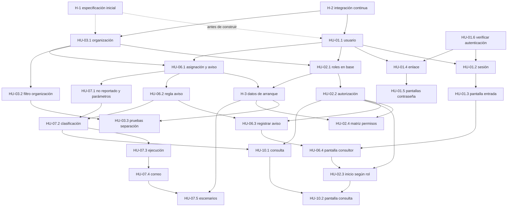

# Tickets — MVP del Controlador de Tiempo

> **Versión 1 · miércoles 18/11/2026 · borrador para refutación. Sin aprobar.**
> Paso 5 del método (PROMPTS 11, 11b, 12, 13, 14 y 14b). Fuente:
> `../04-Backlog/Backlog-MVP-Controlador-de-Tiempo-20261118-v5.md` (6 historias detalladas, 75
> criterios) y `../03-PRD/PRD-MVP-Controlador-de-Tiempo-20261118-v6.md`.
> Un ticket **hereda** los criterios de su historia y no agrega ninguno. **Nombra la capa** que
> toca y no diseña: sin tipos de columna, nombres de ruta ni códigos de respuesta. Eso se decide en
> la especificación y al construir.
> Documento anonimizado.

**Totales de este documento:** 6 historias descompuestas · 24 tickets de historia · 3 tickets de
habilitación · 27 tickets en total · 75 criterios heredados, de los cuales 71 quedan asignados a
un ticket y 4 esperan a la historia de la que dependen · tallas: 9 S, 15 M y 3 L.

**Solo se descomponen las historias detalladas.** Las otras doce del backlog no tienen tickets
todavía: se descomponen cuando se detallen. El método lo pide así.

---

## 1. Convenciones

**Identificador.** `HU-nn.n`: el ticket deriva de su historia. Los de habilitación llevan `H-n`:
no derivan de una historia y cada uno declara de dónde sale.

**Tipo.** Uno de estos: Migración/DB · Modelo/Dominio · Endpoint/API · Frontend · Test · Bug.

**Tamaño de un ticket.** Lo que una persona termina en una sesión, media jornada como máximo.

**Definition of Done, por tipo.** Dice cómo se entrega, no qué hace. Vale para todo ticket del tipo.

| Tipo | Definition of Done |
|---|---|
| Todos | La especificación de la capacidad está escrita y aprobada antes de empezar · las pruebas se escribieron primero y fallaron · cada pieza tiene al menos un caso que pasa y uno que se rechaza · la revisión adversarial del cambio está guardada y cada observación cerrada · la integración continua está en verde · no entra ningún dato real (alias y correos de ejemplo) · el README de la capacidad y `prompts.md` quedan al día |
| Migración/DB | Parte de la plantilla de migración controlada · mensajes de éxito y de error propios · validación de solo lectura, uno a uno, con esperado, encontrado y estado · la validación comprueba que el objeto existe y que está hecho como dice la especificación |
| Modelo/Dominio | La regla vive en un solo lugar del código · pruebas unitarias con reloj controlado donde la regla depende de la hora |
| Endpoint/API | Exige sesión y filtra por organización y por rol · las entradas se validan · un error devuelve un mensaje propio, en español · pruebas de integración contra una base reiniciada |
| Frontend | Se usa bien desde el teléfono · textos en español · estados de carga, de error y de vacío a la vista · horas en la zona horaria del cliente de la asignación |
| Test | Los escenarios citan el criterio que comprueban · corren en la integración continua · no dependen de la hora real |

---

## 2. Tickets de habilitación

No derivan de una historia. Se declara su origen.

| # | Título | Tipo | Origen | Depende de | Talla |
|---|---|---|---|---|---|
| H-1 | Especificación inicial de las capacidades de las seis historias detalladas: acceso, aviso de inicio, reporte de no reportados y su consulta | Test | Paso 6 del método · regla «spec primero» del repositorio · es lo que falta de T-00 del README v2 | — | M |
| H-2 | Integración continua: estilo, tipos y pruebas, en verde en el repositorio | Test | T-01 del README v2 · restricción R-4 del PRD | — | S |
| H-3 | Datos de arranque para pruebas y demostración: dos organizaciones, los tres roles, un supervisor con asignación propia, un consultor con dos asignaciones, clientes en la misma zona horaria | Migración/DB | Semillas de T-02 del README v2 · la carga controlada (HU-05) aún no se construye | HU-01.1, HU-02.1, HU-03.1, HU-06.1 | S |

El harness (guardarraíles, reglas de proceso y plantilla de migración) ya está hecho y revisado:
es la parte cerrada de T-00.

---

## 3. Tickets por historia (PROMPTS 11 y 11b)

La columna **Hereda** lista los criterios de la historia que ese ticket debe hacer verdad. Un
criterio puede estar en más de un ticket cuando toca más de una capa.

### HU-01 · Entrar con cuenta propia — 12 criterios

| # | Título | Tipo | Hereda | Depende de | Talla |
|---|---|---|---|---|---|
| HU-01.1 | Usuario del sistema: su organización, su estado activo y su vínculo con la cuenta de autenticación; un correo, una cuenta | Migración/DB | CA 1, 4, 12 | H-2 | S |
| HU-01.2 | Reglas de la sesión: entrar, cerrar, vigencia de 30 días, corte al desactivar la cuenta y cierre de las demás sesiones al fijar una contraseña | Modelo/Dominio | CA 1, 2, 4, 5, 6, 7, 11 | HU-01.1, HU-01.6 | M |
| HU-01.3 | Pantalla de entrada y de cierre de sesión; sin sesión, toda página lleva a la entrada; mensaje único ante credenciales incorrectas | Frontend | CA 2, 3, 6, 7 | HU-01.2 | S |
| HU-01.4 | Enlace de contraseña: emisión para cuenta nueva y para recuperación, un solo uso, caducidad de 72 horas y las condiciones que lo invalidan | Modelo/Dominio | CA 8, 9, 10 | HU-01.1, HU-01.6 | M |
| HU-01.5 | Pantallas para fijar la contraseña y para «olvidé mi contraseña», con la misma respuesta exista o no la cuenta | Frontend | CA 8, 9, 10 | HU-01.4 | S |
| HU-01.6 | Comprobar qué admite el servicio de autenticación: sesión de 30 días, enlace de 72 horas, si pueden variar por organización y qué límites pone a los intentos (PA-B10) | Test | CA 6, 9 | — | S |

### HU-02 · Cada rol ve y hace solo lo suyo — 12 criterios

| # | Título | Tipo | Hereda | Depende de | Talla |
|---|---|---|---|---|---|
| HU-02.1 | Rol de cada usuario y reglas de acceso por rol en la base, incluido el supervisor que solo ve a sus supervisados | Migración/DB | CA 1, 2, 4, 5, 6, 7 | HU-01.1, HU-03.1 | M |
| HU-02.2 | Autorización en el código, en un solo lugar: qué puede cada rol, quién actúa sobre lo propio, el dato ajeno responde como inexistente y la operación no permitida responde con mensaje | Modelo/Dominio | CA 1, 2, 4, 5, 6, 7, 8, 9, 10 | HU-02.1 | M |
| HU-02.3 | Pantalla de inicio según rol y asignación: quien tiene aviso pendiente ve primero el botón y desde ahí llega a los reportes; mensaje de rechazo por permiso | Frontend | CA 9, 10, 11 | HU-02.2, HU-06.4 | S |
| HU-02.4 | Matriz de pruebas rol por operación, con un caso permitido y uno rechazado por celda, sobre lo construido hasta la fecha | Test | CA 1, 2, 3, 4, 5, 6, 7, 8 | HU-02.2, H-3 | M |

**En espera:** HU-02.CA-12 (el supervisor es una persona distinta del consultor) lo comprueba la
carga y espera a HU-05. Mientras tanto lo cumplen los datos de arranque (H-3).

### HU-03 · Ninguna organización ve a otra — 7 criterios

| # | Título | Tipo | Hereda | Depende de | Talla |
|---|---|---|---|---|---|
| HU-03.1 | Organización en toda tabla de negocio y regla de la base que la filtra para cualquier rol | Migración/DB | CA 1, 2, 3 | H-2 | M |
| HU-03.2 | Filtro por organización en toda consulta del código, en un solo lugar; lo ajeno responde como inexistente | Modelo/Dominio | CA 1, 2, 3, 4 | HU-03.1 | S |
| HU-03.3 | Pruebas de separación en las dos capas, con dos organizaciones: por la aplicación y con una consulta directa a la base | Test | CA 1, 2, 3, 4 | HU-03.2, H-3 | M |

**En espera:** HU-03.CA-5 (exportación), CA-6 (carga) y CA-7 (parámetros) dependen de HU-17, HU-05
y HU-11. Quedan como condición de aceptación de esas historias.

### HU-06 · Avisar el inicio de actividades en un toque — 15 criterios

| # | Título | Tipo | Hereda | Depende de | Talla |
|---|---|---|---|---|---|
| HU-06.1 | Cliente con su zona horaria, asignación con horario, días laborables y vigencia, y aviso de inicio: uno por asignación y día, que no se edita ni se quita | Migración/DB | CA 3, 12, 13 | HU-03.1, HU-01.1 | M |
| HU-06.2 | Regla de la asignación pendiente de aviso: cuál toca, los cinco motivos por los que no hay botón, aviso temprano, puntual o tardío con sus minutos, y el instante exacto del vencimiento | Modelo/Dominio | CA 1, 4, 5, 6, 7, 8, 9, 12 | HU-06.1 | M |
| HU-06.3 | Registrar el aviso: con la hora en que el sistema lo recibe, sin pedir nada más, sin duplicar si se repite; sin forma de editarlo ni quitarlo | Endpoint/API | CA 2, 3, 6, 7, 10, 13 | HU-06.2, HU-02.2 | M |
| HU-06.4 | Pantalla del consultor, primero para teléfono: botón único con el cliente, confirmación con la hora, motivo cuando no hay botón, aviso de fallo con reintento, y nada que diga que fue reportado | Frontend | CA 1, 2, 8, 9, 11, 14, 15 | HU-06.3, HU-01.3 | M |

### HU-07 · Recibir la lista de no reportados al vencer el margen — 20 criterios

| # | Título | Tipo | Hereda | Depende de | Talla |
|---|---|---|---|---|---|
| HU-07.1 | No reportado: uno por asignación y día, con su marca de notificado; margen e intervalo por organización, con la fecha desde la que rigen | Migración/DB | CA 6, 10, 13, 14 | HU-06.1 | M |
| HU-07.2 | Regla de clasificación: quién entra y quién no, minutos de retraso, día laborable y vigencia, consultor desactivado, dos asignaciones, y un solo resultado cuando el aviso llega junto con la ejecución | Modelo/Dominio | CA 1, 2, 3, 4, 9, 13, 14, 16, 19, 20 | HU-07.1, HU-06.2 | L |
| HU-07.3 | Ejecución recurrente protegida: clasifica en cada intervalo, deja el reporte generado dentro del plazo y, tras una caída, reporta lo pendiente | Endpoint/API | CA 1, 11, 13, 15 | HU-07.2 | M |
| HU-07.4 | Correo agrupado: uno por supervisor y ejecución, solo con lo nuevo y solo a quien corresponde; suplencia de la dirección, nada a la cuenta desactivada, reintento del que no salió y contenido mínimo | Modelo/Dominio | CA 2, 5, 6, 7, 8, 10, 12, 17, 18 | HU-07.3 | L |
| HU-07.5 | Escenarios de punta a punta con reloj controlado sobre el ejemplo de inicio 08:00, margen 60 e intervalo 5: 08:59, 09:00, 09:02, sin aviso, aviso posterior, caída y concurrencia | Test | CA 1, 3, 4, 11, 15, 20 | HU-07.4, H-3 | L |

### HU-10 · Consultar por fecha los no reportados y las llegadas tardías — 9 criterios

| # | Título | Tipo | Hereda | Depende de | Talla |
|---|---|---|---|---|---|
| HU-10.1 | Consulta por fecha con alcance por rol: el supervisor ve a los suyos, la dirección a toda su organización, el consultor no accede; lo generado aparece aunque su correo no haya salido | Endpoint/API | CA 1, 2, 3, 4, 5, 6, 7 | HU-07.2, HU-02.2 | M |
| HU-10.2 | Pantalla de consulta: un día a la vez, no reportados y llegadas tardías en secciones aparte, mensaje cuando no hubo nada, horas en la zona horaria del cliente | Frontend | CA 1, 3, 4, 8, 9 | HU-10.1, HU-02.3 | S |

---

## 4. Dependencias y orden (PROMPT 12)

**Orden recomendado, en ocho tramos (0 a 7).** Dentro de un tramo, los tickets no dependen entre
sí; cada uno depende solo de tickets de tramos anteriores. Comprobado con un cruce automático.

| Tramo | Tickets | Cuántos | Qué queda funcionando al terminar |
|---|---|---|---|
| 0 | H-1, H-2, HU-01.6 | 3 | Especificación aprobada, integración continua en verde y el servicio de autenticación comprobado |
| 1 | HU-01.1, HU-03.1 | 2 | Usuarios y organizaciones en la base |
| 2 | HU-01.2, HU-01.4, HU-02.1, HU-03.2, HU-06.1 | 5 | Sesión, enlace, roles y el modelo del aviso |
| 3 | H-3, HU-01.3, HU-01.5, HU-02.2, HU-06.2, HU-07.1 | 6 | Se puede entrar; hay datos de prueba; las reglas de permiso y de aviso existen |
| 4 | HU-02.4, HU-03.3, HU-06.3, HU-07.2 | 4 | Permisos y separación probados; el aviso se registra; la regla del reporte existe |
| 5 | HU-06.4, HU-07.3, HU-10.1 | 3 | **El consultor avisa desde su teléfono: primer código funcional.** El reporte se genera y se puede consultar |
| 6 | HU-02.3, HU-07.4 | 2 | Sale el correo al supervisor; el supervisor con asignación propia ve su botón |
| 7 | HU-07.5, HU-10.2 | 2 | Escenarios de punta a punta y pantalla de consulta: primer dolor resuelto |

**Suma de la tabla:** 3 + 2 + 5 + 6 + 4 + 3 + 2 + 2 = 27 tickets.

El camino más largo es HU-03.1 → HU-06.1 → HU-07.1 → HU-07.2 → HU-07.3 → HU-07.4 → HU-07.5.

---

## 5. Tallas y riesgo (PROMPT 13)

Sin horas. La talla dice cuánto trabajo es; el riesgo, cuánto puede torcerse. Van por separado.

| Talla | Cuántos | En qué se basa |
|---|---|---|
| S | 9 | Una capa, una regla, sin dependencia de la hora ni de un tercero |
| M | 15 | Varias reglas en una capa, o una regla con muchos casos de borde |
| L | 3 | Reglas que dependen del tiempo y de un tercero, con muchos casos: conviene partirlos si al empezarlos no caben en media jornada |

| Ticket | Talla | Riesgo | Por qué |
|---|---|---|---|
| HU-01.6 | S | **Alto** | No se ha comprobado qué admite el servicio de autenticación. Si no admite 30 días, 72 horas o el cierre de las demás sesiones, cambian HU-01.2 y HU-01.4 |
| HU-01.2, HU-01.4 | M | Medio | Dependen de lo que salga de HU-01.6 |
| HU-02.1, HU-03.1 | M | Medio | Las reglas de la base se equivocan en silencio: una regla mal escrita deja ver de más y nada falla. Por eso HU-02.4 y HU-03.3 existen como tickets aparte |
| HU-07.2 | L | **Alto** | Es la regla central del producto, con más casos de borde que ninguna, y depende de la hora y de la zona horaria |
| HU-07.4 | L | **Alto** | Depende de un servicio de correo externo; el reintento y el «uno solo por ejecución» son fáciles de romper |
| HU-07.5 | L | Medio | Exige un reloj controlado que todavía no existe en el proyecto |
| HU-07.3 | M | Medio | La recuperación tras una caída es difícil de probar |
| H-1 | M | Medio | Pasa por refutación; puede traer decisiones nuevas, como pasó con el backlog |
| Los demás | S o M | Bajo | — |

**Sesgos declarados de esta estimación.** La hizo quien va a construir, con asistencia de IA, y sin
haber construido antes sobre este repositorio: tiende a quedarse corta. Ningún ticket incluye el
tiempo de su revisión adversarial ni el de corregir lo que salga, y en este proyecto cada ronda ha
traído entre 9 y 15 hallazgos. Las tallas tampoco incluyen la espera por decisiones de la Dirección.

---

## 6. Prioridad: impacto frente a complejidad (PROMPT 14)

Impacto: cuánto resuelve de los dos dolores del PRD. Complejidad: la suma de sus tickets y su riesgo.

| Historia | Impacto | Complejidad | Lectura |
|---|---|---|---|
| HU-06 · Aviso de inicio | Alto | Media | **Primero entre las de valor.** Es la mitad del primer dolor y lo primero que ve el usuario |
| HU-07 · Reporte de no reportados | Alto | Alta | **El corazón del producto.** No hay atajo: es caro y es lo que justifica el sistema |
| HU-10 · Consulta del reporte | Medio | Baja | **Ganancia rápida.** Barata una vez hecha HU-07, y es lo que mide el plazo del reporte |
| HU-01 · Entrar | Bajo por sí sola | Media | Necesaria: sin ella no se prueba nada |
| HU-02 · Roles | Bajo por sí sola | Media | Necesaria: protege todo lo demás |
| HU-03 · Separación | Bajo por sí sola | Media | Necesaria: un fallo aquí es el más grave que puede tener el sistema |

Las doce historias no detalladas no entran en esta matriz todavía. Por el orden de épicas del PRD
siguen así: HU-08 y HU-09 (cierran la presencia), luego HU-12 a HU-16 (actividad y aprobación),
HU-17 y HU-18 (respaldo), y HU-04, HU-05 y HU-11 (administración por carga y por script).

**Orden de backlog propuesto:** HU-01, HU-03 y HU-02 hasta poder entrar con datos de prueba ·
HU-06 · HU-07 · HU-10.

---

## 7. Cruce con los doce tickets del README v2

El README v2 trae doce tickets escritos antes de este paso. Así se corresponden.

| README v2 | Qué decía | Aquí | Diferencia |
|---|---|---|---|
| T-00 | Harness y spec inicial | H-1, más el harness ya hecho | La spec inicial ya no cubre el registro de actividad: su historia no está detallada |
| T-01 | Integración continua | H-2 | Ninguna |
| T-02 | Esquema inicial: 15 tablas, RLS y semillas | HU-01.1, HU-02.1, HU-03.1, HU-06.1, HU-07.1 y H-3 | **Se parte.** Las tablas se crean con la historia que las necesita, no las quince de una vez. Las de actividad, período, exportación y traza esperan a sus historias |
| T-03 | Acceso: sesión, roles y pruebas de segregación | HU-01.2 a HU-01.6, HU-02.2 a HU-02.4, HU-03.2 y HU-03.3 | **Crece mucho.** Era una S; son once tickets. No contaba el enlace de contraseña, la recuperación, el cierre de sesiones ni el supervisor con asignación propia |
| T-04 | Aviso de inicio: endpoint y pantalla | HU-06.2, HU-06.3 y HU-06.4 | Se parte en regla, registro y pantalla |
| T-05 | Proceso de no reportados, correo agrupado y consulta | HU-07.2 a HU-07.5, HU-10.1 y HU-10.2 | Se parte. Era una M; son seis tickets, tres de ellos L |
| T-06 a T-11 | Motivo y resumen, registro, período, exportación, carga y despliegue | Sin tickets todavía | Sus historias no están detalladas |

**Lo que esto le dice al plan.** El README sumaba 5 tickets S y 7 M, unas 38 horas, con T-00 a T-04
para el 19/11. Solo lo que aquí está descompuesto —acceso, aviso, reporte y consulta— ya son 27
tickets. La estimación del README quedó corta, sobre todo en el acceso, y la fecha de referencia
del 19/11 no se cumple. Queda por decidir qué se recorta para llegar al 09/12 con lo esencial.

**Qué hay que corregir en el README** cuando se actualice: la tabla de tickets de la sección 6 ·
«cinco historias» en la sección 5 · y el texto de los puntos que cambiaron con las decisiones D-49
a D-68.

---

## 8. Lo que sigue

1. Refutación de este documento con el revisor adversarial y decisión de la Dirección.
2. Decidir el recorte para el 09/12, con las tallas a la vista.
3. Paso 6: la especificación inicial (H-1).
4. Llevar los tickets a la herramienta de seguimiento. El tablero es seguimiento, no fuente de
   verdad: manda el repositorio.
