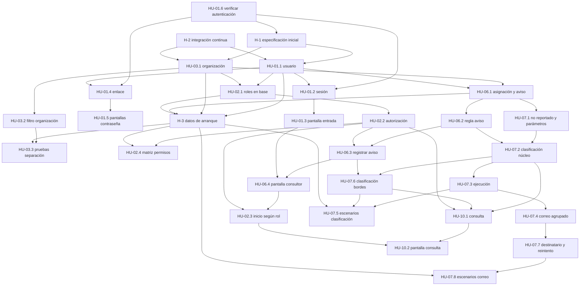

# Tickets — MVP del Controlador de Tiempo

> **Versión 2 · miércoles 18/11/2026 · después de una ronda de refutación (9 hallazgos). Sin aprobar.**
> La respuesta a la ronda 1 está en `Respuesta-Revision-Thibaut-Tickets-v1-20261118-ronda1.md`.
> Paso 5 del método (PROMPTS 11, 11b, 12, 13, 14 y 14b). Fuente:
> `../04-Backlog/Backlog-MVP-Controlador-de-Tiempo-20261118-v5.md` (6 historias detalladas, 75
> criterios) y `../03-PRD/PRD-MVP-Controlador-de-Tiempo-20261118-v6.md`.
> Un ticket **hereda** los criterios de su historia y no agrega ninguno. **Nombra la capa** que
> toca y no diseña: sin tipos de columna, nombres de ruta ni códigos de respuesta. Eso se decide en
> la especificación y al construir.
> Documento anonimizado.

**Totales de este documento:** 6 historias descompuestas · 27 tickets de historia · 3 tickets de
habilitación · 30 tickets en total · 75 criterios heredados: 56 quedan comprobados completos con
estos tickets, 15 solo en parte y 4 esperan enteros a la historia de la que dependen · tallas:
9 S, 21 M y ningún L · 10 tramos (0 a 9).

**Qué cambió frente a la versión 1.** Los tres tickets L se partieron en dos cada uno (27 → 30
tickets) · la especificación inicial (H-1) pasa a depender de la comprobación del servicio de
autenticación y todo lo que construye depende de ella (8 → 10 tramos) · el conteo de criterios
distingue ahora «completo», «en parte» y «en espera» (la versión 1 contaba 71 como asignados sin
distinguir) · la Definition of Done gana tres obligaciones permanentes y dos excepciones escritas
· nueva sección 8 con lo que la especificación inicial tiene que resolver.

**Solo se descomponen las historias detalladas.** Las otras doce del backlog no tienen tickets
todavía: se descomponen cuando se detallen. El método lo pide así.

---

## 1. Convenciones

**Identificador.** `HU-nn.n`: el ticket deriva de su historia. Los de habilitación llevan `H-n`:
no derivan de una historia y cada uno declara de dónde sale. **Un número no se reutiliza ni se
renumera:** los tickets que nacen de partir otro toman el número siguiente libre de su historia
(HU-07.6, HU-07.7 y HU-07.8), y el partido conserva el suyo.

**Tipo.** Uno de estos: Especificación · Migración/DB · Modelo/Dominio · Endpoint/API · Frontend ·
Test · Bug.

**Tamaño de un ticket.** Lo que una persona **construye** en una sesión, media jornada como
máximo. La revisión adversarial del cambio y la corrección de lo que salga van aparte: no caben en
la talla y se cuentan al planear (sección 5). Un tramo no se da por terminado mientras alguno de
sus tickets tenga la revisión abierta.

**Definition of Done, por tipo.** Dice cómo se entrega, no qué hace. Vale para todo ticket del tipo.

| Tipo | Definition of Done |
|---|---|
| Todos | La especificación de la capacidad está escrita y aprobada antes de empezar · las pruebas se escribieron primero y fallaron · cada pieza tiene al menos un caso que pasa y uno que se rechaza · la revisión adversarial del cambio está guardada y cada observación cerrada · la integración continua está en verde · no entra ningún dato real (alias y correos de ejemplo) · el README de la capacidad y `prompts.md` quedan al día |
| Especificación | Cada requisito cita el criterio del backlog del que sale · no afirma nada del servicio de autenticación que HU-01.6 no haya comprobado · resuelve o registra como riesgo aceptado cada punto de la sección 8 · pasó por refutación y la aprobó la Dirección |
| Migración/DB | Parte de la plantilla de migración controlada · mensajes de éxito y de error propios · validación de solo lectura, uno a uno, con esperado, encontrado y estado · la validación comprueba que el objeto existe y que está hecho como dice la especificación · **toda tabla de negocio nace con su organización y con la regla de la base que la filtra, y en el mismo ticket entra a las pruebas de separación (HU-03.3)** |
| Modelo/Dominio | La regla vive en un solo lugar del código · pruebas unitarias con reloj controlado donde la regla depende de la hora |
| Endpoint/API | Exige sesión y filtra por organización y por rol · las entradas se validan · un error devuelve un mensaje propio, en español · pruebas de integración contra una base reiniciada · **toda operación nueva agrega su fila a la matriz rol por operación (HU-02.4), con un caso permitido y uno rechazado, en el mismo ticket** |
| Frontend | Se usa bien desde el teléfono · textos en español · estados de carga, de error y de vacío a la vista · horas en la zona horaria del cliente de la asignación |
| Test | Los escenarios citan el criterio que comprueban · corren en la integración continua **en cada cambio, no una sola vez** · no dependen de la hora real |

**Excepciones escritas a la Definition of Done.** Son dos y no hay más.

| Excepción | A quién aplica | Qué la sustituye |
|---|---|---|
| «La especificación está aprobada antes de empezar» y «las pruebas se escribieron primero» | H-1, que es quien produce la especificación; H-2 y HU-01.6, que la preceden | H-1 cumple la Definition of Done del tipo Especificación. H-2 se da por hecho con la integración continua en verde sobre el repositorio tal como está. HU-01.6 entrega un informe escrito de lo comprobado, con la fecha y la evidencia de cada punto |
| «Exige sesión y filtra por rol» | HU-07.3, la ejecución recurrente: la dispara el sistema, no una persona | Se protege con un secreto propio y procesa organización por organización, cada una con sus parámetros, sin que el resultado de una dependa de otra. Sus pruebas incluyen una llamada sin el secreto, que se rechaza, y dos organizaciones con parámetros distintos |

---

## 2. Tickets de habilitación

No derivan de una historia. Se declara su origen.

| # | Título | Tipo | Origen | Depende de | Talla |
|---|---|---|---|---|---|
| H-1 | Especificación inicial de las capacidades de las seis historias detalladas: acceso, aviso de inicio, reporte de no reportados y su consulta; resuelve los puntos de la sección 8 | Especificación | Paso 6 del método · regla «spec primero» del repositorio · es lo que falta de T-00 del README v2 | HU-01.6 | M |
| H-2 | Integración continua: estilo, tipos y pruebas, en verde en el repositorio | Test | T-01 del README v2 · restricción R-4 del PRD | — | S |
| H-3 | Datos de arranque para pruebas y demostración: dos organizaciones, los tres roles, un supervisor con asignación propia, un consultor con dos asignaciones, clientes en la misma zona horaria | Migración/DB | Semillas de T-02 del README v2 · la carga controlada (HU-05) aún no se construye | HU-01.1, HU-02.1, HU-03.1, HU-06.1 | S |

El harness (guardarraíles, reglas de proceso y plantilla de migración) ya está hecho y revisado:
es la parte cerrada de T-00.

**Límite declarado de H-3.** Todos los clientes de los datos de arranque están en la misma zona
horaria. Las pruebas no ven, por tanto, lo que pasa cerca de la medianoche con clientes en zonas
distintas. Es el riesgo ya aceptado en D-48 y D-58; la sección 8 dice qué debe fijar la
especificación al respecto.

---

## 3. Tickets por historia (PROMPTS 11 y 11b)

La columna **Hereda** lista los criterios de la historia que ese ticket debe hacer verdad. Un
criterio puede estar en más de un ticket cuando toca más de una capa. Que un criterio esté heredado
no quiere decir que quede comprobado entero: la sección 4 dice cuáles quedan en parte.

### HU-01 · Entrar con cuenta propia — 12 criterios

| # | Título | Tipo | Hereda | Depende de | Talla |
|---|---|---|---|---|---|
| HU-01.1 | Usuario del sistema: su organización, su estado activo y su vínculo con la cuenta de autenticación; un correo, una cuenta | Migración/DB | CA 1, 4, 12 | H-1, H-2 | S |
| HU-01.2 | Reglas de la sesión: entrar, cerrar, vigencia de 30 días, corte al desactivar la cuenta y cierre de las demás sesiones al fijar una contraseña | Modelo/Dominio | CA 1, 2, 4, 5, 6, 7, 11 | HU-01.1, HU-01.6 | M |
| HU-01.3 | Pantalla de entrada y de cierre de sesión; sin sesión, toda página lleva a la entrada; mensaje único ante credenciales incorrectas | Frontend | CA 2, 3, 6, 7 | HU-01.2 | S |
| HU-01.4 | Enlace de contraseña: emisión para cuenta nueva y para recuperación, un solo uso, caducidad de 72 horas y las condiciones que lo invalidan | Modelo/Dominio | CA 8, 9, 10 | HU-01.1, HU-01.6 | M |
| HU-01.5 | Pantallas para fijar la contraseña y para «olvidé mi contraseña», con la misma respuesta exista o no la cuenta | Frontend | CA 8, 9, 10 | HU-01.4 | S |
| HU-01.6 | Comprobar qué admite el servicio de autenticación: sesión de 30 días, enlace de 72 horas, cierre de las demás sesiones, si los valores pueden variar por organización y qué límites pone a los intentos de entrada y a las peticiones de enlace (PA-B10) | Test | — | — | S |

**HU-01.6 no hereda criterios:** no hace verdad ninguno, comprueba si son alcanzables. De su
resultado dependen CA 6, 9, 10 y 11, que heredan HU-01.2 y HU-01.4.

### HU-02 · Cada rol ve y hace solo lo suyo — 12 criterios

| # | Título | Tipo | Hereda | Depende de | Talla |
|---|---|---|---|---|---|
| HU-02.1 | Rol de cada usuario y reglas de acceso por rol en la base, incluido el supervisor que solo ve a sus supervisados | Migración/DB | CA 1, 2, 4, 5, 6, 7 | HU-01.1, HU-03.1 | M |
| HU-02.2 | Autorización en el código, en un solo lugar: qué puede cada rol, quién actúa sobre lo propio, el dato ajeno responde como inexistente y la operación no permitida responde con mensaje | Modelo/Dominio | CA 1, 2, 4, 5, 6, 7, 8, 9, 10 | HU-02.1 | M |
| HU-02.3 | Pantalla de inicio según rol y asignación: quien tiene aviso pendiente ve primero el botón y desde ahí llega a los reportes; mensaje de rechazo por permiso | Frontend | CA 9, 10, 11 | HU-02.2, HU-06.4 | S |
| HU-02.4 | Matriz de pruebas rol por operación, con un caso permitido y uno rechazado por celda. Nace con las operaciones que existan y **crece con cada operación nueva**: la fila la agrega el ticket que crea la operación (Definition of Done de Endpoint/API) | Test | CA 1, 2, 3, 4, 5, 6, 7, 8 | HU-02.2, H-3 | M |

**En espera:** HU-02.CA-12 (el supervisor es una persona distinta del consultor) lo comprueba la
carga y espera a HU-05. Mientras tanto lo cumplen los datos de arranque (H-3).

### HU-03 · Ninguna organización ve a otra — 7 criterios

| # | Título | Tipo | Hereda | Depende de | Talla |
|---|---|---|---|---|---|
| HU-03.1 | Organización en toda tabla de negocio y regla de la base que la filtra para cualquier rol | Migración/DB | CA 1, 2, 3 | H-1, H-2 | M |
| HU-03.2 | Filtro por organización en toda consulta del código, en un solo lugar; lo ajeno responde como inexistente | Modelo/Dominio | CA 1, 2, 3, 4 | HU-03.1 | S |
| HU-03.3 | Pruebas de separación en las dos capas, con dos organizaciones: por la aplicación y con una consulta directa a la base. **Recorren todas las tablas de negocio que existan y fallan si alguna no tiene organización o no tiene regla**, de modo que una tabla futura no pueda nacer fuera de ellas | Test | CA 1, 2, 3, 4 | HU-03.2, H-3 | M |

**En espera:** HU-03.CA-5 (exportación), CA-6 (carga) y CA-7 (parámetros) dependen de HU-17, HU-05
y HU-11. Quedan como condición de aceptación de esas historias.

### HU-06 · Avisar el inicio de actividades en un toque — 15 criterios

| # | Título | Tipo | Hereda | Depende de | Talla |
|---|---|---|---|---|---|
| HU-06.1 | Cliente con su zona horaria, asignación con horario, días laborables y vigencia, y aviso de inicio: uno por asignación y día, que no se edita ni se quita | Migración/DB | CA 3, 12, 13 | HU-03.1, HU-01.1 | M |
| HU-06.2 | Regla de la asignación pendiente de aviso: cuál toca, los cinco motivos por los que no hay botón, aviso temprano, puntual o tardío con sus minutos, y el instante exacto del vencimiento | Modelo/Dominio | CA 1, 4, 5, 6, 7, 8, 9, 12 | HU-06.1 | M |
| HU-06.3 | Registrar el aviso: con la hora en que el sistema lo recibe, sin pedir nada más, sin duplicar si se repite; sin forma de editarlo ni quitarlo | Endpoint/API | CA 2, 3, 6, 7, 10, 13 | HU-06.2, HU-02.2 | M |
| HU-06.4 | Pantalla del consultor, primero para teléfono: botón único con el cliente, confirmación con la hora, motivo cuando no hay botón, aviso de fallo con reintento, y nada que diga que fue reportado | Frontend | CA 1, 2, 8, 9, 11, 14, 15 | HU-06.3, HU-01.3 | M |

### HU-07 · Recibir la lista de no reportados al vencer el margen — 20 criterios

| # | Título | Tipo | Hereda | Depende de | Talla |
|---|---|---|---|---|---|
| HU-07.1 | No reportado: uno por asignación y día, con su marca de notificado; margen e intervalo por organización, con la fecha desde la que rigen | Migración/DB | CA 6, 10, 13, 14 | HU-06.1 | M |
| HU-07.2 | Regla de clasificación, el núcleo: quién entra y quién no al vencer el margen, minutos de retraso, día laborable y vigencia de la asignación, y los parámetros que rigen ese día | Modelo/Dominio | CA 1, 2, 3, 4, 9, 13 | HU-07.1, HU-06.2 | M |
| HU-07.3 | Ejecución recurrente protegida con su secreto: clasifica en cada intervalo, organización por organización, deja el reporte generado dentro del plazo y, tras una caída, reporta lo pendiente | Endpoint/API | CA 1, 11, 13, 15 | HU-07.2 | M |
| HU-07.4 | Correo agrupado: uno por supervisor y ejecución, solo con lo nuevo, solo con los supervisados de quien lo recibe, con el contenido mínimo, y ninguno cuando no hay nada nuevo | Modelo/Dominio | CA 2, 5, 6, 7, 8, 17 | HU-07.3 | M |
| HU-07.5 | Escenarios de punta a punta de la clasificación, con reloj controlado sobre el ejemplo de inicio 08:00, margen 60 e intervalo 5: 08:59, 09:00, 09:02, sin aviso, aviso posterior, caída y concurrencia | Test | CA 1, 3, 4, 11, 15, 20 | HU-07.3, HU-07.6, H-3 | M |
| HU-07.6 | Regla de clasificación, los bordes: dos asignaciones el mismo día, consultor desactivado, el registro que se conserva cuando la persona avisa después, y un solo resultado cuando el aviso llega junto con la ejecución | Modelo/Dominio | CA 14, 16, 19, 20 | HU-07.2, HU-06.3 | M |
| HU-07.7 | A quién le llega y qué pasa si no sale: suplencia de la dirección cuando el supervisor está desactivado, nada a la cuenta desactivada, la dirección sin correo por ejecución, y reintento en la ejecución siguiente del que no salió | Modelo/Dominio | CA 10, 12, 18 | HU-07.4 | M |
| HU-07.8 | Escenarios de punta a punta del correo, capturando lo que el sistema entrega al servicio de correo: agrupación, solo lo nuevo, destinatario correcto, reintento y suplencia | Test | CA 5, 6, 8, 10, 12 | HU-07.7, H-3 | M |

**Límite declarado de HU-07.8.** Las pruebas capturan el correo antes de que salga del sistema: no
prueban que el servicio externo lo entregue. La entrega real se comprueba a mano en el despliegue,
con un correo de ejemplo, y queda anotada con su fecha. Que el correo se entregue o se lea no lo
garantiza el producto (RA-3).

### HU-10 · Consultar por fecha los no reportados y las llegadas tardías — 9 criterios

| # | Título | Tipo | Hereda | Depende de | Talla |
|---|---|---|---|---|---|
| HU-10.1 | Consulta por fecha con alcance por rol: el supervisor ve a los suyos, la dirección a toda su organización, el consultor no accede; lo generado aparece aunque su correo no haya salido | Endpoint/API | CA 1, 2, 3, 4, 5, 6, 7 | HU-07.2, HU-07.6, HU-02.2 | M |
| HU-10.2 | Pantalla de consulta: un día a la vez, no reportados y llegadas tardías en secciones aparte, mensaje cuando no hubo nada, horas en la zona horaria del cliente | Frontend | CA 1, 3, 4, 8, 9 | HU-10.1, HU-02.3 | S |

**En parte:** HU-10.CA-1 pide mostrar «su motivo si ya se anotó», y anotar el motivo es de HU-08,
que no tiene tickets. HU-10.1 se construye sin el motivo; mostrarlo queda como condición de
aceptación de HU-08 (sección 4).

---

## 4. Cobertura de criterios: completo, en parte y en espera

Un criterio está **completo** cuando estos tickets lo comprueban entero. **En parte**, cuando lo
comprueban sobre lo que existe y el resto del criterio habla de una capacidad que todavía no tiene
tickets. **En espera**, cuando nada de él se puede comprobar todavía.

| Historia | Criterios | Completos | En parte | En espera |
|---|---|---|---|---|
| HU-01 | 12 | 12 | 0 | 0 |
| HU-02 | 12 | 3 | 8 | 1 |
| HU-03 | 7 | 0 | 4 | 3 |
| HU-06 | 15 | 15 | 0 | 0 |
| HU-07 | 20 | 18 | 2 | 0 |
| HU-10 | 9 | 8 | 1 | 0 |
| **Total** | **75** | **56** | **15** | **4** |

### Los 15 en parte

| Criterio | Qué se comprueba ahora | Qué queda | Lo cierra |
|---|---|---|---|
| HU-02.CA-1 | El consultor ve y registra solo sus avisos | Registros y períodos propios | HU-12, HU-13, HU-14 |
| HU-02.CA-2 | El aviso ajeno responde como inexistente | Registro y período ajenos | HU-12, HU-13, HU-14 |
| HU-02.CA-4 | El supervisor ve los avisos y los reportes de sus supervisados | Anotar motivos, aprobar períodos y exportar; no aprobar el período propio | HU-08, HU-15, HU-17 |
| HU-02.CA-5 | El supervisor no ve lo de los supervisados de otro | No poder aprobar lo de otro supervisor | HU-15 |
| HU-02.CA-6 | La dirección ve todo lo de su organización | Lo que hace un supervisor: motivos, aprobación y exportación | HU-08, HU-15, HU-17 |
| HU-02.CA-7 | La regla queda escrita en la autorización | Ninguna de las tres operaciones existe todavía: cargar, desactivar y cambiar un parámetro | HU-04, HU-05, HU-11 |
| HU-02.CA-8 | Nadie registra un aviso a nombre de otro | Registro de actividad a nombre de otro | HU-12 |
| HU-02.CA-10 | Quien tiene otro rol y asignación propia avisa como cualquier consultor | Registrar, corregir y enviar su período | HU-12, HU-13, HU-14 |
| HU-03.CA-1 | Listas y reportes de lo construido | Listas y reportes de las historias futuras | Cada historia que cree una tabla o una lista |
| HU-03.CA-2 | La dirección no cruza la frontera en lo construido | Lo mismo sobre las tablas futuras | Cada historia que cree una tabla |
| HU-03.CA-3 | Lo ajeno responde como inexistente en lo construido | Lo mismo sobre las tablas futuras | Cada historia que cree una tabla |
| HU-03.CA-4 | El correo de no reportados trae solo la organización propia | El resumen final | HU-09 |
| HU-07.CA-12 | Suplencia de la dirección; la cuenta desactivada no recibe el correo de cada ejecución | Que tampoco reciba el resumen final | HU-09 |
| HU-07.CA-18 | La dirección no recibe el correo de cada ejecución | Que lo reciba todo junto en el resumen final | HU-09 |
| HU-10.CA-1 | Los no reportados del día con sus cinco datos | El motivo, si ya se anotó | HU-08 |

### Los 4 en espera

| Criterio | Qué espera | Lo cierra |
|---|---|---|
| HU-02.CA-12 | Que la carga rechace al supervisor que es el mismo consultor | HU-05 |
| HU-03.CA-5 | Que la exportación traiga solo la organización propia | HU-17 |
| HU-03.CA-6 | Que la carga deje todo en la organización propia | HU-05 |
| HU-03.CA-7 | Que un cambio de parámetro no toque a otra organización | HU-11 |

**Regla para las historias futuras.** Ninguna de las doce historias pendientes se acepta sin cerrar
las filas de estas dos tablas que la nombran. Cuando se descomponga en tickets, cada fila entra
como criterio heredado de uno de ellos. Para HU-03.CA-1 a CA-3 hay además un control que no depende
de la memoria de nadie: la Definition of Done de Migración/DB y las pruebas de HU-03.3, que fallan
si una tabla nace sin organización o sin regla.

---

## 5. Dependencias y orden (PROMPT 12)

**Orden recomendado, en diez tramos (0 a 9).** Dentro de un tramo, los tickets no dependen entre
sí; cada uno depende solo de tickets de tramos anteriores. Comprobado con un cruce automático.

| Tramo | Tickets | Cuántos | Qué queda funcionando al terminar |
|---|---|---|---|
| 0 | H-2, HU-01.6 | 2 | Integración continua en verde y el servicio de autenticación comprobado |
| 1 | H-1 | 1 | Especificación inicial refutada y aprobada |
| 2 | HU-01.1, HU-03.1 | 2 | Usuarios y organizaciones en la base |
| 3 | HU-01.2, HU-01.4, HU-02.1, HU-03.2, HU-06.1 | 5 | Sesión, enlace, roles y el modelo del aviso |
| 4 | H-3, HU-01.3, HU-01.5, HU-02.2, HU-06.2, HU-07.1 | 6 | Se puede entrar; hay datos de prueba; las reglas de permiso y de aviso existen |
| 5 | HU-02.4, HU-03.3, HU-06.3, HU-07.2 | 4 | Permisos y separación probados; el aviso se registra; el núcleo de la regla del reporte existe |
| 6 | HU-06.4, HU-07.3, HU-07.6 | 3 | **El consultor avisa desde su teléfono: primer código funcional.** El reporte se genera |
| 7 | HU-02.3, HU-07.4, HU-07.5, HU-10.1 | 4 | Sale el correo al supervisor; la clasificación está probada de punta a punta; el reporte se puede consultar |
| 8 | HU-07.7, HU-10.2 | 2 | Suplencia y reintento del correo; pantalla de consulta |
| 9 | HU-07.8 | 1 | El correo probado de punta a punta: primer dolor resuelto |

**Suma de la tabla:** 2 + 1 + 2 + 5 + 6 + 4 + 3 + 4 + 2 + 1 = 30 tickets.

El camino más largo es HU-01.6 → H-1 → HU-03.1 → HU-06.1 → HU-07.1 → HU-07.2 → HU-07.3 → HU-07.4 →
HU-07.7 → HU-07.8.

---

## 6. Tallas y riesgo (PROMPT 13)

Sin horas. La talla dice cuánto trabajo es; el riesgo, cuánto puede torcerse. Van por separado.

| Talla | Cuántos | En qué se basa |
|---|---|---|
| S | 9 | Una capa, una regla, sin dependencia de la hora ni de un tercero |
| M | 21 | Varias reglas en una capa, o una regla con muchos casos de borde |
| L | 0 | Los tres que había se partieron: un L no cabe en la media jornada que define a un ticket |

| Ticket | Talla | Riesgo | Por qué |
|---|---|---|---|
| HU-01.6 | S | **Alto** | No se ha comprobado qué admite el servicio de autenticación. Si no admite 30 días, 72 horas o el cierre de las demás sesiones, cambian la especificación, HU-01.2 y HU-01.4. Ahora va antes de H-1 por eso |
| HU-01.2, HU-01.4 | M | Medio | Dependen de lo que salga de HU-01.6 |
| HU-02.1, HU-03.1 | M | Medio | Las reglas de la base se equivocan en silencio: una regla mal escrita deja ver de más y nada falla. Por eso HU-02.4 y HU-03.3 existen como tickets aparte y corren en cada cambio |
| HU-07.2, HU-07.6 | M | **Alto** | Es la regla central del producto, con más casos de borde que ninguna, y depende de la hora y de la zona horaria. La concurrencia de HU-07.6 es lo más difícil de probar del MVP |
| HU-07.4, HU-07.7 | M | **Alto** | Dependen de un servicio de correo externo; el reintento y el «uno solo por ejecución» son fáciles de romper |
| HU-07.5, HU-07.8 | M | Medio | Exigen un reloj controlado y una captura del correo que todavía no existen en el proyecto |
| HU-07.3 | M | Medio | La recuperación tras una caída es difícil de probar; no tiene sesión de usuario y se protege por otra vía |
| H-1 | M | Medio | Pasa por refutación; puede traer decisiones nuevas, como pasó con el backlog. Carga además los seis puntos de la sección 8 |
| Los demás | S o M | Bajo | — |

**Sesgos declarados de esta estimación.** La hizo quien va a construir, con asistencia de IA, y sin
haber construido antes sobre este repositorio: tiende a quedarse corta. **La talla mide construir,
no terminar:** ningún ticket incluye el tiempo de su revisión adversarial ni el de corregir lo que
salga, y la Definition of Done exige las dos cosas. En este proyecto cada ronda ha traído entre 9 y
15 hallazgos. Ese trabajo se suma aparte al decidir el recorte. Las tallas tampoco incluyen la
espera por decisiones de la Dirección.

---

## 7. Prioridad: impacto frente a complejidad (PROMPT 14)

Impacto: cuánto resuelve de los dos dolores del PRD. Complejidad: la suma de sus tickets y su riesgo.

| Historia | Impacto | Complejidad | Lectura |
|---|---|---|---|
| HU-06 · Aviso de inicio | Alto | Media | **Primero entre las de valor.** Es la mitad del primer dolor y lo primero que ve el usuario |
| HU-07 · Reporte de no reportados | Alto | Alta | **El corazón del producto.** No hay atajo: es caro y es lo que justifica el sistema |
| HU-10 · Consulta del reporte | Medio | Baja | **Ganancia rápida.** Barata una vez hecha HU-07, y es lo que mide el plazo del reporte |
| HU-01 · Entrar | Bajo por sí sola | Media | Necesaria: sin ella no se prueba nada |
| HU-02 · Roles | Bajo por sí sola | Media | Necesaria: protege todo lo demás |
| HU-03 · Separación | Bajo por sí sola | Media | Necesaria: un fallo aquí es el más grave que puede tener el sistema |

Las doce historias no detalladas no entran en esta matriz todavía. Por el orden de épicas del PRD
siguen así: HU-08 y HU-09 (cierran la presencia), luego HU-12 a HU-16 (actividad y aprobación),
HU-17 y HU-18 (respaldo), y HU-04, HU-05 y HU-11 (administración por carga y por script).

**Orden de backlog propuesto:** HU-01, HU-03 y HU-02 hasta poder entrar con datos de prueba ·
HU-06 · HU-07 · HU-10.

---

## 8. Lo que la especificación inicial (H-1) tiene que resolver

Salieron de la refutación de la versión 1. Ninguno se decide aquí: un ticket no diseña. Cada uno
se resuelve en la especificación o se registra en ella como riesgo aceptado, con su decisión.

| # | Punto | De dónde sale | Qué se sabe hoy |
|---|---|---|---|
| E-1 | Con qué fecha se decide «hoy», «mañana» y «el día de la desactivación» (HU-07.CA-13 y CA-19) | Hallazgo 6 | Riesgo aceptado en D-48 y D-58. La especificación fija una sola regla de fecha por organización, para que el resultado cerca de la medianoche sea siempre el mismo |
| E-2 | Con qué fecha se interpreta «el día» de la consulta cuando los clientes están en zonas distintas (HU-10.CA-1 a CA-4) | Hallazgo 7 | La misma familia que E-1 y la misma regla. Los datos de arranque no lo prueban (límite declarado de H-3) |
| E-3 | Si el acceso usa directamente el servicio de autenticación o pasa por una capa propia | Sospecha 1 | HU-01 no tiene ticket de tipo Endpoint/API. Si la especificación decide una capa propia, nace un ticket nuevo |
| E-4 | Qué se hace si el servicio de autenticación no limita los intentos de entrada ni las peticiones de enlace, o los limita poco | Sospecha 2 | Lo comprueba HU-01.6. Si el límite no alcanza, la especificación propone la mitigación o la Dirección lo acepta como riesgo |
| E-5 | Qué pasa cuando el servicio de correo acepta un mensaje y la confirmación no llega al sistema | Hallazgo 5 | HU-07.CA-6 solo admite un correo repetido tras una caída (CA-11). Este caso no está en el backlog |
| E-6 | Cómo se protege la ejecución recurrente y cómo recorre las organizaciones | Hallazgo 4 | La excepción de la sección 1 dice qué debe cumplir; el cómo es de la especificación |

---

## 9. Cruce con los doce tickets del README v2

El README v2 trae doce tickets escritos antes de este paso. Así se corresponden.

| README v2 | Qué decía | Aquí | Cuántos | Diferencia |
|---|---|---|---|---|
| T-00 | Harness y spec inicial | H-1, más el harness ya hecho | 1 | La spec inicial ya no cubre el registro de actividad: su historia no está detallada |
| T-01 | Integración continua | H-2 | 1 | Ninguna |
| T-02 | Esquema inicial: 15 tablas, RLS y semillas | HU-01.1, HU-02.1, HU-03.1, HU-06.1, HU-07.1 y H-3 | 6 | **Se parte.** Las tablas se crean con la historia que las necesita, no las quince de una vez. Las de actividad, período, exportación y traza esperan a sus historias, y nacen con organización y regla por la Definition of Done |
| T-03 | Acceso: sesión, roles y pruebas de segregación | HU-01.2 a HU-01.6, HU-02.2 a HU-02.4, HU-03.2 y HU-03.3 | 10 | **Crece mucho.** Era una S; son diez tickets. No contaba el enlace de contraseña, la recuperación, el cierre de sesiones ni el supervisor con asignación propia |
| T-04 | Aviso de inicio: endpoint y pantalla | HU-06.2, HU-06.3 y HU-06.4 | 3 | Se parte en regla, registro y pantalla |
| T-05 | Proceso de no reportados, correo agrupado y consulta | HU-07.2 a HU-07.8, HU-10.1 y HU-10.2 | 9 | Se parte. Era una M; son nueve tickets |
| T-06 a T-11 | Motivo y resumen, registro, período, exportación, carga y despliegue | Sin tickets todavía | 0 | Sus historias no están detalladas |

**Suma de la columna:** 1 + 1 + 6 + 10 + 3 + 9 = 30 tickets.

**Lo que esto le dice al plan.** El README sumaba 5 tickets S y 7 M, unas 38 horas, con T-00 a T-04
para el 19/11. Solo lo que aquí está descompuesto —acceso, aviso, reporte y consulta— ya son 30
tickets, sin contar sus revisiones. La estimación del README quedó corta, sobre todo en el acceso,
y la fecha de referencia del 19/11 no se cumple. Queda por decidir qué se recorta para llegar al
09/12 con lo esencial.

**Qué hay que corregir en el README** cuando se actualice: la tabla de tickets de la sección 6 ·
«cinco historias» en la sección 5 · y el texto de los puntos que cambiaron con las decisiones D-49
a D-68.

---

## 10. Lo que sigue

1. Decisión de la Dirección sobre esta versión: si se revisa otra vez o se cierra.
2. Decidir el recorte para el 09/12, con las tallas a la vista.
3. Paso 6: HU-01.6 y, con su resultado, la especificación inicial (H-1).
4. Llevar los tickets a la herramienta de seguimiento. El tablero es seguimiento, no fuente de
   verdad: manda el repositorio.
