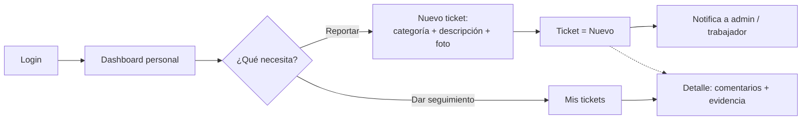
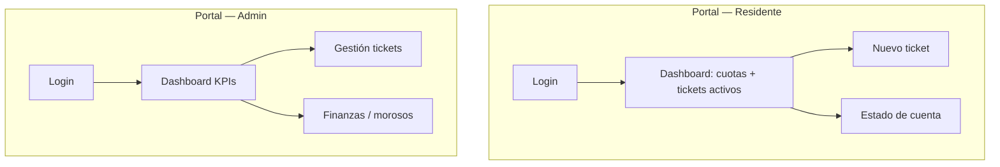

> Documento de diseño detallado (origen: README de la Entrega 1). Resumen y punto de entrada: [README](../README.md).

# 1. Descripción general del producto

**Prompt 1:** *(Claude · Sonnet/Opus · descubrimiento de dominio)*

```
Vivo en el fraccionamiento CuartaQuinientos. Hoy la administración no tiene ningún
sistema: todo se maneja por WhatsApp, recibos en papel y hojas de Excel, y los reportes
de fallas, los pagos y los avisos se pierden.

Quiero diseñar la primera plataforma digital del fraccionamiento, con buenas prácticas,
que cubra 15 módulos:
- Usuarios y viviendas, tickets de mantenimiento, cuotas y pagos, notificaciones y dashboard.
- Anuncios, encuestas, juntas, visitas y áreas comunes, archivos, y reportes/BI.
- Vehículos, mascotas y almacén.
- «C500 Asiste»: un bot de Telegram con IA para usar todo el sistema desde el chat.

Tecnología prevista:
- Backend: API en ASP.NET Core .NET 9 (REST + GraphQL), login con JWT, Dapper y SQL Server.
- Frontend: React 18 con Vite y Apollo.
- Bot: Python 3.11 con python-telegram-bot 21.

Para la Entrega 1 del máster AI4Devs necesito solo documentación, sin código:
descripción del producto, stack justificado, arquitectura y backlog (historias y
tickets), siguiendo Spec-Driven Development (primero la especificación, después el código).
```

*Fijó §0–§1: problema real del fraccionamiento, visión de plataforma completa (no MVP de tres módulos sin justificar) y bot como canal API-first.*

> **Respuesta del asistente:** Plataforma API-first, 15 módulos, perfiles `sgr.Perfiles`, Entrega 1 solo documentación (SDD). — [Registro completo](../prompts.md#p1-producto)

**Prompt 2:** *(Claude · misma fase · decisión de stack)*

```
Genera trade-offs honestos para evaluadores: SQL Server vs PostgreSQL; GraphQL+REST
vs REST puro con ~15 dominios; Dapper+vistas vs EF Core; Apollo vs fetch manual;
bot Python aparte vs extensión .NET. Máx. ~150 palabras por punto. Incluye costos
y riesgos reales, no solo ventajas.
```

*Primer borrador proponía stored procedures y rutas `/api/`*; el refinamiento humano fijó **Dapper + vistas** `vs`* **+ servicios C#**, REST `/{Dominio}/{Controller}` y el orden de arranque de §1.4.*

> **Respuesta del asistente:** Tabla de trade-offs SQL Server / GraphQL+REST / Dapper / Apollo / bot Python; rechazo explícito de SPs y `/api/USR/login`. — `prompts.md` [Prompt 2 §1](../prompts.md#p1-producto)

**Prompt 3:** *(Claude · alineación Módulos 4–5 del máster)*

```
Revisa la tabla de módulos §1.2: ANM = anuncios/comunicados (no mascotas);
VTS = visitas y áreas comunes (no vehículos); mascotas y vehículos en esquema usr.
Integra bot, ia, bi y wms como módulos del diseño con paridad web ↔ Telegram.
Marca (asumido) lo no cerrado con el administrador del fraccionamiento.
```

*Corrigió la confusión típica de la IA entre siglas de dominio; la nota de §1.2 y la matriz §5.0 reflejan el modelo acordado.*

> **Respuesta del asistente:** ANM/VTS/usr corregidos; WMS + «C500 Asiste» con esquemas `bot`, `ia`, `bi`; paridad web ↔ Telegram. — `prompts.md` [Prompt 3 §1](../prompts.md#p1-producto)
>
> *Revisión posterior del autor (`prompts.md` §1 Prompt 4):* descripción general y detallada de cada módulo (§1.2.1) y de lo que hace el bot por perfil (§1.2.2).

---


### **1.1. Objetivo:**

El fraccionamiento CuartaQuinientos no cuenta con ningún sistema digital para su operación diaria: la interacción real de residentes y administración ocurre por WhatsApp, recibos en papel y hojas de cálculo. Los reportes de fallas se pierden sin seguimiento, el estado de cuenta no es consultable por el residente, y las convocatorias a juntas no siempre llegan a todos. Diseñaremos e implementaremos el sistema con un modelo de datos organizado por dominios funcionales.

CuartaQuinientos resuelve el problema **centralizando la operación condominial en una sola plataforma digital**: los residentes reportan incidencias, consultan su estado de cuenta y participan en encuestas; la administración obtiene visibilidad en tiempo real del estado financiero, los tickets abiertos y la ocupación. El canal de Telegram extiende estas capacidades a quienes prefieren no navegar un portal web, usando una interfaz de mensajería que ya usan a diario. Además, ese canal es un **asistente inteligente**: cubre todos los dominios del residente, **resuelve dudas** consultando el reglamento con IA (RAG), hace **sugerencias proactivas** (p. ej. pagar un adeudo vencido o renovar vacunas), permite **reservar la terraza y otras áreas comunes** por chat, y entrega a la administración un **resumen de BI** con los indicadores del fraccionamiento.

El público objetivo son principalmente **residentes** (reporte de incidencias, consulta de estado de cuenta, trámites, bot de Telegram) y **administradores del fraccionamiento** (gestión de todos los dominios, reportes, dashboard de KPIs y notificaciones), con dos perfiles operativos de apoyo: **Guardia** (control de acceso) y **Trabajador** (atención de tickets asignados). Los perfiles se gestionan de forma dinámica en `sgr.Perfiles` (con la bandera `bAdministrador`); el diseño define los perfiles **Administrador, Residente, Guardia** y **Trabajador** (personal de mantenimiento) — **Administrador** con `bAdministrador = 1`.

### **1.2. Características y funcionalidades principales:**

El sistema cubre 15 módulos funcionales. Cada uno se mapea a un esquema SQL en el diseño acordado.

> **Refinamiento con IA.** Una primera pasada confundió dominios: `ANM` **no** es Mascotas (es **Anuncios/comunicados**, esquema `anm`), y `VTS` **no** es Vehículos (es **Visitas y Áreas Comunes**, esquema `vts`). Los vehículos y las mascotas viven en el esquema `usr`. La tabla siguiente refleja el diseño acordado.


| #   | Módulo                                                 | Esquema real                                                                                                                 | Descripción                                                                                                                                                                                                                                                                                                                                                                                                                                                                                                                                                                                                                                |
| --- | ------------------------------------------------------ | ---------------------------------------------------------------------------------------------------------------------------- | ------------------------------------------------------------------------------------------------------------------------------------------------------------------------------------------------------------------------------------------------------------------------------------------------------------------------------------------------------------------------------------------------------------------------------------------------------------------------------------------------------------------------------------------------------------------------------------------------------------------------------------------ |
| 1   | **USR — Usuarios, Perfiles y Residencias**             | `sgr.Usuarios`, `sgr.Perfiles`, `sgr.Casas`, `sgr.Condominios`                                                               | Autenticación y autorización por perfil. El residente **es** un `Usuario` con `PerfilID`; su vivienda se modela en `sgr.Casas` (ligada al condominio y al usuario propietario vía `PropietarioUsuarioID`). Perfil editable y cambio de contraseña (`bActualizarPassword`).                                                                                                                                                                                                                                                                                                                                                                 |
| 2   | **TKT — Tickets de Servicio**                          | `tkt.Tickets` (+ `EstadosTickets`, `PrioridadesTicket`, `ComentariosTicket`, `DocumentosTicket`, `TicketsUsuariosAsignados`) | Reportes de incidencias. Estado y prioridad son **catálogos** (no enums en línea). Ciclo real: **Nuevo → En seguimiento → Resuelto → Cerrado**. Asignación N:M a personal, comentarios y **documentos adjuntos**.                                                                                                                                                                                                                                                                                                                                                                                                                          |
| 3   | **FNZ — Finanzas**                                     | `fnz.Cuotas`, `fnz.Cuentas`, `fnz.Transacciones`, `fnz.TiposMovimiento`                                                      | Cuotas por casa/usuario con período, vencimiento y estado de pago (`Pagado`, `FechaPago`, `MetodoPago`, `ReferenciaPago`). Cuentas y transacciones (cargo/abono) para contabilidad básica y reporte de morosos.                                                                                                                                                                                                                                                                                                                                                                                                                            |
| 4   | **ANM — Anuncios / Comunicados**                       | `anm.Anuncios`, `anm.TiposAnuncio`, `anm.LogVisualizacionAnuncios`                                                           | Comunicados generales del fraccionamiento, con tipos y bitácora de quién los vio.                                                                                                                                                                                                                                                                                                                                                                                                                                                                                                                                                          |
| 5   | **VTS — Visitas y Áreas Comunes**                      | `vts.Visitas`, `vts.AreasComunes`, `vts.ReservacionesArea`, `vts.ReservacionesEstados`                                       | Bitácora de control de acceso de visitantes y **reserva de amenidades** (salón, etc.) por horario y estado.                                                                                                                                                                                                                                                                                                                                                                                                                                                                                                                                |
| 6   | **ENC — Encuestas**                                    | `enc.Encuestas`, `enc.Preguntas`, `enc.OpcionesPregunta`, `enc.Respuestas`, `enc.TiposPregunta`                              | Encuestas **estructuradas**: preguntas tipadas con opciones ordenadas; respuestas por opción o texto libre → resultados consolidables.                                                                                                                                                                                                                                                                                                                                                                                                                                                                                                     |
| 7   | **JNT — Juntas**                                       | `jnt.Juntas`, `jnt.JuntaDetalle`, `jnt.JuntaDetalleArchivos`                                                                 | Convocatoria, contenido/acuerdos y archivos de asambleas.                                                                                                                                                                                                                                                                                                                                                                                                                                                                                                                                                                                  |
| 8   | **NTF — Notificaciones**                               | `ntf.Notificaciones`, `ntf.TiposNotificacion`, `ntf.NotificacionesVisualizadas`                                              | Avisos al usuario, tipados, con marca de leído. **La entrega por Telegram es una extensión planificada** (ver §2.5).                                                                                                                                                                                                                                                                                                                                                                                                                                                                                                                       |
| 9   | **Dashboard — KPIs**                                   | Vistas `vs`*                                                                                                                 | Panel del administrador: tickets abiertos/en seguimiento, morosos del mes, monto cobrado/pendiente y ocupación.                                                                                                                                                                                                                                                                                                                                                                                                                                                                                                                            |
| 10  | **ARC — Archivos**                                     | `arc.Archivos`, `arc.TiposArchivo`, `arc.LogVisualizacionArchivos`                                                           | Repositorio de documentos (reglamentos, actas) con tipos y bitácora de descarga.                                                                                                                                                                                                                                                                                                                                                                                                                                                                                                                                                           |
| 11  | **RPT — Reportes**                                     | Vistas `vs`* + servicios C# (QuestPDF/ClosedXML)                                                                             | Reportes de finanzas, tickets y operación, export a PDF/Excel.                                                                                                                                                                                                                                                                                                                                                                                                                                                                                                                                                                             |
| 12  | **VEH — Vehículos**                                    | `usr.Automoviles` (+ `Marcas`, `Modelos`)                                                                                    | Padrón de vehículos por usuario, con catálogos de marca/modelo y placas para control de acceso.                                                                                                                                                                                                                                                                                                                                                                                                                                                                                                                                            |
| 13  | **MAS — Mascotas**                                     | `usr.Mascotas` (+ `TiposMascota`, `RazasMascota`)                                                                            | Padrón de mascotas por usuario con catálogos de tipo/raza.                                                                                                                                                                                                                                                                                                                                                                                                                                                                                                                                                                                 |
| 14  | **WMS — Almacén**                                      | esquema nuevo `wms` (ver §2.5)                                                                                               | Inventario de herramientas y materiales, y préstamos a trabajadores (`wms.Articulos`, `wms.Prestamos`); modelado desde cero.                                                                                                                                                                                                                                                                                                                                                                                                                                                                                                               |
| 15  | **BOT — «C500 Asiste» (asistente de todo el sistema)** | esquemas nuevos `bot`, `ia` (ver §2.5)                                                                                       | Asistente conversacional **conciso y al punto** (pide solo lo mínimo, usa botones y el contexto del usuario). Cubre **todo el sistema según el perfil**: el residente opera tickets, cuotas, encuestas, juntas, anuncios, mascotas, vehículos, visitas/pases, reservas y perfil; el **trabajador** recibe su próxima tarea, la resuelve y **sube evidencia**; el **administrador administra desde el chat** (registrar pagos, publicar avisos/encuestas, gestionar tickets, `/bi`) sin entrar a la web. Es **inteligente**: resuelve dudas con RAG del reglamento (`ia.`*) y hace **sugerencias proactivas** (cobros, vacunas, encuestas). |


> **Módulos ampliados.** **WMS — Almacén** y **asistente + BI** usan esquemas propios (`wms`, `bot`, `ia`, `bi` — §2.5).

> **Paridad total web ↔ bot.** «C500 Asiste» expone **los mismos 15 módulos** que la web, según el perfil — no es un subconjunto: es *la misma funcionalidad, en formato conversacional y potenciada con IA*. Todo lo que se hace en la web se puede hacer en el bot (levantar/atender tickets con evidencia, cuotas y pagos, encuestas, juntas, anuncios, mascotas, vehículos, visitas/pases QR, reservas, archivos, reportes/BI, perfil y administración), y el asistente añade valor encima: resuelve dudas del **uso del sistema** y del reglamento, guía paso a paso, sugiere de forma proactiva y automatiza tareas repetitivas.


#### **1.2.1. Detalle por módulo**

Cada módulo se describe en dos niveles: **general** (qué problema resuelve) y **detallado** (qué hace cada perfil y las reglas clave). La fase indica cuándo se construye (roadmap §5); las historias están en §5 y los tickets en §6.

**1. USR — Usuarios, Perfiles y Residencias** · *Fase 1 · HU-USR-01..04*
- **General:** puerta de entrada al sistema. Identifica a cada persona, su perfil y la vivienda que ocupa, para que cada quien vea y haga solo lo que le corresponde.
- **Detallado:**
  - Login con correo y contraseña; sesión con JWT y renovación segura (refresh token en cookie `HttpOnly`); bloqueo temporal tras 5 intentos fallidos.
  - Todo usuario nuevo inicia con contraseña temporal y **debe cambiarla** en su primer acceso.
  - El residente consulta y edita sus datos de contacto; no puede cambiar su perfil ni su vivienda.
  - El administrador da de alta, edita y desactiva usuarios y los liga a su casa (`sgr.CasaOcupantes`); **no hay auto-registro público**.
  - Perfiles: Administrador, Residente, Guardia y Trabajador; los permisos por pantalla salen del menú dinámico por perfil.

**2. TKT — Tickets de Servicio** · *Fase 1 (adjuntos en Fase 2) · HU-TKT-01..05*
- **General:** sustituye los reportes de fallas por WhatsApp por un ticket con seguimiento, responsable y fecha de cierre.
- **Detallado:**
  - El residente levanta un ticket (título, descripción, categoría como Agua, Electricidad o Seguridad, y prioridad) desde la web o el bot; el ticket queda ligado a su casa y al canal de origen.
  - Consulta sus tickets con filtro por estado, del más reciente al más antiguo, y ve comentarios y evidencia.
  - El administrador ve todos los tickets del condominio, los **asigna a un trabajador**, cambia su estado y agrega comentarios internos que el residente no ve.
  - Ciclo de vida controlado: **Nuevo → En seguimiento → Resuelto → Cerrado**; transiciones inválidas se rechazan y reabrir limpia la fecha de cierre.
  - Cada cambio relevante (ticket nuevo, asignación, cambio de estado) genera una notificación.
  - Comentarios del residente (Should), calificación de la resolución (Could) y fotos adjuntas (Fase 2).

**3. FNZ — Finanzas** · *Fase 1 · HU-FNZ-01..06*
- **General:** transparenta las cuotas de mantenimiento: cuánto debe cada casa, qué pagó y quién está en mora, sin recibos en papel ni hojas de cálculo.
- **Detallado:**
  - El administrador **genera las cuotas del período** para todas las casas ocupadas (sin duplicar si se repite la operación).
  - El residente consulta su estado de cuenta: cuotas pendientes, vencidas y pagadas, con montos y fechas.
  - El administrador **registra el pago** de una cuota (fecha, método y referencia); en Fase 1 no hay pagos parciales y se evita el doble registro.
  - Reporte de **morosos** del mes para cobranza.
  - Registro de movimientos contables de cargo/abono (Should) y exportación del estado de cuenta en PDF (Could).
  - Cada pago registrado notifica al residente.

**4. ANM — Anuncios / Comunicados** · *Fase 2 · HU-ANM-01..02*
- **General:** canal oficial de comunicados, en lugar de mensajes que se pierden en el grupo de WhatsApp.
- **Detallado:** el administrador publica comunicados clasificados por tipo (catálogo `anm.TiposAnuncio`); los residentes los consultan en la web o el bot, y el sistema registra quién los vio.

**5. VTS — Visitas y Áreas Comunes** · *Fase 3 · HU-VTS-01..03, HU-BOT-08*
- **General:** controla quién entra al fraccionamiento y ordena el uso de las amenidades.
- **Detallado:**
  - El guardia registra visitantes (nombre, identificación, casa que visita y autorización) con su hora de entrada y de salida; el residente puede generar pases de visita con QR.
  - El residente reserva áreas comunes (terraza, salón) por horario; la reserva pasa por estados y se confirma con notificación.
  - El administrador consulta la bitácora de accesos.

**6. ENC — Encuestas** · *Fase 2 · HU-ENC-01..03, HU-BOT-13*
- **General:** permite consultar la opinión de los vecinos de forma ordenada y con resultados medibles.
- **Detallado:** el administrador crea encuestas con título, vigencia, preguntas tipadas y opciones, y al publicarlas los residentes reciben notificación; el residente responde una sola vez desde la web o el chat; el administrador ve los resultados consolidados.

**7. JNT — Juntas** · *Fase 3 · HU-JNT-01..02*
- **General:** asegura que las convocatorias a asamblea y sus acuerdos lleguen a todos y queden registrados.
- **Detallado:** el administrador publica la convocatoria (fecha, ubicación y descripción), después los acuerdos y los archivos del acta; los residentes reciben notificación (portal y Telegram) y las consultan.

**8. NTF — Notificaciones** · *Fase 1 (envío por Telegram en Fase 2) · HU-NTF-01..03*
- **General:** avisa a cada usuario de lo que le importa sin que tenga que estar revisando el sistema.
- **Detallado:**
  - Notificaciones internas por evento (ticket nuevo, asignado o con cambio de estado, pago registrado, cuota vencida, encuesta, junta, reserva, aviso general), con *badge* de no leídas y opción de marcarlas como leídas.
  - El administrador envía **avisos generales** a todos los residentes activos.
  - Toda notificación se genera en un único servicio; para los usuarios vinculados a Telegram se encola su entrega (outbox) y en Fase 2 el bot la envía sin duplicados.

**9. Dashboard — KPIs** · *Fase 1 · HU-DASH-01..02*
- **General:** muestra el estado del fraccionamiento de un vistazo.
- **Detallado:** el **administrador** ve tickets abiertos y en seguimiento, morosos del mes, monto cobrado y pendiente, ocupación de casas y tickets por canal (web/Telegram); el **residente** ve su resumen personal: cuota del mes, tickets activos y notificaciones sin leer.

**10. ARC — Archivos** · *Fase 2 · HU-ARC-01..02*
- **General:** un solo lugar para los documentos oficiales del fraccionamiento.
- **Detallado:** el administrador sube y clasifica documentos oficiales (reglamento, actas) por tipo; los residentes los descargan y queda bitácora de consulta. Los archivos se guardan fuera de la BD (almacenamiento de objetos, ADR-006).

**11. RPT — Reportes y BI** · *Fase 3 · HU-RPT-01..02, HU-BI-01..03*
- **General:** convierte la operación diaria en información para decidir.
- **Detallado:** reporte financiero mensual y de tickets por período exportables a PDF/Excel; **tablero BI** con tendencias (cobranza, morosidad, tiempos de resolución, ocupación) a partir de cortes periódicos de KPIs, y resumen BI enviado por Telegram al administrador.

**12. VEH — Vehículos** · *Fase 3 · HU-VEH-01..02*
- **General:** padrón de vehículos para apoyar el control de acceso.
- **Detallado:** el residente registra sus vehículos (marca, modelo, placas); el administrador y la vigilancia los consultan para identificar vehículos autorizados.

**13. MAS — Mascotas** · *Fase 3 · HU-MAS-01..02*
- **General:** padrón de mascotas del fraccionamiento.
- **Detallado:** el residente registra sus mascotas (tipo, raza, vacunas al día); el administrador consulta el padrón; el vencimiento de vacunas alimenta las sugerencias del bot.

**14. WMS — Almacén** · *Fase 3 · HU-WMS-01..03*
- **General:** controla herramientas y materiales de mantenimiento para que no se pierdan.
- **Detallado:** el administrador da de alta y ajusta artículos del inventario; registra el **préstamo** de herramienta a un trabajador y su devolución.

**15. BOT — «C500 Asiste»** · *Fase 2 (canal) y Fase 3 (IA) · HU-BOT-01..13* — ver §1.2.2.

#### **1.2.2. «C500 Asiste» — qué hace el bot de Telegram**

- **General:** es la misma plataforma dentro de Telegram, la aplicación que los vecinos ya usan a diario. Permite operar el sistema **sin entrar a la web**, con mensajes cortos y botones, y añade un asistente inteligente que resuelve dudas y se adelanta a lo que el usuario necesita.
- **Cómo funciona:** el bot es solo un **cliente del mismo API** que usa la web: no consulta la base de datos, no guarda claves de IA y no duplica reglas de negocio. El usuario vincula su cuenta con un **token de un solo uso** generado en la web (nunca escribe su contraseña en el chat) y puede desvincularla cuando quiera. Detalle técnico en §2.8.

**Qué puede hacer cada perfil desde el chat:**

| Perfil | Acciones principales |
|---|---|
| **Residente** | Levantar un ticket en segundos (`/tickets`) y ver su estado; consultar su estado de cuenta (`/cuotas`); recibir notificaciones al momento (pago registrado, ticket resuelto, cuota por vencer); responder encuestas; reservar la terraza u otra área común; consultar anuncios, juntas y documentos; registrar visitas, vehículos y mascotas. |
| **Trabajador** | Ver su **próxima tarea** asignada, ordenada por prioridad (`/tarea`); subir foto de evidencia y marcarla como resuelta. |
| **Administrador** | Registrar pagos, publicar avisos y encuestas, gestionar tickets y recibir el **resumen BI** (`/bi`) sin abrir la web. |
| **Guardia** | Registrar la entrada de visitantes y validar pases (Fase 3). |

**Lo que lo hace inteligente (Fase 3, salvo las sugerencias de cobro en Fase 2):**
- **Resuelve dudas** del reglamento y del uso del sistema con IA (RAG sobre el reglamento y la guía de uso). Si no está seguro, **no inventa**: lo dice, registra la consulta y ofrece abrir un ticket.
- **Sugerencias proactivas:** recuerda adeudos vencidos, vacunas de mascotas por renovar, encuestas pendientes y reservas próximas.
- **Guía paso a paso** y usa el contexto del usuario (quién es, su casa, su historial) para no volver a preguntar lo que ya sabe: una acción por mensaje, confirmación de un toque.

### **1.3. Diseño y experiencia de usuario:**

> **Entrega 1:** aún no hay UI implementada; las **wireframes conceptuales** (wireframes) están en Mermaid abajo. Capturas del producto real y videotutorial se publican en la **Entrega Final**.

La interfaz web se construye con Tailwind CSS siguiendo un sistema de diseño consistente, con objetivo de accesibilidad **WCAG 2.1 AA**, tipografía legible y navegación por sidebar. La navegación y los permisos por pantalla se apoyan en el menú dinámico por perfil (`sgr.Menus`, `sgr.MenusBotones`, `sgr.PerfilMenus`, `sgr.PerfilMenuBotones`), lo que permite una autorización granular por pantalla y acción. El flujo del residente: login → dashboard personal (estado de cuenta y tickets activos) → acción (reportar ticket / ver cuotas). El flujo del administrador: login → dashboard de KPIs → gestión de cualquier dominio.

El asistente **C500 Asiste** (Telegram) es **conciso y directo**: pide únicamente el dato mínimo indispensable, prefiere **botones inline** a texto libre y aprovecha el contexto (usuario autenticado, historial) para no volver a preguntar lo que ya sabe — una acción por mensaje, confirmación de un toque. Presenta **menús por perfil** (residente / trabajador / admin) con comandos como `/inicio`, `/tickets`, `/tarea`, `/cuotas`, `/bi`, `/ayuda`.

**Sistema de diseño (decisiones):** color primario + estados semánticos (éxito / alerta / error), tipografía de sistema legible, escala de espaciado de 4 px, componentes base reutilizables (botón, tabla, modal, toast, *badge* de estado, tarjeta KPI), tema claro/oscuro y foco visible. Los tokens viven en `tailwind.config.js`. Todos los estados (ticket, cuota) se muestran con **color + etiqueta** (nunca solo color) para cumplir WCAG 2.1 AA.

**Mapa de navegación por perfil:**

- **Residente:** Inicio (resumen) · Mis tickets · Estado de cuenta · Encuestas · Anuncios · Mi vivienda (mascotas / vehículos / visitas) · Perfil.
- **Trabajador:** Mis tareas (cola priorizada) · Detalle + subir evidencia.
- **Administrador:** Dashboard KPIs · Tickets · Finanzas · Residentes · Encuestas / Juntas / Anuncios · Almacén · Reportes / BI · Configuración.

**Flujo principal — el residente levanta y da seguimiento a un ticket:**




> El **mismo flujo** está disponible en «C500 Asiste» (Telegram), por chat y con los pasos mínimos.

**Wireframes conceptuales (Entrega 1):**




### **1.4. Instrucciones de instalación:**

**Requisitos previos:**

- Node.js 20+
- .NET 9 SDK (backend objetivo `net9.0`)
- SQL Server 2019+ (o SQL Server Express)
- Python 3.11+ (bot de Telegram, `python-telegram-bot` 21.x)
- Token de bot de Telegram (obtenido desde @BotFather)
- Git

> Las carpetas `GraphApi/` y `Web/` se crean en **SETUP-000** (Entrega 2); los nombres coinciden con `sdd.config.yaml`, que usan los agentes SDD. `Bot/` también llega en Entrega 2; en Entrega 1 solo existe `SQL/` (esquema de diseño). Los pasos siguientes describen el arranque **objetivo**.

**1. Base de datos (SQL Server):**

```bash
# Crear la BD (una vez)
sqlcmd -S localhost -E -d master -Q "IF DB_ID('CuartaQuinientos') IS NULL CREATE DATABASE CuartaQuinientos;"
# Esquema (solo estructura, idempotente tras DB-000) + alineación al modelo (DB-001) + catálogos y admin inicial (DB-002)
sqlcmd -S localhost -E -d CuartaQuinientos -i SQL/cuartaquinientos_schema.sql
sqlcmd -S localhost -E -d CuartaQuinientos -i SQL/DB-001_alineacion_modelo.sql      # Entrega 2 (script aún no existe)
sqlcmd -S localhost -E -d CuartaQuinientos -i SQL/DB-002_seeds_catalogos.sql -v AdminCorreo="admin@local" AdminPasswordHash="<hash BCrypt>"   # Entrega 2 (script aún no existe)
# Detalle: SQL/README.md · suites de prueba SQL/pruebas/ también llegan en Entrega 2
```

**2. Backend (.NET 9):**

```bash
cd GraphApi
cp ../scaffolds/api/appsettings.Development.example.json appsettings.Development.json
# Secretos SOLO en user-secrets / variables de entorno (nunca en git):
dotnet user-secrets set "Jwt:SecretKey" "<≥32 caracteres aleatorios>"
dotnet user-secrets set "Telegram:BotToken" "<token @BotFather>"      # notificador saliente (Fase 2)
dotnet user-secrets set "Telegram:BotServiceSecret" "<secreto compartido con el bot>"
dotnet user-secrets set "Assistant:ApiKey" "<clave del proveedor LLM>"   # Fase 3
dotnet restore
dotnet run
# API: https://localhost:7001/graphql (GraphQL), /{Dominio}/{Controller} (REST), /swagger, /health
dotnet test ../GraphApi.Tests
```

**3. Bot de Telegram (Python) — Entrega 2:**

```bash
cd Bot
python -m venv .venv
source .venv/bin/activate          # Windows: .\.venv\Scripts\Activate.ps1
pip install -r requirements.txt    # python-telegram-bot 21.x, httpx, python-dotenv
cp .env.example .env
# .env — SOLO conectividad, sin claves de LLM:
# TELEGRAM_TOKEN=<token de @BotFather>
# API_BASE_URL=https://localhost:7001
# BOT_SERVICE_SECRET=<mismo valor que Telegram:BotServiceSecret del backend>
# BOT_WEBHOOK_URL / BOT_WEBHOOK_SECRET (solo producción; en local se usa polling)
python -m bot.main
```

**4. Frontend (React 18 + Vite):**

```bash
cd Web
cp ../scaffolds/web/.env.example .env.local
# VITE_GRAPHQL_URL=https://localhost:7001/graphql
# VITE_API_URL=https://localhost:7001   (REST por dominio: /{Dominio}/{Controller}, sin prefijo /api)
npm install
npm run dev       # http://localhost:5173
npm test          # Vitest + Testing Library
```

**Orden de arranque local:** SQL Server → API → Web → Bot (el bot requiere la API en marcha).

---
