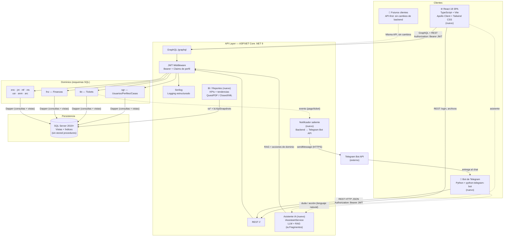
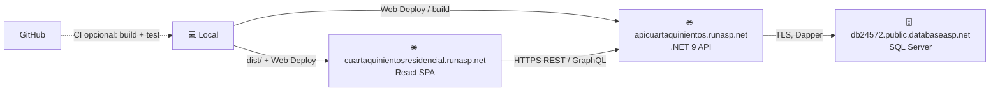

> Documento de diseño detallado (origen: README de la Entrega 1). Resumen y punto de entrada: [README](../README.md).

# 2. Arquitectura del Sistema


### **2.1. Diagrama de arquitectura:**

**Prompt 1:** *(Claude · arquitectura)*

```
Diagrama Mermaid (graph TB): React SPA, bot Telegram, API .NET 9 (GraphQL + REST + JWT),
SQL Server (vistas vs*, sin SPs de negocio), notificador saliente, IAssistantService (RAG),
módulo BI. Despliegue: Vercel + Railway. Los clientes consumen la misma API (API-first).
```

*Generó el diagrama de §2.1 y la narrativa de trade-offs (atomicidad de negocio en un solo despliegue, GraphQL para dashboards compuestos).*

> **Respuesta del asistente:** Diagrama §2.1 con PUSH, IA, BI; justificación API-first y monolito .NET. — `prompts.md` [§2](../prompts.md#p2-arquitectura)

**Prompt 2:** *(Claude · infraestructura)*

```
Añade diagrama Mermaid de despliegue: GitHub Actions → Railway (API+BD), Vercel (SPA),
segundo servicio bot (webhook HTTPS). Explica webhook vs polling en dev/prod.
```

*Quedó §2.4; se añadió explícitamente el **notificador saliente** backend → Telegram Bot API (componente que el primer borrador trataba como opcional).*

> **Respuesta del asistente:** CI → Railway + Vercel + bot webhook; idempotencia en `ntf.NotificacionesEntrega`. — `prompts.md` [§2](../prompts.md#p2-arquitectura)

**Prompt 3:** *(Claude · revisión adversarial — ver también §5.0.1)*

```
Revisa el diseño de auth del bot: ¿es seguro pedir correo y contraseña en el chat?
Propón alternativa y tablas mínimas en esquema bot.* sin duplicar lógica de SGR.
```

*Disparó ADR-004, §2.5 (vinculación por token de un solo uso,* `bot.TokensVinculacion`*,* `bot.CuentasTelegram`*) y la regla de que el bot usa el **mismo JWT y permisos** que la web.*

> **Respuesta del asistente:** Login en chat **rechazado**; flujo token efímero + deep link (ADR-004). — `prompts.md` [§2](../prompts.md#p2-arquitectura)




**Justificación de la arquitectura:**

**¿Por qué GraphQL sobre REST puro?** Con más de una docena de dominios interconectados, las vistas del portal necesitan datos cruzados —el dashboard de un residente muestra tickets, cuotas y notificaciones en una sola pantalla—. GraphQL permite solicitar exactamente esos campos en un único request, eliminando over-fetching. El bot y **cualquier futuro cliente** consumen el mismo endpoint sin versiones distintas: es un diseño **API-first** deliberado, para dejar el sistema encaminado a otros canales (p. ej. móvil) más adelante sin rehacer el backend. REST y GraphQL conviven: REST por dominio y GraphQL para las vistas compuestas del portal.

**¿Por qué Dapper + vistas (y no un ORM pesado)?** El acceso a datos usa Dapper con **consultas parametrizadas** sobre tablas y **18 vistas** `vs`* desnormalizadas (`sgr.vsUsuarios`, `tkt.vsTickets`, `fnz.vsTransacciones`, `vts.vsReservacionesArea`, … —) que resuelven los joins de lectura. La lógica de negocio y las validaciones viven en la **capa de servicios C#** (con FluentValidation); el diseño **no usa stored procedures de negocio** — la atomicidad se maneja con transacciones de conexión (Dapper `IDbTransaction`) y las consultas parametrizadas previenen la inyección SQL. Es el patrón de acceso a datos acordado.

**¿Por qué el bot de Telegram como canal adicional?** WhatsApp es el canal informal real del fraccionamiento. El bot ofrece una alternativa estructurada: comandos claros, respuestas inmediatas y notificaciones automáticas. Reutiliza el mismo backend REST del portal —sin lógica duplicada—, de modo que un ticket abierto desde el bot aparece de inmediato en la administración.

**Trade-offs asumidos:**

- SQL Server tiene costo de licencia en producción (mitigado con Azure SQL serverless o SQL Server Express para el MVP).
- El esquema y las vistas se versionan con scripts SQL numerados por ticket (`DB-000`, `DB-001`, …), idempotentes; no hay migraciones automáticas tipo EF.
- **Railway no ofrece SQL Server gestionado:** se despliega la imagen oficial `mcr.microsoft.com/mssql/server` (edición Express/Developer, ≥ 2 GB de RAM, volumen persistente). Alternativa evaluada: Azure SQL Database en su oferta gratuita `(asumido — validar costo/límites al desplegar)`.
- El bot de Telegram introduce un proceso Python adicional que debe desplegarse y monitorearse por separado.
- La notificación proactiva a Telegram exige un **componente saliente nuevo** (backend → Telegram Bot API): es un componente nuevo del diseño.


### **2.2. Descripción de componentes principales:**

**ASP.NET Core (.NET 9) + GraphQL:** Backend con endpoints REST por dominio y una capa GraphQL. Genera el schema desde tipos C#, soporta queries/mutations y evita el problema N+1 con DataLoaders.

**Dapper:** Micro-ORM que ejecuta consultas parametrizadas sobre tablas y vistas y mapea los resultados a objetos C#. La validación de entrada se hace con **FluentValidation** en la capa de servicios; no hay stored procedures de negocio en runtime.

**JWT:** Tokens firmados con claims estándar del proyecto: `sub` (`UsuarioID`), `correo` (se usa para las columnas de auditoría `Creado`/`Modificado`), `nombre` (nombre para mostrar), `perfil` (nombre del perfil en `sgr.Perfiles`, configurado como `RoleClaimType` para que `[Authorize(Roles=…)]` funcione), `bAdministrador` (`0`/`1`), `condominioId` y `exp`. Vida del access token: **60 min**; renovación con refresh token (14 días) guardado con hash en `sgr.RefreshTokens`. El middleware valida el token y expone los claims como `ClaimsPrincipal` en controladores y resolvers.

> **Auth:** `POST /SGR/AuthService/GenerateToken`; JWT `sub` = `UsuarioID` (USR-BE-007).

**Bot de Telegram (Python, nuevo):** `python-telegram-bot` 21.x en modo webhook (producción) o polling (desarrollo). Actúa como **cliente REST** del mismo API: nunca consulta la BD ni instancia servicios del backend. Para cada `chat_id` vinculado obtiene un JWT del usuario con `POST /SGR/Usuarios/telegram/sesion` (autenticado con el secreto de servicio `X-Bot-Secret`) y lo cachea en memoria hasta su expiración; si el proceso reinicia, lo vuelve a pedir. Ver §2.5 para el flujo de vinculación seguro.

**Notificador saliente (nuevo):** Servicio que, ante eventos del backend (pago registrado, cambio de estado de ticket, encuesta publicada), llama a la Telegram Bot API (`sendMessage`) para el chat vinculado del usuario. Registra la entrega para garantizar idempotencia (extensión `ntf.NotificacionesEntrega` en §2.5).

**React 18 + Apollo Client 3, Vite, Tailwind CSS, Serilog:** Frontend SPA que construiremos de cero (formularios con React Hook Form + Zod, gráficas BI con Chart.js vía `react-chartjs-2`, pruebas con Vitest + Testing Library y Playwright para E2E); Serilog para el logging estructurado del backend.

**Almacenamiento de archivos (adjuntos, evidencias, reglamento):** los binarios **no** se guardan en SQL Server. `arc.Archivos.Ruta` guarda la clave del objeto en un almacenamiento abstraído por `IFileStorage`: disco local (`./storage`) en desarrollo y almacenamiento de objetos compatible S3 en producción `(asumido — proveedor a elegir en Entrega Final)`. Límite: imágenes JPG/PNG/WebP y PDF, máx. 5 MB, validando tipo real (magic bytes), no solo la extensión. Ver ADR-006.

**IAssistantService (nuevo — IA):** Servicio del backend que da la capa inteligente del bot. Delega en un proveedor LLM configurable (p. ej. Claude API) para detección de intención, **Q&A con RAG** sobre `ia.Fragmentos` (reglamento, FAQ y **ayuda de uso del sistema**) y redacción de resúmenes BI. Registra cada respuesta en `ia.Consultas` y **escala** (crea ticket / deriva a humano) cuando la confianza es baja, en vez de inventar. Para **ejecutar** acciones (crear ticket, reservar área, consultar cuotas, registrar pago según perfil) reutiliza los endpoints de dominio: no duplica lógica. El asistente se llama **C500 Asiste** y su diseño es **minimalista**: una acción por mensaje, confirma con un toque y no pide datos que pueda inferir del contexto o del perfil.

**Módulo BI (nuevo):** Alimentado por las vistas `vs`* + snapshots periódicos (`bi.KpiSnapshots`) para KPIs con tendencia (cobranza, morosidad, tiempo de resolución de tickets, ocupación, adopción del bot). Exporta PDF (QuestPDF) y Excel (ClosedXML); el resumen se puede pedir por el bot (`/bi`).

**Worker de sugerencias proactivas (nuevo):** Job programado que detecta adeudos vencidos, vacunas por renovar o encuestas abiertas y genera `bot.Sugerencias` que el notificador saliente envía por Telegram, de forma idempotente y sin repetir lo descartado.

### **2.3. Descripción de alto nivel del proyecto y estructura de ficheros**

El frontend nuevo sigue el patrón **feature-based** (organización por dominio funcional), que escala mejor con múltiples módulos:

```
Web/                                 # Frontend React (nuevo — SETUP-000)
├── src/
│   ├── main.tsx                    # ApolloProvider + RouterProvider
│   ├── App.tsx
│   ├── apollo/client.ts            # uri, auth headers, cache policy
│   ├── shared/                     # components, hooks, types compartidos
│   ├── features/
│   │   ├── auth/                   # login, contexto JWT + claims
│   │   ├── dashboard/
│   │   ├── tickets/
│   │   ├── finanzas/
│   │   ├── anuncios/
│   │   ├── visitas/                # visitas + reserva de áreas comunes
│   │   ├── encuestas/
│   │   ├── juntas/
│   │   ├── notificaciones/
│   │   ├── archivos/
│   │   ├── reportes/
│   │   ├── vehiculos/
│   │   └── mascotas/
│   └── router/PrivateRoute.tsx     # Guard: redirige a /login sin JWT válido
├── tests/                          # Vitest + Testing Library; e2e/ con Playwright
├── vite.config.ts
└── tailwind.config.js

Bot/                                 # Bot de Telegram (Entrega 2)
├── bot/
│   ├── main.py                     # Entrypoint (python -m bot.main)
│   ├── config.py                   # Variables de entorno
│   ├── api_client.py               # httpx → backend REST con JWT por chat
│   └── handlers/                   # start (vinculación), tickets, cuotas, tarea, bi
├── tests/                          # pytest + pytest-asyncio
├── .env.example
└── requirements.txt

GraphApi/                            # Backend ASP.NET Core .NET 9 (SETUP-000)
├── Controllers/                    # REST por dominio: /{Dominio}/{Controller}
├── GraphQL/                        # Queries / Mutations / Types (HotChocolate)
├── Repositories/                   # Dapper: consultas parametrizadas + vistas vs*
├── Services/                       # Lógica de negocio, validaciones (FluentValidation)
├── Infrastructure/                 # IFileStorage, ITelegramNotifier, ILlmProvider, workers
└── Program.cs                      # JWT, CORS, Serilog, ProblemDetails, rate limiting, /health
GraphApi.Tests/                      # xUnit + Moq (unitarias) y Testcontainers SQL Server (integración)

SQL/                                 # Scripts de base de datos
├── cuartaquinientos_schema.sql     # Esquema completo (tablas, vistas, extensiones — sin datos)
├── DB-001_alineacion_modelo.sql    # Entrega 2: renombres + columnas del modelo §3
├── DB-002_seeds_catalogos.sql      # Entrega 2: catálogos + administrador inicial
└── pruebas/                        # Suites BEGIN TRAN … ROLLBACK por ticket

ContextoCuartaQuinientos/            # Contexto SDD: specs por dominio, .planning por ticket, handoff
```


### **2.4. Infraestructura y despliegue**

> **Hosting confirmado (Entrega Final).** [MonsterASP](https://www.monsterasp.net/) / **runasp.net**: API ASP.NET Core en un sitio, SPA React estática en otro, **SQL Server** en `*.databaseasp.net`. El bot de Telegram (**v2**) no se despliega en esta entrega. Perfiles Web Deploy locales (`*.publishSettings`) y contraseñas viven fuera del repositorio (ver `.gitignore`).



**Despliegue manual (fase inicial):** publicar la API con MSDeploy desde Visual Studio o `dotnet publish` + perfil del sitio `apicuartaquinientos`. Publicar la web con `npm run build` y subir el contenido de `dist/` al sitio `cuartaquinientosresidencial`. Aplicar scripts `SQL/DB-*.sql` en orden contra la BD del hosting (SSMS o administrador SQL del proveedor) **antes** de exponer endpoints que dependan del esquema.

**Pipeline CI/CD (objetivo):** en cada Pull Request → `dotnet build` + `dotnet test`, `npm ci && npm test && npm run build`; el merge no sustituye la configuración de secretos en el panel. El despliegue a runasp puede automatizarse después con GitHub Actions + Web Deploy si se desea.

**Configuración y secretos por entorno** (panel MonsterASP / variables de entorno del sitio API; plantillas sin secretos en `scaffolds/api/appsettings.Production.example.json` y `scaffolds/web/.env.production.example`):


| Variable                                                                                        | Servicio | Uso                                          |
| ----------------------------------------------------------------------------------------------- | -------- | -------------------------------------------- |
| `ConnectionStrings__DefaultConnection`                                                          | API      | SQL Server (`Encrypt=True`, `TrustServerCertificate=True`) |
| `Jwt__SecretKey`, `Jwt__Issuer`, `Jwt__Audience`                                                | API      | Firma y validación del JWT                   |
| `Cors__AllowedOrigins`                                                                          | API      | `https://cuartaquinientosresidencial.runasp.net` (+ localhost en dev) |
| `Telegram__*`, `Assistant__*`                                                                   | API      | **v2** — no requeridos en esta entrega       |
| `Storage__Provider`, `Storage__Bucket`                                                          | API      | Almacenamiento de archivos                   |
| `VITE_GRAPHQL_URL`, `VITE_API_URL`                                                              | Web      | Base `https://apicuartaquinientos.runasp.net` (+ `/graphql`) |


**Observabilidad mínima:** Serilog con `CorrelationId` por request, endpoint `/health` (API + conexión a BD) y registro de fallos del notificador en `ntf.NotificacionesEntrega` cuando el módulo esté implementado.

### **2.5. Seguridad**

**Autenticación JWT:** Tokens firmados (HMAC-SHA256), expiración configurable, clave en variables de entorno. El frontend envía `Authorization: Bearer <token>` en cada request de Apollo Client.

**Autorización por perfil:** Cada endpoint REST y resolver GraphQL declara los perfiles permitidos; el middleware rechaza con HTTP 403 antes del controlador. La autorización granular por pantalla/acción se apoya en `sgr.Perfiles` + `sgr.Menus`/`MenusBotones` + `PerfilMenus`/`PerfilMenuBotones`. El bot **usa el mismo JWT y las mismas reglas de perfil** que la web (residente, trabajador, administrador); no hay permisos “ampliados” por Telegram.

**Prevención de inyección SQL:** El acceso a datos usa exclusivamente **consultas parametrizadas** con Dapper sobre tablas y vistas; nunca se concatena SQL con input del usuario. La cuenta SQL de la aplicación se restringe a lectura/escritura sobre sus esquemas, sin permisos DDL.

**Hash de contraseñas:** Las contraseñas se almacenan en `sgr.Usuarios.PasswordHash` con hash **BCrypt** (`BCrypt.Net-Next`); nunca en claro.

**CORS por whitelist:** Solo orígenes configurados explícitamente (localhost en desarrollo, dominio de Vercel en producción).

**Protección contra fuerza bruta:** `POST /SGR/AuthService/GenerateToken` usa el *rate limiter* nativo de ASP.NET Core (5 intentos por minuto por IP + correo → HTTP 429). La respuesta de error es idéntica para usuario inexistente, contraseña incorrecta o cuenta inactiva, y se ejecuta `BCrypt.Verify` aun cuando el usuario no existe, para no revelar cuentas por tiempo de respuesta.

**Sesión en la web:** el access token vive **en memoria** (contexto de React), nunca en `localStorage`; el refresh token viaja en cookie `HttpOnly; Secure; SameSite=Strict` y se renueva con `POST /SGR/AuthService/RefreshToken`. Cerrar sesión revoca el refresh token (`sgr.RefreshTokens.Revocado = 1`).

**Formato de errores:** REST responde con `ProblemDetails` (RFC 7807) — `type`, `title`, `status`, `detail`, `errors` — y un `code` de negocio (`VALIDATION_ERROR`, `FORBIDDEN`, `NOT_FOUND`, `CONFLICT`, `INVALID_TRANSITION`). GraphQL responde en el campo `errors` del payload con los mismos códigos.

**Archivos:** validación de tipo real y tamaño (máx. 5 MB), nombre aleatorio en almacenamiento, descarga siempre a través del API con autorización (sin URLs públicas permanentes).

**Webhook y bot:** el webhook de Telegram valida el encabezado `X-Telegram-Bot-Api-Secret-Token`; el bot se autentica ante el API con `X-Bot-Secret` **solo** para canjear `chat_id` → JWT del usuario vinculado; todas las demás llamadas usan ese JWT y sus permisos.

**Vinculación segura del bot de Telegram.** Un diseño ingenuo pedía que el residente escribiera su correo y contraseña **dentro del chat de Telegram**. Esto se descarta: teclear credenciales en un chat las expone al historial y a los servidores de Telegram, y entrena al usuario al patrón que usa el phishing. El flujo correcto es **vinculación por token de un solo uso**:

1. El residente, ya autenticado en el portal web, pulsa "Vincular Telegram". El backend genera un **token efímero** (un solo uso, expiración corta) asociado a su `UsuarioID`.
2. El portal muestra un deep-link `https://t.me/<bot>?start=<token>` (o un código para pegar en `/start`).
3. Al abrir el bot, este envía el token al backend, que lo valida, lo consume y **vincula el** `chat_id` de Telegram con el `UsuarioID`. El bot recibe entonces un JWT de sesión.
4. La contraseña **nunca** transita por el chat. Un token filtrado caduca solo (10 minutos) y no es reutilizable; en BD se guarda su **hash SHA-256**, no el valor.


#### Extensiones del modelo y resolución de supuestos

Esquemas nuevos `bot`, `ia`, `bi`, `wms` y ampliaciones a tablas existentes (diagrama en §3.3):

**Resolución de supuestos (decisiones tomadas):**

- **Perfiles:** el catálogo `sgr.Perfiles` define `Administrador`, `Residente`, `Guardia`, `Trabajador` en `sgr.Perfiles` (`Administrador` con `bAdministrador = 1`; `Trabajador` = personal de mantenimiento que atiende tickets).
- **Propietario vs arrendatario:** nueva tabla `sgr.CasaOcupantes (CasaOcupanteID, CasaID FK, UsuarioID FK, TipoResidencia [Propietario|Arrendatario], FechaInicio, FechaFin, Vigente)` — soporta varios ocupantes por unidad; `sgr.Casas.PropietarioUsuarioID` sigue marcando al dueño.
- **Categoría de ticket:** catálogo `tkt.CategoriasTicket (Agua, Electricidad, Jardinería, Seguridad, Limpieza, Otro)` + columna `tkt.Tickets.CategoriaTicketID FK`.
- **Comentario interno:** columna `tkt.ComentariosTicket.EsInterno BIT` (visible solo a Administrador).
- **Vacunas de mascota:** columnas `usr.Mascotas.VacunasAlDia BIT` + `FechaUltimaVacuna DATE`.
- **Canal del ticket:** catálogo `tkt.CanalesTicket (WEB, TELEGRAM)` + `tkt.Tickets.CanalID FK` (métricas de adopción por canal).
- **Tipos de notificación:** catálogo `ntf.TiposNotificacion` con tipos (`TICKET_NUEVO`, `TICKET_ESTADO`, `TICKET_ASIGNADO`, `PAGO_REGISTRADO`, `CUOTA_VENCIDA`, `ENCUESTA_PUBLICADA`, `JUNTA_CONVOCADA`, `RESERVA_CONFIRMADA`, `AVISO_GENERAL`).
- **Sesión/tokens:** `sgr.RefreshTokens (TokenID, UsuarioID FK, Token, FechaExpira, Revocado)` para renovar el JWT sin re-login (clave para el bot).
- **Almacén (WMS):** esquema nuevo `wms` — `wms.Articulos (ArticuloID, Nombre, CategoriaID, Stock, StockMinimo, Ubicacion)`, `wms.Prestamos (PrestamoID, ArticuloID FK, UsuarioID FK, Cantidad, FechaPrestamo, FechaDevolucion, Estado)`.

**Canal Telegram + entrega:**

- `bot.CuentasTelegram (CuentaTelegramID, UsuarioID FK, ChatId BIGINT, FechaVinculacion, Activo)` — vinculación 1:1 (reemplaza guardar el chatId en `Preferencias`; más limpio y consultable).
- `bot.TokensVinculacion (Token, UsuarioID FK, FechaExpira, Usado)` — vinculación segura por token de un solo uso.
- `ntf.NotificacionesEntrega (NotificacionEntregaID, NotificacionID FK, CanalID FK → tkt.CanalesTicket, Estado [PENDIENTE|ENVIADA|FALLIDA], FechaEnvio, Reintentos, MotivoError)` — idempotencia del notificador saliente; índice único `(NotificacionID, CanalID)` para que un reintento nunca genere un segundo envío. El catálogo `tkt.CanalesTicket` (WEB|TELEGRAM) se reutiliza como catálogo único de canales.
- **Unidad del ticket:** columna `tkt.Tickets.CasaID FK` (nuevo) — el servicio la infiere de `sgr.CasaOcupantes` vigente del solicitante; la necesitan el trabajador (HU-BOT-10) y el filtro por condominio del admin.

**Asistente inteligente (IA / RAG) — el bot cubre TODO el sistema, no solo tickets:**

- `bot.Conversaciones (ConversacionID, ChatId, UsuarioID FK, EstadoFlujo, ContextoJSON, FechaInicio, FechaUltimaActividad)` — estado del `ConversationHandler` y contexto del asistente.
- `bot.Mensajes (MensajeID, ConversacionID FK, Rol [usuario|bot], Texto, IntentDetectado, FechaHora)` — historial + analítica de intención.
- `bot.Sugerencias (SugerenciaID, UsuarioID FK, Tipo [COBRO|RESERVA|ENCUESTA|VACUNAS|DOCUMENTO], PayloadJSON, Estado [PENDIENTE|ENVIADA|ATENDIDA|DESCARTADA], FechaGenerada, FechaAtendida)` — **nudges proactivos inteligentes** (sugerir pagar un adeudo vencido, recordar renovar vacunas, invitar a responder una encuesta, avisar de una reserva).
- `ia.Documentos (DocumentoID, Titulo, Fuente [reglamento|faq|aviso|ayuda-sistema], Contenido)` — base de conocimiento: el `reglamentocuarta500.pdf` **y** la guía de uso del sistema (cómo hacer cada cosa), para que el asistente resuelva dudas de operación además de normativas.
- `ia.Fragmentos (FragmentoID, DocumentoID FK, Texto, Embedding VARBINARY/JSON)` — chunks + embeddings para **RAG** (resolver dudas citando el reglamento).
- `ia.Consultas (ConsultaID, UsuarioID FK, Pregunta, Respuesta, FragmentosUsados, Confianza, Escalado BIT, FechaHora)` — bitácora de Q&A (auditoría y mejora continua).

**BI para administración:**

- `bi.KpiSnapshots (SnapshotID, CondominioID, Fecha, TicketsAbiertos, TicketsCerrados, TiempoMedioResolucionHoras, IngresosMXN, EgresosMXN, ResidentesMorosos, CasasTotales, CasasOcupadas, TicketsWeb, TicketsTelegram, FechaCreacion)` — foto periódica de KPIs para **tendencias** (cobranza, morosidad, tickets abiertos y tiempo de resolución, ocupación, adopción del bot). El módulo BI se alimenta de las vistas `vs`* + estos snapshots y exporta a PDF (QuestPDF) / Excel (ClosedXML); el admin puede pedir el resumen BI también por el bot (`/bi`).

**Integración de IA:** el backend expone un `IAssistantService` que delega en un proveedor LLM configurable (p. ej. Claude API) para (1) detección de intención, (2) Q&A con RAG sobre `ia.Fragmentos`, y (3) redacción de los resúmenes BI. Las claves viven en variables de entorno; cada respuesta del asistente se registra en `ia.Consultas` y, si su confianza es baja, se **escala** a un ticket/humano en vez de inventar.

### **2.5.1 Registro de decisiones (ADR inline — MADR)**

Decisiones que un desarrollador nuevo cuestionaría; formato resumido MADR (alternativas → decisión → consecuencias). Prompts que las produjeron/refinaron: `prompts.md` Flujos 1–3.


| ID          | Decisión                                                                                         | Alternativas consideradas                                                      | Consecuencias                                                                                     |
| ----------- | ------------------------------------------------------------------------------------------------ | ------------------------------------------------------------------------------ | ------------------------------------------------------------------------------------------------- |
| **ADR-001** | Persistencia con **Dapper + vistas** `vs`*; sin SPs de negocio                                   | EF Core migrations; SPs por operación                                          | Lógica en servicios C# testeables; scripts SQL versionados a mano                                 |
| **ADR-002** | **GraphQL + REST** API-first (mismo backend para web, bot, futuros clientes)                     | Solo REST; BFF por cliente                                                     | Menos over-fetching en dashboard; más superficie de schema que mantener                           |
| **ADR-003** | `POST /SGR/AuthService/GenerateToken`, JWT `sub` = `UsuarioID`                                   | Email en `sub` bajo otro dominio                                               | Contrato único web + bot                                                                          |
| **ADR-004** | Telegram: **token de un solo uso** (nunca password en chat)                                      | Login conversacional con credenciales                                          | Menor riesgo phishing; tabla `bot.TokensVinculacion`                                              |
| **ADR-005** | Backlog en readme §5–§6 + tickets numerados                                                      | Solo issues sin doc                                                            | Trazabilidad HU → ticket → API                                                                    |
| **ADR-006** | Archivos fuera de la BD, detrás de `IFileStorage` (local en dev, objetos S3-compatible en prod)  | `VARBINARY` en SQL Server; disco del contenedor                                | BD ligera y respaldable; Railway no garantiza disco persistente sin volumen                       |
| **ADR-007** | Bot autenticado con **secreto de servicio** solo para canjear `chat_id` → JWT del usuario        | Bot con cuenta de servicio con permisos globales; guardar JWT en BD del bot    | El bot nunca tiene más permisos que el usuario; reinicios sin re-vincular                         |
| **ADR-008** | **Nombres lógicos del readme §3 = contrato**; el esquema físico se alinea con el script `DB-001` | Documentar los nombres físicos heredados (`CorreoUsuario`, `TipoNotiicfacion`) | Código y documentación hablan el mismo idioma; costo: un script de renombre antes de programar    |
| **ADR-009** | Notificaciones Telegram por **outbox** (`ntf.NotificacionesEntrega`) + worker con reintentos     | Envío síncrono dentro de la transacción de negocio                             | Un fallo de Telegram nunca revierte un pago o un ticket; entrega *at-least-once* con índice único |


### **2.6. Tests**

**Estrategia (pirámide) y metas:**


| Nivel               | Herramienta                                                   | Qué cubre                                                                          | Meta                                      |
| ------------------- | ------------------------------------------------------------- | ---------------------------------------------------------------------------------- | ----------------------------------------- |
| Unitarias backend   | xUnit + Moq                                                   | Servicios C# con repositorios mockeados (reglas, permisos, transiciones de estado) | ≥ 80 % de líneas en `Services/`           |
| Integración backend | xUnit + `WebApplicationFactory` + Testcontainers (SQL Server) | Endpoints REST/GraphQL contra BD real efímera con `DB-000..002` aplicados          | Todos los endpoints del núcleo §5.0       |
| SQL                 | Suites `SQL/pruebas/*.sql` (`BEGIN TRAN … ROLLBACK`)          | FK, idempotencia, vistas                                                           | 1 suite por ticket de BD                  |
| Frontend            | Vitest + Testing Library                                      | Componentes y estados vacío / carga / error                                        | Pantallas del núcleo                      |
| E2E                 | Playwright                                                    | Login → crear ticket → admin lo resuelve; admin registra pago → residente lo ve    | 2 flujos del núcleo (Entrega Final)       |
| Bot                 | pytest + pytest-asyncio (API mockeada con `respx`)            | Handlers y `ConversationHandler` sin cuenta real                                   | Flujos `/tickets`, `/cuotas`, vinculación |


**Ejemplo de test unitario** (el servicio recibe un `UsuarioActual` construido a partir del JWT, así la regla de permiso se prueba sin HTTP):

```csharp
[Fact]
public async Task CrearTicket_PerfilNoResidente_RetornaForbidden_YNoInserta()
{
    var repo = new Mock<ITicketRepository>();
    var notif = new Mock<INotificacionService>();
    var service = new TicketService(repo.Object, notif.Object, new CrearTicketInputValidator());
    var input = new CrearTicketInput { Titulo = "Fuga", Descripcion = "Fuga en calle norte", Categoria = "Agua" };
    var admin = new UsuarioActual(UsuarioId: 10, Correo: "admin@local", Perfil: "Administrador");

    var result = await service.CrearTicketAsync(input, admin);

    Assert.False(result.Success);
    Assert.Equal("FORBIDDEN", result.ErrorCode);
    repo.Verify(r => r.InsertarAsync(It.IsAny<Ticket>(), It.IsAny<IDbTransaction>()), Times.Never);
}
```

---


### **2.7. Metodología de construcción**

La **Entrega 1** concentra el diseño en este `readme.md`. La **Entrega 2+** implementa por fases ([roadmap por fases, §5](#roadmap-por-fases-alcance-completo-secuenciado)) con apoyo de IA en codificación, pruebas y revisión adversarial (poke-holes, §5.0.1).

- **Backlog:** historias §5 (INVEST, Given/When/Then, MoSCoW) y tickets técnicos §6.
- **Convenciones:** Dapper + vistas `vs`* (sin SPs de negocio), `bEliminado`, catálogos, perfiles por catálogo, rutas `/{Dominio}/{Controller}`, JWT.
- **Calidad prevista:** tests de servicios (xUnit + Moq), smoke de API y pruebas del bot (Entrega 2+).

Mapa dominio → tamaño estimado de implementación:


| Dominio                | Target(s) SDD                   | Tamaño |
| ---------------------- | ------------------------------- | ------ |
| USR / SGR              | database, backend, frontend     | M      |
| TKT                    | database, backend, frontend     | L      |
| FNZ                    | database, backend, frontend     | L      |
| ENC                    | database, backend, frontend     | M      |
| JNT                    | database, backend, frontend     | S      |
| NTF                    | database, backend, integrations | M      |
| VTS                    | database, backend, frontend     | M      |
| MAS / VEH              | database, backend, frontend     | S      |
| ANM                    | database, backend, frontend     | S      |
| ARC                    | database, backend, frontend     | S      |
| Dashboard              | backend, frontend               | M      |
| RPT / BI               | database, backend, frontend     | M      |
| WMS                    | database, backend, frontend     | S      |
| BOT «C500 Asiste» / IA | integrations, backend, database | XL     |


### **2.8. C500 Asiste — asistente inteligente (no es un chat plano)**

«C500 Asiste» combina **tres capas**; el error típico es poner el LLM en Python y duplicar reglas ahí.


| Capa                  | Dónde                              | Qué hace                                                                                   |
| --------------------- | ---------------------------------- | ------------------------------------------------------------------------------------------ |
| **Presentación**      | Bot Python (`python-telegram-bot`) | Menús, botones, `ConversationHandler`, comandos (`/tickets`, `/tarea`, `/cuotas`, `/bi`)   |
| **Orquestación + IA** | Backend .NET — `IAssistantService` | Intención, RAG (`ia.Fragmentos`), redacción BI, **escalado**; llama a servicios de dominio |
| **Datos**             | SQL Server                         | Negocio (`tkt`, `fnz`, …) + `bot.`* + `ia.*`                                               |


**Flujo resumido**

1. Comando o botón conocido → handler Python → **REST de dominio** (igual que la web), con JWT del usuario vinculado.
2. Texto libre / duda de reglamento o uso → `POST /BOT/Asistente/Consultar` → `IAssistantService` → proveedor LLM **configurable** + RAG.
3. Confianza baja → no inventar: `escalado`, bitácora en `ia.Consultas`, opción de abrir ticket.

**Configurador de proveedor IA (implementación):** sección `Assistant` en `appsettings` + variables de entorno (`Assistant:Provider`, `Assistant:ApiKey`, `Assistant:DefaultModel`, umbrales RAG/confianza). Patrón `ILlmProvider` inyectado en DI; los identificadores de modelo se validan contra la documentación del proveedor al implementar IA-BE-005. **El bot Python no almacena ni usa claves de LLM.**

**Almacenamiento de embeddings:** SQL Server 2019 no tiene tipo vectorial; `ia.Fragmentos.Embedding` guarda el vector serializado y la similitud coseno se calcula en el servicio C# sobre el corpus en memoria (reglamento + guía de uso ≈ cientos de fragmentos, suficiente para un fraccionamiento). Si el corpus crece, se migra a un índice vectorial dedicado `(asumido)`.

> UI Admin para cambiar proveedor/modelo en runtime: **opcional Entrega Final** `(asumido)`; en Fase 2 basta configuración de despliegue.

---
