> Documento de diseño detallado (origen: README de la Entrega 1). Resumen y punto de entrada: [README](../README.md).

# 3. Modelo de Datos

**Prompt 1:** *(Claude · modelado)*

```
ERD Mermaid del modelo acordado en readme §1.2: esquemas sgr, tkt, fnz, enc, jnt, ntf,
vts, usr, anm, arc. Residente = sgr.Usuarios + Casas; cobros = fnz.Cuotas.
Catálogos para estado/prioridad de ticket (no enums en línea). Auditoría + bEliminado.
Sin stored procedures de negocio en el diseño.
```

*Primer borrador en inglés (*`Resident`*,* `IsActive`*); segunda pasada en español por esquema → §3.1.*

**Prompt 2:** *(Claude · extensiones Telegram / IA / BI / WMS)*

```
Subgraph adicional: bot.* (vinculación, conversaciones, sugerencias), ia.* (RAG),
bi.KpiSnapshots, wms.Articulos/Prestamos. FKs coherentes con §2.5.
```

*Consolidó §3 con las tablas de extensión documentadas en §2.5 (entrega idempotente, fragmentos RAG, KPIs).*

**Prompt 3:** *(Claude · cierre de coherencia doc)*

```
Cruza entidades §3 con historias HU-TKT-01 y HU-FNZ-01: ¿faltan columnas para canal
WEB|TELEGRAM, categoría de ticket, comentario interno, vacunas de mascota?
Responde solo con deltas al modelo, no reescribas todo el ERD.
```

*Añadió catálogos* `tkt.CategoriasTicket`*,* `tkt.CanalesTicket`*,* `ComentariosTicket.EsInterno`*, columnas de vacunas en* `usr.Mascotas` *— listados en §2.5.*

> **Respuestas del asistente (§3):** ERD §3.1 en español por esquemas; extensiones `bot`/`ia`/`bi`/`wms`; deltas categoría/canal/vacunas/`CasaOcupantes`. — `prompts.md` [§3](../prompts.md#p3-modelo-datos)

> **Modelo de datos propuesto** (Entrega 1). Esquemas `bot`, `ia`, `bi`, `wms` y ampliaciones se detallan en §2.5 y §3; scripts SQL en Entrega 2.
>
> **Convención de nombres:** en diagramas, contratos y código usamos los nombres **lógicos** del modelo limpio (`Correo`, `PasswordHash`, `bActivo`, …), que son el contrato del proyecto (ADR-008); el script **DB-001** alinea el esquema físico heredado a estos nombres (ver diccionario al final de §3.2). Todas las tablas comparten el patrón de auditoría del sistema (`Creado`, `Modificado`, `UsuarioCreacionID`, `UsuarioModificacionID`, `FechaCreacion`, `FechaModificacion`) y **soft delete** con `bEliminado`. `Creado`/`Modificado` son `NVARCHAR(100)` y guardan el **correo** del autor (claim `correo`); `UsuarioCreacionID`/`UsuarioModificacionID` guardan su `UsuarioID`. En los fragmentos de código, `@By`/`@AdminId` representan el `UsuarioID` y `@ByCorreo` el correo. Por legibilidad, esos campos de auditoría **y las tablas de catálogo/secundarias** (`vts.ReservacionesEstados`, `jnt.JuntaDetalleArchivos`, `usr.Marcas`, `usr.Modelos`, `usr.TiposMascota`, `usr.RazasMascota`, `enc.TiposPregunta`, `vts.TipoIdentificacion`, `ntf.TiposNotificacion`, `fnz.TiposMovimiento`, `tkt.DocumentosComentarioTicket`) se omiten del diagrama; existen en el esquema y resuelven las FK de catálogo (p. ej. `ReservacionArea.ReservacionEstadoID`). Los prefijos de esquema (`sgr`, `tkt`, `fnz`, …) se anotan en cada entidad. Los elementos marcados **(nuevo)** son los cambios aditivos de este proyecto.


### **3.1. Diagrama del modelo de datos:**

```mermaid
erDiagram
    Condominio {
        INT CondominioID PK
        NVARCHAR Nombre
        NVARCHAR Direccion
    }
    Casa {
        INT CasaID PK
        INT CondominioID FK
        NVARCHAR Direccion
        NVARCHAR Numero
        INT PropietarioUsuarioID FK
    }
    Perfil {
        INT PerfilID PK
        NVARCHAR Nombre
        NVARCHAR Descripcion
        BIT bAdministrador
    }
    Usuario {
        INT UsuarioID PK
        NVARCHAR Correo UK
        INT PerfilID FK
        NVARCHAR PasswordHash
        NVARCHAR Nombre
        NVARCHAR Telefono
        NVARCHAR Preferencias "JSON de preferencias del usuario"
        BIT bActivo
        BIT bActualizarPassword
    }
    Ticket {
        INT TicketID PK
        NVARCHAR Titulo
        NVARCHAR Descripcion
        INT UsuarioSolicitanteID FK
        INT PrioridadTicketID FK
        INT EstadoTicketID FK
        INT CategoriaTicketID FK "→ tkt.CategoriasTicket"
        INT CanalID FK "→ tkt.CanalesTicket (WEB|TELEGRAM)"
        INT CasaID FK "unidad del solicitante"
        DATETIME FechaCreacionTicket
        DATETIME FechaCierre
    }
    EstadoTicket {
        INT EstadoTicketID PK
        NVARCHAR EstadoTicket "Nuevo|En seguimiento|Resuelto|Cerrado"
    }
    PrioridadTicket {
        INT PrioridadTicketID PK
        NVARCHAR PrioridadTicket "Baja|Media|Alta|Crítica"
        TINYINT Orden "1..4 (orden de prioridad)"
    }
    ComentarioTicket {
        INT ComentarioTicketID PK
        INT TicketID FK
        INT UsuarioID FK
        NVARCHAR Comentario
        BIT EsInterno "solo visible a Administrador"
        DATETIME FechaComentario
    }
    DocumentoTicket {
        INT DocumentoTicketID PK
        INT TicketID FK
        INT ArchivoID FK "→ arc.Archivos"
    }
    TicketUsuarioAsignado {
        INT TicketsUsuariosAsignadosID PK
        INT TicketID FK
        INT UsuarioID FK
        BIT Terminado
    }
    Cuenta {
        INT CuentaID PK
        NVARCHAR Nombre
        NVARCHAR Tipo
        DECIMAL Saldo
        INT ResponsableUsuarioID FK
    }
    Cuota {
        INT CuotaID PK
        INT UsuarioID FK
        INT CasaID FK
        INT CuentaID FK "cuenta que recibe el pago"
        DECIMAL Monto
        DECIMAL MontoPagado
        DATETIME PeriodoInicio
        DATETIME PeriodoFin
        DATETIME FechaVencimiento
        BIT Pagado
        DATETIME FechaPago
        NVARCHAR MetodoPago
        NVARCHAR ReferenciaPago
    }
    Transaccion {
        INT TransaccionID PK
        INT CuentaID FK
        INT UsuarioID FK
        INT TipoMovimientoID FK
        DECIMAL Cargo
        DECIMAL Abono
        NVARCHAR Motivo
    }
    Encuesta {
        INT EncuestaID PK
        NVARCHAR Titulo
        NVARCHAR Descripcion
        DATETIME FechaInicio
        DATETIME FechaFin
        BIT bActivo
    }
    Pregunta {
        INT PreguntaID PK
        INT EncuestaID FK
        NVARCHAR Texto
        INT TipoPreguntaID FK
        INT Orden
        BIT Requerida
    }
    OpcionPregunta {
        INT OpcionPreguntaID PK
        INT PreguntaID FK
        NVARCHAR Texto
        NVARCHAR Valor
        INT Orden
    }
    Respuesta {
        INT RespuestaID PK
        INT EncuestaID FK
        INT PreguntaID FK
        INT UsuarioID FK
        INT OpcionPreguntaID FK
        NVARCHAR RespuestaTexto
        DATETIME FechaRespuesta
    }
    Junta {
        INT JuntaID PK
        NVARCHAR Titulo
        NVARCHAR Descripcion
        DATETIME FechaProgramada
        NVARCHAR Ubicacion
        BIT bActivo
    }
    JuntaDetalle {
        INT JuntaDetalleID PK
        INT JuntaID FK
        NVARCHAR Contenido
        DATETIME FechaRegistro
    }
    Notificacion {
        INT NotificacionID PK
        INT UsuarioID FK
        NVARCHAR Titulo
        NVARCHAR Mensaje
        INT TipoNotificacionID FK
        DATETIME FechaCreacionNotificacion
    }
    NotificacionVisualizada {
        INT NotificacionVisualizadaID PK
        INT NotificacionID FK
        INT UsuarioID FK
        DATETIME FechaLectura "marca de leído"
    }
    Visita {
        INT VisitaID PK
        NVARCHAR VisitanteNombre
        INT UsuarioVisitadoID FK
        INT CasaID FK
        INT TipoIdentificacionID FK
        DATETIME FechaEntrada
        DATETIME FechaSalida
        BIT Autorizado
    }
    AreaComun {
        INT AreaID PK
        NVARCHAR Nombre
        INT Capacidad
        BIT RequiereReservacion
    }
    ReservacionArea {
        INT ReservacionAreaID PK
        INT AreaID FK
        INT UsuarioID FK
        DATETIME FechaInicio
        DATETIME FechaFin
        INT ReservacionEstadoID FK
    }
    Automovil {
        INT AutomovilID PK
        INT UsuarioID FK
        INT MarcaID FK
        INT ModeloID FK
        NVARCHAR ModeloLibre "si el modelo no está en catálogo"
        NVARCHAR Placas UK "normalizada, única por condominio"
        NVARCHAR Color
    }
    Mascota {
        INT MascotaID PK
        INT UsuarioID FK
        NVARCHAR Nombre
        INT TipoMascotaID FK
        INT RazaMascotaID FK
        NVARCHAR RazaLibre
        DATETIME FechaNacimiento
        BIT VacunasAlDia
        DATE FechaUltimaVacuna
    }
    Archivo {
        INT ArchivoID PK
        NVARCHAR Nombre
        NVARCHAR Ruta "clave en IFileStorage"
        INT TipoArchivoID FK
        BIT EsPrivado
    }
    Anuncio {
        INT AnuncioID PK
        NVARCHAR Titulo
        NVARCHAR Contenido
        DATETIME FechaPublicacion
        DATETIME VigenteHasta
        INT TipoAnuncioID FK
    }

    Condominio ||--o{ Casa : "agrupa"
    Perfil ||--o{ Usuario : "clasifica"
    Usuario ||--o{ Casa : "es propietario"
    Usuario ||--o{ Ticket : "solicita"
    EstadoTicket ||--o{ Ticket : "clasifica"
    PrioridadTicket ||--o{ Ticket : "prioriza"
    Ticket ||--o{ ComentarioTicket : "tiene"
    Usuario ||--o{ ComentarioTicket : "escribe"
    Ticket ||--o{ DocumentoTicket : "adjunta"
    Archivo ||--o{ DocumentoTicket : "se adjunta como"
    Casa ||--o{ Ticket : "ubica"
    Cuenta ||--o{ Cuota : "recibe"
    Ticket ||--o{ TicketUsuarioAsignado : "se asigna"
    Usuario ||--o{ TicketUsuarioAsignado : "atiende"
    Usuario ||--o{ Cuota : "debe"
    Casa ||--o{ Cuota : "genera"
    Cuenta ||--o{ Transaccion : "registra"
    Usuario ||--o{ Transaccion : "asociada"
    Encuesta ||--o{ Pregunta : "contiene"
    Pregunta ||--o{ OpcionPregunta : "ofrece"
    Encuesta ||--o{ Respuesta : "recibe"
    Pregunta ||--o{ Respuesta : "responde"
    OpcionPregunta ||--o{ Respuesta : "elegida en"
    Usuario ||--o{ Respuesta : "responde"
    Junta ||--o{ JuntaDetalle : "detalla"
    Usuario ||--o{ Notificacion : "recibe"
    Notificacion ||--o{ NotificacionVisualizada : "se marca leída"
    Usuario ||--o{ Visita : "recibe"
    Casa ||--o{ Visita : "en"
    AreaComun ||--o{ ReservacionArea : "se reserva"
    Usuario ||--o{ ReservacionArea : "reserva"
    Usuario ||--o{ Automovil : "registra"
    Usuario ||--o{ Mascota : "registra"
    Usuario ||--o{ Anuncio : "publica"
```




> **Nota de diseño.** El residente **no** es una tabla aparte: es un `Usuario` con `PerfilID`. La vivienda se modela con `sgr.Casas.PropietarioUsuarioID` (dueño) **y** con la tabla nueva `sgr.CasaOcupantes` (propietarios **y** arrendatarios, varios por unidad) — así queda resuelto el caso del arrendatario. El estado y la prioridad de un ticket son **catálogos** (`EstadoTicket`, `PrioridadTicket`) con valores sembrados (Nuevo/En seguimiento/Resuelto/Cerrado y Baja/Media/Alta/Crítica), no enums en línea; la categoría y el canal también pasan a catálogo (`CategoriasTicket`, `CanalesTicket`). Las entidades y campos **nuevos** del proyecto (esquemas `bot`, `ia`, `bi`, `wms`, `sgr.CasaOcupantes`, `sgr.RefreshTokens`, catálogos y columnas añadidas) se detallan en §2.5 y §3.3.


### **3.2. Descripción de entidades principales:**

**Usuario (**`sgr.Usuarios`**):** Entidad central de identidad. `Correo` único, `PasswordHash` (BCrypt), `PerfilID` que determina permisos, `Preferencias` (JSON de preferencias), `bActivo` para soft-disable y `bActualizarPassword` para forzar cambio. Ancla la actividad operativa (tickets, cuotas, vehículos, mascotas, reservaciones).

**Perfil (**`sgr.Perfiles`**):** Catálogo de roles con la bandera `bAdministrador`. La autorización fina por pantalla/acción se resuelve con los menús (`sgr.Menus`, `MenusBotones`, `PerfilMenus`, `PerfilMenuBotones`).

**Casa / Condominio (**`sgr.Casas` **/** `sgr.Condominios`**):** La vivienda como entidad de primera clase (número, condominio y usuario propietario). Es lo que ancla cuotas y visitas a una unidad concreta.

**Ticket (**`tkt.Tickets`**):** Núcleo operativo. `UsuarioSolicitanteID` es quien reporta; `EstadoTicketID` y `PrioridadTicketID` son FK a catálogos; `FechaCierre` se registra al cerrar. Comentarios (`tkt.ComentariosTicket`), adjuntos (`tkt.DocumentosTicket` → `arc.Archivos`) y asignación N:M a personal (`tkt.TicketsUsuariosAsignados`, con bandera `Terminado`).

**Máquina de estados del ticket** (la valida `TicketService`; cualquier otra transición → `422 INVALID_TRANSITION`):


| Desde          | Hacia          | Quién                               | Efecto                                                                           |
| -------------- | -------------- | ----------------------------------- | -------------------------------------------------------------------------------- |
| *(alta)*       | Nuevo          | Residente (web / bot)               | `FechaCreacionTicket`; notifica a administradores                                |
| Nuevo          | En seguimiento | Administrador o trabajador asignado | Notifica al solicitante                                                          |
| En seguimiento | Resuelto       | Administrador o trabajador asignado | Registra `FechaCierre` (base del tiempo de resolución) y notifica al solicitante |
| Resuelto       | En seguimiento | Administrador (reapertura)          | Limpia `FechaCierre` y notifica al solicitante                                   |
| Resuelto       | Cerrado        | Administrador                       | Cierre administrativo; `FechaCierre` no cambia; notifica al solicitante          |

Toda transición notifica al solicitante con el tipo `TICKET_ESTADO` (vía `INotificacionService`).


**Cuota (**`fnz.Cuotas`**):** Cargo periódico por casa/usuario. `PeriodoInicio`/`PeriodoFin` y `FechaVencimiento` definen el período; `Pagado`, `FechaPago`, `MontoPagado`, `MetodoPago` y `ReferenciaPago` registran la conciliación; `CuentaID` indica la cuenta de `fnz.Cuentas` que recibe el abono. En Fase 1 un pago liquida la cuota completa (sin pagos parciales). Las cuotas se generan por período con HU-FNZ-06 (una por casa ocupada, idempotente por `CasaID` + `PeriodoInicio`). El reporte de morosos se calcula sobre `Pagado = 0` y `FechaVencimiento < hoy`. La contabilidad general vive en `fnz.Cuentas` + `fnz.Transacciones` (cargo/abono).

**Encuesta (**`enc.`***):** Modelo estructurado —`Preguntas` tipadas y ordenadas, `OpcionesPregunta`, y `Respuestas` que apuntan a una opción (`OpcionPreguntaID`) o a texto libre (`RespuestaTexto`)—. Esto **sí** permite consolidar resultados por opción.

**Notificación (**`ntf.Notificaciones`**):** Aviso al usuario, tipado (`TipoNotificacionID`). **Decisión:** la marca de leído es una fila en `ntf.NotificacionesVisualizadas` (`NotificacionID`, `UsuarioID`, `FechaLectura`), tabla que ya existe en el físico; "no leída" = sin fila en esa tabla. La columna física heredada `ntf.Notificaciones.Leido` no se lee ni se escribe (no se elimina en Fase 1). La entrega por Telegram se rastrea en la tabla nueva `ntf.NotificacionesEntrega` (nuevo) para idempotencia.

**Visita / Área Común (**`vts.`***):** Bitácora de control de acceso (`Visitas`, con entrada/salida y autorización) y reserva de amenidades (`AreasComunes` + `ReservacionesArea` + `ReservacionesEstados`).

**Diccionario lógico ↔ físico (lo aplica DB-001).** El esquema físico `SQL/cuartaquinientos_schema.sql` proviene de un diseño previo con nombres distintos. El contrato es el nombre lógico (ADR-008); DB-001 renombra (`sp_rename`) y agrega columnas de forma idempotente **antes** de escribir código:


| Tabla                       | Físico actual                                                                            | Lógico (contrato)                                                                                                                                                  | Acción DB-001                                                                                                        |
| --------------------------- | ---------------------------------------------------------------------------------------- | ------------------------------------------------------------------------------------------------------------------------------------------------------------------ | -------------------------------------------------------------------------------------------------------------------- |
| `sgr.Usuarios`              | `CorreoUsuario`, `PasswordUsuario`, `NombreUsuario`, `TelefonoUsuario`, `bActivoUsuario` | `Correo`, `PasswordHash`, `Nombre`, `Telefono`, `bActivo`                                                                                                          | Renombrar + quitar el `UNIQUE` heredado sobre el correo + índice único filtrado en `Correo` (`WHERE bEliminado = 0`) |
| `sgr.Usuarios`              | —                                                                                        | `Preferencias NVARCHAR(MAX) NULL` (JSON)                                                                                                                           | Agregar                                                                                                              |
| `sgr.Perfiles`              | `Perfil`                                                                                 | `Nombre`                                                                                                                                                           | Renombrar                                                                                                            |
| `sgr.Condominios`           | `NombreCondominio`, `DireccionCondominio`                                                | `Nombre`, `Direccion`                                                                                                                                              | Renombrar                                                                                                            |
| `sgr.Casas`                 | `DireccionCasa`, `NumeroExtCasa`                                                         | `Direccion`, `Numero`                                                                                                                                              | Renombrar                                                                                                            |
| `fnz.Cuentas`               | `Cuenta`                                                                                 | `Nombre`                                                                                                                                                           | Renombrar                                                                                                            |
| `fnz.Cuotas`                | —                                                                                        | `CuentaID INT NULL FK`, `MontoPagado DECIMAL(18,2) NULL`, índice único `(CasaID, PeriodoInicio) WHERE bEliminado = 0 AND CasaID IS NOT NULL`                       | Agregar                                                                                                              |
| `tkt.CategoriasTicket`      | `CategoriaTicket`                                                                        | `Categoria`                                                                                                                                                        | Renombrar                                                                                                            |
| `vts.AreasComunes`          | `AreasComunesID`, `AreasComunes`                                                         | `AreaID`, `Nombre`                                                                                                                                                 | Renombrar                                                                                                            |
| `vts.ReservacionesArea`     | `AreasComunesID`                                                                         | `AreaID` (FK → `vts.AreasComunes`)                                                                                                                                 | Renombrar                                                                                                            |
| `tkt.Tickets`               | `TituloTicket`, `DescripcionTicket`                                                      | `Titulo`, `Descripcion`                                                                                                                                            | Renombrar                                                                                                            |
| `tkt.Tickets`               | —                                                                                        | `FechaCreacion DATETIME NOT NULL` (auditoría faltante), `CasaID INT NULL FK`                                                                                       | Agregar                                                                                                              |
| `tkt.PrioridadEstickets`    | nombre de tabla con errata                                                               | `tkt.PrioridadesTicket`                                                                                                                                            | Renombrar tabla                                                                                                      |
| `tkt.PrioridadesTicket`     | —                                                                                        | `Orden TINYINT NULL` + índice único filtrado `(Orden) WHERE bEliminado = 0 AND Orden IS NOT NULL` (Baja=1 … Crítica=4; ordenar por prioridad nunca depende del ID) | Agregar                                                                                                              |
| `vts.VisitasGeneradas`      | `Column_20`, `Column_21` (columnas basura sin uso)                                       | —                                                                                                                                                                  | Eliminar (`DROP COLUMN` solo si todas las filas son `NULL`)                                                          |
| `tkt.DocumentosTicket`      | `DocumentoID`                                                                            | `ArchivoID FK → arc.Archivos`                                                                                                                                      | Renombrar + FK                                                                                                       |
| `ntf.TiposNotificacion`     | `TipoNotiicfacion` (errata)                                                              | `TipoNotificacion`                                                                                                                                                 | Renombrar                                                                                                            |
| `ntf.NotificacionesEntrega` | `CanalID` sin FK                                                                         | FK → `tkt.CanalesTicket`, `MotivoError NVARCHAR(500) NULL`, índice único `(NotificacionID, CanalID)`                                                               | Agregar                                                                                                              |
| `usr.Mascotas`              | `NombreMascota`                                                                          | `Nombre`                                                                                                                                                           | Renombrar                                                                                                            |
| `bi.KpiSnapshots`           | —                                                                                        | `TiempoMedioResolucionHoras`, `CasasTotales`, `CasasOcupadas`, `TicketsWeb`, `TicketsTelegram`                                                                     | Agregar                                                                                                              |


Las vistas `vs*` afectadas se recrean con `CREATE OR ALTER VIEW` en el mismo script; además DB-001 amplía `tkt.vsTickets` (categoría, canal, casa), `sgr.vsUsuarios` (casa/condominio vigente, sin `PasswordHash`) y `tkt.vsTicketsUsuariosAsignados` (prioridad y fecha). En `ntf.NotificacionesEntrega` la columna `CanalID` conserva su nombre (solo gana FK).


**Tablas heredadas sin historia en el MVP.** El esquema físico incluye 8 tablas del diseño previo que se despliegan con DB-000 pero **no tienen historia de usuario ni ticket en Fase 1**; no se describen en el diagrama y se conservan para no romper el esquema heredado:

| Tabla | Propósito | Situación en el MVP |
| ----- | --------- | ------------------- |
| `sgr.RecuperacionPassword` | Token de un solo uso para restablecer contraseña | Fuera de alcance (Non-goals USR — Fase 1: sin recuperación por correo) |
| `usr.Parientes` / `usr.Parentescos` | Familiares y contactos de emergencia del residente (con catálogo de parentesco) | Solo en el inventario del API (§4, `/USR`); sin historia — candidata a Fase 3 `(asumido)` |
| `vts.LogUsoVisitas` | Bitácora de accesos con pase de visita (fecha, IP, resultado) | La reutiliza la «bitácora de accesos» de VTS-BE-026 (Fase 3) |
| `fnz.DocumentosTransaccion` | Relación transacción ↔ documento (comprobantes adjuntos) | Solo en el inventario del API (§4, `/FNZ`); FNZ-BE-011 registra solo `ReferenciaPago` (texto), sin adjuntar comprobantes en Fase 1 |
| `api.UsuariosAPI` | Credenciales de integración de un diseño anterior | **No se usa**: la autenticación es JWT sobre `sgr.Usuarios` (§2.5) y el bot usa `BOT_SERVICE_SECRET`; su columna `Password` no se lee ni se escribe `(asumido: retirar en un delta posterior)` |
| `dbo.descripciontablas` / `dbo.descrpcionescampos` | Diccionario de datos (descripción de tablas y columnas); el segundo nombre conserva la errata del original | Metadatos de documentación, sin lógica de negocio |

---


### **3.3. Modelo de extensiones (bot inteligente, IA/RAG, BI y módulos nuevos)**

> **Extensiones del diseño** (esquemas `bot`, `ia`, `bi`, `wms` y ampliaciones a `sgr`/`tkt`). Se muestran por separado del ER principal por legibilidad; comparten el patrón de auditoría + `bEliminado`.

```mermaid
erDiagram
    Usuario ||--o| CuentaTelegram : "vincula"
    Usuario ||--o{ TokenVinculacion : "genera"
    Usuario ||--o{ CasaOcupante : "ocupa"
    Casa ||--o{ CasaOcupante : "alberga"
    Usuario ||--o{ RefreshToken : "renueva"
    Usuario ||--o{ ConversacionBot : "conversa"
    ConversacionBot ||--o{ MensajeBot : "contiene"
    Usuario ||--o{ SugerenciaBot : "recibe"
    Notificacion ||--o{ NotificacionEntrega : "se entrega"
    DocumentoIA ||--o{ FragmentoIA : "se divide"
    Usuario ||--o{ ConsultaIA : "pregunta"
    CategoriaTicket ||--o{ Ticket : "clasifica"
    CanalTicket ||--o{ Ticket : "origen"
    CanalTicket ||--o{ NotificacionEntrega : "canal"
    ArticuloWMS ||--o{ PrestamoWMS : "se presta"
    Usuario ||--o{ PrestamoWMS : "toma"

    CuentaTelegram { INT CuentaTelegramID PK
        INT UsuarioID FK
        BIGINT ChatId
        DATETIME FechaVinculacion
        BIT Activo }
    TokenVinculacion { NVARCHAR Token PK "hash SHA-256 del token"
        INT UsuarioID FK
        DATETIME FechaExpira
        BIT Usado }
    CasaOcupante { INT CasaOcupanteID PK
        INT CasaID FK
        INT UsuarioID FK
        NVARCHAR TipoResidencia "Propietario|Arrendatario"
        DATE FechaInicio
        DATE FechaFin
        BIT Vigente }
    RefreshToken { INT TokenID PK
        INT UsuarioID FK
        NVARCHAR Token
        DATETIME FechaExpira
        BIT Revocado }
    ConversacionBot { INT ConversacionID PK
        BIGINT ChatId
        INT UsuarioID FK
        NVARCHAR EstadoFlujo
        NVARCHAR ContextoJSON
        DATETIME FechaUltimaActividad }
    MensajeBot { INT MensajeID PK
        INT ConversacionID FK
        NVARCHAR Rol "usuario|bot"
        NVARCHAR Texto
        NVARCHAR IntentDetectado
        DATETIME FechaHora }
    SugerenciaBot { INT SugerenciaID PK
        INT UsuarioID FK
        NVARCHAR Tipo "COBRO|RESERVA|ENCUESTA|VACUNAS|DOCUMENTO"
        NVARCHAR PayloadJSON
        NVARCHAR Estado "PENDIENTE|ENVIADA|ATENDIDA|DESCARTADA"
        DATETIME FechaGenerada }
    NotificacionEntrega { INT NotificacionEntregaID PK
        INT NotificacionID FK
        INT CanalID FK
        NVARCHAR Estado "PENDIENTE|ENVIADA|FALLIDA"
        DATETIME FechaEnvio
        INT Reintentos
        NVARCHAR MotivoError }
    DocumentoIA { INT DocumentoID PK
        NVARCHAR Titulo
        NVARCHAR Fuente "reglamento|faq|aviso|ayuda-sistema"
        NVARCHAR Contenido }
    FragmentoIA { INT FragmentoID PK
        INT DocumentoID FK
        NVARCHAR Texto
        VARBINARY Embedding }
    ConsultaIA { INT ConsultaID PK
        INT UsuarioID FK
        NVARCHAR Pregunta
        NVARCHAR Respuesta
        DECIMAL Confianza
        BIT Escalado
        DATETIME FechaHora }
    KpiSnapshot { INT SnapshotID PK
        INT CondominioID FK
        DATE Fecha
        INT TicketsAbiertos
        INT TicketsCerrados
        DECIMAL TiempoMedioResolucionHoras
        DECIMAL IngresosMXN
        DECIMAL EgresosMXN
        INT ResidentesMorosos
        INT CasasTotales
        INT CasasOcupadas
        INT TicketsWeb
        INT TicketsTelegram
        DATETIME FechaCreacion }
    CategoriaTicket { INT CategoriaTicketID PK
        NVARCHAR Categoria }
    CanalTicket { INT CanalID PK
        NVARCHAR Canal "WEB|TELEGRAM" }
    ArticuloWMS { INT ArticuloID PK
        NVARCHAR Nombre
        INT CategoriaID
        INT Stock
        INT StockMinimo
        NVARCHAR Ubicacion }
    PrestamoWMS { INT PrestamoID PK
        INT ArticuloID FK
        INT UsuarioID FK
        INT Cantidad
        DATETIME FechaPrestamo
        DATETIME FechaDevolucion
        NVARCHAR Estado }
```




**Trazabilidad de extensiones de esquema (Entrega 2)**


| Objeto (nuevo)                                                                          | Incluido en diseño | Notas                                                  |
| --------------------------------------------------------------------------------------- | ------------------ | ------------------------------------------------------ |
| Esquemas `bot`, `ia`, `bi`, `wms`                                                       | Sí                 | Idempotente; aplicar tras esquema base                 |
| `bot.CuentasTelegram`, `TokensVinculacion`, `Conversaciones`, `Mensajes`, `Sugerencias` | Sí                 | Vinculación Telegram + analítica                       |
| `ia.Documentos`, `Fragmentos`, `Consultas`                                              | Sí                 | RAG + auditoría Q&A                                    |
| `bi.KpiSnapshots`                                                                       | Sí                 | Tendencias BI                                          |
| `ntf.NotificacionesEntrega`                                                             | Sí                 | Idempotencia envío Telegram                            |
| `wms.CategoriasArticulo`, `Articulos`, `Prestamos`                                      | Sí                 | Inventario (HU-WMS, Fase 3)                            |
| `sgr.CasaOcupantes`, `sgr.RefreshTokens`                                                | Sí                 | Ocupantes y refresh tokens                             |
| `tkt.CategoriasTicket`, `tkt.CanalesTicket`, FK en `tkt.Tickets`                        | Sí                 | Catálogos (tablas; carga en Entrega 2)                 |
| `tkt.ComentariosTicket.EsInterno`                                                       | Sí                 | Comentarios solo admin                                 |
| `usr.Mascotas` — `VacunasAlDia`, `FechaUltimaVacuna`                                    | Sí                 | Control de vacunas                                     |
| Vistas `wms.vsArticulos`, `wms.vsPrestamos`                                             | Sí                 | Lecturas de almacén                                    |
| Renombres y columnas del diccionario lógico ↔ físico (§3.2)                             | Sí                 | Script `DB-001` (Entrega 2, antes del primer endpoint) |
| Catálogos y administrador inicial                                                       | Sí                 | Script `DB-002` (sin datos personales)                 |


Fuente de verdad física: `SQL/cuartaquinientos_schema.sql` + `DB-001` + `DB-002` (Entrega 2). Fuente de verdad del diseño: este readme (ADR-008).

---
