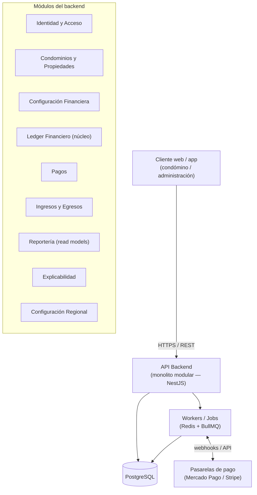
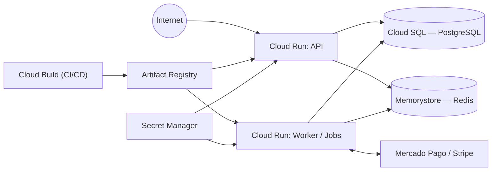
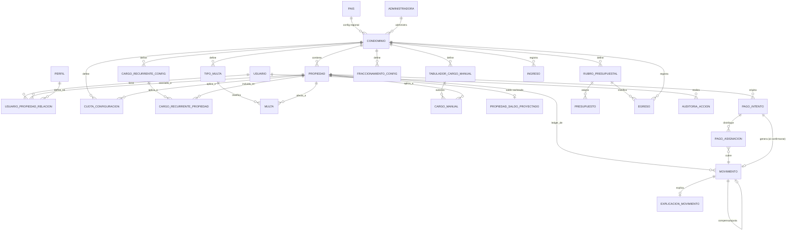

## Índice

0. [Ficha del proyecto](#0-ficha-del-proyecto)
1. [Descripción general del producto](#1-descripción-general-del-producto)
2. [Arquitectura del sistema](#2-arquitectura-del-sistema)
3. [Modelo de datos](#3-modelo-de-datos)
4. [Especificación de la API](#4-especificación-de-la-api)
5. [Historias de usuario](#5-historias-de-usuario)
6. [Tickets de trabajo](#6-tickets-de-trabajo)
7. [Pull requests](#7-pull-requests)

---

## 0. Ficha del proyecto

### **0.1. Tu nombre completo:**

Samuel Valdes Samperio

### **0.2. Nombre del proyecto:**

CondoManager

### **0.3. Descripción breve del proyecto:**

CondoManager es una plataforma de administración financiera y gestión de condominios horizontales. Permite a un condómino consultar de forma consolidada sus propiedades (incluso en varios condominios), entender cuánto debe y por qué, revisar su estado de cuenta histórico con cada ajuste explicado en lenguaje llano, y pagar en línea. Para la administración, permite configurar cuotas, cargos recurrentes, multas y el tabulador de cargos manuales aprobado por Asamblea, registrar pagos, ingresos y egresos (con CFDI), y generar un reporte financiero integral del condominio. El problema central que resuelve no es solo llevar la contabilidad, sino generar **confianza**, haciendo que la información financiera sea trazable y explicable para un condómino sin formación contable.

### **0.4. URL del proyecto:**

`[PENDIENTE — ver pregunta 4]` (no hay evidencia en el repositorio de un despliegue en vivo).

### 0.5. URL o archivo comprimido del repositorio

`https://github.com/samuel-valdes/condomanager` (repositorio **privado**; no se comparten accesos).

---

## 1. Descripción general del producto

### **1.1. Objetivo:**

> CondoManager debe ser una fuente única, confiable, explicable y trazable de la situación financiera de cada propiedad y del condominio — y esa explicabilidad debe ser comprensible para un condómino sin formación contable, no solo verificable por un sistema o un auditor (`docs/prd.md` §3).

El producto ataca el problema de **desconfianza** del condómino hacia la administración de su condominio, causada por información financiera opaca o difícil de verificar. Está dirigido a dos segmentos de comprador — administradoras profesionales (que gestionan varios condominios por cuenta de terceros) y comités/condominios autogestionados — pero el MVP 1 se optimiza primero para el flujo de una **administradora profesional**: el piloto confirmado en México es operado por **CondoManager** (la administradora profesional, cuyo nombre coincide con el del producto). Si CondoManager logra que un condómino entienda y confíe en su estado de cuenta, se abre la puerta a resolver además el problema de cobranza/morosidad y a convertirse en la fuente única de verdad financiera del condominio.

### **1.2. Características y funcionalidades principales:**

Organizadas por épica (`docs/prd.md` §8):

- **Identidad y acceso consolidado (E1):** autenticación única; visualización de todas las propiedades y condominios del usuario sin cambiar de sesión.
- **Saldo consolidado y adeudos vencidos (E2):** saldo total como suma de los saldos de todas las propiedades accesibles, con drill-down Saldo total → Condominio → Propiedad → Estado de cuenta → Movimiento; identificación de cargos vencidos.
- **Estado de cuenta histórico y explicable (E3):** consulta del estado de cuenta a la fecha actual o a cualquier fecha pasada, mostrando únicamente lo que existía en ese momento; toda modificación de saldo viene acompañada de una explicación en lenguaje llano.
- **Configuración financiera (E4):** definición de cuotas por propiedad (con soporte de cambios retroactivos trazables), cargos recurrentes (quincenal, mensual, bimestral, semestral, anual), tipos de multa/amonestación, y el tabulador de cargos manuales aprobado por Asamblea.
- **Aplicación de cargos y multas (E5):** generación, modificación y cancelación de cargos y multas sin pérdida de historial — toda cancelación se resuelve con un movimiento compensatorio, nunca con un borrado.
- **Pagos y cobranza (E6):** selección de adeudos a pagar respetando la regla de antigüedad (FIFO), fraccionamiento de adeudos en partes iguales cuando está aprobado, y pago en línea vía Mercado Pago o Stripe, sin reducir el saldo hasta tener confirmación válida.
- **Ingresos y egresos (E7):** registro de ingresos externos (intereses, rendimientos, aportaciones extraordinarias) y egresos con rubro presupuestal obligatorio y comprobante fiscal (CFDI en México).
- **Reporte financiero integral (E8):** ingresos por tipo, egresos por rubro, comparativo presupuesto vs. ejecución, evolución de recuperación de cartera, cartera vencida, y estado de pago de multas — todo por periodo mensual.

El detalle completo de los 35 requisitos funcionales está en `docs/prd.md` §9 y `docs/mvp.md` §18.

### **1.3. Diseño y experiencia de usuario:**

Propuesta de identidad visual y 5 pantallas de referencia (mockups SVG): **[Pantallas e Identidad Visual — CondoManager](https://claude.ai/artifact/EfJTN9JyyVA5tGdKUXLAzs)** (versión interactiva) — el mismo archivo está guardado en el repositorio en `docs/design/condomanager-screens.html` (ábrelo directamente en un navegador).

El sistema visual usa la metáfora de un libro contable: tipografía tabular (IBM Plex Mono) en toda cifra monetaria, un único color fijo para "vencido" y otro para "al corriente" (nunca ocultos), y el mismo sistema de tarjetas repetido en móvil y escritorio. Pantallas incluidas: Acceso, Saldo consolidado (RF-2/RF-3/RF-4), Estado de cuenta con la explicación en lenguaje llano siempre visible (RF-5/RF-7/RF-8), Pago en línea respetando antigüedad y fraccionamiento (RF-19 a RF-22), y Reporte financiero de administración (RF-28 a RF-35). Son mockups ilustrativos (no un prototipo navegable ni validados con el piloto todavía).

### **1.4. Instrucciones de instalación:**

El repositorio todavía no contiene código fuente (backend/frontend), solo documentación. El stack confirmado (`docs/architecture.md` §9) es Node.js + TypeScript (NestJS) en el backend, PostgreSQL como base de datos, Redis + BullMQ para colas/jobs, y React o Next.js en el frontend. Gestor de paquetes: **npm**. PostgreSQL y Redis se levantan en local vía **docker-compose**.

Pasos previstos una vez exista el código:

1. Clonar el repositorio (privado).
2. Instalar dependencias del backend: `npm install` (dentro de `backend/`).
3. Instalar dependencias del frontend: `npm install` (dentro de `frontend/`).
4. Copiar `.env.example` a `.env` en `backend/` y completar variables (conexión a PostgreSQL, Redis, credenciales OAuth2/OIDC propio, claves de Mercado Pago/Stripe en modo sandbox).
5. Levantar PostgreSQL y Redis en local con `docker-compose up -d` (servicios `postgres` y `redis` definidos en `docker-compose.yml`).
6. Ejecutar migraciones de base de datos: `npm run migration:run` (dentro de `backend/`).
7. Ejecutar datos semilla (país México, un condominio, una administradora y propiedades de ejemplo): `npm run seed`.
8. Levantar el backend en modo desarrollo: `npm run start:dev` (dentro de `backend/`).
9. Levantar el frontend en modo desarrollo: `npm run dev` (dentro de `frontend/`).

---

## 2. Arquitectura del Sistema

### **2.1. Diagrama de arquitectura:**

**Patrón elegido: monolito modular** (no microservicios) organizado por *bounded contexts*, con un ledger financiero append-only como núcleo (`docs/architecture.md` §2, §4).



**Justificación:** el dominio tiene un núcleo fuertemente transaccional (aplicar un pago debe actualizar el ledger de forma atómica respetando la regla FIFO), con un solo piloto y un equipo reducido — separar en microservicios añadiría complejidad de coordinación distribuida sin beneficio real todavía. El monolito se modulariza por bounded context precisamente para que extraer un módulo a un servicio independiente más adelante (p. ej. Pagos, cuando haya múltiples pasarelas y alto volumen) sea un refactor localizado, no una reescritura.

**Beneficios:** despliegue y operación simples, transacciones ACID naturales entre módulos, menor sobrecarga operativa para el tamaño actual del equipo/piloto.
**Déficits asumidos:** escalado independiente por módulo no es posible sin refactor; un fallo de despliegue afecta a todo el sistema a la vez; acoplamiento en tiempo de compilación entre módulos del mismo proceso.

### **2.2. Descripción de componentes principales:**

(`docs/architecture.md` §3)

- **Identidad y Acceso:** usuarios, los 7 perfiles/roles del MVP, y la relación N:M usuario↔propiedad con vigencia. Actúa también como servidor de autorización OAuth2/OIDC propio (no delega a un IdP externo).
- **Condominios y Propiedades:** condominios, propiedades, su asociación a una administradora (o ninguna, si es autogestionado) y a una configuración regional (país).
- **Configuración Financiera:** cuotas vigentes, configuración de cargos recurrentes, tipos de multa, tabulador de cargos manuales, fraccionamiento, rubros presupuestales y presupuesto.
- **Ledger Financiero (núcleo):** libro de movimientos *append-only* por propiedad — cargos, pagos, ajustes y compensaciones. Es el único módulo autorizado a escribir en la tabla de movimientos.
- **Pagos:** orquesta selección de adeudos elegibles, regla FIFO de antigüedad, fraccionamiento autorizado, e interacción con la pasarela de pago.
- **Integración de Pasarelas de Pago:** adaptador común (`PaymentGatewayPort`) con una implementación por proveedor (Mercado Pago, Stripe); procesa webhooks de forma idempotente.
- **Ingresos y Egresos:** ingresos externos y egresos del condominio, con rubro presupuestal y comprobante fiscal configurable por región.
- **Reportería:** vistas derivadas (consultas, no tablas de verdad propias) sobre el ledger, ingresos y egresos.
- **Explicabilidad:** genera, de forma síncrona y con plantillas deterministas (sin LLM), la explicación en lenguaje llano de todo ajuste o compensación, como parte del mismo flujo que crea el movimiento.
- **Configuración Regional:** catálogo de países/mercados con sus parámetros (moneda, tipo de comprobante fiscal, reglas específicas de la región).

### **2.3. Descripción de alto nivel del proyecto y estructura de ficheros**

El repositorio actual solo contiene la carpeta `docs/` con la documentación de producto y arquitectura (`architecture.md`, `data-model.md`, `mvp.md`, `prd.md`); todavía no existe código fuente. Estructura acordada, consistente con el monolito modular por bounded context:

```
condomanager/
├── docs/                      # Documentación de producto y arquitectura (ya existente)
│   ├── prd.md
│   ├── mvp.md
│   ├── architecture.md
│   └── data-model.md
├── backend/
│   ├── src/
│   │   ├── modules/
│   │   │   ├── identity/              # Identidad y Acceso (OAuth2/OIDC propio)
│   │   │   ├── properties/            # Condominios y Propiedades
│   │   │   ├── financial-config/      # Cuotas, cargos recurrentes, multas, tabulador
│   │   │   ├── ledger/                # Núcleo: movimientos append-only, saldo proyectado
│   │   │   ├── payments/              # Orquestación de pagos, FIFO, fraccionamiento
│   │   │   ├── payment-gateways/      # Adaptadores Mercado Pago / Stripe
│   │   │   ├── income-expense/        # Ingresos y egresos
│   │   │   ├── reporting/             # Read models / reporte financiero
│   │   │   ├── explainability/        # Plantillas deterministas de explicación
│   │   │   └── regional-config/       # Catálogo de países/regiones
│   │   ├── common/                    # Guards, decoradores, pipes compartidos
│   │   └── main.ts
│   └── test/
└── frontend/
    └── src/
        ├── pages|app/                 # Dashboard consolidado, estado de cuenta, pagos
        ├── components/
        └── services/                  # Cliente de la API
```

### **2.4. Infraestructura y despliegue**

**Proveedor elegido: Google Cloud Platform (GCP).** `docs/architecture.md` §9 solo confirmaba contenedores (Docker) sin fijar proveedor; se concreta a GCP con los siguientes servicios:

- **Cloud Run** para el backend (monolito modular NestJS) containerizado — escalado a cero/automático, sin gestión de clúster para el volumen esperado del piloto.
- **Cloud SQL for PostgreSQL** como base de datos relacional, con row-level security habilitado para aislar condominios (tenants).
- **Memorystore (Redis)** para las colas de BullMQ (generación de cargos recurrentes, procesamiento de webhooks de pago con reintentos).
- **Cloud Run jobs / un segundo servicio Cloud Run** dedicado al worker de jobs en segundo plano.
- **Artifact Registry** para las imágenes Docker y **Cloud Build** como pipeline de CI/CD (build → test → push de imagen → despliegue a Cloud Run).
- **Secret Manager** para credenciales (DB, OAuth, claves de Mercado Pago/Stripe).
- Pasarelas externas (Mercado Pago, Stripe) se comunican con el backend vía webhooks sobre HTTPS pública expuesta por Cloud Run.

Diagrama de despliegue:



**Proceso de despliegue (CI/CD):** cada push a la rama principal dispara Cloud Build, que ejecuta build + tests, construye la imagen Docker, la publica en Artifact Registry y despliega una nueva revisión en Cloud Run (backend y worker). Las migraciones de base de datos se ejecutan como paso previo al despliegue, antes de enrutar tráfico a la nueva revisión.

### **2.5. Seguridad**

(`docs/architecture.md` §8)

- **Autenticación/autorización OAuth2/OIDC con proveedor de identidad propio:** el backend emite y valida sus propios tokens; no se delega a un IdP externo (Auth0/Cognito/Keycloak).
- **Autorización por rol y por relación:** las acciones restringidas a un rol (ej. solo el Administrador del Condominio puede modificar/cancelar una multa, RF-15) se validan en la capa de aplicación, no solo en la UI; cada requisito de este tipo debe tener un caso de prueba reproducible que confirme el rechazo cuando el rol no corresponde (RNF-1).
- **Privacidad por relación activa:** la información financiera de una propiedad solo es visible para usuarios con una relación activa y vigente sobre esa propiedad (RNF-9).
- **Aislamiento multi-tenant:** todo acceso a datos exige `condominio_id` en el filtro; se recomienda row-level security de PostgreSQL sobre las tablas del Ledger como defensa adicional ante un posible bug de aplicación.
- **Auditoría transversal:** toda configuración financiera sensible (cambio de cuota, de tabulador, etc.) queda asociada al usuario que la realizó, registrada en `AUDITORIA_ACCION`, independiente del ledger (que ya es auditable por diseño).
- **Idempotencia en pagos:** los webhooks de confirmación de pago se procesan de forma idempotente por `referencia_externa`, para no aplicar el mismo pago dos veces.
- **No custodia de fondos:** el dinero del condómino va directo a la cuenta bancaria del condominio vía la pasarela; CondoManager solo registra la confirmación (reduce superficie de riesgo regulatorio/financiero).

### **2.6. Tests**

**Pendiente.** No existe código ni suite de tests todavía en el repositorio.

---

## 3. Modelo de Datos

### **3.1. Diagrama del modelo de datos:**

(`docs/data-model.md` §1)



### **3.2. Descripción de entidades principales:**

Convenciones (`docs/data-model.md`): todo movimiento financiero es *append-only* (no hay `updated_at` de negocio en tablas de ledger); `fecha_efectiva` (cuándo afecta la cuenta) vs. `creado_en` (cuándo se creó el registro) aparece en toda tabla con posible efecto retroactivo; los importes (`importe`) siempre son positivos — el signo lo determina el campo `efecto`.

| Entidad | Campos clave | Notas |
|---|---|---|
| **USUARIO** | `id` (PK, uuid), `nombre`, `email` (unique), `creado_en` | |
| **PERFIL** | `id` (PK, smallint, catálogo), `nombre` | 7 roles fijos: Condómino Titular, Condómino, Inquilino, Administrador Residente, Administrador del Condominio, Comité, Administrador del Sistema |
| **USUARIO_PROPIEDAD_RELACION** | `id` (PK), `usuario_id` (FK→USUARIO), `propiedad_id` (FK→PROPIEDAD), `perfil_id` (FK→PERFIL), `vigente_desde`, `vigente_hasta` (nullable) | resuelve N:M usuario↔propiedad con vigencia |
| **PAIS** | `id` (PK, smallint), `codigo` (ISO-3166), `moneda` (ISO-4217), `tipo_comprobante_fiscal_egreso`, `requiere_tabulador_aprobado_asamblea` (boolean) | configuración regional; único punto de extensión multi-país |
| **ADMINISTRADORA** | `id` (PK, uuid), `nombre` | un condominio puede no tener administradora (autogestionado) |
| **CONDOMINIO** | `id` (PK, uuid), `nombre`, `administradora_id` (FK, nullable), `pais_id` (FK→PAIS) | |
| **PROPIEDAD** | `id` (PK, uuid), `condominio_id` (FK→CONDOMINIO), `identificador` | |
| **CUOTA_CONFIGURACION** | `id` (PK), `propiedad_id` (FK), `importe`, `vigente_desde`, `vigente_hasta`, `creado_por` (FK→USUARIO), `creado_en`, `es_retroactivo` (boolean), `motivo` (obligatorio si retroactivo) | |
| **CARGO_RECURRENTE_CONFIG** | `id` (PK), `condominio_id` (FK), `concepto`, `importe`, `periodicidad` (enum: quincenal/mensual/bimestral/semestral/anual), `vigente_desde`, `vigente_hasta` | |
| **CARGO_RECURRENTE_PROPIEDAD** | `cargo_recurrente_config_id` (FK), `propiedad_id` (FK), `vigente_desde`, `vigente_hasta` | tabla puente N:M con vigencia |
| **TIPO_MULTA** | `id` (PK), `condominio_id` (FK), `nombre`, `es_amonestacion` (boolean) | |
| **MULTA** | `id` (PK), `propiedad_id` (FK), `tipo_multa_id` (FK), `importe` (nullable), `fecha_creacion`, `fecha_aplicacion`, `estado` (enum: activa/cancelada/modificada), `creado_por` (FK), `multa_original_id` (FK→MULTA, nullable) | cancelación/modificación nunca borra la fila |
| **TABULADOR_CARGO_MANUAL** | `id` (PK), `condominio_id` (FK), `concepto`, `importe_autorizado`, `vigente_desde`, `vigente_hasta` | catálogo aprobado por Asamblea |
| **CARGO_MANUAL** | `id` (PK), `propiedad_id` (FK), `tabulador_item_id` (FK→TABULADOR_CARGO_MANUAL), `fecha_creacion`, `fecha_aplicacion`, `creado_por` (FK), `estado` (enum: activo/cancelado) | |
| **FRACCIONAMIENTO_CONFIG** | `id` (PK), `condominio_id` (FK), `numero_partes` (int), `vigente_desde`, `vigente_hasta` | |
| **RUBRO_PRESUPUESTAL** | `id` (PK), `condominio_id` (FK), `nombre` | |
| **PRESUPUESTO** | `id` (PK), `rubro_id` (FK), `periodo`, `importe_presupuestado` | |
| **MOVIMIENTO** | `id` (PK, uuid), `propiedad_id` (FK), `tipo` (enum: cargo_recurrente/cargo_manual/multa/pago/ajuste/compensacion), `origen_tipo`, `origen_id` (FK polimórfica), `importe` (siempre positivo), `efecto` (enum: incrementa_saldo/reduce_saldo), `fecha_efectiva`, `creado_en` (inmutable), `creado_por` (FK), `movimiento_relacionado_id` (FK→MOVIMIENTO, nullable), `concepto` | tabla central, **append-only**; ningún módulo fuera del Ledger escribe aquí directamente |
| **PROPIEDAD_SALDO_PROYECTADO** | `propiedad_id` (PK/FK, 1:1), `saldo_actual`, `ultimo_movimiento_id` (FK→MOVIMIENTO), `actualizado_en` | proyección cacheada, derivada y reconstruible; se escribe en la misma transacción que cada `MOVIMIENTO` |
| **EXPLICACION_MOVIMIENTO** | `id` (PK), `movimiento_id` (FK→MOVIMIENTO, unique, 1:1), `plantilla_codigo`, `texto`, `generado_en` | obligatoria para todo movimiento tipo ajuste/compensación |
| **PAGO_INTENTO** | `id` (PK), `usuario_id` (FK), `importe_total`, `estado` (enum: pendiente/confirmado/fallido), `pasarela` (enum: mercado_pago/stripe), `referencia_externa` (usada para idempotencia del webhook), `creado_en`, `confirmado_en` (nullable) | |
| **PAGO_ASIGNACION** | `id` (PK), `pago_intento_id` (FK), `movimiento_cargo_id` (FK→MOVIMIENTO), `importe_asignado`, `movimiento_pago_id` (FK→MOVIMIENTO, nullable hasta confirmación) | plan de aplicación FIFO/fraccionamiento |
| **INGRESO** | `id` (PK), `condominio_id` (FK), `tipo` (enum), `importe`, `fecha`, `referencia` (nullable) | |
| **EGRESO** | `id` (PK), `condominio_id` (FK), `rubro_id` (FK, obligatorio), `importe`, `fecha`, `concepto`, `comprobante_fiscal_tipo`, `comprobante_fiscal_referencia`, `creado_por` (FK) | |
| **AUDITORIA_ACCION** | `id` (PK), `usuario_id` (FK), `accion`, `entidad`, `entidad_id`, `detalle` (json, nullable), `creado_en` | auditoría transversal de configuración, independiente del Ledger |

---

## 4. Especificación de la API

Estilo confirmado: **REST / OpenAPI 3.0** (`docs/architecture.md` §2 dejaba esto abierto frente a GraphQL). A continuación, 3 endpoints representativos derivados de RF-2, RF-5 y RF-22/RF-23.

```yaml
openapi: 3.0.3
info:
  title: CondoManager API (propuesta)
  version: "0.1.0"
paths:
  /api/v1/me/balance:
    get:
      summary: Saldo consolidado del usuario autenticado (RF-2, RF-4)
      security:
        - oauth2: []
      responses:
        "200":
          description: Saldo consolidado
          content:
            application/json:
              example:
                saldoTotal: 15800.00
                saldoVencido: 4000.00
                saldoNoVencido: 11800.00
                propiedades:
                  - propiedadId: "a1b2c3"
                    condominioId: "c9d8e7"
                    saldoActual: 7800.00
                  - propiedadId: "f4e5d6"
                    condominioId: "c9d8e7"
                    saldoActual: 8000.00

  /api/v1/properties/{propertyId}/statement:
    get:
      summary: Estado de cuenta de una propiedad, actual o a una fecha pasada (RF-5, RF-6, RF-7)
      security:
        - oauth2: []
      parameters:
        - name: propertyId
          in: path
          required: true
          schema: { type: string, format: uuid }
        - name: asOf
          in: query
          required: false
          description: Fecha de corte (ISO-8601); si se omite, se usa la fecha actual
          schema: { type: string, format: date }
      responses:
        "200":
          description: Movimientos y saldo resultante a la fecha solicitada
          content:
            application/json:
              example:
                propiedadId: "a1b2c3"
                fechaConsulta: "2026-09-30"
                saldoResultante: 7800.00
                movimientos:
                  - fecha: "2026-09-01"
                    concepto: "Cuota de mantenimiento septiembre"
                    tipo: "cargo_recurrente"
                    importe: 2200.00
                    saldo: 7800.00
                  - fecha: "2026-08-15"
                    concepto: "Ajuste retroactivo de cuota (ver explicación)"
                    tipo: "ajuste"
                    importe: 150.00
                    saldo: 5600.00
                    explicacion: "Tu cuota de agosto cambió de $2,050 a $2,200 por acuerdo de Asamblea del 10/08; la diferencia de $150 se aplicó este mes."

  /api/v1/payments/intents:
    post:
      summary: Iniciar un intento de pago (RF-19, RF-20, RF-21, RF-22)
      security:
        - oauth2: []
      requestBody:
        required: true
        content:
          application/json:
            example:
              seleccion:
                tipo: "propiedad"
                propiedadId: "a1b2c3"
              pasarela: "mercado_pago"
      responses:
        "201":
          description: Intento de pago creado, pendiente de confirmación por la pasarela
          content:
            application/json:
              example:
                pagoIntentoId: "p-001"
                estado: "pendiente"
                importeTotal: 4000.00
                asignaciones:
                  - movimientoCargoId: "m-010"
                    importeAsignado: 4000.00
                urlRedireccionPasarela: "https://www.mercadopago.com.mx/checkout/..."
```

---

## 5. Historias de Usuario

Las 18 historias de usuario desarrolladas hasta el momento cubren las épicas E1, E2 y E3. Cada una está documentada en su propio archivo bajo `docs/backlog/e{1,2,3}/` con su declaración completa (Como/Quiero/Para) y sus criterios de aceptación en formato Dado/Cuando/Entonces; aquí se listan agrupadas por épica, con un enlace al detalle completo de cada una.

### Épica 1 — Identidad y acceso consolidado (`docs/backlog/e1/`)

| ID | Historia | Declaración |
|---|---|---|
| E1-HU1 | [Autenticación única](backlog/e1/e1-hu1-autenticacion-unica.md) | Como usuario con acceso a propiedades en uno o varios condominios, quiero autenticarme una sola vez en CondoManager, para no tener que iniciar sesión por separado en cada condominio al que tengo acceso. |
| E1-HU2 | [Ver todas las propiedades consolidadas sin cambiar de sesión](backlog/e1/e1-hu2-lista-consolidada-sin-cambiar-sesion.md) | Como usuario recién autenticado, quiero ver en una sola pantalla todas las propiedades a las que tengo acceso, sin importar a qué condominio pertenezcan, para no tener que cambiar de cuenta o sesión para consultarlas. |
| E1-HU3 | [Identificación y condominio de cada propiedad](backlog/e1/e1-hu3-identificacion-y-condominio.md) | Como usuario consultando mi lista consolidada de propiedades, quiero ver la identificación de cada propiedad y el condominio al que pertenece, para ubicar de qué propiedad se trata dentro del listado. |
| E1-HU4 | [Relación del usuario con cada propiedad](backlog/e1/e1-hu4-relacion-con-cada-propiedad.md) | Como usuario con una relación específica sobre una propiedad (condómino, inquilino, administrador, etc.), quiero ver qué relación tengo con cada propiedad listada, para entender bajo qué rol estoy accediendo a ella. |
| E1-HU5 | [Propiedades consolidadas sin importar el perfil](backlog/e1/e1-hu5-consolidado-sin-importar-perfil.md) | Como usuario con distintos perfiles en distintas propiedades (ej. condómino en una, Administrador Residente en otra), quiero ver todas mis propiedades consolidadas en una sola lista sin importar el perfil que tengo en cada una, para no necesitar una vista separada por rol. |

### Épica 2 — Saldo consolidado y adeudos vencidos (`docs/backlog/e2/`)

| ID | Historia | Declaración |
|---|---|---|
| E2-HU1 | [Saldo consolidado](backlog/e2/e2-hu1-saldo-consolidado.md) | Como condómino con una o varias propiedades, quiero ver mi saldo consolidado (suma de todas mis propiedades) al entrar a CondoManager, para conocer cuánto debo en total sin calcularlo manualmente. |
| E2-HU2 | [Desglose del saldo por condominio](backlog/e2/e2-hu2-desglose-por-condominio.md) | Como condómino con propiedades en varios condominios, quiero ver mi saldo desglosado por condominio, para saber qué condominio concentra mi adeudo. |
| E2-HU3 | [Desglose del saldo por propiedad](backlog/e2/e2-hu3-desglose-por-propiedad.md) | Como condómino, quiero ver mi saldo desglosado por propiedad dentro de un condominio, para identificar cuál de mis propiedades específicas tiene el adeudo. |
| E2-HU4 | [Navegar de una propiedad a su estado de cuenta](backlog/e2/e2-hu4-navegar-estado-cuenta.md) | Como condómino, quiero navegar desde una propiedad hacia su estado de cuenta, para acceder al detalle de los movimientos que explican su saldo. |
| E2-HU5 | [Ver el movimiento individual que origina un cargo](backlog/e2/e2-hu5-movimiento-individual.md) | Como condómino, quiero identificar desde el estado de cuenta el movimiento individual que originó un cargo o adeudo, para verificar su origen exacto. |
| E2-HU6 | [Saldo vencido vs. saldo no vencido](backlog/e2/e2-hu6-saldo-vencido-no-vencido.md) | Como condómino, quiero ver por separado mi saldo vencido y mi saldo no vencido, para saber qué parte de mi deuda ya está en mora. |
| E2-HU7 | [Lista de propiedades con adeudo](backlog/e2/e2-hu7-propiedades-con-adeudo.md) | Como condómino con múltiples propiedades, quiero ver la lista de propiedades que tienen adeudos, para saber cuáles requieren mi atención sin revisar cada una individualmente. |
| E2-HU8 | [Cargos vencidos consolidados](backlog/e2/e2-hu8-cargos-vencidos-consolidados.md) | Como condómino, quiero ver en un solo lugar la lista de cargos vencidos de todas mis propiedades y condominios, para no tener que consultarlos propiedad por propiedad. |

### Épica 3 — Estado de cuenta histórico y explicable (`docs/backlog/e3/`)

| ID | Historia | Declaración |
|---|---|---|
| E3-HU1 | [Consulta del estado de cuenta a cualquier fecha](backlog/e3/e3-hu1-consulta-estado-cuenta-por-fecha.md) | Como condómino, quiero consultar el estado de cuenta de una propiedad en cualquier fecha, actual o anterior, para conocer mi situación financiera tal como era en ese momento. |
| E3-HU2 | [Exclusión de información que no existía en la fecha consultada](backlog/e3/e3-hu2-exclusion-movimientos-no-existentes.md) | Como condómino, quiero que una consulta a una fecha pasada excluya cargos, pagos o ajustes que todavía no existían en esa fecha, para no ver información que no corresponde al momento que estoy consultando. |
| E3-HU3 | [Datos mínimos de cada movimiento](backlog/e3/e3-hu3-datos-minimos-por-movimiento.md) | Como condómino, quiero ver en cada movimiento del estado de cuenta su fecha, concepto, tipo (cargo o pago), importe y saldo resultante, para identificar con precisión qué originó cada cambio en mi saldo. |
| E3-HU4 | [Explicación en lenguaje llano de ajustes, cancelaciones y compensaciones](backlog/e3/e3-hu4-explicacion-lenguaje-llano.md) | Como condómino, quiero recibir una explicación en lenguaje sencillo cada vez que un ajuste, cancelación o movimiento compensatorio modifique mi saldo, para entender el motivo del cambio sin necesitar conocimientos contables. |
| E3-HU5 | [Explicación individual por movimiento aunque se combinen varios ajustes](backlog/e3/e3-hu5-explicacion-individual-ajustes-combinados.md) | Como condómino, quiero que cada movimiento conserve su propia explicación individual incluso cuando varios ajustes se combinen en el mismo periodo, para no perder claridad cuando hay cambios complejos sobre el mismo adeudo. |

Las épicas E4 a E8 (`docs/prd.md` §8) todavía no tienen historias de usuario descompuestas.

---

## 6. Tickets de Trabajo

Las 18 historias de usuario de la sección 5 se descompusieron en **74 tickets de trabajo**: cada uno es una unidad de trabajo que una persona puede terminar en una sesión (media jornada máx.), con tipo (Endpoint/API, Migración/DB, Modelo/Dominio, Frontend o Test), Definition of Done según su tipo y dependencias con otros tickets. El ticket hereda los criterios de aceptación de su historia; no se detalla en esta sección (tipos de columna, rutas, status codes, etc. quedan para la implementación).

El detalle completo de cada ticket (DoD por tipo, dependencias, criterios de aceptación heredados) está en:
- `docs/backlog/e1/tickets.md` — 23 tickets
- `docs/backlog/e2/tickets.md` — 33 tickets
- `docs/backlog/e3/tickets.md` — 18 tickets

### Épica 1 (23 tickets)

| ID | Título | Tipo |
|---|---|---|
| E1-HU1.1 | Persistencia de sesión y de intentos de autenticación fallidos | Migración/DB |
| E1-HU1.2 | Autenticación de credenciales y gestión de sesión única por usuario | Modelo/Dominio |
| E1-HU1.3 | Endpoint de inicio de sesión | Endpoint/API |
| E1-HU1.4 | Verificación de sesión válida exigida en todo endpoint de propiedad/condominio | Endpoint/API |
| E1-HU1.5 | Flujo de login único y navegación entre condominios sin re-autenticación | Frontend |
| E1-HU1.6 | Suite de pruebas de autenticación única | Test |
| E1-HU2.1 | Consulta de propiedades consolidadas del usuario autenticado | Modelo/Dominio |
| E1-HU2.2 | Endpoint de lista consolidada de propiedades, incluyendo el caso sin propiedades | Endpoint/API |
| E1-HU2.3 | Pantalla única de lista consolidada, incluyendo estado vacío explícito | Frontend |
| E1-HU2.4 | Acceso directo a una propiedad de otro condominio desde la lista consolidada | Frontend |
| E1-HU2.5 | Suite de pruebas de la lista consolidada | Test |
| E1-HU3.1 | Incluir identificador de propiedad y nombre de condominio en la consulta consolidada | Modelo/Dominio |
| E1-HU3.2 | Exponer identificador de propiedad y condominio en la respuesta del endpoint consolidado | Endpoint/API |
| E1-HU3.3 | Mostrar identificador de propiedad y condominio por elemento de la lista | Frontend |
| E1-HU3.4 | Pruebas de identificación y condominio, incluyendo identificadores duplicados entre condominios | Test |
| E1-HU4.1 | Resolver todas las relaciones vigentes del usuario por propiedad | Modelo/Dominio |
| E1-HU4.2 | Exponer las relaciones/roles vigentes del usuario por propiedad en el endpoint consolidado | Endpoint/API |
| E1-HU4.3 | Mostrar todas las relaciones/roles vigentes del usuario por propiedad | Frontend |
| E1-HU4.4 | Pruebas de relaciones del usuario por propiedad, incluyendo relaciones simultáneas y vencidas | Test |
| E1-HU5.1 | Agregación de propiedades de todos los perfiles del usuario sin duplicar ni omitir | Modelo/Dominio |
| E1-HU5.2 | Regla de visibilidad global para el perfil Administrador del Sistema | Modelo/Dominio |
| E1-HU5.3 | Aplicar visibilidad global de Administrador del Sistema en el endpoint consolidado | Endpoint/API |
| E1-HU5.4 | Pruebas de consolidación sin importar perfil, incluyendo Administrador del Sistema | Test |

### Épica 2 (33 tickets)

| ID | Título | Tipo |
|---|---|---|
| E2-HU1.1 | Cálculo del saldo consolidado del usuario a partir de los saldos de sus propiedades con relación vigente | Modelo/Dominio |
| E2-HU1.2 | Endpoint de saldo consolidado del usuario autenticado, incluyendo caso sin propiedades | Endpoint/API |
| E2-HU1.3 | Mostrar saldo consolidado al entrar a CondoManager, incluyendo estado sin propiedades y saldo a favor | Frontend |
| E2-HU1.4 | Suite de pruebas de saldo consolidado | Test |
| E2-HU2.1 | Agregación del saldo del usuario agrupado por condominio, incluyendo condominios con saldo cero | Modelo/Dominio |
| E2-HU2.2 | Endpoint de desglose de saldo por condominio | Endpoint/API |
| E2-HU2.3 | Navegación desde el saldo consolidado al desglose por condominio, incluido el caso de un solo condominio | Frontend |
| E2-HU2.4 | Pruebas del desglose por condominio, incluyendo condominio único y condominio con saldo cero | Test |
| E2-HU3.1 | Obtener el saldo individual de cada propiedad del usuario dentro de un condominio, incluyendo saldo cero y saldo a favor | Modelo/Dominio |
| E2-HU3.2 | Endpoint de desglose de saldo por propiedad dentro de un condominio | Endpoint/API |
| E2-HU3.3 | Navegación desde el saldo de un condominio al desglose por propiedad, mostrando saldo cero y saldo a favor de forma distintiva | Frontend |
| E2-HU3.4 | Pruebas del desglose por propiedad, incluyendo saldo cero y saldo a favor | Test |
| E2-HU4.1 | Obtener el estado de cuenta de una propiedad específica, validando relación vigente del usuario y manejando propiedad sin movimientos | Modelo/Dominio |
| E2-HU4.2 | Endpoint de estado de cuenta de una propiedad, incluyendo rechazo cuando la relación no está vigente | Endpoint/API |
| E2-HU4.3 | Navegación desde una propiedad hacia su estado de cuenta, incluyendo estado vacío para propiedad sin movimientos | Frontend |
| E2-HU4.4 | Pruebas de navegación al estado de cuenta, incluyendo relación no vigente y propiedad sin movimientos | Test |
| E2-HU5.1 | Obtener el detalle de un movimiento individual del estado de cuenta, incluyendo su vínculo con el movimiento compensatorio cuando aplique | Modelo/Dominio |
| E2-HU5.2 | Endpoint de detalle de un movimiento individual | Endpoint/API |
| E2-HU5.3 | Selección de un cargo en el estado de cuenta para ver su movimiento individual, mostrando el movimiento original y el compensatorio como registros distintos vinculados | Frontend |
| E2-HU5.4 | Pruebas del movimiento individual, incluyendo cargo con ajuste/compensación posterior vinculado | Test |
| E2-HU6.1 | Soporte de fecha de vencimiento por cargo en el ledger (cuota, cargo recurrente, cargo manual, multa) | Migración/DB |
| E2-HU6.2 | Clasificación de saldo vencido vs. no vencido con corte inclusivo a la fecha actual | Modelo/Dominio |
| E2-HU6.3 | Exponer saldo vencido y saldo no vencido en el saldo consolidado del usuario | Endpoint/API |
| E2-HU6.4 | Mostrar saldo vencido y saldo no vencido por separado, incluyendo el caso de saldo vencido en cero | Frontend |
| E2-HU6.5 | Pruebas de saldo vencido/no vencido, incluyendo corte inclusivo en la fecha actual y coincidencia con el saldo total | Test |
| E2-HU7.1 | Filtrar las propiedades del usuario con saldo pendiente, excluyendo las que están al corriente o a favor | Modelo/Dominio |
| E2-HU7.2 | Endpoint de lista de propiedades con adeudo, incluyendo caso sin adeudos | Endpoint/API |
| E2-HU7.3 | Mostrar la lista de propiedades con adeudo, incluyendo mensaje explícito cuando no hay adeudos | Frontend |
| E2-HU7.4 | Pruebas de la lista de propiedades con adeudo, incluyendo propiedad a favor excluida y caso sin adeudos | Test |
| E2-HU8.1 | Consolidar los cargos vencidos de todas las propiedades y condominios del usuario (cuotas, cargos recurrentes, cargos manuales y multas), ordenados del más antiguo al más reciente | Modelo/Dominio |
| E2-HU8.2 | Endpoint de cargos vencidos consolidados del usuario, incluyendo caso sin cargos vencidos | Endpoint/API |
| E2-HU8.3 | Pantalla de cargos vencidos consolidados, identificando condominio y propiedad de cada cargo, incluyendo mensaje explícito sin cargos vencidos | Frontend |
| E2-HU8.4 | Pruebas de cargos vencidos consolidados, incluyendo distintos tipos de cargo y el orden del más antiguo al más reciente | Test |

### Épica 3 (18 tickets)

| ID | Título | Tipo |
|---|---|---|
| E3-HU1.1 | Cálculo del saldo y movimientos de una propiedad a una fecha dada (actual o pasada) sobre el ledger | Modelo/Dominio |
| E3-HU1.2 | Validación de la fecha de consulta: rechazo de fechas futuras y de acceso sin relación vigente | Modelo/Dominio |
| E3-HU1.3 | Endpoint de estado de cuenta de una propiedad con parámetro de fecha de consulta | Endpoint/API |
| E3-HU1.4 | Selector de fecha en el estado de cuenta, con bloqueo de fechas futuras y mensaje para fechas sin información disponible | Frontend |
| E3-HU1.5 | Suite de pruebas de consulta del estado de cuenta por fecha | Test |
| E3-HU2.1 | Exclusión de movimientos con fecha efectiva posterior a la fecha consultada del saldo y del listado del estado de cuenta histórico | Modelo/Dominio |
| E3-HU2.2 | Reflejar un ajuste retroactivo en su propia fecha efectiva sin alterar el saldo histórico previo a su creación | Modelo/Dominio |
| E3-HU2.3 | Pruebas de exclusión de movimientos posteriores y de ajustes retroactivos reflejados en su propia fecha | Test |
| E3-HU3.1 | Incluir fecha, concepto, tipo (cargo o pago), importe y saldo resultante por movimiento, en orden cronológico consistente | Modelo/Dominio |
| E3-HU3.2 | Exponer fecha, concepto, tipo, importe y saldo resultante por movimiento en la respuesta del endpoint de estado de cuenta | Endpoint/API |
| E3-HU3.3 | Mostrar fecha, concepto, tipo, importe y saldo resultante por movimiento en la vista de estado de cuenta | Frontend |
| E3-HU3.4 | Pruebas de los datos mínimos por movimiento, incluyendo movimientos con la misma fecha y consistencia del saldo resultante | Test |
| E3-HU4.1 | Incluir la explicación en lenguaje llano asociada a todo movimiento de ajuste, cancelación o compensación en la consulta del estado de cuenta | Modelo/Dominio |
| E3-HU4.2 | Exponer la explicación en lenguaje llano por movimiento en la respuesta del endpoint de estado de cuenta | Endpoint/API |
| E3-HU4.3 | Mostrar la explicación en lenguaje llano junto al movimiento correspondiente en el estado de cuenta | Frontend |
| E3-HU4.4 | Pruebas de explicación en lenguaje llano, verificando que ningún ajuste/cancelación/compensación quede sin explicación | Test |
| E3-HU5.1 | Garantizar una explicación individual por cada movimiento de ajuste/compensación, sin fusionar ni omitir cuando varios ocurren sobre el mismo periodo, en el mismo orden cronológico que sus movimientos | Modelo/Dominio |
| E3-HU5.2 | Pruebas de explicaciones individuales con múltiples ajustes combinados sobre el mismo periodo, verificando que ninguna se omite, fusiona ni resume | Test |

Las épicas E4 a E8 todavía no tienen tickets, porque dependen de historias de usuario que aún no se descomponen (ver sección 5).

---

## 7. Pull Requests

**Pendiente.** El historial de commits del repositorio hasta ahora corresponde únicamente a la documentación de producto y arquitectura (`docs/`); todavía no se han abierto Pull Requests de implementación. Esta sección debe completarse con las 3 PRs reales una vez exista desarrollo.

**Pull Request 1**

**Pull Request 2**

**Pull Request 3**
