## Índice

0. [Ficha del proyecto](#0-ficha-del-proyecto)
1. [Descripción general del producto](#1-descripción-general-del-producto)
2. [Arquitectura del sistema](#2-arquitectura-del-sistema)
3. [Modelo de datos](#3-modelo-de-datos)
4. [Especificación de la API](#4-especificación-de-la-api)
5. [Historias de usuario](#5-historias-de-usuario)
6. [Tickets de trabajo](#6-tickets-de-trabajo)
7. [Pull requests](#7-pull-requests)

> **Estado de este documento (Entrega 2, [presentada de forma anticipada](https://github.com/LIDR-academy-temp/AI4Devs-finalproject/pull/14)):** describe el MVP implementado, que se instala y se prueba desde este repositorio. Lo que todavía no existe se indica como pendiente: el despliegue público, el despliegue continuo y la validación agronómica del índice.

---

## 0. Ficha del proyecto

### **0.1. Tu nombre completo:**

Pablo Guillermo Di Nanno

### **0.2. Nombre del proyecto:**

Weather Track

### **0.3. Descripción breve del proyecto:**

Aplicación web adaptable a escritorio y móvil que transforma los datos de una estación meteorológica en una recomendación clara sobre si conviene aplicar fitosanitarios en este momento.

### **0.4. URL del proyecto:**

El MVP se ejecuta en la computadora de quien lo instala, en `http://localhost:8080`: ver la [instalación](#14-instrucciones-de-instalación). Todavía no hay una URL pública, porque el despliegue en internet quedó pospuesto hasta después de esta entrega ([ADR-0002](docs/decisions/0002-proveedor-del-servidor.md)). El acceso al prototipo de validación se comparte por un canal privado cuando se solicita.

### **0.5. URL o archivo comprimido del repositorio**

https://github.com/dinannopabloguillermo/AI4Devs-finalproject-temp

---

## 1. Descripción general del producto

### **1.1. Objetivo:**

**Problema.** Aplicar fitosanitarios durante una inversión térmica aumenta el riesgo de deriva: el aire estable puede mantener el producto suspendido y trasladarlo fuera del lote. Las estaciones meteorológicas ya miden las variables necesarias, pero entregan valores sueltos. Quien debe decidir tiene que interpretarlos por su cuenta, sin saber si los datos están actualizados o son confiables.

**Para quién.** Productores agropecuarios y aplicadores que trabajan en la zona de influencia de una estación. El caso inicial es la estación INTA Pergamino, con sensores de temperatura y humedad a 2 m y 10 m, viento y radiación solar, entre otros.

**Pregunta que responde.** "¿Puedo aplicar ahora en esta estación sin riesgo de deriva?"

| Qué introduce el usuario | Qué le devuelve el sistema |
|---|---|
| Correo y contraseña | Acceso a las estaciones que tiene asignadas |
| Estación | Condiciones actuales, antigüedad del dato y calidad de cada lectura |
| Nada adicional: la evaluación se calcula sola cada 10 minutos | Recomendación, índice TIS y motivos en lenguaje claro |
| Sensor y rango de fechas | Serie histórica con máximo, mínimo, promedio y cantidad de registros |

**Origen.** El proyecto nació en un ámbito laboral, creció como servicio profesional y se integra aquí como tesis de graduación.

### **1.2. Características y funcionalidades principales:**

#### Alcance del MVP

| ID | Funcionalidad | Descripción |
|---|---|---|
| F1 | Cuentas | Registro público con confirmación por correo, ingreso, recupero de la contraseña, «Mi cuenta» y baja, que borra la cuenta con todos sus datos. Las cuentas sin confirmar en 48 horas también se borran. Sin niveles de usuario: toda cuenta confirmada ve todas las estaciones. Las credenciales de SAT2 nunca se relacionan con las cuentas. |
| F2 | Estación | Selector siempre visible con las estaciones: cada una es un equipo de SAT2, hoy INTA Pergamino. Un equipo que deja de llegar de SAT2 queda inactivo y muestra solo sus históricos. |
| F3 | Condiciones actuales | Una tarjeta por sensor con valor, unidad, calidad del dato y antigüedad. |
| F4 | Recomendación | Estado de aplicación, índice TIS (Índice de Inversión Térmica), diferencia térmica y motivos. |
| F5 | Históricos | Serie por sensor del último día, la última semana o el último mes, o de un rango elegido en el calendario: hasta 31 días, dentro del último año y sin fechas futuras. Con resumen estadístico. |
| F6 | Ingesta automática | Carga inicial de los últimos 31 días y proceso programado que cada 10 minutos obtiene datos, los normaliza, los guarda y calcula la recomendación. |
| F7 | Base de clientes | El administrador exporta a CSV las cuentas confirmadas, con su consentimiento para recibir novedades, sin datos de acceso. |

#### Sistema de unidades

Todo el sistema usa unidades métricas: las medidas se guardan, calculan y muestran así. Las referencias en mph o °F solo aparecen al citar una fuente en el [contraste bibliográfico](docs/tis/contraste-bibliografico.md).

| Magnitud | Unidad |
|---|---|
| Temperatura | °C |
| Velocidad del viento | km/h |
| Dirección del viento | grados |
| Radiación solar | W/m² |
| Humedad relativa | % |
| Presión | hPa |
| Lluvia | mm |
| Altura de medición | m |

Si un sensor usado por el índice informara otra unidad, sus lecturas no se usan y la recomendación pasa a `DATOS_INSUFICIENTES`.

#### Reglas de la recomendación

El índice TIS va de 0 a 100 y combina cuatro factores:

`TIS = 0,50 × temperatura + 0,25 × viento + 0,15 × radiación + 0,10 × humedad`

En este documento, ΔT significa siempre `T10m − T2m`.

| Factor | Regla (de 0 a 100) |
|---|---|
| Temperatura | ΔT ≤ 0: 0. ΔT ≥ 3 °C: 100. En el medio, `ΔT / 3 × 100` |
| Viento (km/h) | ≤ 1: 100. ≤ 3: 90. ≤ 5: 70. ≤ 8: 40. ≤ 12: 20. Mayor: 0 |
| Radiación (W/m²) | ≤ 0: 100. ≤ 50: 90. ≤ 100: 75. ≤ 250: 50. ≤ 500: 20. Mayor: 0 |
| Humedad (promedio de 2 m y 10 m) | ≥ 90 %: 100. ≥ 80 %: 80. ≥ 60 %: 50. Menor: 20 |

| Índice | Estado base |
|---|---|
| 0 a 20 | `APTO` |
| Más de 20 y hasta 40 | `PRECAUCION` |
| Más de 40 y hasta 60 | `RIESGO_DERIVA` |
| Más de 60 | `NO_APLICAR` |

Las siguientes reglas se aplican en este orden sobre el estado base:

| ID | Regla | Resultado |
|---|---|---|
| R1 | Falta o es inválida alguna de las seis lecturas (T2m, T10m, HR2m, HR10m, viento o radiación) | `DATOS_INSUFICIENTES`, sin índice |
| R2 | La medición tiene más de 30 minutos de antigüedad al consultarla | `DATOS_INSUFICIENTES`, con motivo `DATOS_DESACTUALIZADOS` |
| R3 | ΔT > 0 | Nunca `APTO`: como mínimo `PRECAUCION`, con motivo `INVERSION_DETECTADA` |
| R3b | ΔT > 0 y viento de 6,4 km/h o menos | `NO_APLICAR`, con motivo `INVERSION_DETECTADA` |
| R4 | Alguna lectura es sospechosa (por ejemplo, más de 25 puntos de diferencia de humedad entre 2 m y 10 m) | Nunca `APTO`: como mínimo `PRECAUCION`, con motivo `DATO_SOSPECHOSO` |

La recomendación es **orientativa** y la pantalla lo indica siempre. Los pesos y umbrales provienen del prototipo: la bibliografía respalda las variables, pero no sus valores, como detalla el [contraste bibliográfico](docs/tis/contraste-bibliografico.md). Su validación agronómica está prevista para la Entrega 3. No reemplaza el criterio de un profesional ni la etiqueta del producto.

**Situación actual de la estación real.** Desde el 30 de octubre de 2026, el sensor de humedad a 2 m de la estación informa 0 %, tras semanas de valores en baja. Mientras no se revise en el campo, la regla R4 impide que esa estación llegue a `APTO`. Es el comportamiento esperado ante un dato dudoso.

### **1.3. Diseño y experiencia de usuario:**

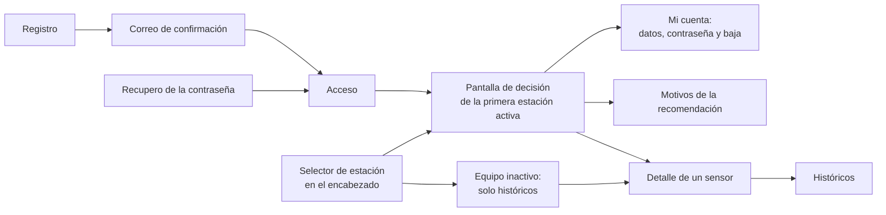

La **pantalla de decisión** es el centro de la experiencia. Muestra primero el estado de aplicación con su color, debajo los motivos y el aviso de que es orientativa, y al final las tarjetas de sensores. Se actualiza sola cada 60 segundos. Si los datos no son vigentes, el estado pasa a `DATOS_INSUFICIENTES` y explica por qué.

El encabezado tiene siempre el selector de estación, aunque haya una sola, y el enlace a «Mi cuenta». En los modos con datos ficticios, una franja lo avisa en todas las pantallas.

La **pantalla de acceso** ofrece crear una cuenta y recuperar la contraseña. Los enlaces de los correos abren pantallas propias: confirmar la cuenta, elegir una contraseña nueva o darse de baja, que solo borra al tocar el botón. Los términos de uso y la política de privacidad son un borrador pendiente de revisión legal.

Capturas del MVP, con datos ficticios. Las primeras cuatro son del modo `simulado`, con el nombre de la estación real; las demás, del modo `prueba`, con las situaciones cargadas en "Caso de prueba - 1":

| Pantalla | Captura |
|---|---|
| Acceso | 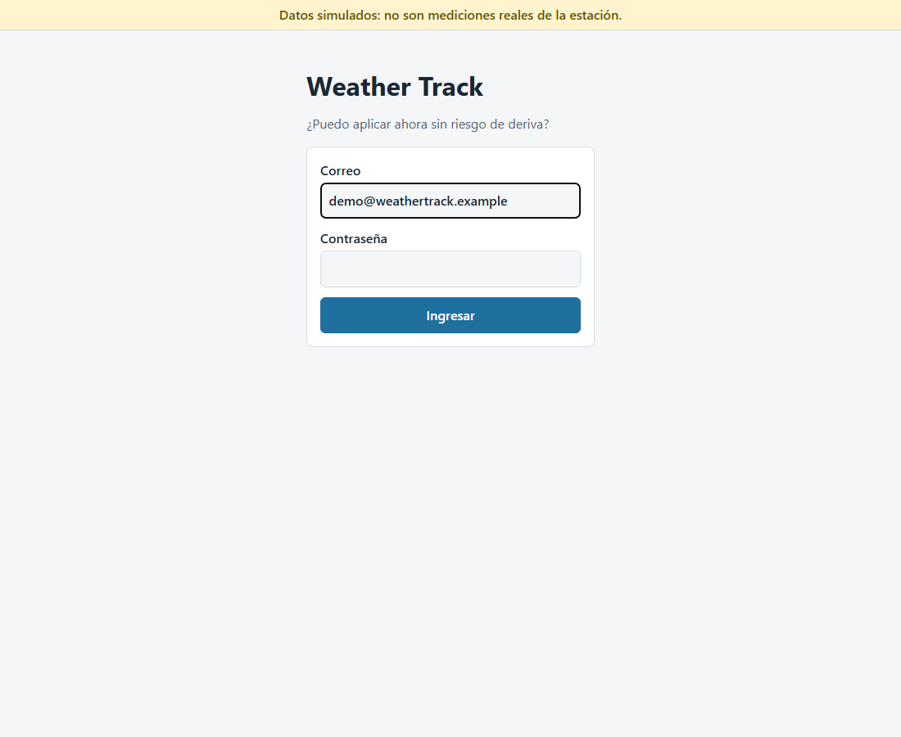 |
| Decisión: apto | 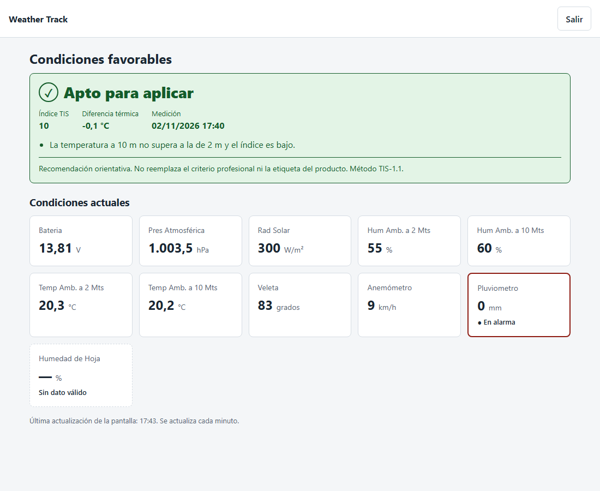 |
| Detalle e históricos | 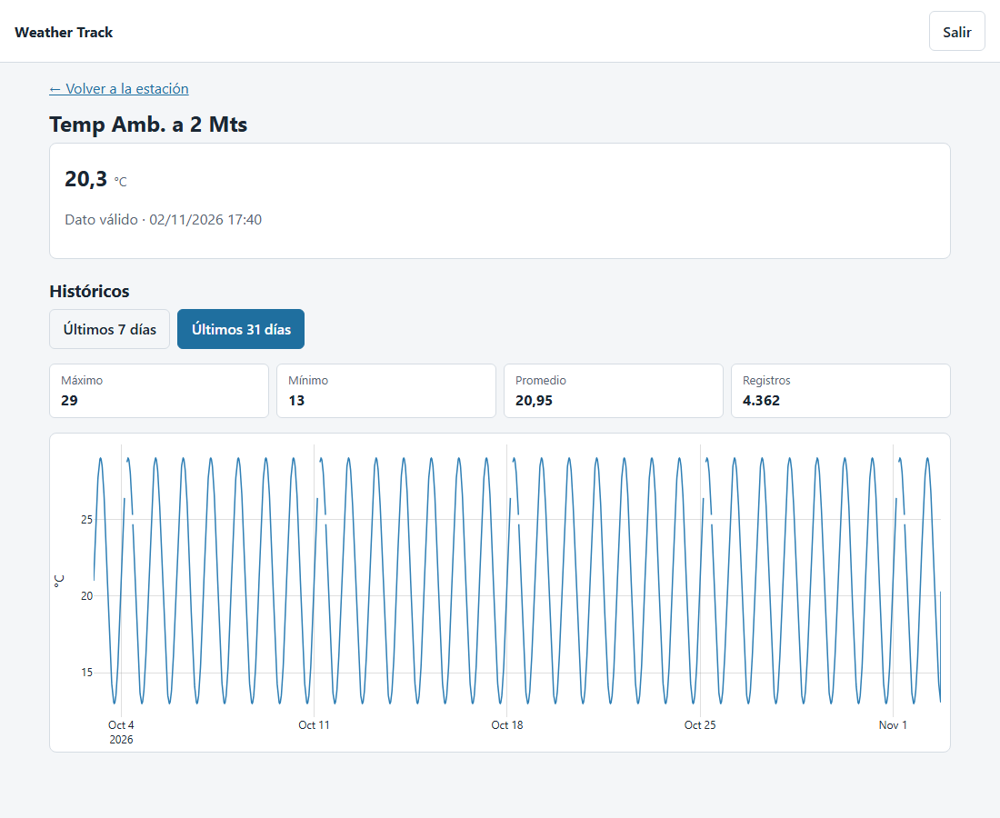 |
| Móvil, a 360 píxeles | 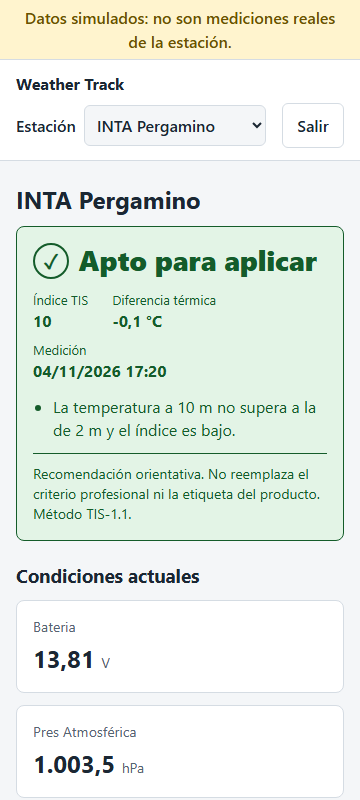 |
| Decisión: no aplicar | 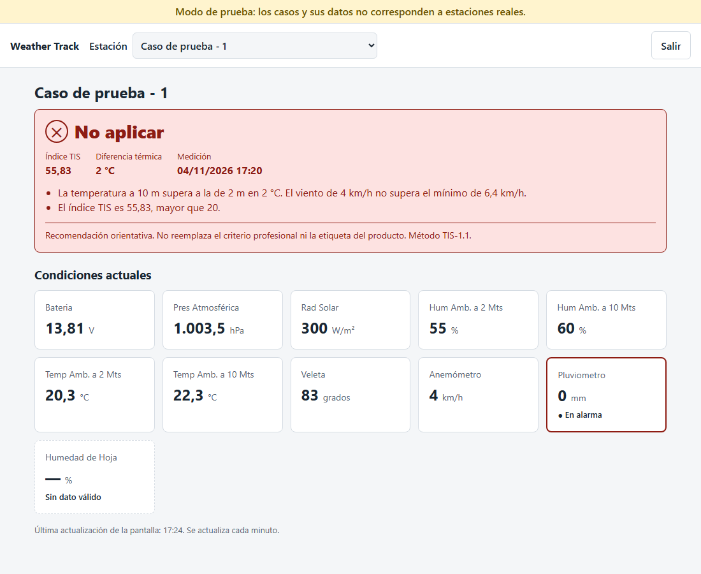 |
| Decisión: datos insuficientes | 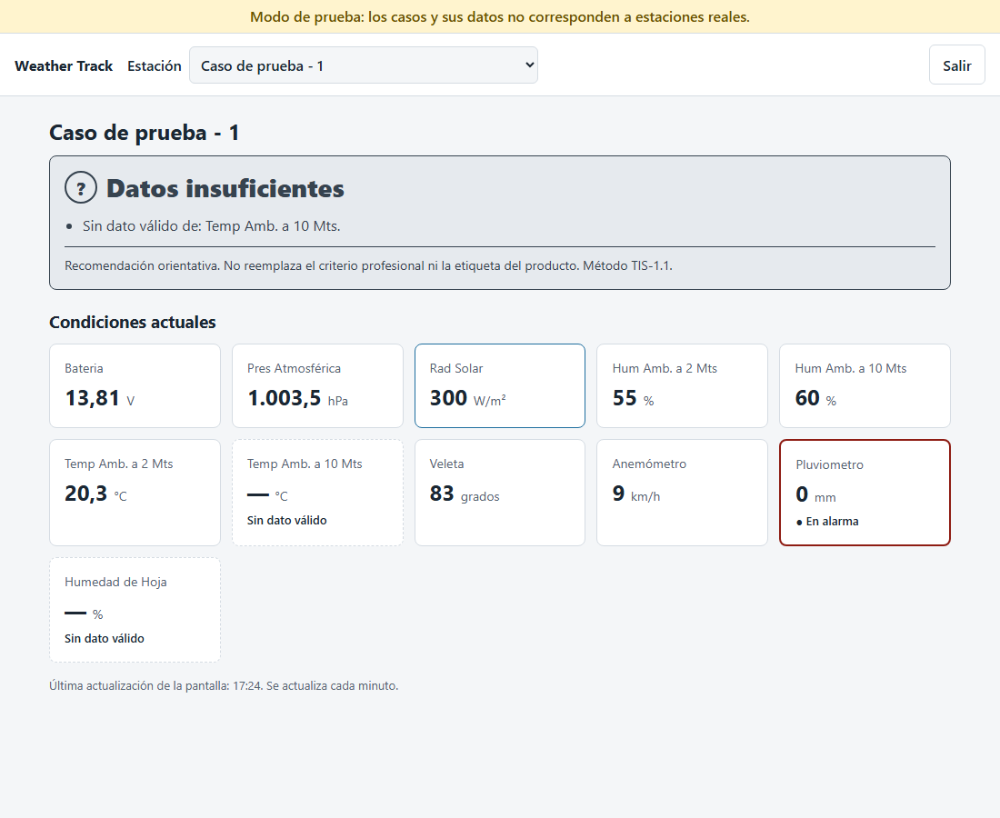 |
| Selector con dos estaciones | 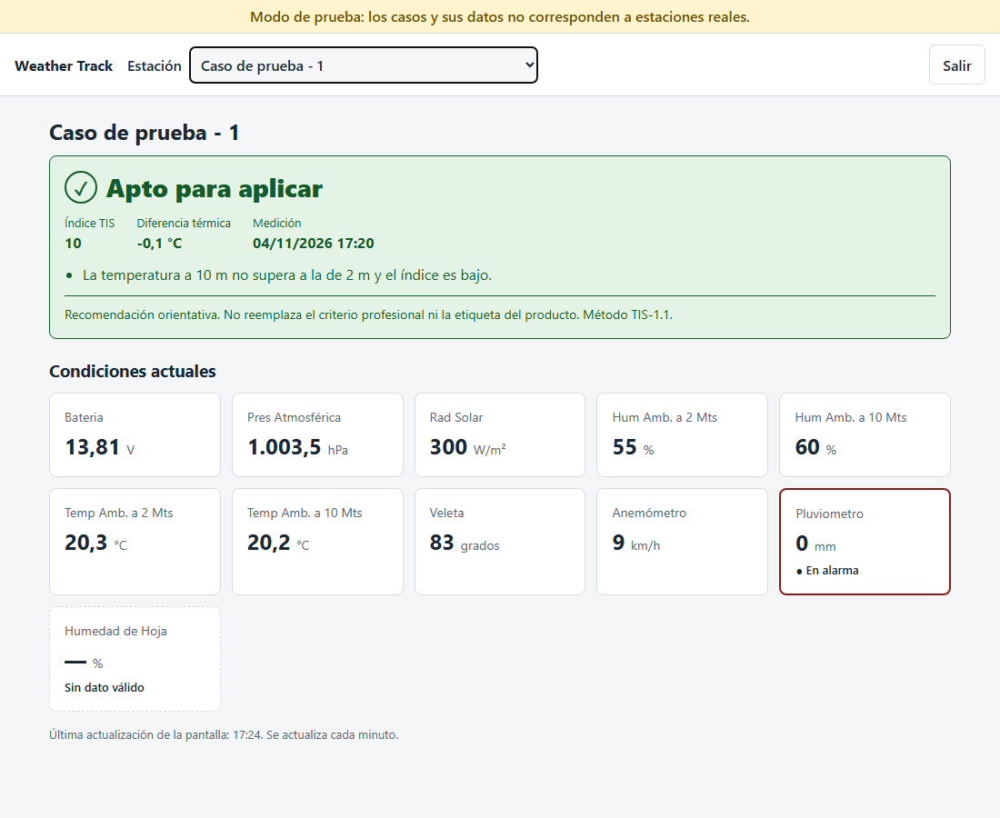 |
| Equipo inactivo | 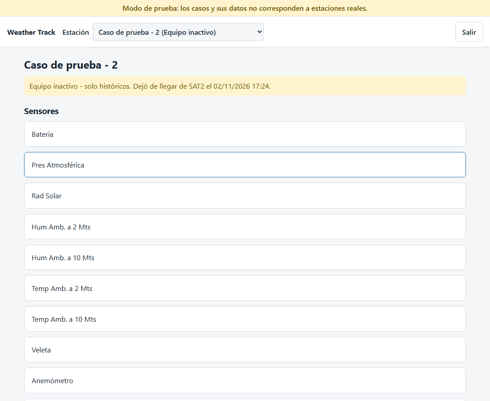 |

En `docs/prototipo/` quedan las capturas del prototipo de validación, que sirvió de referencia. No son del MVP.

### **1.4. Instrucciones de instalación:**

Requisitos: Git y Docker con Docker Compose. Estos pasos usan datos ficticios y no necesitan credenciales.

```bash
git clone -b feature/entrega-2-PDN https://github.com/dinannopabloguillermo/AI4Devs-finalproject-temp.git weather-track
cd weather-track
cp .env.example .env
docker compose up --build -d --wait
docker compose exec api python -m app.semillas
```

El último comando muestra el usuario de demostración y su clave, que aparece una sola vez. La aplicación queda en `http://localhost:8080`. También se puede crear una cuenta desde «Crear una cuenta»: el correo de confirmación llega a Mailpit, en `http://localhost:8025`, y no sale a internet.

- **[Guía de instalación local](docs/despliegue/instalacion-local.md):** paso a paso desde cero, uso con datos reales de SAT2, actualización, desinstalación y problemas frecuentes.
- **[Guion de la demostración](docs/demo/guion-demo.md):** recorre los cinco estados y las reglas en unos 7 minutos, en modo `prueba`, cargando cada situación en "Caso de prueba - 1" con `python -m herramientas.situaciones`.
- **[Despliegue en Google Cloud](docs/despliegue/despliegue-gcp.md) (pospuesto):** guía preparada para publicar en internet con HTTPS y dominio propio. Todavía no se ejecutó.
- **Modos de datos:** `simulado` por defecto, `real` con una cuenta de SAT2 y `prueba` para ver el selector con dos casos. La base recuerda con qué modo se llenó y no arranca con otro, así que los datos reales y los ficticios nunca se mezclan. Para probar con datos reales hay un comando que copia la base a un proyecto aislado. Detalle en la [sección 5 de la guía](docs/despliegue/instalacion-local.md#5-modos-de-datos).
- El administrador puede operar con `docker compose exec api python -m app.administracion`: `crear-usuario` (la crea ya confirmada), `restablecer-clave`, `desactivar-usuario` y `exportar-clientes`, que escribe el CSV de la base de clientes en la salida estándar.
- **Administración de SAT2:** `hacer-administrador --email` le da a una cuenta confirmada la opción «Administración», donde carga la URL y las credenciales de SAT2 sin entrar al servidor. Antes hay que generar las claves con `generar-claves-sat2`. El resto de las cuentas no ve la opción. Pasos en la [sección 4 de la guía](docs/despliegue/instalacion-local.md#4-usar-datos-reales-de-sat2-opcional) y decisión en el [ADR-0004](docs/decisions/0004-credenciales-de-sat2.md).
- Para detenerla sin perder datos, usar `docker compose stop`. `docker compose down -v` borra la base.
- La documentación de la API está en `http://localhost:8080/api/docs`.

**Pruebas** (además requieren uv y Node.js):

```bash
docker compose up -d --wait db_pruebas
cd backend && uv run ruff check && uv run pytest
cd ../frontend && npm ci && npm test
npx playwright install chromium && npm run e2e
```

`npm run e2e` levanta la pila completa en un proyecto propio, `wt-e2e`, recorre las historias de usuario en un navegador y borra esa base al terminar. No toca los datos de la instalación principal.

### **1.5. Prototipo de validación**

Existe una aplicación en R Shiny, en un repositorio privado, creada para probar la lógica y la interfaz con datos reales. Permitió validar la lectura de datos de SAT2, las tarjetas por sensor, los históricos y una primera versión del índice TIS. **No es la base de código del MVP**: el MVP se construye nuevo con la arquitectura de la sección 2.

### **1.6. Evolución futura (fuera del MVP)**

- Niveles de uso diferenciados con roles: público general, sector productivo e investigación.
- Más índices: Delta T psicrométrico, déficit de presión de vapor, evapotranspiración de referencia, grados-día, horas de mojado foliar, heladas y acumulados.
- Predicción a corto y mediano plazo, y seguimiento de fenómenos macroclimáticos como El Niño.
- Carga de toda la historia disponible en SAT2. Hoy se cargan los últimos 31 días al instalar y se consulta hasta un año atrás.
- Trazabilidad automática entre cada escenario de las especificaciones y las pruebas que lo verifican.
- Humedad de suelos, que requiere una fuente de datos adicional.
- Agentes de IA dentro del producto para ingesta y análisis.
- Migración a un repositorio y una operación de producción empresarial. Este repositorio es académico y esa migración no forma parte de este trabajo.

### **1.7. IA en el ciclo de vida**

| Fase | Uso de IA | Estado |
|---|---|---|
| Análisis | Ingeniería inversa del prototipo con OpenSpec y Claude Code, y contraste entre la documentación de la API y sus respuestas reales | Realizado |
| Diseño | Definición del MVP, arquitectura, modelo de datos, API, historias y tickets de este documento con Claude Code, con revisión y decisión humana | Realizado |
| Implementación | Desarrollo guiado por especificaciones con OpenSpec y Claude Code, actividad por actividad, con aprobación humana de cada paso. Las reglas del asistente están en [CLAUDE.md](CLAUDE.md) | Realizado |
| Pruebas | Generación de tests a partir de los criterios de aceptación y de la tabla de la sección 2.6, con revisión humana | Realizado |
| Despliegue | Configuración de producción e instalación local, probadas en copias limpias y en un clon real | Parcial: el despliegue público está pospuesto |
| Mantenimiento y seguridad | Revisión de seguridad con pruebas negativas, y corrección de los hallazgos | Realizado para esta entrega ([informe](docs/seguridad/revision-entrega-2.md)) |
| Integración continua | Pipeline de GitHub Actions redactado con Claude Code, con revisión humana de cada control ([ADR-0003](docs/decisions/0003-pipeline-de-integracion-continua.md)) | Realizado |
| Revisión de código | GitHub Copilot revisa cada pull request a `main` con [instrucciones propias del proyecto](.github/copilot-instructions.md), en castellano y por zona: dominio, migraciones, flujos, API y frontend. Solo comenta: no aprueba ni bloquea, y la decisión de fusionar es humana | Realizado |
| Documentación viva | La [guía de las especificaciones](docs/especificaciones/README.md) se genera desde OpenSpec, y una prueba del pipeline falla si queda vieja | Realizado |

Los prompts reales están en [prompts.md](prompts.md).

---

## 2. Arquitectura del Sistema

### **2.1. Diagrama de arquitectura:**

La decisión y sus alternativas están en el [ADR-0001](docs/decisions/0001-arquitectura-destino-weather-track.md), y las actividades y plazos hasta el 19 de noviembre, en el [plan de implementación de la Entrega 2](docs/plan/plan-implementacion-entrega-2.md).

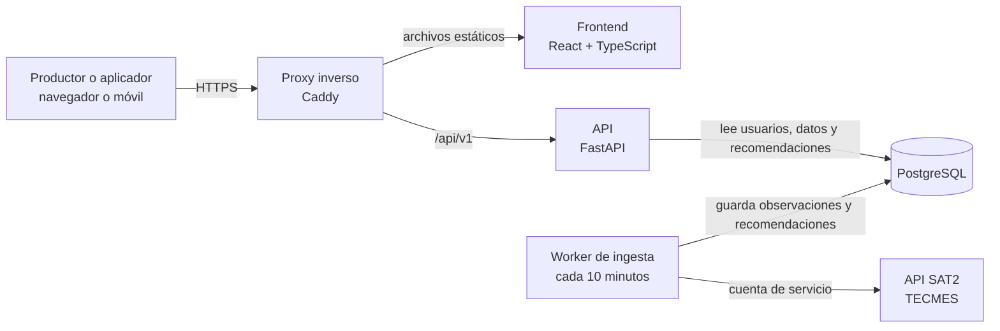

En el servidor el acceso es por HTTPS. En la instalación local es por HTTP, solo desde la misma computadora.

**Patrón.** Monolito modular con arquitectura en capas y un worker separado, ambos sobre el mismo código de dominio. El usuario nunca consulta SAT2 de forma directa: lee lo que el worker ya guardó y validó.

**Por qué esta arquitectura.** Es lo más simple que resuelve lo que el prototipo no resolvía:

| Necesidad | Cómo se resuelve |
|---|---|
| Datos siempre actualizados, aunque nadie tenga la pantalla abierta | El worker trabaja de forma independiente de la sesión del usuario |
| No manejar credenciales de SAT2 de los usuarios | Cuentas propias y una única cuenta de servicio en el servidor |
| Históricos rápidos y sin consultas repetidas a un tercero | Datos normalizados en PostgreSQL |
| Regla de seguridad del TIS fácil de probar | Motor de cálculo como función pura, sin dependencias de red ni de base de datos |

**Beneficios.** Una sola persona con asistencia de IA puede construirla antes del 19 de noviembre, según el [plan](docs/plan/plan-implementacion-entrega-2.md); el despliegue es simple y cada capa se prueba por separado.

**Sacrificios.**
- Si SAT2 no responde, no hay datos nuevos. La regla R2 evita que se muestre una recomendación vieja como vigente.
- Tener un solo servidor implica un punto único de falla, aceptable para un MVP.
- La latencia del dato depende del ciclo de 10 minutos, que coincide con la frecuencia de las mediciones.
- Se reescribe la lógica ya probada en R, a cambio de una base mantenible y con tests.

**Alternativas descartadas.** Evolucionar Shiny, porque la sesión queda ligada a la pestaña y no resuelve la ingesta en segundo plano. Microservicios, porque agregan complejidad operativa sin beneficio a esta escala.

### **2.2. Descripción de componentes principales:**

| Componente | Tecnología | Responsabilidad |
|---|---|---|
| Frontend | React, TypeScript, Vite, Plotly.js | Pantallas de acceso, decisión, detalle e históricos. Consulta la API cada 60 segundos. |
| API | Python, FastAPI, Pydantic, SQLAlchemy | Autenticación, control de acceso por estación y lectura de datos. Aplica la regla R2 al responder. |
| Worker de ingesta | Python, APScheduler, httpx | Sincroniza el catálogo, obtiene lecturas, normaliza, marca la calidad y dispara el cálculo. Registra cada ejecución. |
| Motor de recomendación | Python, sin dependencias externas | Función pura que recibe lecturas y devuelve índice, estado y motivos. Lo usa el worker. |
| Base de datos | PostgreSQL 18, Alembic | Usuarios, estaciones, sensores, observaciones, recomendaciones e historial de ingesta. |
| Proxy inverso | Caddy | HTTPS, entrega de estáticos y enrutamiento hacia la API. |

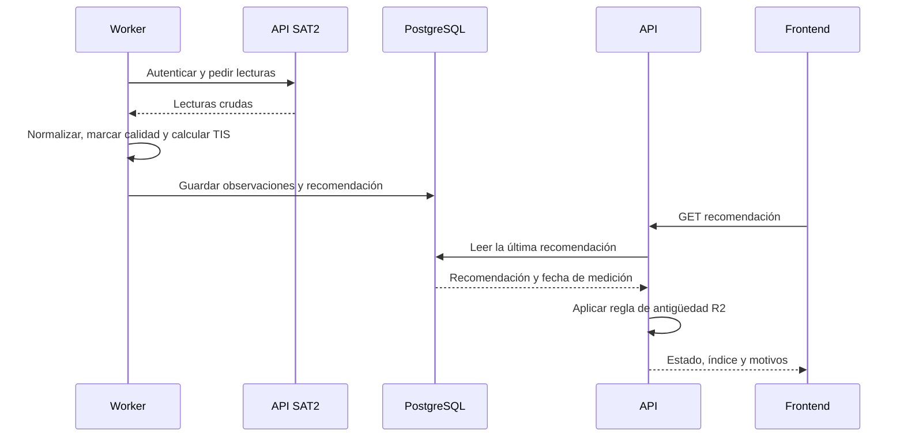

### **2.3. Descripción de alto nivel del proyecto y estructura de ficheros**

```text
AI4Devs-finalproject-temp/
├── backend/
│   ├── app/
│   │   ├── api/             # Rutas HTTP, sesión, autorización y errores
│   │   ├── dominio/         # Motor de recomendación, normalización y vigencia
│   │   ├── ingesta/         # Cliente SAT2, modos simulados, ciclo, carga y worker
│   │   ├── datos/           # Modelos y conexión a la base de datos
│   │   ├── administracion.py  # Comandos para administrar cuentas
│   │   ├── cifrado_sat2.py  # Cifrado de la configuración de SAT2 con clave pública
│   │   ├── seguridad.py     # Contraseñas e identificadores de sesión
│   │   └── semillas.py      # Datos de demostración
│   ├── herramientas/        # Prueba de límites de SAT2, contrato, guía de especificaciones y pruebas negativas
│   ├── migraciones/         # Migraciones de Alembic
│   └── tests/
├── frontend/
│   ├── e2e/                 # Pruebas de extremo a extremo con Playwright
│   └── src/
│       ├── pantallas/       # Acceso, estaciones, decisión y detalle
│       ├── componentes/     # Estado, tarjetas y gráfico
│       ├── servicios/       # Cliente de la API, sesión y actualización periódica
│       └── pruebas/         # Pruebas con Vitest
├── .github/
│   ├── workflows/           # Pipeline de integración continua
│   ├── instructions/        # Criterios de revisión de Copilot por zona
│   ├── copilot-instructions.md  # Cómo revisa Copilot los pull requests
│   └── pull_request_template.md
├── openspec/                # Especificaciones y cambios
├── docs/
│   ├── capturas/            # Capturas del MVP
│   ├── decisions/           # ADR-0001 a ADR-0004
│   ├── demo/                # Guion de la demostración
│   ├── despliegue/          # Instalación local y despliegue en Google Cloud
│   ├── especificaciones/    # Guía generada desde las especificaciones de OpenSpec
│   ├── plan/                # Plan de implementación
│   ├── prototipo/           # Capturas del prototipo
│   ├── seguridad/           # Informe de la revisión de seguridad
│   └── tis/                 # Contraste bibliográfico del índice
├── docker-compose.yml       # Pila local
├── docker-compose.prod.yml  # Ajustes para el servidor
├── .env.example
├── CLAUDE.md                # Reglas para el asistente de IA
├── prompts.md
└── readme.md
```

El backend sigue una arquitectura en capas: `api` y `ingesta` dependen de `dominio` y `datos`, y `dominio` no depende de ninguna otra capa.

### **2.4. Infraestructura y despliegue**

**Implementado.** Toda la pila corre con Docker Compose, en cinco servicios: `db`, `migraciones` (se ejecuta una vez y termina), `api`, `worker` y `proxy`. En la instalación local se suma `correo` (Mailpit), que atrapa los correos de las cuentas sin enviarlos a internet; en el servidor se usa un proveedor real.

| Modo | Cómo se usa | Estado |
|---|---|---|
| Local | [Instalación local](docs/despliegue/instalacion-local.md), por HTTP y solo desde la misma computadora | Probado con un clon real desde GitHub, en Windows 11 |
| Servidor | `docker-compose.prod.yml` agrega HTTPS con Caddy, exige las variables críticas y publica solo los puertos 80 y 443 | Probado en local, con certificado interno |
| Google Cloud | [Guía de despliegue](docs/despliegue/despliegue-gcp.md) y [ADR-0002](docs/decisions/0002-proveedor-del-servidor.md) | **Pospuesto.** La guía no se ejecutó en la nube |

**Implementado: integración continua.** Cada push y cada pull request a `main` pasan por un flujo de GitHub Actions ([`integracion.yml`](.github/workflows/integracion.yml), decisión en el [ADR-0003](docs/decisions/0003-pipeline-de-integracion-continua.md)): lint y pruebas del backend y del frontend, contrato de la API, especificaciones de OpenSpec, escaneo de secretos de todo el historial, auditoría de dependencias y extremo a extremo con la pila completa. Antes de fusionar en `main` corren también las pruebas negativas sobre la configuración de producción. El flujo no usa secretos y fija sus acciones por SHA. Las ejecuciones son públicas en [GitHub Actions](https://github.com/dinannopabloguillermo/AI4Devs-finalproject-temp/actions/workflows/integracion.yml).

**Implementado: revisión con IA y documentación viva.** GitHub Copilot revisa cada pull request a `main` y cada push nuevo, con las instrucciones del proyecto. No es un control exigido: fusionar depende del pipeline y del responsable. La [guía de las especificaciones](docs/especificaciones/README.md) se genera con `uv run python -m herramientas.documentar_especificaciones`, y el trabajo de backend falla si no coincide con `openspec/specs`.

**Pendiente: despliegue continuo.** La publicación de imágenes y el despliegue en el servidor del esquema siguiente siguen en la línea B de la [hoja de ruta](docs/plan/hoja-de-ruta-entrega-final.md).

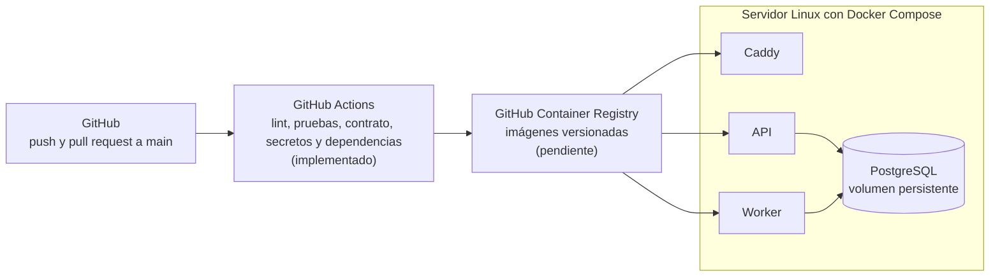

### **2.5. Seguridad**

Implementado y revisado en el [informe de seguridad](docs/seguridad/revision-entrega-2.md), que también detalla los hallazgos corregidos y los riesgos aceptados.

| Práctica | Aplicación |
|---|---|
| Secretos fuera del código | Variables de entorno y `.env.example` sin valores reales. Gitleaks revisa todo el historial en cada push y pull request; los falsos positivos conocidos están en `.gitleaksignore` con su motivo. |
| Credenciales de terceros aisladas | Solo el worker puede leer la cuenta de servicio de SAT2. El administrador la carga desde la aplicación y se guarda cifrada con una clave pública: la API cifra pero no puede descifrar, y nunca la devuelve al navegador ([ADR-0004](docs/decisions/0004-credenciales-de-sat2.md)). Sin configuración guardada, el worker usa el `.env`. |
| Administración | El rol solo se otorga desde la línea de comandos del servidor. Para cualquier otra cuenta, y sin sesión, las rutas de administración responden igual que una ruta inexistente. Guardar exige la contraseña del administrador, y cada cambio se avisa por correo y queda registrado, sin los valores. |
| Contraseñas | Solo se guarda un hash con Argon2id, con un tope de cálculos simultáneos para que una ráfaga no agote la memoria. |
| Sesión | Identificador opaco en cookie `HttpOnly` y `SameSite`, y `Secure` en el servidor. Vence a las 8 horas y se invalida al salir. |
| Autorización | Todas las rutas se protegen en el servidor. Sin niveles de usuario, toda cuenta confirmada consulta todas las estaciones; una estación inexistente da 404 y un sensor solo se lee a través de su propia estación. |
| Cuentas | Códigos de un solo uso de 256 bits, guardados como hash y enviados después de `#`, para que no lleguen al servidor en la dirección. La baja de un clic de los programas de correo sí lleva el código en la dirección, como exige su norma, y los registros lo ocultan. Las mismas respuestas exista o no la cuenta. Contraseñas de 15 a 128 caracteres, sin las más comunes, según NIST SP 800-63B-4. La baja por enlace exige `POST`. |
| Abuso | Bloqueo por cuenta tras 5 intentos fallidos, y límite por dirección IP: 30 inicios de sesión cada 15 minutos, 5 registros por hora, 10 pedidos de recupero o reenvío por hora y 30 usos de enlaces cada 15 minutos. Caddy reemplaza `X-Forwarded-For` con la dirección real, así que una cabecera falsa no lo evade. Además, cada correo recibe como máximo 3 mensajes del mismo tipo por hora. |
| Transporte | HTTPS en el servidor. En local, HTTP solo desde la misma computadora. El navegador y la API comparten dominio, así que CORS no está habilitado. |
| Cabeceras | HSTS, política de contenido, `nosniff`, protección contra marcos y sin cabecera `Server`. |
| Entrada | Validación con Pydantic, consultas parametrizadas por el ORM y límite de 64 KB en el cuerpo. |
| Registros | Sin contraseñas ni tokens en los logs. |
| Datos de prueba | Datos de ejemplo y de prueba ficticios, sin copias de respuestas con credenciales. |

### **2.6. Tests**

Resultado de la última ejecución, el 9 de noviembre de 2026: todas pasan, en local y en el [pipeline](https://github.com/dinannopabloguillermo/AI4Devs-finalproject-temp/actions/workflows/integracion.yml), que las corre en cada push. El backend además pasa Ruff, y el pipeline falla si el motor baja del 100 % de cobertura o si falta la base de pruebas.

| Nivel | Herramienta | Qué cubre | Pruebas |
|---|---|---|---|
| Unitario, integración e ingesta | pytest, con PostgreSQL de prueba y SAT2 simulado | Motor, normalización, calidad, rutas de la API, acceso, restricciones de la base, ingesta, errores de SAT2, equipos inactivos, separación de datos reales y ficticios, modo prueba, situaciones, límites del rango de históricos, el ciclo de vida de las cuentas (registro, códigos, correo, contraseñas, límites por IP y exportación), la guía generada de las especificaciones, las instrucciones de revisión, el cifrado de la configuración de SAT2, la API de administración y el origen de la configuración en el worker | 688 |
| Frontend | Vitest, Testing Library | Estados de la pantalla de decisión, selector de estación, equipo inactivo, avisos de modo, flujos de acceso e históricos con sus rangos y el calendario, las pantallas de cuentas con sus errores por campo y la pantalla de administración, visible solo para el rol | 108 |
| Extremo a extremo | Playwright, contra la pila completa en modo prueba | HU1, HU2 y HU3 básica, con los cinco estados y las reglas R1 a R4 cargados como situaciones en "Caso de prueba - 1", más el rango manual de históricos, el selector, el equipo inactivo y las cuentas leyendo los correos en Mailpit: registro, confirmación, recupero y las tres formas de baja, y la administración de SAT2 con valores ficticios | 24 |
| Seguridad | [`pruebas_negativas.py`](backend/herramientas/pruebas_negativas.py), contra la configuración de producción | Autorización, sesión, entradas, cabeceras, carga, enumeración de correos, enlaces de un solo uso, baja por `GET`, límites por IP y administración de SAT2 | 133 |

Además, la ingesta se probó una vez contra SAT2 real, durante 38 minutos y con 48.427 lecturas. Los comandos están en la [sección 1.4](#14-instrucciones-de-instalación).

**Casos de referencia del motor de recomendación:**

| Caso | ΔT (°C) | Viento (km/h) | Radiación (W/m²) | HR 2 m / 10 m (%) | Índice | Estado esperado | Regla |
|---|---|---|---|---|---|---|---|
| Condiciones favorables | −0,1 | 9 | 1056 | 55 / 60 | 7 | `APTO` | Base |
| Inversión con índice bajo | +0,9 | 13 | 300 | 50 / 55 | 20 | `PRECAUCION` | R3 |
| Inversión con poco viento | +0,5 | 2 | 600 | 50 / 50 | 32,83 | `NO_APLICAR` | R3b |
| Riesgo intermedio | +1,5 | 9 | 0 | 60 / 60 | 50 | `RIESGO_DERIVA` | Base |
| Máximo riesgo | +3,0 | 1 | 0 | 95 / 95 | 100 | `NO_APLICAR` | Base |
| Lectura sospechosa | −0,1 | 9 | 1056 | 0 / 61 | 7 | `PRECAUCION` | R4 |
| Falta T10m | Sin dato | 9 | 1056 | 55 / 60 | Sin índice | `DATOS_INSUFICIENTES` | R1 |
| Medición de hace 31 minutos | −0,1 | 9 | 1056 | 55 / 60 | 7 guardado | `DATOS_INSUFICIENTES` | R2 |

---

## 3. Modelo de Datos

### **3.1. Diagrama del modelo de datos:**

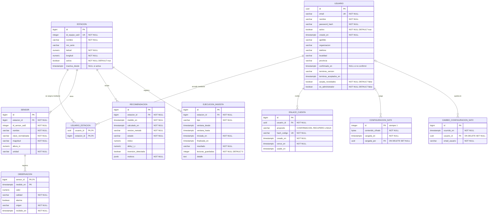

### **3.2. Descripción de entidades principales:**

> Se guarda en UTC. La interfaz muestra la hora de Argentina (`America/Argentina/Buenos_Aires`).
>
> Las tablas de soporte `SESION` e `INTENTO_ACCESO` se detallan en el [diseño del cambio](openspec/changes/archive/2026-11-03-weather-track-mvp-nucleo/design.md). La tabla `CONFIGURACION_BASE`, de una sola fila, registra si la base guarda datos reales o ficticios para que nunca se mezclen; se detalla en el [diseño de `weather-track-estaciones`](openspec/changes/archive/2026-11-05-weather-track-estaciones/design.md). `CORREO_SALIENTE`, la bandeja de salida de los correos de las cuentas, y `LIMITE_IP`, los contadores del límite de pedidos por dirección IP, se detallan en el [diseño de `weather-track-registro-cuentas`](openspec/changes/archive/2026-11-05-weather-track-registro-cuentas/design.md).

**USUARIO.** Persona con acceso al sistema.

| Atributo | Tipo | Restricciones | Descripción |
|---|---|---|---|
| `id` | `uuid` | PK | Identificador |
| `email` | `varchar(254)` | UNIQUE, NOT NULL | Correo de acceso, en minúsculas |
| `nombre` | `varchar(120)` | NOT NULL | Nombre visible |
| `password_hash` | `varchar(255)` | NOT NULL | Hash Argon2id |
| `activo` | `boolean` | NOT NULL, DEFAULT true | Permite desactivar sin borrar |
| `creado_en` | `timestamptz` | NOT NULL | Fecha de alta |
| `apellido`, `organizacion`, `telefono`, `localidad`, `provincia` | `varchar` | | Datos del registro. Opcionales en la base para las cuentas anteriores; la API exige los obligatorios |
| `confirmado_en` | `timestamptz` | | Cuándo confirmó el correo. Sin confirmar no puede iniciar sesión. Las cuentas anteriores quedaron confirmadas |
| `terminos_version`, `terminos_aceptados_en` | `varchar(20)`, `timestamptz` | | Versión y fecha de los términos y la política de privacidad aceptados |
| `acepta_novedades` | `boolean` | NOT NULL, DEFAULT false | Consentimiento para recibir novedades, que se ofrece sin marcar |
| `es_administrador` | `boolean` | NOT NULL, DEFAULT false | Ve la administración de SAT2. Solo lo otorga la línea de comandos del servidor |

**CONFIGURACION_SAT2.** Una sola fila con la URL, el usuario y la contraseña de SAT2 que cargó un administrador, cifrados juntos con la clave pública ([ADR-0004](docs/decisions/0004-credenciales-de-sat2.md)). Solo el worker, con la clave privada, puede leerla. Sin esta fila, el worker usa el `.env`.

| Atributo | Tipo | Restricciones | Descripción |
|---|---|---|---|
| `id` | `integer` | PK, CHECK `id = 1` | Una sola fila |
| `contenido_cifrado` | `bytea` | NOT NULL | Cambia en cada guardado; así el worker sabe que debe recargar |
| `cargada_en` | `timestamptz` | NOT NULL | Cuándo se guardó |
| `cargada_por` | `uuid` | FK a `USUARIO.id`, ON DELETE SET NULL | Quién la guardó |

**CAMBIO_CONFIGURACION_SAT2.** Registro de cada guardado, sin los valores. Conserva el correo para que el registro sobreviva al borrado de la cuenta.

| Atributo | Tipo | Restricciones | Descripción |
|---|---|---|---|
| `id` | `bigint` | PK | Identificador |
| `ocurrido_en` | `timestamptz` | NOT NULL, índice descendente | Cuándo |
| `usuario_id` | `uuid` | FK a `USUARIO.id`, ON DELETE SET NULL | Quién |
| `email_usuario` | `varchar(254)` | NOT NULL | Correo de quien guardó |

**ENLACE_CUENTA.** Código de un solo uso de confirmación, recupero o baja (N:1 con USUARIO, borrado en cascada). El código solo viaja en el correo: la base guarda su SHA-256.

| Atributo | Tipo | Restricciones | Descripción |
|---|---|---|---|
| `id` | `bigint` | PK | Identificador |
| `usuario_id` | `uuid` | FK, NOT NULL, ON DELETE CASCADE | Cuenta |
| `proposito` | `varchar(14)` | CHECK `CONFIRMACION`, `RECUPERO` o `BAJA` | Vence a las 48 horas, a los 30 minutos y a los 60 días, respectivamente |
| `hash_codigo` | `varchar(64)` | UNIQUE, NOT NULL | SHA-256 del código |
| `creado_en`, `vence_en` | `timestamptz` | NOT NULL, `vence_en > creado_en` | Vigencia |
| `usado_en` | `timestamptz` | | Cuándo se usó. Un código usado, vencido o reemplazado no vuelve a servir |

**ESTACION.** Equipo meteorológico registrado en SAT2.

| Atributo | Tipo | Restricciones | Descripción |
|---|---|---|---|
| `id` | `bigint` | PK | Identificador interno |
| `id_equipo_sat2` | `integer` | UNIQUE, NOT NULL | Identificador en SAT2 |
| `nombre` | `varchar(120)` | NOT NULL | Nombre visible |
| `nro_serie` | `varchar(40)` | | Serie del equipo |
| `latitud` | `numeric(9,6)` | NOT NULL, entre −90 y 90 | Ubicación |
| `longitud` | `numeric(9,6)` | NOT NULL, entre −180 y 180 | Ubicación |
| `activa` | `boolean` | NOT NULL, DEFAULT true | Si su equipo sigue llegando de SAT2 y participa de la ingesta |
| `inactiva_desde` | `timestamptz` | NULL si y solo si `activa` | Desde cuándo el equipo dejó de llegar de SAT2. La estación conserva sus datos |

**USUARIO_ESTACION.** Estaciones a las que accede cada usuario (N:M).

| Atributo | Tipo | Restricciones | Descripción |
|---|---|---|---|
| `usuario_id` | `uuid` | PK, FK a `USUARIO.id`, ON DELETE CASCADE | Usuario |
| `estacion_id` | `bigint` | PK, FK a `ESTACION.id`, ON DELETE CASCADE | Estación |

**SENSOR.** Sensor de una estación (N:1 con ESTACION). `UNIQUE (estacion_id, id_sensor_sat2)` y `UNIQUE (estacion_id, clave_normalizada)`.

| Atributo | Tipo | Restricciones | Descripción |
|---|---|---|---|
| `id` | `bigint` | PK | Identificador interno |
| `estacion_id` | `bigint` | FK a `ESTACION.id`, NOT NULL | Estación |
| `id_sensor_sat2` | `integer` | NOT NULL | Identificador en SAT2 |
| `nombre` | `varchar(120)` | NOT NULL | Nombre original |
| `clave_normalizada` | `varchar(120)` | NOT NULL | Minúsculas y sin tildes; vincula las lecturas con el catálogo |
| `magnitud` | `varchar(30)` | NOT NULL, CHECK en lista cerrada | `TEMPERATURA`, `HUMEDAD_RELATIVA`, `VIENTO_VELOCIDAD`, `VIENTO_DIRECCION`, `RADIACION`, `PRESION`, `PRECIPITACION`, `MOJADO_FOLIAR` o `BATERIA` |
| `altura_m` | `numeric(5,2)` | | Altura de medición, si aplica |
| `unidad` | `varchar(20)` | NOT NULL | Unidad de medida |

**OBSERVACION.** Lectura de un sensor en un instante (N:1 con SENSOR). Índice sobre `medido_en`.

| Atributo | Tipo | Restricciones | Descripción |
|---|---|---|---|
| `sensor_id` | `bigint` | PK, FK a `SENSOR.id` | Sensor |
| `medido_en` | `timestamptz` | PK | Instante de medición |
| `valor` | `numeric(12,4)` | NULL solo si `calidad = FALTANTE` | Valor normalizado |
| `calidad` | `varchar(12)` | NOT NULL, CHECK | `OK`, `FALTANTE` o `SOSPECHOSO` |
| `alarma` | `boolean` | | Alarma informada por SAT2; nula si la fuente no la informa |
| `origen` | `varchar(12)` | NOT NULL, CHECK | `INSTANTANEO` o `HISTORICO` |
| `recibido_en` | `timestamptz` | NOT NULL | Instante de obtención |

**RECOMENDACION.** Resultado del motor para una medición (N:1 con ESTACION). `UNIQUE (estacion_id, medido_en, version_metodo)`.

| Atributo | Tipo | Restricciones | Descripción |
|---|---|---|---|
| `id` | `bigint` | PK | Identificador |
| `estacion_id` | `bigint` | FK a `ESTACION.id`, NOT NULL | Estación |
| `medido_en` | `timestamptz` | NOT NULL | Instante de los datos usados |
| `calculado_en` | `timestamptz` | NOT NULL | Instante del cálculo |
| `version_metodo` | `varchar(20)` | NOT NULL | Versión de la fórmula, por ejemplo `TIS-1.1` |
| `estado` | `varchar(24)` | NOT NULL, CHECK | `APTO`, `PRECAUCION`, `RIESGO_DERIVA`, `NO_APLICAR` o `DATOS_INSUFICIENTES` |
| `indice` | `numeric(5,2)` | Entre 0 y 100; NULL solo con `DATOS_INSUFICIENTES` | Índice TIS |
| `delta_t_c` | `numeric(5,2)` | | `T10m − T2m` en °C |
| `inversion_detectada` | `boolean` | CHECK: si `estado = APTO`, debe ser `false` | Refuerza la regla R3 en la base |
| `motivos` | `jsonb` | NOT NULL | Lista de `{codigo, detalle}` |

**EJECUCION_INGESTA.** Registro de cada ciclo del worker (N:1 con ESTACION). Permite informar el estado real de la conexión con SAT2.

| Atributo | Tipo | Restricciones | Descripción |
|---|---|---|---|
| `id` | `bigint` | PK | Identificador |
| `estacion_id` | `bigint` | FK a `ESTACION.id`, NOT NULL | Estación |
| `tipo` | `varchar(14)` | NOT NULL, CHECK | `CICLO` o `CARGA_INICIAL` |
| `ventana_desde` | `timestamptz` | | Inicio de la ventana, solo en cargas |
| `ventana_hasta` | `timestamptz` | | Fin de la ventana, solo en cargas |
| `iniciada_en` | `timestamptz` | NOT NULL | Inicio de la ejecución |
| `finalizada_en` | `timestamptz` | | Fin de la ejecución |
| `resultado` | `varchar(12)` | NOT NULL, CHECK | `EN_CURSO`, `EXITO`, `PARCIAL` o `ERROR` |
| `lecturas_guardadas` | `integer` | NOT NULL, DEFAULT 0 | Cantidad de lecturas guardadas |
| `detalle` | `text` | | Descripción del error, sin datos sensibles |

---

## 4. Especificación de la API

Esta sección muestra el acceso, la lista de estaciones y los tres endpoints de lectura. El contrato completo, que suma la ruta de salud, se genera desde el código: está en [`frontend/openapi.json`](frontend/openapi.json) y en `/api/docs`. Una prueba falla si difiere de la API.

El registro, la confirmación, el recupero y las bajas por enlace no usan sesión: los protegen sus códigos de un solo uso y el límite por dirección IP. Las demás rutas exigen la sesión del usuario. Sin niveles de usuario, toda cuenta consulta todas las estaciones. Los valores de los ejemplos son ficticios.

Los flujos de cuentas vienen del cambio [`weather-track-registro-cuentas`](openspec/changes/archive/2026-11-05-weather-track-registro-cuentas/proposal.md), y el estado de los equipos, de [`weather-track-estaciones`](openspec/changes/archive/2026-11-05-weather-track-estaciones/proposal.md).

```yaml
openapi: 3.0.3
info:
  title: Weather Track API
  version: 1.0.0
  description: Endpoints principales del MVP de Weather Track.
servers:
  - url: /api/v1
security:
  - sesion: []
paths:
  /auth/login:
    post:
      summary: Inicia la sesión con correo y contraseña
      description: >-
        Si las credenciales son válidas, crea la sesión y la devuelve en la
        cookie wt_sesion (HttpOnly, SameSite=Lax, Secure en el servidor), que
        vence a las 8 horas. Un correo inexistente, una contraseña incorrecta y
        una cuenta desactivada reciben la misma respuesta.
      operationId: iniciarSesion
      security: []
      requestBody:
        required: true
        content:
          application/json:
            schema:
              $ref: '#/components/schemas/SolicitudInicio'
            example:
              email: persona@ejemplo.com
              contrasena: una-clave-de-ejemplo
      responses:
        '200':
          description: Sesión iniciada
          headers:
            Set-Cookie:
              description: Identificador de sesión en la cookie wt_sesion
              schema:
                type: string
          content:
            application/json:
              schema:
                $ref: '#/components/schemas/UsuarioPublico'
              example:
                email: persona@ejemplo.com
                nombre: Persona de Ejemplo
        '401':
          description: Correo o contraseña incorrectos
          content:
            application/json:
              schema:
                $ref: '#/components/schemas/Error'
              example:
                codigo: CREDENCIALES_INVALIDAS
                mensaje: Correo o contraseña incorrectos.
        '422':
          $ref: '#/components/responses/SolicitudInvalida'
        '429':
          description: >-
            Cinco intentos fallidos para el mismo correo en 15 minutos
            (DEMASIADOS_INTENTOS), o más de 30 pedidos desde la misma dirección
            IP en 15 minutos (DEMASIADOS_PEDIDOS). No se evalúa la contraseña.
          headers:
            Retry-After:
              description: Segundos que faltan para volver a intentar
              schema:
                type: integer
          content:
            application/json:
              schema:
                $ref: '#/components/schemas/Error'
              example:
                codigo: DEMASIADOS_INTENTOS
                mensaje: Demasiados intentos. Vuelva a probar más tarde.
  /auth/logout:
    post:
      summary: Cierra la sesión
      description: >-
        Invalida la sesión en el servidor y borra la cookie. Responde igual
        aunque no haya sesión.
      operationId: cerrarSesion
      security: []
      responses:
        '204':
          description: Sesión cerrada
  /auth/registro:
    post:
      summary: Crea una cuenta sin confirmar y envía el correo de confirmación
      description: >-
        Responde lo mismo exista o no el correo. Si ya pertenece a una cuenta
        confirmada, esa cuenta no cambia y su titular recibe un aviso. Si
        pertenece a una cuenta sin confirmar, sus datos se reemplazan y se
        envía un enlace nuevo, que anula el anterior.
      operationId: registrarCuenta
      security: []
      requestBody:
        required: true
        content:
          application/json:
            schema:
              $ref: '#/components/schemas/SolicitudRegistro'
      responses:
        '202':
          $ref: '#/components/responses/Aviso'
        '422':
          description: >-
            Datos inválidos (SOLICITUD_INVALIDA), contraseña que no cumple la
            política (CONTRASENA_RECHAZADA) o términos sin aceptar
            (TERMINOS_NO_ACEPTADOS). `campos` indica qué revisar.
          content:
            application/json:
              schema:
                $ref: '#/components/schemas/Error'
              example:
                codigo: CONTRASENA_RECHAZADA
                mensaje: La contraseña debe tener al menos 15 caracteres. Una frase de varias palabras sirve.
                campos:
                  contrasena: La contraseña debe tener al menos 15 caracteres. Una frase de varias palabras sirve.
        '429':
          $ref: '#/components/responses/DemasiadosPedidos'
  /auth/confirmacion:
    post:
      summary: Confirma la cuenta con el código del correo, válido 48 horas
      operationId: confirmarCuenta
      security: []
      requestBody:
        required: true
        content:
          application/json:
            schema:
              $ref: '#/components/schemas/SolicitudCodigo'
      responses:
        '200':
          $ref: '#/components/responses/Aviso'
        '400':
          $ref: '#/components/responses/EnlaceInvalido'
        '429':
          $ref: '#/components/responses/DemasiadosPedidos'
  /auth/confirmacion/reenvio:
    post:
      summary: Envía un enlace de confirmación nuevo si la cuenta no está confirmada
      operationId: reenviarConfirmacion
      security: []
      requestBody:
        required: true
        content:
          application/json:
            schema:
              $ref: '#/components/schemas/SolicitudCorreo'
      responses:
        '202':
          $ref: '#/components/responses/Aviso'
        '429':
          $ref: '#/components/responses/DemasiadosPedidos'
  /auth/recupero:
    post:
      summary: Envía un enlace para elegir una contraseña nueva, válido 30 minutos
      description: Responde lo mismo exista o no una cuenta con ese correo.
      operationId: pedirRecupero
      security: []
      requestBody:
        required: true
        content:
          application/json:
            schema:
              $ref: '#/components/schemas/SolicitudCorreo'
      responses:
        '202':
          $ref: '#/components/responses/Aviso'
        '429':
          $ref: '#/components/responses/DemasiadosPedidos'
  /auth/recupero/nueva-contrasena:
    post:
      summary: Elige una contraseña nueva con el código del correo
      description: >-
        Cierra todas las sesiones, levanta el bloqueo por intentos fallidos y
        avisa al titular. Si la contraseña no cumple la política, el código no
        se consume.
      operationId: elegirNuevaContrasena
      security: []
      requestBody:
        required: true
        content:
          application/json:
            schema:
              $ref: '#/components/schemas/SolicitudNuevaContrasena'
      responses:
        '200':
          $ref: '#/components/responses/Aviso'
        '400':
          $ref: '#/components/responses/EnlaceInvalido'
        '422':
          $ref: '#/components/responses/SolicitudInvalida'
        '429':
          $ref: '#/components/responses/DemasiadosPedidos'
  /cuenta:
    get:
      summary: Datos de la cuenta con sesión
      operationId: obtenerCuenta
      responses:
        '200':
          description: Datos de la cuenta
          content:
            application/json:
              schema:
                $ref: '#/components/schemas/Cuenta'
        '401':
          $ref: '#/components/responses/NoAutenticado'
    put:
      summary: Modifica los datos de la cuenta; el correo no se cambia
      operationId: actualizarCuenta
      requestBody:
        required: true
        content:
          application/json:
            schema:
              $ref: '#/components/schemas/DatosPersonales'
      responses:
        '200':
          description: Datos guardados
          content:
            application/json:
              schema:
                $ref: '#/components/schemas/Cuenta'
        '401':
          $ref: '#/components/responses/NoAutenticado'
        '422':
          $ref: '#/components/responses/SolicitudInvalida'
  /cuenta/contrasena:
    post:
      summary: Cambia la contraseña; exige la actual y cierra las demás sesiones
      operationId: cambiarContrasena
      requestBody:
        required: true
        content:
          application/json:
            schema:
              $ref: '#/components/schemas/SolicitudCambioContrasena'
      responses:
        '204':
          description: Contraseña cambiada; el titular recibe un aviso
        '400':
          $ref: '#/components/responses/ContrasenaIncorrecta'
        '401':
          $ref: '#/components/responses/NoAutenticado'
        '422':
          $ref: '#/components/responses/SolicitudInvalida'
  /cuenta/baja:
    post:
      summary: Borra la cuenta y todos sus datos; exige la contraseña
      operationId: darDeBaja
      requestBody:
        required: true
        content:
          application/json:
            schema:
              $ref: '#/components/schemas/SolicitudBaja'
      responses:
        '204':
          description: Cuenta borrada y sesión cerrada
        '400':
          $ref: '#/components/responses/ContrasenaIncorrecta'
        '401':
          $ref: '#/components/responses/NoAutenticado'
  /cuenta/baja-con-enlace:
    post:
      summary: Borra la cuenta con el código de baja de un correo
      description: >-
        La pantalla de baja la llama solo cuando la persona confirma con un
        botón: abrir el enlace nunca borra nada.
      operationId: darDeBajaConEnlace
      security: []
      requestBody:
        required: true
        content:
          application/json:
            schema:
              $ref: '#/components/schemas/SolicitudBajaConEnlace'
      responses:
        '200':
          $ref: '#/components/responses/Aviso'
        '400':
          $ref: '#/components/responses/EnlaceInvalido'
        '429':
          $ref: '#/components/responses/DemasiadosPedidos'
  /cuenta/baja-un-clic:
    post:
      summary: Baja en un clic desde el programa de correo (RFC 8058)
      description: >-
        Dirección de la cabecera List-Unsubscribe. Solo acepta POST: un GET no
        borra nada. El código es el único que viaja en la dirección, y el
        registro de accesos lo oculta.
      operationId: darDeBajaEnUnClic
      security: []
      parameters:
        - name: codigo
          in: query
          required: true
          schema:
            type: string
            maxLength: 200
      responses:
        '200':
          $ref: '#/components/responses/Aviso'
        '400':
          $ref: '#/components/responses/EnlaceInvalido'
  /administracion/sat2:
    get:
      summary: Estado de la configuración de SAT2; solo para administradores
      description: >-
        Nunca devuelve la URL, el usuario ni la contraseña de SAT2: la API solo
        tiene la clave pública y no puede descifrarlos. Para una cuenta sin el
        rol, o sin sesión, responde 404 como una ruta inexistente.
      operationId: obtenerConfiguracionSat2
      responses:
        '200':
          description: Estado de la configuración, último ciclo y últimos 10 cambios
          content:
            application/json:
              schema:
                $ref: '#/components/schemas/EstadoConfiguracionSat2'
        '404':
          description: La ruta no existe para esta cuenta
    put:
      summary: Reemplaza la configuración de SAT2; exige la contraseña del administrador
      description: >-
        La guarda cifrada con la clave pública, la agrega al registro de cambios
        y avisa por correo a cada administrador activo, sin los valores. Una
        contraseña incorrecta cuenta como intento fallido de ingreso.
      operationId: guardarConfiguracionSat2
      requestBody:
        required: true
        content:
          application/json:
            schema:
              $ref: '#/components/schemas/SolicitudConfiguracionSat2'
      responses:
        '200':
          description: Configuración guardada
          content:
            application/json:
              schema:
                $ref: '#/components/schemas/EstadoConfiguracionSat2'
        '400':
          $ref: '#/components/responses/ContrasenaIncorrecta'
        '404':
          description: La ruta no existe para esta cuenta
        '422':
          $ref: '#/components/responses/SolicitudInvalida'
        '429':
          $ref: '#/components/responses/DemasiadosPedidos'
        '503':
          description: Falta la clave pública en el servidor
          content:
            application/json:
              schema:
                $ref: '#/components/schemas/Error'
  /estaciones:
    get:
      summary: Lista las estaciones a las que accede el usuario
      operationId: listarEstaciones
      responses:
        '200':
          description: >-
            Estaciones del usuario, activas e inactivas, ordenadas por nombre.
            Una estación inactiva es un equipo que dejó de llegar de SAT2 y
            solo conserva sus históricos.
          content:
            application/json:
              schema:
                type: array
                items:
                  $ref: '#/components/schemas/EstacionResumen'
              example:
                - id: 1
                  nombre: INTA Pergamino
                  latitud: '-33.890000'
                  longitud: '-60.570000'
                  activa: true
                  inactiva_desde: null
        '401':
          $ref: '#/components/responses/NoAutenticado'
  /estaciones/{estacionId}/condiciones-actuales:
    get:
      summary: Obtiene la última lectura de cada sensor y su vigencia
      operationId: obtenerCondicionesActuales
      parameters:
        - $ref: '#/components/parameters/EstacionId'
      responses:
        '200':
          description: Condiciones actuales de la estación
          content:
            application/json:
              schema:
                $ref: '#/components/schemas/CondicionesActuales'
              example:
                estacion_id: 1
                estacion_nombre: INTA Pergamino
                activa: true
                inactiva_desde: null
                medido_en: '2026-11-01T14:40:00-03:00'
                antiguedad_segundos: 180
                estado_datos: VIGENTE
                ultima_ingesta_exitosa_en: '2026-11-01T14:41:02-03:00'
                ultima_ingesta_con_error: false
                sensores:
                  - sensor_id: 10
                    nombre: Temp Amb. a 2 Mts
                    magnitud: TEMPERATURA
                    altura_m: 2
                    valor: 21.3
                    unidad: °C
                    calidad: OK
                    alarma: false
        '401':
          $ref: '#/components/responses/NoAutenticado'
        '403':
          $ref: '#/components/responses/SinAcceso'
        '404':
          $ref: '#/components/responses/NoEncontrado'
  /estaciones/{estacionId}/recomendacion:
    get:
      summary: Obtiene la recomendación de aplicación vigente
      description: >-
        Devuelve la última recomendación calculada. Si la medición tiene más de
        30 minutos de antigüedad, el estado es DATOS_INSUFICIENTES y no se
        informa índice.
      operationId: obtenerRecomendacion
      parameters:
        - $ref: '#/components/parameters/EstacionId'
      responses:
        '200':
          description: Recomendación vigente
          content:
            application/json:
              schema:
                $ref: '#/components/schemas/Recomendacion'
              example:
                estacion_id: 1
                estado: PRECAUCION
                indice: 20
                delta_t_c: 0.9
                inversion_detectada: true
                motivos:
                  - codigo: INVERSION_DETECTADA
                    detalle: La temperatura a 10 m supera a la de 2 m en 0,9 °C.
                medido_en: '2026-11-01T06:40:00-03:00'
                antiguedad_segundos: 240
                version_metodo: TIS-1.1
                aviso: Recomendación orientativa. No reemplaza el criterio profesional ni la etiqueta del producto.
        '401':
          $ref: '#/components/responses/NoAutenticado'
        '403':
          $ref: '#/components/responses/SinAcceso'
        '404':
          $ref: '#/components/responses/NoEncontrado'
  /estaciones/{estacionId}/sensores/{sensorId}/historico:
    get:
      summary: Obtiene la serie histórica de un sensor y su resumen
      operationId: obtenerHistorico
      parameters:
        - $ref: '#/components/parameters/EstacionId'
        - name: sensorId
          in: path
          required: true
          schema:
            type: integer
            format: int64
        - name: desde
          in: query
          required: true
          schema:
            type: string
            format: date-time
        - name: hasta
          in: query
          required: true
          description: Debe ser posterior a desde, con un rango máximo de 32 días, para abarcar desde las 00:00 de un día hasta las 23:59 del mismo día del mes siguiente. Desde no puede ser anterior a las 00:00, hora de Argentina, del mismo día del año anterior, y hasta no puede superar en más de 5 minutos la hora del servidor.
          schema:
            type: string
            format: date-time
      responses:
        '200':
          description: Serie ordenada de forma ascendente. Las lecturas faltantes tienen valor nulo y no se interpolan.
          content:
            application/json:
              schema:
                $ref: '#/components/schemas/Historico'
              example:
                sensor_id: 10
                unidad: °C
                desde: '2026-10-25T00:00:00-03:00'
                hasta: '2026-11-01T00:00:00-03:00'
                resumen:
                  maximo: 28.1
                  minimo: 2.9
                  promedio: 14.6
                  cantidad: 1008
                puntos:
                  - medido_en: '2026-10-25T00:00:00-03:00'
                    valor: 12.4
                    calidad: OK
        '401':
          $ref: '#/components/responses/NoAutenticado'
        '403':
          $ref: '#/components/responses/SinAcceso'
        '404':
          $ref: '#/components/responses/NoEncontrado'
        '422':
          description: Rango de fechas inválido, mayor a 32 días, futuro o anterior a un año
          content:
            application/json:
              schema:
                $ref: '#/components/schemas/Error'
components:
  securitySchemes:
    sesion:
      type: apiKey
      in: cookie
      name: wt_sesion
  parameters:
    EstacionId:
      name: estacionId
      in: path
      required: true
      schema:
        type: integer
        format: int64
  responses:
    NoAutenticado:
      description: Sesión ausente o vencida
      content:
        application/json:
          schema:
            $ref: '#/components/schemas/Error'
    SinAcceso:
      description: El usuario no tiene acceso a esta estación
      content:
        application/json:
          schema:
            $ref: '#/components/schemas/Error'
    NoEncontrado:
      description: La estación o el sensor no existen
      content:
        application/json:
          schema:
            $ref: '#/components/schemas/Error'
    Aviso:
      description: >-
        Pedido recibido. En registro, reenvío y recupero el mensaje es siempre
        el mismo, para no revelar qué correos están registrados.
      content:
        application/json:
          schema:
            $ref: '#/components/schemas/Aviso'
          example:
            mensaje: Si los datos son correctos, en unos minutos recibirá un correo para confirmar la cuenta.
    EnlaceInvalido:
      description: Código usado, vencido, de otro propósito o inexistente. No dice de qué cuenta era
      content:
        application/json:
          schema:
            $ref: '#/components/schemas/Error'
          example:
            codigo: ENLACE_INVALIDO
            mensaje: El enlace no es válido o ya venció. Puede pedir uno nuevo.
    ContrasenaIncorrecta:
      description: La contraseña ingresada para confirmar el cambio no es la de la cuenta
      content:
        application/json:
          schema:
            $ref: '#/components/schemas/Error'
    DemasiadosPedidos:
      description: Límite de pedidos por dirección IP superado
      headers:
        Retry-After:
          description: Segundos que faltan para volver a intentar
          schema:
            type: integer
      content:
        application/json:
          schema:
            $ref: '#/components/schemas/Error'
    SolicitudInvalida:
      description: El cuerpo o los parámetros no cumplen el contrato
      content:
        application/json:
          schema:
            $ref: '#/components/schemas/Error'
          example:
            codigo: SOLICITUD_INVALIDA
            mensaje: La solicitud no es válida.
  schemas:
    DatosPersonales:
      type: object
      required: [nombre, apellido, localidad, provincia]
      properties:
        nombre:
          type: string
          maxLength: 120
        apellido:
          type: string
          maxLength: 120
        localidad:
          type: string
          maxLength: 120
        provincia:
          type: string
          maxLength: 60
        organizacion:
          type: string
          maxLength: 160
          nullable: true
        telefono:
          type: string
          maxLength: 40
          nullable: true
        acepta_novedades:
          type: boolean
          default: false
          description: Permiso para recibir novedades, que se ofrece sin marcar
    SolicitudRegistro:
      allOf:
        - $ref: '#/components/schemas/DatosPersonales'
        - type: object
          required: [email, contrasena, acepta_terminos]
          properties:
            email:
              type: string
              maxLength: 254
            contrasena:
              type: string
              description: De 15 a 128 caracteres, sin contraseñas comunes ni el correo
            acepta_terminos:
              type: boolean
              description: Términos y política de privacidad. Tiene que ser verdadero
    SolicitudCorreo:
      type: object
      required: [email]
      properties:
        email:
          type: string
          maxLength: 254
    SolicitudCodigo:
      type: object
      required: [codigo]
      properties:
        codigo:
          type: string
          maxLength: 200
          description: El código del enlace, que viaja después de `#`
    SolicitudNuevaContrasena:
      type: object
      required: [codigo, contrasena]
      properties:
        codigo:
          type: string
          maxLength: 200
        contrasena:
          type: string
    Cuenta:
      type: object
      required: [email, nombre, acepta_novedades]
      properties:
        email:
          type: string
        nombre:
          type: string
        apellido:
          type: string
          nullable: true
        localidad:
          type: string
          nullable: true
        provincia:
          type: string
          nullable: true
        organizacion:
          type: string
          nullable: true
        telefono:
          type: string
          nullable: true
        acepta_novedades:
          type: boolean
        terminos_version:
          type: string
          nullable: true
        es_administrador:
          type: boolean
          description: Lo otorga solo la línea de comandos del servidor.
    SolicitudCambioContrasena:
      type: object
      required: [actual, nueva]
      properties:
        actual:
          type: string
        nueva:
          type: string
    SolicitudBaja:
      type: object
      required: [contrasena]
      properties:
        contrasena:
          type: string
    SolicitudBajaConEnlace:
      type: object
      required: [codigo]
      properties:
        codigo:
          type: string
          maxLength: 200
    Aviso:
      type: object
      required: [mensaje]
      properties:
        mensaje:
          type: string
    SolicitudInicio:
      type: object
      required: [email, contrasena]
      properties:
        email:
          type: string
          minLength: 1
          maxLength: 254
          description: Se compara sin distinguir mayúsculas. No admite caracteres de control.
        contrasena:
          type: string
          minLength: 1
          maxLength: 1024
    UsuarioPublico:
      type: object
      required: [email, nombre, es_administrador]
      properties:
        email:
          type: string
        nombre:
          type: string
        es_administrador:
          type: boolean
          description: Solo decide si la interfaz muestra la administración.
    SolicitudConfiguracionSat2:
      type: object
      required: [url_base, usuario, clave, contrasena_actual]
      properties:
        url_base:
          type: string
          minLength: 1
          maxLength: 500
          description: Dirección absoluta con http:// o https://.
        usuario:
          type: string
          minLength: 1
          maxLength: 200
        clave:
          type: string
          minLength: 1
          maxLength: 1024
          description: Contraseña de SAT2. No se recorta.
        contrasena_actual:
          type: string
          minLength: 1
          maxLength: 1024
          description: Contraseña de Weather Track del administrador.
    EstadoConfiguracionSat2:
      type: object
      required: [configuracion_guardada, puede_guardar, modo, cambios]
      properties:
        configuracion_guardada:
          type: boolean
          description: Sin configuración guardada, la ingesta usa las variables del servidor.
        puede_guardar:
          type: boolean
          description: Falso si falta la clave pública en el servidor.
        modo:
          type: string
          enum: [real, simulado, prueba, desconocido]
        cargada_en:
          type: string
          format: date-time
          nullable: true
        cargada_por:
          type: string
          nullable: true
        ultimo_ciclo:
          type: object
          nullable: true
          required: [resultado, finalizado_en]
          properties:
            resultado:
              type: string
            finalizado_en:
              type: string
              format: date-time
        cambios:
          type: array
          maxItems: 10
          items:
            type: object
            required: [ocurrido_en, email]
            properties:
              ocurrido_en:
                type: string
                format: date-time
              email:
                type: string
    EstacionResumen:
      type: object
      required: [id, nombre, latitud, longitud, activa]
      properties:
        id:
          type: integer
          format: int64
        nombre:
          type: string
        latitud:
          type: string
          format: decimal
          description: Grados decimales, como texto para no perder precisión
        longitud:
          type: string
          format: decimal
          description: Grados decimales, como texto para no perder precisión
        activa:
          type: boolean
          description: Falso si el equipo dejó de llegar de SAT2
        inactiva_desde:
          type: string
          format: date-time
          nullable: true
    Calidad:
      type: string
      enum: [OK, FALTANTE, SOSPECHOSO]
    Motivo:
      type: object
      required: [codigo, detalle]
      properties:
        codigo:
          type: string
          enum:
            - SIN_INVERSION
            - INDICE_ELEVADO
            - INVERSION_DETECTADA
            - DATO_FALTANTE
            - DATO_SOSPECHOSO
            - DATOS_DESACTUALIZADOS
            - SIN_MEDICIONES
        detalle:
          type: string
    LecturaSensor:
      type: object
      required: [sensor_id, nombre, magnitud, unidad, calidad]
      properties:
        sensor_id:
          type: integer
          format: int64
        nombre:
          type: string
        magnitud:
          type: string
        altura_m:
          type: number
          nullable: true
        valor:
          type: number
          nullable: true
        unidad:
          type: string
        calidad:
          $ref: '#/components/schemas/Calidad'
        alarma:
          type: boolean
          nullable: true
    CondicionesActuales:
      type: object
      required: [estacion_id, estacion_nombre, activa, estado_datos, ultima_ingesta_con_error, sensores]
      properties:
        estacion_id:
          type: integer
          format: int64
        estacion_nombre:
          type: string
        activa:
          type: boolean
          description: Falso si el equipo dejó de llegar de SAT2; la pantalla muestra solo sus históricos
        inactiva_desde:
          type: string
          format: date-time
          nullable: true
        medido_en:
          type: string
          format: date-time
          nullable: true
        antiguedad_segundos:
          type: integer
          nullable: true
        estado_datos:
          type: string
          enum: [VIGENTE, DESACTUALIZADO, SIN_DATOS]
        ultima_ingesta_exitosa_en:
          type: string
          format: date-time
          nullable: true
        ultima_ingesta_con_error:
          type: boolean
        sensores:
          type: array
          items:
            $ref: '#/components/schemas/LecturaSensor'
    Recomendacion:
      type: object
      required: [estacion_id, estado, motivos, version_metodo, aviso]
      properties:
        estacion_id:
          type: integer
          format: int64
        estado:
          type: string
          enum: [APTO, PRECAUCION, RIESGO_DERIVA, NO_APLICAR, DATOS_INSUFICIENTES]
        indice:
          type: number
          minimum: 0
          maximum: 100
          nullable: true
        delta_t_c:
          type: number
          nullable: true
        inversion_detectada:
          type: boolean
          nullable: true
        motivos:
          type: array
          items:
            $ref: '#/components/schemas/Motivo'
        medido_en:
          type: string
          format: date-time
          nullable: true
        antiguedad_segundos:
          type: integer
          nullable: true
        version_metodo:
          type: string
        aviso:
          type: string
    Punto:
      type: object
      required: [medido_en, calidad]
      properties:
        medido_en:
          type: string
          format: date-time
        valor:
          type: number
          nullable: true
        calidad:
          $ref: '#/components/schemas/Calidad'
    Resumen:
      type: object
      required: [cantidad]
      properties:
        maximo:
          type: number
          nullable: true
        minimo:
          type: number
          nullable: true
        promedio:
          type: number
          nullable: true
        cantidad:
          type: integer
    Historico:
      type: object
      required: [sensor_id, unidad, desde, hasta, resumen, puntos]
      properties:
        sensor_id:
          type: integer
          format: int64
        unidad:
          type: string
        desde:
          type: string
          format: date-time
        hasta:
          type: string
          format: date-time
        resumen:
          $ref: '#/components/schemas/Resumen'
        puntos:
          type: array
          items:
            $ref: '#/components/schemas/Punto'
    Error:
      type: object
      required: [codigo, mensaje]
      properties:
        codigo:
          type: string
        mensaje:
          type: string
        campos:
          type: object
          description: Campo del formulario y mensaje para mostrar junto a él. Nunca repite lo enviado
          additionalProperties:
            type: string
```

---

## 5. Historias de Usuario

**Historia de Usuario 1: ver si puedo aplicar ahora**

Como productor o aplicador, quiero ver las condiciones actuales y una recomendación en una sola pantalla, para decidir rápido si aplico fitosanitarios.

*Prioridad: alta. Estimación: 5 puntos.*

```gherkin
Escenario: Condiciones favorables con datos vigentes
  Dado que inicié sesión y tengo acceso a la estación
  Y la última medición tiene menos de 30 minutos
  Y no hay inversión térmica ni lecturas sospechosas
  Y el índice TIS es 20 o menor
  Cuando abro la pantalla de decisión
  Entonces veo el estado "Apto", el índice y la hora de medición
  Y veo el aviso de que la recomendación es orientativa
  Y veo una tarjeta por sensor con valor, unidad y calidad

Escenario: Estación sin acceso
  Dado que inicié sesión y no tengo acceso a la estación
  Cuando intento consultarla
  Entonces veo un mensaje de acceso denegado y ningún dato de la estación
```

**Historia de Usuario 2: entender la recomendación y no confiar en datos dudosos**

Como productor o aplicador, quiero saber por qué recibo una recomendación y si los datos son confiables, para no decidir sobre información equivocada o vieja.

*Prioridad: alta. Estimación: 5 puntos.*

```gherkin
Escenario: Inversión térmica con índice bajo
  Dado que la temperatura a 10 m supera a la de 2 m
  Y el índice TIS es 20 o menor
  Cuando abro la pantalla de decisión
  Entonces el estado nunca es "Apto"
  Y veo como mínimo "Precaución" con el motivo "Inversión detectada" y el valor de la diferencia térmica

Escenario: Inversión térmica con poco viento
  Dado que la temperatura a 10 m supera a la de 2 m
  Y el viento es de 6,4 km/h o menos
  Cuando abro la pantalla de decisión
  Entonces veo "No aplicar" con el motivo y el valor del viento

Escenario: Falta una lectura necesaria
  Dado que no hay dato válido de alguna de las seis lecturas del índice
  Cuando abro la pantalla de decisión
  Entonces veo "Datos insuficientes", sin índice, y el sensor afectado

Escenario: Datos desactualizados
  Dado que la última medición tiene más de 30 minutos
  Cuando abro la pantalla de decisión o se actualiza sola
  Entonces la recomendación anterior deja de mostrarse como vigente
  Y veo "Datos insuficientes" con la antigüedad del dato

Escenario: Lectura sospechosa
  Dado que la humedad a 2 m y a 10 m difiere en más de 25 puntos
  Cuando abro la pantalla de decisión
  Entonces el estado nunca es "Apto"
  Y veo una advertencia que identifica las lecturas sospechosas
```

**Historia de Usuario 3: revisar el comportamiento histórico**

Como productor o aplicador, quiero consultar la evolución de un sensor en un período, para entender las condiciones recientes y planificar la próxima aplicación.

*Prioridad: media. Estimación: 3 puntos.*

```gherkin
Escenario: Consulta de un período válido
  Dado que estoy en el detalle de un sensor
  Cuando elijo Día, Semana o Mes
  Entonces veo un gráfico de la serie
  Y veo máximo, mínimo, promedio y cantidad de registros

Escenario: Rango elegido en el calendario
  Dado que estoy en el detalle de un sensor
  Cuando elijo una fecha de inicio y una de fin dentro del último año, con hasta 31 días
  Entonces veo el gráfico desde las 00:00 del inicio hasta las 23:59 del fin, en hora de Argentina

Escenario: Rango fuera de los límites
  Dado que estoy en el detalle de un sensor
  Cuando elijo más de 31 días, una fecha futura o una de hace más de un año
  Entonces la pantalla explica el error junto a las fechas y no consulta los datos

Escenario: Huecos en la serie
  Dado que faltan lecturas en el período
  Cuando veo el gráfico
  Entonces la línea se interrumpe en el hueco, sin interpolar
  Y las lecturas faltantes no entran en el resumen
```

---

## 6. Tickets de Trabajo

**Ticket 1: WT-DB-01. Crear el esquema inicial de la base de datos**

| Campo | Detalle |
|---|---|
| Tipo | Base de datos |
| Prioridad y estimación | Alta, 1 día |
| Historias | HU1, HU2 y HU3 |
| Dependencias | Ninguna |

*Objetivo.* Crear con migraciones las siete tablas de la sección 3, con sus restricciones.

*Tareas:*
1. Configurar Alembic y la conexión a PostgreSQL mediante variables de entorno.
2. Crear `USUARIO`, `ESTACION`, `USUARIO_ESTACION`, `SENSOR`, `OBSERVACION`, `RECOMENDACION` y `EJECUCION_INGESTA`.
3. Agregar claves, restricciones `UNIQUE` y `CHECK` e índice sobre `OBSERVACION.medido_en`.
4. Agregar el índice `(estacion_id, medido_en DESC)` en `RECOMENDACION`, para obtener la última.
5. Crear semillas con una estación, sus sensores y un usuario de demostración, todos ficticios.

*Criterios de aceptación:*
- `alembic upgrade head` funciona sobre una base vacía y `alembic downgrade base` la revierte sin errores.
- Insertar una recomendación `APTO` con `inversion_detectada = true` falla por la restricción `CHECK`.
- Insertar dos observaciones del mismo sensor e instante falla por la clave primaria.
- Insertar una observación con `valor` nulo y `calidad = OK` falla.
- Las semillas se pueden ejecutar dos veces sin duplicar datos.

**Ticket 2: WT-BE-01. Implementar el motor de recomendación**

| Campo | Detalle |
|---|---|
| Tipo | Backend |
| Prioridad y estimación | Alta, 1 día |
| Historias | HU1 y HU2 |
| Dependencias | Ninguna: es una función pura, sin red ni base de datos |

*Objetivo.* Calcular la recomendación según la sección 1.2, como una función del dominio que se cierra sola con sus tests.

*Tareas:*
1. Escribir primero los tests parametrizados con los casos de referencia de la sección 2.6, cuidando los límites "menor o igual" y "mayor que".
2. Implementar en `dominio` una función pura que reciba las seis lecturas y su calidad, y devuelva índice, estado, ΔT y motivos.
3. Aplicar R1, R3, R3b y R4 en el cálculo; versionarlo como `TIS-1.1`.

*Criterios de aceptación:*
- Los casos de la tabla de la sección 2.6 que no dependen de la hora pasan como tests unitarios. El caso de R2 se verifica en WT-BE-02, porque se aplica al leer.
- El módulo no importa nada de `api`, `ingesta` ni `datos`, y una prueba de arquitectura lo verifica.
- La cobertura de pruebas del motor es de al menos 90 %.

El cálculo desde el worker, después de guardar las observaciones, es parte de WT-BE-03. El endpoint `GET /estaciones/{estacionId}/recomendacion` es parte de WT-BE-02, después de la autenticación (WT-BE-04). Así lo recomendó la revisión de la Entrega 1, y así se implementó.

**Ticket 3: WT-FE-01. Construir la pantalla de decisión**

| Campo | Detalle |
|---|---|
| Tipo | Frontend |
| Prioridad y estimación | Alta, 2 días |
| Historias | HU1 y HU2 |
| Dependencias | WT-FE-02 (base y acceso) y el contrato de WT-BE-02 (recomendación y condiciones actuales) |

*Objetivo.* Mostrar en una sola pantalla adaptable el estado de aplicación, sus motivos y las condiciones actuales.

*Tareas:*
1. Crear el cliente de los endpoints de recomendación y condiciones actuales, con tipos derivados del OpenAPI.
2. Construir el bloque de estado con color, texto e ícono, de modo que no dependa solo del color. Incluir índice, hora de medición y aviso orientativo.
3. Construir la lista de motivos y las tarjetas por sensor, con su calidad.
4. Actualizar los datos cada 60 segundos y mostrar la hora de la última actualización.
5. Manejar los estados de carga, error de red, sesión vencida y acceso denegado.
6. Adaptar la pantalla a un ancho de 360 px en adelante.

*Criterios de aceptación:*
- Cada uno de los cinco estados se muestra con su texto y color, y tiene un test.
- Con `DATOS_INSUFICIENTES` no se muestra ningún índice ni texto que sugiera aplicar.
- Si falla la red, el estado anterior no queda como vigente: se muestra un aviso de falta de conexión.
- La sesión vencida lleva a la pantalla de acceso.
- No hay desplazamiento horizontal en 360 px.
- El test con Playwright de los escenarios de HU1 y HU2 pasa contra datos simulados.

**Trazabilidad**

| Historia | Funcionalidad | Endpoint | Entidades | Ticket |
|---|---|---|---|---|
| HU1 | F1 a F4, F6 | `condiciones-actuales`, `recomendacion` | `USUARIO`, `USUARIO_ESTACION`, `ESTACION`, `SENSOR`, `OBSERVACION`, `RECOMENDACION` | WT-DB-01, WT-BE-01 a WT-BE-04, WT-FE-01 |
| HU2 | F3, F4, F6 | `recomendacion`, `condiciones-actuales` | `OBSERVACION`, `RECOMENDACION`, `EJECUCION_INGESTA` | WT-DB-01, WT-BE-01 a WT-BE-03, WT-FE-01 |
| HU3 | F5 | `historico` | `SENSOR`, `OBSERVACION` | WT-DB-01, WT-BE-02 a WT-BE-04, WT-FE-02 |

**Orden, dependencias y estado de los tickets**

Cada ticket se cierra solo: depende únicamente de tickets anteriores de la tabla. Las estimaciones son el tiempo esperado PERT, en días ideales, del [plan de implementación](docs/plan/plan-implementacion-entrega-2.md#5-actividades-y-estimaciones).

| Orden | Ticket | Descripción | Depende de | Estimación | Estado |
|---|---|---|---|---|---|
| 1 | WT-DB-01 | Esquema inicial de la base de datos | Ninguno | 1,00 | Hecho |
| 2 | WT-BE-01 | Motor de recomendación, función pura | Ninguno | 1,00 | Hecho |
| 3 | WT-BE-03 | Worker de ingesta contra SAT2: carga inicial de 31 días, ciclo de 10 minutos, normalización, reglas de calidad, cálculo de la recomendación y modo simulado | WT-DB-01, WT-BE-01 | 2,58 | Hecho |
| 4 | WT-BE-04 | Autenticación, sesiones y autorización por estación | WT-DB-01 | 1,08 | Hecho |
| 5 | WT-BE-02 | Endpoints de lectura: recomendación (con R2 al responder), condiciones actuales e históricos | WT-BE-01, WT-BE-04 | 1,04 | Hecho |
| 6 | WT-FE-02 | Base del frontend, acceso, detalle de sensor e históricos | Contratos de WT-BE-04 y WT-BE-02 | 1,38 | Hecho |
| 7 | WT-FE-01 | Pantalla de decisión | WT-FE-02 y contrato de WT-BE-02 | 1,58 | Hecho |
| 8 | WT-OPS-01 | Docker Compose, integración continua, despliegue y escaneo de secretos | Todos los anteriores | 1,17 | Parcial: Docker Compose, configuración de producción, instalación local e integración continua con escaneo de secretos hechos ([ADR-0003](docs/decisions/0003-pipeline-de-integracion-continua.md)). El despliegue público queda pendiente |

El worker contra SAT2 (WT-BE-03) era la parte con más incertidumbre. Se redujo midiendo antes los límites de la API real, en la actividad A02 del plan, y es el ticket con la estimación más alta.

---

## 7. Pull Requests

**Pull Request 1:** [documentación y diseño del MVP (Entrega 1)](https://github.com/LIDR-academy-temp/AI4Devs-finalproject/pull/12). Agrega el problema, el alcance, la arquitectura, el modelo de datos, la API, las historias, los tickets y los prompts.

**Pull Request 2:** [implementación del MVP (Entrega 2)](https://github.com/LIDR-academy-temp/AI4Devs-finalproject/pull/14), presentada de forma anticipada desde la rama `feature/entrega-2-PDN`. Unifica las dos pull requests que se habían planificado por separado, para el esquema y el motor y para la pantalla de decisión, y agrega el resto del alcance núcleo.
