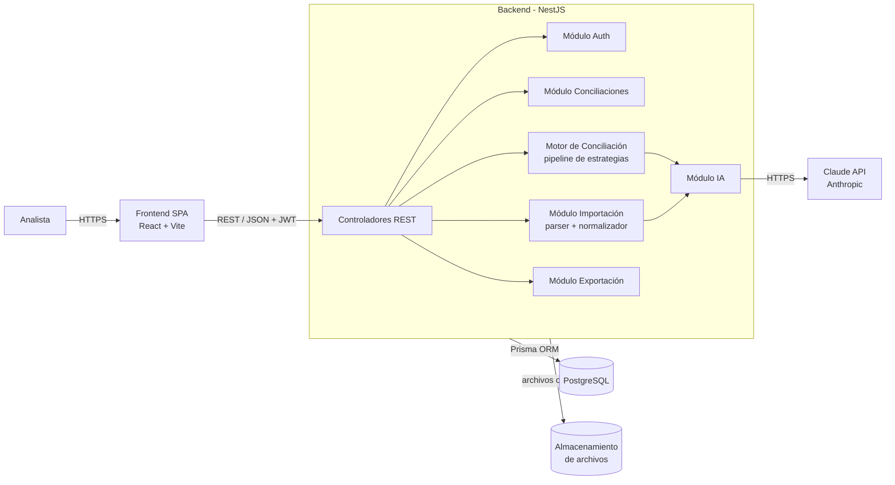
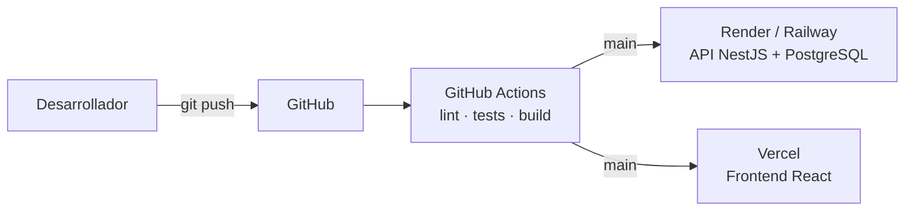
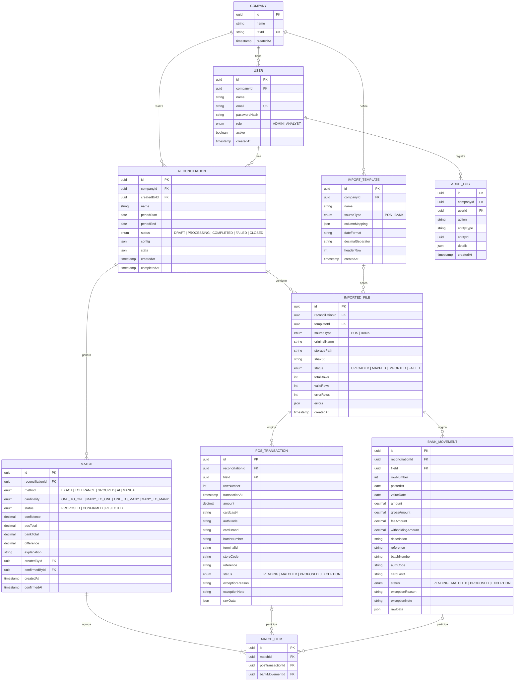

## Índice

0. [Ficha del proyecto](#0-ficha-del-proyecto)
1. [Descripción general del producto](#1-descripción-general-del-producto)
2. [Arquitectura del sistema](#2-arquitectura-del-sistema)
3. [Modelo de datos](#3-modelo-de-datos)
4. [Especificación de la API](#4-especificación-de-la-api)
5. [Historias de usuario](#5-historias-de-usuario)
6. [Tickets de trabajo](#6-tickets-de-trabajo)
7. [Pull requests](#7-pull-requests)

---

## 0. Ficha del proyecto

| Campo                   | Valor                                                                                                                                                                                                                                                                                                 |
| ----------------------- | ----------------------------------------------------------------------------------------------------------------------------------------------------------------------------------------------------------------------------------------------------------------------------------------------------- |
| **Nombre completo**     | Rafael Josué Arteaga Mosquera                                                                                                                                                                                                                                                                         |
| **Nombre del proyecto** | Concilia                                                                                                                                                                                                                                                                                              |
| **Descripción breve**   | Aplicación web que recibe el reporte de ventas con tarjeta de crédito del POS y el extracto bancario de una cadena comercial, cruza automáticamente ambas fuentes mediante un motor de conciliación por niveles (con apoyo de IA) y deja al analista solo las partidas que requieren revisión humana. |
| **URL del proyecto**    | _Pendiente (entrega 3)_                                                                                                                                                                                                                                                                               |
| **Repositorio**         | https://github.com/rafarteaga/AI4Devs-finalproject.git                                                                                                                                                                                                                                                |
| **Stack**               | Node.js · NestJS · TypeScript · React · PostgreSQL · Prisma · Claude API                                                                                                                                                                                                                              |

---

## 1. Descripción general del producto

### 1.1 Objetivo

**Problema.** Las cadenas comerciales reciben diariamente cientos o miles de pagos con tarjeta de crédito y débito. Para asegurar que todo lo vendido fue efectivamente acreditado, una persona del área financiera cruza manualmente en Excel el reporte del sistema de punto de venta contra el extracto que entrega el banco. Este proceso:

- consume horas o días de trabajo al cierre de cada período;
- es propenso a errores humanos (fórmulas rotas, filas omitidas, cruces equivocados);
- se complica porque el banco no siempre acredita transacción por transacción: puede depositar por lotes, con días de desfase y con montos netos de comisiones y retenciones;
- no deja trazabilidad de quién cruzó qué, ni por qué.

**Solución.** Concilia automatiza el cruce. El usuario sube ambos archivos, el sistema los normaliza y ejecuta un motor de conciliación por niveles de confianza que resuelve la mayoría de los casos de forma automática. Las partidas restantes se presentan de forma ordenada, con sugerencias generadas por IA, para que el analista las resuelva en minutos en lugar de horas.

**Usuarios objetivo.**

- **Analista de conciliación / tesorería:** usuario principal; carga archivos, revisa resultados y resuelve pendientes.
- **Jefe financiero / contador:** consulta el estado de las conciliaciones, los porcentajes de cruce y las excepciones.
- **Administrador:** gestiona usuarios y plantillas de importación de la empresa.

**Valor aportado.**

- Objetivo de conciliación automática ≥ 90 % de las transacciones en escenarios estándar.
- Reducción drástica del tiempo de cierre.
- Trazabilidad completa: cada cruce registra método, nivel de confianza, usuario y fecha.
- Independencia del formato: funciona con distintos bancos y sistemas POS mediante mapeo de columnas.

### 1.2 Características y funcionalidades principales

**1. Importación flexible de archivos.** Carga de archivos CSV y Excel (.xlsx) del POS y del banco. El usuario mapea las columnas de cada archivo a los campos estándar de Concilia (fecha, monto, código de autorización, últimos 4 dígitos, lote, referencia…). La IA sugiere el mapeo analizando cabeceras y filas de ejemplo, y el mapeo puede guardarse como plantilla reutilizable para ese banco o POS.

**2. Normalización de datos.** Conversión de fechas en distintos formatos, montos con separadores decimales locales, limpieza de referencias y enmascaramiento de tarjetas (solo se guardan los últimos 4 dígitos). Las filas inválidas se reportan con el motivo del error sin bloquear la importación.

**3. Motor de conciliación por niveles.** Se ejecuta como una secuencia de estrategias; cada nivel trabaja solo con lo que los niveles anteriores dejaron sin cruzar:

| Nivel | Estrategia | Regla | Confianza |
|---|---|---|---|
| 1 | Exacto | Mismo código de autorización + mismo monto + misma fecha | Alta (auto-confirmado) |
| 2 | Tolerancia | Mismo monto (o monto neto esperado) + últimos 4 dígitos, dentro de una ventana de días configurable | Media-alta (auto-confirmado si es único) |
| 3 | Agrupado (N:1) | Suma de varias ventas del POS (mismo día, lote o marca) = un depósito bancario, considerando comisión y retención configuradas | Media (propuesto) |
| 4 | Asistido por IA | Un LLM analiza los pendientes pre-filtrados y propone posibles cruces con una explicación | Variable (siempre requiere confirmación humana) |

Parámetros configurables por conciliación: ventana de días (por defecto 3), tolerancia de monto (por defecto 0,05), porcentaje de comisión y porcentaje de retención (opcionales, para depósitos netos).

**4. Panel de resultados.** Resumen con totales y porcentaje de conciliación; pestañas de conciliadas, pendientes POS, pendientes banco, propuestas y excepciones; filtros por fecha, monto, marca y método de cruce.

**5. Conciliación manual.** Selección de una o varias transacciones de cada lado para crear un cruce manual, con cálculo en vivo de la diferencia. Los cruces pueden deshacerse.

**6. Gestión de excepciones.** Las partidas que no tienen contraparte se marcan con un motivo (contracargo, anulación, error de registro, pendiente de acreditación…) y una nota.

**7. Exportación.** Reporte Excel con el resumen y el detalle de cruces, pendientes y excepciones, listo para archivo o auditoría.

**8. Historial y auditoría.** Listado de conciliaciones por período y registro de todas las acciones relevantes de los usuarios.

**Fuera de alcance del MVP:** conexión directa con APIs bancarias, lectura de extractos en PDF, conciliación contable (asientos), multi-moneda y aplicación móvil.

### 1.3 Diseño y experiencia de usuario

Flujo principal del usuario:

```
Login → Listado de conciliaciones → Nueva conciliación (nombre, período, parámetros)
      → Cargar archivo POS → Mapear columnas → Cargar extracto banco → Mapear columnas
      → Ejecutar conciliación → Panel de resultados
      → Revisar propuestas / cruces manuales / excepciones → Exportar Excel
```

Pantallas principales:

1. **Login.**
2. **Listado de conciliaciones:** tabla con nombre, período, estado, porcentaje conciliado y fecha.
3. **Asistente de nueva conciliación:** wizard de pasos (datos generales → archivo POS → archivo banco → ejecutar).
4. **Mapeo de columnas:** vista previa de las primeras filas del archivo y selector de campo por cada columna, con la sugerencia de IA preseleccionada.
5. **Panel de resultados:** tarjetas de KPIs y tablas por estado.
6. **Vista de conciliación manual:** dos tablas lado a lado (POS | Banco) con selección múltiple y barra de diferencia.

_Se añadirán capturas y un vídeo demostrativo en la entrega final._

### 1.4 Instrucciones de instalación

**Requisitos:** Node.js ≥ 20.19 (recomendado 24, ver `.nvmrc`), npm ≥ 10 y Docker (para PostgreSQL). Alternativamente, cualquier PostgreSQL 16 accesible desde `DATABASE_URL`.

```bash
git clone https://github.com/rafarteaga/AI4Devs-finalproject.git
cd AI4Devs-finalproject
cp .env.example .env            # DATABASE_URL, JWT_SECRET, ANTHROPIC_API_KEY, AI_MODEL, CORS_ORIGIN
docker compose up -d db         # PostgreSQL 16 local (crea también la BD de test concilia_test)
npm install                     # instala los tres workspaces: apps/api, apps/web y samples
npm run db:migrate              # aplica las migraciones de Prisma
npm run db:seed                 # empresa demo + usuarios admin@demo.concilia.app y analista@demo.concilia.app
npm run dev                     # API en http://localhost:3000/api/v1 · docs en /api/docs · web en http://localhost:5173
```

Contraseña por defecto de los usuarios demo: `Concilia2026!` (configurable con `SEED_ADMIN_PASSWORD` y `SEED_ANALYST_PASSWORD` antes del seed).

Otros comandos útiles:

| Comando | Qué hace |
|---|---|
| `npm run lint` · `npm run format` | Lint y formato de todo el monorepo |
| `npm test` | Tests unitarios de todos los workspaces |
| `npm run test:integration` | Tests de integración de la API contra `DATABASE_URL_TEST` |
| `npm run samples:generate` | Regenera los datasets sintéticos en `samples/standard/` |
| `PORT=3100 npm run dev -w apps/api` | Arranca la API en otro puerto (el frontend lee `VITE_API_URL`) |
---

## 2. Arquitectura del sistema

### 2.1 Diagrama de arquitectura

Se opta por un **monolito modular** con frontend SPA separado. Para el volumen esperado (miles o decenas de miles de transacciones por conciliación) y un equipo de una persona, ofrece la mejor relación entre simplicidad, velocidad de desarrollo y facilidad de despliegue, manteniendo módulos bien delimitados que podrían extraerse a servicios en el futuro (por ejemplo, el motor de conciliación como worker independiente).



**Beneficios:** un solo despliegue de backend, transacciones de base de datos simples, tipado de extremo a extremo con TypeScript y un dominio acotado que no justifica microservicios.

**Sacrificios:** el motor corre en el mismo proceso que la API, por lo que conciliaciones muy grandes podrían afectar la latencia. Se mitiga ejecutando el motor de forma asíncrona (la API responde de inmediato y el frontend consulta el estado). Si el volumen crece, el paso natural es mover el motor a un worker con cola (BullMQ + Redis).

### 2.2 Descripción de componentes principales

| Componente | Tecnología | Responsabilidad |
|---|---|---|
| Frontend | React 18, Vite, TypeScript, TanStack Query, React Router, Tailwind CSS + shadcn/ui | Interfaz de usuario, wizard de importación, panel de resultados y conciliación manual |
| API | NestJS 12 (ESM), TypeScript 6, class-validator, Swagger | Endpoints REST, validación de entrada, documentación OpenAPI automática |
| Auth | Passport + JWT, bcrypt | Autenticación, autorización por roles y aislamiento de datos por empresa |
| Importación | SheetJS (xlsx), csv-parse, Multer | Lectura de archivos, vista previa, aplicación del mapeo, normalización y validación de filas |
| Motor de conciliación | TypeScript puro (sin dependencias de framework) | Pipeline de estrategias de cruce; lógica de dominio aislada y altamente testeable |
| Módulo IA | SDK de Anthropic (Claude, modelo configurable por variable de entorno) | Sugerencia de mapeo de columnas y propuesta de cruces para pendientes |
| Exportación | ExcelJS | Generación del reporte Excel |
| Persistencia | PostgreSQL 16 + Prisma 7 (driver adapter `pg`) | Modelo relacional, migraciones y consultas tipadas |

**Diseño del motor de conciliación.** Se implementa con el patrón *Strategy* dentro de un *pipeline*:

```ts
interface MatchingStrategy {
  name: MatchMethod;                       // EXACT | TOLERANCE | GROUPED | AI
  run(pool: UnmatchedPool, config: ReconciliationConfig): MatchCandidate[];
}

// El motor ejecuta las estrategias en orden; cada una consume
// solo las transacciones que quedaron libres tras la anterior.
const pipeline = [new ExactStrategy(), new ToleranceStrategy(), new GroupedStrategy()];
```

El motor recibe y devuelve estructuras en memoria, sin acceso a base de datos, lo que permite probarlo con tests unitarios sobre datasets sintéticos. Un servicio de aplicación (`ReconciliationRunner`) se encarga de cargar los datos, invocar el motor y persistir los resultados en una transacción.

Para depósitos netos se calcula el **monto neto esperado** de cada venta o grupo de ventas:

```
neto_esperado = bruto − (bruto × %comisión) − (bruto × %retención)
cruce válido si |neto_esperado − monto_banco| ≤ tolerancia
```

El **nivel 4 (IA)** se ejecuta bajo demanda: se pre-filtran candidatos por ventana de fechas y rango de montos para acotar el contexto, se envían al LLM solo datos no sensibles (fecha, monto, últimos 4 dígitos, referencia, lote) y se solicita una respuesta en JSON estructurado con los identificadores propuestos, un nivel de confianza y una explicación. Las propuestas de IA **nunca se confirman automáticamente**.

### 2.3 Estructura de ficheros

Monorepo con workspaces de npm:

```
concilia/
├── apps/
│   ├── api/                        # Backend NestJS
│   │   ├── prisma/
│   │   │   ├── schema.prisma
│   │   │   ├── migrations/
│   │   │   └── seed.ts
│   │   ├── src/
│   │   │   ├── auth/
│   │   │   ├── users/
│   │   │   ├── reconciliations/
│   │   │   ├── imports/            # parser, mapeo, normalización
│   │   │   ├── templates/
│   │   │   ├── matching/
│   │   │   │   ├── engine/         # dominio puro: pipeline + estrategias
│   │   │   │   └── matching.service.ts
│   │   │   ├── ai/
│   │   │   ├── exports/
│   │   │   ├── audit/
│   │   │   └── common/             # guards, filtros, decoradores
│   │   └── test/                   # tests de integración
│   └── web/                        # Frontend React
│       └── src/
│           ├── pages/
│           ├── components/
│           ├── features/           # reconciliations, imports, results
│           ├── api/                # cliente HTTP y hooks de TanStack Query
│           └── lib/
├── e2e/                            # Tests Playwright
├── samples/                        # Datasets sintéticos POS/banco
├── docker-compose.yml
├── .github/workflows/ci.yml
├── README.md
└── prompts.md
```

El backend sigue la estructura modular de NestJS (un módulo por contexto funcional), con el motor de conciliación separado como capa de dominio independiente del framework.

### 2.4 Infraestructura y despliegue



- **Local:** Docker Compose con PostgreSQL; backend y frontend en modo desarrollo.
- **CI:** GitHub Actions ejecuta lint, tests unitarios y de integración (con PostgreSQL como servicio) y build en cada pull request.
- **CD:** al fusionar en `main`, el frontend se despliega en Vercel y el backend con su base de datos en Render o Railway. Las migraciones de Prisma se aplican en el despliegue (`prisma migrate deploy`).
- **Configuración:** variables de entorno (`DATABASE_URL`, `JWT_SECRET`, `ANTHROPIC_API_KEY`, `AI_MODEL`, `CORS_ORIGIN`).

### 2.5 Seguridad

- **Autenticación** con JWT de corta duración y contraseñas con hash bcrypt.
- **Autorización** por roles (`ADMIN`, `ANALYST`) mediante guards de NestJS.
- **Aislamiento multiempresa:** todas las consultas se filtran por `companyId` obtenido del token, nunca del cliente.
- **Datos de tarjeta:** el sistema nunca almacena el número completo (PAN). Durante la importación cualquier número de tarjeta se reduce a los últimos 4 dígitos, alineado con buenas prácticas PCI DSS.
- **IA:** solo se envían al LLM campos no sensibles y enmascarados; la clave de API reside únicamente en el backend.
- **Archivos:** validación de extensión, tipo MIME y tamaño máximo (10 MB); hash SHA-256 para detectar cargas duplicadas.
- **Entrada:** validación de DTOs con class-validator, Helmet para cabeceras HTTP, CORS restringido y rate limiting en login.
- **Auditoría:** registro de acciones críticas (crear o deshacer cruces, marcar excepciones, ejecutar conciliación).

### 2.6 Tests

| Tipo | Herramienta | Alcance |
|---|---|---|
| Unitarios | Vitest | Estrategias del motor, normalizadores de fecha y monto, cálculo de neto esperado, servicios |
| Integración | Vitest + Supertest + PostgreSQL de test | Endpoints de la API contra base de datos real: importación, ejecución de conciliación, cruces manuales |
| E2E | Playwright | Flujo completo: login → crear conciliación → subir archivos → ejecutar → cruce manual → exportar |

Se generan **datasets sintéticos** (`samples/`, ver [`samples/README.md`](samples/README.md)) con casos controlados: cruces exactos, desfases de fechas, depósitos por lote, depósitos netos, duplicados y transacciones huérfanas. Cada dataset incluye un `expected.json` con la contraparte y el nivel esperado de cada fila, lo que permite medir precisión y cobertura del motor de forma objetiva por escenario. El objetivo de cobertura de tests del motor es ≥ 90 %.

Proporciones del dataset estándar (`samples/standard/`, 1.205 ventas POS y 986 líneas bancarias, semilla fija `concilia-2026`): 60 % cruces exactos, 15 % desfase de fechas (1-3 días), 15 % depósitos por lote, 5 % depósitos netos (comisión 2,5 %, retención 1 %), 3 % ventas duplicadas, 1 % ventas sin abono y 1 % abonos sin venta, más 12 débitos que la importación debe descartar. Los archivos POS y banco usan a propósito formatos distintos (`;` + `dd/MM/yyyy` + decimal coma frente a `,` + `yyyy-MM-dd` + decimal punto) para ejercitar la normalización. Se regenera con `npm run samples:generate -- --all`; la misma semilla produce archivos idénticos byte a byte.

---

## 3. Modelo de datos

### 3.1 Diagrama entidad-relación



### 3.2 Descripción de entidades

**Company (empresa).** Cadena comercial cliente de Concilia; es la unidad de aislamiento de datos.
- `taxId`: RUC o identificación tributaria, único.

**User (usuario).** Persona que accede al sistema.
- `email` único; `role` determina permisos (`ADMIN` gestiona usuarios y plantillas; `ANALYST` opera conciliaciones).
- Relación N:1 con `Company`.

**ImportTemplate (plantilla de importación).** Configuración reutilizable para leer archivos de un banco o POS concreto.
- `columnMapping`: JSON que relaciona columnas del archivo con campos estándar, por ejemplo `{ "Fecha Trx": "transactionAt", "Valor": "amount", "Autorizacion": "authCode" }`.
- `dateFormat` (p. ej. `dd/MM/yyyy`), `decimalSeparator` (`.` o `,`) y `headerRow` (fila donde empiezan las cabeceras).

**Reconciliation (conciliación).** Un proceso de cruce para un período determinado.
- `config`: parámetros del motor, por ejemplo `{ "dateWindowDays": 3, "amountTolerance": 0.05, "feePercent": 0, "withholdingPercent": 0, "enableGrouping": true }`.
- `stats`: resumen calculado tras la ejecución (totales, cruzados por método, porcentaje conciliado).
- `status`: ciclo de vida `DRAFT → PROCESSING → COMPLETED → CLOSED` (o `FAILED`).

**ImportedFile (archivo importado).** Cada archivo subido a una conciliación.
- `sha256` permite detectar si el mismo archivo se sube dos veces.
- `errors`: lista de filas rechazadas con su motivo.

**PosTransaction (transacción POS).** Una venta con tarjeta registrada en el punto de venta.
- `amount` en `DECIMAL(14,2)` (nunca `float`, para evitar errores de redondeo).
- `cardLast4`: únicamente los últimos 4 dígitos.
- `rawData`: la fila original, para trazabilidad.
- Índices: `(reconciliationId, status)`, `(reconciliationId, authCode)`, `(reconciliationId, amount, transactionAt)`.

**BankMovement (movimiento bancario).** Una línea de crédito del extracto bancario.
- `amount`: monto efectivamente acreditado. `grossAmount`, `feeAmount` y `withholdingAmount` son opcionales y se completan cuando el extracto los detalla, lo que permite soportar depósitos brutos, netos o por lote.
- Mismos estados e índices análogos a `PosTransaction`.

**Match (cruce).** Resultado de relacionar una o más transacciones POS con uno o más movimientos bancarios.
- `method`: estrategia que lo generó; `confidence`: valor entre 0 y 1.
- `difference = bankTotal − posTotal`, útil para identificar comisiones o errores.
- `explanation`: justificación textual (obligatoria en cruces por IA).
- `createdById` es nulo para cruces automáticos.

**MatchItem (detalle de cruce).** Tabla de relación que permite cruces 1:1, N:1, 1:N y N:M. Cada fila referencia una transacción POS **o** un movimiento bancario (restricción `CHECK` para que exactamente uno de los dos no sea nulo). Una transacción solo puede pertenecer a un cruce en estado `CONFIRMED` o `PROPOSED` a la vez (validado en la capa de servicio).

**AuditLog (auditoría).** Registro inmutable de acciones relevantes: `RUN_RECONCILIATION`, `CREATE_MANUAL_MATCH`, `UNDO_MATCH`, `CONFIRM_AI_MATCH`, `MARK_EXCEPTION`, etc.

---

## 4. Especificación de la API

API REST con prefijo `/api/v1`, autenticación Bearer JWT y documentación Swagger disponible en `/api/docs`.

### 4.1 Resumen de endpoints

| Método | Endpoint | Descripción |
|---|---|---|
| POST | `/auth/login` | Inicia sesión y devuelve el token |
| GET | `/auth/me` | Datos del usuario autenticado |
| GET | `/reconciliations` | Lista conciliaciones (paginado, filtros por estado y período) |
| POST | `/reconciliations` | Crea una conciliación |
| GET | `/reconciliations/{id}` | Detalle y resumen de una conciliación |
| POST | `/reconciliations/{id}/files` | Sube un archivo POS o banco |
| GET | `/files/{fileId}/preview` | Primeras filas y mapeo sugerido por IA |
| POST | `/files/{fileId}/import` | Aplica el mapeo, normaliza e importa las filas |
| POST | `/reconciliations/{id}/run` | Ejecuta el motor de conciliación (asíncrono) |
| GET | `/reconciliations/{id}/pos-transactions` | Lista transacciones POS con filtros (`status`, fechas, monto) |
| GET | `/reconciliations/{id}/bank-movements` | Lista movimientos bancarios con filtros |
| GET | `/reconciliations/{id}/matches` | Lista cruces con filtros (`method`, `status`) |
| POST | `/reconciliations/{id}/matches` | Crea un cruce manual |
| PATCH | `/matches/{matchId}` | Confirma o rechaza un cruce propuesto |
| DELETE | `/matches/{matchId}` | Deshace un cruce y libera sus transacciones |
| POST | `/reconciliations/{id}/ai-suggestions` | Solicita a la IA propuestas para los pendientes |
| PATCH | `/pos-transactions/{id}/exception` | Marca o desmarca una excepción POS |
| PATCH | `/bank-movements/{id}/exception` | Marca o desmarca una excepción bancaria |
| GET | `/reconciliations/{id}/export` | Descarga el reporte en Excel |
| GET / POST | `/templates` | Lista o crea plantillas de importación |

### 4.2 Endpoints principales en detalle

```yaml
openapi: 3.0.3
info:
  title: Concilia API
  version: 1.0.0
paths:
  /api/v1/reconciliations/{id}/files:
    post:
      summary: Sube un archivo POS o bancario a una conciliación
      security: [{ bearerAuth: [] }]
      parameters:
        - { name: id, in: path, required: true, schema: { type: string, format: uuid } }
      requestBody:
        required: true
        content:
          multipart/form-data:
            schema:
              type: object
              required: [file, sourceType]
              properties:
                file: { type: string, format: binary, description: "CSV o XLSX, máx. 10 MB" }
                sourceType: { type: string, enum: [POS, BANK] }
                templateId: { type: string, format: uuid, nullable: true }
      responses:
        '201':
          description: Archivo recibido
          content:
            application/json:
              example:
                id: "8f2c1c7e-..."
                sourceType: "POS"
                originalName: "ventas_septiembre.xlsx"
                status: "UPLOADED"
                totalRows: 4821
        '400': { description: Formato o tamaño no válido }
        '409': { description: Archivo duplicado (mismo hash) en esta conciliación }

  /api/v1/reconciliations/{id}/run:
    post:
      summary: Ejecuta el motor de conciliación de forma asíncrona
      security: [{ bearerAuth: [] }]
      parameters:
        - { name: id, in: path, required: true, schema: { type: string, format: uuid } }
      requestBody:
        required: false
        content:
          application/json:
            schema:
              type: object
              properties:
                dateWindowDays: { type: integer, default: 3 }
                amountTolerance: { type: number, default: 0.05 }
                feePercent: { type: number, default: 0 }
                withholdingPercent: { type: number, default: 0 }
                enableGrouping: { type: boolean, default: true }
      responses:
        '202':
          description: Ejecución iniciada; consultar GET /reconciliations/{id} para ver el estado
          content:
            application/json:
              example: { id: "c41d...", status: "PROCESSING" }
        '422': { description: Faltan archivos POS o banco importados }

  /api/v1/reconciliations/{id}/matches:
    post:
      summary: Crea un cruce manual
      security: [{ bearerAuth: [] }]
      parameters:
        - { name: id, in: path, required: true, schema: { type: string, format: uuid } }
      requestBody:
        required: true
        content:
          application/json:
            schema:
              type: object
              required: [posTransactionIds, bankMovementIds]
              properties:
                posTransactionIds: { type: array, items: { type: string, format: uuid }, minItems: 1 }
                bankMovementIds: { type: array, items: { type: string, format: uuid }, minItems: 1 }
                note: { type: string, maxLength: 500 }
            example:
              posTransactionIds: ["a1...", "a2...", "a3..."]
              bankMovementIds: ["b7..."]
              note: "Depósito del lote 0452 neto de comisión"
      responses:
        '201':
          description: Cruce creado y confirmado
          content:
            application/json:
              example:
                id: "m9..."
                method: "MANUAL"
                cardinality: "MANY_TO_ONE"
                status: "CONFIRMED"
                posTotal: 312.40
                bankTotal: 305.28
                difference: -7.12
        '409': { description: Alguna transacción ya pertenece a otro cruce activo }
components:
  securitySchemes:
    bearerAuth: { type: http, scheme: bearer, bearerFormat: JWT }
```

---

## 5. Historias de usuario

Priorización MoSCoW (**Must**, **Should**, **Could**). La columna *Entrega* indica en qué hito se implementa: **E2** = 23 de octubre (flujo principal), **E3** = 11 de noviembre (entrega final).

| ID    | Historia                             | Prioridad | Entrega |
| ----- | ------------------------------------ | --------- | ------- |
| HU-01 | Iniciar sesión                       | Must      | E2      |
| HU-02 | Crear una conciliación               | Must      | E2      |
| HU-03 | Cargar el archivo del POS            | Must      | E2      |
| HU-04 | Cargar el extracto bancario          | Must      | E2      |
| HU-05 | Mapear columnas del archivo          | Must      | E2      |
| HU-06 | Ejecutar la conciliación automática  | Must      | E2      |
| HU-07 | Ver resultados de la conciliación    | Must      | E2      |
| HU-08 | Conciliar manualmente                | Must      | E2      |
| HU-09 | Revisar sugerencias de la IA         | Should    | E3      |
| HU-10 | Marcar excepciones                   | Should    | E3      |
| HU-11 | Exportar el reporte a Excel          | Should    | E3      |
| HU-12 | Reutilizar plantillas de importación | Could     | E3      |

---

### HU-01 · Iniciar sesión
**Como** analista de conciliación, **quiero** iniciar sesión con mi correo y contraseña, **para** acceder únicamente a las conciliaciones de mi empresa.

**Criterios de aceptación**
- **Dado** un usuario activo, **cuando** ingresa credenciales correctas, **entonces** accede al listado de conciliaciones.
- **Dado** credenciales incorrectas, **cuando** intenta ingresar, **entonces** ve un mensaje genérico de error sin revelar si el correo existe.
- **Dado** un usuario autenticado, **cuando** consulta cualquier recurso, **entonces** solo obtiene datos de su propia empresa.

---

### HU-02 · Crear una conciliación
**Como** analista, **quiero** crear una conciliación indicando nombre, período y parámetros de cruce, **para** organizar el trabajo de cada cierre.

**Criterios de aceptación**
- **Dado** que estoy en el listado, **cuando** completo nombre, fecha de inicio y fecha de fin, **entonces** se crea en estado `DRAFT`.
- **Dado** que la fecha de fin es anterior a la de inicio, **cuando** intento guardar, **entonces** se muestra un error de validación.
- Los parámetros (ventana de días, tolerancia, % comisión, % retención) tienen valores por defecto editables.

---

### HU-03 · Cargar el archivo del POS
**Como** analista, **quiero** subir el reporte de ventas con tarjeta del POS en CSV o Excel, **para** que el sistema lo use en el cruce.

**Criterios de aceptación**
- Se aceptan `.csv` y `.xlsx` de hasta 10 MB; otros formatos se rechazan con un mensaje claro.
- Tras la carga se muestra una vista previa de las primeras 20 filas.
- **Dado** que subo el mismo archivo dos veces en una conciliación, **entonces** el sistema me avisa que es un duplicado.

---

### HU-04 · Cargar el extracto bancario
**Como** analista, **quiero** subir el extracto bancario en CSV o Excel, **para** compararlo contra las ventas del POS.

**Criterios de aceptación**
- Mismas validaciones de formato, tamaño y duplicado que HU-03.
- Solo se importan movimientos de crédito (abonos); los débitos se descartan e informan en el resumen de importación.
- Se admiten extractos con o sin columnas de comisión y retención.

---

### HU-05 · Mapear columnas del archivo
**Como** analista, **quiero** indicar qué columna del archivo corresponde a cada campo (fecha, monto, autorización, etc.), **para** poder trabajar con archivos de cualquier banco o POS.

**Criterios de aceptación**
- Se muestra cada columna del archivo con un selector de campo estándar.
- Los campos obligatorios (fecha y monto) deben estar asignados para continuar.
- Al confirmar, se importan las filas válidas y se muestra el número de filas rechazadas con su motivo (fecha inválida, monto vacío…).
- _(E3)_ El sistema preselecciona un mapeo sugerido por IA que el usuario puede modificar.

---

### HU-06 · Ejecutar la conciliación automática
**Como** analista, **quiero** ejecutar el cruce automático con un clic, **para** evitar el trabajo manual en Excel.

**Criterios de aceptación**
- **Dado** que hay al menos un archivo POS y uno bancario importados, **cuando** pulso "Ejecutar", **entonces** la conciliación pasa a `PROCESSING` y veo un indicador de progreso.
- El motor aplica en orden los niveles exacto, tolerancia y agrupado (E3), y cada transacción queda en un único cruce.
- Al terminar, el estado pasa a `COMPLETED` y se muestra el porcentaje conciliado.
- **Dado** un error durante el proceso, **entonces** el estado pasa a `FAILED`, no se persisten cruces parciales y se muestra el motivo.
- Se puede volver a ejecutar; los cruces automáticos anteriores se recalculan y los manuales se conservan.

---

### HU-07 · Ver resultados de la conciliación
**Como** analista, **quiero** ver un resumen y el detalle de lo conciliado y lo pendiente, **para** saber qué me queda por revisar.

**Criterios de aceptación**
- Se muestran KPIs: total POS, total banco, número y porcentaje de conciliadas, pendientes de cada lado y diferencia total en monto.
- Pestañas: Conciliadas, Pendientes POS, Pendientes banco, Propuestas y Excepciones.
- Cada cruce muestra método, nivel de confianza y diferencia.
- Las tablas permiten filtrar por fecha, monto, marca de tarjeta y método, y están paginadas.

---

### HU-08 · Conciliar manualmente
**Como** analista, **quiero** seleccionar transacciones del POS y del banco y cruzarlas manualmente, **para** resolver los casos que el motor no pudo resolver.

**Criterios de aceptación**
- Puedo seleccionar una o varias transacciones de cada lado; se muestra en vivo la suma de cada lado y la diferencia.
- Al confirmar, se crea un cruce `MANUAL` confirmado y las transacciones pasan a `MATCHED`.
- Puedo deshacer cualquier cruce; sus transacciones vuelven a `PENDING` y la acción queda auditada.
- No puedo incluir una transacción que ya esté en otro cruce activo.

---

### HU-09 · Revisar sugerencias de la IA
**Como** analista, **quiero** que la IA me proponga posibles cruces para los pendientes con una explicación, **para** resolver más rápido los casos difíciles.

**Criterios de aceptación**
- **Cuando** pulso "Sugerir con IA", **entonces** se generan propuestas en estado `PROPOSED` con confianza y explicación.
- Puedo aceptar o rechazar cada propuesta individualmente; ninguna se confirma sin mi acción.
- Una propuesta rechazada no vuelve a sugerirse en la misma conciliación.
- Si el servicio de IA no está disponible, se informa sin afectar el resto de la aplicación.

---

### HU-10 · Marcar excepciones
**Como** analista, **quiero** marcar una transacción pendiente como excepción indicando un motivo, **para** documentar por qué no tiene contraparte.

**Criterios de aceptación**
- Motivos predefinidos: contracargo, anulación, error de registro en POS, pendiente de acreditación, otro (con nota obligatoria).
- La transacción pasa a `EXCEPTION`, aparece en su pestaña y deja de contar como pendiente.
- La excepción puede revertirse.

---

### HU-11 · Exportar el reporte a Excel
**Como** jefe financiero, **quiero** descargar el resultado en Excel, **para** archivarlo o enviarlo a auditoría.

**Criterios de aceptación**
- El archivo incluye hojas de Resumen, Conciliadas (con método y diferencia), Pendientes POS, Pendientes banco y Excepciones.
- Los montos se exportan como números, no como texto.

---

### HU-12 · Reutilizar plantillas de importación
**Como** analista, **quiero** guardar el mapeo de columnas de un banco o POS como plantilla, **para** no repetirlo cada mes.

**Criterios de aceptación**
- Al confirmar un mapeo puedo guardarlo con un nombre.
- Al subir un archivo puedo elegir una plantilla y el mapeo se aplica automáticamente.
- Si las columnas del archivo no coinciden con la plantilla, el sistema lo advierte.

---

## 6. Tickets de trabajo

Estimación en *story points* (1 SP ≈ medio día de trabajo asistido por IA).

### 6.1 Backlog completo

| ID | Título | Tipo | HU | Prior. | SP | Entrega |
|---|---|---|---|---|---|---|
| TK-01 | Configurar monorepo (NestJS + React/Vite + TS), ESLint, Prettier y Docker Compose con PostgreSQL | Setup | — | Alta | 3 | E2 |
| TK-02 | Definir esquema Prisma, migración inicial y seed (empresa y usuarios demo) | BD | — | Alta | 3 | E2 |
| TK-03 | Generador de datasets sintéticos POS/banco con casos controlados | Datos / Test | — | Alta | 2 | E2 |
| TK-04 | Módulo de autenticación: login JWT, guard de roles y aislamiento por empresa | Backend | HU-01 | Alta | 3 | E2 |
| TK-05 | Pantalla de login y gestión de sesión en el frontend | Frontend | HU-01 | Alta | 2 | E2 |
| TK-06 | API CRUD de conciliaciones con validación de período y parámetros | Backend | HU-02 | Alta | 2 | E2 |
| TK-07 | Pantallas de listado y creación de conciliaciones | Frontend | HU-02 | Alta | 3 | E2 |
| TK-08 | Endpoint de carga de archivos: validación de tipo y tamaño, hash de duplicados, almacenamiento | Backend | HU-03, HU-04 | Alta | 3 | E2 |
| TK-09 | Servicio de parseo CSV/XLSX y vista previa | Backend | HU-03, HU-04 | Alta | 3 | E2 |
| TK-10 | Aplicación de mapeo, normalización y validación de filas | Backend | HU-05 | Alta | 5 | E2 |
| TK-11 | UI de carga de archivos y mapeo de columnas | Frontend | HU-03, HU-04, HU-05 | Alta | 5 | E2 |
| TK-12 | Motor de conciliación: pipeline de estrategias + nivel 1 (exacto) | Backend | HU-06 | Alta | 5 | E2 |
| TK-13 | Motor nivel 2: tolerancia de fechas y cálculo de monto neto esperado | Backend | HU-06 | Alta | 5 | E2 |
| TK-14 | Ejecución asíncrona del motor, persistencia transaccional y cálculo de estadísticas | Backend | HU-06 | Alta | 3 | E2 |
| TK-15 | API de resumen y listados con filtros y paginación | Backend | HU-07 | Alta | 3 | E2 |
| TK-16 | Panel de resultados con KPIs y pestañas | Frontend | HU-07 | Alta | 5 | E2 |
| TK-17 | Conciliación manual y deshacer cruce (API + UI) | Full-stack | HU-08 | Alta | 5 | E2 |
| TK-18 | Motor nivel 3: cruces agrupados N:1 por día, lote y marca | Backend | HU-06 | Media | 8 | E3 |
| TK-19 | Integración con Claude API: sugerencia de mapeo de columnas | Backend / IA | HU-05 | Media | 3 | E3 |
| TK-20 | Sugerencias de cruce por IA para pendientes + UI de revisión | Full-stack / IA | HU-09 | Media | 8 | E3 |
| TK-21 | Gestión de excepciones con motivo (API + UI) | Full-stack | HU-10 | Media | 3 | E3 |
| TK-22 | Exportación del reporte a Excel | Backend | HU-11 | Media | 3 | E3 |
| TK-23 | Plantillas de importación reutilizables | Full-stack | HU-12 | Baja | 3 | E3 |
| TK-24 | Registro de auditoría de acciones críticas | Backend | HU-08, HU-10 | Baja | 2 | E3 |
| TK-25 | Tests unitarios del motor y normalizadores (cobertura ≥ 90 % en el motor) | Test | HU-06 | Alta | 3 | E3 |
| TK-26 | Tests de integración de la API con PostgreSQL de test | Test | Varias | Alta | 3 | E3 |
| TK-27 | Tests E2E con Playwright del flujo principal | Test | Varias | Alta | 5 | E3 |
| TK-28 | Pipeline CI en GitHub Actions (lint, tests, build) | DevOps | — | Alta | 2 | E3 |
| TK-29 | Despliegue: backend y BD en Render/Railway, frontend en Vercel | DevOps | — | Alta | 3 | E3 |

**Total estimado:** E2 = 60 SP · E3 = 46 SP.

> Aunque los tests formales se agrupan en E3, se escribirán tests unitarios del motor en paralelo a TK-12 y TK-13, ya que el motor es la parte más crítica del producto.

### 6.1.1 Ejecución del backlog con OpenSpec

El backlog se implementa con [OpenSpec](https://github.com/Fission-AI/OpenSpec) (desarrollo guiado por especificaciones: `/opsx:propose` → `/opsx:apply` → `/opsx:archive`). Cada *change* en `openspec/changes/` agrupa los tickets de un bloque funcional y contiene `proposal.md`, `specs/` (requisitos con escenarios derivados de los criterios de aceptación), `design.md` y `tasks.md` (checklist de implementación). Los changes de E2 están completos; los de E3 solo tienen propuesta hasta que E2 esté archivado. El documento de requisitos del producto está en [`docs/PRD.md`](docs/PRD.md).

| Change | Entrega | Tickets | HU |
|---|---|---|---|
| `setup-project-foundation` | E2 | TK-01, TK-02, TK-03 | — |
| `auth-and-tenant-isolation` | E2 | TK-04, TK-05 | HU-01 |
| `reconciliation-management` | E2 | TK-06, TK-07 | HU-02 |
| `file-import-and-column-mapping` | E2 | TK-08, TK-09, TK-10, TK-11 | HU-03, HU-04, HU-05 |
| `matching-engine-core` | E2 | TK-12, TK-13, TK-14 | HU-06 |
| `results-and-manual-matching` | E2 | TK-15, TK-16, TK-17 | HU-07, HU-08 |
| `matching-engine-grouped` | E3 | TK-18 | HU-06 |
| `ai-column-mapping-suggestions` | E3 | TK-19 | HU-05 |
| `ai-match-suggestions` | E3 | TK-20 | HU-09 |
| `exception-management-and-audit` | E3 | TK-21, TK-24 | HU-10 |
| `excel-export` | E3 | TK-22 | HU-11 |
| `import-templates` | E3 | TK-23 | HU-12 |
| `quality-ci-and-deployment` | E3 | TK-25 a TK-29 | — |

### 6.2 Tickets en detalle

#### TK-10 · Aplicación de mapeo, normalización y validación de filas

**Tipo:** Backend · **HU:** HU-05 · **Prioridad:** Alta · **Estimación:** 5 SP · **Entrega:** E2

**Descripción.** Implementar el endpoint `POST /files/{fileId}/import`, que recibe un mapeo de columnas, transforma cada fila del archivo al formato estándar e inserta las transacciones en `pos_transactions` o `bank_movements` según el `sourceType`.

**Detalle técnico**
- DTO de entrada: `{ columnMapping: Record<string, StandardField>, dateFormat: string, decimalSeparator: '.' | ',', headerRow: number }`.
- Normalizadores puros y testeables:
  - `parseDate(value, format)`: admite strings y números de serie de Excel.
  - `parseAmount(value, decimalSeparator)`: elimina símbolos de moneda y separadores de miles; devuelve un decimal.
  - `maskCard(value)`: extrae solo los últimos 4 dígitos; si detecta un número de tarjeta completo, nunca lo persiste.
  - `normalizeText(value)`: recorta espacios y convierte a mayúsculas.
- En extractos bancarios se descartan los débitos (montos negativos o columna de tipo débito).
- Inserción masiva con `createMany` en lotes de 1.000 filas, dentro de una transacción.
- Las filas inválidas se guardan en `imported_files.errors` como `[{ row, field, reason }]`.

**Criterios de aceptación**
- Un archivo de 5.000 filas se importa en menos de 10 segundos.
- Las filas con fecha o monto inválido se rechazan sin detener el proceso.
- La respuesta incluye `totalRows`, `validRows`, `errorRows` y los primeros 50 errores.
- Tests unitarios para cada normalizador con casos borde (fechas `dd/MM/yyyy` y `MM/dd/yyyy`, montos `1.234,56` y `1,234.56`, celdas vacías).

**Dependencias:** TK-02, TK-08, TK-09.

---

#### TK-12 · Motor de conciliación: pipeline de estrategias + nivel 1 (exacto)

**Tipo:** Backend · **HU:** HU-06 · **Prioridad:** Alta · **Estimación:** 5 SP · **Entrega:** E2

**Descripción.** Crear la capa de dominio del motor en `src/matching/engine/`, independiente de NestJS y Prisma, con la infraestructura del pipeline y la primera estrategia de cruce exacto.

**Detalle técnico**
- Tipos de dominio: `PosTxn`, `BankMov`, `UnmatchedPool`, `MatchCandidate`, `ReconciliationConfig`.
- Interfaz `MatchingStrategy { name; run(pool, config): MatchCandidate[] }`.
- Clase `MatchingEngine` que ejecuta las estrategias en orden y retira del pool las transacciones ya cruzadas.
- `ExactStrategy`:
  - Indexa los movimientos bancarios en un `Map` con clave `authCode|amount|date` para obtener complejidad O(n).
  - Si una clave tiene más de un candidato en algún lado, no cruza (ambigüedad) y lo deja para niveles posteriores.
  - Genera cruces `ONE_TO_ONE`, `method: EXACT`, `confidence: 1.0`, `status: CONFIRMED`.
- Todos los montos se manejan con `decimal.js` para evitar errores de coma flotante.

**Criterios de aceptación**
- Con el dataset sintético de casos exactos se cruza el 100 % sin falsos positivos.
- Las transacciones con claves duplicadas quedan sin cruzar.
- Tests unitarios del motor y de la estrategia (cobertura ≥ 90 %).
- El motor procesa 10.000 × 10.000 registros en menos de 2 segundos.

**Dependencias:** TK-03.

---

#### TK-20 · Sugerencias de cruce por IA para pendientes + UI de revisión

**Tipo:** Full-stack / IA · **HU:** HU-09 · **Prioridad:** Media · **Estimación:** 8 SP · **Entrega:** E3

**Descripción.** Permitir que el analista solicite al LLM propuestas de cruce para las transacciones que quedaron pendientes tras la ejecución automática.

**Detalle técnico**
- Endpoint `POST /reconciliations/{id}/ai-suggestions`.
- **Pre-filtrado** en backend: para cada movimiento bancario pendiente, seleccionar transacciones POS pendientes dentro de la ventana de fechas y de un rango de ±15 % del monto. Procesar en bloques de hasta 50 movimientos por llamada para controlar el tamaño del contexto y el coste.
- **Datos enviados:** solo `id`, fecha, monto, últimos 4, lote, referencia y marca. Nunca datos personales.
- **Prompt de sistema** que exige responder únicamente con JSON: `[{ bankMovementIds, posTransactionIds, confidence, explanation }]`.
- **Validación de la respuesta:** esquema con Zod; descartar propuestas con IDs inexistentes, ya cruzados o rechazados previamente, y recalcular la diferencia en el backend (no confiar en los cálculos del modelo).
- Persistir como `Match` con `method: AI` y `status: PROPOSED`; las transacciones pasan a `PROPOSED`.
- Frontend: pestaña "Propuestas" con tarjetas que muestran ambos lados, la diferencia, la confianza y la explicación, y botones Aceptar / Rechazar.
- Manejo de errores: timeout de 60 s, reintento único y mensaje amigable si la API no responde.

**Criterios de aceptación**
- Las propuestas nunca se confirman sin acción del usuario.
- Aceptar una propuesta la pasa a `CONFIRMED`; rechazarla libera las transacciones y evita que se vuelva a proponer.
- Test de integración con el cliente de IA simulado (mock) que verifica el descarte de respuestas inválidas.
- El prompt utilizado se documenta en `prompts.md`.

**Dependencias:** TK-14, TK-16, TK-19.

---

## 7. Pull requests

_Se documentarán a partir de la entrega 2._

| PR | Título | Tickets | Descripción |
|---|---|---|---|
| #1 | _pendiente de abrir_ — `feature/entrega-1-RJAM` | TK-04..TK-07 | Autenticación JWT, aislamiento por empresa, login y gestión de conciliaciones (changes `auth-and-tenant-isolation` y `reconciliation-management`). |
