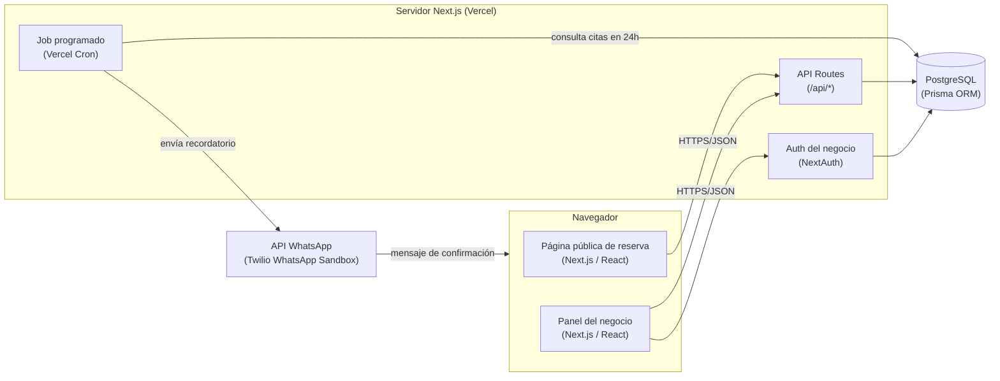
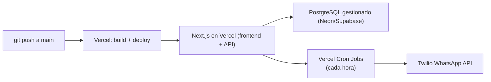
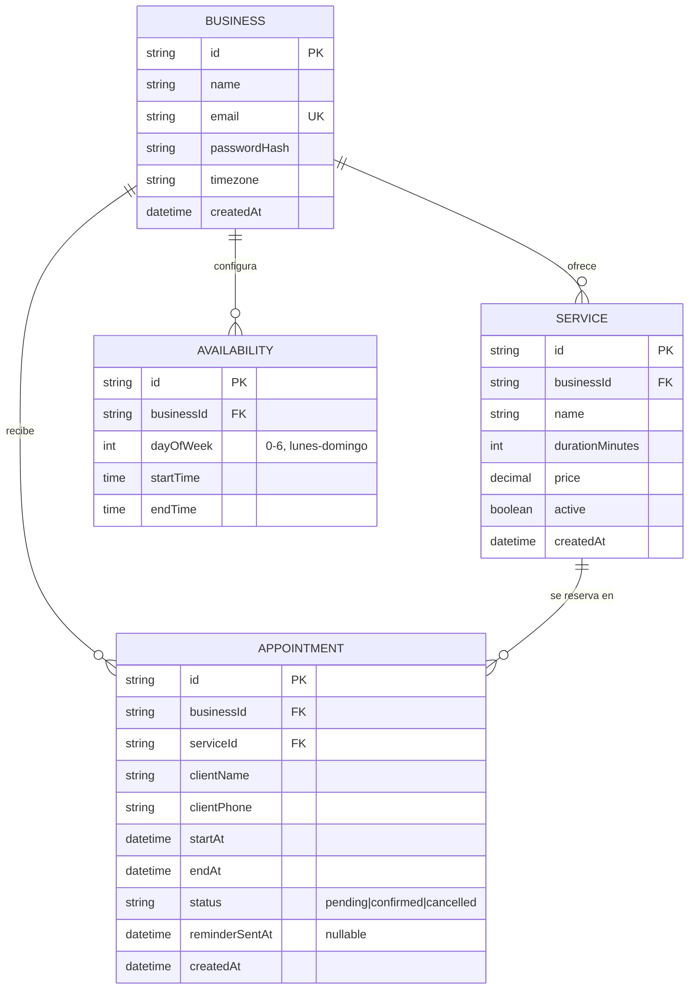

## Índice

0. [Ficha del proyecto](#0-ficha-del-proyecto)
1. [Descripción general del producto](#1-descripción-general-del-producto)
2. [Arquitectura del sistema](#2-arquitectura-del-sistema)
3. [Modelo de datos](#3-modelo-de-datos)
4. [Especificación de la API](#4-especificación-de-la-api)
5. [Historias de usuario](#5-historias-de-usuario)
6. [Tickets de trabajo](#6-tickets-de-trabajo)
7. [Pull requests](#7-pull-requests)

---

## 0. Ficha del proyecto

### **0.1. Tu nombre completo:**

Raúl Mena

### **0.2. Nombre del proyecto:**

AgendaYa

### **0.3. Descripción breve del proyecto:**

AgendaYa es un sistema de reserva de citas para negocios que atienden por turnos (peluquerías, consultorios, talleres, spas, etc.), similar a Calendly pero enfocado en el caso de uso "negocio con servicios y horario propio". El dueño del negocio configura sus servicios y su disponibilidad horaria; el cliente reserva una cita en uno de los horarios libres sin necesidad de crear cuenta; y 24 horas antes de la cita el sistema envía automáticamente un mensaje de WhatsApp de confirmación/recordatorio.

### **0.4. URL del proyecto:**

> Pendiente de despliegue. Se documentará en la Entrega Final (despliegue opcional según las bases del proyecto).

### 0.5. URL o archivo comprimido del repositorio

https://github.com/raul-mena/AI4Devs-finalproject

---

## 1. Descripción general del producto

### **1.1. Objetivo:**

Negocios pequeños y medianos que trabajan por cita (peluquerías, barberías, consultorios, talleres, spas, estudios, etc.) suelen gestionar su agenda a mano, por WhatsApp o por llamadas, lo que genera doble reserva de horarios, olvidos de clientes y tiempo perdido confirmando citas una por una.

AgendaYa resuelve esto dando al dueño del negocio una agenda online donde define sus servicios y su disponibilidad, y da al cliente final un enlace público donde puede ver los huecos libres y reservar en segundos, sin llamadas ni cuenta de usuario. El sistema se encarga de enviar automáticamente un recordatorio de confirmación por WhatsApp 24 horas antes de cada cita, reduciendo las ausencias ("no-shows") y la carga operativa del negocio.

- **Para quién:** dueños/administradores de negocios de servicios por cita (lado "negocio") y las personas que reservan esos servicios (lado "cliente", sin necesidad de registro).
- **Qué introduce el usuario:** el negocio introduce sus servicios (nombre, duración, precio) y sus horarios disponibles; el cliente introduce sus datos de contacto (nombre y teléfono) y elige servicio + horario.
- **Qué le devuelve el sistema:** al negocio, una agenda con las citas confirmadas y filtradas por día; al cliente, la confirmación inmediata de su cita y, 24h antes, un mensaje de WhatsApp recordándola.

### **1.2. Características y funcionalidades principales:**

**Funcionalidades must-have (alcance de este proyecto):**

1. **Gestión de disponibilidad horaria:** el dueño del negocio define los días y rangos horarios en que atiende (p. ej. lunes a viernes 9:00–18:00), y la duración de los turnos, para que el sistema calcule automáticamente los huecos reservables.
2. **Catálogo de servicios del negocio:** el dueño crea/edita los servicios que ofrece (nombre, duración en minutos, precio), que el cliente elige al reservar.
3. **Reserva pública de citas:** el cliente, sin necesidad de cuenta, consulta los horarios libres de un negocio para un servicio y una fecha, y reserva un turno indicando nombre y teléfono.
4. **Recordatorio automático por WhatsApp 24h antes:** un proceso programado detecta las citas cuya hora de inicio está a ~24 horas de distancia y envía un mensaje de WhatsApp (vía API de WhatsApp Business/Twilio) confirmando fecha, hora y servicio; se registra el envío para no duplicarlo.
5. **Panel de agenda del negocio:** el dueño visualiza sus citas (por día/semana) con estado (pendiente, confirmada, cancelada) para organizar su atención.

**Funcionalidades should-have (opcionales, no forman parte del alcance operativo exigido):**

- Cancelación/reprogramación de la cita por el propio cliente desde un enlace enviado por WhatsApp.
- Reporte simple de ocupación/no-shows por negocio.

### **1.3. Diseño y experiencia de usuario:**

> Pendiente para la Entrega Final: se incluirán capturas de pantalla y/o un video de 2-3 minutos mostrando el flujo completo (alta de disponibilidad y servicios por el negocio → reserva pública por el cliente → recordatorio de WhatsApp recibido → panel de agenda).

### **1.4. Instrucciones de instalación:**

> El código aún no se ha implementado (esta es la Entrega 1, documentación). Estas instrucciones reflejan la instalación prevista una vez exista el scaffold de la Entrega 2, y se mantendrán actualizadas en cada entrega.

```bash
# 1. Clonar el repositorio
git clone https://github.com/raul-mena/AI4Devs-finalproject.git
cd AI4Devs-finalproject

# 2. Instalar dependencias
npm install

# 3. Configurar variables de entorno
cp .env.example .env
# completar DATABASE_URL, NEXTAUTH_SECRET, WHATSAPP_API_TOKEN (credenciales de prueba), etc.

# 4. Levantar base de datos local (Postgres) con Docker
docker-compose up -d

# 5. Migraciones y datos de prueba (seed)
npx prisma migrate dev
npx prisma db seed

# 6. Arrancar la app en modo desarrollo
npm run dev
# abrir http://localhost:3000
```

**Datos de prueba (seed):** la seed crea un negocio demo ("Barbería AgendaYa Demo", email `demo@agendaya.test` / password `Demo1234!`), 2 servicios y disponibilidad para la semana en curso, para poder probar la reserva pública sin pasos manuales previos.

---

## 2. Arquitectura del Sistema

### **2.1. Diagrama de arquitectura:**

Arquitectura: **monolito modular** sobre Next.js (App Router), que sirve tanto el frontend (React/SSR) como la API (Route Handlers) desde el mismo proceso, con una base de datos relacional (PostgreSQL vía Prisma) y un job programado que dispara los recordatorios de WhatsApp a través de una API externa.

Se eligió un monolito modular (en lugar de microservicios) porque el alcance del MVP (3-5 funcionalidades) no justifica la complejidad operativa de separar servicios: un solo despliegue, un solo repositorio y un único modelo de datos son suficientes y permiten iterar más rápido durante el curso. El sacrificio principal es que el envío de WhatsApp y el cálculo de disponibilidad comparten el mismo runtime que el resto de la app; para el volumen de un MVP esto no es un problema, y si el negocio escalara, el módulo de notificaciones podría extraerse a un worker independiente sin tocar el resto.



### **2.2. Descripción de componentes principales:**

- **Frontend (Next.js / React + TypeScript + Tailwind CSS):** dos superficies, la pública de reserva (sin login) y el panel del negocio (con login), renderizadas por el mismo proyecto Next.js.
- **API (Next.js Route Handlers):** expone los endpoints de disponibilidad, servicios, citas y autenticación; valida entradas con Zod y habla con la base de datos a través de Prisma.
- **Autenticación (NextAuth.js):** sesión del dueño del negocio (email + password con hash bcrypt); la reserva pública no requiere autenticación.
- **Base de datos (PostgreSQL + Prisma ORM):** persistencia de negocios, servicios, disponibilidad y citas.
- **Job programado (Vercel Cron / node-cron en local):** se ejecuta cada hora, busca citas cuya hora de inicio cae dentro de la ventana de 24h y aún no tienen recordatorio enviado, y dispara el envío de WhatsApp.
- **Integración WhatsApp (Twilio WhatsApp Business API, modo sandbox/test):** servicio externo usado solo para enviar la plantilla de confirmación/recordatorio; se usan credenciales de prueba (Account SID/Auth Token de sandbox), nunca credenciales de producción, documentadas vacías en `.env.example`.

### **2.3. Descripción de alto nivel del proyecto y estructura de ficheros**

Estructura prevista (Next.js App Router), orientada por capas dentro de cada módulo de dominio:

```
/app
  /(public)/[businessSlug]         # página pública de reserva por negocio
  /(dashboard)/agenda               # panel de agenda del negocio (requiere login)
  /(dashboard)/servicios             # gestión de servicios
  /(dashboard)/disponibilidad        # gestión de horarios disponibles
  /api
    /auth/[...nextauth]             # autenticación del negocio
    /businesses/[id]/availability    # alta/consulta de disponibilidad
    /businesses/[id]/slots          # cálculo de huecos reservables
    /appointments                    # creación/consulta de citas
/lib
  /services                          # lógica de negocio pura (cálculo de slots, reglas de reserva)
  /notifications                     # integración con la API de WhatsApp
  /db                                 # cliente Prisma
/prisma
  schema.prisma                      # modelo de datos
  seed.ts                            # datos de prueba
/jobs
  send-reminders.ts                  # job de recordatorios 24h
/tests
  /unit
  /integration
  /e2e
```

La separación entre `/app` (rutas y presentación), `/lib/services` (reglas de negocio testeables sin HTTP ni DB real) y `/prisma` (modelo de datos) sigue el patrón habitual de Next.js full-stack, y permite testear la lógica de cálculo de disponibilidad de forma unitaria sin levantar servidor.

### **2.4. Infraestructura y despliegue**

Despliegue previsto (opcional, no obligatorio para la entrega):



- **Hosting app:** Vercel (despliegue automático desde `main`, variables de entorno gestionadas en el dashboard de Vercel).
- **Base de datos:** PostgreSQL gestionado (Neon o Supabase, capa gratuita suficiente para el MVP).
- **Tareas programadas:** Vercel Cron Jobs invocando el endpoint del job de recordatorios cada hora.
- **Entorno local:** `docker-compose` con un contenedor de PostgreSQL para desarrollo, descrito en el apartado de instalación.

### **2.5. Seguridad**

- **Contraseñas:** hash con bcrypt; nunca se almacena ni se loguea la contraseña en texto plano.
- **Sesión del negocio:** cookies de sesión firmadas vía NextAuth, `httpOnly` y `secure` en producción.
- **Validación de entrada:** todos los endpoints validan el body/query con Zod antes de tocar la base de datos (evita inyección y datos corruptos).
- **Acceso a datos del panel:** cada endpoint del panel del negocio filtra siempre por el `businessId` de la sesión autenticada, para que un negocio no pueda leer ni modificar citas/servicios de otro negocio.
- **Secretos:** credenciales de WhatsApp (Twilio) y cadena de conexión a la base de datos solo en variables de entorno (`.env`, no versionado); `.env.example` documenta las claves sin valores reales.
- **Datos de prueba:** las únicas credenciales versionadas son las del seed de desarrollo, explícitamente de prueba y sin acceso a producción.

### **2.6. Tests**

> Plan de pruebas para la Entrega Final (en la Entrega 1 no hay código todavía):

- **Unitarios:** cálculo de huecos disponibles a partir de la disponibilidad configurada y las citas ya existentes (`/lib/services`), incluyendo casos límite (servicio que no cabe antes del cierre, solapamiento de citas).
- **Integración:** endpoints de disponibilidad y de creación de citas contra una base de datos de pruebas (p. ej. SQLite/Postgres efímero), verificando que una cita creada bloquea el hueco correspondiente.
- **E2E:** flujo completo "negocio configura disponibilidad y servicio → cliente reserva en la página pública → la cita aparece en el panel del negocio", con el envío de WhatsApp simulado/mockeado para no depender de la red real.

---

## 3. Modelo de Datos

### **3.1. Diagrama del modelo de datos:**



### **3.2. Descripción de entidades principales:**

- **Business** (negocio/dueño): entidad raíz del sistema. `id` (PK, uuid), `name` (nombre del negocio, not null), `email` (UK, not null, usado para login), `passwordHash` (not null), `timezone` (not null, usada para calcular huecos y la ventana de 24h), `createdAt`.
- **Service** (servicio ofrecido por el negocio): `id` (PK), `businessId` (FK → Business.id, not null), `name` (not null), `durationMinutes` (int, not null, > 0), `price` (decimal, not null, >= 0), `active` (boolean, default true), `createdAt`. Relación N:1 con Business.
- **Availability** (horario disponible recurrente): `id` (PK), `businessId` (FK → Business.id, not null), `dayOfWeek` (int 0-6, not null), `startTime`/`endTime` (time, not null, `endTime` > `startTime`). Relación N:1 con Business. Define las ventanas semanales dentro de las cuales se calculan los huecos reservables según la duración de cada `Service`.
- **Appointment** (cita reservada): `id` (PK), `businessId` (FK → Business.id, not null), `serviceId` (FK → Service.id, not null), `clientName`/`clientPhone` (not null, datos del cliente final, sin cuenta propia), `startAt`/`endAt` (datetime, not null, calculados a partir del slot elegido y la duración del servicio), `status` (enum `pending|confirmed|cancelled`, default `pending`), `reminderSentAt` (datetime, nullable; se rellena cuando el job de WhatsApp envía el recordatorio, para evitar reenvíos), `createdAt`. Restricción lógica: no puede solaparse con otra `Appointment` del mismo `businessId` (validada en la capa de servicio al crear la cita).

---

## 4. Especificación de la API

Especificación de los 3 endpoints principales (formato resumido tipo OpenAPI):

```yaml
openapi: 3.0.0
info:
  title: AgendaYa API
  version: "1.0"
paths:
  /api/businesses/{businessId}/availability:
    post:
      summary: Crear un bloque de disponibilidad horaria para el negocio (requiere sesión del negocio)
      security:
        - sessionAuth: []
      parameters:
        - name: businessId
          in: path
          required: true
          schema: { type: string }
      requestBody:
        required: true
        content:
          application/json:
            schema:
              type: object
              required: [dayOfWeek, startTime, endTime]
              properties:
                dayOfWeek: { type: integer, minimum: 0, maximum: 6 }
                startTime: { type: string, example: "09:00" }
                endTime: { type: string, example: "18:00" }
      responses:
        "201":
          description: Bloque de disponibilidad creado
          content:
            application/json:
              example:
                id: "avail_123"
                businessId: "biz_456"
                dayOfWeek: 1
                startTime: "09:00"
                endTime: "18:00"

  /api/businesses/{businessId}/slots:
    get:
      summary: Obtener los huecos reservables de un negocio para un servicio y fecha dados (público, sin autenticación)
      parameters:
        - name: businessId
          in: path
          required: true
          schema: { type: string }
        - name: serviceId
          in: query
          required: true
          schema: { type: string }
        - name: date
          in: query
          required: true
          schema: { type: string, format: date, example: "2026-11-20" }
      responses:
        "200":
          description: Lista de horarios libres ese día para ese servicio
          content:
            application/json:
              example:
                date: "2026-11-20"
                serviceId: "svc_789"
                slots: ["09:00", "09:30", "10:00", "11:30"]

  /api/appointments:
    post:
      summary: Crear una reserva de cita (público, sin autenticación)
      requestBody:
        required: true
        content:
          application/json:
            schema:
              type: object
              required: [businessId, serviceId, startAt, clientName, clientPhone]
              properties:
                businessId: { type: string }
                serviceId: { type: string }
                startAt: { type: string, format: date-time, example: "2026-11-20T09:30:00-05:00" }
                clientName: { type: string, example: "Ana Pérez" }
                clientPhone: { type: string, example: "+51987654321" }
      responses:
        "201":
          description: Cita creada en estado "pending"
          content:
            application/json:
              example:
                id: "appt_321"
                status: "pending"
                startAt: "2026-11-20T09:30:00-05:00"
                endAt: "2026-11-20T10:00:00-05:00"
        "409":
          description: El horario solicitado ya no está disponible (conflicto con otra cita)
```

---

## 5. Historias de Usuario

**Historia de Usuario 1**

Como **dueño de un negocio por cita**, quiero **configurar mis horarios disponibles por día de la semana y la duración de mis servicios**, para que **los clientes solo puedan reservar en los huecos que realmente puedo atender, sin solaparse con otras citas**.

*Criterios de aceptación:*
- Puedo crear, editar y eliminar bloques de disponibilidad (día de la semana, hora de inicio, hora de fin).
- El sistema rechaza un bloque con `endTime <= startTime`.
- Los huecos reservables que se ofrecen al cliente se calculan combinando mi disponibilidad con la duración del servicio elegido y las citas ya existentes.

**Historia de Usuario 2**

Como **cliente de un negocio**, quiero **ver los horarios libres de un servicio en una fecha y reservar uno sin crear una cuenta**, para **asegurar mi cita en segundos, igual que con Calendly**.

*Criterios de aceptación:*
- Puedo consultar los huecos libres de un negocio para un servicio y una fecha concretos.
- Al reservar, indico solo mi nombre y teléfono (sin registro ni contraseña).
- Si otra persona reserva ese mismo hueco antes que yo, el sistema me informa que ya no está disponible (409) en vez de crear una doble cita.

**Historia de Usuario 3**

Como **cliente que reservó una cita**, quiero **recibir un mensaje de WhatsApp de confirmación 24 horas antes**, para **recordar mi cita y poder reaccionar (confirmar o reorganizarme) a tiempo**.

*Criterios de aceptación:*
- El sistema revisa periódicamente las citas en estado `pending`/`confirmed` cuya hora de inicio está a ~24 horas.
- Para cada una, envía una sola vez un mensaje de WhatsApp con negocio, servicio, fecha y hora, y registra `reminderSentAt` para no reenviarlo.
- Si el envío falla (p. ej. error de la API de WhatsApp), la cita queda marcada para reintento sin bloquear el resto del proceso.

---

## 6. Tickets de Trabajo

**Ticket 1 (Backend) — Endpoint de cálculo de huecos disponibles**

- **Descripción:** implementar `GET /api/businesses/{businessId}/slots?serviceId=&date=`, que devuelva los horarios libres de ese día combinando `Availability` (del día de la semana correspondiente) con la duración del `Service` y las `Appointment` ya existentes ese día para ese negocio.
- **Alcance:** lógica pura en `/lib/services/slots.ts` (testeable sin HTTP) + Route Handler que la invoca y valida los parámetros con Zod.
- **Criterios de aceptación:** devuelve 400 si falta `serviceId`/`date`; devuelve `slots: []` si no hay disponibilidad ese día; un slot ya ocupado por una cita existente no aparece en la lista; tests unitarios cubren solapamiento parcial y el último slot que justo no cabe antes del cierre.
- **Estimación:** 5 puntos.

**Ticket 2 (Frontend) — Página pública de reserva**

- **Descripción:** construir `/[businessSlug]`, página sin autenticación donde el cliente elige un servicio, ve el calendario/huecos disponibles del día seleccionado (consumiendo el endpoint de slots) y confirma la reserva con nombre y teléfono.
- **Alcance:** componente de selección de fecha, lista de huecos, formulario de datos del cliente, llamada a `POST /api/appointments`, y pantalla de confirmación o de error (409) si el hueco ya no está libre.
- **Criterios de aceptación:** el formulario no permite enviar sin nombre/teléfono válidos; al reservar con éxito se muestra confirmación con fecha/hora/servicio; si el hueco ya fue tomado, se refresca la lista de huecos y se muestra un aviso claro sin perder los datos ya escritos.
- **Estimación:** 8 puntos.

**Ticket 3 (Base de datos) — Esquema Prisma inicial y migraciones**

- **Descripción:** definir en `prisma/schema.prisma` los modelos `Business`, `Service`, `Availability` y `Appointment` descritos en el modelo de datos (sección 3), con sus claves foráneas, índices y restricciones (`email` único en `Business`, índice compuesto `(businessId, startAt)` en `Appointment` para acelerar la consulta de slots/solapes).
- **Alcance:** migración inicial (`prisma migrate dev`) + script de seed (`prisma/seed.ts`) con un negocio demo, 2 servicios y disponibilidad de la semana en curso.
- **Criterios de aceptación:** `npx prisma migrate dev` crea el esquema sin errores; `npx prisma db seed` deja datos consultables desde la página pública de reserva; existe un índice que permite consultar las citas de un negocio por rango de fechas de forma eficiente.
- **Estimación:** 5 puntos.

---

## 7. Pull Requests

> No aplica todavía: la Entrega 1 es solo documentación (0% código) y, según las bases del proyecto, los pull requests no se evalúan en esta entrega. Se documentarán 3 PRs principales en la Entrega Final.

**Pull Request 1**

**Pull Request 2**

**Pull Request 3**
