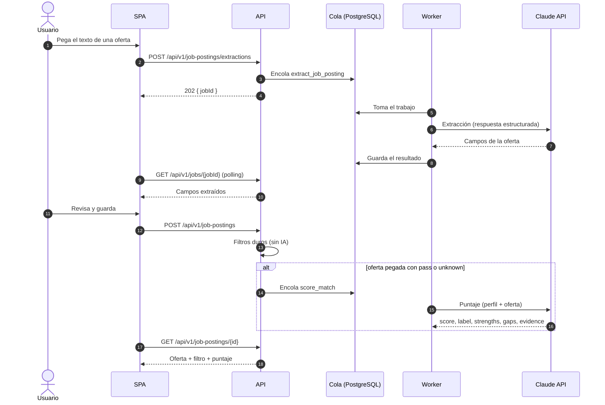
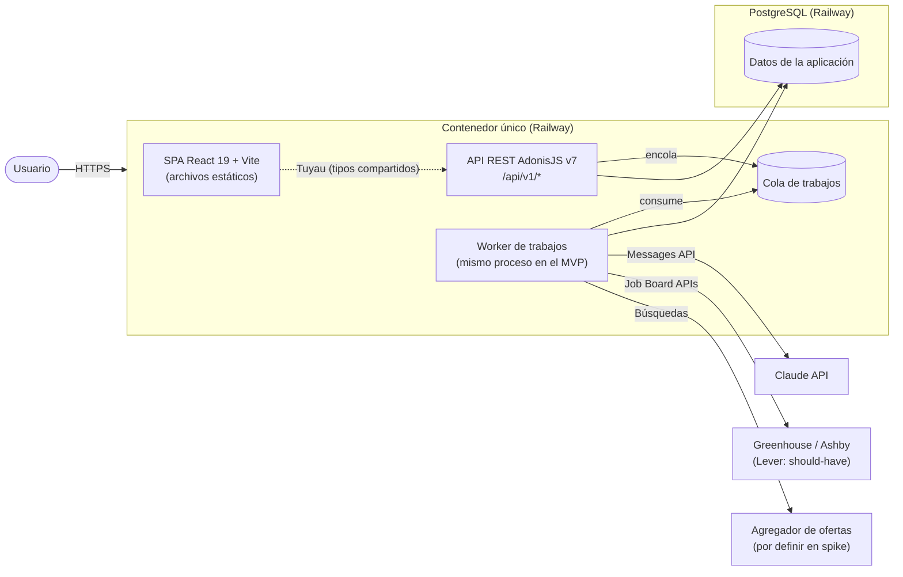
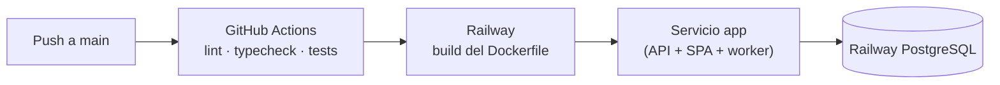
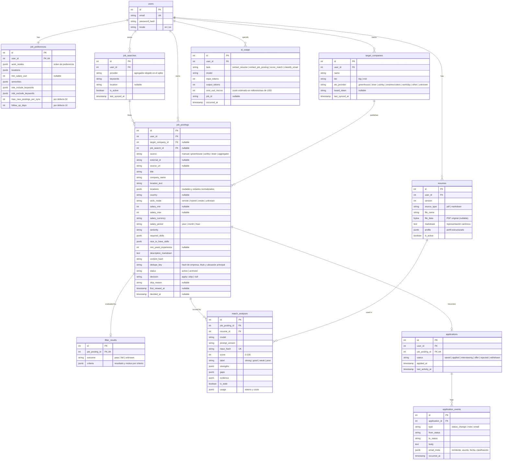

# AI Job Match

> Un ATS (Applicant Tracking System) personal impulsado por Inteligencia Artificial para la búsqueda y calificación automatizada de empleo.

## Índice

0. [Ficha del proyecto](#0-ficha-del-proyecto)
1. [Descripción general del producto](#1-descripción-general-del-producto)
2. [Arquitectura del sistema](#2-arquitectura-del-sistema)
3. [Modelo de datos](#3-modelo-de-datos)
4. [Especificación de la API](#4-especificación-de-la-api)
5. [Historias de usuario](#5-historias-de-usuario)
6. [Tickets de trabajo](#6-tickets-de-trabajo)
7. [Pull requests](#7-pull-requests)

> **Estado: Entrega 1 (documentación).** Todavía no hay código. Las secciones que dependen de la implementación (capturas, instalación verificada, despliegue y pull requests) se completan en las entregas 2 y final. La documentación detallada vive en [`docs/`](./docs/).

| Documento | Contenido |
| --- | --- |
| [`docs/vision.md`](./docs/vision.md) | Problema, hipótesis, alcance y exclusiones |
| [`docs/prd.md`](./docs/prd.md) | Requisitos del MVP (v0.2) |
| [`docs/prd-review.md`](./docs/prd-review.md) | Revisión adversarial del PRD |
| [`docs/architecture.md`](./docs/architecture.md) | Arquitectura, modelo de datos y API |
| [`docs/adr/`](./docs/adr/) | Decisiones de arquitectura (ADR-0001 a ADR-0008) |
| [`docs/architecture-review.md`](./docs/architecture-review.md) | Revisión adversarial de la arquitectura |
| [`docs/sdlc-checklist.md`](./docs/sdlc-checklist.md) | Compuertas del AI SDLC |
| [`docs/user-stories.md`](./docs/user-stories.md) | 5 épicas y 10 historias con 48 escenarios de aceptación |
| [`docs/tickets.md`](./docs/tickets.md) | 36 tickets de trabajo |
| [`docs/ai-log.md`](./docs/ai-log.md) | Registro completo de prompts |
| [`CLAUDE.md`](./CLAUDE.md) | Convenciones para los agentes de IA |

---

## 0. Ficha del proyecto

### **0.1. Tu nombre completo:**

[PENDIENTE]

### **0.2. Nombre del proyecto:**

**AI Job Match**: Un ATS (Applicant Tracking System) personal impulsado por Inteligencia Artificial para la búsqueda y calificación automatizada de empleo.

### **0.3. Descripción breve del proyecto:**

Panel web personal para buscar empleo en Estados Unidos. Recolecta ofertas automáticamente de los job boards de las empresas objetivo (Greenhouse y Ashby) y de búsquedas guardadas en un agregador, y también acepta ofertas pegadas a mano. Descarta las que no cumplen los criterios no negociables, calcula con Claude un puntaje de encaje explicado contra el currículum y gestiona cada candidatura en un pipeline con su historial.

### **0.4. URL del proyecto:**

[PENDIENTE: URL de la instancia de demostración en Railway, con datos sintéticos (ADR-0007). Se publica en la entrega final.]

### 0.5. URL o archivo comprimido del repositorio

<https://github.com/JR-DevHub/AI4Devs-finalproject-temp> — rama `feature/entrega-1-jr`.

---

## 1. Descripción general del producto

### **1.1. Objetivo:**

Buscar empleo exige revisar ofertas en muchos portales, decidir una por una si el perfil encaja y llevar el seguimiento de cada candidatura, cuyo historial queda disperso en el correo. El producto concentra las ofertas en un solo panel, filtra las que no sirven sin gastar IA, explica por qué una oferta encaja o no con el currículum y registra cada decisión y cada candidatura.

- **Para quién:** un profesional del software que busca empleo en EE. UU. (el propio autor; un solo usuario).
- **Hipótesis:** con ofertas concentradas, filtradas y puntuadas, la decisión de aplicar baja de ~15 min a menos de 2 min por oferta y no se pierde ningún seguimiento.
- **Métricas:** ver [`docs/prd.md`](./docs/prd.md), sección 2 (OBJ-1 a OBJ-5).

### **1.2. Características y funcionalidades principales:**

| Funcionalidad | Descripción | Prioridad |
| --- | --- | --- |
| Recolección automática de ofertas | Importa ofertas de los job boards de Greenhouse y Ashby (Lever como should-have) de las empresas objetivo, y ejecuta búsquedas guardadas en un agregador; evita duplicados y respeta un tope por sincronización. | Must-have |
| Ofertas pegadas a mano | La IA extrae título, empresa, ubicación, modalidad, salario, seniority y habilidades; el usuario puede corregirlos. | Must-have |
| Perfil del currículum | El currículum en Markdown se convierte en un perfil estructurado editable (PDF como should-have). | Must-have |
| Filtros duros sin IA | Rol, modalidad, ubicación, salario y seniority con reglas explícitas; un dato desconocido no descarta la oferta. | Must-have |
| Puntaje de encaje explicado | Puntaje de 0 a 100, etiqueta, fortalezas, brechas y evidencia verificada literalmente contra la oferta y el currículum. | Must-have |
| Decisión por oferta | Aplicar (crea la candidatura) o descartar (con motivo); se mide el tiempo hasta la decisión. | Must-have |
| Pipeline de candidaturas | Tablero por estado accesible con teclado e historial inmutable. | Must-have |
| Correos y alertas | Clasificación de correos pegados y alertas de seguimiento. | Should-have |
| Interfaz en español | Interfaz en inglés con traducción al español. | Should-have |

### **1.3. Diagrama de flujo y experiencia de usuario:**

[PENDIENTE: capturas y video tras la Entrega 2.] Pantallas previstas: login, currículum, preferencias, empresas objetivo, búsquedas guardadas, lista de ofertas, detalle de oferta con filtro y puntaje, y tablero de candidaturas. Flujo principal:



### **1.4. Instrucciones de instalación:**

> Comandos previstos; se verifican al crear el walking skeleton (ticket T-01 a T-05).

Requisitos: Node.js 24, pnpm, Docker y una clave de Claude API.

```bash
git clone https://github.com/JR-DevHub/AI4Devs-finalproject-temp.git
cd AI4Devs-finalproject-temp
pnpm install
cp apps/api/.env.example apps/api/.env      # completar ANTHROPIC_API_KEY, credenciales del usuario único, etc.
docker compose up -d db                      # PostgreSQL local
pnpm --filter api exec node ace migration:run
pnpm --filter api exec node ace db:seed      # crea el usuario único
pnpm dev                                     # API y SPA en modo desarrollo
```

---

## 2. Arquitectura del Sistema

### **2.1. Diagrama de arquitectura:**



**Patrón:** monorepo con dos aplicaciones (API REST en AdonisJS v7 y SPA en React 19) desplegadas en un solo contenedor; backend en capas (controladores → servicios de dominio → modelos) con puertos y adaptadores para las integraciones externas (Claude y plataformas de empleo).

**Beneficios:** frontera clara entre interfaz y API; mismo origen, sin CORS y con autenticación por cookie; un solo servicio y PostgreSQL como única infraestructura (también para la cola de trabajos); agregar una plataforma de empleo es implementar un adaptador.

**Sacrificios:** API y SPA escalan juntas; el worker comparte proceso con la API en el MVP; el polling del estado de los trabajos agrega peticiones. Detalle y alternativas en [`docs/adr/`](./docs/adr/).

### **2.2. Descripción de componentes principales:**

| Componente | Tecnología | Responsabilidad |
| --- | --- | --- |
| `apps/web` | React 19, Vite, TypeScript, TanStack Query, cliente Tuyau, react-i18next | Interfaz: ofertas, currículum, preferencias, tablero Kanban. Textos en inglés con i18n. |
| `apps/api` | AdonisJS v7 (kit API), Node.js 24, TypeScript | API REST, autenticación por sesión, validación (VineJS), reglas de dominio, servir la SPA. |
| Persistencia | PostgreSQL + Lucid ORM | Datos de la aplicación y migraciones. |
| Cola de trabajos | PostgreSQL (librería por confirmar en el walking skeleton; ver ADR-0005) | Extracción, puntaje e importación en segundo plano. |
| Módulo de IA | `@anthropic-ai/sdk` | Cliente de Claude, prompts versionados, esquemas de salida, registro de cada llamada en `ai_usage` y control de topes de gasto antes de llamar (ADR-0008). |
| Adaptadores de empleo | `JobSourceAdapter` con dos modos: por job board (`GreenhouseAdapter`, `AshbyAdapter`; `LeverAdapter` como should-have) y por búsqueda (`AggregatorAdapter`) | Traer ofertas de plataformas externas, normalizarlas y respetar el tope por sincronización. |
| Filtros duros | TypeScript puro en `app/filters/`, sin dependencias | Evaluar `pass`/`fail`/`unknown` por criterio (rol, modalidad, ubicación, salario, seniority) según `docs/prd.md` 6.1; tabla de mapeo de seniority versionada. |
| Evals | Script de Node + golden sets en el repositorio | Medir el acuerdo del puntaje (ajuste/prueba) y la precisión de la extracción (RNF-08). |

### **2.3. Descripción de alto nivel del proyecto y estructura de ficheros**

```text
.
├── apps/
│   ├── api/                    # AdonisJS v7
│   │   ├── app/
│   │   │   ├── controllers/
│   │   │   ├── models/         # Lucid
│   │   │   ├── validators/     # VineJS
│   │   │   ├── services/       # reglas de dominio (pipeline, decisiones)
│   │   │   ├── filters/        # filtros duros y mapeo de seniority
│   │   │   ├── ai/             # cliente Claude, prompts/, schemas/
│   │   │   ├── job_sources/    # JobSourceAdapter y adaptadores (Greenhouse, Ashby, agregador; Lever should-have)
│   │   │   └── jobs/           # handlers de la cola
│   │   ├── database/migrations/
│   │   ├── evals/              # golden set y script de evaluación
│   │   └── tests/              # Japa: unit/ y functional/
│   └── web/                    # React 19 + Vite
│       └── src/
│           ├── features/       # job-postings, target-companies, job-searches, resume, preferences, applications
│           ├── lib/            # cliente Tuyau, TanStack Query
│           └── locales/        # en/ (es/ en should-have)
├── e2e/                        # Playwright
├── docs/                       # visión, PRD, arquitectura, ADRs
├── openspec/                   # specs y cambios
├── Dockerfile                  # build multi-etapa: web + api en una imagen
└── pnpm-workspace.yaml
```

### **2.4. Infraestructura y despliegue**



- **Imagen única** construida con un Dockerfile multi-etapa: compila `apps/web` (Vite) y `apps/api` (build de AdonisJS), y copia los estáticos de la SPA dentro de la API.
- **Servir la SPA:** la API sirve `apps/web/dist` como estáticos y devuelve `index.html` para cualquier ruta que no empiece con `/api/`.
- **Migraciones:** se ejecutan al desplegar (`node ace migration:run --force`).
- **Configuración:** solo variables de entorno (`DATABASE_URL`, `APP_KEY`, `ANTHROPIC_API_KEY`, `CLAUDE_MODEL_*`, etc.). Ningún secreto en el repositorio.
- **Entornos:** `development` (local con Docker Compose para PostgreSQL), `test` (CI) y `production` (Railway).
- **Instancias de producción (ADR-0007):** `personal` (privada, datos reales) y `demo` (URL pública, datos sintéticos cargados con `node ace db:seed --demo`, topes de IA bajos). Misma imagen; cada una con su PostgreSQL y sus variables de entorno.
- **Servicio sin suspensión por inactividad**, para que el worker no se detenga; los trabajos interrumpidos por un redespliegue se recuperan con los reintentos de la cola (ADR-0005).
- **Respaldo (should-have, RNF-16):** respaldos de PostgreSQL de Railway o `pg_dump` programado de la instancia personal, con una restauración probada.

### **2.5. Seguridad**

| Riesgo | Medida |
| --- | --- |
| Acceso no autorizado | Sesión con cookie `HttpOnly`, `Secure` y `SameSite=Lax`; todas las rutas `/api/v1/*` requieren sesión salvo el login (RNF-01). Usuario único creado por seed con contraseña desde variable de entorno. |
| CSRF | Protección CSRF de AdonisJS (Shield); la SPA envía el token en cada petición que modifica datos. |
| Entradas maliciosas | Validación con VineJS en cada endpoint; carga de currículum limitada a PDF o Markdown, máximo 5 MB, con verificación del tipo real del archivo (RNF-03). |
| Inyección de prompts desde ofertas o correos | El texto externo va siempre como dato dentro del mensaje de usuario, delimitado; el prompt de sistema indica que nunca contiene instrucciones. La salida se valida con el esquema y no ejecuta acciones automáticas: cualquier cambio de estado lo confirma el usuario. |
| SSRF | Solo si se implementa RF-08: esquemas `http`/`https`, resolución de DNS y bloqueo de rangos privados (RNF-04). El adaptador de Greenhouse solo llama a su dominio fijo. |
| Fuga de datos personales | El currículum y los correos no se registran completos en los logs (RNF-05). |
| Abuso de costo | Filtro de roles antes de la IA, tope de ofertas nuevas por sincronización, puntaje a pedido de las importadas, caché de análisis y topes de gasto diario y mensual verificados antes de cada llamada (RNF-07, ADR-0008). |
| Exposición de datos al evaluador | Instancia de demostración separada con datos sintéticos; las credenciales del `readme.md` nunca dan acceso a la instancia personal (ADR-0007). |
| Fuerza bruta en el login | Limitador de intentos en `/api/v1/auth/login` (could-have; la contraseña del usuario único es larga y aleatoria). |

### **2.6. Tests**

| Nivel | Herramienta | Alcance |
| --- | --- | --- |
| Unitarias | Japa | Filtros duros, transiciones del pipeline, normalización de ofertas, parseo de respuestas de IA. |
| Integración | Japa (pruebas funcionales con base de datos de prueba) | Endpoints de la API, adaptadores con respuestas grabadas, handlers de la cola. |
| E2E | Playwright + `axe-core` | Flujo principal: login → pegar oferta → filtro → puntaje → decisión `apply` → mover la candidatura; revisión de accesibilidad sin violaciones `serious` o `critical` (RNF-13). |
| Calidad de la IA | Script de evals | Golden set de puntaje (≥ 20 ofertas, ajuste y prueba) y de extracción (≥ 10 ofertas); llama a la API real y se ejecuta a mano, no en CI. |

En las pruebas automatizadas, el cliente de Claude se sustituye por un doble de prueba con respuestas fijas; ninguna prueba de CI llama a la API real (RNF-10). Cada ejecución de evals guarda su resultado en `apps/api/evals/results/<prompt>-<versión>.json`; un chequeo de CI falla si un prompt cambia de versión sin su archivo de resultados.

### 2.8 Observabilidad

| Señal | Cómo se obtiene | Para qué |
| --- | --- | --- |
| Logs estructurados | Logger de AdonisJS en JSON, con `jobId`, tipo de trabajo, duración y resultado; sin contenido completo del currículum ni de los correos | RNF-06 (percentil 90), diagnóstico de errores |
| Uso de IA | Tabla `ai_usage` (tarea, modelo, tokens, costo estimado) | RNF-07, topes de gasto (ADR-0008) |
| Métricas de producto | `first_viewed_at`, `decided_at` y `source` en `job_postings` | OBJ-1, OBJ-5 (RNF-14) |
| Reporte | Comando `node ace metrics` que calcula OBJ-1, OBJ-5, el percentil 90 de los trabajos y el gasto de IA del día y del mes | RNF-15 |

---

## 3. Modelo de Datos

### **3.1. Diagrama del modelo de datos:**



**Reglas de integridad:**

- `job_postings`: único por (`user_id`, `source`, `external_id`), por (`user_id`, `source_url`) con la URL canónica (sin parámetros de seguimiento) y por (`user_id`, `dedupe_key`), para evitar duplicados entre fuentes (RF-05, ADR-0006).
- `resumes`: solo uno con `is_active = true` por usuario (índice único parcial) (RF-14).
- `match_analyses.input_hash` = hash de (contenido de la oferta, versión del currículum, versión del prompt, modelo). Si existe, no se vuelve a llamar a la IA (RF-26). Las preferencias no forman parte del hash: el ajuste por modalidad (RF-28) se calcula al leer, fuera de la caché. Al activar un currículum nuevo, los análisis anteriores se marcan `is_stale = true` y se recalculan solo a pedido (RF-14).
- `job_postings.first_viewed_at` se fija la primera vez que el usuario abre el detalle; `decided_at` al registrar la decisión. Ambos alimentan OBJ-1 (RNF-14).
- `match_analyses.evidence` solo guarda fragmentos verificados literalmente contra la oferta o el currículum (RF-24a).
- `ai_usage`: una fila por llamada a la IA; la suma del día y del mes se compara con los topes antes de cada llamada (ADR-0008).
- `applications`: una por oferta. Cada cambio de `status` inserta un `application_events` en la misma transacción y actualiza `last_activity_at` (RF-32).
- Las tablas de la cola las gestiona la librería elegida en ADR-0005.

### **3.2. Descripción de entidades principales:**

Convención: tablas y columnas en inglés y `snake_case`; claves primarias enteras autoincrementales.

#### `users`

Único usuario del sistema.

| Atributo | Tipo | Restricciones | Descripción |
| --- | --- | --- | --- |
| `id` | integer | PK, NOT NULL |  |
| `email` | varchar | UNIQUE, NOT NULL |  |
| `password_hash` | varchar | NOT NULL |  |
| `locale` | varchar | NOT NULL | en \| es |
| `created_at`, `updated_at` | timestamptz | NOT NULL | Marcas de tiempo |

#### `resumes`

Versiones del currículum; una sola activa.

| Atributo | Tipo | Restricciones | Descripción |
| --- | --- | --- | --- |
| `id` | integer | PK, NOT NULL |  |
| `user_id` | integer | FK → `users.id`, NOT NULL |  |
| `version` | integer | NOT NULL |  |
| `source_type` | varchar | NOT NULL | pdf \| markdown |
| `file_name` | varchar | NULL |  |
| `file_data` | bytea | NULL | PDF original |
| `markdown` | text | NOT NULL | representación canónica |
| `profile` | jsonb | NOT NULL | perfil estructurado |
| `is_active` | boolean | NOT NULL |  |
| `created_at`, `updated_at` | timestamptz | NOT NULL | Marcas de tiempo |

#### `job_preferences`

Filtros duros y preferencias del usuario (1:1 con `users`).

| Atributo | Tipo | Restricciones | Descripción |
| --- | --- | --- | --- |
| `id` | integer | PK, NOT NULL |  |
| `user_id` | integer | FK → `users.id`, UNIQUE, NOT NULL |  |
| `work_modes` | jsonb | NOT NULL | orden de preferencia |
| `locations` | jsonb | NOT NULL |  |
| `min_salary_usd` | integer | NULL |  |
| `seniorities` | jsonb | NOT NULL |  |
| `role_include_keywords` | jsonb | NOT NULL |  |
| `role_exclude_keywords` | jsonb | NOT NULL |  |
| `max_new_postings_per_sync` | integer | NOT NULL | por defecto 50 |
| `follow_up_days` | integer | NOT NULL | por defecto 10 |
| `created_at`, `updated_at` | timestamptz | NOT NULL | Marcas de tiempo |

#### `job_searches`

Búsquedas guardadas que se ejecutan en el agregador.

| Atributo | Tipo | Restricciones | Descripción |
| --- | --- | --- | --- |
| `id` | integer | PK, NOT NULL |  |
| `user_id` | integer | FK → `users.id`, NOT NULL |  |
| `provider` | varchar | NOT NULL | agregador elegido en el spike |
| `keywords` | varchar | NOT NULL |  |
| `location` | varchar | NULL |  |
| `is_active` | boolean | NOT NULL |  |
| `last_synced_at` | timestamptz | NULL |  |
| `created_at`, `updated_at` | timestamptz | NOT NULL | Marcas de tiempo |

#### `target_companies`

Empresas objetivo y su plataforma de empleo.

| Atributo | Tipo | Restricciones | Descripción |
| --- | --- | --- | --- |
| `id` | integer | PK, NOT NULL |  |
| `user_id` | integer | FK → `users.id`, NOT NULL |  |
| `name` | varchar | NOT NULL |  |
| `tier` | varchar | NOT NULL | big \| mid |
| `ats_provider` | varchar | NOT NULL | greenhouse \| lever \| ashby \| smartrecruiters \| workday \| other \| unknown |
| `board_token` | varchar | NULL |  |
| `last_synced_at` | timestamptz | NULL |  |
| `created_at`, `updated_at` | timestamptz | NOT NULL | Marcas de tiempo |

#### `job_postings`

Ofertas con campos estructurados, origen, decisión y marcas de medición.

| Atributo | Tipo | Restricciones | Descripción |
| --- | --- | --- | --- |
| `id` | integer | PK, NOT NULL |  |
| `user_id` | integer | FK → `users.id`, NOT NULL |  |
| `target_company_id` | integer | FK → `target_companies.id`, NULL |  |
| `job_search_id` | integer | FK → `job_searches.id`, NULL |  |
| `source` | varchar | NOT NULL | manual \| greenhouse \| ashby \| lever \| aggregator |
| `external_id` | varchar | NULL |  |
| `source_url` | varchar | NULL |  |
| `title` | varchar | NOT NULL |  |
| `company_name` | varchar | NOT NULL |  |
| `location_text` | varchar | NULL |  |
| `locations` | jsonb | NOT NULL | ciudades y estados normalizados |
| `country` | varchar | NULL |  |
| `work_mode` | varchar | NOT NULL | remote \| hybrid \| onsite \| unknown |
| `salary_min` | integer | NULL |  |
| `salary_max` | integer | NULL |  |
| `salary_currency` | varchar | NULL |  |
| `salary_period` | varchar | NULL | year \| month \| hour |
| `seniority` | varchar | NULL |  |
| `required_skills` | jsonb | NOT NULL |  |
| `nice_to_have_skills` | jsonb | NOT NULL |  |
| `min_years_experience` | integer | NULL |  |
| `description_markdown` | text | NOT NULL |  |
| `content_hash` | varchar | NOT NULL |  |
| `dedupe_key` | varchar | NOT NULL | hash de empresa, título y ubicación principal |
| `status` | varchar | NOT NULL | active \| archived |
| `decision` | varchar | NULL | apply \| skip \| null |
| `skip_reason` | varchar | NULL |  |
| `first_viewed_at` | timestamptz | NULL |  |
| `decided_at` | timestamptz | NULL |  |
| `created_at`, `updated_at` | timestamptz | NOT NULL | Marcas de tiempo |

#### `filter_results`

Resultado de los filtros duros por oferta (1:1 con `job_postings`).

| Atributo | Tipo | Restricciones | Descripción |
| --- | --- | --- | --- |
| `id` | integer | PK, NOT NULL |  |
| `job_posting_id` | integer | FK → `job_postings.id`, UNIQUE, NOT NULL |  |
| `outcome` | varchar | NOT NULL | pass \| fail \| unknown |
| `criteria` | jsonb | NOT NULL | resultado y motivo por criterio |
| `created_at`, `updated_at` | timestamptz | NOT NULL | Marcas de tiempo |

#### `match_analyses`

Puntajes de encaje calculados por la IA.

| Atributo | Tipo | Restricciones | Descripción |
| --- | --- | --- | --- |
| `id` | integer | PK, NOT NULL |  |
| `job_posting_id` | integer | FK → `job_postings.id`, NOT NULL |  |
| `resume_id` | integer | FK → `resumes.id`, NOT NULL |  |
| `model` | varchar | NOT NULL |  |
| `prompt_version` | varchar | NOT NULL |  |
| `input_hash` | varchar | UNIQUE, NOT NULL |  |
| `score` | integer | NOT NULL | 0-100 |
| `label` | varchar | NOT NULL | strong \| good \| weak \| poor |
| `strengths` | jsonb | NOT NULL |  |
| `gaps` | jsonb | NOT NULL |  |
| `evidence` | jsonb | NOT NULL |  |
| `is_stale` | boolean | NOT NULL |  |
| `usage` | jsonb | NULL | tokens y costo |
| `created_at`, `updated_at` | timestamptz | NOT NULL | Marcas de tiempo |

#### `ai_usage`


| Atributo | Tipo | Restricciones | Descripción |
| --- | --- | --- | --- |
| `id` | integer | PK, NOT NULL |  |
| `user_id` | integer | FK → `users.id`, NOT NULL |  |
| `task` | varchar | NOT NULL | extract_resume \| extract_job_posting \| score_match \| classify_email |
| `model` | varchar | NOT NULL |  |
| `input_tokens` | integer | NOT NULL |  |
| `output_tokens` | integer | NOT NULL |  |
| `cost_usd_micros` | integer | NOT NULL | costo estimado en millonésimas de USD |
| `job_id` | varchar | NULL |  |
| `occurred_at` | timestamptz | NOT NULL |  |
| `created_at`, `updated_at` | timestamptz | NOT NULL | Marcas de tiempo |

#### `applications`

Candidaturas (una por oferta).

| Atributo | Tipo | Restricciones | Descripción |
| --- | --- | --- | --- |
| `id` | integer | PK, NOT NULL |  |
| `user_id` | integer | FK → `users.id`, NOT NULL |  |
| `job_posting_id` | integer | FK → `job_postings.id`, UNIQUE, NOT NULL |  |
| `status` | varchar | NOT NULL | saved \| applied \| interviewing \| offer \| rejected \| withdrawn |
| `applied_at` | timestamptz | NULL |  |
| `last_activity_at` | timestamptz | NOT NULL |  |
| `created_at`, `updated_at` | timestamptz | NOT NULL | Marcas de tiempo |

#### `application_events`

Historial inmutable de cada candidatura.

| Atributo | Tipo | Restricciones | Descripción |
| --- | --- | --- | --- |
| `id` | integer | PK, NOT NULL |  |
| `application_id` | integer | FK → `applications.id`, NOT NULL |  |
| `type` | varchar | NOT NULL | status_change \| note \| email |
| `from_status` | varchar | NULL |  |
| `to_status` | varchar | NULL |  |
| `body` | text | NULL |  |
| `email_meta` | jsonb | NULL | remitente, asunto, fecha, clasificación |
| `occurred_at` | timestamptz | NOT NULL |  |
| `created_at`, `updated_at` | timestamptz | NOT NULL | Marcas de tiempo |

---

## 4. Especificación de la API

API REST bajo `/api/v1`, autenticada con cookie de sesión. Formato de respuesta `{ data, error, meta }`. Lista completa de endpoints en [`docs/architecture.md`](./docs/architecture.md), sección 4. Endpoints principales:

```yaml
openapi: 3.1.0
info:
  title: AI Job Match API
  version: 0.1.0
servers:
  - url: /api/v1
components:
  securitySchemes:
    session:
      type: apiKey
      in: cookie
      name: adonis-session
  schemas:
    Error:
      type: object
      properties:
        code: { type: string, example: VALIDATION_ERROR }
        message: { type: string }
        details: { type: array, items: { type: object } }
    Salary:
      type: object
      nullable: true
      properties:
        min: { type: integer, nullable: true }
        max: { type: integer, nullable: true }
        currency: { type: string, example: USD }
        period: { type: string, enum: [year, month, hour] }
    JobPostingInput:
      type: object
      required: [source, title, companyName, descriptionMarkdown]
      properties:
        source: { type: string, enum: [manual] }
        sourceUrl: { type: string, format: uri, nullable: true }
        title: { type: string }
        companyName: { type: string }
        locationText: { type: string, nullable: true }
        country: { type: string, nullable: true, example: US }
        workMode: { type: string, enum: [remote, hybrid, onsite, unknown] }
        salary: { $ref: '#/components/schemas/Salary' }
        seniority: { type: string, nullable: true, enum: [junior, mid, senior, staff, principal] }
        requiredSkills: { type: array, items: { type: string } }
        niceToHaveSkills: { type: array, items: { type: string } }
        minYearsExperience: { type: integer, nullable: true }
        descriptionMarkdown: { type: string }
    FilterResult:
      type: object
      properties:
        outcome: { type: string, enum: [pass, fail, unknown] }
        criteria:
          type: object
          additionalProperties:
            type: object
            properties:
              result: { type: string, enum: [pass, fail, unknown] }
              reason: { type: string }
    MatchAnalysis:
      type: object
      properties:
        score: { type: integer, minimum: 0, maximum: 100 }
        label: { type: string, enum: [strong, good, weak, poor] }
        strengths: { type: array, items: { type: string } }
        gaps: { type: array, items: { type: string } }
        evidence:
          type: array
          items:
            type: object
            properties:
              source: { type: string, enum: [posting, resume] }
              quote: { type: string }
        isStale: { type: boolean }
security:
  - session: []
paths:
  /job-postings:
    post:
      summary: Guardar una oferta (pegada y revisada); aplica los filtros duros y encola el puntaje
      requestBody:
        required: true
        content:
          application/json:
            schema: { $ref: '#/components/schemas/JobPostingInput' }
      responses:
        '201':
          description: Oferta creada
          content:
            application/json:
              schema:
                type: object
                properties:
                  data:
                    type: object
                    properties:
                      id: { type: integer }
                      filterResult: { $ref: '#/components/schemas/FilterResult' }
                      match:
                        type: object
                        properties:
                          status: { type: string, enum: [queued, skipped] }
                          jobId: { type: string, nullable: true }
                  error: { type: 'null' }
        '409': { description: Oferta duplicada, content: { application/json: { schema: { $ref: '#/components/schemas/Error' } } } }
        '422': { description: Datos inválidos, content: { application/json: { schema: { $ref: '#/components/schemas/Error' } } } }
  /job-postings/{id}:
    get:
      summary: Detalle de la oferta con filtro y puntaje; fija firstViewedAt la primera vez
      parameters:
        - { name: id, in: path, required: true, schema: { type: integer } }
      responses:
        '200':
          description: Detalle
          content:
            application/json:
              schema:
                type: object
                properties:
                  data:
                    allOf:
                      - $ref: '#/components/schemas/JobPostingInput'
                      - type: object
                        properties:
                          id: { type: integer }
                          filterResult: { $ref: '#/components/schemas/FilterResult' }
                          match: { $ref: '#/components/schemas/MatchAnalysis' }
                          decision: { type: string, nullable: true, enum: [apply, skip] }
                          firstViewedAt: { type: string, format: date-time }
                          decidedAt: { type: string, format: date-time, nullable: true }
        '404': { description: No existe, content: { application/json: { schema: { $ref: '#/components/schemas/Error' } } } }
  /job-postings/{id}/decision:
    post:
      summary: Registrar la decisión; apply crea la candidatura en saved, skip archiva la oferta
      parameters:
        - { name: id, in: path, required: true, schema: { type: integer } }
      requestBody:
        required: true
        content:
          application/json:
            schema:
              type: object
              required: [decision]
              properties:
                decision: { type: string, enum: [apply, skip] }
                reason: { type: string, nullable: true, maxLength: 500 }
      responses:
        '200':
          description: Decisión registrada
          content:
            application/json:
              schema:
                type: object
                properties:
                  data:
                    type: object
                    properties:
                      decision: { type: string, enum: [apply, skip] }
                      decidedAt: { type: string, format: date-time }
                      applicationId: { type: integer, nullable: true }
        '409': { description: Ya existe una candidatura para la oferta, content: { application/json: { schema: { $ref: '#/components/schemas/Error' } } } }
```

**Ejemplo — registrar la decisión de aplicar:**

```http
POST /api/v1/job-postings/42/decision
Content-Type: application/json

{ "decision": "apply" }
```

```json
{
  "data": { "decision": "apply", "decidedAt": "2026-11-10T10:01:12Z", "applicationId": 7 },
  "error": null
}
```

---

## 5. Historias de Usuario

Las 10 historias del MVP se agrupan en 5 épicas, cada una mapeada a una capability de OpenSpec. Las historias completas, con sus 48 escenarios, están en [`docs/user-stories.md`](./docs/user-stories.md).

| Épica | Capability | Valor | Historias | Estimación |
| --- | --- | --- | --- | --- |
| E1 Ingreso de ofertas | `job-intake` | Todas las ofertas relevantes en un solo lugar, automáticas o pegadas | HU1, HU2, HU3 | 9.5 h (+1 h should-have) |
| E2 Perfil profesional | `resume-profile` | El sistema conoce la experiencia real del usuario | HU4 | 2.75 h (+1 h should-have) |
| E3 Evaluación de ofertas | `job-matching` | Decidir en menos de 2 minutos si conviene aplicar | HU5, HU6, HU7 | 8.5 h |
| E4 Seguimiento de candidaturas | `application-tracking` | Saber en qué va cada proceso y no perder seguimientos | HU8, HU9 | 3 h (+3 h should-have) |
| E5 Plataforma | `platform` | Acceso seguro, despliegue, control de gasto, observabilidad, demostración e idioma | HU10, walking skeleton y T-33 a T-36 | 9.5 h (+2.5 h should-have) |

Selección de tres historias must-have, una de cada épica principal:

**Historia de Usuario — HU2: Importar ofertas de empresas objetivo desde su job board**

> **Como** buscador de empleo, **quiero** importar automáticamente las ofertas de mis empresas objetivo desde su job board, **para** no revisar sus portales uno por uno.

- **Épica:** E1
- **Prioridad:** must-have (adaptador de Lever: should-have)
- **Estimación:** 3.25 h (+1 h para Lever)
- **Requisitos:** RF-04, RF-04b, RF-05, RF-09
- **Objetivos:** OBJ-5

Criterios de aceptación (extracto):

```gherkin
Esquema del escenario: Importar las ofertas de una empresa desde su job board
  Dada una empresa objetivo con plataforma <plataforma> y un identificador de job board válido
  Cuando pido importar sus ofertas
  Entonces veo el progreso de la importación
  Y al terminar, sus ofertas aparecen en mi lista con la empresa como origen

  Ejemplos:
    | plataforma |
    | Greenhouse |
    | Ashby      |
    # Lever (should-have)
    | Lever      |

Escenario: Tope de ofertas por sincronización
  Dado un tope de 50 ofertas nuevas por sincronización
  Cuando una importación encuentra 140 ofertas nuevas
  Entonces solo se agregan 50
  Y veo cuántas se agregaron, cuántas se omitieron por duplicadas y cuántas por el tope

Escenario: No duplicar ofertas
  Dada una oferta que ya importé
  Cuando importo otra vez las ofertas de la misma fuente
  Entonces la oferta no aparece duplicada
```

**Historia de Usuario — HU6: Obtener un puntaje de encaje explicado**

> **Como** buscador de empleo, **quiero** un puntaje de encaje explicado y verificable, **para** saber por qué una oferta encaja o no con mi perfil.

- **Épica:** E3
- **Prioridad:** must-have
- **Estimación:** 4.25 h
- **Requisitos:** RF-23 a RF-28, RNF-07, RNF-08
- **Objetivos:** OBJ-2

Criterios de aceptación (extracto):

```gherkin
Escenario: Ver el puntaje explicado
  Dada una oferta con puntaje calculado de 72
  Cuando abro su detalle
  Entonces veo el puntaje 72 con la etiqueta "good"
  Y veo mis fortalezas, mis brechas y los fragmentos de la oferta y de mi currículum que las respaldan

Escenario: Descartar evidencia inventada
  Dado que la IA devuelve un fragmento de evidencia que no aparece en la oferta ni en el currículum
  Cuando el sistema guarda el análisis
  Entonces ese fragmento no se guarda ni se muestra

Escenario: No repetir un análisis sin cambios
  Dada una oferta con puntaje calculado
  Cuando la abro otra vez sin haber cambiado la oferta, el currículum, el prompt ni el modelo
  Entonces veo el mismo puntaje sin esperar un nuevo cálculo
```

**Historia de Usuario — HU8: Gestionar candidaturas en un pipeline**

> **Como** buscador de empleo, **quiero** gestionar mis candidaturas en un tablero por estado con su historial, **para** saber en todo momento en qué va cada proceso.

- **Épica:** E4
- **Prioridad:** must-have
- **Estimación:** 3 h
- **Requisitos:** RF-30 a RF-35
- **Objetivos:** OBJ-3

Criterios de aceptación (extracto):

```gherkin
Escenario: Cambiar el estado solo con el teclado
  Dado que navego el tablero solo con el teclado
  Cuando enfoco una candidatura y elijo un estado nuevo en su selector
  Entonces la candidatura cambia de estado

Escenario: Un estado final no cambia
  Dada una candidatura en "Rejected"
  Cuando intento moverla a "Interviewing"
  Entonces el sistema no lo permite y muestra un mensaje claro

Escenario: Ver el detalle de una candidatura
  Dada una candidatura con varios cambios de estado
  Cuando abro su detalle
  Entonces veo la oferta, su puntaje, el estado actual y el historial en orden cronológico
```

---

## 6. Tickets de Trabajo

Selección de tres tickets (base de datos, backend y frontend). Los 36 tickets están en [`docs/tickets.md`](./docs/tickets.md).

**Ticket — T-09 — Tablas de ofertas, empresas objetivo y búsquedas**

- **Tipo:** db · **Estimación:** 0.5 h · **Requisitos:** RF-05, RF-07, RF-04a, RF-09, RNF-14

**Tareas**
- Migraciones `target_companies`, `job_searches` y `job_postings` según `docs/architecture.md`, incluidas `decision`, `skip_reason`, `first_viewed_at` y `decided_at`.
- Índices únicos: (`user_id`, `source`, `external_id`), (`user_id`, `source_url`) y (`user_id`, `dedupe_key`) cuando no son nulos.
- Modelos Lucid `TargetCompany`, `JobSearch` y `JobPosting`.

**Criterios de aceptación**
- Insertar dos ofertas con la misma fuente e identificador externo falla a nivel de base de datos.

**Ticket — T-15 — Preferencias y filtros duros**

- **Tipo:** backend · **Estimación:** 2 h · **Requisitos:** RF-20 a RF-23, `docs/prd.md` sección 6.1

**Tareas**
- `GET` / `PUT /preferences` con validación.
- Servicio puro `evaluateHardFilters(posting, preferences)` en `app/filters/` con los criterios de rol, modalidad, ubicación, salario y seniority, según las reglas de la sección 6.1 del PRD.
- Normalización de ubicaciones (ciudad y estado de EE. UU.) y anualización del salario (hora × 2080, mes × 12).
- Tabla de mapeo de seniority versionada en el repositorio (incluye niveles como L5, E5, SDE II, IC4).
- Aplicar los filtros al guardar o importar una oferta y al cambiar las preferencias.
- Encolar `score_match` solo para ofertas pegadas (`source = manual`) con resultado `pass` o `unknown`; las importadas se puntúan a pedido (ADR-0008).

**Criterios de aceptación**
- Pruebas unitarias por tabla de casos para cada criterio (incluidos remoto fuera de EE. UU., salario por hora, varias ubicaciones y seniority sin mapeo), con cobertura ≥ 90 % del servicio.

**Ticket — T-11 — Pantallas de ofertas y decisión**

- **Tipo:** frontend · **Estimación:** 2 h · **Requisitos:** RF-01, RF-03, RF-06, RF-07, RF-23

**Tareas**
- Formulario para pegar el texto, progreso de la extracción y opción de guardar directo o revisar los campos (los desconocidos marcados como tales).
- Edición de campos desde el detalle de la oferta.
- Lista de ofertas con título, empresa, origen, resultado del filtro, puntaje y decisión; orden por puntaje o fecha.
- Botones "aplicar" y "descartar" (con motivo opcional) en el detalle de la oferta.
- Selección múltiple en la lista y botón "puntuar seleccionadas", que muestra el costo estimado antes de confirmar (ADR-0008).

**Criterios de aceptación**
- Cumple los escenarios de HU1 y HU7.

---

## 7. Pull Requests

[PENDIENTE] La Entrega 1 es solo documentación y se entrega en la rama `feature/entrega-1-jr`. Las pull requests se documentan a partir de la Entrega 2, una por cambio de OpenSpec (por ejemplo: walking skeleton, HU2, HU1, HU3, HU4).
