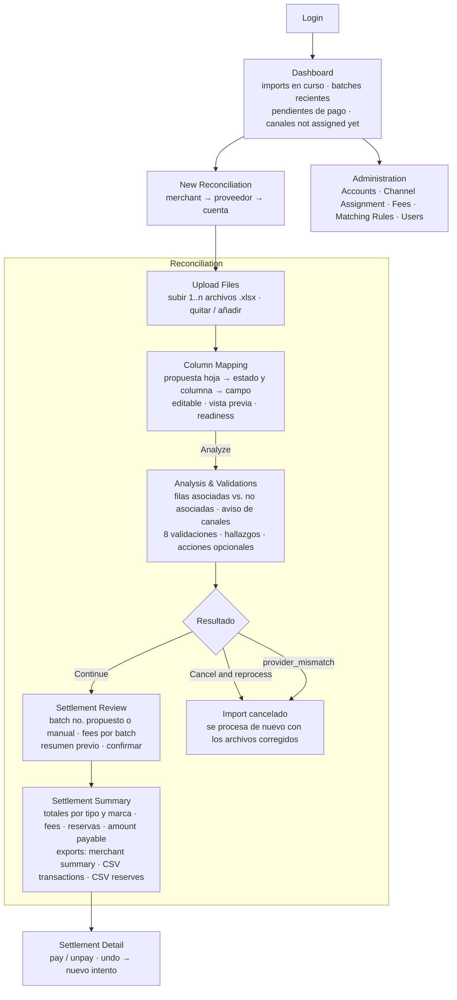
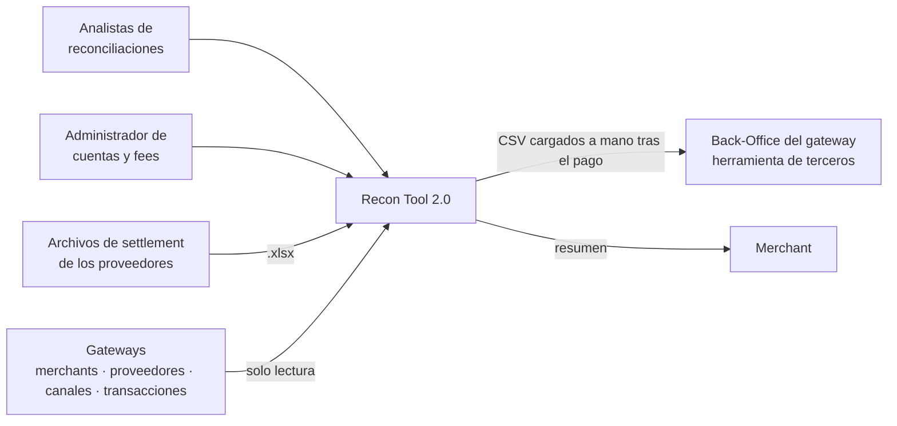
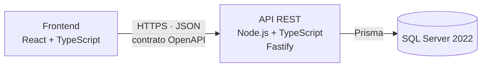
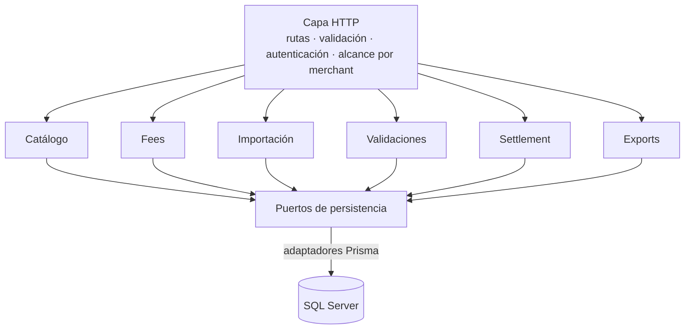
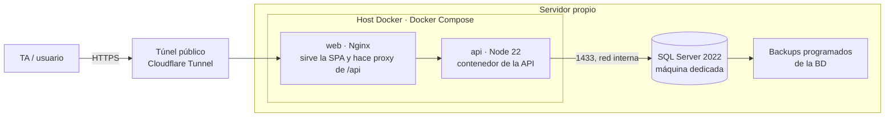
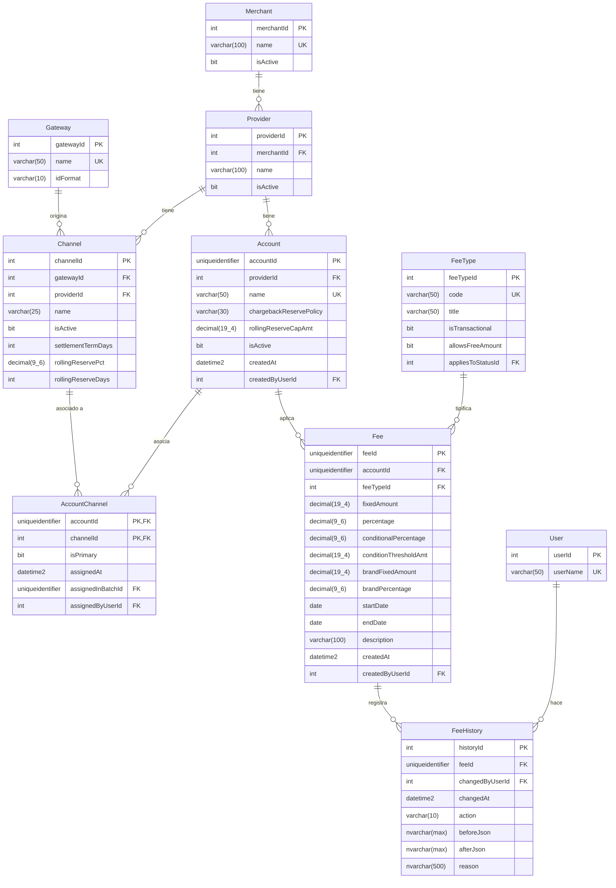
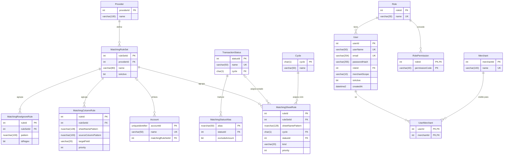
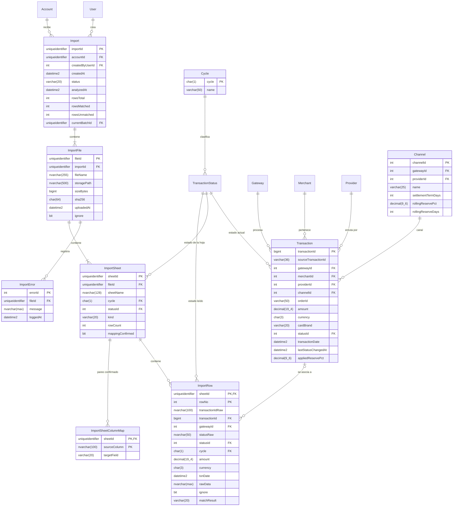
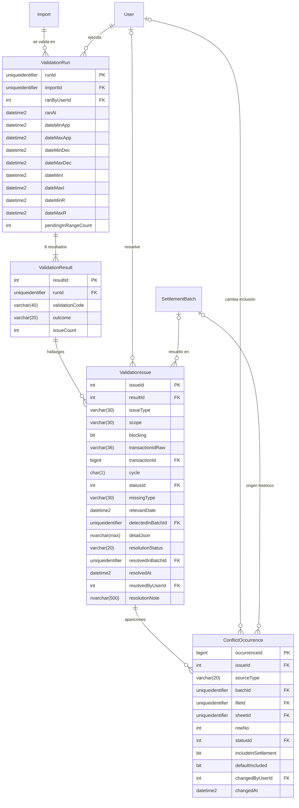
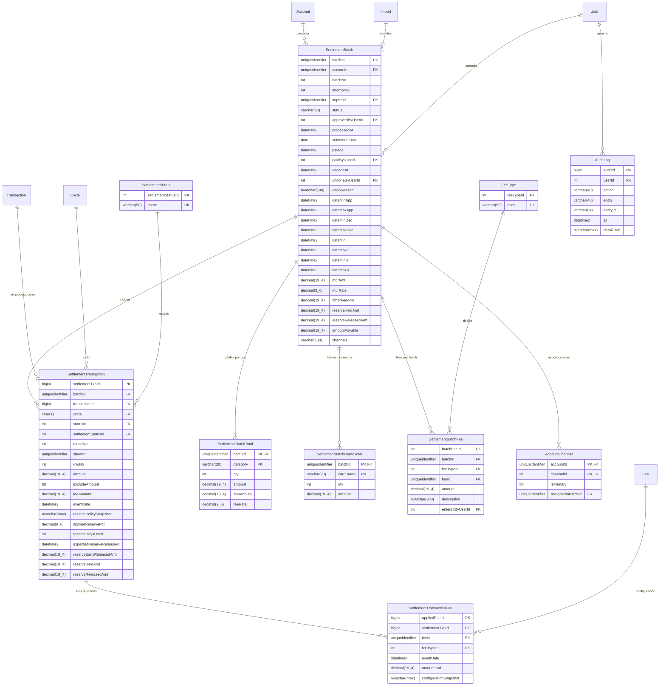

# Recon Tool 2.0 — Proyecto Final AI4Devs

> Entrega 1 · Documentación técnica. Sigue la plantilla oficial de `LIDR-academy/AI4Devs-finalproject`. Documento vivo: define el proyecto y se actualiza con cada entrega.

> **Sistema actual y desarrollo propuesto.** Existe una única herramienta Recon Tool en producción, implementada sobre reportes SSRS. "Recon Tool 2.0" es el nombre de este proyecto: su reemplazo como aplicación web independiente. Las versiones de los documentos de referencia son revisiones de la documentación, no versiones desplegadas del sistema.

## Índice

0. [Ficha del proyecto](#0-ficha-del-proyecto)
1. [Descripción general del producto](#1-descripción-general-del-producto)
2. [Arquitectura del sistema](#2-arquitectura-del-sistema)
3. [Modelo de datos](#3-modelo-de-datos)
4. [Especificación de la API](#4-especificación-de-la-api)
5. [Historias de usuario](#5-historias-de-usuario)
6. [Tickets de trabajo](#6-tickets-de-trabajo)
7. [Pull requests](#7-pull-requests)

---

## 0. Ficha del proyecto

### 0.1. Tu nombre completo

**Manfred Valverde Perrogón**

### 0.2. Nombre del proyecto

Recon Tool 2.0

### 0.3. Descripción breve del proyecto

Recon Tool 2.0 es una aplicación web para el equipo de reconciliaciones de una compañía que procesa pagos a través de varios gateways, proveedores y merchants. Automatiza el cruce de los archivos de settlement que envían los proveedores contra las transacciones propias, valida inconsistencias (faltantes, duplicados, colisiones de estado) y permite procesar batches de reconciliación con trazabilidad completa. Cada ciclo E/I/R está Settled únicamente cuando está incluido en un batch procesado y pagado; un batch procesado pendiente de pago todavía no confiere ese estado. El proyecto desarrolla una aplicación independiente para reemplazar la herramienta interna que actualmente funciona sobre reportes SSRS.

### 0.4. URL del proyecto

Pendiente de despliegue. La Entrega 1 contiene únicamente la documentación técnica.

### 0.5. URL o archivo comprimido del repositorio

**Repositorio:** [kajirioji/AI4Devs-finalproject](https://github.com/kajirioji/AI4Devs-finalproject).

**Rama de la Entrega 1:** [`entrega-1-MVP`](https://github.com/kajirioji/AI4Devs-finalproject/tree/entrega-1-MVP). Las ramas siguientes seguirán el patrón del enunciado: `feature/entrega-2-MVP` y `final-project-MVP`.

La Entrega 1 contiene `readme.md` y `prompts.md`; no incluye código.

---

## 1. Descripción general del producto

### 1.1. Objetivo

**El problema.** La compañía procesa pagos a través de varios gateways y de entre 15 y 20 proveedores activos, cada uno con una o varias cuentas y canales. Cada proveedor envía periódicamente —normalmente cada 7, 10 o 14 días— un archivo de settlement con las transacciones que va a pagar. De lo aprobado libera alrededor del 90 % en ese plazo; el resto se retiene como rolling reserve y se libera a unos 180 días. Una transacción puede tener movimientos en tres ciclos de reconciliación: la operación original (E), los ajustes posteriores como chargeback o refund (I) y la reserva (R). Cada ciclo necesita su propio estado y seguimiento; tres ciclos no implica un máximo de tres eventos. Los porcentajes y plazos dependen de la configuración acordada con cada proveedor.

El Back-Office del gateway principal no sirve para dar ese seguimiento: solo guarda un flag de "settled" y una última fecha, sin número de batch ni historial, así que un archivo repetido sobrescribe lo anterior sin dejar rastro; tampoco indica cuántos fees se pagaron por esa transacción ni por el batch. Para cubrir ese hueco existe el Recon Tool actual, un conjunto de unos 24 reportes SSRS que el equipo usa como si fuera una aplicación web. Funciona, pero SSRS no está diseñado para ese uso y obliga a rodeos para poder utilizarlo: normalizar el archivo del proveedor es copiar y pegar a mano en una plantilla Excel sin ninguna validación; crear una cuenta o cargar un fee se hace por consulta directa a la base; reprocesar un batch lo borra sin dejar historia; y cada pantalla nueva cuesta mucho más de lo que debería. El resultado aguas abajo son disputas del merchant sobre el resumen preliminar, que en buena parte nacen de la falta de precisión y trazabilidad en la validación.

**Qué resuelve Recon Tool 2.0.** Lleva ese mismo proceso a una aplicación web propia, con el flujo de reconciliación de punta a punta: importar los archivos de settlement dentro de la aplicación, parear sus hojas y columnas con revisión humana, cruzar contra las transacciones propias, ejecutar las validaciones, dejar que el analista revise los resultados, procesar el batch separando los tres ciclos de reconciliación, y generar el resumen para el merchant y los exports para el Back-Office. Todo con trazabilidad por batch, administración de cuentas y fees desde la propia aplicación, y sin tocar la base de producción por consulta directa. El procesamiento del batch y su pago se controlan por separado. La finalidad del proyecto incluye importar directamente los Excel originales de cada proveedor sin plantilla intermedia; el MVP cubre la importación de la plantilla estandarizada con pareo configurable, y la importación directa queda documentada como roadmap. La aplicación habilita funcionalidades nuevas y mejora la experiencia en las que ya existen.

**Para quién.** Los usuarios principales son los analistas del equipo de reconciliaciones, que hoy ejecutan el proceso a mano y en SSRS. Los usuarios secundarios son quien administra cuentas y fees (hoy, por SQL) y, de forma indirecta, el merchant, que no entra a la herramienta pero recibe un resumen más preciso y con menos disputas.

**Qué valor aporta.** Menos tiempo por reconciliación (desaparece la carpeta compartida y la navegación forzada en SSRS; con la importación directa, además, el copiar y pegar a la plantilla), menos errores (se reduce la manipulación manual de archivos y con ella el error humano; validación de entrada, reglas de negocio en los fees, pareo revisado antes de analizar), mayor trazabilidad respecto al sistema actual (batches con estado e intentos, fees con historial de cambios, deshacer sin perder rastro, registro de quién aprobó cada batch) y más control sobre la propia herramienta: los parámetros propios de cada cuenta —política de reserva ante chargeback, fees y reglas de pareo— y los asociados al proceso se configuran desde la aplicación, sin depender de consultas directas a la base.

### 1.2. Características y funcionalidades principales

El producto se construye como MVP alrededor del flujo principal de reconciliación. Lo que sigue distingue entre las reglas de negocio confirmadas (que rigen todo el diseño), lo que entra en el MVP (Entregas 2 y 3) y lo que queda documentado como finalidad del proyecto o roadmap.

#### Reglas de negocio confirmadas

- **Ciclo (`cycle`) distinto de estado.** El estado (`Pending`, `Successful`, `Declined`, `Chargeback`, `Refund`, `RDR`) es lo que la transacción *es* en el gateway: nace `Pending`, pasa a `Successful` o `Declined`, y una `Successful` puede derivar después en `Chargeback`, `Refund` o `RDR`. El ciclo (E, I, R) es lo que el proveedor *está liquidando* en cada fila del archivo y se obtiene de la hoja o de la regla de pareo, no del estado. La rolling reserve no es un estado: es la parte retenida (≈10 %) de una transacción `Successful` ya liquidada en E, que el proveedor libera en R al cumplirse el plazo (≈180 días). Una fila de la hoja RR referencia la transacción original y conserva el estado que esta tenga en ese momento. `Pending` significa que el estado no se actualizó; nunca se procesa.
- **Settled por ciclo.** E, I y R se evalúan separadamente. Solo un movimiento incluido en un batch procesado **y pagado** está Settled. Procesado pendiente de pago, pagado y deshecho son situaciones distintas. Los pendientes se presentan separados entre no reconciliados y reconciliados pendientes de pago.
- **Creación de cuentas: fees y reglas de pareo.** Los fees son por cuenta, pero al crear una cuenta se elige entre *sin fees* (por defecto; se crean uno a uno después) o *copiar los fees de otra cuenta del mismo proveedor* (se copian solo los fees activos en ese momento, no su historial, y cada copia nace con vigencia `NULL…NULL` para cubrir todo lo que llegue a la cuenta nueva; se ajustan después si hace falta; la copia queda auditada). Las reglas de pareo no son por cuenta sino por proveedor: un proveedor tiene uno o más **conjuntos de reglas** (`MatchingRuleSet`) y cada cuenta se enlaza a uno de ellos o a ninguno (en cuyo caso aplican las reglas globales). Un cambio en el conjunto aplica a todas las cuentas enlazadas sin tocar imports ya analizados; una cuenta puede cambiar de conjunto desde Account Detail, con efecto en el siguiente import. Los alias de estado siguen siendo globales.
- **Exports operativos.** El resumen y ambos CSV se generan al procesar el batch, antes del pago. Reconciliaciones los guarda para revisar su composición y ejecuta manualmente los CSV en el Back-Office después de recibir el pago. Descargar un CSV no marca nada como pagado ni Settled.
- **USD.** Los cálculos y totales usan el importe en USD proporcionado por los gateways; los fees configurados también están en USD. Se conservan monto y moneda originales del proveedor como referencia (`Currency` en ISO de tres letras: el proveedor liquida siempre en USD, pero en las transacciones puede informar la moneda original, EUR, MXN…); una fila en moneda distinta de USD no se bloquea ni se compara en importe; no se incorpora conversión cambiaria al MVP.
- **Identidad.** `transactionId BIGINT IDENTITY` es la clave interna para relaciones; la identidad externa es `(gatewayId, sourceTransactionId)`, donde `sourceTransactionId VARCHAR(36)` conserva el ID de origen normalizado según el formato del gateway (`numeric`: solo dígitos, sin ceros a la izquierda; `uuid`: 36 caracteres en minúsculas, sin llaves). El mismo identificador de origen en gateways distintos no es la misma transacción. El cruce busca el ID normalizado en los gateways de los canales de la cuenta: una coincidencia es `matched`, ninguna es `unmatched` y más de una es `ambiguous`, que no se procesa hasta que el analista elija el gateway o cancele. Hoy conviven un gateway numérico y uno UUID, así que el formato desambigua por sí solo; `ambiguous` solo puede aparecer con dos gateways del mismo formato en la misma cuenta. La columna de ID se lee siempre como texto para no perder dígitos ni formato (hoy los IDs numéricos tienen 15 dígitos; hubo una época de 16, y Excel pierde precisión a partir de 15, por eso la plantilla los pega como texto). Los exports (CSV y resumen) escriben el ID como texto, nunca como número, para que al abrirlos en Excel no se conviertan a notación científica ni pierdan dígitos.
- **Fees múltiples y vigencias.** Cada movimiento puede tener varios fees; cada uno conserva tipo, configuración aplicada e importe USD. Para operaciones originales rige la fecha de la transacción; para chargebacks, refunds y returns, la fecha del evento. Ambas provienen del gateway; nunca se sustituyen por la fecha del batch. Las fechas de vigencia de un fee dicen **a qué movimientos aplica**, no cuándo se configuró: `startDate NULL` significa "desde siempre" (−∞) y `endDate NULL` "sin fin" (+∞); un fee `NULL…NULL` aplica a cualquier evento. Un fee nunca se ata a la fecha de creación de la cuenta ni del propio fee, porque una cuenta nueva puede recibir canales con historial.
- **Reserva por cuenta.** Se configura si, cuando una `Successful` con reserva retenida pasa a `Chargeback`, esa reserva se libera de inmediato o se mantiene retenida hasta cumplir el plazo. Se conserva la regla aplicada y el importe liberado anticipadamente; una reserva liberada por chargeback deja de reportarse como pendiente de liberación y no se espera en R.
- **Incidencias.** Las incidencias de validación permanecen persistentes o resueltas, nunca se eliminan. Las correcciones posteriores quedan vinculadas al batch que las resolvió.
- **Duplicados.** No se contabilizan dos veces. Los resultados parciales indican lo que se incluirá y las diferencias frente al archivo del proveedor; el analista las comunica fuera de la aplicación. No se exige una decisión por fila para continuar.
- **Validaciones y bloqueo.** Ninguna validación bloquea el procesamiento, con una sola excepción: `provider_mismatch` (el import se creó bajo un proveedor o cuenta incorrectos) bloquea sin override; el analista debe volver a la selección de contexto y procesar con el proveedor correcto. Las demás generan advertencias persistentes.
- **Approved + Declined.** La coexistencia se notifica como validación, pero no impide procesar. No se resuelve silenciosamente.
- **Refund + Chargeback.** Pueden coexistir; se notifican para revisión del negocio. No se tratan como duplicado ni se excluye uno de los dos automáticamente.
- **Duplicados y colisiones.** Se detectan por identidad externa y ciclo: dos apariciones del mismo movimiento en el mismo ciclo con el **mismo estado** son duplicado; con **estados distintos** son colisión. Ciclos distintos (E, I, R) nunca se comparan entre sí. Ambos generan advertencia, nunca bloqueo. El mismo ajuste (ciclo I) con el mismo estado en dos batches distintos es duplicado por defecto, con la aparición actual excluida; si es legítimo, el analista la incluye a mano.
- **CHB 2 (solo archivos legacy).** La plantilla actual no lo contempla: ya no se usa. Se conserva únicamente como alias de compatibilidad para archivos antiguos: si una columna de estado trae el texto `CHB 2`, se traduce a `Chargeback` (ciclo I) con `excludeAmount = 1` (cuenta en `chargebackQty`, no suma a `chargebackAmt`, aplica el fee de Chargeback) y no se considera duplicado del `Chargeback` del mismo movimiento. Sin ese alias, la regla de duplicados no tiene excepciones.
- **Importes del archivo siempre positivos.** En la plantilla, `Amount` es positivo en todas las hojas, sea E, I o R; el signo lo aplica el sistema según el ciclo y el tipo (los ajustes I y los fees restan, las aprobaciones E y las liberaciones R suman). Un importe negativo en el archivo se marca como advertencia de formato. En la hoja `RR`, `Amount` es la reserva liberada (≈10 % de la operación original), no el importe original.
- **Rondas.** Dato derivado al procesar, no una entrada: ronda 1 si E e I se procesan en el mismo batch; ronda 2 si la E ya estaba en un batch anterior vigente y el batch incorpora el movimiento I. La ronda clasifica el escenario; no crea un procesamiento distinto ni participa en la detección de duplicados. CHB 2 no significa "ronda 2".
- **Rangos de fechas por ciclo y faltantes.** APP, DEC, I y R conservan rangos independientes, obtenidos de los movimientos del batch que sí se asociaron: APP con las `Successful` y su fecha de creación; DEC con las `Declined`, solo si el archivo las trae; I con la fecha del evento (cambio de estado); R con la fecha de creación de las reservas incluidas, normalmente con antigüedad cercana o superior al plazo de liberación (típicamente 180 días). I no se combina con E aunque compartan settlement term. Son candidatas a faltante las transacciones del proveedor en los canales de la cuenta, no procesadas en ese ciclo en un batch vigente, con fecha ≤ máximo del rango: anterior al mínimo → `missing_previous_to_batch`; dentro del rango, inclusive → `missing_in_range`. Nada posterior al máximo se considera. Las declinadas faltantes solo se evalúan cuando el proveedor reporta declinadas, con el rango DEC. Las transacciones en `Pending` en el gateway no pertenecen a ningún rango hasta que su estado se corrija: se excluyen de faltantes y la corrida las cuenta aparte, de forma informativa. Un faltante se registra una sola vez por proveedor, ciclo y transacción, y se resuelve al incluirse en un batch `processed`.
- **Alcance del histórico.** Para duplicados, colisiones y faltantes, los batches anteriores son los intentos no deshechos de **todas las cuentas del proveedor**, no solo de la cuenta del batch.
- **Resultado de una validación.** `passed`, `failed`, `not_applicable` (el ciclo no tiene movimientos en el batch o no hay histórico sobre el que correr; se muestra como n/a y no cuenta como aprobada) o `not_implemented`.
- **Deshacer.** Solo batches procesados pendientes de pago. Se conserva el intento anterior con autor y motivo, el import vuelve a `analyzed` para validar de nuevo, y se permite un nuevo intento con el mismo número oficial. Se recalculan las incidencias cuya resolución dependía del intento anulado; no se revierte la asignación del canal.

#### En el alcance del MVP

**Acceso y roles.** Login con usuario y contraseña. Permisos por acción (procesar settlement, procesar pago, administrar cuentas, administrar fees, administrar usuarios, consultar) y visibilidad por merchant: cada usuario ve solo los merchants que tiene asignados, o todos si su alcance es `all`.

**Catálogo de merchants, proveedores, cuentas y canales.** Jerarquía merchant → proveedor → cuenta → canal. Merchants, proveedores (asociados a un merchant), canales y transacciones vienen suministrados por los gateways y son de solo lectura en la aplicación; es en esa información donde se detecta un proveedor o un canal nuevo. La **cuenta** es la entidad propia del Recon Tool: una agrupación lógica de canales de un proveedor para llevar contabilidades separadas. Se crea y edita desde la aplicación (hoy, por consulta directa), admite canales de varios gateways, administra sus fees y su política de reserva ante chargeback, y se enlaza a un conjunto de reglas de pareo del proveedor. Al crearla se indica si parte sin fees o copia los de otra cuenta del proveedor, y a qué conjunto de reglas se enlaza (o ninguno). El settlement term, el porcentaje de reserva y el plazo de liberación se reciben de los gateways como configuración del canal; el porcentaje efectivamente aplicado viene guardado en cada transacción. Un canal no viene asociado a ninguna cuenta: aparece como *not assigned yet* mientras tenga transacciones sin ningún batch procesado, y se asocia a una cuenta al procesar el primer settlement que lo incluye, con aviso previo al analista. Un canal puede tener historial en más de una cuenta, pero una sola es su **cuenta principal** —la última que procesó un settlement con ese canal— y los pendientes del canal se reportan solo en ella. Un merchant no ve los proveedores de otro merchant, aunque compartan proveedor. Los canales pueden quedar inactivos; no se borran.

**Administración de fees por cuenta, con historial.** Creación y edición de fees por cuenta: tipo, monto fijo o porcentaje, valor y vigencia (rango de fechas, con inicio o fin abiertos: "always"). El motor calcula automáticamente solo los **fees por transacción** (aprobadas, declinadas, chargebacks, refunds, RDR, MDR…). Los fees **no transaccionales** —por batch, setup, anuales— se mantienen en el mismo módulo como referencia con su monto preestablecido, pero los indica el proveedor batch a batch, así que llegan en la hoja `Other Fees` de la plantilla y se revisan (prellenados, con importe ajustable) al procesar el batch; además existen categorías de importe libre (ajustes por corrección de batches anteriores, ajustes por duplicados, penalizaciones). Los fees no se eliminan: quedan asociados a la cuenta aunque el canal pase a inactivo, porque el fee aplicado se guarda por movimiento. Regla de negocio: no pueden coexistir dos fees del mismo tipo con vigencias que se solapen en la misma cuenta. Cada cambio queda registrado con quién, cuándo y qué cambió, y al editar un fee el sistema permite simular el efecto del cambio antes de aplicarlo.

**Importación de archivos con pareo revisado.** Se suben uno o varios archivos `.xlsx` de settlement de una cuenta (en el MVP, la plantilla estandarizada que el equipo ya utiliza; en la versión actual solo se podía procesar un archivo por batch, aquí uno o varios archivos de plantilla forman un mismo batch: hojas `APP`, `DEC`, `CHB`, `REF`, `RDR` y `RR` con columnas `ID`, `Amount`, `Currency`; hoja `Other Fees` con los fees del batch (`Type of Fee`, `Amount`, `Currency`); hojas `Duplicate Corrections` y `CHB Alerts` fuera del MVP; hoja oculta `Settings` con los catálogos de las listas desplegables; varios archivos forman un mismo batch). La hoja `Other Fees` se lee en la importación y sus filas aparecen prellenadas como fees por batch propuestos en Settlement Review, donde el analista los confirma, ajusta o quita; un tipo que no exista en el catálogo se marca como advertencia y queda como importe libre con su texto. El sistema propone el pareo de hojas y columnas a partir de las reglas configuradas para la cuenta: qué hoja corresponde a qué estado (estado fijo por hoja), qué columna es el Transaction ID, qué columna aporta el estado y cómo se traducen sus valores al catálogo interno (alias), opcionalmente qué columna indica el gateway (para cuentas con varios gateways del mismo formato de ID), y qué filas se ignoran (totales, cabeceras repetidas). El analista revisa la propuesta, la ajusta si hace falta y la confirma antes de analizar. El resto de las columnas se conserva como fila original de referencia. Para analizar debe estar identificado el Transaction ID y confirmada la forma de obtener el estado, por hoja o por columna. Opcionalmente se parean monto, moneda y fecha para compararlos como advertencia.

**Cruce contra transacciones propias.** Cada fila se enlaza por la identidad externa `(gateway, sourceTransactionId)` contra la tabla de transacciones propias, buscando en los gateways de los canales de la cuenta (o en el gateway indicado por la columna pareada como `gateway`, si existe); se muestran primero las filas no asociadas y las ambiguas, estas últimas con sus candidatas enfrentadas. Del enlace se derivan el canal y el estado actual; el ciclo (`cycle` E, I o R) lo fija la hoja o la columna pareada, no el estado. Si el import trae transacciones de un canal sin asociar o asociado a otra cuenta, el sistema lo avisa antes de validar: al procesar, ese canal quedará asociado a esta cuenta como principal.

**Ocho validaciones con detalle por caso.** Transacciones de otro proveedor o merchant (`provider_mismatch`, la única bloqueante); ajustes sobre transacciones que el gateway todavía refleja como aprobadas (`non_recorded_adjustment`); duplicados y colisiones de estado dentro del batch; duplicados y colisiones contra batches anteriores; transacciones faltantes anteriores al batch (`missing_previous_to_batch`); transacciones faltantes dentro del rango del archivo (`missing_in_range`). Las validaciones respetan la identidad externa y el ciclo E/I/R, y aplican las reglas confirmadas (Approved + Declined, Refund + Chargeback, CHB 2, rondas). Cada validación devuelve su resultado (`passed`, `failed`, `not_applicable`, `not_implemented`) y el número de hallazgos; cada hallazgo abre a un detalle con todas sus apariciones (en el import actual o en batches anteriores de cualquier cuenta del proveedor). Las reglas exactas están en 3.3.

**Revisión humana de resultados.** El analista revisa los resultados parciales: transacciones y cantidades por ciclo, advertencias con acceso al detalle, diferencias frente al archivo. Toma una sola decisión sobre el conjunto: continuar a la revisión del batch, o cancelar el import y procesarlo de nuevo con los archivos corregidos. De forma **opcional** puede actuar sobre un hallazgo concreto: cambiar qué aparición de un duplicado o colisión se incluye en el settlement, o marcar como resuelto un `non_recorded_adjustment` tras verificarlo en el gateway. Ninguna de esas acciones es obligatoria para continuar; todas quedan auditadas. Las incidencias se conservan como persistentes o resueltas.

**Procesamiento del batch.** Antes de confirmar, el analista revisa los fees por batch: los que trae la hoja `Other Fees` del archivo aparecen prellenados (tipo resuelto contra el catálogo, importe del archivo) y puede confirmarlos, ajustarlos, quitarlos o añadir otros (preestablecidos de la cuenta con importe ajustable, o de importe libre con su categoría). Al confirmar, el sistema propone el siguiente número de batch (editable), registra los movimientos incluidos por ciclo E/I/R —todavía no Settled—, aplica los fees vigentes a la fecha del evento de cada movimiento, suma los fees por batch, calcula reservas según la política de la cuenta, asocia a la cuenta los canales nuevos, y genera el Settlement Summary: totales por tipo y por marca, fees por tipo y por batch, reservas retenidas y liberadas, y amount payable.

**Exports.** Al procesar se generan el resumen para el merchant y los CSV de transacciones y rolling reserves. Reconciliaciones los guarda como documentos de trabajo y los ejecuta en el Back-Office después de recibir el pago. Su generación no implica pago ni cambia el estado Settled.

**Pago y seguimiento.** Listado de settlements por cuenta con su estado (procesado, pagado, deshecho); marcar un batch como pagado o retirar la marca con el permiso correspondiente; consulta de faltantes y duplicados persistentes; canales con transacciones sin cuenta asignada; ficha de una transacción con sus movimientos por ciclo.

**Deshacer un batch.** Solo un batch procesado pendiente de pago. Se conserva el intento anterior con motivo y autor; el import vuelve a `analyzed`, se valida de nuevo y se procesa como nuevo intento del mismo número oficial. Un intento deshecho no contribuye a totales vigentes ni al estado Settled.

#### Finalidad del proyecto: importación directa de los archivos originales (roadmap)

La meta del proyecto es que el equipo deje de normalizar a mano: subir los Excel originales de cada proveedor y que la aplicación los interprete mediante reglas configurables por proveedor, sin un importador fijo por proveedor. Esa capacidad **no forma parte del MVP**; se documenta aquí para que el diseño del MVP no la cierre. Las reglas previstas, además del pareo de hojas y columnas que sí entra en el MVP:

- **Estado derivado por fila:** condiciones sobre uno o varios campos determinan el estado, con reglas configurables, no inferencias libres de IA.
- **Fees informados por el proveedor:** se identifican por separado del importe de la operación y de los fees calculados por la aplicación; las diferencias quedan explícitas en la revisión.
- **Varias filas para un movimiento:** las reglas relacionan apariciones y determinan cuáles participan en el cálculo (por ejemplo, una fila *pending* seguida de otra *approved*). Las repeticiones no justificadas por una regla siguen sujetas a las validaciones.
- **Filas excluidas del cálculo:** se conserva su contenido original y el motivo de exclusión.

La vista previa mostraría el resultado de la interpretación y las reglas aplicadas; una fila sin interpretación suficiente o con reglas contradictorias quedaría señalada, sin asignarle un estado en silencio. El modelo de datos del MVP (conjuntos de reglas por proveedor, `ImportSheetColumnMap`, `rawData` por fila) está pensado para admitir estas reglas sin rehacer la importación.

#### Fuera del alcance del MVP (roadmap)

- **Importación directa de los Excel originales** con las reglas de interpretación descritas arriba, y formatos de entrada distintos de `.xlsx`.
- **Entidad Pago separada del settlement:** registrar el dinero que llega del proveedor y aplicarlo a uno o varios settlements, con pagos parciales y montos sin aplicar.
- **Reportería avanzada** inspirada en el sistema de reconciliación de un merchant: Aged Receivables (settlements en tránsito envejecidos a 30/60/90 días, reconciliado no procesado, reservas por vencer), forecast de settlements esperados, cortes contables y fees por rango.
- **Ingreso automático de batches históricos** y archivado del archivo procesado.

La integración con el Back-Office del gateway se mantiene como hoy, mediante los CSV exportados: es una herramienta de terceros sobre la que no se pueden hacer cambios.

### 1.3. Diseño y experiencia de usuario

> En la Entrega 1 no existe todavía interfaz. Esta sección describe el mapa del sitio y el recorrido del usuario; las capturas reales y el vídeo se añadirán en las Entregas 2 y 3.

#### Mapa de pantallas

Los nombres son los que aparecerán en la interfaz (en inglés). La columna "Alcance" indica qué se construye en las Entregas 2 y 3 y qué queda como roadmap.

| Menú | Pantalla | Qué muestra / permite | Alcance |
|---|---|---|---|
| — | **Login** | Usuario y contraseña | MVP |
| — | **Dashboard** | Landing tras el login: imports en curso, batches recientes, settlements pendientes de pago, canales *not assigned yet*, accesos rápidos según permisos | MVP |
| Reconciliation | **New Reconciliation** | Elegir merchant → proveedor → cuenta y arrancar el flujo | MVP |
| Reconciliation | **Upload Files** | Subir uno o varios archivos del settlement; quitar y añadir antes de analizar | MVP |
| Reconciliation | **Column Mapping** | Propuesta de pareo por hoja y columna, editable; vista previa; estado de preparación | MVP |
| Reconciliation | **Analysis & Validations** | Filas asociadas / no asociadas; aviso de canales; ocho validaciones con hallazgos, apariciones y acciones opcionales; `provider_mismatch` bloquea | MVP |
| Reconciliation | **Settlement Review** | Número de batch, fees por batch (preestablecidos ajustables o importe libre), resumen previo, confirmar | MVP |
| Reconciliation | **Settlement Summary** | Totales, fees, reservas, amount payable, resumen de incidencias, exports | MVP |
| Reconciliation | **In Progress** | Imports abiertos (subidos, pareados, analizados, validados) para retomarlos | MVP |
| Settlements | **Settlement List** | Por merchant, proveedor, cuenta, estado, fechas e intento | MVP |
| Settlements | **Settlement Detail** | Summary, movimientos por ciclo E/I/R, fees por batch, exports, intentos anteriores, undo | MVP |
| Settlements | **Payments** | Marcar pagado / retirar la marca; pendientes de pago por proveedor | MVP |
| Search | **Transaction Search** | Ficha de una transacción con sus movimientos por ciclo y sus apariciones en validaciones | MVP |
| Search | **Missing & Duplicates** | Faltantes y duplicados persistentes por cuenta, con su resolución | MVP |
| Reports | **Unsettled Transactions per Channel** | Pendientes por canal, reportados en la cuenta principal del canal, separando no reconciliados y pendientes de pago | MVP |
| Reports | **Aged Receivables**, **Settlement Forecast**, **Fee Summary** | Reportería inspirada en el sistema del merchant | Roadmap |
| Administration | **Merchants & Providers** | Solo lectura: lo que viene del gateway, con sus cuentas y canales | MVP |
| Administration | **Accounts** / **Account Detail** | Lista a ancho completo; crear cuenta en un diálogo (nombre, merchant, proveedor, política de reserva, tope, fees: ninguno o copiar de otra cuenta, conjunto de reglas de pareo: ninguno o uno del proveedor); editar y cerrar; canales asociados (principal e históricos); fees; conjunto de reglas | MVP |
| Administration | **Channel Assignment** | Canales *not assigned yet* y cuenta principal de cada canal | MVP |
| Administration | **Fees** (vista global) | Solo lectura: todos los fees activos del sistema, agrupados por merchant › proveedor, con filtros por merchant, proveedor, cuenta, tipo, estado y búsqueda; cada cuenta enlaza a su página de fees | MVP |
| Administration | **Account Fees** / **Fee History** | Fees de una cuenta (transaccionales y no transaccionales): crear, editar, cerrar vigencia, historial de cambios, simulación de un cambio (roadmap); se llega desde Account Detail o desde la vista global | MVP |
| Administration | **Matching Rules** | Conjuntos de reglas por proveedor (hoja, columna y filas a ignorar), alias de estado globales y reglas globales por defecto; crear un conjunto nuevo y ver qué cuentas lo usan | MVP |
| Administration | **Interpretation Rules** | Estado derivado, filas relacionadas, fees informados | Roadmap |
| Administration | **Users & Roles** | Usuarios, rol, alcance y merchants visibles | MVP |
| Administration | **Audit Log** | Quién hizo qué y cuándo | MVP (solo lectura) |

#### Presentación de validaciones y resultados parciales

La pantalla Analysis & Validations presenta principalmente las transacciones y su cantidad por ciclo, el resumen conjunto de advertencias con acceso al detalle de cada hallazgo y sus apariciones, y las reservas liberadas que ya muestra el sistema actual. La estimación de fees, su desglose y la reserva por retener van en un detalle desplegable cuya utilidad y densidad se validarán con el prototipo. El total por pagar se revisa en Settlement Review, con los fees por batch incorporados.

Se toma una sola decisión sobre el conjunto: **Continue to settlement review** o **Cancel and reprocess**. No hay una pantalla ni una decisión obligatoria por advertencia. Dentro del detalle de un hallazgo, el analista puede opcionalmente cambiar la inclusión de una aparición o marcar resuelto un ajuste no registrado; esas acciones quedan auditadas. Si existe un `provider_mismatch`, el botón de continuar está deshabilitado y la pantalla indica que debe cancelarse y procesarse con el proveedor correcto.

#### Recorrido del flujo principal

El analista entra a la aplicación y recorre el flujo principal en seis pantallas. Cada una muestra lo justo para tomar la siguiente decisión, y el sistema nunca avanza solo: importar, confirmar el pareo, continuar tras las validaciones y procesar son acciones explícitas del usuario.



Lo que el usuario ve en cada paso del flujo principal:

1. **Upload Files.** Selecciona la cuenta y arrastra uno o varios archivos. El sistema lista los archivos recibidos con sus hojas y número de filas; se pueden quitar y añadir mientras no se haya analizado.
2. **Column Mapping.** Para cada hoja, la propuesta de a qué estado corresponde (APP, DEC, CHB, REF, RR, resumen o ignorar) y, para cada columna, a qué campo se parea (Transaction ID, estado, monto, moneda, fecha, o "conservar como dato de referencia"), con el origen de cada propuesta. El analista corrige lo que no cuadre y confirma. No se puede analizar sin Transaction ID identificado y una forma confirmada de obtener el estado, por hoja o por columna.
3. **Analysis & Validations.** Primero las filas que no se pudieron asociar y el aviso de canales sin asociar o de otra cuenta; después las ocho validaciones con su resultado y conteo. Cada hallazgo abre a un detalle con todas sus apariciones. El analista continúa o cancela; opcionalmente actúa sobre hallazgos concretos. La aprobación queda registrada.
4. **Settlement Review.** El sistema propone el siguiente número de batch (editable), el analista revisa los fees por batch que trae la hoja `Other Fees` (prellenados) y añade o ajusta los que falten, revisa el resumen previo y confirma.
5. **Settlement Summary.** Totales por tipo y por marca, fees por movimiento y por batch, reservas retenidas y liberadas, amount payable, resumen de incidencias (persistentes y resueltas), y los tres exports.
6. **Settlement Detail.** Desde aquí se marca pagado o se retira la marca y, si el batch está pendiente de pago, se deshace para reprocesarlo como nuevo intento.

### 1.4. Instrucciones de instalación

> **Procedimiento previsto, no verificado.** La Entrega 1 contiene documentación. Los comandos de instalación, arranque y pruebas se verificarán con el código en la Entrega 2. Todos los datos de demostración serán sintéticos.

**Prerrequisitos previstos:** Node.js 22 LTS o superior, npm, Docker y Docker Compose, Git.

**Instalación inicial prevista:**

1. Clonar el repositorio y copiar `.env.example` a `.env` en `backend/` y `frontend/`. El `.env` del backend incluye la cadena de conexión a SQL Server con el usuario de aplicación `recon_app`; la contraseña de `sa` solo la usa el script de inicialización del contenedor para crear la base y ese usuario, y no se utiliza desde la aplicación.
2. Levantar la base de datos: `docker compose up -d db` (SQL Server 2022 Developer Edition en contenedor, puerto 1433). Al primer arranque, un script de inicialización crea la base `ReconTool2` y el usuario `recon_app` con permisos solo sobre ese esquema.
3. Instalar dependencias: `npm install` en `backend/` y en `frontend/`.
4. Ejecutar migraciones y seed sintético: `npm run db:migrate && npm run db:seed` en `backend/`. El seed utiliza exclusivamente datos sintéticos y es idempotente: crea o actualiza los datos de ejemplo sin borrar el trabajo existente (proveedores, cuentas, canales, fees, usuarios de prueba, un lote de transacciones propias y archivos de settlement de ejemplo en `data/samples/`).

**Arranque habitual previsto (sin reiniciar datos):**

5. Arrancar backend (`npm run dev`, puerto 3000) y frontend (`npm run dev`, puerto 5173).
6. Entrar con el usuario de prueba indicado en el seed.

Alternativa todo-en-uno prevista: `docker compose up` levanta base de datos, backend y frontend sin borrar sus volúmenes ni ejecutar un reset.

**Reinicio explícito de datos de prueba:** `npm run db:reset`, únicamente en desarrollo y bajo acción explícita del usuario. Es destructivo para los datos de ese entorno y no forma parte del arranque habitual.

**Credenciales:** inicialización y migraciones utilizan una identidad administrativa separada. La aplicación usa `recon_app` con permisos de ejecución y acceso a datos, sin permisos de modificación del esquema. Los comandos y permisos exactos se verificarán en la Entrega 2.

---

## 2. Arquitectura del Sistema

### 2.1. Diagrama de arquitectura

> **Arquitectura y stack propuestos, pendientes de validación técnica.** Todavía no se ha comenzado a programar. React, TypeScript, Fastify, Prisma y SQL Server son la propuesta de trabajo. Antes de implementarla se realizará una prueba pequeña de lectura de Excel, cruce contra transacciones sintéticas y persistencia en SQL Server. En producción, la integración se alimentará de los datos consolidados de los gateways.

Recon Tool 2.0 es una aplicación web de tres piezas —una SPA en React, una API REST en Node/TypeScript y una base de datos SQL Server— organizada como **monolito modular con arquitectura hexagonal** (puertos y adaptadores) en el backend.

**Vista de contexto** — quién usa el sistema y con qué se relaciona:



**Vista de contenedores** — las tres piezas y cómo se comunican:



**Vista interna del backend** — módulos de dominio y capas:



**Patrón y por qué.** El backend se divide en módulos de dominio (catálogo, fees, importación, validaciones, settlement, exports), y dentro de cada uno la lógica de negocio no depende de HTTP ni de la base de datos: recibe y devuelve objetos del dominio, y habla con la persistencia a través de puertos (interfaces de repositorio) implementados con Prisma. Es la arquitectura hexagonal que el máster trabaja en el módulo de backend, en su versión pragmática de un solo despliegue.

Las razones son de este proyecto, no genéricas:

- **La lógica de reconciliación es lo que vale y lo que hay que testear.** Las ocho validaciones y el cálculo del settlement son funciones deterministas con entrada y salida conocidas. Aislarlas de la base de datos permite probarlas con datos en memoria, hacer TDD sobre ellas y reutilizarlas si mañana cambia el motor de base de datos o la interfaz.
- **El origen de las transacciones propias va a cambiar.** En el MVP viven en una tabla sintética; en producción se alimentarán desde los gateways. Un puerto `TransactionSource` con una implementación local hoy y otra mañana evita reescribir el dominio.
- **Un solo despliegue es lo correcto para el tamaño del equipo.** Un monolito modular se levanta con un `docker compose up`, se depura en un solo proceso y no necesita orquestación. Los módulos dan los límites internos que permitirían separar alguno después si hiciera falta, sin pagar ese coste ahora.

**Qué se sacrifica.** Más ficheros y más indirección que un CRUD directo (cada módulo tiene sus entidades, sus puertos y sus adaptadores), lo que cuesta al principio en un stack nuevo para el autor. El monolito no escala por partes, aunque la carga esperada (batches de 1.000–2.000 filas, decenas de usuarios) no lo requiere. Y la SPA obliga a mantener un contrato OpenAPI entre frontend y backend, que se convierte en tarea y en test.

**Decisiones previstas como ADR** (en `docs/adr/`, formato MADR). Las reglas de negocio confirmadas y la sustitución de SSRS están acordadas; las elecciones tecnológicas mantienen estado **Propuesto**, pendiente de la prueba técnica:

| ADR | Decisión | Alternativa descartada | Consecuencia principal |
|---|---|---|---|
| 001 | Aplicación web propia en lugar de seguir extendiendo SSRS | Añadir reportes al sistema actual | Formularios, validación, sesiones y errores se resuelven de forma nativa; hay que reconstruir lo que el sistema actual ya hace |
| 002 | SQL Server 2022 desde el MVP, contenedor oficial para desarrollo | PostgreSQL con portabilidad posterior | Reutiliza esquema y lógica del sistema actual; el paso a producción es un despliegue, no una migración; la imagen es solo x86-64 |
| 003 | Tres ciclos de reconciliación (E, I, R) como eje del modelo, con Settled solo tras el pago | Un único estado "settled" por transacción | Una transacción puede tener varios movimientos distribuidos en los tres ciclos, cada uno con seguimiento propio; el modelo y el summary se construyen alrededor de eso |
| 004 | Tabla de transacciones propia y desacoplada del gateway | Consultar la tabla de transacciones del gateway en vivo como el sistema actual | Tests reproducibles y sin acceso a producción; en producción hace falta un job o vista de carga |
| 005 | Monolito modular hexagonal con Fastify + Prisma | NestJS (más estructura, más magia) · Express (menos estructura) | Curva corta, tipado de punta a punta, validación con Zod compartida con el frontend |
| 006 | Batches como intentos conservados (`attemptNo`) en lugar de borrar al deshacer | Borrar y recrear el batch (comportamiento del sistema actual) | Trazabilidad completa del reprocesamiento; índices únicos filtrados para un solo intento vigente |

### 2.2. Descripción de componentes principales

> Componentes y tecnologías previstos; esta sección describe el diseño propuesto, no una implementación existente.

**Frontend (React 19, TypeScript, Vite).** SPA con enrutado por pantalla (login, dashboard, flujo de reconciliación en seis pasos, settlements, pagos, búsqueda, administración). Estado de servidor con TanStack Query (caché, reintentos, invalidación tras cada acción); componentes de UI con shadcn/ui sobre Tailwind; formularios con React Hook Form y los mismos esquemas Zod que valida el backend. Tabla de datos virtualizada para las vistas de filas, hallazgos y apariciones.

**API HTTP (Node.js 22, Fastify).** Expone la API REST bajo `/api/v1`, valida cada petición con Zod, publica la especificación OpenAPI en `/docs` (Scalar) y protege las rutas con JWT de corta duración más refresh. Un plugin de autorización resuelve por petición los permisos del usuario y su alcance de merchants, y lo inyecta en los casos de uso.

**Módulo de catálogo.** Merchants, proveedores y canales de solo lectura (alimentados por el seed en el MVP y por un job desde los gateways en producción); cuentas con creación (sin fees o copiando los de otra cuenta del proveedor; enlace opcional a un conjunto de reglas) y edición, política de reserva ante chargeback, canales asociados y cuenta principal por canal; conjuntos de reglas de pareo por proveedor.

**Módulo de fees.** Fees por cuenta con tipo, monto fijo o porcentaje, valor y vigencia; regla de no solapamiento; historial de cambios; simulación del efecto de una edición.

**Módulo de importación.** Recibe uno o varios `.xlsx` por cuenta, los lee hoja a hoja (SheetJS), aplica el conjunto de reglas de pareo enlazado a la cuenta (o las globales) para proponer el mapeo, guarda cada fila con su identificador de origen, estado y el resto de columnas como JSON de referencia, y ejecuta el cruce por identidad externa contra la tabla de transacciones propias.

**Módulo de validaciones.** Las ocho validaciones como funciones puras sobre el conjunto de filas del import, el histórico de settlements vigentes de la cuenta y el ciclo de vida de estados. Devuelve por validación el resultado y los hallazgos, cada uno con sus N apariciones y su inclusión por defecto; persiste hallazgos como incidencias persistentes o resueltas.

**Módulo de settlement.** Asigna el número de batch y el intento, registra los movimientos por ciclo E/I/R, aplica fees por fecha de evento y reservas por política de cuenta, produce el Settlement Summary y gestiona los estados del batch (`processed`, `paid`, `undone`).

**Módulo de exports.** Genera el resumen para el merchant y los dos CSV con el formato que el Back-Office necesita, identificados por intento.

**Persistencia (Prisma sobre SQL Server 2022).** Esquema propio del Recon Tool 2.0, migraciones versionadas, seed sintético idempotente. Los repositorios son adaptadores de los puertos del dominio.

**Autenticación y autorización.** Usuarios con contraseña hasheada (Argon2), permisos por acción, alcance de merchants (`assigned` / `all`) y asignación de merchants por usuario.

### 2.3. Descripción de alto nivel del proyecto y estructura de ficheros

Monorepo con dos aplicaciones y la documentación al lado del código:

```
recon-tool-2/
├── readme.md                     # este documento (plantilla oficial)
├── prompts.md                    # registro del uso de IA
├── AGENTS.md                     # contexto para copilotos (CLAUDE.md → symlink)
├── .claude/                      # skills y hooks del proyecto
├── docker-compose.yml            # db (SQL Server) · api · web
├── .github/workflows/            # CI: lint · tests · build (Entrega 3)
├── docs/
│   ├── adr/                      # ADR-001 … ADR-006 en formato MADR
│   ├── diagrams/                 # fuentes Mermaid de arquitectura, infra y modelo
│   ├── openapi.yaml              # contrato de la API
│   └── wireframes/               # flujo de pantallas (Entrega 1) y capturas (E2/E3)
├── data/
│   └── samples/                  # archivos de settlement sintéticos (.xlsx) y resultados esperados
├── backend/
│   ├── prisma/
│   │   ├── schema.prisma
│   │   ├── migrations/
│   │   └── seed.ts               # seed idempotente (upsert)
│   ├── src/
│   │   ├── modules/
│   │   │   ├── catalog/          # domain/ · application/ · infrastructure/ · http/
│   │   │   ├── fees/
│   │   │   ├── imports/
│   │   │   ├── validations/
│   │   │   ├── settlements/
│   │   │   └── exports/
│   │   ├── shared/               # errores, tipos, utilidades de dinero y fechas
│   │   ├── auth/                 # JWT, permisos, alcance de merchants
│   │   ├── app.ts                # composición de Fastify y plugins
│   │   └── server.ts
│   └── tests/
│       ├── unit/                 # dominio: validaciones, settlement, fees
│       └── integration/          # repositorios y rutas contra SQL Server efímero
├── frontend/
│   ├── src/
│   │   ├── app/                  # rutas y layout
│   │   ├── features/             # una carpeta por pantalla: imports, validations, settlements, payments, fees, catalog, auth
│   │   ├── components/ui/        # shadcn/ui
│   │   ├── lib/api/              # cliente tipado generado desde openapi.yaml
│   │   └── lib/schemas/          # esquemas Zod compartidos
│   └── tests/                    # Vitest + Testing Library
└── e2e/                          # Playwright: flujo importar → validar → procesar → pagar
```

Cada módulo del backend sigue la misma división interna: `domain/` (entidades, reglas y puertos, sin dependencias externas), `application/` (casos de uso), `infrastructure/` (adaptadores Prisma y ficheros) y `http/` (rutas y esquemas). El frontend se organiza por *feature* en lugar de por tipo de fichero, de modo que cada pantalla tiene juntos sus componentes, sus consultas y sus tests.

### 2.4. Infraestructura y despliegue

> **Despliegue previsto, pendiente de validación.** La intención es utilizar un servidor propio con Docker y túnel público exclusivamente para la demostración con datos sintéticos. La conectividad, los recursos y el procedimiento se verificarán antes de confirmar esta alternativa. La automatización descrita es propuesta, no implementada.

**Entornos.**

| Entorno | Dónde | Base de datos | Para qué |
|---|---|---|---|
| Local (autor y TA) | Docker Compose en el portátil | SQL Server 2022 en contenedor | Desarrollo, tests, revisión de la entrega |
| Demostración (URL pública) | Servidor propio: host Docker para la aplicación + máquina dedicada para SQL Server | SQL Server 2022 en máquina dedicada | Entorno persistente y URL pública para las Entregas 2 y 3 |
| Producción (futuro, fuera del alcance del máster) | Infraestructura de la compañía | SQL Server existente | Destino final; el esquema y el ORM no cambian |



**Proceso de despliegue previsto.** En la Entrega 2, manual y reproducible: `git pull` en el host Docker, `docker compose build` y `docker compose up -d`, con las migraciones ejecutadas como paso separado del despliegue, mediante una identidad distinta de la aplicación. En la Entrega 3 se automatiza con GitHub Actions: cada push a la rama de entrega ejecuta lint, tests unitarios y de integración (con SQL Server efímero en el runner) y build de las imágenes; el despliegue al servidor se dispara desde el runner sobre el túnel. La URL pública sale por Cloudflare Tunnel, que no requiere abrir puertos en el router; como respaldo ante indisponibilidad del servidor el día de la revisión, la Entrega 3 incluye vídeo del sistema funcionando.

**Configuración.** Toda la configuración va por variables de entorno (`.env.example` versionado, `.env` no). Secretos del servidor fuera del repositorio.

### 2.5. Seguridad

> Requisitos del MVP y controles previstos; todavía no implementados ni verificados.

**Perfiles y permisos.** Cada perfil agrupa acciones autorizadas. Se separan consulta y exports (`reports.view`), reconciliación y deshacer (`settlement.process`), registro y retiro de pago (`payment.process`), cuentas y reglas (`account.manage`), consulta y edición de fees (`fee.view`, `fee.manage`) y administración de usuarios, perfiles y asignaciones (`user.manage`). Administrar cuentas no concede administración de usuarios.

**Aislamiento por merchant.** Cada usuario tiene un alcance explícito: `assigned` usa las filas de `UserMerchant`; `all` concede acceso a todos los merchants. No tener asignaciones no significa acceso global. El backend comprueba permiso de acción y alcance de datos en cada petición. Listados, búsquedas, dashboards, conteos, archivos, exports, incidencias y auditoría no revelan merchants ajenos ni sus recursos; un recurso no autorizado responde como no encontrado. La gestión de usuarios no permite ampliar el propio alcance ni conceder merchants o permisos fuera de la autoridad del administrador.

- **Ningún dato real en el repositorio.** Todo el contenido de `data/samples/` y del seed es sintético: proveedores, merchants, IDs y montos generados. No hay nombres reales de proveedores ni de merchants, ni estructuras de la base de producción más allá de lo necesario para el modelo.
- **Autenticación.** Contraseñas con Argon2; JWT de acceso de corta duración con refresh; permisos y alcance resueltos en cada petición, nunca en el frontend.
- **Validación de entrada en el punto de entrada de datos externos.** Los archivos del proveedor se validan por tipo, tamaño, número de hojas y filas antes de parsearse; cada fila pasa por esquemas Zod; los montos se manejan como `DECIMAL(19,4)` en la base y como decimales en la aplicación, nunca como `float` ni como `MONEY` (ver 3.2). El cruce con transacciones propias se hace por identidad exacta, sin construir SQL dinámico.
- **Trazabilidad.** Toda aprobación de batch, pago, retiro de pago, deshacer, acción sobre un hallazgo, cambio de fee y creación o edición de cuenta quedan registrados con usuario y fecha.
- **Base de datos.** Usuario de aplicación con los permisos mínimos sobre el esquema (nunca `sa` fuera del contenedor local); cadenas de conexión en variables de entorno; migraciones revisadas por una persona antes de aplicarse, y ninguna migración destructiva sin respaldo previo. Cualquier conexión de un agente de IA a datos que no sean sintéticos se hace en modo solo lectura.
- **Transporte y perímetro.** HTTPS en el túnel público; la base de datos solo es alcanzable desde la red interna del servidor.

### 2.6. Tests

> **Pruebas previstas, todavía no ejecutadas.** La Entrega 1 documenta la estrategia; no afirma cobertura medida ni resultados de ejecución.

**Escenarios críticos de aceptación previstos:**

- Aislamiento por merchant en consultas, búsquedas, conteos, descargas, incidencias y acceso directo por ID; las respuestas no revelan recursos ajenos.
- Separación de permisos: consultar no permite procesar; procesar no permite registrar pagos; administrar cuentas no permite administrar usuarios.
- Importación de la plantilla con estado por hoja y por columna con alias; conservación de la fila original; readiness correcto cuando falta el estado.
- Duplicados contabilizados una sola vez, con hallazgos persistentes, N apariciones y resultados parciales verificables.
- Fees múltiples en USD elegidos por fecha de la operación o del ajuste, incluyendo límites de vigencia.
- Ciclos E/I/R no Settled al procesar y Settled al pagar; CSV disponibles desde el procesamiento sin cambiar esos estados.
- Deshacer solo estando pendiente de pago; conservación de intentos, mismo número oficial, import de vuelta a `analyzed` y recálculo de incidencias afectadas.
- Reserva mantenida o cancelada según la política de la cuenta, con la regla aplicada conservada.
- `provider_mismatch` bloquea; las demás validaciones no.

La estrategia sigue el principio del máster: el test es la especificación determinista que valida lo que genera el agente. Se organiza en tres niveles, con ejemplos de lo que se prueba en cada uno.

**Unitarios (Vitest, sin base de datos).** El dominio de validaciones y settlement es el candidato natural: para cada una de las ocho validaciones, un conjunto de filas de entrada y el resultado esperado (por ejemplo, un ID repetido con estados `Successful` y `Declined` en el mismo archivo produce una colisión con dos apariciones y advertencia no bloqueante). Cálculo del Settlement Summary con fees fijos, porcentuales y condicionales, y con fees por batch. Regla de no solapamiento de fees, con los casos límite de rangos contiguos y abiertos. Propuesta de pareo a partir de las reglas de la cuenta. Los tests se escriben primero (Red → Green → Refactor) y cada test generado por IA se rompe a propósito una vez para comprobar que detecta el fallo.

**Integración (Vitest + SQL Server efímero en contenedor).** Repositorios y rutas contra una base real: importar un archivo de ejemplo y verificar filas, hojas y JSON de referencia; procesar un batch y comprobar los movimientos E/I/R y sus fees en `SettlementTransaction` y `SettlementTransactionFee`; deshacer y comprobar el segundo intento; intentar crear un fee solapado y recibir `409 Conflict`. Cada test corre dentro de una transacción que se revierte al terminar. El contrato OpenAPI se contrasta contra las respuestas reales.

**End-to-end (Playwright).** El flujo principal completo en el navegador: login → cuenta → importar `data/samples/provider-a-batch-118-part1.xlsx` y `-part2.xlsx` → confirmar pareo → revisar validaciones → procesar → descargar el summary → marcar pagado. Escenarios en Gherkin para el flujo feliz, para "cancelar y reprocesar" y para `provider_mismatch`.

**En pipeline (Entrega 3).** Unitarios e integración en cada push, con objetivo de cobertura del 80 % en el dominio; E2E en la rama de entrega. Como métrica complementaria, mutation testing sobre el módulo de validaciones, que es donde un test que "pasa" sin detectar nada haría más daño.

---

## 3. Modelo de Datos

El modelo propuesto parte del esquema real del Recon Tool actual (30 tablas, 15 procedimientos almacenados) y lo reorganiza con tres criterios: conservar lo que ya funciona (la cadena de ingesta archivo → hoja → fila, los tres ciclos E/I/R, los catálogos de estados), normalizar lo que el sistema actual resolvía con columnas repetidas o con `UNIQUE` que impiden historial, y añadir lo que el MVP necesita y el sistema actual no tiene (usuarios con permisos y alcance, merchants, conjuntos de reglas de pareo por proveedor, hallazgos con N apariciones, fees por movimiento con historial, intentos de batch, Settled solo tras el pago).

### Del sistema actual al desarrollo propuesto: qué se conserva, qué cambia, qué se va

| Sistema actual (`ReconTool.dbo`) | Desarrollo propuesto | Cambio |
|---|---|---|
| `Gateways`, `Account`, `AccountChannels` | `Gateway`, `Merchant`, `Provider`, `Channel`, `Account`, `AccountChannel` | `Merchant`, `Provider` (asociado a un merchant) y `Channel` pasan a ser tablas propias de solo lectura alimentadas desde los gateways. `Account` sigue siendo la única entidad exclusiva del Recon Tool: gana `chargebackReservePolicy` e `isActive`, pierde `originalPath`. Los parámetros `settlementTermDays`, `rollingReservePct` y `rollingReserveDays` pertenecen a `Channel` y provienen del gateway. `AccountChannel` pasa de lista fija a asignación con cuenta principal (`isPrimary`, una sola por canal) para atribuir pendientes una sola vez |
| `Transactions` (espejo de flags E/I/R) + la tabla de transacciones del gateway | `Transaction` | Tabla propia (sintética en el MVP) con identidad externa `(gatewayId, sourceTransactionId)` y clave interna `BIGINT`. Los flags `E/I/R_IsSettled` desaparecen: Settled por ciclo se deriva de `SettlementTransaction` en un intento de batch pagado |
| `TransactionStatus`, `TransactionTypes`, `SettlementStatus`, `FeeType` | `TransactionStatus`, `Cycle`, `SettlementStatus`, `FeeType` | Catálogos conservados con sus valores; `TransactionTypes` pasa a llamarse `Cycle` (`cycle` E/I/R en todo el modelo); `TransactionStatus` deja de tener una fila artificial para la reserva: R no es un estado; `FeeType` gana `allowsFreeAmount` |
| `MatchingSheets`, `MatchingSummarySheets`, `MatchingColumns`, `MatchingRowsIgnore`, `MatchingTransactionStatus` | `MatchingRuleSet`, `MatchingSheetRule`, `MatchingColumnRule`, `MatchingRowIgnoreRule`, `MatchingStatusAlias` | Las reglas de hoja y de filas a ignorar eran globales; pasan a agruparse en conjuntos por proveedor (`MatchingRuleSet`) a los que se enlaza cada cuenta, con reglas globales (`ruleSetId NULL`) como fallback. `MatchingSummarySheets` se funde en `MatchingSheetRule.kind` |
| `FoundFileGroups`, `FoundFiles`, `FoundSheets`, `FoundTransactions` | `Import`, `ImportFile`, `ImportSheet`, `ImportRow` + `ImportSheetColumnMap` | Misma cadena. `Import` gana estado explícito (`uploaded → mapped → analyzed → validated → processed`, o `cancelled`). `ImportSheetColumnMap` es nueva: el pareo **confirmado por el analista**, distinto de la regla que lo propuso. `ImportRow` conserva `rawData` y gana `transactionId` resuelto, `amount`, `currency` y `txnDate` opcionales |
| `ValidationMissing`, `ValidationDuplicates`, `ValidationMismatch` (pantalla) + `SettlementTransactionMissing/Duplicate/Collision` (logs persistentes) | `ValidationRun`, `ValidationResult`, `ValidationIssue`, `ConflictOccurrence` | Seis tablas se unifican: una corrida por import, un resultado por validación, un hallazgo por caso y **N apariciones** por hallazgo (el sistema actual solo admitía dos). Cada hallazgo es persistente o resuelto, con el batch que lo resolvió; cada aparición lleva su inclusión en el settlement, por defecto y tras acción humana opcional |
| `SettlementBatches` (57 columnas, 40 de ellas `money`) | `SettlementBatch` + `SettlementBatchTotal` + `SettlementBatchBrandTotal` | Los totales por tipo y por marca pasan de columnas a filas. El batch gana `attemptNo`, estado (`processed` / `paid` / `undone`), quién aprobó, y rangos de fechas APP/DEC/I/R; deshacer conserva la fila |
| — | `SettlementBatchFee` | Nueva: fees no transaccionales aplicados a un batch (preestablecidos con importe ajustable, o de importe libre). Hoy se pierden en `otherFee` |
| `SettlementTransactionLog` | `SettlementTransaction` + `SettlementTransactionFee` | Se conserva y gana importe, fecha de evento, reserva retenida / liberada / liberada anticipadamente por chargeback y política aplicada por movimiento; los fees pasan a un detalle 1:N con la configuración aplicada. `UNIQUE (transactionId, cycle, batchId)` |
| `FeeAccount` + `UQ (feeTypeId, accountId)` | `Fee` + `FeeHistory` | El `UNIQUE` impedía vigencias sucesivas del mismo fee; se sustituye por **no solapamiento de vigencias** por tipo y cuenta. Todo cambio queda en `FeeHistory` |
| `Users` (solo nombre) | `User`, `Role`, `RolePermission`, `UserMerchant` | Autenticación real, permisos por acción, alcance y merchants visibles por usuario |
| `ErrorLog` | `ImportError` | Igual, ligado al archivo |
| — | `AuditLog` | Nueva: aprobación de batch, pago, deshacer, acciones sobre hallazgos, cambios de configuración |
| `FeesTemp`, `Settings` | se eliminan | Tabla de trabajo temporal y configuración clave-valor que en el desarrollo propuesto vive en la cuenta o el canal |
| Tipos `money`, `datetime`, `uniqueidentifier` | `DECIMAL(19,4)`, `datetime2`, `uniqueidentifier` | `money` redondea en operaciones intermedias y no es portable; `DECIMAL(19,4)` tiene el mismo rango y precisión sin esos problemas. Los `uniqueidentifier` se mantienen donde el sistema actual los usa, con `int identity` en tablas de alto volumen |

### 3.1. Diagrama del modelo de datos

Para que se lea, el modelo se presenta en cinco diagramas por área; comparten las entidades que aparecen en más de uno. Tipos en notación SQL Server; `PK`, `FK` y `UK` (única) en la columna de claves. Mermaid no admite comas en los tipos: `decimal(19_4)` representa `DECIMAL(19,4)` y `decimal(9_6)`, `DECIMAL(9,6)`. Las restricciones compuestas (por ejemplo `UNIQUE (gatewayId, sourceTransactionId)`) se describen en 3.2.

**Catálogo y fees**



**Reglas de pareo, usuarios y roles**



**Transacciones propias e importación**



**Validaciones e incidencias**



**Settlement**



### 3.2. Descripción de entidades principales

Convenciones: todas las tablas llevan `createdAt datetime2 NOT NULL DEFAULT SYSUTCDATETIME()` y, las que se editan, `updatedAt`; se omiten por brevedad. Los importes son `DECIMAL(19,4)`; los porcentajes, `DECIMAL(9,6)` como fracción (0.025000 = 2,5 %); las fechas, `datetime2` o `date`. Los `uniqueidentifier` se generan en la aplicación. Se listan las entidades del flujo principal con detalle completo y las de apoyo de forma resumida.

#### Catálogo

**Gateway → Merchant → Provider → Channel** — la jerarquía que viene de los gateways, de solo lectura para la aplicación (en el MVP la carga el seed; en producción, un job desde los gateways). `Gateway` (`gatewayId`, `name`, `idFormat` ∈ {`numeric`, `uuid`} — define cómo se normaliza `sourceTransactionId` antes de guardarlo o cruzarlo); `Merchant` (`merchantId`, `name`, `isActive`); `Provider` (`providerId`, `merchantId`, `name`, `isActive`) — un mismo proveedor usado por dos merchants llega como dos registros; `Channel` (`channelId`, `gatewayId`, `providerId`, `name`, `isActive`) — el canal (RAM) por el que se procesan las transacciones, con sus parámetros: `settlementTermDays INT NOT NULL CHECK > 0`, `rollingReservePct DECIMAL(9,6) NOT NULL CHECK BETWEEN 0 AND 1`, `rollingReserveDays INT NOT NULL CHECK >= 0` (normalmente 180, excepcionalmente 120, contados desde la creación de la transacción). El porcentaje a usar en el cálculo es el aplicado a la transacción, no el actual del canal. Aquí se detecta un proveedor o canal nuevo: un proveedor sin cuentas, o un canal con transacciones y sin fila en `AccountChannel` (*not assigned yet*).

**Account** — cuenta de un proveedor; es la unidad de reconciliación y la única entidad exclusiva del Recon Tool. Agrupa canales (posiblemente de varios gateways) para llevar contabilidades separadas.

| Atributo | Tipo | Restricciones | Descripción |
|---|---|---|---|
| accountId | uniqueidentifier | PK | Identificador (se conserva el del sistema actual) |
| providerId | int | FK → Provider, NOT NULL | Proveedor que envía los archivos; el merchant se deriva de él; el gateway se identifica en cada canal y transacción |
| name | varchar(50) | UNIQUE, NOT NULL | Nombre de la cuenta (`UC_Account` en el sistema actual) |
| chargebackReservePolicy | varchar(30) | NOT NULL, CHECK | `hold_until_term` (la reserva sigue retenida hasta el plazo y se libera en R) / `release_on_chargeback` (se libera de inmediato al registrarse el chargeback) |
| rollingReserveCapAmt | decimal(19,4) | NULL | Tope de reserva retenida, si el proveedor lo aplica |
| matchingRuleSetId | int | FK → MatchingRuleSet, NULL | Conjunto de reglas de pareo del proveedor al que se enlaza la cuenta; NULL = solo reglas globales. Cambiable desde Account Detail, con efecto en el siguiente import |
| isActive | bit | NOT NULL DEFAULT 1 | Las cuentas se cierran, no se borran |
| createdByUserId | int | FK → User | Quién la creó |

Relaciones: 1:N con AccountChannel, Fee, Import, SettlementBatch; N:1 opcional con MatchingRuleSet. Creación: `POST /providers/{id}/accounts` admite `copyFeesFromAccountId` (otra cuenta del mismo proveedor; copia solo sus fees activos, cada uno con `startDate NULL` y `endDate NULL`, y lo registra en el historial y en la auditoría) y `matchingRuleSetId`.

**AccountChannel** — asociación de cuenta y canal para atribuir pendientes una sola vez; no es un historial de reasignaciones.

| Atributo | Tipo | Restricciones | Descripción |
|---|---|---|---|
| accountId, channelId | | PK compuesta, FK | |
| isPrimary | bit | NOT NULL | Cuenta principal del canal. Índice único filtrado `(channelId) WHERE isPrimary = 1`: una sola principal por canal |
| assignedAt | datetime2 | NOT NULL | Cuándo se asoció |
| assignedInBatchId | uniqueidentifier | FK → SettlementBatch, NULL | Batch cuyo procesamiento creó la asociación |
| assignedByUserId | int | FK → User | Quién aprobó ese batch |

Reglas: la asociación se crea al procesar el primer batch de la cuenta que incluye transacciones del canal (con aviso previo en el análisis). La **principal es la última cuenta que procesó un settlement con ese canal**: al procesar, `isPrimary` pasa a la cuenta del batch y se retira de la anterior. Los pendientes del canal (faltantes, no reconciliados, reconciliados pendientes de pago) se reportan solo en la cuenta principal. Los movimientos ya procesados permanecen en su batch y cuenta. Deshacer un batch no revierte la cuenta principal.

#### Fees

**Fee** — un fee vigente para una cuenta y un tipo. Si `FeeType.isTransactional = 1` el motor lo aplica automáticamente por movimiento; si no, es el monto preestablecido que el analista agrega al batch (ajustable) en Settlement Review.

| Atributo | Tipo | Restricciones | Descripción |
|---|---|---|---|
| feeId | uniqueidentifier | PK | |
| accountId | uniqueidentifier | FK → Account, NOT NULL | |
| feeTypeId | int | FK → FeeType, NOT NULL | Tipo (aprobada, declinada, chargeback, refund, RDR, chargeback > 1 %, mensual, MDR…) |
| fixedAmount | decimal(19,4) | NULL | Monto fijo por movimiento o por batch |
| percentage | decimal(9,6) | NULL | Porcentaje sobre el monto |
| conditionalPercentage | decimal(9,6) | NULL | Porcentaje alternativo cuando se cumple la condición |
| conditionThresholdAmt | decimal(19,4) | NULL | Umbral de la condición (en el sistema actual estaba implícito en el procedimiento) |
| brandFixedAmount, brandPercentage | decimal | NULL | Variante por marca de tarjeta (`br_*` en el sistema actual) |
| startDate | date | NULL | Inicio de vigencia; NULL = desde siempre (−∞). Se muestra como "always", nunca en blanco |
| endDate | date | NULL | Fin de vigencia; NULL = sin fin (+∞) |
| description | varchar(100) | NULL | |
| createdByUserId | int | FK → User | |

Restricciones: `CHECK (fixedAmount IS NOT NULL OR percentage IS NOT NULL)`; `CHECK (startDate IS NULL OR endDate IS NULL OR endDate >= startDate)`; **no solapamiento**: para una misma (`accountId`, `feeTypeId`) no pueden existir dos filas cuyas vigencias se intersequen, evaluando los NULL como centinelas: dos fees A y B se solapan si `COALESCE(A.startDate,'0001-01-01') <= COALESCE(B.endDate,'9999-12-31') AND COALESCE(B.startDate,'0001-01-01') <= COALESCE(A.endDate,'9999-12-31')` (dos fees `NULL…NULL` del mismo tipo se solapan). SQL Server no lo expresa como constraint declarativa; se implementa en el caso de uso (transacción con bloqueo por cuenta) y se respalda con un trigger `AFTER INSERT, UPDATE` que rechaza la operación. Sustituye al `UNIQUE (feeTypeId, accountId)` del sistema actual. Selección del fee vigente para un movimiento con fecha de evento `d`: `(startDate IS NULL OR startDate <= d) AND (endDate IS NULL OR endDate >= d)`. Los NULL se guardan como tales (no como fechas centinela) para no contaminar informes y exports. Los fees no se eliminan: para retirar uno se le pone `endDate`; cambiar un fee cierra el vigente con `endDate = nuevo startDate − 1 día` y abre el nuevo, y el primero de la cadena puede tener `startDate NULL`.

**FeeHistory** — una fila por cambio: `feeId`, `changedByUserId`, `changedAt`, `action` (`created` / `updated` / `closed`), `beforeJson` y `afterJson` con la fila completa antes y después, `reason`. Permite auditar un summary contra el fee vigente a la fecha del evento. **FeeType** — catálogo conservado (`feeTypeId`, `code`, `title`, `isTransactional`, `appliesToStatusId`) más `allowsFreeAmount` para las categorías de importe libre. El catálogo no transaccional se siembra con los 21 valores de la lista `Non-Transactional Fees` de la plantilla (Annual Fee, Bram Fine, Chargeback Assessment Fee, Chargeback Order Deduction, Chargeback over 1 %/2 %/3 %, Chargeback Reversed, Cross Border Fee, Customer Service Fee, Monthly Fee, Rebate 2 %/3 %, Release of Frozen Funds, Remittance Charges, Service Fee, Settlement Fee, Setup Fee, Special Adjustment, Special Deduction, Wire Fee).

#### Reglas de pareo

**MatchingRuleSet** — conjunto de reglas de un proveedor (`ruleSetId`, `providerId`, `name` UNIQUE por proveedor, `isActive`); agrupa las reglas de hoja, columna y filas a ignorar, y es a lo que se enlaza cada cuenta. Un proveedor suele tener un solo conjunto; se crea otro cuando el proveedor cambia de formato y no conviene migrar todas las cuentas a la vez. **MatchingSheetRule** — por conjunto: patrón de nombre de hoja → `cycle` (E, I o R) y `statusId` opcional (estado fijo por hoja: APP → E/`Successful`, DEC → E/`Declined`, CHB → I/`Chargeback`, REF → I/`Refund`, RDR → I/`RDR`; RR → R sin estado, porque la liberación de reserva no es un estado), `kind` ∈ {`transactions`, `batch_fees`, `ignore`} (una hoja de fees por batch, como `Other Fees`, no tiene ciclo ni estado) y `priority`, que decide cuando varios patrones coinciden. Reglas globales de la plantilla: `APP`→E/`Successful`, `DEC`→E/`Declined`, `CHB`→I/`Chargeback`, `REF`→I/`Refund`, `RDR`→I/`RDR`, `RR`→R, `Other Fees`→`batch_fees`, `Duplicate Corrections`, `CHB Alerts` y `Settings`→`ignore` con aviso. **MatchingColumnRule** — por conjunto y opcionalmente por hoja: patrón de nombre de columna → `targetField` ∈ {`transactionId`, `status`, `gateway`, `amount`, `currency`, `txnDate`, `feeType`, `providerRef`, `orderId`, `reference`} (globales de la plantilla: `ID`→`transactionId`, `Amount`→`amount`, `Currency`→`currency`, `Type of Fee`→`feeType`). `transactionId` debe quedar identificado para analizar; el estado debe poder resolverse por hoja o por columna. **MatchingRowIgnoreRule** — patrones de filas a saltar (totales, cabeceras repetidas), con `isRegex`; regla global: toda fila con `ID` vacío (la plantilla deja celdas `=SUM(...)` bajo la última fila). **MatchingStatusAlias** — global: texto de estado leído (`Successful`, `App`, `Chargeback`, `CHB 2`…) → `statusId`, más `excludeAmount bit` para los alias que se traducen a un estado pero no suman importe (`CHB 2` → `Chargeback` con `excludeAmount = 1`). Las reglas con `ruleSetId NULL` son las globales y actúan como valores por defecto; una regla del conjunto prevalece sobre la global con el mismo patrón, y una cuenta sin conjunto usa solo las globales. Las reglas de interpretación avanzada (estado derivado, filas relacionadas, fees informados) quedan para el roadmap y se añadirían como tablas nuevas sin modificar estas.

#### Transacciones propias

**Transaction** — la tabla contra la que se cruza el archivo del proveedor. Sintética en el MVP; en producción se alimentaría desde los gateways.

| Atributo | Tipo | Restricciones | Descripción |
|---|---|---|---|
| transactionId | bigint | PK IDENTITY | Clave interna para relaciones |
| sourceTransactionId | varchar(36) | NOT NULL; `UNIQUE (gatewayId, sourceTransactionId)` | ID de origen **normalizado** según `Gateway.idFormat`: numérico de hasta 15 dígitos sin ceros a la izquierda, o UUID en minúsculas sin llaves. La identidad externa es el par con el gateway |
| gatewayId, merchantId, providerId | int | FK, NOT NULL | Contexto de enrutamiento |
| channelId | int | FK → Channel, NOT NULL | Canal (RAM) por el que se procesó |
| orderId | varchar(50) | NULL | Referencia del comercio |
| amount | decimal(19,4) | NOT NULL | Importe en USD suministrado por el gateway |
| currency | char(3) | NOT NULL, CHECK = 'USD' | Moneda de cálculo del sistema |
| cardBrand | varchar(20) | NULL | Para totales por marca |
| statusId | int | FK → TransactionStatus, NOT NULL | Estado actual |
| transactionDate | datetime2 | NOT NULL | Creación en el gateway; fecha para fees de la operación original |
| lastStatusChangedAt | datetime2 | NULL | Última fecha de cambio de estado recibida del gateway; no es un historial |
| appliedReservePct | decimal(9,6) | NOT NULL, CHECK 0–1 | Porcentaje de reserva aplicado a esta transacción, suministrado por el gateway |

Índices: (`gatewayId`, `sourceTransactionId`) único, (`providerId`, `transactionDate`), (`merchantId`, `transactionDate`), (`statusId`). Si el cruce numérico necesitara más velocidad, se añadiría una columna calculada persistida `sourceTransactionIdNum AS TRY_CONVERT(bigint, sourceTransactionId)` con su índice, sin cambiar el modelo. Settled por ciclo no vive aquí: se deriva de `SettlementTransaction` unido a un intento de batch pagado. La fuente conserva únicamente creación, estado actual y última fecha de cambio de estado; para un ajuste se usa esa última fecha solo si corresponde al evento reconciliado. No se reconstruyen rondas ni eventos sobrescritos: un ajuste que no pueda fecharse con esos datos genera advertencia de revisión. Cada procesamiento conserva estado, fecha utilizada, importe USD y fees como evidencia propia.

**TransactionStatus** (`statusId`, `name`, `cycle` E/I) y **Cycle** (`E` transacción, `I` ajuste, `R` reserva) — catálogos conservados; `TransactionTypes` pasa a llamarse `Cycle` y el término `cycle` se usa en todo el modelo y el código. Estados del gateway actual: `Successful`, `Declined` y `Pending` (ciclo natural E; `Pending` es el estado inicial o no actualizado y nunca se procesa), `Chargeback`, `Refund` y `RDR` (ciclo natural I). **El ciclo R no tiene estado propio**: la rolling reserve es la parte retenida de una `Successful` liquidada en E, y su liberación llega en la hoja RR, que `MatchingSheetRule` asigna al ciclo R sin estado. Por eso el ciclo con que se procesa una fila (`ImportRow.cycle`) viene de la hoja o de la regla de pareo, y `TransactionStatus.cycle` solo sirve para validar coherencia (una fila E con estado de ciclo I es un `non_recorded_adjustment` al revés y se advierte) y para derivar el ciclo cuando el estado llega por columna. Pendiente de validar contra el catálogo del nuevo gateway.

#### Importación

**Import** — un lote de archivos subidos para una cuenta; es el objeto que recorre el flujo principal. Equivale al *file group* del sistema actual: algunos proveedores envían las transacciones de un mismo settlement repartidas en varios archivos, y para nosotros forman un solo batch y una sola contabilidad.

| Atributo | Tipo | Restricciones | Descripción |
|---|---|---|---|
| importId | uniqueidentifier | PK | |
| accountId | uniqueidentifier | FK → Account, NOT NULL | |
| createdByUserId | int | FK → User, NOT NULL | |
| status | varchar(20) | NOT NULL, CHECK | `uploaded` → `mapped` → `analyzed` → `validated` → `processed`; o `cancelled`. Deshacer el batch vigente devuelve el import a `analyzed` |
| analyzedAt | datetime2 | NULL | |
| rowsTotal, rowsMatched, rowsUnmatched | int | NULL | Resumen del cruce |
| currentBatchId | uniqueidentifier | FK → SettlementBatch, NULL | Intento vigente (no deshecho); los intentos históricos se consultan por `SettlementBatch.importId` |

**ImportFile** — `fileId`, `importId`, `fileName`, `storagePath`, `sizeBytes`, `sha256` (`UNIQUE (importId, sha256)`: el mismo archivo no se sube dos veces al mismo import), `uploadedAt`, `ignore`. **ImportSheet** — `sheetId`, `fileId`, `sheetName`, `cycle` (ciclo asignado a la hoja tras confirmar el pareo), `statusId` (estado fijo de la hoja, NULL en RR o cuando el estado viene por columna), `kind` (`transactions` / `batch_fees` / `ignore`), `rowCount`, `mappingConfirmed`. **ImportSheetColumnMap** — el pareo confirmado para esa hoja: PK (`sheetId`, `sourceColumn`) → `targetField`; es la fuente de verdad del parseo, no la regla.

**ImportRow** — una fila leída del archivo.

| Atributo | Tipo | Restricciones | Descripción |
|---|---|---|---|
| sheetId, rowNo | | PK compuesta | Posición exacta en el archivo (para el detalle de apariciones) |
| transactionIdRaw | nvarchar(100) | NULL | Texto leído de la columna pareada como ID, tal cual (antes de normalizar); la columna se lee como texto para no perder dígitos |
| transactionId | bigint | FK → Transaction, NULL | Resuelto en el cruce por `(gatewayId, sourceTransactionId)` dentro de los gateways de la cuenta; NULL = sin asociar o ambigua |
| gatewayId | int | FK → Gateway, NULL | Gateway leído de la columna pareada como `gateway`, o elegido por el analista para resolver una ambigüedad |
| statusRaw, statusId | nvarchar(50), int | | Estado leído y estado resuelto vía alias o hoja; en una fila R es el estado actual de la transacción |
| cycle | char(1) | FK → Cycle, NOT NULL | Ciclo E / I / R con que se procesará la fila, heredado de la hoja o de la regla de pareo |
| amount, currency, txnDate | decimal, char(3), datetime2 | NULL | Solo si se parearon esas columnas; se comparan como advertencia |
| rawData | nvarchar(max) | NOT NULL, CHECK ISJSON | La fila completa original |
| ignore | bit | NOT NULL DEFAULT 0 | Marcada por regla o por el analista |
| matchResult | varchar(20) | NOT NULL | `matched` / `unmatched` / `ambiguous` / `ignored`. `ambiguous`: el ID normalizado existe en más de un gateway de la cuenta; las candidatas se guardan en `detailJson` y la fila no se procesa hasta resolverla |

Índices: (`transactionId`), (`sheetId`, `statusId`), (`transactionIdRaw`). Lectura de Excel: una celda numérica conserva como máximo 15 dígitos significativos; el lector toma la columna de ID como texto y, si detecta notación científica o pérdida de precisión, marca la fila para revisión en lugar de cruzarla.

#### Validaciones e incidencias

**ValidationRun** — una ejecución de las ocho validaciones sobre un import, con los rangos de fechas por ciclo (`dateMin/MaxApp`, `dateMin/MaxDec`, `dateMin/MaxI`, `dateMin/MaxR`) obtenidos de los movimientos asociados del batch según 3.3, y `pendingInRangeCount` (transacciones en `Pending` dentro de los rangos, informativo). Los rangos alimentan las validaciones de faltantes. Una nueva corrida invalida la revisión de la anterior; las corridas se conservan.

**ValidationResult** — ocho filas por corrida: `validationCode` ∈ {`provider_mismatch`, `non_recorded_adjustment`, `duplicate_in_batch`, `status_collision_in_batch`, `duplicate_across_batches`, `status_collision_across_batches`, `missing_previous_to_batch`, `missing_in_range`}, `outcome` ∈ {`passed`, `failed`, `not_applicable`, `not_implemented`}, `issueCount`; `UNIQUE (runId, validationCode)`. Las dos validaciones de faltantes producen hallazgos por ciclo (APP, DEC, I, R) dentro del mismo resultado, con `not_applicable` cuando ningún ciclo tiene rango.

**ValidationIssue** — un hallazgo lógico producido por una validación. Para duplicados y colisiones no guarda dos apariciones en columnas fijas: las apariciones viven en `ConflictOccurrence`, lo que permite representar 2, 3 o N filas sin cambiar el esquema.

| Atributo | Tipo | Descripción |
|---|---|---|
| issueId | int PK | |
| resultId | FK → ValidationResult | Validación que lo produjo |
| issueType | varchar(30) | `provider_mismatch`, `non_recorded_adjustment`, `duplicate`, `collision`, `missing` |
| scope | varchar(30) | `in_batch`, `across_batches`, `previous_to_batch`, `in_range` o NULL según el tipo |
| blocking | bit | `provider_mismatch = 1`; todas las demás = 0 |
| transactionIdRaw, transactionId, cycle | | Movimiento afectado |
| statusId | FK → TransactionStatus, NULL | Estado esperado o reportado; especialmente útil para faltantes |
| missingType | varchar(30), NULL | Para faltantes: `previous_to_batch` / `in_range` |
| relevantDate | datetime2, NULL | Fecha utilizada para clasificar el faltante según su ciclo |
| detectedInBatchId | FK → SettlementBatch, NULL | Batch durante cuya validación se detectó |
| detailJson | nvarchar(max) | Datos complementarios |
| resolutionStatus | varchar(20) | `persistent` / `resolved`; el hallazgo no se elimina |
| resolvedInBatchId, resolvedAt | | Batch `processed` posterior que lo resolvió, y cuándo |
| resolvedByUserId, resolutionNote | | Cuando la resolución es una acción humana (p. ej. `non_recorded_adjustment` verificado en el gateway) |

**ConflictOccurrence** — una aparición concreta de un hallazgo de tipo duplicado o colisión. Sustituye el diseño del sistema actual de `fileId #1/#2`, `sheetId #1/#2`, `RowNo #1/#2` y estados emparejados.

| Atributo | Tipo | Descripción |
|---|---|---|
| occurrenceId | bigint PK identity | |
| issueId | FK → ValidationIssue | Hallazgo al que pertenece |
| sourceType | varchar(20) | `current_import` / `previous_batch` |
| batchId | FK → SettlementBatch, NULL | Batch histórico de origen cuando aplica |
| fileId, sheetId, rowNo | | Ubicación exacta cuando proviene de un import |
| statusId | FK → TransactionStatus | Estado de esta aparición |
| includeInSettlement | bit | Si esta aparición participa en el procesamiento actual |
| defaultIncluded | bit | Valor asignado automáticamente antes de intervención humana |
| changedByUserId, changedAt | | Quién cambió la inclusión y cuándo (acción opcional, auditada) |

Reglas de inclusión por defecto: `duplicate + in_batch`, primera aparición incluida y posteriores excluidas; `duplicate + across_batches`, aparición actual excluida (la histórica se conserva como evidencia); `collision + in_batch`, todas las apariciones actuales incluidas; `collision + across_batches`, aparición actual incluida. El analista puede modificar `includeInSettlement`, incluso para incluir un duplicado detectado; es una decisión de negocio opcional y queda auditada. El hallazgo sigue existiendo aunque cambie la inclusión: detección y contabilización son conceptos distintos.

Casos particulares. **Faltantes** usan `ValidationIssue` sin apariciones: una transacción interna que debió reconciliarse según el rango de su ciclo (`missingType` y `relevantDate` conservan la clasificación); se registra una sola vez por proveedor, ciclo y transacción, permanece `persistent` hasta que se incluye en un batch `processed` posterior de cualquier cuenta del proveedor, momento en que pasa a `resolved` con `resolvedInBatchId` (no hace falta esperar al pago), y vuelve a `persistent` si ese batch se deshace. **`provider_mismatch`** es el único hallazgo bloqueante: el import se creó bajo un proveedor o cuenta incorrectos; no hay override, el analista cancela y procesa con el proveedor correcto; el hallazgo conserva la evidencia. **`non_recorded_adjustment`**: el proveedor reporta un movimiento I que el gateway todavía refleja como APP; el movimiento viene incluido por defecto y el analista puede excluirlo; `resolutionStatus` es independiente de la inclusión y pasa a `resolved` cuando alguien verifica o corrige el estado en el gateway, con auditoría.

#### Settlement

**SettlementBatch** — un intento de procesamiento de un import.

| Atributo | Tipo | Restricciones | Descripción |
|---|---|---|---|
| batchId | uniqueidentifier | PK | |
| accountId | uniqueidentifier | FK, NOT NULL | |
| batchNo | int | NOT NULL; `UNIQUE (accountId, batchNo, attemptNo)` | Número oficial del proveedor; propuesto por el sistema, editable |
| attemptNo | int | NOT NULL, CHECK > 0 | Versión de procesamiento del número oficial |
| importId | uniqueidentifier | FK → Import, NOT NULL | Un import puede tener varios intentos históricos |
| status | varchar(20) | NOT NULL, CHECK | `processed` → `paid`; `undone` solo desde `processed`; retirar la marca de pago devuelve a `processed` con auditoría |
| approvedByUserId, processedAt | | NOT NULL | Quién aprobó el batch y cuándo |
| settlementDate | date | NULL | |
| paidAt, paidByUserId | | NULL | Marcar pagado / retirar la marca |
| undoneAt, undoneByUserId, undoReason | | NULL | Deshacer conserva la fila; el import vuelve a `analyzed` |
| dateMin/MaxApp, dateMin/MaxDec, dateMin/MaxI, dateMin/MaxR | datetime2 | NULL | Rangos de fechas por ciclo |
| mdrAmt, mdrRate | decimal | | |
| otherFeeAmt | decimal(19,4) | NOT NULL DEFAULT 0 | Suma de `SettlementBatchFee` |
| reserveHeldAmt, reserveReleasedAmt | decimal(19,4) | NOT NULL DEFAULT 0 | |
| amountPayable | decimal(19,4) | NOT NULL | Resultado del summary |
| channels | varchar(100) | NULL | Canales incluidos |

Reglas de intentos: índices únicos filtrados por `status <> 'undone'` garantizan un solo intento vigente por (`accountId`, `batchNo`) y por `importId`. Tras deshacer, el siguiente intento incrementa `attemptNo` conservando el número oficial. La confirmación y el cambio de intento vigente son atómicos. Se recalculan las incidencias afectadas; no se revierte la cuenta principal; los exports históricos se identifican por intento.

**SettlementBatchFee** — fees no transaccionales aplicados al batch: `batchFeeId`, `batchId`, `feeTypeId` (FK), `feeId` (FK → Fee, NULL si es de importe libre), `amount`, `description`, `enteredByUserId`. La suma alimenta `SettlementBatch.otherFeeAmt`. `CHECK`: si `feeId IS NULL` el tipo debe tener `allowsFreeAmount = 1`.

**SettlementBatchTotal** — PK (`batchId`, `category`) con `category` ∈ {`deposit`, `declined`, `chargeback`, `refund`, `rdr`}: `qty`, `amount`, `feeAmount`, `feeRate`. **SettlementBatchBrandTotal** — PK (`batchId`, `cardBrand`): `qty`, `amount`.

**SettlementTransaction** — un movimiento procesado en un ciclo dentro de un intento de batch.

| Atributo | Tipo | Restricciones | Descripción |
|---|---|---|---|
| settlementTxnId | bigint | PK identity | |
| batchId | uniqueidentifier | FK, NOT NULL | |
| transactionId | bigint | FK → Transaction, NOT NULL | |
| cycle | char(1) | FK → Cycle, NOT NULL | Ciclo E / I / R |
| statusId | int | FK → TransactionStatus, NOT NULL | Estado de la transacción al procesarse (en R, el estado vigente de la `Successful` original) |
| settlementStatusId | int | FK → SettlementStatus, NOT NULL | |
| roundNo | int | NULL | Ronda 1 / 2 (clasificación del escenario E–I) |
| sheetId, rowNo | | NULL | De qué fila del archivo salió |
| amount | decimal(19,4) | NOT NULL | Importe USD procesado en este ciclo |
| excludeAmount | bit | NOT NULL DEFAULT 0 | `CHB 2`: cuenta en `chargebackQty` y aplica fee de Chargeback, pero no suma a `chargebackAmt` |
| feeAmount | decimal(19,4) | NOT NULL | Total del detalle `SettlementTransactionFee` |
| eventDate | datetime2 | NOT NULL | Fecha del evento en el gateway, usada para vigencias de fees |
| appliedReservePct | decimal(9,6) | NOT NULL | Copia del porcentaje aplicado recibido en la transacción |
| reserveDaysUsed | int | NOT NULL | Plazo recibido de la configuración del canal |
| expectedReserveReleaseAt | datetime2 | NULL | Creación original + plazo del canal; llegar a esta fecha no confiere Settled |
| reservePolicySnapshot | nvarchar(max) | NULL, JSON | Política de reserva aplicada |
| reserveEarlyReleasedAmt | decimal(19,4) | NOT NULL DEFAULT 0 | Reserva liberada anticipadamente al registrarse el chargeback (`release_on_chargeback`); esa reserva ya no se espera en R |
| reserveHeldAmt, reserveReleasedAmt | decimal(19,4) | NOT NULL DEFAULT 0 | Reserva retenida (ciclo E) o liberada (ciclo R); la liberación referencia la misma `transactionId` que el movimiento E |

Restricción: `UNIQUE (transactionId, cycle, batchId)`. Settled de un movimiento en un ciclo exige una fila aquí cuyo intento de batch tenga `status = 'paid'`; reemplaza a los tres flags del sistema actual y admite el chargeback por diferencia.

**SettlementTransactionFee** — detalle 1:N de fees por movimiento: `appliedFeeId BIGINT IDENTITY PK`, `settlementTxnId FK`, `feeId FK`, `feeTypeId FK`, `eventDate`, `amountUsd DECIMAL(19,4)` y `configurationSnapshot NVARCHAR(MAX)` con la configuración aplicada. El total se conserva en `SettlementTransaction.feeAmount`; las ediciones posteriores del catálogo no recalculan históricos.

**SettlementStatus** — catálogo conservado; el estado efectivo Settled exige un intento de batch pagado.

#### Acceso y auditoría

**User** (`userId`, `userName` UNIQUE, `email` UNIQUE, `passwordHash` Argon2, `roleId`, `merchantScope` ∈ {`assigned`, `all`} por defecto `assigned`, `isActive`), **Role** (`roleId`, `name`), **RolePermission** (PK `roleId`, `permissionCode` ∈ {`settlement.process`, `payment.process`, `account.manage`, `fee.manage`, `fee.view`, `reports.view`, `user.manage`}), **UserMerchant** (PK `userId`, `merchantId`). **AuditLog** — acciones que no quedan ya en otra tabla con autor y fecha: aprobación de batch con hallazgos, pago y retiro de pago, deshacer, cambios de inclusión y resoluciones, creación y edición de cuenta.

### 3.3. Reglas de validación cerradas (cross-validation funcional)

La revisión contra los procedimientos reales del Recon Tool actual (`recon_validation_duplicates`, `recon_validation_mismatch`, `recon_validation_missing`, `recon_settlement_process`, `recon_batch_reset`) está cerrada. Estas reglas son parte del diseño y no deben reinterpretarse al implementar.

**Identidad y ciclos.** Identidad externa por `(gatewayId, sourceTransactionId)` normalizado; relaciones internas por `transactionId`. Tres ciclos (`cycle` E, I, R) que nunca se comparan entre sí. El ciclo de cada fila lo fija la hoja o la regla de pareo (`ImportRow.cycle`), no el estado. Estados del gateway actual y su ciclo natural: `Successful`, `Declined`, `Pending` → E (`Pending` nunca se procesa); `Chargeback`, `Refund`, `RDR` → I. R no tiene estado: es la liberación de la reserva retenida a una `Successful` ya procesada en E (hoja RR). Pendiente de validar el catálogo del nuevo gateway cuando entre al proceso.

**Duplicados y colisiones** (regla del sistema actual, conservada). Clave de comparación: `(transactionId, cycle)`. Mismo estado → `duplicate`; estados distintos → `collision`. Aplica dentro del batch y contra el histórico. Única excepción, y solo para archivos legacy con alias `CHB 2`: un `Chargeback` y un `CHB 2` del mismo movimiento no generan hallazgo (el alias se traduce a `Chargeback` con `excludeAmount = 1`); la plantilla actual no lo produce. Consecuencias ya confirmadas: Approved + Declined es colisión en E con advertencia; Refund + Chargeback es colisión en I con advertencia; el mismo ajuste con el mismo estado en dos batches es duplicado, con la aparición actual excluida e incluible a mano. Ningún par bloquea.

**Rondas.** Derivadas al procesar: ronda 1 si E e I van en el mismo batch, ronda 2 si la E está en un batch anterior vigente. No participan en la detección. CHB 2 no equivale a ronda 2.

**`non_recorded_adjustment`.** El archivo reporta un movimiento de ciclo I y el gateway todavía tiene la transacción en un estado de ciclo E. Advertencia; el movimiento se incluye por defecto y se resuelve a mano cuando se verifica el gateway.

**`provider_mismatch`.** La transacción asociada pertenece a otro proveedor que el de la cuenta del import. Es el único hallazgo bloqueante: no hay override; se cancela y se procesa bajo el proveedor correcto.

**Faltantes** (límites del sistema actual, conservados, con nombres nuevos).

| Ciclo | Rango del batch (sobre movimientos asociados) | Candidatas | Fecha comparada |
|---|---|---|---|
| APP | `Successful` del batch, por fecha de creación | Transacciones `Successful` del proveedor en los canales de la cuenta, no procesadas en E en un batch vigente | Creación |
| DEC | `Declined` del batch, **solo si el archivo trae declinadas** | Transacciones `Declined` del proveedor en los canales de la cuenta, no procesadas en E | Creación |
| I | Movimientos I del batch, por fecha del evento | Transacciones en estado de ciclo natural I, no procesadas en I | Cambio de estado |
| R | Filas R del batch (hoja RR), por fecha de creación de la transacción original | Reservas retenidas: movimientos E procesados en un batch vigente con `reserveHeldAmt > 0`, sin `reserveEarlyReleasedAmt` por política y sin movimiento R procesado | Creación |

Para cada ciclo con rango: candidata con fecha anterior al mínimo → `missing_previous_to_batch`; con fecha dentro de `[mínimo, máximo]` (inclusive) → `missing_in_range`; con fecha posterior al máximo → no se considera. Se excluyen las transacciones presentes en el batch, las ya procesadas en ese ciclo en un batch vigente de cualquier cuenta del proveedor, y las ya registradas como faltantes para ese proveedor y ciclo. `Pending` se excluye de los faltantes y se cuenta aparte en la corrida (`pendingInRangeCount`), de forma informativa. Un faltante se registra una vez, se resuelve al incluirse en un batch `processed` y vuelve a `persistent` si ese batch se deshace.

**Alcance del histórico.** Batches anteriores = intentos con `status <> 'undone'` de todas las cuentas del proveedor.

**Resultados y persistencia.** Cada validación devuelve `passed`, `failed`, `not_applicable` o `not_implemented`; `not_applicable` cuando el ciclo no tiene movimientos en el batch o no hay histórico sobre el que correr, y se muestra como n/a sin contar como aprobada. Los resultados y hallazgos se conservan por corrida (el sistema actual los borraba y reinsertaba por batch; sus tablas `SettlementTransactionMissing/Duplicate/Collision`, que ningún procedimiento usaba, no se migran). Lo que en el sistema actual hacía `SettlementTransactionLog` (fuente de "ya procesado" y de batches anteriores) lo hace `SettlementTransaction` filtrado por intento vigente.

**Pendiente, fuera de esta cross-validation:** catálogo de estados y formato de ID del nuevo gateway, cuando entre al proceso.

---

## 4. Especificación de la API

La API es REST bajo `/api/v1`, con contrato OpenAPI 3.1 en `docs/openapi.yaml` (publicado por el backend en `/docs`). Convenciones comunes a todos los endpoints:

- **Autenticación y alcance:** `Authorization: Bearer <JWT>` en todas las rutas salvo `POST /auth/login`. Cada petición resuelve los permisos del usuario y su alcance de merchants; un recurso de un merchant no visible responde `404`, no `403`, para no revelar su existencia.
- **Errores:** cuerpo uniforme `{ code, message, details? }`. `400` datos inválidos · `401` sin sesión · `403` sin permiso · `404` no existe o no visible · `409` conflicto con el estado actual · `422` archivo que no se puede procesar.
- **Dinero y porcentajes:** viajan como **strings** decimales (`"25.0000"`, `"0.025000"`), nunca como números JSON. Fechas en ISO 8601, UTC.
- **Identificadores:** UUID para cuentas, imports, archivos, hojas, fees y batches; enteros para catálogos, usuarios, hallazgos y resultados; `bigint` para transacciones, movimientos y apariciones.

Se documentan los tres endpoints principales, uno por cada capacidad que define el producto: administrar fees con reglas de negocio, importar con propuesta de pareo, y procesar. El inventario completo de endpoints previstos está al final de la sección.

### 4.1. `POST /accounts/{accountId}/fees` — crear un fee

Permiso `fee.manage`. Crea un fee vigente para la cuenta. Regla de negocio: no puede solaparse en vigencia con otro fee del mismo tipo en la misma cuenta; `startDate: null` significa "desde siempre" y `endDate: null` "sin fin", y ambos NULL se tratan como −∞ y +∞ en la comprobación de solapamiento.

```yaml
/accounts/{accountId}/fees:
  post:
    summary: Crea un fee para la cuenta
    security: [{ bearerAuth: [] }]
    parameters:
      - { name: accountId, in: path, required: true, schema: { type: string, format: uuid } }
    requestBody:
      required: true
      content:
        application/json:
          schema: { $ref: '#/components/schemas/FeeCreate' }
          example:
            feeTypeId: 3
            percentage: "0.025000"
            fixedAmount: "25.0000"
            startDate: null
            endDate: null
            description: "Chargeback fee (applies to every event)"
    responses:
      '201':
        description: Fee creado
        content:
          application/json:
            schema: { $ref: '#/components/schemas/Fee' }
            example:
              feeId: "8f1c2b3e-…"
              accountId: "efb2446e-…"
              feeType: { feeTypeId: 3, code: "CHB", title: "Chargeback", isTransactional: true }
              fixedAmount: "25.0000"
              percentage: "0.025000"
              conditionalPercentage: null
              conditionThresholdAmt: null
              brandFixedAmount: null
              startDate: null
              endDate: null
              description: "Chargeback fee (applies to every event)"
              createdBy: { userId: 7, userName: "analyst1" }
              createdAt: "2026-10-01T14:02:11Z"
      '400':
        description: Datos inválidos (ni monto fijo ni porcentaje; endDate anterior a startDate cuando ambos están informados)
        content:
          application/json:
            example: { code: VALIDATION_ERROR, message: "fixedAmount o percentage es obligatorio", details: { field: "fixedAmount" } }
      '409':
        description: Vigencia solapada con otro fee del mismo tipo
        content:
          application/json:
            example:
              code: FEE_OVERLAP
              message: "Ya existe un fee de tipo CHB vigente en ese rango"
              details:
                conflicts:
                  - { feeId: "2a9d…", startDate: null, endDate: null }

components:
  schemas:
    FeeCreate:
      type: object
      required: [feeTypeId]
      properties:
        feeTypeId: { type: integer }
        fixedAmount: { type: string, pattern: '^-?\d+(\.\d{1,4})?$', nullable: true }
        percentage: { type: string, pattern: '^\d+(\.\d{1,6})?$', nullable: true }
        conditionalPercentage: { type: string, nullable: true }
        conditionThresholdAmt: { type: string, nullable: true }
        brandFixedAmount: { type: string, nullable: true }
        startDate: { type: string, format: date, nullable: true, description: 'null = desde siempre' }
        endDate: { type: string, format: date, nullable: true, description: 'null = sin fin' }
        description: { type: string, maxLength: 100 }
```

### 4.2. `POST /accounts/{accountId}/imports` — importar archivos y obtener la propuesta de pareo

Permiso `settlement.process`. Recibe uno o varios `.xlsx` (hasta 20 MB cada uno) que forman un mismo batch. Crea el `Import` en estado `uploaded`, lee las hojas, aplica el conjunto de reglas de pareo enlazado a la cuenta (o las globales) y devuelve la propuesta hoja por hoja y columna por columna, con una vista previa de filas. **No analiza**: el analista revisa la propuesta, la ajusta con `PUT /imports/{importId}/mapping` y lanza el análisis con `POST /imports/{importId}/analyze`.

```yaml
/accounts/{accountId}/imports:
  post:
    summary: Sube uno o varios archivos de settlement y devuelve la propuesta de pareo
    security: [{ bearerAuth: [] }]
    parameters:
      - { name: accountId, in: path, required: true, schema: { type: string, format: uuid } }
    requestBody:
      required: true
      content:
        multipart/form-data:
          schema:
            type: object
            required: [files]
            properties:
              files:
                type: array
                minItems: 1
                items: { type: string, format: binary }
    responses:
      '201':
        description: Import creado con la propuesta de pareo
        content:
          application/json:
            example:
              importId: "c41e7d10-…"
              accountId: "efb2446e-…"
              status: uploaded
              createdBy: { userId: 7, userName: "analyst1" }
              files:
                - fileId: "9b02…"
                  fileName: "provider-a-batch-119-part1.xlsx"
                  sizeBytes: 184320
                  sheets:
                    - sheetId: "d77a…"
                      sheetName: "APP"
                      rowCount: 1913
                      proposed: { kind: transactions, cycle: E, statusId: 1, statusName: "Successful", source: global }
                      columns:
                        - { sourceColumn: "ID",       targetField: transactionId, source: global }
                        - { sourceColumn: "Amount",   targetField: amount,        source: global }
                        - { sourceColumn: "Currency", targetField: currency,      source: global }
                      preview:
                        - { "ID": "4512308877", "Amount": "120.50", "Currency": "USD" }
                    - sheetId: "e10c…"
                      sheetName: "RR"
                      rowCount: 1149
                      proposed: { kind: transactions, cycle: R, statusId: null, source: global }
                      columns:
                        - { sourceColumn: "ID",       targetField: transactionId, source: global }
                        - { sourceColumn: "Amount",   targetField: amount,        source: global }
                        - { sourceColumn: "Currency", targetField: currency,      source: global }
                    - sheetId: "e2b1…"
                      sheetName: "Other Fees"
                      rowCount: 3
                      proposed: { kind: batch_fees, cycle: null, statusId: null, source: global }
                      columns:
                        - { sourceColumn: "Type of Fee", targetField: feeType,  source: global }
                        - { sourceColumn: "Amount",      targetField: amount,   source: global }
                        - { sourceColumn: "Currency",    targetField: currency, source: global }
                    - sheetId: "e3c2…"
                      sheetName: "CHB Alerts"
                      rowCount: 0
                      proposed: { kind: ignore, source: global, note: "Hoja fuera del MVP; se omite" }
                      columns: []
                - fileId: "a3f4…"
                  fileName: "provider-a-batch-119-part2.xlsx"
                  sizeBytes: 90112
                  sheets:
                    - sheetId: "f88b…"
                      sheetName: "DEC"
                      rowCount: 388
                      proposed: { kind: transactions, cycle: E, statusId: 2, statusName: "Declined", source: global }
                      columns:
                        - { sourceColumn: "ID",       targetField: transactionId, source: global }
                        - { sourceColumn: "Amount",   targetField: amount,        source: global }
                        - { sourceColumn: "Currency", targetField: currency,      source: global }
              batchFees:
                - { feeTypeId: 22, code: "MONTHLY", title: "Monthly Fee", amount: "150.0000", currency: "USD", source: file }
                - { feeTypeId: 31, code: "WIRE",    title: "Wire Fee",    amount: "25.0000",  currency: "USD", source: file }
                - { feeTypeId: null, code: null,    title: "Special Deduction (typo)", amount: "-42.5000", currency: "USD", source: file, warning: "Tipo no encontrado en el catálogo; queda como importe libre" }
              readiness:
                canAnalyze: true
                notes:
                  - { sheetId: "f88b…", sheetName: "DEC", message: "Estado fijo por hoja (Declined); el archivo trae declinadas, se abrirá rango DEC" }
                  - { sheetId: "e3c2…", sheetName: "CHB Alerts", message: "Hoja fuera del MVP; se omite" }
              channels:
                - { channelId: 31, name: "RAM-01", assignment: assigned }
                - { channelId: 38, name: "RAM-07", assignment: unassigned, note: "Se asociará a esta cuenta al procesar" }
                - { channelId: 12, name: "RAM-03", assignment: assigned_to_other_account, otherAccount: "ProviderA-EUR", note: "Esta cuenta pasará a ser la principal del canal" }
      '400':
        description: Sin archivos, tipo no permitido o tamaño excedido
      '404':
        description: Cuenta inexistente o no visible para el usuario
      '409':
        description: Archivo idéntico ya incluido en el import
        content:
          application/json:
            example: { code: DUPLICATE_FILE, message: "ProviderA_batch118_part1.xlsx ya está en este import", details: { fileId: "9b02…" } }
      '422':
        description: Archivo ilegible o sin hojas reconocibles
        content:
          application/json:
            example: { code: FILE_UNREADABLE, message: "ProviderA_batch118_part2.xlsx no es un .xlsx válido" }
```

`source` indica de dónde salió cada propuesta (`rule` regla de la cuenta, `default` regla global, `none` sin propuesta); `readiness` dice si ya se puede analizar y, si no, exactamente qué falta (`missing`) o qué conviene revisar (`notes`); `channels` resume la situación de cada canal detectado.

### 4.3. `POST /imports/{importId}/settlements` — procesar el batch

Permiso `settlement.process`. Requiere un import en `validated` sin hallazgos bloqueantes. Las advertencias persistentes no requieren acciones individuales. Crea un intento de batch en estado `processed` (pendiente de pago), incluye una sola vez cada movimiento según la inclusión vigente de sus apariciones, aplica fees por fecha de evento y la política de reserva de la cuenta, suma los fees por batch, calcula totales USD y genera el resumen y ambos CSV. Los ciclos pasan a Settled solo con `POST /settlements/{id}/pay`. Un reprocesamiento tras deshacer conserva el número oficial e incrementa el intento.

```yaml
/imports/{importId}/settlements:
  post:
    summary: Procesa el import como un intento de batch y devuelve el Settlement Summary
    security: [{ bearerAuth: [] }]
    parameters:
      - { name: importId, in: path, required: true, schema: { type: string, format: uuid } }
    requestBody:
      required: false
      content:
        application/json:
          schema:
            type: object
            properties:
              batchNo: { type: integer, description: "Si se omite, el sistema usa el siguiente de la cuenta; tras deshacer, el mismo número con nuevo intento" }
              settlementDate: { type: string, format: date }
              note: { type: string, maxLength: 500 }
              confirmChannelAssignment: { type: boolean, description: "Obligatorio en true si el import trae canales sin asociar o de otra cuenta" }
              batchFees:
                type: array
                items:
                  type: object
                  required: [feeTypeId, amount]
                  properties:
                    feeTypeId: { type: integer }
                    feeId: { type: string, format: uuid, nullable: true, description: "Fee preestablecido de la cuenta del que sale el importe; null si es importe libre" }
                    amount: { type: string }
                    description: { type: string, maxLength: 200 }
          example:
            batchNo: 118
            settlementDate: "2026-10-03"
            confirmChannelAssignment: true
            batchFees:
              - { feeTypeId: 22, feeId: "b7e1…", amount: "150.0000", description: "Monthly fee (preset)" }
              - { feeTypeId: 40, feeId: null,   amount: "-42.5000", description: "Adjustment: duplicate in batch 115" }
    responses:
      '201':
        description: Intento de batch procesado, pendiente de pago
        content:
          application/json:
            example:
              batchId: "5c3f9e21-…"
              accountId: "efb2446e-…"
              batchNo: 118
              attemptNo: 1
              status: processed
              approvedBy: { userId: 7, userName: "analyst1" }
              processedAt: "2026-10-01T15:40:03Z"
              settlementDate: "2026-10-03"
              dateRanges:
                APP: { from: "2026-09-01", to: "2026-09-14" }
                DEC: { from: "2026-09-01", to: "2026-09-14" }
                I:   { from: "2026-06-02", to: "2026-09-12" }
                R:   { from: "2026-03-05", to: "2026-03-18" }
              channels: ["RAM-01", "RAM-03", "RAM-07"]
              totals:
                - { category: deposit,    qty: 780, amount: "93610.0000", feeAmount: "2340.2500", feeRate: "0.025000" }
                - { category: declined,   qty: 390, amount: "0.0000",     feeAmount: "97.5000",   feeRate: null }
                - { category: chargeback, qty: 24,  amount: "-2880.0000", feeAmount: "600.0000",  feeRate: null }
                - { category: refund,     qty: 11,  amount: "-1320.0000", feeAmount: "0.0000",    feeRate: null }
                - { category: rdr,        qty: 0,   amount: "0.0000",     feeAmount: "0.0000",    feeRate: null }
              brandTotals:
                - { cardBrand: VISA, qty: 512, amount: "61440.0000" }
                - { cardBrand: MC,   qty: 268, amount: "32170.0000" }
              mdrAmt: "0.0000"
              batchFees:
                - { feeTypeId: 22, code: "MONTHLY", amount: "150.0000", description: "Monthly fee (preset)" }
                - { feeTypeId: 40, code: "ADJ_DUP", amount: "-42.5000", description: "Adjustment: duplicate in batch 115" }
              otherFeeAmt: "107.5000"
              reserveHeldAmt: "9361.0000"
              reserveReleasedAmt: "7420.0000"
              reserveEarlyReleasedAmt: "240.0000"
              amountPayable: "84223.7500"
              channelsAssigned:
                - { channelId: 38, name: "RAM-07", assignment: new_primary }
                - { channelId: 12, name: "RAM-03", assignment: primary_moved_from, previousAccount: "ProviderA-EUR" }
              validationSummary: { persistent: 13, resolved: 0, blocking: 0 }
              settledStatus: "pending_payment"
              exports:
                summary: "/api/v1/settlements/5c3f9e21-…/export?type=summary"
                transactions: "/api/v1/settlements/5c3f9e21-…/export?type=transactions"
                reserves: "/api/v1/settlements/5c3f9e21-…/export?type=reserves"
      '409':
        description: El import no está validado, tiene hallazgos bloqueantes, ya existe un intento vigente para ese número, o faltan confirmaciones
        content:
          application/json:
            examples:
              notValidated:
                value: { code: IMPORT_NOT_VALIDATED, message: "El import está en estado analyzed" }
              blockingIssue:
                value: { code: BLOCKING_VALIDATION_ISSUE, message: "provider_mismatch: el import debe cancelarse y procesarse con el proveedor correcto", details: { issueIds: [4411] } }
              batchNoTaken:
                value: { code: BATCH_NO_TAKEN, message: "El batch 118 ya tiene un intento vigente para esta cuenta" }
              channelsNotConfirmed:
                value: { code: CHANNEL_ASSIGNMENT_NOT_CONFIRMED, message: "El import incluye canales sin asociar; confirmá la asociación", details: { channels: [38, 12] } }
```

### 4.4. Inventario de endpoints previstos

Lista consolidada de lo que el MVP necesita; los tres documentados arriba están marcados. Sirve de guía para la Entrega 2 y se depura conforme avance la implementación.

| Área | Método y ruta | Permiso | Qué hace |
|---|---|---|---|
| Auth | `POST /auth/login` | — | Devuelve JWT de acceso y refresh |
| Auth | `POST /auth/refresh` · `POST /auth/logout` | — | Renovar / cerrar sesión |
| Auth | `GET /auth/me` | — | Usuario, rol, permisos, alcance y merchants visibles |
| Catálogo | `GET /merchants` · `GET /merchants/{id}/providers` | — | Jerarquía de los gateways (solo lectura), filtrada por alcance |
| Catálogo | `GET /providers/{id}` · `GET /providers/{id}/channels` | — | Proveedor con sus cuentas y canales (parámetros del canal incluidos) |
| Catálogo | `GET /channels?unassigned=true` | — | Canales con transacciones y sin cuenta (*not assigned yet*) |
| Catálogo | `GET /channels/{id}/accounts` | — | Cuentas asociadas al canal y cuál es la principal |
| Catálogo | `GET /providers/{id}/accounts` · `POST /providers/{id}/accounts` | `account.manage` (POST) | Cuentas del proveedor; crear cuenta (nombre, política de reserva ante chargeback, tope de reserva, `copyFeesFromAccountId` opcional, `matchingRuleSetId` opcional) |
| Catálogo | `GET /accounts/{id}` · `PATCH /accounts/{id}` | `account.manage` (PATCH) | Detalle / editar cuenta, activar o cerrar |
| Catálogo | `GET /accounts/{id}/channels` | — | Canales asociados a la cuenta (principal e históricos) |
| Fees | `GET /fees?merchantId=&providerId=&accountId=&kind=&status=&q=` | `fee.view` | Vista global de fees activos, programados o cerrados, con filtros |
| Fees | `GET /accounts/{id}/fees?asOf=&transactional=` | `fee.view` | Fees de la cuenta, vigentes a una fecha; `transactional=false` da los preestablecidos por batch |
| Fees | **`POST /accounts/{id}/fees`** ✅ | `fee.manage` | Crear fee (4.1) |
| Fees | `PATCH /fees/{id}` | `fee.manage` | Editar o cerrar vigencia; registra en historial |
| Fees | `POST /fees/{id}/simulate` | `fee.manage` | Efecto de un cambio sobre los settlements afectados, sin aplicar |
| Fees | `GET /fees/{id}/history` | `fee.view` | Historial de cambios |
| Fees | `GET /fee-types` | — | Catálogo de tipos (transaccional, importe libre) |
| Pareo | `GET /providers/{id}/matching-rule-sets` · `POST …/matching-rule-sets` | `account.manage` (POST) | Conjuntos de reglas del proveedor, con las cuentas que usan cada uno; crear conjunto |
| Pareo | `GET /matching-rule-sets/{id}` · `PUT /matching-rule-sets/{id}` | `account.manage` (PUT) | Reglas de hoja, columna y filas a ignorar del conjunto |
| Pareo | `GET /matching-rules/global` · `PUT /matching-rules/global` | `account.manage` (PUT) | Reglas globales por defecto y alias de estado |
| Pareo | `PATCH /accounts/{id}` con `matchingRuleSetId` | `account.manage` | Enlazar la cuenta a otro conjunto (efecto en el siguiente import) |
| Importación | **`POST /accounts/{id}/imports`** ✅ | `settlement.process` | Subir archivos y obtener propuesta de pareo (4.2) |
| Importación | `GET /accounts/{id}/imports?status=` | — | Imports de la cuenta por estado |
| Importación | `GET /imports/{id}` | — | Detalle: archivos, hojas, pareo, contadores, estado, intento vigente |
| Importación | `PUT /imports/{id}/mapping` | `settlement.process` | Confirmar o corregir el pareo por hoja y columna |
| Importación | `POST /imports/{id}/analyze` | `settlement.process` | Parsear con el pareo confirmado y cruzar por identidad externa |
| Importación | `GET /imports/{id}/rows?match=unmatched&page=` | — | Filas leídas, con las no asociadas primero |
| Importación | `POST /imports/{id}/files` · `DELETE /imports/{id}/files/{fileId}` | `settlement.process` | Añadir o quitar archivos antes de analizar |
| Importación | `POST /imports/{id}/cancel` | `settlement.process` | Cancelar un import no procesado (conserva archivos, filas y hallazgos como historial) |
| Validaciones | `POST /imports/{id}/validations` | `settlement.process` | Ejecutar las ocho validaciones (nueva corrida; invalida la anterior) |
| Validaciones | `GET /imports/{id}/validations` | — | Última corrida: resultado, conteo y bloqueo por validación, rangos por ciclo |
| Validaciones | `GET /imports/{id}/validation-issues?type=&scope=&status=` | — | Hallazgos de la última corrida con su resolución e inclusión por defecto |
| Validaciones | `GET /validation-issues/{id}` | — | Hallazgo con todas sus apariciones (import actual y batches anteriores) |
| Validaciones | `PATCH /validation-issues/{id}` | `settlement.process` | Acción opcional: marcar resuelto un `non_recorded_adjustment` verificado, con nota |
| Validaciones | `PATCH /conflict-occurrences/{id}` | `settlement.process` | Acción opcional: cambiar `includeInSettlement` de una aparición, auditado |
| Validaciones | `POST /imports/{id}/review` | `settlement.process` | Registrar la decisión de conjunto "continuar": el import pasa a `validated` si no hay hallazgos bloqueantes |
| Settlement | **`POST /imports/{id}/settlements`** ✅ | `settlement.process` | Procesar (4.3) |
| Settlement | `GET /settlements/{id}` | — | Intento de batch con summary y estado de pago |
| Settlement | `GET /settlements/{id}/transactions?type=E\|I\|R&page=` | — | Movimientos del intento con sus fees aplicados y reserva |
| Settlement | `GET /settlements/{id}/export?type=summary\|transactions\|reserves` | `reports.view` | Descargas identificadas por intento; no cambian el estado |
| Settlement | `POST /settlements/{id}/pay` · `POST /settlements/{id}/unpay` | `payment.process` | Marcar pagado (los movimientos pasan a Settled) / retirar la marca, auditado |
| Settlement | `POST /settlements/{id}/undo` | `settlement.process` | Deshacer un intento `processed`: conserva la fila con motivo, el import vuelve a `analyzed` |
| Settlement | `GET /imports/{id}/settlements` | — | Intentos históricos y vigente de un import |
| Settlement | `GET /accounts/{id}/settlements?status=&from=&to=` | — | Settlements de la cuenta |
| Settlement | `GET /accounts/{id}/batch-number/next` | — | Siguiente `batchNo` propuesto |
| Consultas | `GET /accounts/{id}/issues?type=missing\|duplicate&status=persistent` | — | Faltantes y duplicados persistentes de la cuenta |
| Consultas | `GET /providers/{id}/pending-payments` | — | Settlements procesados y no pagados por proveedor |
| Consultas | `GET /channels/{id}/unsettled` | `reports.view` | Pendientes del canal (no reconciliados y reconciliados pendientes de pago), reportados en la cuenta principal |
| Consultas | `GET /transactions/{transactionId}` · `GET /transactions?gatewayId=&sourceTransactionId=` | — | Ficha de una transacción con sus movimientos por ciclo y sus apariciones en validaciones |
| Dashboard | `GET /dashboard` | — | Imports en curso, batches recientes, pendientes de pago, canales sin asignar, para el alcance del usuario |
| Usuarios | `GET /users` · `POST /users` · `PATCH /users/{id}` | `user.manage` | Usuarios, rol, alcance y merchants asignados dentro de la autoridad del administrador |
| Sistema | `GET /health` | — | Estado del servicio y de la conexión a la base |

Fuera del MVP (roadmap, no se implementan): pagos como entidad (`/payments`), reportes avanzados (`/reports/aged-receivables`, `/reports/forecast`), reglas de interpretación avanzada (`/accounts/{id}/interpretation-rules`) y formatos adicionales a `.xlsx`.

---

## 5. Historias de Usuario

Tres historias principales del flujo. Son amplias y se descomponen en tickets; los criterios describen comportamiento previsto, todavía no implementado ni probado, en formato Given/When/Then para que sean traducibles a tests.

### HU1 — Importar los archivos de un settlement y confirmar el pareo

**Como** analista de reconciliaciones, **quiero** cargar los archivos del settlement de una cuenta y revisar cómo se interpretan sus hojas y columnas antes de analizar, **para** preparar la reconciliación dentro de la aplicación con control sobre lo que se va a cruzar.

**Criterios de aceptación:**

1. *Dado* una cuenta de un merchant dentro de mi alcance y permiso `settlement.process`, *cuando* subo uno o varios `.xlsx` válidos de hasta 20 MB, *entonces* se crea un import en estado `uploaded` que agrupa todos los archivos, y veo cada archivo con sus hojas y su número de filas.
2. *Dado* un import en `uploaded` o `mapped`, *cuando* añado o quito un archivo, *entonces* el grupo se actualiza sin afectar ningún dato interno y la propuesta de pareo se recalcula; *cuando* subo un archivo idéntico a uno ya incluido, *entonces* se rechaza por su huella indicando con cuál coincide, sin perder la configuración revisada.
3. *Dado* un import con archivos, *cuando* el sistema aplica las reglas de la cuenta, *entonces* para cada hoja veo el estado propuesto (fijo por hoja, resumen o ignorar) y para cada columna el campo propuesto, indicando si viene de una regla de la cuenta, de una regla global o no tiene propuesta.
4. *Dado* que una propuesta no es correcta, *cuando* cambio el estado de una hoja o el campo de una columna y confirmo, *entonces* el pareo confirmado se guarda para ese import, pasa a `mapped` y la vista previa se actualiza.
5. *Dado* que en alguna hoja no ignorada falta el Transaction ID o no hay forma confirmada de obtener el estado (ni fijo por hoja ni por columna), *cuando* intento analizar, *entonces* el sistema no analiza y me indica qué hoja y qué campo faltan.
6. *Dado* un pareo confirmado completo, *cuando* lanzo el análisis, *entonces* cada fila queda guardada con su fila original de referencia, su ID se normaliza según el formato del gateway y se cruza por `(gateway, sourceTransactionId)` dentro de los gateways de la cuenta, el import pasa a `analyzed` y veo filas asociadas, no asociadas, ambiguas e ignoradas, con las no asociadas y ambiguas primero; *dado* una fila ambigua, *cuando* elijo el gateway entre las candidatas, *entonces* pasa a asociada y la elección queda registrada.
7. *Dado* que las transacciones asociadas incluyen un canal sin cuenta o cuya cuenta principal es otra, *cuando* termina el análisis, *entonces* veo el aviso con cada canal, su situación y la cuenta principal actual.
8. *Dado* un import en cualquier estado anterior a `processed`, *cuando* lo abro desde In Progress, *entonces* puedo retomarlo donde quedó; *dado* un import ya analizado, *entonces* sus archivos no se modifican: una corrección cancela el import conservando evidencia y se procesa de nuevo en un import nuevo.

**Fuera de alcance:** importación directa de los Excel originales sin plantilla y reglas de interpretación avanzada (estado derivado, filas relacionadas, fees informados); formatos distintos de `.xlsx`; matching difuso; administración de reglas de pareo desde esta pantalla.

### HU2 — Revisar validaciones y resultados parciales

**Como** analista de reconciliaciones, **quiero** revisar las transacciones que se contabilizarán y las advertencias detectadas, **para** decidir si continuar con el settlement o cancelar el import y procesarlo de nuevo con los archivos corregidos.

**Criterios de aceptación:**

1. *Dado* un import en `analyzed`, *cuando* ejecuto las validaciones, *entonces* se crea una corrida con las ocho validaciones, cada una con su resultado, su número de hallazgos y si bloquea, más los rangos de fechas APP, DEC, I y R usados; una corrida nueva invalida la revisión de la anterior.
2. *Dado* una validación con hallazgos, *cuando* abro uno, *entonces* veo todas sus apariciones (en este import o en batches anteriores) con archivo, hoja, fila, estado y cuál está incluida en el settlement por defecto.
3. *Dado* dos apariciones del mismo movimiento con la misma identidad externa y el mismo ciclo, *cuando* se validan, *entonces* se genera un hallazgo de duplicado, una sola aparición queda incluida y las demás excluidas; *dado* un movimiento E y su reserva R, *entonces* no son duplicado.
4. *Dado* Approved + Declined para el mismo movimiento, *cuando* se valida, *entonces* se genera una advertencia que no bloquea; *dado* Refund + Chargeback, *entonces* coexisten con advertencia y sin exclusión automática; *dado* un archivo legacy con alias `CHB 2`, *entonces* cuenta en cantidad y fee de chargeback, su importe queda excluido de `chargebackAmt` y no es duplicado del `Chargeback` del mismo movimiento; *dado* una validación sin ciclo o sin histórico sobre el que correr, *entonces* su resultado es `not_applicable` y no cuenta como aprobada.
5. *Dado* un `provider_mismatch`, *cuando* reviso, *entonces* el botón de continuar está deshabilitado y el sistema indica que debo cancelar y procesar con el proveedor correcto; no existe override.
6. *Dado* hallazgos no bloqueantes, *cuando* elijo continuar, *entonces* el import pasa a `validated` sin exigir decisión por hallazgo; los hallazgos quedan `persistent` y la aprobación con mi usuario.
7. *Dado* el detalle de un hallazgo, *cuando* opcionalmente cambio la inclusión de una aparición o marco resuelto un `non_recorded_adjustment` tras verificarlo en el gateway, *entonces* el cambio se guarda con mi usuario y fecha, y el hallazgo sigue existiendo.
8. *Dado* que decido no continuar, *cuando* cancelo, *entonces* el import pasa a `cancelled` conservando archivos, filas, corrida y hallazgos; el corregido se procesa como import nuevo; la comunicación con el proveedor ocurre fuera de la aplicación.
9. *Dado* un faltante `persistent`, *cuando* la transacción aparece en un batch `processed` posterior de la cuenta, *entonces* el hallazgo pasa a `resolved` con ese batch; *cuando* ese batch se deshace, *entonces* el hallazgo vuelve a `persistent` conservando la evidencia.

**Fuera de alcance:** comunicaciones automáticas al proveedor; corrección parcial de archivos ya analizados; validación del catálogo de estados del nuevo gateway.

### HU3 — Procesar el batch, generar los archivos y registrar su pago

**Como** analista de reconciliaciones, **quiero** confirmar el batch, obtener su resumen y sus archivos, y registrar después el pago, **para** documentar lo reconciliado y que los movimientos queden Settled solo cuando el proveedor haya pagado.

**Criterios de aceptación:**

1. *Dado* un import en `validated`, *cuando* abro Settlement Review, *entonces* veo propuesto el siguiente número de batch de la cuenta y puedo cambiarlo; *dado* que ya existe un intento vigente con ese número, *cuando* confirmo, *entonces* el sistema lo rechaza; *dado* un import cuyo intento anterior fue deshecho, *entonces* el mismo número se acepta con intento incrementado.
2. *Dado* que estoy en Settlement Review, *cuando* agrego fees por batch, *entonces* puedo elegir entre los no transaccionales preestablecidos de la cuenta con importe ajustable o ingresar uno de importe libre con su categoría y descripción; se reflejan en el resumen previo y quedan con mi usuario.
3. *Dado* que confirmo, *cuando* el sistema procesa, *entonces* cada movimiento incluido genera una fila por ciclo E/I/R; cada uno recibe los fees vigentes a la fecha de la operación (E) o del evento (I), con su desglose y configuración aplicada; *dado* que la fuente no permite fechar un ajuste, *entonces* se advierte y no se inventa la fecha.
4. *Dado* que confirmo, *entonces* la reserva usa el porcentaje guardado en la transacción y el plazo del canal, y cuando la transacción ya pasó a `Chargeback` aplica la política de la cuenta (mantener retenida hasta el plazo o liberar de inmediato), conservando la regla aplicada y el importe.
5. *Dado* que el import incluye canales sin asociar o de otra cuenta, *cuando* confirmo con la asociación aceptada, *entonces* cada canal queda asociado a esta cuenta como principal y el hecho queda en auditoría.
6. *Dado* un batch recién procesado, *entonces* su estado es `processed`, sus movimientos no están Settled, y están disponibles el resumen para el merchant y los dos CSV identificados por intento; descargarlos no altera ningún estado.
7. *Dado* permiso `payment.process`, *cuando* marco el batch como pagado, *entonces* pasa a `paid`, sus movimientos E/I/R quedan Settled y la acción queda auditada; *cuando* retiro la marca, *entonces* vuelve a `processed` con auditoría, sin revertir acciones del Back-Office.
8. *Dado* un batch `processed` pendiente de pago, *cuando* lo deshago indicando el motivo, *entonces* pasa a `undone` conservando sus datos, el import vuelve a `analyzed`, se recalculan las incidencias afectadas, la cuenta principal del canal no se revierte y el hecho queda en auditoría; *dado* un batch `paid`, *entonces* no puede deshacerse sin retirar antes la marca de pago.

**Fuera de alcance:** pagos parciales, aplicación de un pago a varios batches, ejecución automática de los CSV en el Back-Office.

---

## 6. Tickets de Trabajo

Tres tickets representativos del backlog, uno por capa; no representan todo el trabajo del MVP. Responsable: **Manfred Valverde Perrogón**. Estimación en puntos Fibonacci (1 punto ≈ media jornada), a validar antes de implementar. Las dependencias se crean como tareas separadas, sin afirmar que ya están resueltas; en particular **RT2-DB-000 · Esquema base y migraciones** (catálogo, transacciones, importación, conjuntos de reglas de pareo por proveedor, usuarios) precede a los tres.

### Ticket 1 — RT2-DB-001 · Persistencia de intentos de batch, movimientos y fees aplicados

**Tipo:** Base de datos. **Historia:** HU3. **Estimación:** 8 puntos. **Depende de:** RT2-DB-000.

**Objetivo:** guardar cada procesamiento con trazabilidad, distinguirlo del pago y permitir reprocesar sin borrar el intento anterior.

**Tareas:**

1. Crear `SettlementBatch` (con `attemptNo`, estado, rangos por ciclo, totales), `SettlementBatchTotal`, `SettlementBatchBrandTotal`, `SettlementBatchFee`, `SettlementTransaction` (con reserva y política aplicada) y `SettlementTransactionFee`, con PK/FK y migración revisada a mano.
2. Relacionarlas con cuentas, transacciones (`transactionId BIGINT`) e imports (`Import.currentBatchId`).
3. Importes USD como `DECIMAL(19,4)`, porcentajes `DECIMAL(9,6)`, fecha de evento y parámetros usados para fees y reservas; `CHECK` de estados y de `SettlementBatchFee`.
4. Índices únicos filtrados por `status <> 'undone'`: un solo intento vigente por (`accountId`, `batchNo`) y por `importId`; `UNIQUE (accountId, batchNo, attemptNo)`; `UNIQUE (transactionId, cycle, batchId)`.
5. Vista o consulta de Settled por ciclo: existe fila en `SettlementTransaction` cuyo batch tiene `status = 'paid'`.
6. Pruebas de integración sobre SQL Server efímero con datos sintéticos que verifiquen migración, relaciones y restricciones.

**Criterios de aceptación:**

1. Dos intentos vigentes del mismo número y cuenta se rechazan; tras marcar uno como `undone` se admite otro con `attemptNo + 1`.
2. Un movimiento admite varios fees con importe y configuración aplicada, y `feeAmount` coincide con su suma.
3. La consulta de Settled no devuelve movimientos de batches `processed` ni `undone`; sí los de batches `paid`.
4. Las FK impiden guardar movimientos o fees sin batch, transacción o fee asociados.
5. Ninguna columna de importe es `money`, `float` ni `real`.
6. La migración aplica en limpio y las pruebas pasan en CI.

**Definición de hecho:** migración aplicable en una base limpia y documentada en 1.4; esquema y 3.2 alineados; revisión humana del DDL; pruebas de integración ejecutadas; sin datos reales; ADR-006 escrito.

**Fuera de alcance:** interfaz, lectura de Excel, motor de cálculo y flujo de deshacer (este ticket prepara su almacenamiento); esquema base (RT2-DB-000).

### Ticket 2 — RT2-BE-002 · Ejecutar validaciones de duplicados y colisiones

**Tipo:** Backend. **Historia:** HU2. **Estimación:** 8 puntos. **Depende de:** RT2-DB-000, RT2-DB-001, caso de uso de análisis (HU1), archivos de muestra con resultado esperado.

**Objetivo:** identificar repeticiones e incompatibilidades después del cruce, conservar hallazgos con todas sus apariciones y evitar contabilizar dos veces un movimiento.

**Tareas:**

1. Implementar cuatro validaciones como funciones puras en `modules/validations/domain/`: `duplicate_in_batch`, `status_collision_in_batch`, `duplicate_across_batches`, `status_collision_across_batches`.
2. Comparar por identidad externa `(gatewayId, sourceTransactionId)` resuelta a `transactionId`, y por `cycle`, con la regla de 3.3: mismo estado → duplicado, estado distinto → colisión, con la excepción legacy `Chargeback` / `CHB 2` (`excludeAmount`) codificada en `statusRules.ts`; ningún par bloquea.
3. Considerar como anteriores los batches `processed` y `paid` de **todas las cuentas del proveedor**; excluir `undone`. Respetar el alcance por merchant del usuario.
4. Producir `ValidationIssue` con N `ConflictOccurrence` y la inclusión por defecto de cada aparición según las reglas de 3.2.
5. Caso de uso `RunValidations`: persiste corrida, ocho resultados con `outcome` (`passed` / `failed` / `not_applicable` / `not_implemented`; las no implementadas nunca como aprobadas) y hallazgos en una transacción; una corrida nueva invalida la anterior sin borrarla.
6. Rutas `POST /imports/{id}/validations`, `GET /imports/{id}/validations`, `GET /imports/{id}/validation-issues`, `GET /validation-issues/{id}` con esquemas Zod, permiso y alcance; OpenAPI actualizado.
7. Tests unitarios primero (Red → Green → Refactor) y de integración contra `data/samples/provider-a-batch-118-collisions.xlsx` con su `expected.json`.

**Criterios de aceptación:**

1. Dos apariciones del mismo movimiento en el mismo ciclo generan un hallazgo de duplicado con dos apariciones, una incluida y otra excluida.
2. Un movimiento E y su reserva R no generan hallazgo.
3. Un movimiento incluido en un batch vigente anterior se señala con la aparición histórica como evidencia y la actual excluida.
4. Un batch `undone` no cuenta como anterior.
5. Una colisión muestra todas las apariciones con sus estados; ninguna se resuelve en silencio.
6. Los hallazgos quedan guardados sin exigir acción individual; los endpoints devuelven resultado, conteo y bloqueo por validación.
7. En un archivo legacy, un `Chargeback` y un `CHB 2` del mismo movimiento no generan hallazgo; un `Refund` y un `Chargeback` del mismo movimiento generan colisión no bloqueante. Para el archivo de muestra, la corrida reproduce exactamente el resultado esperado; para el batch limpio, las cuatro validaciones dan cero hallazgos; sin batches anteriores del proveedor, las dos validaciones *across batches* devuelven `not_applicable`. Cobertura del dominio ≥ 90 %; cada test se ha roto a propósito una vez. 2.000 filas contra 50.000 movimientos anteriores en menos de 2 segundos.

**Definición de hecho:** dominio sin dependencias de Prisma ni Fastify; pruebas unitarias e integración en verde en CI; contrato OpenAPI contrastado contra la respuesta real; sin `any`; diff revisado con los cinco focos del módulo de backend; `prompts.md` actualizado.

**Fuera de alcance:** las otras cuatro validaciones (`provider_mismatch`, `non_recorded_adjustment`, dos de faltantes); cambio de inclusión por el analista; cálculo de fees; interfaz.

### Ticket 3 — RT2-FE-003 · Pantallas Upload Files y Column Mapping

**Tipo:** Frontend. **Historia:** HU1. **Estimación:** 8 puntos. **Depende de:** contrato OpenAPI 4.2 (puede empezar con respuestas simuladas); RT2-DB-000 y caso de uso de importación para la integración real.

**Objetivo:** cargar los archivos de la plantilla, revisar el pareo propuesto y confirmarlo antes de analizar.

**Tareas:**

1. Ruta `/accounts/:accountId/reconciliations/new` en `features/imports/`, con selección de cuenta dentro del alcance del usuario.
2. **Upload Files:** arrastrar y soltar, selector múltiple, solo `.xlsx` hasta 20 MB; lista de archivos con quitar y añadir mientras el import esté en `uploaded` o `mapped`; el `409` de archivo duplicado se muestra con el nombre coincidente sin perder el estado de la pantalla.
3. **Column Mapping:** una tarjeta por archivo y una sección por hoja; selector de estado por hoja (APP, DEC, CHB, REF, RR, Summary, Ignore) con origen de la propuesta; selector de campo por columna con la lista cerrada de `targetField` (incluido `gateway`) y "keep as reference data"; vista previa de 10 filas coloreada según el pareo. La columna pareada como Transaction ID se muestra como texto tal cual se leyó, nunca como número.
4. **Readiness:** barra con "Ready to analyze" o la lista de lo que falta por hoja; **Analyze** deshabilitado hasta `canAnalyze = true`.
5. Acciones **Save mapping** (`PUT /imports/{id}/mapping`) y **Analyze** (`POST /imports/{id}/analyze`) con estados de carga, errores `400/409/422` en contexto y navegación a Analysis & Validations con los contadores.
6. React Hook Form con los esquemas Zod compartidos; shadcn/ui; TanStack Table para la vista previa; TanStack Query con invalidación tras cada acción.
7. Tests con Vitest y Testing Library: propuesta renderizada desde una respuesta del contrato; cambiar un selector actualiza la vista previa; `canAnalyze = false` deshabilita Analyze y muestra los faltantes; `409` y `422` se muestran junto al archivo. Accesibilidad: teclado, etiquetas, contraste AA, axe sin violaciones críticas.

**Criterios de aceptación:**

1. Solo aparecen cuentas de merchants dentro de mi alcance; la API impone la misma restricción.
2. Subir los dos archivos del batch de muestra produce dos tarjetas con sus hojas y número de filas; el estado fijo por hoja de `DEC` permite continuar sin columna de estado.
3. Si a una hoja no ignorada le falta el Transaction ID, Analyze está deshabilitado y la barra indica hoja y campo; al corregir y guardar, se habilita.
4. Subir de nuevo el mismo archivo muestra el error de duplicado y la pantalla conserva el pareo editado; quitar un archivo recalcula la barra.
5. Analyze lleva a la pantalla siguiente con filas asociadas, no asociadas, ambiguas e ignoradas; un ID de 16 dígitos o un UUID se muestran íntegros en la vista previa, sin notación científica ni truncado.
6. Después del análisis no se pueden modificar archivos; la pantalla ofrece cancelar y crear un import nuevo.
7. Funciona a 1280 px y 1024 px sin desplazamiento horizontal; tests en verde; sin errores de lint ni de tipos.

**Definición de hecho:** cliente generado desde el contrato (sin `fetch` manual); sin estado de servidor fuera de TanStack Query; tests en verde en CI; revisión visual contra 1.3 y capturas en `docs/wireframes/`; `prompts.md` actualizado.

**Fuera de alcance:** pantalla Analysis & Validations; administración de reglas de pareo; reglas de interpretación avanzada (roadmap); internacionalización (interfaz solo en inglés).

---

## 7. Pull Requests

Sin código en la Entrega 1. Las tres pull requests se documentarán a partir de la Entrega 2, con el flujo `feature/entrega-2-MVP` → rama principal del fork y la revisión de cada diff generado con IA según los cinco focos del módulo de backend (correctitud, seguridad, rendimiento, legibilidad y tests). La rama de la Entrega 1 es `entrega-1-MVP`.
