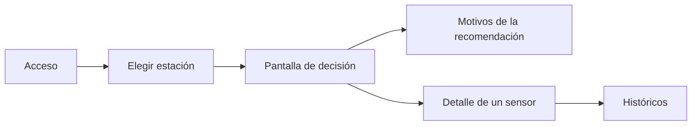
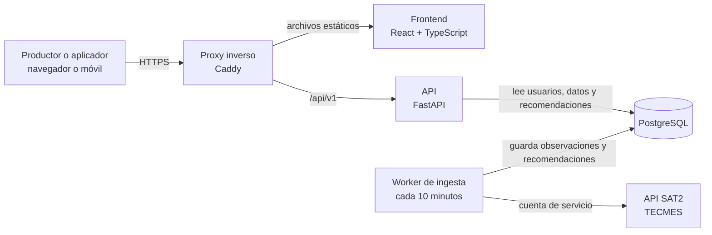
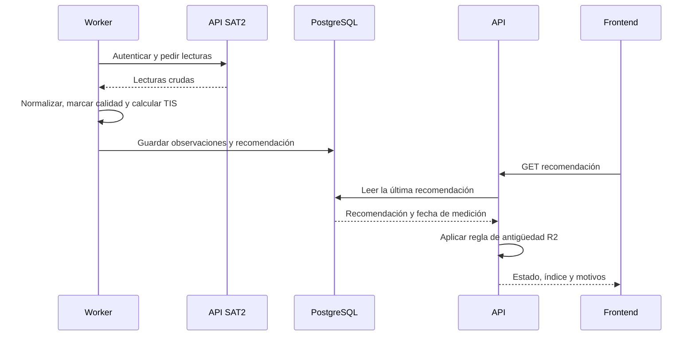
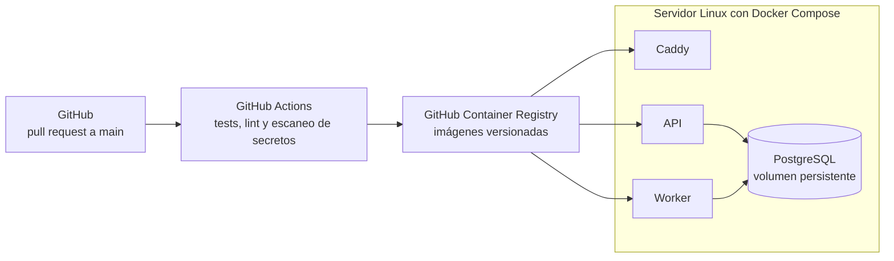
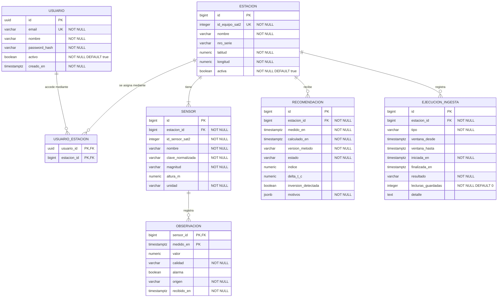

## Índice

0. [Ficha del proyecto](#0-ficha-del-proyecto)
1. [Descripción general del producto](#1-descripción-general-del-producto)
2. [Arquitectura del sistema](#2-arquitectura-del-sistema)
3. [Modelo de datos](#3-modelo-de-datos)
4. [Especificación de la API](#4-especificación-de-la-api)
5. [Historias de usuario](#5-historias-de-usuario)
6. [Tickets de trabajo](#6-tickets-de-trabajo)
7. [Pull requests](#7-pull-requests)

> **Estado de este documento (Entrega 2, [presentada de forma anticipada](https://github.com/LIDR-academy-temp/AI4Devs-finalproject/pull/14)):** describe el MVP implementado, que se instala y se prueba desde este repositorio. Lo que todavía no existe se indica como pendiente: el despliegue público, el pipeline de entrega continua y la validación agronómica del índice.

---

## 0. Ficha del proyecto

### **0.1. Tu nombre completo:**

Pablo Guillermo Di Nanno

### **0.2. Nombre del proyecto:**

Weather Track

### **0.3. Descripción breve del proyecto:**

Aplicación web adaptable a escritorio y móvil que transforma los datos de una estación meteorológica en una recomendación clara sobre si conviene aplicar fitosanitarios en este momento.

### **0.4. URL del proyecto:**

El MVP se ejecuta en la computadora de quien lo instala, en `http://localhost:8080`: ver la [instalación](#14-instrucciones-de-instalación). Todavía no hay una URL pública, porque el despliegue en internet quedó pospuesto hasta después de esta entrega ([ADR-0002](docs/decisions/0002-proveedor-del-servidor.md)). El acceso al prototipo de validación se comparte por un canal privado cuando se solicita.

### **0.5. URL o archivo comprimido del repositorio**

https://github.com/dinannopabloguillermo/AI4Devs-finalproject-temp

---

## 1. Descripción general del producto

### **1.1. Objetivo:**

**Problema.** Aplicar fitosanitarios durante una inversión térmica aumenta el riesgo de deriva: el aire estable puede mantener el producto suspendido y trasladarlo fuera del lote. Las estaciones meteorológicas ya miden las variables necesarias, pero entregan valores sueltos. Quien debe decidir tiene que interpretarlos por su cuenta, sin saber si los datos están actualizados o son confiables.

**Para quién.** Productores agropecuarios y aplicadores que trabajan en la zona de influencia de una estación. El caso inicial es la estación INTA Pergamino, con sensores de temperatura y humedad a 2 m y 10 m, viento y radiación solar, entre otros.

**Pregunta que responde.** "¿Puedo aplicar ahora en esta estación sin riesgo de deriva?"

| Qué introduce el usuario | Qué le devuelve el sistema |
|---|---|
| Correo y contraseña | Acceso a las estaciones que tiene asignadas |
| Estación | Condiciones actuales, antigüedad del dato y calidad de cada lectura |
| Nada adicional: la evaluación se calcula sola cada 10 minutos | Recomendación, índice TIS y motivos en lenguaje claro |
| Sensor y rango de fechas | Serie histórica con máximo, mínimo, promedio y cantidad de registros |

**Origen.** El proyecto nació en un ámbito laboral, creció como servicio profesional y se integra aquí como tesis de graduación.

### **1.2. Características y funcionalidades principales:**

#### Alcance del MVP

| ID | Funcionalidad | Descripción |
|---|---|---|
| F1 | Acceso | Inicio y cierre de sesión con cuentas propias de Weather Track. Las cuentas las crea un administrador; no hay registro público. |
| F2 | Estación | Selección entre las estaciones asignadas al usuario. |
| F3 | Condiciones actuales | Una tarjeta por sensor con valor, unidad, calidad del dato y antigüedad. |
| F4 | Recomendación | Estado de aplicación, índice TIS (Índice de Inversión Térmica), diferencia térmica y motivos. |
| F5 | Históricos | Serie por sensor de los últimos 7 o 31 días, con resumen estadístico. |
| F6 | Ingesta automática | Carga inicial de los últimos 31 días y proceso programado que cada 10 minutos obtiene datos, los normaliza, los guarda y calcula la recomendación. |

#### Sistema de unidades

Todo el sistema usa unidades métricas: las medidas se guardan, calculan y muestran así. Las referencias en mph o °F solo aparecen al citar una fuente en el [contraste bibliográfico](docs/tis/contraste-bibliografico.md).

| Magnitud | Unidad |
|---|---|
| Temperatura | °C |
| Velocidad del viento | km/h |
| Dirección del viento | grados |
| Radiación solar | W/m² |
| Humedad relativa | % |
| Presión | hPa |
| Lluvia | mm |
| Altura de medición | m |

Si un sensor usado por el índice informara otra unidad, sus lecturas no se usan y la recomendación pasa a `DATOS_INSUFICIENTES`.

#### Reglas de la recomendación

El índice TIS va de 0 a 100 y combina cuatro factores:

`TIS = 0,50 × temperatura + 0,25 × viento + 0,15 × radiación + 0,10 × humedad`

En este documento, ΔT significa siempre `T10m − T2m`.

| Factor | Regla (de 0 a 100) |
|---|---|
| Temperatura | ΔT ≤ 0: 0. ΔT ≥ 3 °C: 100. En el medio, `ΔT / 3 × 100` |
| Viento (km/h) | ≤ 1: 100. ≤ 3: 90. ≤ 5: 70. ≤ 8: 40. ≤ 12: 20. Mayor: 0 |
| Radiación (W/m²) | ≤ 0: 100. ≤ 50: 90. ≤ 100: 75. ≤ 250: 50. ≤ 500: 20. Mayor: 0 |
| Humedad (promedio de 2 m y 10 m) | ≥ 90 %: 100. ≥ 80 %: 80. ≥ 60 %: 50. Menor: 20 |

| Índice | Estado base |
|---|---|
| 0 a 20 | `APTO` |
| Más de 20 y hasta 40 | `PRECAUCION` |
| Más de 40 y hasta 60 | `RIESGO_DERIVA` |
| Más de 60 | `NO_APLICAR` |

Las siguientes reglas se aplican en este orden sobre el estado base:

| ID | Regla | Resultado |
|---|---|---|
| R1 | Falta o es inválida alguna de las seis lecturas (T2m, T10m, HR2m, HR10m, viento o radiación) | `DATOS_INSUFICIENTES`, sin índice |
| R2 | La medición tiene más de 30 minutos de antigüedad al consultarla | `DATOS_INSUFICIENTES`, con motivo `DATOS_DESACTUALIZADOS` |
| R3 | ΔT > 0 | Nunca `APTO`: como mínimo `PRECAUCION`, con motivo `INVERSION_DETECTADA` |
| R3b | ΔT > 0 y viento de 6,4 km/h o menos | `NO_APLICAR`, con motivo `INVERSION_DETECTADA` |
| R4 | Alguna lectura es sospechosa (por ejemplo, más de 25 puntos de diferencia de humedad entre 2 m y 10 m) | Nunca `APTO`: como mínimo `PRECAUCION`, con motivo `DATO_SOSPECHOSO` |

La recomendación es **orientativa** y la pantalla lo indica siempre. Los pesos y umbrales provienen del prototipo: la bibliografía respalda las variables, pero no sus valores, como detalla el [contraste bibliográfico](docs/tis/contraste-bibliografico.md). Su validación agronómica está prevista para la Entrega 3. No reemplaza el criterio de un profesional ni la etiqueta del producto.

**Situación actual de la estación real.** Desde el 30 de octubre de 2026, el sensor de humedad a 2 m de la estación informa 0 %, tras semanas de valores en baja. Mientras no se revise en el campo, la regla R4 impide que esa estación llegue a `APTO`. Es el comportamiento esperado ante un dato dudoso.

### **1.3. Diseño y experiencia de usuario:**



La **pantalla de decisión** es el centro de la experiencia. Muestra primero el estado de aplicación con su color, debajo los motivos y el aviso de que es orientativa, y al final las tarjetas de sensores. Se actualiza sola cada 60 segundos. Si los datos no son vigentes, el estado pasa a `DATOS_INSUFICIENTES` y explica por qué.

Capturas del MVP, con datos ficticios:

| Pantalla | Captura |
|---|---|
| Acceso |  |
| Decisión: apto |  |
| Decisión: no aplicar |  |
| Decisión: datos insuficientes |  |
| Detalle e históricos |  |
| Móvil, a 360 píxeles |  |

En `docs/prototipo/` quedan las capturas del prototipo de validación, que sirvió de referencia. No son del MVP.

### **1.4. Instrucciones de instalación:**

Requisitos: Git y Docker con Docker Compose. Estos pasos usan datos ficticios y no necesitan credenciales.

```bash
git clone -b feature/entrega-2-PDN https://github.com/dinannopabloguillermo/AI4Devs-finalproject-temp.git weather-track
cd weather-track
cp .env.example .env
docker compose up --build -d --wait
docker compose exec api python -m app.semillas
```

El último comando muestra el usuario de demostración y su clave, que aparece una sola vez. La aplicación queda en `http://localhost:8080`.

- **[Guía de instalación local](docs/despliegue/instalacion-local.md):** paso a paso desde cero, uso con datos reales de SAT2, actualización, desinstalación y problemas frecuentes.
- **[Guion de la demostración](docs/demo/guion-demo.md):** recorre los cinco estados y las reglas en unos 7 minutos, con el modo `escenarios`.
- **[Despliegue en Google Cloud](docs/despliegue/despliegue-gcp.md) (pospuesto):** guía preparada para publicar en internet con HTTPS y dominio propio. Todavía no se ejecutó.
- Las cuentas se administran con `docker compose exec api python -m app.administracion`, con los comandos `crear-usuario`, `asignar-estacion`, `restablecer-clave` y `desactivar-usuario`.
- Para detenerla sin perder datos, usar `docker compose stop`. `docker compose down -v` borra la base.
- La documentación de la API está en `http://localhost:8080/api/docs`.

**Pruebas** (además requieren uv y Node.js):

```bash
docker compose up -d --wait db_pruebas
cd backend && uv run pytest
cd ../frontend && npm ci && npm test
npx playwright install chromium && npm run e2e
```

`npm run e2e` levanta la pila completa en un proyecto propio, `wt-e2e`, recorre las historias de usuario en un navegador y borra esa base al terminar. No toca los datos de la instalación principal.

### **1.5. Prototipo de validación**

Existe una aplicación en R Shiny, en un repositorio privado, creada para probar la lógica y la interfaz con datos reales. Permitió validar la lectura de datos de SAT2, las tarjetas por sensor, los históricos y una primera versión del índice TIS. **No es la base de código del MVP**: el MVP se construye nuevo con la arquitectura de la sección 2.

### **1.6. Evolución futura (fuera del MVP)**

- Niveles de uso diferenciados con roles: público general, sector productivo e investigación.
- Más índices: Delta T psicrométrico, déficit de presión de vapor, evapotranspiración de referencia, grados-día, horas de mojado foliar, heladas y acumulados.
- Predicción a corto y mediano plazo, y seguimiento de fenómenos macroclimáticos como El Niño.
- Carga de toda la historia disponible en SAT2 y rango manual de fechas en históricos.
- Humedad de suelos, que requiere una fuente de datos adicional.
- Agentes de IA dentro del producto para ingesta y análisis.
- Migración a un repositorio y una operación de producción empresarial. Este repositorio es académico y esa migración no forma parte de este trabajo.

### **1.7. IA en el ciclo de vida**

| Fase | Uso de IA | Estado |
|---|---|---|
| Análisis | Ingeniería inversa del prototipo con OpenSpec y Claude Code, y contraste entre la documentación de la API y sus respuestas reales | Realizado |
| Diseño | Definición del MVP, arquitectura, modelo de datos, API, historias y tickets de este documento con Claude Code, con revisión y decisión humana | Realizado |
| Implementación | Desarrollo guiado por especificaciones con OpenSpec y Claude Code, actividad por actividad, con aprobación humana de cada paso | Realizado |
| Pruebas | Generación de tests a partir de los criterios de aceptación y de la tabla de la sección 2.6, con revisión humana | Realizado |
| Despliegue | Configuración de producción e instalación local, probadas en copias limpias y en un clon real | Parcial: el despliegue público está pospuesto |
| Mantenimiento y seguridad | Revisión de seguridad con pruebas negativas, y corrección de los hallazgos | Realizado para esta entrega ([informe](docs/seguridad/revision-entrega-2.md)) |

Los prompts reales están en [prompts.md](prompts.md).

---

## 2. Arquitectura del Sistema

### **2.1. Diagrama de arquitectura:**

La decisión y sus alternativas están en el [ADR-0001](docs/decisions/0001-arquitectura-destino-weather-track.md), y las actividades y plazos hasta el 19 de noviembre, en el [plan de implementación de la Entrega 2](docs/plan/plan-implementacion-entrega-2.md).



En el servidor el acceso es por HTTPS. En la instalación local es por HTTP, solo desde la misma computadora.

**Patrón.** Monolito modular con arquitectura en capas y un worker separado, ambos sobre el mismo código de dominio. El usuario nunca consulta SAT2 de forma directa: lee lo que el worker ya guardó y validó.

**Por qué esta arquitectura.** Es lo más simple que resuelve lo que el prototipo no resolvía:

| Necesidad | Cómo se resuelve |
|---|---|
| Datos siempre actualizados, aunque nadie tenga la pantalla abierta | El worker trabaja de forma independiente de la sesión del usuario |
| No manejar credenciales de SAT2 de los usuarios | Cuentas propias y una única cuenta de servicio en el servidor |
| Históricos rápidos y sin consultas repetidas a un tercero | Datos normalizados en PostgreSQL |
| Regla de seguridad del TIS fácil de probar | Motor de cálculo como función pura, sin dependencias de red ni de base de datos |

**Beneficios.** Una sola persona con asistencia de IA puede construirla antes del 19 de noviembre, según el [plan](docs/plan/plan-implementacion-entrega-2.md); el despliegue es simple y cada capa se prueba por separado.

**Sacrificios.**
- Si SAT2 no responde, no hay datos nuevos. La regla R2 evita que se muestre una recomendación vieja como vigente.
- Tener un solo servidor implica un punto único de falla, aceptable para un MVP.
- La latencia del dato depende del ciclo de 10 minutos, que coincide con la frecuencia de las mediciones.
- Se reescribe la lógica ya probada en R, a cambio de una base mantenible y con tests.

**Alternativas descartadas.** Evolucionar Shiny, porque la sesión queda ligada a la pestaña y no resuelve la ingesta en segundo plano. Microservicios, porque agregan complejidad operativa sin beneficio a esta escala.

### **2.2. Descripción de componentes principales:**

| Componente | Tecnología | Responsabilidad |
|---|---|---|
| Frontend | React, TypeScript, Vite, Plotly.js | Pantallas de acceso, decisión, detalle e históricos. Consulta la API cada 60 segundos. |
| API | Python, FastAPI, Pydantic, SQLAlchemy | Autenticación, control de acceso por estación y lectura de datos. Aplica la regla R2 al responder. |
| Worker de ingesta | Python, APScheduler, httpx | Sincroniza el catálogo, obtiene lecturas, normaliza, marca la calidad y dispara el cálculo. Registra cada ejecución. |
| Motor de recomendación | Python, sin dependencias externas | Función pura que recibe lecturas y devuelve índice, estado y motivos. Lo usa el worker. |
| Base de datos | PostgreSQL 18, Alembic | Usuarios, estaciones, sensores, observaciones, recomendaciones e historial de ingesta. |
| Proxy inverso | Caddy | HTTPS, entrega de estáticos y enrutamiento hacia la API. |



### **2.3. Descripción de alto nivel del proyecto y estructura de ficheros**

```text
AI4Devs-finalproject-temp/
├── backend/
│   ├── app/
│   │   ├── api/             # Rutas HTTP, sesión, autorización y errores
│   │   ├── dominio/         # Motor de recomendación, normalización y vigencia
│   │   ├── ingesta/         # Cliente SAT2, modos simulados, ciclo, carga y worker
│   │   ├── datos/           # Modelos y conexión a la base de datos
│   │   ├── administracion.py  # Comandos para administrar cuentas
│   │   ├── seguridad.py     # Contraseñas e identificadores de sesión
│   │   └── semillas.py      # Datos de demostración
│   ├── herramientas/        # Prueba de límites de SAT2, contrato y pruebas negativas
│   ├── migraciones/         # Migraciones de Alembic
│   └── tests/
├── frontend/
│   ├── e2e/                 # Pruebas de extremo a extremo con Playwright
│   └── src/
│       ├── pantallas/       # Acceso, estaciones, decisión y detalle
│       ├── componentes/     # Estado, tarjetas y gráfico
│       ├── servicios/       # Cliente de la API, sesión y actualización periódica
│       └── pruebas/         # Pruebas con Vitest
├── openspec/                # Especificaciones y cambios
├── docs/
│   ├── capturas/            # Capturas del MVP
│   ├── decisions/           # ADR-0001 y ADR-0002
│   ├── demo/                # Guion de la demostración
│   ├── despliegue/          # Instalación local y despliegue en Google Cloud
│   ├── plan/                # Plan de implementación
│   ├── prototipo/           # Capturas del prototipo
│   ├── seguridad/           # Informe de la revisión de seguridad
│   └── tis/                 # Contraste bibliográfico del índice
├── docker-compose.yml       # Pila local
├── docker-compose.prod.yml  # Ajustes para el servidor
├── .env.example
├── prompts.md
└── readme.md
```

El backend sigue una arquitectura en capas: `api` y `ingesta` dependen de `dominio` y `datos`, y `dominio` no depende de ninguna otra capa.

### **2.4. Infraestructura y despliegue**

**Implementado.** Toda la pila corre con Docker Compose, en cinco servicios: `db`, `migraciones` (se ejecuta una vez y termina), `api`, `worker` y `proxy`.

| Modo | Cómo se usa | Estado |
|---|---|---|
| Local | [Instalación local](docs/despliegue/instalacion-local.md), por HTTP y solo desde la misma computadora | Probado con un clon real desde GitHub, en Windows 11 |
| Servidor | `docker-compose.prod.yml` agrega HTTPS con Caddy, exige las variables críticas y publica solo los puertos 80 y 443 | Probado en local, con certificado interno |
| Google Cloud | [Guía de despliegue](docs/despliegue/despliegue-gcp.md) y [ADR-0002](docs/decisions/0002-proveedor-del-servidor.md) | **Pospuesto.** La guía no se ejecutó en la nube |

**Pendiente: pipeline.** Este esquema es preliminar y no está implementado. Sus etapas y herramientas se evaluarán en el proceso final, en otro ADR.



### **2.5. Seguridad**

Implementado y revisado en el [informe de seguridad](docs/seguridad/revision-entrega-2.md), que también detalla los hallazgos corregidos y los riesgos aceptados.

| Práctica | Aplicación |
|---|---|
| Secretos fuera del código | Variables de entorno y `.env.example` sin valores reales. El historial se revisó con Gitleaks; el escaneo en cada pull request queda para el pipeline. |
| Credenciales de terceros aisladas | La cuenta de servicio de SAT2 solo existe en el worker. Nunca llega al navegador ni a la API de lectura. |
| Contraseñas | Solo se guarda un hash con Argon2id, con un tope de cálculos simultáneos para que una ráfaga no agote la memoria. |
| Sesión | Identificador opaco en cookie `HttpOnly` y `SameSite`, y `Secure` en el servidor. Vence a las 8 horas y se invalida al salir. |
| Autorización | Todas las rutas se protegen en el servidor. Un usuario solo accede a sus estaciones; de lo contrario recibe 403. |
| Abuso | Bloqueo por cuenta tras 5 intentos fallidos. Aún no hay límite por dirección IP. |
| Transporte | HTTPS en el servidor. En local, HTTP solo desde la misma computadora. El navegador y la API comparten dominio, así que CORS no está habilitado. |
| Cabeceras | HSTS, política de contenido, `nosniff`, protección contra marcos y sin cabecera `Server`. |
| Entrada | Validación con Pydantic, consultas parametrizadas por el ORM y límite de 64 KB en el cuerpo. |
| Registros | Sin contraseñas ni tokens en los logs. |
| Datos de prueba | Datos de ejemplo y de prueba ficticios, sin copias de respuestas con credenciales. |

### **2.6. Tests**

Resultado de la última ejecución, el 2 de noviembre de 2026: todas pasan.

| Nivel | Herramienta | Qué cubre | Pruebas |
|---|---|---|---|
| Unitario, integración e ingesta | pytest, con PostgreSQL de prueba y SAT2 simulado | Motor, normalización, calidad, rutas de la API, permisos, restricciones de la base, ingesta y errores de SAT2 | 355 |
| Frontend | Vitest, Testing Library | Estados de la pantalla de decisión y flujos de acceso e históricos | 46 |
| Extremo a extremo | Playwright, contra la pila completa en contenedores | HU1, HU2 y HU3 básica, con los cinco estados y las reglas R1 a R4 | 14 |
| Seguridad | [`pruebas_negativas.py`](backend/herramientas/pruebas_negativas.py), contra la configuración de producción | Autorización, sesión, entradas, cabeceras y carga | 77 |

Además, la ingesta se probó una vez contra SAT2 real, durante 38 minutos y con 48.427 lecturas. Los comandos están en la [sección 1.4](#14-instrucciones-de-instalación).

**Casos de referencia del motor de recomendación:**

| Caso | ΔT (°C) | Viento (km/h) | Radiación (W/m²) | HR 2 m / 10 m (%) | Índice | Estado esperado | Regla |
|---|---|---|---|---|---|---|---|
| Condiciones favorables | −0,1 | 9 | 1056 | 55 / 60 | 7 | `APTO` | Base |
| Inversión con índice bajo | +0,9 | 13 | 300 | 50 / 55 | 20 | `PRECAUCION` | R3 |
| Inversión con poco viento | +0,5 | 2 | 600 | 50 / 50 | 32,83 | `NO_APLICAR` | R3b |
| Riesgo intermedio | +1,5 | 9 | 0 | 60 / 60 | 50 | `RIESGO_DERIVA` | Base |
| Máximo riesgo | +3,0 | 1 | 0 | 95 / 95 | 100 | `NO_APLICAR` | Base |
| Lectura sospechosa | −0,1 | 9 | 1056 | 0 / 61 | 7 | `PRECAUCION` | R4 |
| Falta T10m | Sin dato | 9 | 1056 | 55 / 60 | Sin índice | `DATOS_INSUFICIENTES` | R1 |
| Medición de hace 31 minutos | −0,1 | 9 | 1056 | 55 / 60 | 7 guardado | `DATOS_INSUFICIENTES` | R2 |

---

## 3. Modelo de Datos

### **3.1. Diagrama del modelo de datos:**



### **3.2. Descripción de entidades principales:**

> Se guarda en UTC. La interfaz muestra la hora de Argentina (`America/Argentina/Buenos_Aires`).
>
> Las tablas de soporte `SESION` e `INTENTO_ACCESO` se detallan en el [diseño del cambio](openspec/changes/weather-track-mvp-nucleo/design.md).

**USUARIO.** Persona con acceso al sistema.

| Atributo | Tipo | Restricciones | Descripción |
|---|---|---|---|
| `id` | `uuid` | PK | Identificador |
| `email` | `varchar(254)` | UNIQUE, NOT NULL | Correo de acceso, en minúsculas |
| `nombre` | `varchar(120)` | NOT NULL | Nombre visible |
| `password_hash` | `varchar(255)` | NOT NULL | Hash Argon2id |
| `activo` | `boolean` | NOT NULL, DEFAULT true | Permite desactivar sin borrar |
| `creado_en` | `timestamptz` | NOT NULL | Fecha de alta |

**ESTACION.** Equipo meteorológico registrado en SAT2.

| Atributo | Tipo | Restricciones | Descripción |
|---|---|---|---|
| `id` | `bigint` | PK | Identificador interno |
| `id_equipo_sat2` | `integer` | UNIQUE, NOT NULL | Identificador en SAT2 |
| `nombre` | `varchar(120)` | NOT NULL | Nombre visible |
| `nro_serie` | `varchar(40)` | | Serie del equipo |
| `latitud` | `numeric(9,6)` | NOT NULL, entre −90 y 90 | Ubicación |
| `longitud` | `numeric(9,6)` | NOT NULL, entre −180 y 180 | Ubicación |
| `activa` | `boolean` | NOT NULL, DEFAULT true | Si participa de la ingesta |

**USUARIO_ESTACION.** Estaciones a las que accede cada usuario (N:M).

| Atributo | Tipo | Restricciones | Descripción |
|---|---|---|---|
| `usuario_id` | `uuid` | PK, FK a `USUARIO.id`, ON DELETE CASCADE | Usuario |
| `estacion_id` | `bigint` | PK, FK a `ESTACION.id`, ON DELETE CASCADE | Estación |

**SENSOR.** Sensor de una estación (N:1 con ESTACION). `UNIQUE (estacion_id, id_sensor_sat2)` y `UNIQUE (estacion_id, clave_normalizada)`.

| Atributo | Tipo | Restricciones | Descripción |
|---|---|---|---|
| `id` | `bigint` | PK | Identificador interno |
| `estacion_id` | `bigint` | FK a `ESTACION.id`, NOT NULL | Estación |
| `id_sensor_sat2` | `integer` | NOT NULL | Identificador en SAT2 |
| `nombre` | `varchar(120)` | NOT NULL | Nombre original |
| `clave_normalizada` | `varchar(120)` | NOT NULL | Minúsculas y sin tildes; vincula las lecturas con el catálogo |
| `magnitud` | `varchar(30)` | NOT NULL, CHECK en lista cerrada | `TEMPERATURA`, `HUMEDAD_RELATIVA`, `VIENTO_VELOCIDAD`, `VIENTO_DIRECCION`, `RADIACION`, `PRESION`, `PRECIPITACION`, `MOJADO_FOLIAR` o `BATERIA` |
| `altura_m` | `numeric(5,2)` | | Altura de medición, si aplica |
| `unidad` | `varchar(20)` | NOT NULL | Unidad de medida |

**OBSERVACION.** Lectura de un sensor en un instante (N:1 con SENSOR). Índice sobre `medido_en`.

| Atributo | Tipo | Restricciones | Descripción |
|---|---|---|---|
| `sensor_id` | `bigint` | PK, FK a `SENSOR.id` | Sensor |
| `medido_en` | `timestamptz` | PK | Instante de medición |
| `valor` | `numeric(12,4)` | NULL solo si `calidad = FALTANTE` | Valor normalizado |
| `calidad` | `varchar(12)` | NOT NULL, CHECK | `OK`, `FALTANTE` o `SOSPECHOSO` |
| `alarma` | `boolean` | | Alarma informada por SAT2; nula si la fuente no la informa |
| `origen` | `varchar(12)` | NOT NULL, CHECK | `INSTANTANEO` o `HISTORICO` |
| `recibido_en` | `timestamptz` | NOT NULL | Instante de obtención |

**RECOMENDACION.** Resultado del motor para una medición (N:1 con ESTACION). `UNIQUE (estacion_id, medido_en, version_metodo)`.

| Atributo | Tipo | Restricciones | Descripción |
|---|---|---|---|
| `id` | `bigint` | PK | Identificador |
| `estacion_id` | `bigint` | FK a `ESTACION.id`, NOT NULL | Estación |
| `medido_en` | `timestamptz` | NOT NULL | Instante de los datos usados |
| `calculado_en` | `timestamptz` | NOT NULL | Instante del cálculo |
| `version_metodo` | `varchar(20)` | NOT NULL | Versión de la fórmula, por ejemplo `TIS-1.1` |
| `estado` | `varchar(24)` | NOT NULL, CHECK | `APTO`, `PRECAUCION`, `RIESGO_DERIVA`, `NO_APLICAR` o `DATOS_INSUFICIENTES` |
| `indice` | `numeric(5,2)` | Entre 0 y 100; NULL solo con `DATOS_INSUFICIENTES` | Índice TIS |
| `delta_t_c` | `numeric(5,2)` | | `T10m − T2m` en °C |
| `inversion_detectada` | `boolean` | CHECK: si `estado = APTO`, debe ser `false` | Refuerza la regla R3 en la base |
| `motivos` | `jsonb` | NOT NULL | Lista de `{codigo, detalle}` |

**EJECUCION_INGESTA.** Registro de cada ciclo del worker (N:1 con ESTACION). Permite informar el estado real de la conexión con SAT2.

| Atributo | Tipo | Restricciones | Descripción |
|---|---|---|---|
| `id` | `bigint` | PK | Identificador |
| `estacion_id` | `bigint` | FK a `ESTACION.id`, NOT NULL | Estación |
| `tipo` | `varchar(14)` | NOT NULL, CHECK | `CICLO` o `CARGA_INICIAL` |
| `ventana_desde` | `timestamptz` | | Inicio de la ventana, solo en cargas |
| `ventana_hasta` | `timestamptz` | | Fin de la ventana, solo en cargas |
| `iniciada_en` | `timestamptz` | NOT NULL | Inicio de la ejecución |
| `finalizada_en` | `timestamptz` | | Fin de la ejecución |
| `resultado` | `varchar(12)` | NOT NULL, CHECK | `EN_CURSO`, `EXITO`, `PARCIAL` o `ERROR` |
| `lecturas_guardadas` | `integer` | NOT NULL, DEFAULT 0 | Cantidad de lecturas guardadas |
| `detalle` | `text` | | Descripción del error, sin datos sensibles |

---

## 4. Especificación de la API

Esta sección muestra los tres endpoints principales. El contrato completo, que incluye acceso, lista de estaciones y salud, se genera desde el código: está en [`frontend/openapi.json`](frontend/openapi.json) y en `/api/docs`. Una prueba falla si difiere de la API.

Todas las rutas usan la sesión del usuario y comprueban que tenga acceso a la estación. Los valores de los ejemplos son ficticios.

```yaml
openapi: 3.0.3
info:
  title: Weather Track API
  version: 1.0.0
  description: Endpoints principales del MVP de Weather Track.
servers:
  - url: /api/v1
security:
  - sesion: []
paths:
  /estaciones/{estacionId}/condiciones-actuales:
    get:
      summary: Obtiene la última lectura de cada sensor y su vigencia
      operationId: obtenerCondicionesActuales
      parameters:
        - $ref: '#/components/parameters/EstacionId'
      responses:
        '200':
          description: Condiciones actuales de la estación
          content:
            application/json:
              schema:
                $ref: '#/components/schemas/CondicionesActuales'
              example:
                estacion_id: 1
                estacion_nombre: Estación de ejemplo
                medido_en: '2026-11-01T14:40:00-03:00'
                antiguedad_segundos: 180
                estado_datos: VIGENTE
                ultima_ingesta_exitosa_en: '2026-11-01T14:41:02-03:00'
                ultima_ingesta_con_error: false
                sensores:
                  - sensor_id: 10
                    nombre: Temp Amb. a 2 Mts
                    magnitud: TEMPERATURA
                    altura_m: 2
                    valor: 21.3
                    unidad: °C
                    calidad: OK
                    alarma: false
        '401':
          $ref: '#/components/responses/NoAutenticado'
        '403':
          $ref: '#/components/responses/SinAcceso'
        '404':
          $ref: '#/components/responses/NoEncontrado'
  /estaciones/{estacionId}/recomendacion:
    get:
      summary: Obtiene la recomendación de aplicación vigente
      description: >-
        Devuelve la última recomendación calculada. Si la medición tiene más de
        30 minutos de antigüedad, el estado es DATOS_INSUFICIENTES y no se
        informa índice.
      operationId: obtenerRecomendacion
      parameters:
        - $ref: '#/components/parameters/EstacionId'
      responses:
        '200':
          description: Recomendación vigente
          content:
            application/json:
              schema:
                $ref: '#/components/schemas/Recomendacion'
              example:
                estacion_id: 1
                estado: PRECAUCION
                indice: 20
                delta_t_c: 0.9
                inversion_detectada: true
                motivos:
                  - codigo: INVERSION_DETECTADA
                    detalle: La temperatura a 10 m supera a la de 2 m en 0,9 °C.
                medido_en: '2026-11-01T06:40:00-03:00'
                antiguedad_segundos: 240
                version_metodo: TIS-1.1
                aviso: Recomendación orientativa. No reemplaza el criterio profesional ni la etiqueta del producto.
        '401':
          $ref: '#/components/responses/NoAutenticado'
        '403':
          $ref: '#/components/responses/SinAcceso'
        '404':
          $ref: '#/components/responses/NoEncontrado'
  /estaciones/{estacionId}/sensores/{sensorId}/historico:
    get:
      summary: Obtiene la serie histórica de un sensor y su resumen
      operationId: obtenerHistorico
      parameters:
        - $ref: '#/components/parameters/EstacionId'
        - name: sensorId
          in: path
          required: true
          schema:
            type: integer
            format: int64
        - name: desde
          in: query
          required: true
          schema:
            type: string
            format: date-time
        - name: hasta
          in: query
          required: true
          description: Debe ser posterior a desde, con un rango máximo de 31 días.
          schema:
            type: string
            format: date-time
      responses:
        '200':
          description: Serie ordenada de forma ascendente. Las lecturas faltantes tienen valor nulo y no se interpolan.
          content:
            application/json:
              schema:
                $ref: '#/components/schemas/Historico'
              example:
                sensor_id: 10
                unidad: °C
                desde: '2026-10-25T00:00:00-03:00'
                hasta: '2026-11-01T00:00:00-03:00'
                resumen:
                  maximo: 28.1
                  minimo: 2.9
                  promedio: 14.6
                  cantidad: 1008
                puntos:
                  - medido_en: '2026-10-25T00:00:00-03:00'
                    valor: 12.4
                    calidad: OK
        '401':
          $ref: '#/components/responses/NoAutenticado'
        '403':
          $ref: '#/components/responses/SinAcceso'
        '404':
          $ref: '#/components/responses/NoEncontrado'
        '422':
          description: Rango de fechas inválido o mayor a 31 días
          content:
            application/json:
              schema:
                $ref: '#/components/schemas/Error'
components:
  securitySchemes:
    sesion:
      type: apiKey
      in: cookie
      name: wt_sesion
  parameters:
    EstacionId:
      name: estacionId
      in: path
      required: true
      schema:
        type: integer
        format: int64
  responses:
    NoAutenticado:
      description: Sesión ausente o vencida
      content:
        application/json:
          schema:
            $ref: '#/components/schemas/Error'
    SinAcceso:
      description: El usuario no tiene acceso a esta estación
      content:
        application/json:
          schema:
            $ref: '#/components/schemas/Error'
    NoEncontrado:
      description: La estación o el sensor no existen
      content:
        application/json:
          schema:
            $ref: '#/components/schemas/Error'
  schemas:
    Calidad:
      type: string
      enum: [OK, FALTANTE, SOSPECHOSO]
    Motivo:
      type: object
      required: [codigo, detalle]
      properties:
        codigo:
          type: string
          enum:
            - SIN_INVERSION
            - INDICE_ELEVADO
            - INVERSION_DETECTADA
            - DATO_FALTANTE
            - DATO_SOSPECHOSO
            - DATOS_DESACTUALIZADOS
            - SIN_MEDICIONES
        detalle:
          type: string
    LecturaSensor:
      type: object
      required: [sensor_id, nombre, magnitud, unidad, calidad]
      properties:
        sensor_id:
          type: integer
          format: int64
        nombre:
          type: string
        magnitud:
          type: string
        altura_m:
          type: number
          nullable: true
        valor:
          type: number
          nullable: true
        unidad:
          type: string
        calidad:
          $ref: '#/components/schemas/Calidad'
        alarma:
          type: boolean
          nullable: true
    CondicionesActuales:
      type: object
      required: [estacion_id, estacion_nombre, estado_datos, ultima_ingesta_con_error, sensores]
      properties:
        estacion_id:
          type: integer
          format: int64
        estacion_nombre:
          type: string
        medido_en:
          type: string
          format: date-time
          nullable: true
        antiguedad_segundos:
          type: integer
          nullable: true
        estado_datos:
          type: string
          enum: [VIGENTE, DESACTUALIZADO, SIN_DATOS]
        ultima_ingesta_exitosa_en:
          type: string
          format: date-time
          nullable: true
        ultima_ingesta_con_error:
          type: boolean
        sensores:
          type: array
          items:
            $ref: '#/components/schemas/LecturaSensor'
    Recomendacion:
      type: object
      required: [estacion_id, estado, motivos, version_metodo, aviso]
      properties:
        estacion_id:
          type: integer
          format: int64
        estado:
          type: string
          enum: [APTO, PRECAUCION, RIESGO_DERIVA, NO_APLICAR, DATOS_INSUFICIENTES]
        indice:
          type: number
          minimum: 0
          maximum: 100
          nullable: true
        delta_t_c:
          type: number
          nullable: true
        inversion_detectada:
          type: boolean
          nullable: true
        motivos:
          type: array
          items:
            $ref: '#/components/schemas/Motivo'
        medido_en:
          type: string
          format: date-time
          nullable: true
        antiguedad_segundos:
          type: integer
          nullable: true
        version_metodo:
          type: string
        aviso:
          type: string
    Punto:
      type: object
      required: [medido_en, calidad]
      properties:
        medido_en:
          type: string
          format: date-time
        valor:
          type: number
          nullable: true
        calidad:
          $ref: '#/components/schemas/Calidad'
    Resumen:
      type: object
      required: [cantidad]
      properties:
        maximo:
          type: number
          nullable: true
        minimo:
          type: number
          nullable: true
        promedio:
          type: number
          nullable: true
        cantidad:
          type: integer
    Historico:
      type: object
      required: [sensor_id, unidad, desde, hasta, resumen, puntos]
      properties:
        sensor_id:
          type: integer
          format: int64
        unidad:
          type: string
        desde:
          type: string
          format: date-time
        hasta:
          type: string
          format: date-time
        resumen:
          $ref: '#/components/schemas/Resumen'
        puntos:
          type: array
          items:
            $ref: '#/components/schemas/Punto'
    Error:
      type: object
      required: [codigo, mensaje]
      properties:
        codigo:
          type: string
        mensaje:
          type: string
```

Otros endpoints del MVP, sin detalle aquí: `POST /auth/login`, `POST /auth/logout` y `GET /estaciones`, que lista las estaciones del usuario.

---

## 5. Historias de Usuario

**Historia de Usuario 1: ver si puedo aplicar ahora**

Como productor o aplicador, quiero ver las condiciones actuales y una recomendación en una sola pantalla, para decidir rápido si aplico fitosanitarios.

*Prioridad: alta. Estimación: 5 puntos.*

```gherkin
Escenario: Condiciones favorables con datos vigentes
  Dado que inicié sesión y tengo acceso a la estación
  Y la última medición tiene menos de 30 minutos
  Y no hay inversión térmica ni lecturas sospechosas
  Y el índice TIS es 20 o menor
  Cuando abro la pantalla de decisión
  Entonces veo el estado "Apto", el índice y la hora de medición
  Y veo el aviso de que la recomendación es orientativa
  Y veo una tarjeta por sensor con valor, unidad y calidad

Escenario: Estación sin acceso
  Dado que inicié sesión y no tengo acceso a la estación
  Cuando intento consultarla
  Entonces veo un mensaje de acceso denegado y ningún dato de la estación
```

**Historia de Usuario 2: entender la recomendación y no confiar en datos dudosos**

Como productor o aplicador, quiero saber por qué recibo una recomendación y si los datos son confiables, para no decidir sobre información equivocada o vieja.

*Prioridad: alta. Estimación: 5 puntos.*

```gherkin
Escenario: Inversión térmica con índice bajo
  Dado que la temperatura a 10 m supera a la de 2 m
  Y el índice TIS es 20 o menor
  Cuando abro la pantalla de decisión
  Entonces el estado nunca es "Apto"
  Y veo como mínimo "Precaución" con el motivo "Inversión detectada" y el valor de la diferencia térmica

Escenario: Inversión térmica con poco viento
  Dado que la temperatura a 10 m supera a la de 2 m
  Y el viento es de 6,4 km/h o menos
  Cuando abro la pantalla de decisión
  Entonces veo "No aplicar" con el motivo y el valor del viento

Escenario: Falta una lectura necesaria
  Dado que no hay dato válido de alguna de las seis lecturas del índice
  Cuando abro la pantalla de decisión
  Entonces veo "Datos insuficientes", sin índice, y el sensor afectado

Escenario: Datos desactualizados
  Dado que la última medición tiene más de 30 minutos
  Cuando abro la pantalla de decisión o se actualiza sola
  Entonces la recomendación anterior deja de mostrarse como vigente
  Y veo "Datos insuficientes" con la antigüedad del dato

Escenario: Lectura sospechosa
  Dado que la humedad a 2 m y a 10 m difiere en más de 25 puntos
  Cuando abro la pantalla de decisión
  Entonces el estado nunca es "Apto"
  Y veo una advertencia que identifica las lecturas sospechosas
```

**Historia de Usuario 3: revisar el comportamiento histórico**

Como productor o aplicador, quiero consultar la evolución de un sensor en un período, para entender las condiciones recientes y planificar la próxima aplicación.

*Prioridad: media. Estimación: 3 puntos.*

```gherkin
Escenario: Consulta de un período válido
  Dado que estoy en el detalle de un sensor
  Cuando elijo los últimos 7 o 31 días
  Entonces veo un gráfico de la serie
  Y veo máximo, mínimo, promedio y cantidad de registros

Escenario: Huecos en la serie
  Dado que faltan lecturas en el período
  Cuando veo el gráfico
  Entonces la línea se interrumpe en el hueco, sin interpolar
  Y las lecturas faltantes no entran en el resumen
```

---

## 6. Tickets de Trabajo

**Ticket 1: WT-DB-01. Crear el esquema inicial de la base de datos**

| Campo | Detalle |
|---|---|
| Tipo | Base de datos |
| Prioridad y estimación | Alta, 1 día |
| Historias | HU1, HU2 y HU3 |
| Dependencias | Ninguna |

*Objetivo.* Crear con migraciones las siete tablas de la sección 3, con sus restricciones.

*Tareas:*
1. Configurar Alembic y la conexión a PostgreSQL mediante variables de entorno.
2. Crear `USUARIO`, `ESTACION`, `USUARIO_ESTACION`, `SENSOR`, `OBSERVACION`, `RECOMENDACION` y `EJECUCION_INGESTA`.
3. Agregar claves, restricciones `UNIQUE` y `CHECK` e índice sobre `OBSERVACION.medido_en`.
4. Agregar el índice `(estacion_id, medido_en DESC)` en `RECOMENDACION`, para obtener la última.
5. Crear semillas con una estación, sus sensores y un usuario de demostración, todos ficticios.

*Criterios de aceptación:*
- `alembic upgrade head` funciona sobre una base vacía y `alembic downgrade base` la revierte sin errores.
- Insertar una recomendación `APTO` con `inversion_detectada = true` falla por la restricción `CHECK`.
- Insertar dos observaciones del mismo sensor e instante falla por la clave primaria.
- Insertar una observación con `valor` nulo y `calidad = OK` falla.
- Las semillas se pueden ejecutar dos veces sin duplicar datos.

**Ticket 2: WT-BE-01. Implementar el motor de recomendación y su endpoint**

| Campo | Detalle |
|---|---|
| Tipo | Backend |
| Prioridad y estimación | Alta, 2 días |
| Historias | HU1 y HU2 |
| Dependencias | WT-DB-01 |

*Objetivo.* Calcular la recomendación según la sección 1.2 y exponerla en `GET /estaciones/{estacionId}/recomendacion`.

*Tareas:*
1. Implementar en `dominio` una función pura que reciba las seis lecturas y su calidad, y devuelva índice, estado, ΔT y motivos.
2. Aplicar R1, R3, R3b y R4 en el cálculo; versionarlo como `TIS-1.1`.
3. Invocar el motor desde el worker después de guardar las observaciones, y persistir el resultado en `RECOMENDACION`.
4. Implementar el endpoint con la autorización por estación y el esquema de la sección 4.
5. Aplicar R2 al responder: con más de 30 minutos, devolver `DATOS_INSUFICIENTES`, sin índice, y motivo `DATOS_DESACTUALIZADOS`.
6. Si la estación aún no tiene recomendaciones, devolver `DATOS_INSUFICIENTES` con motivo `SIN_MEDICIONES`.

*Criterios de aceptación:*
- Los ocho casos de la tabla de la sección 2.6 pasan como tests unitarios o de integración.
- Ningún test llega a la red: SAT2 se simula.
- El endpoint devuelve 401 sin sesión, 403 sin acceso y 404 si la estación no existe.
- La respuesta valida contra el esquema OpenAPI y siempre incluye `aviso`.
- La cobertura de pruebas del motor es de al menos 90 %.

**Ticket 3: WT-FE-01. Construir la pantalla de decisión**

| Campo | Detalle |
|---|---|
| Tipo | Frontend |
| Prioridad y estimación | Alta, 2 días |
| Historias | HU1 y HU2 |
| Dependencias | WT-BE-01 y el endpoint de condiciones actuales |

*Objetivo.* Mostrar en una sola pantalla adaptable el estado de aplicación, sus motivos y las condiciones actuales.

*Tareas:*
1. Crear el cliente de los endpoints de recomendación y condiciones actuales, con tipos derivados del OpenAPI.
2. Construir el bloque de estado con color, texto e ícono, de modo que no dependa solo del color. Incluir índice, hora de medición y aviso orientativo.
3. Construir la lista de motivos y las tarjetas por sensor, con su calidad.
4. Actualizar los datos cada 60 segundos y mostrar la hora de la última actualización.
5. Manejar los estados de carga, error de red, sesión vencida y acceso denegado.
6. Adaptar la pantalla a un ancho de 360 px en adelante.

*Criterios de aceptación:*
- Cada uno de los cinco estados se muestra con su texto y color, y tiene un test.
- Con `DATOS_INSUFICIENTES` no se muestra ningún índice ni texto que sugiera aplicar.
- Si falla la red, el estado anterior no queda como vigente: se muestra un aviso de falta de conexión.
- La sesión vencida lleva a la pantalla de acceso.
- No hay desplazamiento horizontal en 360 px.
- El test con Playwright de los escenarios de HU1 y HU2 pasa contra datos simulados.

**Trazabilidad**

| Historia | Funcionalidad | Endpoint | Entidades | Ticket |
|---|---|---|---|---|
| HU1 | F1 a F4, F6 | `condiciones-actuales`, `recomendacion` | `USUARIO`, `USUARIO_ESTACION`, `ESTACION`, `SENSOR`, `OBSERVACION`, `RECOMENDACION` | WT-DB-01, WT-BE-01 a WT-BE-04, WT-FE-01 |
| HU2 | F3, F4, F6 | `recomendacion`, `condiciones-actuales` | `OBSERVACION`, `RECOMENDACION`, `EJECUCION_INGESTA` | WT-DB-01, WT-BE-01 a WT-BE-03, WT-FE-01 |
| HU3 | F5 | `historico` | `SENSOR`, `OBSERVACION` | WT-DB-01, WT-BE-02 a WT-BE-04, WT-FE-02 |

**Estado de los tickets**

| Ticket | Descripción | Estado |
|---|---|---|
| WT-DB-01 | Esquema inicial de la base de datos | Hecho |
| WT-BE-01 | Motor y endpoint de recomendación | Hecho |
| WT-FE-01 | Pantalla de decisión | Hecho |
| WT-BE-02 | Endpoints de condiciones actuales e históricos | Hecho |
| WT-BE-03 | Worker de ingesta, normalización, reglas de calidad y modo simulado | Hecho |
| WT-BE-04 | Autenticación, sesiones y autorización por estación | Hecho |
| WT-FE-02 | Pantallas de acceso, detalle de sensor e históricos | Hecho |
| WT-OPS-01 | Docker Compose, integración continua, despliegue y escaneo de secretos | Parcial: Docker Compose, configuración de producción e instalación local hechos, y escaneo manual del historial. La integración continua y el despliegue público quedan pendientes |

---

## 7. Pull Requests

**Pull Request 1:** [documentación y diseño del MVP (Entrega 1)](https://github.com/LIDR-academy-temp/AI4Devs-finalproject/pull/12). Agrega el problema, el alcance, la arquitectura, el modelo de datos, la API, las historias, los tickets y los prompts.

**Pull Request 2:** [implementación del MVP (Entrega 2)](https://github.com/LIDR-academy-temp/AI4Devs-finalproject/pull/14), presentada de forma anticipada desde la rama `feature/entrega-2-PDN`. Unifica las dos pull requests que se habían planificado por separado, para el esquema y el motor y para la pantalla de decisión, y agrega el resto del alcance núcleo.
