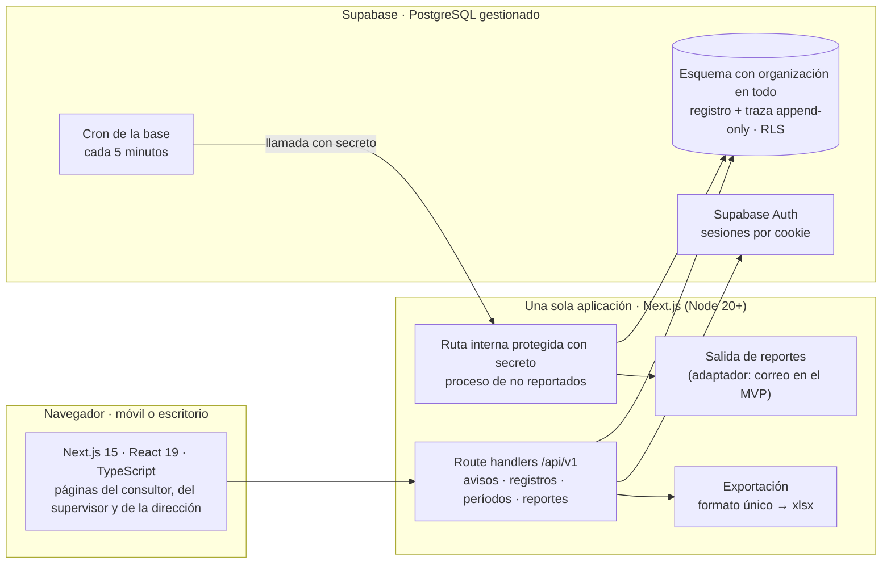
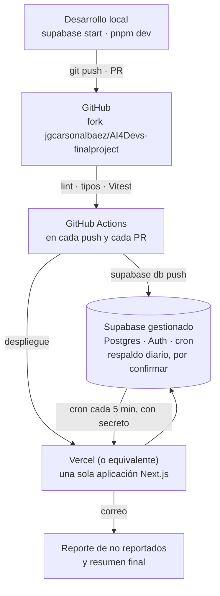
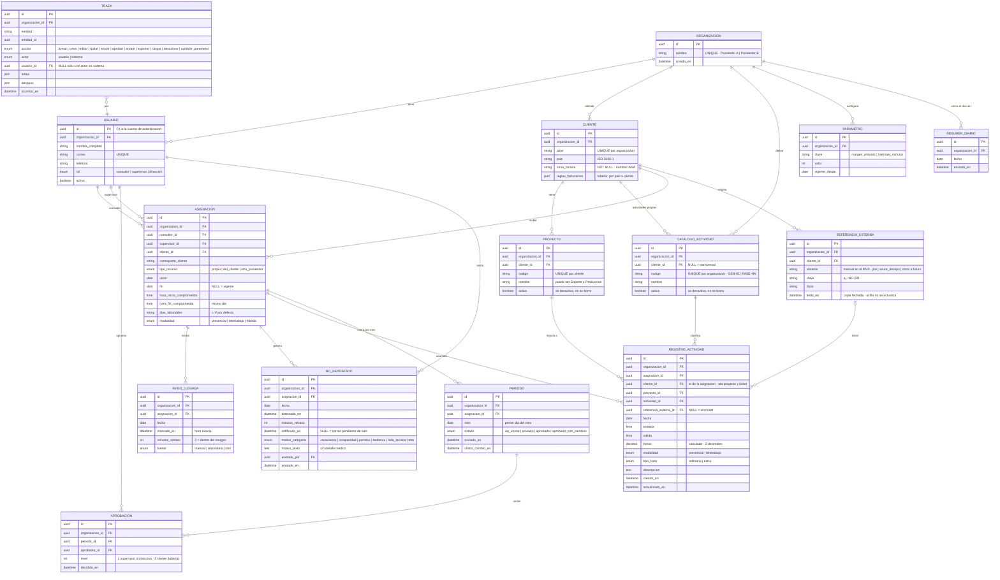

## Índice

0. [Ficha del proyecto](#0-ficha-del-proyecto)
1. [Descripción general del producto](#1-descripción-general-del-producto)
2. [Arquitectura del sistema](#2-arquitectura-del-sistema)
3. [Modelo de datos](#3-modelo-de-datos)
4. [Especificación de la API](#4-especificación-de-la-api)
5. [Historias de usuario](#5-historias-de-usuario)
6. [Tickets de trabajo](#6-tickets-de-trabajo)
7. [Pull requests](#7-pull-requests)

> **Versión 2 del documento (martes 17/11/2026).** Incorpora las once recomendaciones de la revisión de la entrega 1 y el documento de producto (PRD) del MVP, que pasó por dos rondas de revisión adversarial con un modelo distinto al que lo redactó. El cambio de fondo es un **recorte del alcance**: la versión 1 proponía nueve capacidades y la revisión señaló que era demasiado para el plazo. Lo que salió del MVP no se borró: está en el apartado 1.2 con lo que lo cubre mientras tanto.
>
> **Estado.** Sigue siendo documentación: todavía no hay código. La sección 7 y los apartados que dependen de código en marcha (1.3 imágenes, 1.4 instalación, 2.6 tests ejecutados) se declaran como pendientes. Un hueco declarado es una decisión; un hueco callado es un descuido.
>
> **Revisión del miércoles 18/11/2026.** Este documento pasó a su vez por revisión adversarial antes de publicarse: 17 observaciones, de las que 15 se corrigieron aquí, 1 se aceptó como riesgo y 1 se descartó. Las de fondo: el resumen final llega a cada supervisor solo con sus supervisados; un correo que no salió se reintenta; la base impide mezclar proyectos de un cliente en la asignación de otro; y la traza es inalterable también para el proceso interno.
>
> **Anonimización.** El proyecto es una herramienta interna real de dos empresas de consultoría. Los clientes aparecen como `Cliente A` … `Cliente I` con alias estables; no se nombran personas, contratos ni códigos de proyecto reales.

---

## 0. Ficha del proyecto

### **0.1. Tu nombre completo:**

Jaime Guillermo Carson Albáez

### **0.2. Nombre del proyecto:**

**Controlador de Tiempo** — presencia, actividad y respaldo de facturación para consultores asignados a clientes.

### **0.3. Descripción breve del proyecto:**

Herramienta interna para empresas de *staff augmentation* que asignan consultores a clientes. Resuelve dos dolores distintos con un solo registro: **saber antes que el cliente** si un consultor no ha empezado a trabajar (presencia), y **sustentar la factura mensual** con actividad imputada por proyecto, aprobada y trazable (actividad). Sustituye tres modelos que hoy conviven sin hablarse: plantillas Excel de asistencia, un reporte de imputación por porcentaje y un catálogo de actividades en HTML sin implementar.

### **0.4. URL del proyecto:**

Pendiente — todavía no hay despliegue. Se publica con el primer código funcional.

### 0.5. URL o archivo comprimido del repositorio

https://github.com/jgcarsonalbaez/AI4Devs-finalproject — fork del repositorio oficial; rama de la entrega 1: `feature/entrega-1-JC`.

---

## 1. Descripción general del producto

### **1.1. Objetivo:**

**Para quién.** Dos empresas de consultoría (Proveedor A y Proveedor B) que asignan consultores a bancos y entidades financieras bajo contratos con horario comprometido. El **usuario primario es el consultor asignado**; el supervisor y la dirección consumen lo que él registra.

**Qué dolor resuelve.** La necesidad apareció en tres clientes y no es de un proyecto: es capacidad operativa central del servicio. Son dos dolores con exigencias distintas:

| | Presencia y puntualidad | Actividad |
|---|---|---|
| **Por qué duele** | *«Nos enteramos por el cliente de que un recurso no asistió o no se conectó.»* Costo de reputación | Sin sustento de actividad no se puede facturar. En uno de los países donde se opera es exigencia legal |
| **Qué necesita** | Detección **oportuna** — hoy, no al cierre del mes | Evidencia con trazabilidad y aprobación |
| **Si falla** | Se pierde reputación | No se factura |

**El reencuadre que guía el diseño:** el primer dolor **no es de registro, es de detección**. Una hoja de horas que se llena al cierre del período deja que el cliente siga avisando primero. El producto es *saberlo antes que el cliente*; el registro es el subproducto.

**Qué valor aporta.** Un **reporte programado de no reportados** que convierte el silencio de un consultor en una lista con nombre y teléfono al vencer el margen, y que trae **solo a quienes siguen pendientes**, que es lo que apremia. Y un solo acto de registro, por proyecto y actividad, que alimenta un **formato único de reporte**, aprobado por el supervisor y exportable a Excel, que acompaña la factura mensual.

**Qué no es.** No es un motor de facturación (se factura por otra vía; el sistema produce el respaldo). No es un sistema de notificaciones en tiempo real.

### **1.2. Características y funcionalidades principales:**

**Alcance del MVP — siete capacidades:**

1. **Acceso y separación** — cuenta propia, tres roles (consultor, supervisor, dirección) y una frontera entre organizaciones que ningún rol cruza.
2. **Aviso de inicio de actividades** — un solo toque en un botón que dice «Inicio de Actividades», igual para quien llega a la oficina y para quien se conecta. Es distinto del registro de actividad y ocurre en otro momento: al empezar, sin tener que pensar todavía en qué se va a trabajar. El aviso se acepta **desde antes de la hora de inicio comprometida**: quien llega temprano avisa al llegar. *Separar los dos actos quita la fricción justo donde se necesita la señal.*
3. **Reporte de no reportados** — un proceso recurrente revisa quién no ha avisado después del margen y envía a cada supervisor **un solo correo** con sus pendientes. El supervisor contacta y anota el motivo. Cuando todas las asignaciones del día quedan clasificadas **y ya terminó el horario de la última**, sale un **resumen final** con las llegadas tardías en sección aparte: cada supervisor recibe el de sus supervisados y la dirección el de toda la organización.
4. **Registro de actividad** — qué hizo el consultor, con tres datos: el **proyecto** del cliente (o «Soporte a Producción»), la **actividad** del catálogo y, si aplica, el **ticket**. Desde el teléfono o la computadora, en segundos.
5. **Envío y aprobación del período mensual** — el consultor envía su mes; el supervisor lo aprueba en un solo paso.
6. **Formato único de reporte, exportable a Excel** — encabezado · detalle diario · resumen (horas y porcentaje por proyecto, horas por actividad, ordinarias y extras, todo *calculado*) · conformidad con tres firmas.
7. **Trazabilidad** — quién avisó, registró, corrigió, envió, aprobó, anotó y exportó, y cuándo; en las correcciones, el valor anterior y el nuevo.

**Los dos parámetros del reporte**, uno de cada uno por organización: el **margen** (minutos desde la hora de inicio comprometida; valor inicial 60) y el **intervalo** (minutos entre ejecuciones del proceso; valor inicial 5, mínimo 5 y en múltiplos de 5). No hay hora de cierre que configurar: cada asignación del día deja de revisarse cuando queda clasificada, con aviso o como no reportada, y el resumen final espera a que termine el horario de la última asignación del día.

**Sale del MVP y queda contemplado.** Recorte hecho a partir de la revisión de la entrega 1:

| Qué sale | Qué lo cubre mientras tanto |
|---|---|
| Solución móvil (iOS y Android) que recuerda el aviso al consultor y notifica los no reportados | El correo agrupado y el resumen final; el consultor avisa desde la aplicación web en su teléfono |
| Exportación a PDF | El Excel conserva la red de seguridad |
| Bloqueo del período aprobado y reapertura con motivo | El período aprobado admite correcciones trazadas y queda marcado como «aprobado con cambios posteriores» |
| Registro de ausencias (vacaciones, incapacidad, permiso) | Quien está ausente aparece en el reporte y se anota el motivo con su categoría |
| Ida y vuelta de observaciones entre supervisor y consultor | Aprobación en un solo paso |
| Proyectos llave en mano (solo registro de actividades, sin aviso) | No se atienden en este entregable |
| Observar el cambio de modalidad de un día concreto | La modalidad que el consultor indica en cada registro |
| Seguimiento semanal de quién no ha registrado sus actividades | La lista de días sin registro que el sistema muestra al enviar el mes |
| Acceso de aplicaciones externas (token en cabecera) | Solo la aplicación web, con cookie de sesión |
| Proceso de trabajos en segundo plano separado | Una sola aplicación y un disparador programado en la base |
| Pantallas de administración y de consulta de la traza | Carga controlada de datos por la dirección; consulta técnica de la traza |
| Fecha por zona horaria para el resumen final y la vigencia de los parámetros, cuando una organización atienda clientes en zonas distintas | Una sola fecha por organización, exacta mientras sus clientes compartan zona |
| Calendario de festivos por cliente | En un festivo los consultores aparecen como no reportados y se anota el motivo |
| Control del texto del motivo para que no lleve detalle médico | La categoría «incapacidad» y la instrucción a quien anota |
| *Guardarraíl:* que el agente vea un commit hecho por un alias, un script o `make`, y no solo el escrito como `git commit` | Los hooks `pre-commit` y `commit-msg` de git, que corren en todo commit |
| *Guardarraíl:* leer el texto comprimido o en otra codificación dentro de una imagen | Solo entran imágenes; de ellas se revisan las cadenas legibles. PDF, hojas de cálculo y comprimidos no entran |
| *Guardarraíl:* detectar un correo cuyo dominio no lleva punto | La lista privada, que detiene el nombre de la empresa donde aparezca |
| *Migraciones:* mensaje propio también cuando el error es de sintaxis del fichero | Aparece al aplicar la migración en local, antes de la base compartida |
| *Guardarraíl:* hook `pre-push` que revise todo lo que va a salir, incluido lo que llega por `merge`, `pull` o `cherry-pick`, que no pasa por el `pre-commit` | Un solo autor y ninguna rama ajena; la regla de `CLAUDE.md` de revisar a mano antes de traer trabajo de otra rama |
| *Guardarraíl:* detectar un secreto o un nombre armado por partes en el código | La revisión adversarial de cada pull request; el guardarraíl protege contra el descuido, no contra quien quiera rodearlo |

**Fuera de alcance del MVP, explícito:** notificación en tiempo real y escalamiento · conectores de lectura y escritura con las herramientas del cliente · evidencia desde repositorios · aprobación del cliente dentro del sistema · multi-empresa y cobro del servicio · migración del histórico · indicadores y tableros · geolocalización · motor de facturación.

**Capacidades anticipadas con su tubería dejada en el MVP.** La regla: *una tubería es un punto de extensión —un campo, una interfaz genérica o un estado—, no una funcionalidad a medias; si hay que probarla, no es tubería*. Dos **no se pueden postergar** porque obligarían a migrar datos: la **organización** en todo registro y la **referencia externa** (sistema · clave · título · fecha de lectura) como entidad en lugar de texto libre; el ticket del MVP ya se guarda ahí, con sistema `manual`. Las demás (fuente del aviso, segundo nivel de aprobación, tipo de recurso, país y reglas de facturación) son campos o estados que ya viven en el modelo de datos de la sección 3.

**Decisión de stack (17/10/2026, Dirección):** Next.js + React + TypeScript + Supabase (PostgreSQL) — **el mismo stack del sistema de talento humano que la empresa ya opera**, para que lo mantenga el mismo equipo con las mismas plantillas de migración y para que el Controlador pueda integrarse en ese sistema sin reescribir. Principio que acompaña la decisión: *incorporar la tecnología que beneficie al proyecto cuando aparezca, sin convertirse en una mezcolanza; lo mejor que se pueda pagar.*

**Supuestos que siguen abiertos** (los demás de la versión 1 —canal, margen y período— ya son decisiones):

| Supuesto | Valor provisional | Dónde se cambia |
|---|---|---|
| Cómo se obliga el registro | Reglamento interno de la empresa; la cláusula contractual se evalúa aparte | Fuera del sistema |
| Primer cliente en adoptarlo | `Cliente A`, que arranca sin histórico que migrar | Configuración |

**Riesgos aceptados, a la vista.** El ajuste final se hace en el Excel, fuera del sistema · un período corregido después de aprobado no pasa por nueva aprobación, pero queda marcado · el sistema garantiza que el correo sale, no que se lee a tiempo · quien se ausenta varios días aparece cada día en el reporte · el aviso es una declaración, no una verificación · tras una caída puede salir un correo repetido o aparecer un no reportado falso, que se anota como «falla técnica» · la traza se guarda pero no tiene pantalla de consulta · «hoy» se calcula en la zona horaria de cada cliente, pero el resumen final y la vigencia de un parámetro usan una sola fecha por organización: es exacto mientras los clientes de una organización compartan zona, como ocurre hoy, y la separación por zona queda contemplada · no hay calendario de festivos: en un festivo del cliente los consultores aparecen como no reportados y se anota el motivo · el texto del motivo es libre: que no lleve detalle médico depende de quien lo escribe.

### **1.3. Diseño y experiencia de usuario:**

> **Pendiente de imágenes y vídeo** — se incorporan cuando exista interfaz. Aquí se documenta el recorrido que esa interfaz tiene que cumplir, porque es una restricción de diseño y no una aspiración.

**Restricción que manda sobre todo lo demás:** el consultor no gana nada registrando —el valor lo cobran las empresas—. Si el incentivo es externo (reglamento o contrato), la adopción depende por completo de que registrar **no cueste nada**. Por eso la fricción mínima es restricción, no deseo.

**Recorrido del consultor (web adaptada al teléfono, sin aplicación que instalar):**

1. Abre la aplicación al empezar; puede dejar el acceso directo en su pantalla de inicio. La pantalla principal muestra **un solo botón grande**, «Inicio de Actividades». Un toque, confirmación, cierra. Tiempo objetivo con sesión vigente: **menos de 5 segundos**.
2. Durante el día o al cierre, **registra actividad**: fecha precargada, entrada tomada del aviso, salida, proyecto, actividad del catálogo (lista corta, la última usada primero), ticket opcional y descripción breve. Tiempo objetivo: **menos de 60 segundos por registro**.
3. Desde el último día laborable del mes ve su período y lo **envía** al supervisor. Al enviar, el sistema le muestra los días laborables sin registro, sin impedirle el envío.

**Recorrido del supervisor:**

1. Al vencer el margen recibe **un correo** con los no reportados de sus asignaciones: nombre, cliente, hora comprometida, minutos de retraso y teléfono. Contacta. Anota el motivo en el sistema (queda trazado).
2. Al terminar la última jornada del día recibe el **resumen final** de sus supervisados.
3. Al cierre del mes **revisa** el período enviado y lo **aprueba** en un solo paso.
4. **Exporta** el reporte único en Excel, que acompaña la factura.

**Lo que la interfaz no hace:** no pide al consultor datos que el sistema ya sabe (cliente, horario), no obliga a decidir la actividad en el momento del aviso, y no muestra a un consultor nada de otro.

### **1.4. Instrucciones de instalación:**

> **Pendiente — aplica desde que haya código.** El objetivo fijado: `pnpm install`, un `.env.local` desde `.env.example` con las variables de Supabase, `supabase start` para la base local (Postgres en contenedor, idéntico al gestionado), `supabase db reset` para migraciones y semillas, y `pnpm dev` para levantar la aplicación. Una sola aplicación, sin procesos aparte. Sin diferencias de dialecto entre local y producción.

---

## 2. Arquitectura del Sistema

### **2.1. Diagrama de arquitectura:**



**Patrón: una sola aplicación Next.js modular, con un disparador programado en la base.** Módulos por capacidad (`avisos`, `reportes`, `registros`, `periodos`, `exportacion`, `carga`), lógica de negocio en servicios que usan los route handlers, y **ningún proceso aparte**. El reporte de no reportados lo dispara el cron de Supabase, que cada 5 minutos llama a una ruta interna protegida con un secreto que solo conoce la base. Se eligió por tres razones:

- **Es el stack que la empresa ya opera.** El sistema de talento humano de la casa está hecho con Next.js y Supabase, migraciones SQL controladas, Vitest y Playwright. Lo mantiene el mismo equipo, con las mismas plantillas; y el Controlador de Tiempo está pensado para integrarse en ese sistema a largo plazo — en el mismo stack eso es mover carpetas, en otro es reescribir.
- **El modelo de datos es lo caro, y aquí es Postgres puro.** Las tuberías del MVP viven en migraciones SQL portables, con el patrón de migración controlada ya probado en casa. La segregación por organización se refuerza con **RLS** (row-level security) en la base, no solo en el código.
- **Un solo despliegue.** La versión 1 separaba un worker con una cola de trabajos. La revisión de la entrega 1 pidió una aplicación y un job simple antes de separar nada: un segundo despliegue es un segundo frente que mantener y asegurar. La cola de trabajos queda como tubería para cuando haga falta.

**Cómo trabaja el proceso de no reportados.** Es **un solo proceso recurrente**, no una programación por cada hora de inicio. En cada ejecución busca las asignaciones con jornada laborable hoy cuyo margen ya venció, sin aviso y aún sin reportar; las guarda una sola vez por asignación y fecha, y envía a cada supervisor un único correo con las suyas. Quien avisó tarde antes de esa ejecución no entra en la lista: su aviso queda marcado como llegada tardía. Así no hay que reprogramar cuando cambian las asignaciones; si el sistema estuvo caído se pone al día solo; y funciona igual con cualquier zona horaria, porque cada hora se interpreta en la zona del cliente. **Costo aceptado:** el reporte puede salir hasta un intervalo tarde.

**Sacrificios que implica:** dependencia de dos proveedores gestionados (Vercel o equivalente para Next.js, Supabase para la base) — lock-in moderado y ya aceptado en casa; lo atado es auth, RLS y el cron, no las migraciones. Y la lógica de negocio hay que mantenerla disciplinada en módulos de servicio, porque Next.js no la impone. **Por confirmar en el panel del proveedor antes de construir:** que el cron está disponible en el plan gratuito, cuál es su política de pausa por inactividad, y **si ese plan incluye respaldo diario restaurable**; si no alcanza, la salida es subir temporalmente el nivel de licencia.

### **2.2. Descripción de componentes principales:**

| Componente | Tecnología | Responsabilidad |
|---|---|---|
| **API** | Next.js 15 (App Router), TypeScript, route handlers `/api/v1`, validación con `zod`, cliente `@supabase/ssr` | Autorización por rol y **por organización en toda consulta** (doblada por RLS en la base), reglas de negocio (horas, cruces, estados del período), un solo formato de respuesta `{ data }` |
| **Proceso de no reportados** | Ruta interna en la misma aplicación, disparada por el cron de Supabase con un secreto; corre con la clave de servicio, solo en el servidor | Detecta a quienes siguen pendientes, guarda el reporte una vez por asignación y fecha, agrupa por supervisor, reintenta el correo que no llegó a salir y, cuando todo el día queda clasificado y terminó la última jornada, emite el resumen final a cada destinatario con su ámbito |
| **Salida de reportes** | Interfaz `CanalDeSalida` con una implementación: correo (Resend o SMTP vía Nodemailer) | El proceso no sabe por dónde viaja el reporte; la notificación en el móvil será una segunda implementación |
| **Exportación** | Generación de `xlsx` (ExcelJS) del formato único, a pedido | El respaldo de la factura; indica a la vista el estado del período |
| **Carga controlada** | Script que lee archivos de carga, valida, rechaza lo que no cumple e informa qué quedó cargado | Crea la organización y su primera cuenta de dirección; carga clientes, proyectos, asignaciones, usuarios y catálogo. Sustituye a las pantallas de administración |
| **Frontend** | React 19 dentro de Next.js, Tailwind 4, `lucide-react`; móvil primero | Pantalla de aviso de un toque, registro de actividad, período, reporte del supervisor, exportación |
| **Autenticación** | Supabase Auth (correo + contraseña) con **cookie de sesión** servida por `@supabase/ssr` | Roles en tabla `USUARIO`; políticas RLS leen el rol y la organización del usuario autenticado. No hay token en cabecera: el único cliente es la aplicación web |
| **Base de datos** | Supabase · PostgreSQL, local con `supabase start` y gestionado en producción | Esquema versionado en `supabase/migrations/` con el patrón de migración controlada; `organizacion_id` en todas las tablas de negocio; tabla `traza` append-only; RLS activo |
| **Especificación viva** | OpenSpec (`openspec/specs/<capability>/spec.md`) | La verdad de cada capability vive en la spec; el README de cada capability enlaza, no repite |
| **Guardarraíles del repositorio** | Hooks de Claude Code en `.claude/hooks/` | `datos-que-no-salen` desde el primer commit: bloquea con código de salida 2 secretos, nombres y dominios reales y ficheros `.env`, y deja registro fechado; la lista de nombres reales vive fuera de git, porque el fork es público. `readme-al-dia` entra con el primer endpoint |

### **2.3. Descripción de alto nivel del proyecto y estructura de ficheros**

Estructura prevista. Se materializa **por partes**: cada pieza nace cuando hay algo que vigilar y se prueba de verdad.

```
AI4Devs-finalproject/
├── readme.md · prompts.md              # documentación de la entrega
├── CLAUDE.md                           # instrucciones del harness (reglas de proceso)
├── .claude/hooks/                      # datos-que-no-salen · readme-al-dia
├── .github/workflows/ci.yml            # lint · tipos · tests en cada push y cada PR
├── openspec/                           # especificación viva (fuente de verdad)
│   ├── specs/<capability>/spec.md
│   └── plantillas/migracion-controlada.sql
├── docs/
│   ├── prd/                            # PRD del MVP y respuestas a su revisión adversarial
│   ├── capabilities/<nombre>/README.md # qué rutas existen y dónde está implementada cada regla
│   ├── revisiones/PR-n.md              # revisión adversarial de cada pull request
│   └── seguridad/registro-de-bloqueos.md
├── app/                                # Next.js 15 (App Router)
│   ├── (consultor)/ · (supervisor)/ · (direccion)/
│   └── api/v1/ · api/interno/
├── src/{modules/<capability>,components,lib}
├── tests/{unit,integration,e2e}        # Vitest · Playwright
├── scripts/carga/                      # carga controlada de datos
├── supabase/
│   ├── migrations/                     # SQL con el patrón de migración controlada
│   ├── validaciones/                   # validación 1 a 1 de solo lectura por objeto
│   └── seed.sql
└── package.json · Makefile             # setup · start · test · help
```

**Una sola aplicación, con carpetas por capability** dentro de `src/modules/`: cada capacidad del MVP tiene su spec, su README y sus tests nombrados igual, de modo que se pueda leer la spec y saber qué falta.

### **2.4. Infraestructura y despliegue**



- **Dos proveedores gestionados, los mismos que usa el sistema de talento:** Supabase para base de datos, auth y el disparador programado, y Vercel o equivalente para la aplicación. **No hay worker.**
- **Pipeline.** GitHub Actions con lint, tipos y tests en cada push y cada PR. La tarea no termina al escribir el archivo sino al **verlo en verde en el fork**, con el enlace como evidencia.
- **Base de datos gestionada, con respaldo diario por confirmar.** El respaldo diario es un requisito del producto; que el plan contratado lo incluya y que se pueda restaurar se comprueba en T-11, antes del despliegue, y no se da por hecho. Si la aplicación no está disponible en el cierre del mes, la contingencia es la plantilla anterior en Excel, que se conserva; el sistema no promete exportar mientras está caído.
- **Secretos** solo en variables de entorno de los proveedores (la clave de servicio nunca llega al navegador; el secreto del cron solo lo conocen la base y la aplicación); jamás en el repositorio — el hook `datos-que-no-salen` lo impide en el commit y deja línea en el registro.
- **Despliegue:** merge a `main` → CI en verde → `supabase db push` aplica las migraciones pendientes con el patrón de migración controlada (cada objeto verifica su propia existencia antes y después, con mensaje propio, no el del motor; la validación 1 a 1 de solo lectura se imprime al final) → despliegue de la aplicación.

### **2.5. Seguridad**

| Práctica | Cómo se aplica |
|---|---|
| **Autenticación** | Supabase Auth con cookie de sesión servida por `@supabase/ssr`; sesión obligatoria en toda ruta de negocio; la clave de servicio solo vive en el servidor |
| **Autorización por rol y por organización, en dos capas** | Tres roles: `consultor` · `supervisor` · `direccion`. El aprobador del cliente no existe como rol en el MVP; se agrega por migración cuando el cliente apruebe dentro del sistema. **Toda consulta filtra por `organizacion_id` en el código, y RLS en Postgres lo vuelve a exigir** aunque el código falle. Dentro de la organización, las políticas del supervisor exigen además que la asignación sea suya (`supervisor_id`): un supervisor no ve ni aprueba lo del equipo de otro. `organizacion_id` va en **todas** las tablas de negocio, también en las hijas, con llave foránea compuesta hacia la asignación donde aplique: así las políticas son iguales, de una línea y sin cruce de tablas |
| **Quién puede qué** | El consultor ve, registra y corrige solo lo propio. El supervisor ve lo de sus supervisados, anota motivos, aprueba y exporta. La dirección ve su organización y además carga datos, desactiva cuentas y cambia parámetros |
| **Cuentas desactivadas** | La persona pierde el acceso de inmediato, también con una sesión abierta, y sus asignaciones **como consultor** terminan ese día. Si era supervisor, las asignaciones de sus supervisados siguen vigentes: la dirección recibe sus reportes y aprueba sus períodos hasta que se cargue otro supervisor |
| **Trazabilidad inalterable** | Tabla `traza` append-only: quién, cuándo, y el antes y el después. Un disparador en la base rechaza `UPDATE` y `DELETE` **para cualquier rol, incluida la clave de servicio** que usa el proceso interno; revocar permisos al usuario normal no bastaba |
| **Período aprobado** | No se bloquea en el MVP. Toda corrección posterior queda trazada y el período pasa a «aprobado con cambios posteriores», estado que el archivo exportado muestra a la vista |
| **Ruta del proceso programado** | Solo responde a una llamada con el secreto; no usa sesión de usuario |
| **Datos personales** | Mínimos: nombre, correo corporativo, teléfono de contacto. Sin documento de identidad. De la salud solo se guarda la categoría «incapacidad» del motivo, sin diagnóstico ni detalle |
| **Secretos y datos que no salen** | Hook que bloquea commits con claves reconocibles, nombres o dominios reales o ficheros `.env`, y escribe una línea fechada en `docs/seguridad/registro-de-bloqueos.md` — bloquear sin registrar protege pero no demuestra |
| **Validación en el borde** | `zod` en cada route handler; nunca se vuelca el cuerpo de una petición sobre un registro (el fallo por omisión más frecuente del código generado es la asignación masiva) |
| **Documentación anonimizada** | Alias de clientes estables en todo lo que sale del repositorio interno |

### **2.6. Tests**

> **Pendiente de ejecución — aplica desde que haya código.** Se documenta aquí el plan, que es parte de la arquitectura.

**Orden y papel de la IA.** En reglas de negocio y permisos, **los tests se escriben antes del código**: en cada ticket el primer commit son los tests fallando y el segundo el código que los hace pasar; el orden de los commits es la evidencia. La IA propone los casos límite desde la especificación, la Dirección los aprueba o agrega, y el prompt queda en `prompts.md`. **Regla de la casa:** cada pieza de código se ejercita al menos dos veces, con **un caso positivo y uno negativo**. La regla se limita a donde un error cuesta —cálculos, fechas, segregación— para poder cumplirla sin excepciones.

- **Unitarios (Vitest):** cálculo de horas; porcentaje por proyecto; regla de «no reportado» (jornada laborable, margen vencido, sin aviso, en la zona horaria del cliente); llegada tardía; cruce de registros; estados del período.
- **De integración (Vitest contra Supabase local):** un test por escenario de la spec sobre una base reiniciada con `supabase db reset`; cubren la autorización por organización en las dos capas (código y RLS: un consultor de A no lee registros de B ni con una consulta directa), los permisos por rol y la trazabilidad.
- **End-to-end del flujo recortado (Playwright), al final:** aviso → registro → envío → aprobación → exportación.

---

## 3. Modelo de Datos

### **3.1. Diagrama del modelo de datos:**



### **3.2. Descripción de entidades principales:**

**Tres decisiones de esquema que no se pueden postergar** (obligarían a migrar datos si se agregaran después):

- **`organizacion_id` en todas las tablas de negocio, también en las hijas** (las 14 tablas distintas de `ORGANIZACION`). La versión 1 afirmaba «en todas» y solo la tenían siete. La coherencia se garantiza en la base con **llave foránea compuesta** (`asignacion_id`, `organizacion_id`) hacia la asignación, donde aplique. Costo aceptado: un dato repetido, controlado por esa llave. Beneficio: la segregación entre organizaciones —la promesa de seguridad del producto— es la regla más simple y más fácil de demostrar.
- **`REFERENCIA_EXTERNA` como entidad**, no texto libre. El ticket de un registro se guarda como *sistema · clave · título · fecha de lectura*; en el MVP el consultor lo teclea y el sistema es `manual`. Así un registro aprobado no pierde significado si el cliente cambia o borra su ticket después, y el conector de lectura futuro solo rellena esta tabla. Para que la copia sea de verdad fechada, **una fila no se actualiza nunca**: si el mismo ticket llega con otro título se crea una fila nueva, y los registros anteriores siguen apuntando a la que tenían.
- **Zona horaria en el cliente**, obligatoria, con nombre estándar. El servidor corre en UTC: sin zona, «hoy» no significa lo mismo para el consultor y para el proceso programado. El código obtiene la zona por **una sola función**, de modo que a futuro se pueda agregar una columna opcional en la asignación sin migrar datos ni reescribir.

| Entidad | Para qué | Claves y restricciones | Relaciones |
|---|---|---|---|
| **ORGANIZACION** | La empresa que presta el servicio (Proveedor A, Proveedor B) | `id` PK · `nombre` UNIQUE NOT NULL | 1:N con todas las demás |
| **USUARIO** | Consultores, supervisores y dirección: tres roles | `id` es llave foránea a la cuenta de autenticación (`auth.users`): no hay perfil sin cuenta ni cuenta con perfil ajeno · `correo` UNIQUE · `rol` NOT NULL · `activo` (desactivar quita el acceso y termina sus asignaciones como consultor) | 1:N asignaciones (como consultor y como supervisor), aprobaciones, anotaciones y trazas |
| **CLIENTE** | A quién se asignan los consultores. Alias estable | `alias` UNIQUE por organización · `pais` y `zona_horaria` NOT NULL · `reglas_facturacion` JSON (tubería) | 1:N proyectos, asignaciones, actividades propias, referencias externas |
| **PROYECTO** | A qué se imputa cada registro dentro del cliente. Un consultor puede participar en varios a la vez. Incluye «Soporte a Producción» | `codigo` UNIQUE por cliente · `activo`: se desactiva, **no se borra ni se renombra** | 1:N registros |
| **CATALOGO_ACTIVIDAD** | Tipo de trabajo: `GEN-01…05` transversales (`cliente_id` NULL) y actividades propias por cliente. Nunca texto libre | `codigo` UNIQUE por organización · `activo`: se desactiva, no se borra ni se renombra | 1:N registros |
| **ASIGNACION** | Un consultor con un cliente, con su supervisor, su contraparte y el **horario comprometido** (viene del contrato, no se inventa). Lo normal es una por consultor; se admite otra solo si los horarios no se cruzan | FKs NOT NULL · CHECK `hora_fin_comprometida > hora_inicio_comprometida` (mismo día) · CHECK `fin IS NULL OR fin >= inicio` · el cruce de horarios lo rechaza la carga | 1:N avisos, no reportados, registros, períodos |
| **AVISO_LLEGADA** | La señal de un toque. **No es el registro de actividad** | UNIQUE (`asignacion_id`, `fecha`) · `marcado_en` NOT NULL · `minutos_retraso` > 0 marca la llegada tardía · `fuente` (tubería) | N:1 asignación |
| **NO_REPORTADO** | El reporte guardado **y** la anotación del motivo, en una sola fila por asignación y fecha. La unicidad impide duplicar la fila; **el envío lo gobierna `notificado_en`**: el proceso envía lo que lo tiene en NULL y lo marca al salir el correo, de modo que un correo que no salió se reintenta en la siguiente ejecución | UNIQUE (`asignacion_id`, `fecha`) · `detectado_en` NOT NULL · `notificado_en` NULL hasta que sale el correo · motivo NULL hasta que se anota | N:1 asignación; N:1 usuario que anota |
| **RESUMEN_DIARIO** | Marca de que el resumen final del día ya salió. Sale una vez, cuando todo está clasificado y terminó la última jornada; el contenido se arma por destinatario: cada supervisor, sus supervisados; la dirección, toda la organización | UNIQUE (`organizacion_id`, `fecha`) | N:1 organización |
| **REGISTRO_ACTIVIDAD** | Qué hizo, cuánto, en qué proyecto y con qué actividad. Un solo acto alimenta todo el reporte | `horas` calculado · CHECK `salida > entrada` · sin cruce con otro registro del mismo consultor · sin fecha futura ni fuera de la vigencia de la asignación · `descripcion` NOT NULL · **mismo cliente garantizado en la base:** llaves foráneas compuestas con `cliente_id` hacia la asignación, el proyecto y la referencia externa; la actividad, que puede ser transversal, se valida con un disparador (transversal o del mismo cliente) | N:1 asignación, proyecto, actividad; N:1 referencia externa opcional |
| **REFERENCIA_EXTERNA** | El ticket: copia fechada de la clave y el título. La fila no se actualiza | UNIQUE (`cliente_id`, `sistema`, `clave`, `titulo`) · `clave` y `leido_en` NOT NULL · sin `UPDATE` | 1:N registros |
| **PERIODO** | El mes calendario de una asignación: la unidad que se envía y se aprueba | UNIQUE (`asignacion_id`, `mes`) · `estado` NOT NULL (sin_enviar → enviado → aprobado → aprobado_con_cambios; un cambio en un período enviado lo devuelve a sin_enviar) | 1:N aprobaciones |
| **APROBACION** | Cada aprobación de un período, por nivel. El nivel 2 (cliente) es tubería: quitar la tabla obligaría a migrar datos después | CHECK aprobador distinto del consultor del período | N:1 período, aprobador |
| **PARAMETRO** | Margen e intervalo, uno de cada uno por organización | UNIQUE (`organizacion_id`, `clave`, `vigente_desde`) · CHECK margen > 0; intervalo ≥ 5 y múltiplo de 5 · un cambio rige desde el día siguiente | N:1 organización |
| **TRAZA** | Evidencia. Append-only: un disparador rechaza `UPDATE`/`DELETE` para cualquier rol. El actor es un usuario o el `sistema` (la carga inicial, que crea la primera cuenta de dirección cuando todavía no existe ningún usuario) | `ocurrido_en` NOT NULL · CHECK `usuario_id` NOT NULL salvo actor `sistema` · `antes`/`despues` JSON · índice por (`entidad`, `entidad_id`) | N:1 usuario, organización |

**Cálculos que no se capturan:** `horas` se deriva de entrada y salida; el **porcentaje por proyecto** se calcula sobre el total de horas del período (nunca se teclea; si el período no tiene horas, no se calcula); los totales de horas ordinarias y extras salen de `tipo_hora`; los minutos de retraso salen de la hora comprometida y la zona del cliente.

**Qué salió del modelo frente a la versión 1:** la entidad `AUSENCIA` (la reemplaza la categoría del motivo en `NO_REPORTADO`), los estados `observado` y `bloqueado`, y el ámbito del parámetro por cliente y por asignación.

---

## 4. Especificación de la API

Tres endpoints principales del flujo, en OpenAPI 3.1 (extracto). Todas las rutas bajo `/api/v1`, autenticadas con la **cookie de sesión** de la aplicación y **filtradas por la organización del usuario autenticado**. No hay cabecera `Authorization`: el único cliente del MVP es la aplicación web; el token en cabecera queda contemplado para cuando existan clientes externos. Editar y quitar un registro (`PATCH` y `DELETE /api/v1/registros/{id}`) son parte del ticket T-07 y siguen las mismas reglas que la creación; no se detallan en este extracto.

```yaml
openapi: 3.1.0
info:
  title: Controlador de Tiempo — API
  version: 0.2.0
components:
  securitySchemes:
    sesion: { type: apiKey, in: cookie, name: sesion, description: "Cookie de sesión que gestiona @supabase/ssr; el nombre real lo fija el proveedor" }
  schemas:
    Aviso:
      type: object
      properties:
        id: { type: string, format: uuid }
        asignacionId: { type: string, format: uuid }
        fecha: { type: string, format: date }
        marcadoEn: { type: string, format: date-time }
        minutosDeRetraso: { type: integer, example: 0, description: "0 = dentro del margen; mayor que 0 = llegada tardía" }
    Registro:
      type: object
      properties:
        id: { type: string, format: uuid }
        fecha: { type: string, format: date }
        entrada: { type: string }
        salida: { type: string }
        horas: { type: number, example: 8.5 }
        proyecto: { type: object, properties: { codigo: { type: string, example: "PRJ-001" }, nombre: { type: string } } }
        actividad: { type: object, properties: { codigo: { type: string, example: "GEN-01" }, nombre: { type: string } } }
        ticket: { type: object, nullable: true, properties: { clave: { type: string }, titulo: { type: string } } }
    NoReportado:
      type: object
      properties:
        id: { type: string, format: uuid }
        consultor: { type: object, properties: { nombre: { type: string }, telefono: { type: string } } }
        cliente: { type: string, example: "Cliente A" }
        horaInicioComprometida: { type: string, example: "08:00" }
        minutosDeRetraso: { type: integer, example: 65 }
        motivo: { type: object, nullable: true, properties: { categoria: { type: string }, texto: { type: string } } }
        avisoPosterior: { type: string, format: date-time, nullable: true, description: "Si avisó después de ser reportado" }
    Envelope_Aviso: { type: object, properties: { data: { $ref: "#/components/schemas/Aviso" } } }
    Envelope_Registro: { type: object, properties: { data: { $ref: "#/components/schemas/Registro" } } }
security:
  - sesion: []
paths:
  /api/v1/avisos:
    post:
      summary: Aviso de inicio de actividades — un toque
      description: Registra el aviso de hoy para la primera asignación vigente del consultor que aún no tiene aviso y cuyo horario no ha terminado. Se acepta antes de la hora de inicio comprometida; «hoy» es la fecha en la zona horaria del cliente. No lleva cuerpo. Idempotente por (asignación, fecha).
      responses:
        "201":
          description: Aviso creado. Si el margen ya venció, minutosDeRetraso es mayor que cero.
          content:
            application/json:
              schema: { $ref: "#/components/schemas/Envelope_Aviso" }
        "200": { description: Ya existía un aviso hoy; se devuelve el existente }
        "401": { description: Sin sesión o cuenta desactivada }
        "409": { description: No hay asignación pendiente de aviso hoy; la respuesta dice por qué }

  /api/v1/registros:
    post:
      summary: Registro de actividad
      requestBody:
        required: true
        content:
          application/json:
            schema:
              type: object
              required: [fecha, entrada, salida, proyectoId, actividadId, modalidad, descripcion]
              properties:
                asignacionId: { type: string, format: uuid, description: "Obligatorio solo si el consultor tiene dos asignaciones" }
                fecha: { type: string, format: date }
                entrada: { type: string, example: "08:05" }
                salida: { type: string, example: "17:10" }
                proyectoId: { type: string, format: uuid }
                actividadId: { type: string, format: uuid }
                ticket:
                  type: object
                  nullable: true
                  description: "Opcional. Si se envía, la clave es obligatoria"
                  required: [clave]
                  properties:
                    clave: { type: string, minLength: 1, example: "INC-001" }
                    titulo: { type: string }
                modalidad: { type: string, enum: [presencial, teletrabajo] }
                tipoHora: { type: string, enum: [ordinaria, extra], default: ordinaria }
                descripcion: { type: string, minLength: 1, maxLength: 500 }
      responses:
        "201":
          description: Registro creado, con horas calculadas. Si el período estaba enviado vuelve a sin_enviar; si estaba aprobado pasa a aprobado_con_cambios.
          content:
            application/json:
              schema: { $ref: "#/components/schemas/Envelope_Registro" }
        "401": { description: Sin sesión }
        "422": { description: "salida ≤ entrada · cruce con otro registro · fecha u hora futura · fecha fuera de la asignación · proyecto o actividad inactivos o de otro cliente" }

  /api/v1/reportes/no-reportados:
    get:
      summary: Reporte de no reportados y llegadas tardías de una fecha
      description: Solo supervisores (sus asignaciones) y dirección (su organización).
      parameters:
        - { name: fecha, in: query, required: false, schema: { type: string, format: date }, description: "Por defecto, hoy" }
      responses:
        "200":
          content:
            application/json:
              schema:
                type: object
                properties:
                  data:
                    type: object
                    properties:
                      noReportados: { type: array, items: { $ref: "#/components/schemas/NoReportado" } }
                      llegadasTardias: { type: array, items: { $ref: "#/components/schemas/Aviso" } }
        "403": { description: El rol consultor no accede a este reporte }

  /api/v1/reportes/no-reportados/{id}/motivo:
    patch:
      summary: Anotar el motivo de un no reportado
      requestBody:
        required: true
        content:
          application/json:
            schema:
              type: object
              required: [categoria]
              properties:
                categoria: { type: string, enum: [vacaciones, incapacidad, permiso, tardanza, falla_tecnica, otro] }
                texto: { type: string, maxLength: 300, description: "Sin diagnóstico ni detalle médico" }
      responses:
        "200": { description: Motivo anotado; queda quién y cuándo }
        "403": { description: Solo el supervisor de la asignación o la dirección }
        "404": { description: No existe o pertenece a otra organización }
```

**Ejemplo — aviso de inicio de actividades** (inicio comprometido 08:00, margen de 60 minutos, zona del cliente UTC−5):

```http
POST /api/v1/avisos
Cookie: <cookie de sesión de la aplicación>
```

```json
{ "data": { "id": "a9e2…", "asignacionId": "7f1c…", "fecha": "2026-11-19",
            "marcadoEn": "2026-11-19T13:04:12Z", "minutosDeRetraso": 0 } }
```

---

## 5. Historias de Usuario

El backlog del MVP tiene **cinco historias, todas necesarias:** aviso de inicio · reporte de no reportados · registro de actividad · envío y aprobación del período · exportación del formato único. Se documentan las tres principales.

**Historia de Usuario 1 — Aviso de inicio de actividades en un toque**

> **Como** consultor asignado a un cliente, **quiero** avisar con un solo toque que empecé a trabajar, **para** que mi empresa lo sepa antes que el cliente sin que yo tenga que detenerme a pensar en qué voy a trabajar.

*Criterios de aceptación (declarativos, nivel de negocio):*
- Dado que tengo una asignación pendiente de aviso hoy, cuando abro la aplicación veo un único botón que dice «Inicio de Actividades»; al tocarlo, el aviso queda registrado con la hora exacta y recibo confirmación. **Objetivo: menos de 5 segundos** con sesión vigente.
- Dado que ya avisé hoy, cuando vuelvo a tocar, no se crea un segundo aviso: veo el que ya existe.
- Dado que llego antes de mi hora de inicio comprometida, puedo avisar igual: el aviso se acepta desde que empieza el día en la zona horaria del cliente.
- Dado que no tengo asignación pendiente de aviso (fin de semana, asignación cuya vigencia terminó o todavía no empieza, horario de hoy ya terminado), no veo el botón y veo por qué.
- Dado que tengo dos asignaciones hoy con horarios que no se cruzan, el botón corresponde a la primera que aún no tiene aviso y cuyo horario no ha terminado.
- El aviso **no** me pide proyecto, actividad ni descripción — eso es otro acto, en otro momento.
- **Fuera de esta historia:** verificar que de verdad empecé (el aviso es una declaración, no una verificación: el sistema detecta el silencio, no la falsedad).

*Criterios INVEST:* independiente de las demás · negociable en la forma del botón, no en el tiempo objetivo · valiosa por sí sola (es la mitad del primer dolor) · estimable (un endpoint idempotente y una pantalla) · pequeña · testable (los criterios son comprobables sin saber de la implementación).

**Historia de Usuario 2 — Reporte de no reportados al vencer el margen**

> **Como** supervisor de consultores asignados, **quiero** recibir al vencer el margen la lista de quienes siguen sin avisar, **para** contactarlos y saber qué ocurrió antes de que el cliente me lo diga.

*Criterios de aceptación:*
- Dado un día laborable de la asignación, quien no ha avisado cuando corre la primera ejecución posterior al vencimiento del margen aparece en el reporte con nombre, cliente, hora comprometida, minutos de retraso y teléfono de contacto.
- Dado que el consultor avisó dentro del margen, **no** aparece.
- Dado que el consultor avisó después del margen pero antes de esa ejecución, **no** aparece en la lista: su aviso queda marcado como llegada tardía. La lista trae solo a quienes siguen pendientes.
- Recibo **un solo correo** por ejecución con todos mis no reportados nuevos, y cada uno me llega una sola vez.
- Cuando contacto al consultor, puedo anotar el motivo con su categoría; la anotación queda trazada con quién y cuándo. El texto no lleva detalle médico.
- Si el consultor avisa después de haber sido reportado, su registro en el reporte se conserva, con la llegada tardía.
- Cuando todas las asignaciones del día quedan clasificadas y ya terminó el horario de la última, recibo un resumen final **solo de mis supervisados**, con los no reportados, las llegadas tardías en sección aparte y el total de avisos a tiempo. La dirección recibe el de toda la organización.
- No veo ni recibo nada de los supervisados de otro supervisor de mi misma organización.
- Si el correo de una ejecución no llegó a salir, sale en la siguiente.
- El margen y el intervalo son parámetros de la organización; un cambio rige desde el día siguiente.
- **Fuera de esta historia:** escalamiento automático, recordatorio al consultor, notificación en el móvil. La hora exacta del aviso y la interfaz del canal quedan como tubería.

**Historia de Usuario 3 — Enviar y aprobar el período mensual**

> **Como** supervisor, **quiero** revisar el mes de cada consultor y aprobarlo en un solo paso, **para** que lo que acompaña la factura esté respaldado por una aprobación con nombre y fecha.

*Criterios de aceptación:*
- Dado que soy consultor, desde el último día laborable del mes puedo enviar mi período; al enviarlo veo los días laborables sin registro, y puedo enviarlo igual.
- Dado un período enviado, el supervisor ve los registros con horas calculadas, el total del mes y las horas extra separadas, y puede **aprobarlo** en un solo paso. Queda quién aprobó y cuándo. La dirección también puede aprobar. Nadie aprueba su propio período.
- Dado un período enviado que cambia antes de aprobarse, vuelve a «sin enviar».
- Dado un período aprobado, sigue admitiendo correcciones del consultor: con la primera pasa a «aprobado con cambios posteriores» y toda corrección queda trazada con el valor anterior y el nuevo.
- Desde el período puedo **exportar el formato único** a Excel; el archivo indica a la vista el estado del período.
- **Fuera de esta historia:** el bloqueo y la reapertura con motivo, la ida y vuelta de observaciones, y la conformidad del cliente dentro del sistema.

---

## 6. Tickets de Trabajo

### Backlog del MVP

Todos los tickets en una línea. El detalle completo de cada uno se escribe al empezarlo; abajo se documentan los tres principales. **Tamaño:** S ≈ 2 horas · M ≈ 4 horas. **Meta:** qué entra para la fecha de referencia del código (jueves 19/11/2026, no obligatoria) y qué para la entrega final (miércoles 09/12/2026).

| Orden | Ticket | Qué entrega | Depende de | Tamaño | Meta |
|---|---|---|---|---|---|
| 1 | T-00 | Harness: `CLAUDE.md`, spec inicial, plantilla de migración controlada y hook `datos-que-no-salen` | — | S | 19/11 |
| 2 | T-01 | Pipeline: lint, tipos y tests en GitHub Actions, en verde en el fork | T-00 | S | 19/11 |
| 3 | T-02 | Esquema inicial: 15 tablas, RLS y semillas *(Ticket 3, abajo)* | T-00 | M | 19/11 |
| 4 | T-03 | Acceso: sesión por cookie, roles y pruebas de segregación | T-02 | S | 19/11 |
| 5 | T-04 | Aviso de inicio: endpoint y pantalla *(Ticket 2, abajo)* | T-03 | S | 19/11 |
| 6 | T-05 | Proceso de no reportados, correo agrupado y consulta *(Ticket 1, abajo)* | T-04 | M | 09/12 |
| 7 | T-06 | Anotación del motivo y resumen final del día, por destinatario y al terminar la última jornada | T-05 | S | 09/12 |
| 8 | T-07 | Registro de actividad: crear, editar y quitar (endpoints y pantalla) | T-03 | M | 09/12 |
| 9 | T-08 | Período mensual: envío, aprobación y cambios posteriores | T-07 | M | 09/12 |
| 10 | T-09 | Exportación del formato único a Excel | T-08 | M | 09/12 |
| 11 | T-10 | Carga controlada de datos (la inicial, trazada con actor `sistema`) y desactivación de cuentas, incluido el supervisor que la dirección suple | T-02 | M | 09/12 |
| 12 | T-11 | Prueba de punta a punta del flujo, comprobación del respaldo diario y despliegue | T-06, T-09 | M | 09/12 |

**Suma:** 5 tickets S y 7 tickets M, unas 38 horas. **Supera las ~30 horas del plazo en unas 8.** No se disimula: si el plazo no alcanza, el candidato a reducirse es T-10, porque las semillas cubren los datos del primer cliente para la demostración. La revisión del 18/11 agregó criterios a T-02, T-05, T-06, T-07, T-10 y T-11 sin cambiar su talla: la estimación queda más ajustada de lo que dice la suma.

**Ticket 1 — Backend · Proceso de no reportados** *(T-05 del backlog)*

| | |
|---|---|
| **Título** | Implementar el proceso de no reportados, el correo agrupado y `GET /api/v1/reportes/no-reportados` |
| **Historia** | HU-2 |
| **Descripción** | **Un solo proceso recurrente**, disparado cada 5 minutos por el cron de Supabase, que llama a una ruta interna protegida con un secreto. En cada ejecución, y para cada organización cuyo intervalo corresponda, busca las asignaciones con jornada laborable hoy —en la zona horaria de su cliente— cuya hora de inicio comprometida más el margen ya pasó, sin `AVISO_LLEGADA` y sin fila en `NO_REPORTADO`, e inserta una fila por cada una. **A una organización le corresponde la ejecución cuando los minutos transcurridos desde la medianoche UTC son múltiplo de su intervalo.** Después envía: toma **todas las filas con `notificado_en` en NULL** —las recién insertadas y las que quedaron pendientes de una ejecución que falló—, las agrupa por supervisor, emite por la interfaz `CanalDeSalida` (implementación `CorreoSupervisor`) un solo correo por supervisor y marca `notificado_en` al salir. Si el supervisor de la asignación está desactivado, el destinatario es la dirección. El route handler devuelve el reporte de una fecha, acotado a la organización y, para supervisores, a sus asignaciones. El resumen final del día es el ticket T-06. |
| **Criterios de aceptación técnicos** | Con inicio 08:00, margen 60 e intervalo 5: (1) aviso a las 08:59 → no aparece y su `minutosDeRetraso` es 0. (2) Sin aviso → aparece en la ejecución de las 09:05 con `minutosDeRetraso` = 65. (3) Aviso a las 09:02 → **no** aparece en la lista de las 09:05 y el aviso queda con `minutosDeRetraso` = 62. (4) Reportado a las 09:05 y aviso a las 09:20 → la fila se conserva y el aviso queda con 80. (5) Dos ejecuciones seguidas no duplican la fila (lo impide la unicidad por asignación y fecha) ni el correo (la segunda no encuentra filas con `notificado_en` en NULL). (5b) Si el envío falla después de insertar la fila, `notificado_en` queda en NULL y la siguiente ejecución envía el correo. El caso inverso —el correo salió y el proceso cayó antes de marcarlo— puede repetir un correo: es el riesgo aceptado tras una caída. (6) Dos no reportados del mismo supervisor en la misma ejecución producen un solo correo. (7) Una llamada a la ruta interna sin el secreto recibe 401. (8) El rol `consultor` recibe 403. (9) Un supervisor de la organización A no ve asignaciones de B aunque conozca el id — comprobado en el código y con una consulta directa bajo RLS. (10) La zona se obtiene por una sola función: un cliente en otra zona se reporta a su hora local. (11) Un supervisor **no ve las asignaciones de otro supervisor de su misma organización**, ni por la ruta ni con una consulta directa bajo RLS; la dirección sí las ve todas. (12) Con intervalo 15, la organización se procesa en las ejecuciones de :00, :15, :30 y :45 y no en las de :05 o :10. |
| **Tareas** | Tests primero, con un caso positivo y uno negativo por regla · servicio `resolverParametro` (vigencia desde el día siguiente) · servicio `calcularNoReportados(ahora)` con los casos límite (fin de semana, asignación que empieza hoy, dos asignaciones) · ruta interna con verificación del secreto · configuración del cron · interfaz `CanalDeSalida` + `CorreoSupervisor` · route handler con validación `zod` · tests de integración contra Supabase local · README de la capability `reportes` y spec al día |
| **Definición de hecho** | Tests unitarios y de integración en verde · lint y tipos limpios · CI en verde en el fork · spec y README de la capability actualizados en el mismo PR · revisión adversarial guardada en `docs/revisiones/` con cada observación cerrada |
| **Estimación** | M |
| **Prioridad** | Necesario — es la mitad del primer dolor |

**Ticket 2 — Frontend · Pantalla de aviso (móvil primero)** *(T-04 del backlog)*

| | |
|---|---|
| **Título** | Pantalla principal del consultor con el botón «Inicio de Actividades» |
| **Historia** | HU-1 |
| **Descripción** | Al autenticarse un usuario con rol `consultor`, la ruta `/` muestra su asignación pendiente de aviso y un único botón grande, «Inicio de Actividades», igual para toda modalidad; al tocarlo llama a `POST /api/v1/avisos` y muestra confirmación con la hora. Si ya avisó, muestra el aviso existente y la hora. Si no hay asignación pendiente, muestra el motivo. Diseño para teléfono: botón a ancho completo, alto mínimo 64 px, sin scroll para llegar a él. |
| **Criterios de aceptación técnicos** | (1) Desde pantalla de inicio hasta confirmación: una sola interacción, sin modal intermedio. (2) Doble toque o reintento tras fallo de red no crea dos avisos (el backend es idempotente; el botón se deshabilita mientras hay petición en vuelo). (3) Sin conexión: el botón lo dice en lugar de fallar en silencio. (4) Accesible: etiqueta del botón legible por lector de pantalla; contraste AA. (5) La pantalla no muestra ningún dato de otro consultor. (6) Con dos asignaciones, el botón corresponde a la primera sin aviso cuyo horario no ha terminado. (7) Antes de la hora de inicio comprometida el botón está disponible y el aviso queda con `minutosDeRetraso` = 0; con la asignación aún sin vigencia (empieza otro día) no hay botón. |
| **Tareas** | Tests primero para la regla de qué asignación corresponde · componente `BotonInicioActividades` · página `app/(consultor)/page.tsx` · manejo de 200/201/401/409 · estados vacío / ya avisado / sin asignación / error de red · estilos móvil primero con Tailwind · pruebas de componente para los cuatro estados · captura de pantalla para el apartado 1.3 |
| **Definición de hecho** | Lint y build limpios · pruebas en verde · CI en verde en el fork · captura añadida al README · revisado en un teléfono real · revisión adversarial guardada |
| **Estimación** | S |
| **Prioridad** | Necesario |

**Ticket 3 — Base de datos · Esquema inicial** *(T-02 del backlog)*

| | |
|---|---|
| **Título** | Migraciones iniciales: `ORGANIZACION`, `USUARIO`, `CLIENTE`, `PROYECTO`, `CATALOGO_ACTIVIDAD`, `ASIGNACION`, `AVISO_LLEGADA`, `NO_REPORTADO`, `RESUMEN_DIARIO`, `REGISTRO_ACTIVIDAD`, `REFERENCIA_EXTERNA`, `PERIODO`, `APROBACION`, `PARAMETRO`, `TRAZA` |
| **Historias** | Todas (es el cimiento) |
| **Descripción** | Crear el esquema de la sección 3 en Supabase (PostgreSQL) con migraciones SQL en `supabase/migrations/`, en el orden de dependencias, usando la **plantilla de migración controlada** (bloques `DO $$ … RAISE NOTICE / RAISE EXCEPTION $$`). **Tres decisiones que no se negocian:** `organizacion_id NOT NULL` en todas las tablas de negocio con llave foránea compuesta hacia la asignación donde aplique; `REFERENCIA_EXTERNA` como tabla propia; y `zona_horaria NOT NULL` en `CLIENTE`. `TRAZA` es append-only: un disparador rechaza `UPDATE` y `DELETE` para cualquier rol, también para la clave de servicio; `REFERENCIA_EXTERNA` no admite `UPDATE`. `USUARIO.id` es llave foránea a `auth.users`. `REGISTRO_ACTIVIDAD` lleva `cliente_id` con llaves compuestas hacia asignación, proyecto y referencia, y un disparador para la actividad. **RLS activo** en toda tabla de negocio, con políticas que leen la organización y el rol del usuario autenticado y, para el supervisor, que la asignación sea suya; la lectura del rol se hace con una función que no dispara las políticas de `USUARIO` sobre sí misma. Semillas (`supabase/seed.sql`): dos organizaciones, el catálogo transversal `GEN-01…05`, un `Cliente A` con su zona horaria y dos proyectos (uno de ellos «Soporte a Producción»), una cuenta de dirección, un supervisor, dos consultores con asignación 08:00–17:00 L–V, y los parámetros `margen_minutos = 60` e `intervalo_minutos = 5`. |
| **Criterios de aceptación técnicos** | (1) Cada migración sigue el patrón de **migración controlada**: para tablas, si existe → mensaje propio y abortar; crear; verificar que existe → *«creada exitosamente»* o mensaje de error propio. Para índices, constraints y políticas, recrear. **El mensaje lo escribimos nosotros, nunca el motor.** (2) Un script de validación de solo lectura en `supabase/validaciones/` muestra `esperado / encontrado / estado` por objeto (15 tablas, sus UNIQUE y CHECK, y las políticas RLS). (3) `CHECK salida > entrada` en `REGISTRO_ACTIVIDAD`; UNIQUE (`asignacion_id`, `fecha`) en `AVISO_LLEGADA` y en `NO_REPORTADO`; CHECK del intervalo (≥ 5 y múltiplo de 5). (4) Un `UPDATE` o un `DELETE` sobre `TRAZA` falla con el rol `authenticated` **y también con la clave de servicio**; un `INSERT` pasa. (5) Con un usuario de la organización A autenticado, una consulta directa a cualquiera de las 14 tablas de negocio no devuelve filas de B. (6) Insertar una fila hija con una `organizacion_id` distinta de la de su asignación falla por la llave compuesta. (7) `supabase db reset` + semillas deja la base lista para los tests de integración. (8) Insertar un registro con un proyecto o una referencia de otro cliente que el de su asignación falla en la base; con una actividad propia de otro cliente también; con una actividad transversal pasa. (9) Un supervisor autenticado no lee asignaciones, registros ni períodos del equipo de otro supervisor de su organización con una consulta directa; la dirección sí. (10) No se puede insertar un `USUARIO` cuyo `id` no exista en `auth.users`. (11) Un `UPDATE` sobre `REFERENCIA_EXTERNA` falla; la misma clave con otro título crea una fila nueva. (12) Una fila de `TRAZA` sin `usuario_id` solo se admite con actor `sistema`. |
| **Tareas** | 15 migraciones en orden · enums como tipos Postgres o CHECK · índices por (`organizacion_id`), (`asignacion_id`, `fecha`), (`entidad`, `entidad_id`) · políticas RLS por tabla, con la función que lee rol y organización · disparadores de `TRAZA`, `REFERENCIA_EXTERNA` y de la actividad del registro · `seed.sql` · script de validación 1 a 1 · tipos generados (`supabase gen types`) |
| **Definición de hecho** | `make setup` en una máquina limpia (`supabase start` + `db reset`) termina en verde con la validación 1 a 1 impresa · CI en verde en el fork · los tests de integración de HU-1 pueden correr sobre esta base · revisión adversarial guardada |
| **Estimación** | M |
| **Prioridad** | Necesario — bloquea a casi todos los demás |

---

## 7. Pull Requests

> **Todavía no hay pull requests de código.** Se documentarán los tres principales del proyecto (previsiblemente: esquema inicial, aviso + reporte de no reportados, y período + exportación).
>
> **Cómo se revisa cada uno.** Ningún PR se abre sin su **revisión adversarial**, hecha con un modelo distinto al que escribió el código. La revisión se guarda como archivo en el repositorio (`docs/revisiones/PR-n.md`) y cada observación se cierra de una de tres formas —se corrige, se acepta como riesgo o se descarta— con su razón. Aquí se citará, por PR, cuántas observaciones hubo y cómo se cerraron.

**Pull Request 1**

**Pull Request 2**

**Pull Request 3**
