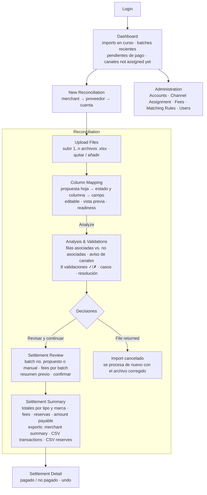
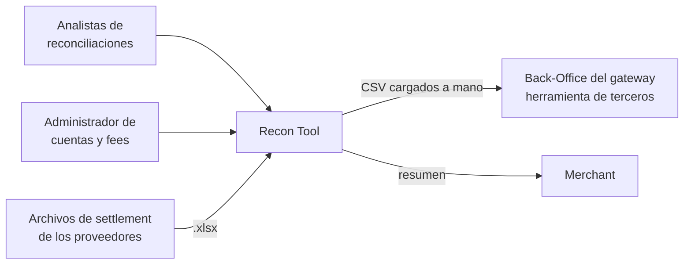
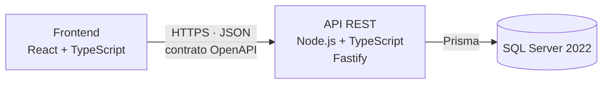
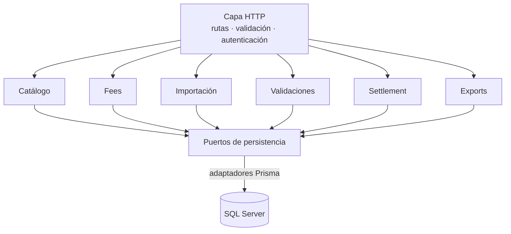
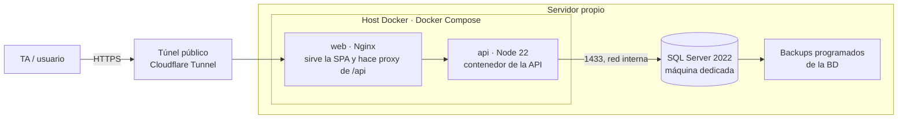
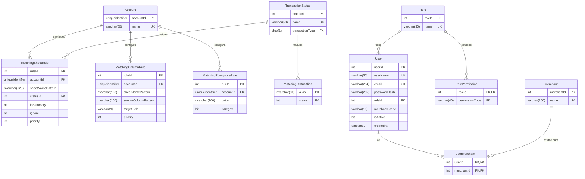
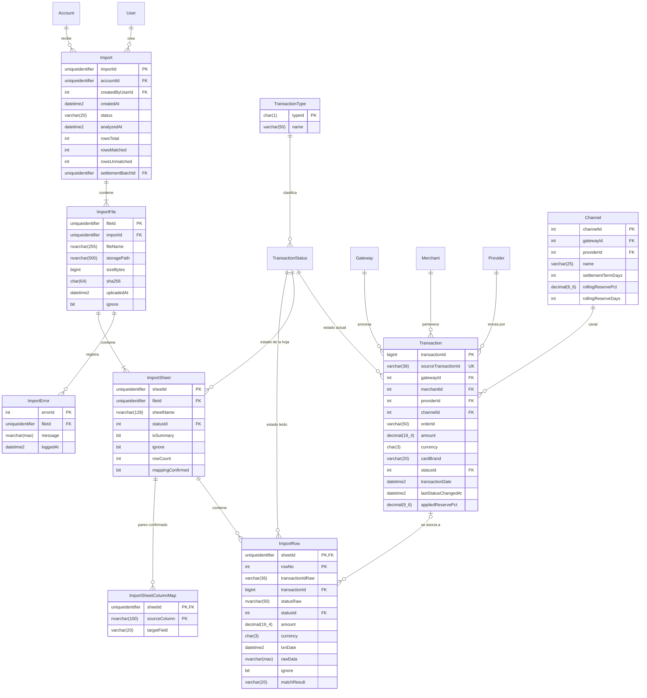
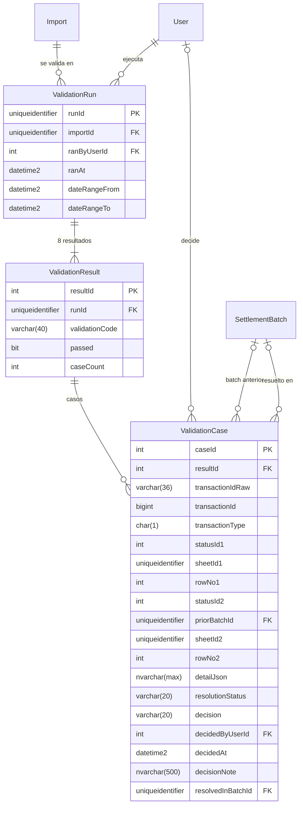
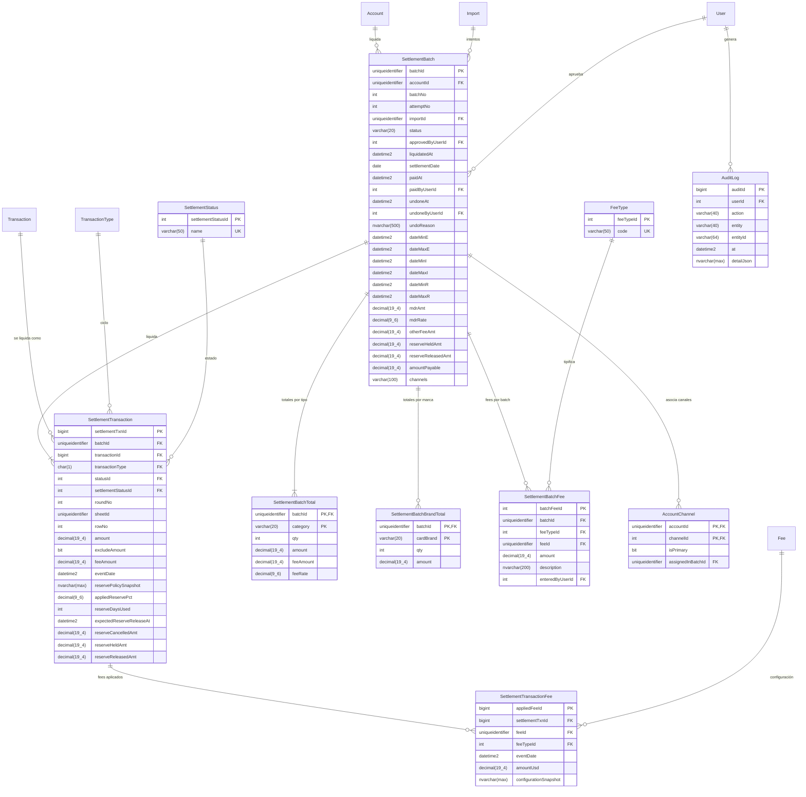

# Recon Tool — Proyecto Final AI4Devs

> Entrega 1 · Documentación técnica. Sigue la plantilla oficial de `LIDR-academy/AI4Devs-finalproject`.

> **Sistema actual y desarrollo propuesto.** Existe una única herramienta Recon Tool en producción, implementada sobre SSRS. Las versiones de los documentos de referencia representan revisiones de la documentación, no versiones desplegadas del sistema. Este proyecto documenta y desarrolla su reemplazo como aplicación web independiente.

## Índice

1. [Ficha del proyecto](#0-ficha-del-proyecto)
2. [Descripción general del producto](#1-descripción-general-del-producto)
3. [Arquitectura del sistema](#2-arquitectura-del-sistema)
4. [Modelo de datos](#3-modelo-de-datos)
5. [Especificación de la API](#4-especificación-de-la-api)
6. [Historias de usuario](#5-historias-de-usuario)
7. [Tickets de trabajo](#6-tickets-de-trabajo)
8. [Pull requests](#7-pull-requests)

---


## 0. Ficha del proyecto


### 0.1. Tu nombre completo

**Manfred Valverde Perrogón**

### 0.2. Nombre del proyecto

Recon Tool 2.0

### 0.3. Descripción breve del proyecto

Recon Tool es una aplicación web para el equipo de reconciliaciones de una compañía que procesa pagos a través de varios gateways, proveedores y merchants. Automatiza el cruce de los archivos de settlement que envían los proveedores contra las transacciones propias, valida inconsistencias (faltantes, duplicados, colisiones de estado) y permite procesar batches de reconciliación con trazabilidad completa. Cada ciclo E/I/R está Settled únicamente cuando está incluido en un batch procesado y pagado. Un batch procesado pendiente de pago todavía no confiere ese estado. El proyecto desarrolla una aplicación independiente para reemplazar la herramienta interna que actualmente funciona sobre reportes SSRS.

### 0.4. URL del proyecto

Pendiente de despliegue. Esta entrega contiene únicamente la documentación técnica.

### 0.5. URL o archivo comprimido del repositorio

**Repositorio:** [kajirioji/AI4Devs-finalproject](https://github.com/kajirioji/AI4Devs-finalproject).

**Rama de entrega:** `[entrega-1-MVP](https://github.com/kajirioji/AI4Devs-finalproject/tree/entrega-1-MVP)`.

Esta entrega contiene `readme.md` y `prompts.md`; no incluye código.

---


## 1. Descripción general del producto


### 1.1. Objetivo

**El problema.** La compañía procesa pagos a través de varios gateways y de entre 15 y 20 proveedores activos, cada uno con una o varias cuentas y canales. Cada proveedor envía periódicamente —normalmente cada 7, 10 o 14 días— un archivo de settlement con las transacciones que va a pagar. De lo aprobado libera alrededor del 90 % en ese plazo; el resto se retiene como rolling reserve y se libera a unos 180 días. Una transacción puede tener movimientos en tres ciclos de reconciliación: la operación original, los ajustes posteriores (como chargeback o refund) y la reserva. Cada ciclo necesita su propio estado y seguimiento; tres ciclos no implica un máximo de tres eventos. Los porcentajes y plazos dependen de la configuración acordada con cada proveedor.

El Back-Office del gateway principal no sirve para dar ese seguimiento: solo guarda un flag de "settled" y una última fecha, sin número de batch ni historial, así que un archivo repetido sobrescribe lo anterior sin dejar rastro; tampoco indica cuántos fees se pagaron por esa transacción ni por el batch. Para cubrir ese hueco existe el Recon Tool actual, un conjunto de unos 24 reportes SSRS que el equipo usa como si fuera una aplicación web. Funciona, pero SSRS no está diseñado para ese uso y obliga a rodeos para poder utilizarlo: normalizar el archivo del proveedor es copiar y pegar a mano en una plantilla Excel sin ninguna validación; crear una cuenta o cargar un fee se hace por consulta directa a la base; reprocesar un batch lo borra sin dejar historia; y cada pantalla nueva cuesta mucho más de lo que debería. El resultado aguas abajo son disputas del merchant sobre el resumen preliminar, que en buena parte nacen de la falta de precisión y trazabilidad en la validación.

**Qué resuelve Recon Tool.** Lleva ese mismo proceso a una aplicación web propia, con el flujo de reconciliación de punta a punta: importar directamente los archivos Excel originales del proveedor (.xlsx), sin copiar sus datos a una plantilla intermedia, parear sus hojas y columnas con revisión humana, cruzar contra las transacciones propias, ejecutar las validaciones, dejar que el analista decida sobre cada bandera, procesar el batch separando los tres ciclos de reconciliación, y generar el resumen para el merchant y los exports para el Back-Office. Todo con trazabilidad por batch, administración de cuentas y fees desde la propia aplicación, y sin tocar la base de producción por consulta directa. El procesamiento del batch y su pago se controlan por separado. La aplicación habilita funcionalidades nuevas y mejora la experiencia en las que ya existen.

**Para quién.** Los usuarios principales son los analistas del equipo de reconciliaciones, que hoy ejecutan el proceso a mano y en SSRS. Los usuarios secundarios son quien administra cuentas y fees (hoy, por SQL) y, de forma indirecta, el merchant, que no entra a la herramienta pero recibe un resumen más preciso y con menos disputas.

**Qué valor aporta.** Menos tiempo por reconciliación (se elimina el paso de copiar datos a una plantilla para los archivos .xlsx admitidos y se simplifica la navegación), menos errores (se reduce la manipulación manual de archivos y el riesgo de errores; validación de entrada, reglas de negocio en los fees, pareo revisado antes de analizar), mayor trazabilidad respecto al sistema actual (batches con estado e historial, fees con historial de cambios, deshacer sin perder rastro, registro de quién aprobó cada batch) y más control sobre la propia herramienta: los parámetros propios de cada cuenta —política de reserva ante chargeback, fees y reglas de pareo— y los asociados al proceso se configuran desde la aplicación, sin depender de consultas directas a la base.

### 1.2. Características y funcionalidades principales

El producto se construye como MVP alrededor del flujo principal de reconciliación. Lo que sigue distingue entre lo que entra en el MVP (entregas 2 y 3) y lo que queda documentado como roadmap.

### Reglas de negocio confirmadas

- **Settled por ciclo:** E, I y R se evalúan separadamente. Solo un movimiento incluido en un batch procesado y pagado está Settled. Procesado pendiente de pago, pagado y deshecho son situaciones distintas. Los pendientes se presentan separados entre no reconciliados y reconciliados pendientes de pago.
- **Exports operativos:** el resumen y ambos CSV se generan al procesar el batch, incluso antes del pago. Reconciliaciones los guarda para revisar su composición y ejecuta manualmente los CSV en el Back-Office después de recibir el pago. Descargar un CSV no marca nada como pagado o Settled.
- **USD:** los cálculos y totales usan el importe en USD proporcionado por los gateways. Los fees configurados también están en USD. Se conservan monto y moneda originales del proveedor como referencia; no se comparan directamente importes de monedas distintas ni se incorpora conversión cambiaria al MVP.
- **Identidad:** `transactionId BIGINT IDENTITY` es la PK interna; `sourceTransactionId VARCHAR(36) UNIQUE` conserva el ID global de origen (15 dígitos o UUID, según el gateway); `gatewayId` identifica la fuente. El cruce inicial se hace por el identificador de origen indexado y en conjunto; las relaciones internas usan el BIGINT. Se admiten varios gateways en una cuenta.
- **Fees múltiples y vigencias:** cada movimiento puede tener varios fees. Cada uno conserva tipo, configuración aplicada e importe USD. Para operaciones originales rige la fecha de la transacción; para returns, chargebacks y refunds rige la fecha del evento correspondiente. Ambas fechas provienen del gateway, nunca se sustituye esta fecha por la del batch.
- **Reserva por cuenta:** se configura si ante chargeback se mantiene pendiente hasta su liberación o se cancela. Se conserva la regla aplicada y el importe cancelado; una reserva cancelada no se reporta como pendiente de liberación ni como liberada o Settled por ese solo hecho.
- **Incidencias:** el sistema actual ya guarda advertencias y resultados de validación. Se conserva esa capacidad: las incidencias permanecen persistentes o resueltas, sin eliminarse. Las correcciones posteriores quedan vinculadas al batch que las resolvió.
- **Duplicados:** no se contabilizan dos veces. Los resultados parciales indican lo que se incluirá y las diferencias frente al archivo del proveedor. El analista revisa y comunica las diferencias fuera de la aplicación; puede continuar o enviar a revisión. No se exige una decisión contable adicional por fila ni cerrar individualmente todas las advertencias.
- **Deshacer dentro del MVP:** solo batches pendientes de pago. Se conserva el intento anterior y el motivo, se permite un nuevo intento con el mismo número oficial, y se recalculan incidencias cuya resolución dependía del intento anulado, sin revertir la asignación del canal.


#### En el alcance del MVP

**Acceso y roles.** Login con usuario y contraseña. Roles por acción (procesar settlement, procesar pago, administrar cuentas, administrar fees, consultar) y visibilidad por merchant: cada usuario ve solo los merchants que tiene asignados.

**Catálogo de merchants, proveedores, cuentas y canales.** Jerarquía merchant → proveedor → cuenta → canal. Merchants, proveedores (asociados a un merchant), canales y transacciones vienen suministrados por los gateways y son de solo lectura en la aplicación; es en esa información donde se detecta un proveedor o un canal nuevo. La **cuenta** es la entidad propia del Recon Tool: una agrupación lógica de canales de un proveedor para llevar contabilidades separadas. Se crea y edita desde la aplicación (hoy, por consulta directa) y admite canales de varios gateways; administra sus fees, sus reglas de pareo y su política de reserva ante chargeback. El settlement term, el porcentaje configurado y el plazo de reserva se reciben de los gateways como configuración del canal; el porcentaje efectivamente aplicado viene guardado en cada transacción. Un canal no viene asociado a ninguna cuenta: aparece como *not assigned yet* mientras tenga transacciones sin ningún batch procesado, y se asocia a una cuenta al procesar el primer settlement que lo incluye, con aviso previo al analista. Un canal puede tener historial en más de una cuenta (se modela según cómo se procesó financieramente), pero una sola es su **cuenta principal** —la última que procesó un settlement con ese canal— y los pendientes del canal se reportan solo en ella, para no contarlos dos veces. Un merchant no ve los proveedores de otro merchant, aunque compartan proveedor. Los canales pueden quedar inactivos; no se borran.

**Administración de fees por cuenta, con historial.** Creación y edición de fees por cuenta: tipo de fee, monto fijo o porcentaje, valor, y vigencia (rango de fechas o "aplica siempre"). El motor calcula automáticamente solo los **fees por transacción** (aprobadas, declinadas, chargebacks, refunds, RDR, MDR…). Los fees **no transaccionales** —por batch, setup, anuales— se mantienen en el mismo módulo como referencia con su monto preestablecido, pero los indica el proveedor batch a batch, así que se agregan manualmente al batch antes de procesarlo, con importe ajustable; además existen categorías de importe libre (ajustes por corrección de batches anteriores, ajustes por duplicados, penalizaciones). Los fees no se eliminan: quedan asociados a la cuenta aunque el canal pase a inactivo, porque el fee aplicado se guarda por transacción. Regla de negocio: no pueden coexistir dos fees del mismo tipo con rangos de vigencia que se solapen en la misma cuenta. Cada cambio queda registrado con quién, cuándo y qué cambió, y al editar un fee el sistema permite recalcular de forma temporal el efecto del cambio sobre las transacciones afectadas antes de aplicarlo.

**Importación directa de archivos originales con pareo revisado.** El MVP permite subir uno o varios archivos Excel originales de settlement (.xlsx) de una cuenta, sin normalizarlos previamente en una plantilla intermedia. La interpretación se configura mediante reglas de pareo y revisión humana; no requiere desarrollar un importador fijo por cada proveedor. El sistema propone el pareo de hojas y columnas a partir de las reglas configuradas para la cuenta (qué hoja corresponde a qué estado, qué columna es el Transaction ID, qué filas ignorar); el analista revisa la propuesta, la ajusta si hace falta y la confirma antes de analizar. El resto de las columnas se conserva como fila original de referencia. Para avanzar debe estar identificado el Transaction ID y configurada la forma de obtener el estado, ya sea por hoja, columna o reglas sobre los campos de cada fila. También se pueden parear monto, moneda, fecha y fees informados por el proveedor, según el formato.

**Reglas de interpretación del archivo.** Además del pareo de hojas y columnas, el MVP permite configurar por cuenta, según el formato del proveedor, cómo interpretar las filas antes de ejecutar las validaciones de negocio:

- **Estado fijo por hoja:** se asigna un estado a todas sus filas sin exigir una columna de estado.
- **Estado explícito por fila:** una columna aporta el estado y las reglas traducen sus valores al catálogo interno.
- **Estado derivado por fila:** condiciones sobre uno o varios campos determinan el estado. Se usan reglas configurables, no inferencias libres de IA.
- **Fees informados por el proveedor:** se identifican por separado del importe de la operación y de los fees calculados por la aplicación. No se suman automáticamente ambos valores; el tratamiento y las diferencias deben quedar explícitos en la revisión.
- **Varias filas para un movimiento:** las reglas relacionan las apariciones y determinan cuáles participan en el cálculo, por ejemplo, una fila pending seguida de otra approved. No se descartan duplicados de forma general: las repeticiones que no estén justificadas por una regla siguen sujetas a las validaciones.
- **Filas excluidas del cálculo:** se conserva su contenido original y el motivo de exclusión como referencia.

La vista previa muestra el resultado de la interpretación, las filas de origen y las reglas aplicadas para revisión humana. Una fila sin interpretación suficiente o con reglas contradictorias queda señalada para revisión, sin asignarle silenciosamente un estado. Los formatos concretos y sus resultados esperados se incorporarán como casos de prueba sintéticos.

**Cruce contra transacciones propias.** Cada fila se enlaza por Transaction ID exacto contra la tabla de transacciones propias; se muestran primero las filas que no se pudieron asociar. Del enlace se derivan el canal, el estado actual y el tipo de liquidación (E transacción, I ajuste, R reserva). Si el import trae transacciones de un canal sin asociar o asociado a otra cuenta, el sistema lo avisa antes de validar: al liquidar, ese canal quedará asociado a esta cuenta como principal.

**Ocho validaciones con detalle por caso.** Transacciones de otro canal o merchant; ajustes sobre transacciones nunca liquidadas como aprobadas; duplicados y colisiones de estado dentro del batch; duplicados y colisiones contra batches anteriores; transacciones faltantes en el hueco entre settlements; transacciones faltantes dentro del rango de fechas del archivo. Cada validación devuelve ✓ o ✗ con el número de casos, y cada caso abre a un detalle con las dos apariciones enfrentadas.

**Revisión humana de resultados.** El analista revisa los resultados parciales y sus advertencias. Los duplicados se contabilizan una sola vez y las diferencias con el archivo se muestran para comunicarlas al proveedor. Puede confirmar el procesamiento o devolver el archivo a revisión. Las incidencias se conservan como persistentes o resueltas; no se exige decidir ni ajustar individualmente cada fila para continuar. La aprobación del batch queda auditada.

**Liquidación del batch.** Antes de confirmar, el analista agrega los fees por batch que indica el proveedor: elige entre los no transaccionales preestablecidos de la cuenta (importe ajustable) o ingresa uno de importe libre con su categoría. Al confirmar, el sistema propone el siguiente número de batch (editable a mano), registra los movimientos incluidos por tipo E/I/R, todavía no Settled hasta registrar el pago, registra faltantes, duplicados y colisiones en sus logs, aplica los fees vigentes a la fecha del evento de cada movimiento, suma los fees por batch, asocia a la cuenta los canales nuevos, y genera el Settlement Summary: totales por tipo de transacción, fees por tipo, fees por batch, reservas retenidas y liberadas, y amount payable.

**Exports.** Al procesar el batch se generan el resumen para el merchant y los CSV de transacciones y rolling reserves. Reconciliaciones los guarda como documentos de trabajo y los ejecuta en el Back-Office después de recibir el pago. Su generación no implica pago ni cambia el estado Settled.

**Seguimiento básico.** Listado de settlements por cuenta con su estado (validado, liquidado, pagado), marcar un batch como pagado o no pagado, consulta de faltantes y duplicados, y canales con transacciones sin cuenta asignada (*not assigned yet*).

**Deshacer un batch.** Solo un batch procesado pendiente de pago puede deshacerse. Se conserva el intento anterior con motivo y autor; se reprocesa como nuevo intento del mismo número oficial y se recalculan las incidencias afectadas. Un intento deshecho no contribuye a totales vigentes ni al estado Settled.

#### Fuera del alcance del MVP (roadmap)

- **Entidad Pago separada del settlement**: registrar el dinero que llega del proveedor y aplicarlo a uno o varios settlements, con pagos parciales y montos sin aplicar.
- **Reportería avanzada** inspirada en el sistema de reconciliación de un merchant: Aged Receivables (settlements en tránsito envejecidos a 30/60/90 días, reconciliado no liquidado, reservas por vencer), forecast de settlements esperados, cortes contables y fees por rango.
- **Formatos de entrada adicionales a .xlsx** y estructuras que requieran transformaciones especiales no cubiertas por las reglas configurables de interpretación. La importación directa de los Excel originales sí forma parte del MVP.
- **Ingreso automático de batches históricos** y archivado del archivo procesado.

La integración con el Back-Office del gateway se mantiene como hoy, mediante los CSV exportados: es una herramienta de terceros sobre la que no se pueden hacer cambios.

### 1.3. Diseño y experiencia de usuario

> En la Entrega 1 no existe todavía interfaz. Esta sección describe el mapa del sitio y el recorrido del usuario pantalla por pantalla; las capturas reales y el vídeo se añadirán en las Entregas 2 y 3.


#### Mapa de pantallas

Los nombres son los que aparecerán en la interfaz (en inglés). La columna "Alcance" indica qué se construye en las Entregas 2 y 3 y qué queda como roadmap.


| Menú           | Pantalla                                                       | Qué muestra / permite                                                                                                                             | Alcance            |
| -------------- | -------------------------------------------------------------- | ------------------------------------------------------------------------------------------------------------------------------------------------- | ------------------ |
| —              | **Login**                                                      | Usuario y contraseña                                                                                                                              | MVP                |
| —              | **Dashboard**                                                  | Landing tras el login: imports en curso, batches recientes, settlements pendientes de pago, canales *not assigned yet*, accesos rápidos según rol | MVP                |
| Reconciliation | **New Reconciliation**                                         | Elegir merchant → proveedor → cuenta y arrancar el flujo                                                                                          | MVP                |
| Reconciliation | **Upload Files**                                               | Subir uno o varios archivos del settlement; quitar y añadir antes de analizar                                                                     | MVP                |
| Reconciliation | **Column Mapping**                                             | Propuesta de pareo por hoja y columna, editable; vista previa; estado de preparación                                                              | MVP                |
| Reconciliation | **Analysis & Validations**                                     | Filas asociadas / no asociadas; aviso de canales sin asociar; ocho validaciones con casos y estado de resolución                                  | MVP                |
| Reconciliation | **Settlement Review**                                          | Número de batch, fees por batch (preestablecidos ajustables o importe libre), resumen previo, confirmar                                           | MVP                |
| Reconciliation | **Settlement Summary**                                         | Totales, fees, reservas, amount payable, decisiones, exports                                                                                      | MVP                |
| Reconciliation | **In Progress**                                                | Imports abiertos (subidos, pareados, analizados, validados) para retomarlos                                                                       | MVP                |
| Settlements    | **Settlement List**                                            | Por merchant, proveedor, cuenta, estado y fechas                                                                                                  | MVP                |
| Settlements    | **Settlement Detail**                                          | Summary, transacciones por ciclo E/I/R, fees por batch, exports, undo                                                                             | MVP                |
| Settlements    | **Payments**                                                   | Marcar pagado / no pagado; pendientes de pago por proveedor                                                                                       | MVP                |
| Search         | **Transaction Search**                                         | Ficha de una transacción con sus liquidaciones por ciclo y sus apariciones en validaciones                                                        | MVP                |
| Search         | **Missing & Duplicates**                                       | Faltantes y duplicados persistentes por cuenta, con su resolución                                                                                 | MVP                |
| Reports        | **Unsettled Transactions per Channel**                         | Pendientes por canal, reportados en la cuenta principal del canal                                                                                 | MVP                |
| Reports        | **Aged Receivables**, **Settlement Forecast**, **Fee Summary** | Reportería inspirada en el sistema del merchant                                                                                                   | Roadmap            |
| Administration | **Merchants & Providers**                                      | Solo lectura: lo que viene del gateway, con sus cuentas y canales                                                                                 | MVP                |
| Administration | **Accounts** / **Account Detail**                              | Crear, editar y cerrar cuentas; parámetros; canales asociados (principal e históricos); fees; matching rules                                      | MVP                |
| Administration | **Channel Assignment**                                         | Canales *not assigned yet* y cuenta principal de cada canal                                                                                       | MVP                |
| Administration | **Fees** / **Fee History**                                     | Fees por cuenta (transaccionales y no transaccionales), vigencias, historial de cambios, simulación de un cambio                                  | MVP                |
| Administration | **Matching Rules**                                             | Reglas de hoja, columna y filas a ignorar por cuenta y globales                                                                                   | MVP                |
| Administration | **Users & Roles**                                              | Usuarios, rol y merchants visibles                                                                                                                | MVP                |
| Administration | **Audit Log**                                                  | Quién hizo qué y cuándo                                                                                                                           | MVP (solo lectura) |


#### Presentación de validaciones y resultados parciales

La pantalla presenta principalmente las transacciones, su cantidad por tipo/ciclo, el resumen conjunto de advertencias con acceso al detalle y las reservas pagadas que ya se muestran en el sistema actual. La estimación de fees, su desglose y la reserva por retener se muestran en un detalle desplegable cuya utilidad y densidad se validarán con el prototipo. El total por pagar se revisa en la confirmación final del batch, incluyendo sus fees adicionales.

Se toma una sola decisión sobre el conjunto: **Continuar a revisión del batch** o **Cancelar y reprocesar**. No hay una pantalla ni una decisión obligatoria por advertencia. Continuar conserva las incidencias; cuando el archivo requiere corrección se conserva el intento y se procesa nuevamente el conjunto completo.

#### Recorrido del flujo principal

El analista entra a la aplicación y recorre el flujo principal en seis pantallas. Cada una muestra lo justo para tomar la siguiente decisión, y el sistema nunca avanza solo: importar, confirmar el pareo, decidir sobre las validaciones y liquidar son acciones explícitas del usuario.




Lo que el usuario ve en cada paso del flujo principal:

1. **Upload Files.** Selecciona la cuenta y arrastra uno o varios archivos. El sistema lista los archivos recibidos con sus hojas y número de filas; se pueden quitar y añadir mientras no se haya analizado.
2. **Column Mapping e interpretación.** Para cada hoja, la propuesta de a qué estado corresponde (APP, DEC, CHB, REF, RR, resumen o ignorar) y, para cada columna, a qué campo se parea (Transaction ID, estado, monto, moneda, fecha, o "conservar como dato de referencia"). El analista revisa el pareo y las reglas de interpretación, corrige lo que no cuadre y confirma. No se puede analizar sin Transaction ID identificado y una configuración confirmada para obtener el estado por hoja, columna o reglas. La vista previa muestra también fees informados, filas relacionadas y exclusiones cuando corresponda.
3. **Analysis & Validations.** Primero las filas que no se pudieron asociar a ninguna transacción propia y el aviso de canales sin asociar o de otra cuenta; después las ocho validaciones con ✓ o ✗ y su conteo. Cada caso abre a un detalle con las dos apariciones enfrentadas. El analista revisa los resultados parciales y continúa o devuelve el archivo; las incidencias permanecen persistentes o resueltas y la aprobación queda registrada.
4. **Settlement Review.** El sistema propone el siguiente número de batch (editable), el analista agrega los fees por batch que indica el proveedor, revisa el resumen previo y confirma.
5. **Settlement Summary.** Totales por tipo de transacción y por marca, fees por transacción y por batch, reservas retenidas y liberadas, amount payable, decisiones de validación, y los tres exports.
6. **Settlement Detail.** Desde aquí se marca pagado / no pagado y, si hace falta, se deshace el batch.


### 1.4. Instrucciones de instalación

> **Procedimiento previsto, no verificado.** Esta entrega contiene documentación. Los comandos de instalación, arranque y pruebas se verificarán con el código en la Entrega 2. Todos los datos de demostración serán sintéticos.

**Prerrequisitos previstos:** Node.js 22 LTS o superior, npm, Docker y Docker Compose, Git.

**Instalación inicial prevista:**

1. Clonar el repositorio y copiar `.env.example` a `.env` en `backend/` y `frontend/`. El `.env` del backend incluye la cadena de conexión a SQL Server con el usuario de aplicación `recon_app`; la contraseña de `sa` solo la usa el script de inicialización del contenedor para crear la base y ese usuario, y no se utiliza desde la aplicación.
2. Levantar la base de datos: `docker compose up -d db` (SQL Server 2022 Developer Edition en contenedor, puerto 1433). Al primer arranque, un script de inicialización crea la base `ReconTool2` y el usuario `recon_app` con permisos solo sobre ese esquema.
3. Instalar dependencias: `npm install` en `backend/` y en `frontend/`.
4. Ejecutar migraciones y seed sintético: `npm run db:migrate && npm run db:seed` en `backend/`. El seed utiliza exclusivamente datos sintéticos y es idempotente: crea o actualiza los datos de ejemplo sin borrar el trabajo existente y crea proveedores, cuentas, canales, fees, usuarios de prueba, un lote de transacciones propias y archivos de settlement de ejemplo en `data/samples/`.

**Arranque habitual previsto (sin reiniciar datos):**

1. Arrancar backend (`npm run dev`, puerto 3000) y frontend (`npm run dev`, puerto 5173).
2. Entrar con el usuario de prueba indicado en el seed.

Alternativa todo-en-uno prevista: `docker compose up` levanta base de datos, backend y frontend sin borrar sus volúmenes ni ejecutar un reset.

**Reinicio explícito de datos de prueba:** `npm run db:reset`, únicamente en desarrollo y bajo acción explícita del usuario. Es destructivo para los datos de ese entorno y no forma parte del arranque habitual.

**Credenciales:** inicialización y migraciones utilizan una identidad administrativa separada. La aplicación usa `recon_app` con permisos de ejecución y acceso a datos necesarios, sin permisos de modificación del esquema. Los comandos y permisos exactos se verificarán en la Entrega 2.

---


## 2. Arquitectura del Sistema


### 2.1. Diagrama de arquitectura

> **Arquitectura y stack propuestos, pendientes de validación técnica.** Todavía no se ha comenzado a programar. React, TypeScript, Fastify, Prisma y SQL Server son la propuesta de trabajo. Antes de implementarla se realizará una prueba pequeña de lectura de Excel, cruce contra transacciones sintéticas y persistencia en SQL Server. La integración futura utilizará los datos consolidados de los gateways en ATHENA (servidor de produccion destino).

Recon Tool es una aplicación web de tres piezas —una SPA en React, una API REST en Node/TypeScript y una base de datos SQL Server— organizada como **monolito modular con arquitectura hexagonal** (puertos y adaptadores) en el backend.

**Vista de contexto** — quién usa el sistema y con qué se relaciona:




**Vista de contenedores** — las tres piezas y cómo se comunican:




**Vista interna del backend** — módulos de dominio y capas:




**Patrón y por qué.** El backend se divide en módulos de dominio (catálogo, fees, importación, validaciones, settlement, exports), y dentro de cada uno la lógica de negocio no depende de HTTP ni de la base de datos: recibe y devuelve objetos del dominio, y habla con la persistencia a través de puertos (interfaces de repositorio) implementados con Prisma. Es la arquitectura hexagonal que el máster trabaja en el módulo de backend, en su versión pragmática de un solo despliegue.

Las razones son de este proyecto, no genéricas:

- **La lógica de reconciliación es lo que vale y lo que hay que testear.** Las ocho validaciones y el cálculo del settlement son funciones deterministas con entrada y salida conocidas. Aislarlas de la base de datos permite probarlas con datos en memoria, hacer TDD sobre ellas y reutilizarlas si mañana cambia el motor de base de datos o la interfaz.
- **El origen de las transacciones propias va a cambiar.** En el MVP viven en una tabla sintética; en producción se alimentarán desde la base del gateway. Un puerto `TransactionSource` con una implementación local hoy y otra mañana evita reescribir el dominio.
- **Un solo despliegue es lo correcto para el tamaño del equipo.** Un monolito modular se levanta con un `docker compose up`, se depura en un solo proceso y no necesita orquestación. Los módulos dan los límites internos que permitirían separar alguno después si hiciera falta, sin pagar ese coste ahora.

**Qué se sacrifica.** Más ficheros y más indirección que un CRUD directo (cada módulo tiene sus entidades, sus puertos y sus adaptadores), lo que cuesta al principio en un stack nuevo para el autor. El monolito no escala por partes, aunque la carga esperada (batches de 1.000–2.000 filas, decenas de usuarios) no lo requiere. Y la SPA obliga a mantener un contrato OpenAPI entre frontend y backend, que se convierte en tarea y en test.

**Decisiones previstas como ADR** (en `docs/adr/`, formato MADR). Las reglas de negocio confirmadas y la sustitución de SSRS están acordadas; las elecciones tecnológicas y de arquitectura mantienen estado **Propuesto**, pendiente de la prueba técnica:


| ADR | Decisión                                                                            | Alternativa descartada                                                         | Consecuencia principal                                                                                                                                                      |
| --- | ----------------------------------------------------------------------------------- | ------------------------------------------------------------------------------ | --------------------------------------------------------------------------------------------------------------------------------------------------------------------------- |
| 001 | Aplicación web propia en lugar de seguir extendiendo SSRS                           | Añadir reportes al sistema actual                                              | Formularios, validación, sesiones y errores se resuelven de forma nativa; hay que reconstruir lo que el sistema actual ya hace                                              |
| 002 | SQL Server 2022 desde el MVP, contenedor oficial para desarrollo                    | PostgreSQL con portabilidad posterior                                          | Reutiliza esquema y lógica del sistema actual; el paso a producción es un despliegue, no una migración; la imagen es solo x86-64                                            |
| 003 | Liquidación en tres ciclos (E transacción, I ajuste, R reserva) como eje del modelo | Un único estado "settled" por transacción                                      | Una transacción puede tener varios movimientos de settlement distribuidos en los tres ciclos, con seguimiento propio; el modelo y el summary se construyen alrededor de eso |
| 004 | Tabla de transacciones propia y desacoplada del gateway                             | Consultar la tabla de transacciones del gateway en vivo como el sistema actual | Tests reproducibles y sin acceso a producción; en producción hace falta un job o vista de carga                                                                             |
| 005 | Monolito modular hexagonal con Fastify + Prisma                                     | NestJS (más estructura, más magia) · Express (menos estructura)                | Curva corta, tipado de punta a punta, validación con Zod compartida con el frontend                                                                                         |


### 2.2. Descripción de componentes principales

> Componentes y tecnologías previstos; esta sección describe el diseño propuesto, no una implementación existente.

**Frontend (React 19, TypeScript, Vite).** SPA con enrutado por pantalla (login, dashboard, cuenta, flujo de importación en cinco pasos, settlements, fees). Estado de servidor con TanStack Query (caché, reintentos, invalidación tras cada acción); componentes de UI con shadcn/ui sobre Tailwind; formularios con React Hook Form y los mismos esquemas Zod que valida el backend. Tabla de datos virtualizada para las vistas de filas y casos.

**API HTTP (Node.js 22, Fastify).** Expone la API REST bajo `/api/v1`, valida cada petición con Zod, publica la especificación OpenAPI en `/docs` (Scalar) y protege las rutas con JWT de corta duración más refresh. Un plugin de autorización resuelve por petición el rol del usuario y los merchants que puede ver, y lo inyecta en los casos de uso.

**Módulo de catálogo.** Proveedores, cuentas y canales; creación y edición de cuentas con fees, reglas y política de reserva ante chargeback; consulta de parámetros de los canales recibidos de los gateways; canales activos e inactivos.

**Módulo de fees.** Fees por cuenta con tipo, monto fijo o porcentaje, valor y vigencia. Aplica la regla de no solapamiento por tipo y cuenta, mantiene el historial de cambios y calcula el efecto previo de una edición sobre las transacciones afectadas.

**Módulo de importación.** Recibe uno o varios `.xlsx` por cuenta, los lee hoja a hoja (SheetJS), aplica las reglas de pareo de la cuenta para proponer el mapeo, guarda cada fila con su ID, estado y el resto de columnas como JSON de referencia, y ejecuta el cruce por Transaction ID contra la tabla de transacciones propias.

**Módulo de validaciones.** Las ocho validaciones como funciones puras sobre el conjunto de filas del import, el histórico de settlements de la cuenta y el ciclo de vida de estados. Devuelve por validación el resultado, el conteo y los casos con las dos apariciones enfrentadas.

**Módulo de settlement.** Asigna el número de batch, deriva el tipo E/I/R de cada fila, aplica el modelo de fees vigente, registra faltantes, duplicados y colisiones, produce el Settlement Summary y gestiona los estados del batch (validado, liquidado, pagado, deshecho).

**Módulo de exports.** Genera el resumen para el merchant y los dos CSV con el formato que el Back-Office necesita.

**Persistencia (Prisma sobre SQL Server 2022).** Esquema propio del Recon Tool, migraciones versionadas, seed sintético idempotente. Los repositorios son adaptadores de los puertos del dominio.

**Autenticación y autorización.** Usuarios con contraseña hasheada (Argon2), roles por acción y asignación de merchants por usuario.

### 2.3. Descripción de alto nivel del proyecto y estructura de ficheros

Monorepo con dos aplicaciones y la documentación al lado del código:

```
recon-tool-2/
├── readme.md                     # este documento (plantilla oficial)
├── prompts.md                    # registro del uso de IA
├── AGENTS.md                     # contexto para copilotos (CLAUDE.md → symlink)
├── .claude/                      # skills y hooks del proyecto
├── docker-compose.yml            # db (SQL Server) · api · web
├── .github/workflows/            # CI: lint · tests · build (Entrega 3)
├── docs/
│   ├── adr/                      # ADR-001 … ADR-005 en formato MADR
│   ├── diagrams/                 # fuentes Mermaid de arquitectura, infra y modelo
│   ├── openapi.yaml              # contrato de la API
│   └── wireframes/               # flujo de pantallas (Entrega 1) y capturas (E2/E3)
├── data/
│   └── samples/                  # archivos de settlement sintéticos (.xlsx)
├── backend/
│   ├── prisma/
│   │   ├── schema.prisma
│   │   ├── migrations/
│   │   └── seed.ts               # seed idempotente
│   ├── src/
│   │   ├── modules/
│   │   │   ├── catalog/          # domain/ · application/ · infrastructure/ · http/
│   │   │   ├── fees/
│   │   │   ├── imports/
│   │   │   ├── validations/
│   │   │   ├── settlements/
│   │   │   └── exports/
│   │   ├── shared/               # errores, tipos, utilidades de dinero y fechas
│   │   ├── auth/                 # JWT, roles, merchants visibles
│   │   ├── app.ts                # composición de Fastify y plugins
│   │   └── server.ts
│   └── tests/
│       ├── unit/                 # dominio: validaciones, settlement, fees
│       └── integration/          # repositorios y rutas contra SQL Server efímero
├── frontend/
│   ├── src/
│   │   ├── app/                  # rutas y layout
│   │   ├── features/             # una carpeta por pantalla: imports, validations, settlements, fees, catalog, auth
│   │   ├── components/ui/        # shadcn/ui
│   │   ├── lib/api/              # cliente tipado generado desde openapi.yaml
│   │   └── lib/schemas/          # esquemas Zod compartidos
│   └── tests/                    # Vitest + Testing Library
└── e2e/                          # Playwright: flujo importar → validar → liquidar
```

Cada módulo del backend sigue la misma división interna: `domain/` (entidades, reglas y puertos, sin dependencias externas), `application/` (casos de uso), `infrastructure/` (adaptadores Prisma y ficheros) y `http/` (rutas y esquemas). El frontend se organiza por *feature* en lugar de por tipo de fichero, de modo que cada pantalla tiene juntos sus componentes, sus consultas y sus tests.

### 2.4. Infraestructura y despliegue

> **Despliegue previsto, pendiente de validación.** La intención es utilizar un servidor propio con Docker y túnel público exclusivamente para la demostración con datos sintéticos. La conectividad, recursos y procedimiento se verificarán antes de confirmar esta alternativa. La automatización descrita es propuesta, no implementada.

**Entornos.**


| Entorno                                           | Dónde                                                                              | Base de datos                       | Para qué                                                  |
| ------------------------------------------------- | ---------------------------------------------------------------------------------- | ----------------------------------- | --------------------------------------------------------- |
| Local (autor y TA)                                | Docker Compose en el portátil                                                      | SQL Server 2022 en contenedor       | Desarrollo, tests, revisión de la entrega                 |
| Demostración (URL pública)                        | Servidor propio: host Docker para la aplicación + máquina dedicada para SQL Server | SQL Server 2022 en máquina dedicada | Entorno persistente y URL pública para las Entregas 2 y 3 |
| Producción (futuro, fuera del alcance del máster) | Infraestructura de la compañía                                                     | SQL Server existente                | Destino final; el esquema y el ORM no cambian             |





**Proceso de despliegue previsto.** En la Entrega 2, manual y reproducible: `git pull` en el host Docker, `docker compose build` y `docker compose up -d`, con las migraciones ejecutadas como paso separado del despliegue, mediante una identidad distinta de la aplicación. En la Entrega 3 se automatiza con GitHub Actions: cada push a la rama de entrega ejecuta lint, tests unitarios y de integración (con SQL Server efímero en el runner) y build de las imágenes; el despliegue al servidor se dispara desde el runner sobre el túnel. La URL pública sale por Cloudflare Tunnel, que no requiere abrir puertos en el router; como respaldo ante indisponibilidad del servidor el día de la revisión, la Entrega 3 incluye vídeo del sistema funcionando.

**Configuración.** Toda la configuración va por variables de entorno (`.env.example` versionado, `.env` no). Secretos del servidor fuera del repositorio.

### 2.5. Seguridad

> Requisitos del MVP y controles previstos; todavía no implementados ni verificados.

**Perfiles y permisos.** Cada perfil agrupa acciones autorizadas. Se separan consulta y exports (`reports.view`), reconciliación y deshacer (`settlement.process`), registro/retiro de pago (`payment.process`), cuentas y reglas (`account.manage`), consulta/edición de fees (`fee.view`, `fee.manage`) y administración de usuarios, perfiles y asignaciones (`user.manage`). Administrar cuentas no concede administración de usuarios.

**Aislamiento por merchant.** Cada usuario puede tener uno, varios o todos los merchants autorizados. Se configura un alcance explícito: `assigned` usa las filas de `UserMerchant`; `all` concede acceso a todos. No tener asignaciones no significa acceso global. El backend comprueba tanto permiso de acción como alcance de datos en cada petición. Listados, búsquedas, dashboards, conteos, archivos, exports, incidencias y auditoría no revelan merchants ajenos ni sus recursos. Los IDs solicitados directamente también se validan; un recurso no autorizado responde como no encontrado. La gestión de usuarios y asignaciones tampoco permite ampliar el propio alcance ni conceder merchants o permisos fuera de la autoridad del administrador.

- **Ningún dato real en el repositorio.** Todo el contenido de `data/samples/` y del seed es sintético: proveedores, merchants, IDs y montos generados. No hay nombres reales de proveedores ni de merchants, ni estructuras de la base de producción más allá de lo necesario para el modelo.
- **Autenticación y autorización.** Contraseñas con Argon2; JWT de acceso de corta duración con refresh; roles por acción (procesar settlement, procesar pago, administrar cuentas, administrar fees, consultar) y visibilidad por merchant resuelta en cada petición, nunca en el frontend.
- **Validación de entrada en el punto de entrada de datos externos.** Los archivos del proveedor se validan por tipo, tamaño, número de hojas y filas antes de parsearse; cada fila pasa por esquemas Zod; los montos se manejan como `DECIMAL(19,4)` en la base y como decimales en la aplicación, nunca como `float` ni como `MONEY` (ver 3.2). El cruce con transacciones propias se hace por ID exacto, sin construir SQL dinámico.
- **Trazabilidad.** Toda decisión sobre banderas, toda aprobación de batch, todo cambio de fee y todo deshacer quedan registrados con usuario y fecha.
- **Base de datos.** Usuario de aplicación con los permisos mínimos sobre el esquema (nunca `sa` fuera del contenedor local); cadenas de conexión en variables de entorno; migraciones revisadas por una persona antes de aplicarse, y ninguna migración destructiva sin respaldo previo. Cualquier conexión de un agente de IA a datos que no sean sintéticos se hace en modo solo lectura.
- **Transporte y perímetro.** HTTPS en el túnel público; la base de datos solo es alcanzable desde la red interna del servidor.


### 2.6. Tests

> **Pruebas previstas, todavía no ejecutadas.** Esta entrega documenta la estrategia; no afirma cobertura medida ni resultados de ejecución.

**Escenarios críticos de aceptación previstos:**

- Aislamiento por merchant en consultas, búsquedas, conteos, descargas, incidencias y acceso directo por ID; las respuestas no revelan recursos ajenos.
- Separación de permisos: consultar no permite procesar; procesar no permite registrar pagos; administrar cuentas no permite administrar usuarios.
- Importación completa con estados por hoja, explícitos por fila y derivados de reglas; conservación de evidencia y revisión conjunta.
- Duplicados contabilizados una sola vez, con advertencias persistentes y resultados parciales verificables.
- Fees múltiples en USD elegidos por fecha de la operación o del ajuste suministrada por el gateway, incluyendo límites de vigencia.
- Ciclos E/I/R no Settled al procesar y Settled al pagar; CSV disponibles desde el procesamiento sin cambiar esos estados.
- Deshacer solo estando pendiente de pago; conservación de intentos, mismo número oficial y recálculo de incidencias afectadas.
- Reserva mantenida o cancelada según configuración de la cuenta, con regla histórica conservada.

La estrategia sigue el principio del máster: el test es la especificación determinista que valida lo que genera el agente. Se organiza en tres niveles, con ejemplos de lo que se prueba en cada uno.

**Unitarios (Vitest, sin base de datos).** El dominio de validaciones y settlement es el candidato natural: para cada una de las ocho validaciones, un conjunto de filas de entrada y el resultado esperado (por ejemplo, un ID repetido con estados `App` y `Fail` en el mismo archivo produce una colisión de estado con las dos apariciones). Cálculo del Settlement Summary con fees fijos, porcentuales y condicionales. Regla de no solapamiento de fees, con los casos límite de rangos contiguos y abiertos. Propuesta de pareo a partir de las reglas de la cuenta. Los tests se escriben primero (Red → Green → Refactor) y cada test generado por IA se rompe a propósito una vez para comprobar que detecta el fallo.

**Integración (Vitest + SQL Server efímero en contenedor).** Repositorios y rutas contra una base real: importar un archivo de ejemplo y verificar filas, hojas y JSON de referencia; liquidar un batch y comprobar los tres tipos E/I/R en `SettlementTransaction`; intentar crear un fee solapado y recibir un error `409 Conflict`. Cada test corre dentro de una transacción que se revierte al terminar. El contrato OpenAPI se contrasta contra las respuestas reales.

**End-to-end (Playwright).** El flujo principal completo en el navegador: login → cuenta → importar `data/samples/provider-a-batch-12.xlsx` → confirmar pareo → revisar validaciones → liquidar → descargar el summary. Escenarios en Gherkin para el flujo feliz y para "devolver archivo al proveedor".

**En pipeline (Entrega 3).** Unitarios e integración en cada push, con objetivo de cobertura del 80 % en el dominio; E2E en la rama de entrega. Como métrica complementaria, mutation testing sobre el módulo de validaciones, que es donde un test que "pasa" sin detectar nada haría más daño.

---


## 3. Modelo de Datos

El modelo propuesto parte del esquema real del Recon Tool actual (30 tablas, 15 procedimientos almacenados) y lo reorganiza con tres criterios: conservar lo que ya funciona (la cadena de ingesta archivo → hoja → fila, los tres ciclos de liquidación E/I/R, los catálogos de estados), normalizar lo que el sistema actual resolvía con columnas repetidas o con `UNIQUE` que impiden historial, y añadir lo que el MVP necesita y el sistema actual no tiene (usuarios con roles, merchants, reglas de pareo por cuenta, decisiones registradas sobre las validaciones, historial de fees, deshacer con rastro).

### Del sistema actual al desarrollo propuesto: qué se conserva, qué cambia, qué se va


| Sistema actual (`ReconTool.dbo`)                                                                                                                                   | Desarrollo propuesto                                                                      | Cambio                                                                                                                                                                                                                                                                                                                                                                                                                                                                                                                                                                                                                                                                                                                                                    |
| ------------------------------------------------------------------------------------------------------------------------------------------------------------------ | ----------------------------------------------------------------------------------------- | --------------------------------------------------------------------------------------------------------------------------------------------------------------------------------------------------------------------------------------------------------------------------------------------------------------------------------------------------------------------------------------------------------------------------------------------------------------------------------------------------------------------------------------------------------------------------------------------------------------------------------------------------------------------------------------------------------------------------------------------------------- |
| `Gateways`, `Account`, `AccountChannels`                                                                                                                           | `Gateway`, `Merchant`, `Provider`, `Channel`, `Account`, `AccountChannel`                 | Se conservan. `Merchant`, `Provider` (asociado a un merchant) y `Channel` pasan a ser tablas propias de solo lectura alimentadas desde el gateway (en el sistema actual venían de los gateways). `Account` sigue siendo la única entidad exclusiva del Recon Tool; gana `chargebackReservePolicy` e `isActive`; los parámetros `settlementTermDays`, `rollingReservePct` y `rollingReserveDays` pertenecen a `Channel` y provienen del gateway; pierde `originalPath` (ya no se lee de una carpeta). `AccountChannel` pasa de lista fija a **asignación para distribuir pendientes** (`isPrimary`, una sola cuenta por canal); los movimientos procesados conservan su propia cuenta a través del batch, sin historial adicional de cambios de asignación |
| `Transactions` (espejo de flags E/I/R) + la tabla de transacciones del gateway                                                                                     | `Transaction`                                                                             | Tabla propia de transacciones (sintética en el MVP). Los tres flags `E/I/R_IsSettled` desaparecen: el estado de liquidación por ciclo se lee de `SettlementTransaction`, una fila por transacción y ciclo                                                                                                                                                                                                                                                                                                                                                                                                                                                                                                                                                 |
| `TransactionStatus`, `TransactionTypes`, `SettlementStatus`, `FeeType`                                                                                             | iguales                                                                                   | Catálogos conservados con sus valores                                                                                                                                                                                                                                                                                                                                                                                                                                                                                                                                                                                                                                                                                                                     |
| `MatchingSheets`, `MatchingSummarySheets`, `MatchingColumns`, `MatchingRowsIgnore`, `MatchingTransactionStatus`                                                    | `MatchingSheetRule`, `MatchingColumnRule`, `MatchingRowIgnoreRule`, `MatchingStatusAlias` | Las reglas de hoja y de filas a ignorar eran globales; pasan a ser por cuenta (con reglas globales como fallback). `MatchingSummarySheets` se funde en `MatchingSheetRule.isSummary`                                                                                                                                                                                                                                                                                                                                                                                                                                                                                                                                                                      |
| `FoundFileGroups`, `FoundFiles`, `FoundSheets`, `FoundTransactions`                                                                                                | `Import`, `ImportFile`, `ImportSheet`, `ImportRow` + `ImportSheetColumnMap`               | Misma cadena. `Import` gana un estado explícito (subido → pareado → analizado → validado → liquidado / cancelado). `ImportSheetColumnMap` es nueva: el pareo de columnas **confirmado por el analista** para esa hoja, distinto de la regla que lo propuso. `ImportRow` conserva `rawData` (el JSON de la fila original) y gana `transactionId` resuelto, `amount`, `currency` y `txnDate` opcionales                                                                                                                                                                                                                                                                                                                                                     |
| `ValidationMissing`, `ValidationDuplicates`, `ValidationMismatch` (resultado de pantalla) + `SettlementTransactionMissing/Duplicate/Collision` (logs persistentes) | `ValidationRun`, `ValidationResult`, `ValidationCase`                                     | Seis tablas se unifican en una estructura: una corrida por import, un resultado por cada una de las ocho validaciones, y un caso por hallazgo con las dos apariciones enfrentadas, **la decisión del analista** (descartada, aprobada con salvedad, archivo devuelto), quién la tomó y, para faltantes, en qué batch posterior se resolvió                                                                                                                                                                                                                                                                                                                                                                                                                |
| `SettlementBatches` (57 columnas, 40 de ellas `money`)                                                                                                             | `SettlementBatch` + `SettlementBatchTotal` + `SettlementBatchBrandTotal`                  | Los totales por tipo (deposit/declined/chargeback/refund/rdr × qty/amt/fee/rate) y por marca (Vi/Ma/Am/Di) dejan de ser columnas y pasan a filas; añadir un tipo o una marca no exige `ALTER TABLE`. El batch gana estado (liquidado / pagado / deshecho), quién lo aprobó, y el deshacer conserva la fila en vez de borrarla                                                                                                                                                                                                                                                                                                                                                                                                                             |
| —                                                                                                                                                                  | `SettlementBatchFee`                                                                      | Nueva: fees no transaccionales aplicados a un batch (preestablecidos de la cuenta con importe ajustable, o de importe libre: correcciones, duplicados, penalizaciones). Hoy se pierden en `otherFee`                                                                                                                                                                                                                                                                                                                                                                                                                                                                                                                                                      |
| `SettlementTransactionLog`                                                                                                                                         | `SettlementTransaction`                                                                   | Se conserva y gana `amount`, `feeAmount`, `reserveHeldAmt` y `reserveReleasedAmt` **por transacción** (hoy los fees solo existen a nivel de batch); `UNIQUE (transactionId, transactionType, batchId)`                                                                                                                                                                                                                                                                                                                                                                                                                                                                                                                                                    |
| `FeeAccount` + `UQ (feeTypeId, accountId)`                                                                                                                         | `Fee` + `FeeHistory`                                                                      | El `UNIQUE` por tipo y cuenta impedía tener vigencias sucesivas del mismo fee; se sustituye por la regla de **no solapamiento de vigencias** por tipo y cuenta. Todo cambio queda en `FeeHistory`                                                                                                                                                                                                                                                                                                                                                                                                                                                                                                                                                         |
| `Users` (solo nombre)                                                                                                                                              | `User`, `Role`, `RolePermission`, `UserMerchant`                                          | Autenticación real, roles por acción y merchants visibles por usuario                                                                                                                                                                                                                                                                                                                                                                                                                                                                                                                                                                                                                                                                                     |
| `ErrorLog`                                                                                                                                                         | `ImportError`                                                                             | Igual, ligado al archivo                                                                                                                                                                                                                                                                                                                                                                                                                                                                                                                                                                                                                                                                                                                                  |
| —                                                                                                                                                                  | `AuditLog`                                                                                | Nueva: aprobación de batch, deshacer, cambios de configuración                                                                                                                                                                                                                                                                                                                                                                                                                                                                                                                                                                                                                                                                                            |
| `FeesTemp`, `Settings`                                                                                                                                             | se eliminan                                                                               | Tabla de trabajo temporal y configuración por clave-valor que en el desarrollo propuesto vive en la cuenta                                                                                                                                                                                                                                                                                                                                                                                                                                                                                                                                                                                                                                                |
| Tipos `money`, `datetime`, `uniqueidentifier`                                                                                                                      | `DECIMAL(19,4)`, `datetime2`, `uniqueidentifier`                                          | `money` redondea en operaciones intermedias y no es portable; `DECIMAL(19,4)` tiene el mismo rango y precisión sin esos problemas. Los identificadores `uniqueidentifier` se mantienen dondel sistema actual los usa, con `int identity` en tablas de alto volumen (filas, casos, log)                                                                                                                                                                                                                                                                                                                                                                                                                                                                    |


### 3.1. Diagrama del modelo de datos

Para que se lea, el modelo se presenta en cinco diagramas por área; comparten las entidades que aparecen en más de uno. Tipos en notación SQL Server; `PK`, `FK` y `UK` (única) en la columna de claves.

**Catálogo y fees**


**Reglas de pareo, usuarios y roles**




**Transacciones propias e importación**




**Validaciones y decisiones**




**Settlement**




> Nota de notación: Mermaid no admite comas en los tipos, por eso `decimal(19_4)` representa `DECIMAL(19,4)` y `decimal(9_6)` representa `DECIMAL(9,6)`.


### 3.2. Descripción de entidades principales

Convenciones: todas las tablas llevan `createdAt datetime2 NOT NULL DEFAULT SYSUTCDATETIME()` y, las que se editan, `updatedAt`; se omiten en las tablas siguientes por brevedad. Los importes son `DECIMAL(19,4)`; los porcentajes, `DECIMAL(9,6)` (0.025000 = 2,5 %); las fechas, `datetime2` o `date`. Los `uniqueidentifier` se generan en la aplicación. Se listan las entidades del flujo principal con detalle completo y las de apoyo de forma resumida.

#### Catálogo

**Account** — cuenta de un proveedor; es la unidad de reconciliación y la única entidad exclusiva del Recon Tool (merchants, proveedores, canales y transacciones vienen del gateway). Agrupa canales para llevar contabilidades separadas.


| Atributo                | Tipo             | Restricciones           | Descripción                                                                                                       |
| ----------------------- | ---------------- | ----------------------- | ----------------------------------------------------------------------------------------------------------------- |
| accountId               | uniqueidentifier | PK                      | Identificador (se conserva el del sistema actual)                                                                 |
| providerId              | int              | FK → Provider, NOT NULL | Proveedor que envía los archivos; el merchant se deriva de él; el gateway se identifica en cada canal/transacción |
| name                    | varchar(50)      | UNIQUE, NOT NULL        | Nombre de la cuenta (`UC_Account` en el sistema actual)                                                           |
| chargebackReservePolicy | varchar(30)      | NOT NULL, CHECK         | maintain_until_release / cancel_on_chargeback                                                                     |
| rollingReserveCapAmt    | decimal(19,4)    | NULL                    | Tope de reserva retenida, si el proveedor lo aplica                                                               |
| isActive                | bit              | NOT NULL DEFAULT 1      | Las cuentas se cierran, no se borran                                                                              |
| createdByUserId         | int              | FK → User               | Quién la creó                                                                                                     |


Relaciones: 1:N con AccountChannel, Fee, MatchingSheetRule, MatchingColumnRule, MatchingRowIgnoreRule, Import, SettlementBatch.

**Merchant → Provider → Channel, con Gateway por canal** — la jerarquía que viene del gateway, de solo lectura para la aplicación (en el MVP la carga el seed; en producción, un job desde los gateways). `Merchant` (`merchantId`, `name`, `isActive`); `Provider` (`providerId`, `merchantId`, `name`, `isActive`) — un mismo proveedor usado por dos merchants llega como dos registros; `Channel` (`channelId`, `gatewayId`, `providerId`, `name`, `isActive`) — el canal (RAM) por el que se procesan las transacciones. Aquí es donde se detecta un proveedor o canal nuevo: un proveedor sin cuentas, o un canal con transacciones y sin fila en `AccountChannel` (*not assigned yet*).

**Parámetros del canal (solo lectura desde los gateways):** `settlementTermDays INT NOT NULL CHECK > 0`, `rollingReservePct DECIMAL(9,6) NOT NULL CHECK BETWEEN 0 AND 1` y `rollingReserveDays INT NOT NULL CHECK >= 0`. Los porcentajes se normalizan a fracción (0.10 = 10 %). El plazo de reserva suele ser 180 días y excepcionalmente 120, contados desde la creación de la transacción. Según el funcionamiento confirmado, estos plazos no cambian. El porcentaje a usar en el cálculo es el aplicado a la transacción, no el actual del canal.

**AccountChannel** — asociación de cuenta y canal para atribuir pendientes una sola vez; no es un historial de reasignaciones.


| Atributo             | Tipo             | Restricciones              | Descripción                                                                                                       |
| -------------------- | ---------------- | -------------------------- | ----------------------------------------------------------------------------------------------------------------- |
| accountId, channelId |                  | PK compuesta, FK           |                                                                                                                   |
| isPrimary            | bit              | NOT NULL                   | Cuenta principal del canal. Índice único filtrado `(channelId) WHERE isPrimary = 1`: una sola principal por canal |
| assignedAt           | datetime2        | NOT NULL                   | Cuándo se asoció                                                                                                  |
| assignedInBatchId    | uniqueidentifier | FK → SettlementBatch, NULL | Batch cuya liquidación creó la asociación                                                                         |
| assignedByUserId     | int              | FK → User                  | Quién aprobó ese batch                                                                                            |


Reglas: la asociación se crea al liquidar el primer batch de la cuenta que incluye transacciones del canal (con aviso previo en el análisis). Un canal puede tener historial en varias cuentas; la **principal es la última cuenta que procesó un settlement con ese canal** (al liquidar, `isPrimary` pasa a la cuenta del batch y se retira de la anterior). Los pendientes del canal (faltantes, no liquidadas) se reportan solo en la cuenta principal. Los movimientos ya procesados permanecen en su batch y cuenta. No se requiere un historial específico de cambios de asignación ni revertir la cuenta principal al deshacer un batch.

#### Fees

**Fee** — un fee vigente para una cuenta y un tipo. Si `FeeType.isTransactional = 1` el motor lo aplica automáticamente por transacción; si no, es el monto preestablecido que el analista agrega al batch (ajustable) en la liquidación.


| Atributo                          | Tipo             | Restricciones          | Descripción                                                                                      |
| --------------------------------- | ---------------- | ---------------------- | ------------------------------------------------------------------------------------------------ |
| feeId                             | uniqueidentifier | PK                     |                                                                                                  |
| accountId                         | uniqueidentifier | FK → Account, NOT NULL |                                                                                                  |
| feeTypeId                         | int              | FK → FeeType, NOT NULL | Tipo (transacción aprobada, declinada, chargeback, refund, RDR, chargeback > 1 %, mensual, MDR…) |
| fixedAmount                       | decimal(19,4)    | NULL                   | Monto fijo por transacción o por batch                                                           |
| percentage                        | decimal(9,6)     | NULL                   | Porcentaje sobre el monto                                                                        |
| conditionalPercentage             | decimal(9,6)     | NULL                   | Porcentaje alternativo cuando se cumple la condición                                             |
| conditionThresholdAmt             | decimal(19,4)    | NULL                   | Umbral de la condición (nuevo: en el sistema actual estaba implícito en el procedimiento)        |
| brandFixedAmount, brandPercentage | decimal          | NULL                   | Variante por marca de tarjeta (`br_*` en el sistema actual)                                      |
| startDate                         | date             | NOT NULL               | Inicio de vigencia                                                                               |
| endDate                           | date             | NULL                   | Fin de vigencia; NULL = vigente sin fin ("aplica siempre" desde `startDate`)                     |
| description                       | varchar(100)     | NULL                   |                                                                                                  |
| createdByUserId                   | int              | FK → User              |                                                                                                  |


Restricciones: `CHECK (fixedAmount IS NOT NULL OR percentage IS NOT NULL)`; `CHECK (endDate IS NULL OR endDate >= startDate)`; **no solapamiento**: para una misma (`accountId`, `feeTypeId`) no pueden existir dos filas cuyos rangos [`startDate`, `endDate`] se intersequen. SQL Server no lo expresa como constraint declarativa; se implementa en el caso de uso (transacción con bloqueo por cuenta) y se respalda con un trigger `AFTER INSERT, UPDATE` que rechaza la operación. Sustituye al `UNIQUE (feeTypeId, accountId)` del sistema actual, que impedía tener vigencias sucesivas. Los fees no se eliminan: para retirar uno se le pone `endDate`.

**FeeHistory** — una fila por cambio: `feeId`, `changedByUserId`, `changedAt`, `action` (`created` / `updated` / `closed`), `beforeJson` y `afterJson` con la fila completa antes y después, `reason`. Es lo que permite auditar un summary contra el fee que estaba vigente a la fecha del evento y aplicado al procesar.

**FeeType** — catálogo conservado del sistema actual (`feeTypeId`, `code`, `title`, `isTransactional`, `appliesToStatusId`) más `allowsFreeAmount` para las categorías de importe libre (corrección de batches anteriores, ajuste por duplicados, penalización).

#### Reglas de pareo

**MatchingSheetRule** — por cuenta: patrón de nombre de hoja → `statusId` (APP, DEC, CHB, REF, RR) o `isSummary` / `ignore`; `priority` decide cuando varios patrones coinciden. **MatchingColumnRule** — por cuenta y opcionalmente por hoja: patrón de nombre de columna → `targetField` ∈ {`transactionId`, `status`, `amount`, `currency`, `txnDate`, `providerRef`, `orderId`, `reference`}; `transactionId` y `status` son obligatorios para poder analizar. **MatchingRowIgnoreRule** — patrones de filas a saltar (totales, cabeceras repetidas), con `isRegex`. **MatchingStatusAlias** — global: texto de estado leído (`Successful`, `App`, `Chargeback`, `CHB 2`…) → `statusId`. Las reglas con `accountId NULL` actúan como valores por defecto para todas las cuentas.

#### Transacciones propias

**Transaction** — la tabla contra la que se cruza el Transaction ID. Sintética en el MVP; en producción se alimentaría desde el gateway.


| Atributo                          | Tipo          | Restricciones                    | Descripción                                                                        |
| --------------------------------- | ------------- | -------------------------------- | ---------------------------------------------------------------------------------- |
| transactionId                     | bigint        | PK IDENTITY                      | ID interno para relaciones                                                         |
| sourceTransactionId               | varchar(36)   | UNIQUE, NOT NULL                 | ID global original: numérico de 15 dígitos o UUID, según el gateway                |
| gatewayId, merchantId, providerId | int           | FK, NOT NULL                     | Contexto de enrutamiento                                                           |
| channelId                         | int           | FK → Channel, NOT NULL           | Canal (RAM) por el que se procesó                                                  |
| orderId                           | varchar(50)   | NULL                             | Referencia del comercio                                                            |
| amount                            | decimal(19,4) | NOT NULL                         | Valor USD suministrado por el gateway                                              |
| currency                          | char(3)       | NOT NULL, CHECK = USD            | Moneda de cálculo del sistema                                                      |
| cardBrand                         | varchar(20)   | NULL                             | Para totales por marca                                                             |
| statusId                          | int           | FK → TransactionStatus, NOT NULL | Estado actual                                                                      |
| transactionDate                   | datetime2     | NOT NULL                         | Creación de la transacción en el gateway; fecha para fees de la operación original |
| lastStatusChangedAt               | datetime2     | NULL                             | Última fecha de cambio de estado recibida del gateway; no es un historial          |
| appliedReservePct                 | decimal(9,6)  | NOT NULL, CHECK 0–1              | Porcentaje histórico aplicado a esta transacción y suministrado por el gateway     |


Índices: (`providerId`, `transactionDate`), (`merchantId`, `transactionDate`), (`statusId`). El estado Settled por ciclo no vive aquí: se deriva de SettlementTransaction unido a un intento de batch pagado. La fuente conserva únicamente creación, estado actual y última fecha de cambio de estado. Para un ajuste actual se usa esa última fecha solo si corresponde al evento reconciliado. No se reconstruyen rondas ni eventos sobrescritos: un ajuste anterior que no pueda identificarse con esos datos genera advertencia de revisión, sin atribuirle automáticamente la última fecha. Cada procesamiento conserva estado, fecha utilizada, importe USD y fees como evidencia histórica propia.

**TransactionStatus** (`statusId`, `name`, `transactionType` E/I/R) y **TransactionType** (`E` transacción, `I` ajuste, `R` reserva) — catálogos conservados. `TransactionStatus.transactionType` es lo que decide en qué ciclo se liquida cada fila.

#### Importación

**Import** — un lote de archivos subidos para una cuenta; es el objeto que recorre el flujo principal. Equivale al *file group* del sistema actual: algunos proveedores envían las transacciones de un mismo settlement repartidas en varios archivos (por separación interna, por fechas), y para nosotros forman un solo batch y una sola contabilidad. Importarlos juntos evita el copiar y pegar manual para consolidarlos.


| Atributo                              | Tipo             | Restricciones                      | Descripción                                                                      |
| ------------------------------------- | ---------------- | ---------------------------------- | -------------------------------------------------------------------------------- |
| importId                              | uniqueidentifier | PK                                 |                                                                                  |
| accountId                             | uniqueidentifier | FK → Account, NOT NULL             |                                                                                  |
| createdByUserId                       | int              | FK → User, NOT NULL                |                                                                                  |
| status                                | varchar(20)      | NOT NULL, CHECK                    | `uploaded` → `mapped` → `analyzed` → `validated` → `settled`; o `cancelled`      |
| analyzedAt                            | datetime2        | NULL                               |                                                                                  |
| rowsTotal, rowsMatched, rowsUnmatched | int              | NULL                               | Resumen del cruce                                                                |
| settlementBatchId                     | uniqueidentifier | FK → SettlementBatch, NULL, UNIQUE | Referencia al intento vigente o último; no sustituye la relación 1:N de intentos |


**ImportFile** — archivo físico: `fileId`, `importId`, `fileName`, `storagePath`, `sizeBytes`, `sha256` (evita subir dos veces el mismo archivo al mismo import: `UNIQUE (importId, sha256)`), `uploadedAt`, `ignore`.

**ImportSheet** — hoja del archivo: `sheetId`, `fileId`, `sheetName`, `statusId` (estado asignado a la hoja tras confirmar el pareo), `isSummary`, `ignore`, `rowCount`, `mappingConfirmed`.

**ImportSheetColumnMap** — el pareo confirmado para esa hoja: PK (`sheetId`, `sourceColumn`) → `targetField`. Se rellena con la propuesta de las reglas y lo que el analista corrige; es la fuente de verdad del parseo, no la regla.

**ImportRow** — una fila leída del archivo.


| Atributo                  | Tipo                        | Restricciones          | Descripción                                                     |
| ------------------------- | --------------------------- | ---------------------- | --------------------------------------------------------------- |
| sheetId, rowNo            |                             | PK compuesta           | Posición exacta en el archivo (para el detalle de casos)        |
| transactionIdRaw          | varchar(36)                 | NULL                   | Texto leído de la columna pareada como ID                       |
| transactionId             | bigint                      | FK → Transaction, NULL | Resuelto en el cruce; NULL = fila sin transacción asociada      |
| statusRaw, statusId       | nvarchar(50), int           |                        | Estado leído y estado resuelto vía alias o hoja                 |
| amount, currency, txnDate | decimal, char(3), datetime2 | NULL                   | Solo si se parearon esas columnas; se comparan como advertencia |
| rawData                   | nvarchar(max)               | NOT NULL, CHECK ISJSON | La fila completa original                                       |
| ignore                    | bit                         | NOT NULL DEFAULT 0     | Marcada por regla o por el analista                             |
| matchResult               | varchar(20)                 | NOT NULL               | `matched` / `unmatched` / `ignored`                             |


Índices: (`transactionId`), (`sheetId`, `statusId`), (`transactionIdRaw`).

#### Validaciones

**ValidationRun** — una ejecución de las ocho validaciones sobre un import. Las dos validaciones de faltantes abarcan E/I/R; falta precisar fechas y límites por ciclo, por lo que el rango genérico `dateRangeFrom`/`To` del modelo deberá ajustarse a esa definición antes de implementar. **ValidationResult** — ocho filas por corrida: `validationCode` ∈ {`provider_mismatch`, `non_recorded_adjustment`, `duplicate_in_batch`, `status_collision_in_batch`, `duplicate_across_batches`, `status_collision_across_batches`, `missing_gap`, `missing_in_range`}, `passed`, `caseCount`; `UNIQUE (runId, validationCode)`.

**ValidationCase** — un hallazgo con sus evidencias y estado de resolución. Los campos decision/decidedBy/decidedAt son anotaciones opcionales de revisión, no requisitos para procesar; no reemplazan resolutionStatus. Las resoluciones y reaperturas se registran también en AuditLog para conservar historia.


| Atributo                                         | Tipo                       | Descripción                                                        |
| ------------------------------------------------ | -------------------------- | ------------------------------------------------------------------ |
| caseId                                           | int PK                     |                                                                    |
| resultId                                         | FK → ValidationResult      |                                                                    |
| transactionIdRaw, transactionId, transactionType |                            | La transacción afectada                                            |
| statusId1, sheetId1, rowNo1                      |                            | Primera aparición (en este import)                                 |
| statusId2, priorBatchId, sheetId2, rowNo2        |                            | Segunda aparición (en este import o en un batch anterior)          |
| detailJson                                       | nvarchar(max)              | Datos adicionales (canal, proveedor esperado vs. leído, fechas)    |
| resolutionStatus                                 | varchar(20)                | persistent / resolved; no se elimina la incidencia                 |
| decision                                         | varchar(20)                | `pending` / `dismissed` / `accepted_with_caveat` / `file_returned` |
| decidedByUserId, decidedAt, decisionNote         |                            | Quién decidió, cuándo y por qué                                    |
| resolvedInBatchId                                | FK → SettlementBatch, NULL | Para faltantes: batch posterior en que apareció                    |


Sustituye a las seis tablas de validación e incidencias del sistema actual; la persistencia de faltantes, duplicados y colisiones entre batches se consulta aquí filtrando por `validationCode`.

#### Settlement

**SettlementBatch** — la liquidación de un import.


| Atributo                                    | Tipo             | Restricciones                                      | Descripción                                                                                                             |
| ------------------------------------------- | ---------------- | -------------------------------------------------- | ----------------------------------------------------------------------------------------------------------------------- |
| batchId                                     | uniqueidentifier | PK                                                 |                                                                                                                         |
| accountId                                   | uniqueidentifier | FK, NOT NULL                                       |                                                                                                                         |
| batchNo                                     | int              | NOT NULL, `UNIQUE (accountId, batchNo, attemptNo)` | Número oficial del proveedor; propuesto por el sistema, editable                                                        |
| importId                                    | uniqueidentifier | FK → Import, NOT NULL                              | Un import puede tener varios intentos históricos                                                                        |
| attemptNo                                   | int              | NOT NULL, CHECK > 0                                | Versión de procesamiento del número oficial                                                                             |
| status                                      | varchar(20)      | NOT NULL, CHECK                                    | `liquidated` → `paid`; `undone` solo desde `liquidated`; retirar la marca de pago devuelve a `liquidated` con auditoría |
| approvedByUserId, liquidatedAt              |                  | NOT NULL                                           | Quién aprobó el batch (con las banderas que hubiera)                                                                    |
| settlementDate                              | date             | NULL                                               |                                                                                                                         |
| paidAt, paidByUserId                        |                  | NULL                                               | Marcar pagado / no pagado                                                                                               |
| undoneAt, undoneByUserId, undoReason        |                  | NULL                                               | Deshacer conserva la fila; el import vuelve a `analyzed` para validar de nuevo antes de reprocesar                      |
| dateMinE/MaxE, dateMinI/MaxI, dateMinR/MaxR | datetime2        | NULL                                               | Rango de fechas por ciclo (conservado del sistema actual)                                                               |
| mdrAmt, mdrRate                             | decimal          |                                                    |                                                                                                                         |
| otherFeeAmt                                 | decimal(19,4)    | NOT NULL DEFAULT 0                                 | Suma de `SettlementBatchFee`                                                                                            |
| reserveHeldAmt, reserveReleasedAmt          | decimal(19,4)    | NOT NULL DEFAULT 0                                 |                                                                                                                         |
| amountPayable                               | decimal(19,4)    | NOT NULL                                           | Resultado del summary                                                                                                   |
| channels                                    | varchar(100)     | NULL                                               | Canales incluidos                                                                                                       |


Reglas de intentos: `SettlementBatch` representa un intento conservado. Índices únicos filtrados por `status <> 'undone'` garantizan un solo intento vigente por (`accountId`, `batchNo`) y por `importId`. Tras deshacer se incrementa `attemptNo`, conservando el número oficial. La confirmación y el cambio de intento vigente son atómicos. Se recalculan las incidencias afectadas; no se revierte la cuenta principal; los exports históricos se identifican por intento para evitar usarlos como archivos vigentes.

**SettlementBatchFee** — fees no transaccionales aplicados al batch: `batchFeeId`, `batchId`, `feeTypeId` (FK), `feeId` (FK → Fee, NULL si es de importe libre), `amount` (el preestablecido de la cuenta, ajustado, o el importe libre), `description`, `enteredByUserId`. La suma alimenta `SettlementBatch.otherFeeAmt`. `CHECK`: si `feeId IS NULL` el tipo debe tener `allowsFreeAmount = 1`.

**SettlementBatchTotal** — PK (`batchId`, `category`) con `category` ∈ {`deposit`, `declined`, `chargeback`, `refund`, `rdr`}: `qty`, `amount`, `feeAmount`, `feeRate`. Sustituye a las 20 columnas `*Qty/*Amt/*Fee/*FeeRate` del sistema actual. **SettlementBatchBrandTotal** — PK (`batchId`, `cardBrand`): `qty`, `amount`; sustituye a las columnas `depositVi/Ma/Am/Di`*.

**SettlementTransaction** — una transacción liquidada en un ciclo dentro de un batch.


| Atributo                           | Tipo             | Restricciones                    | Descripción                                                                  |
| ---------------------------------- | ---------------- | -------------------------------- | ---------------------------------------------------------------------------- |
| settlementTxnId                    | bigint           | PK identity                      |                                                                              |
| batchId                            | uniqueidentifier | FK, NOT NULL                     |                                                                              |
| transactionId                      | bigint           | FK → Transaction, NOT NULL       |                                                                              |
| transactionType                    | char(1)          | FK → TransactionType, NOT NULL   | Ciclo E / I / R                                                              |
| statusId                           | int              | FK → TransactionStatus, NOT NULL | Estado con el que se liquidó                                                 |
| settlementStatusId                 | int              | FK → SettlementStatus, NOT NULL  |                                                                              |
| roundNo                            | int              | NULL                             | Ronda (p. ej. chargeback de segunda vuelta)                                  |
| sheetId, rowNo                     |                  | NULL                             | De qué fila del archivo salió                                                |
| amount                             | decimal(19,4)    | NOT NULL                         | Monto liquidado en este ciclo                                                |
| excludeAmount                      | bit              | NOT NULL DEFAULT 0               | `CHB 2`: se registra pero no suma al total                                   |
| feeAmount                          | decimal(19,4)    | NOT NULL                         | Total del detalle SettlementTransactionFee                                   |
| eventDate                          | datetime2        | NOT NULL                         | Fecha del evento en el gateway, usada para vigencias                         |
| appliedReservePct                  | decimal(9,6)     | NOT NULL                         | Copia del porcentaje aplicado recibido en la transacción                     |
| reserveDaysUsed                    | int              | NOT NULL                         | Plazo recibido de la configuración del canal                                 |
| expectedReserveReleaseAt           | datetime2        | NULL                             | Creación original + plazo del canal; llegar a esta fecha no confiere Settled |
| reservePolicySnapshot              | nvarchar(max)    | NULL, JSON                       | Regla de reserva aplicada                                                    |
| reserveCancelledAmt                | decimal(19,4)    | NOT NULL DEFAULT 0               | Reserva cancelada; no liberada                                               |
| reserveHeldAmt, reserveReleasedAmt | decimal(19,4)    | NOT NULL DEFAULT 0               | Reserva retenida (ciclo E) o liberada (ciclo R)                              |


Restricción: `UNIQUE (transactionId, transactionType, batchId)`. El estado "Settled" de una transacción en cada ciclo exige la existencia de una fila aquí cuyo intento de batch tenga status = paid; reemplaza a los tres flags del sistema actual y admite el caso del chargeback por diferencia.

**SettlementTransactionFee** — detalle 1:N de fees por movimiento: `appliedFeeId BIGINT IDENTITY PK`, `settlementTxnId BIGINT FK`, `feeId UNIQUEIDENTIFIER FK`, `feeTypeId INT FK`, `eventDate DATETIME2`, `amountUsd DECIMAL(19,4)` y `configurationSnapshot NVARCHAR(MAX)` con la configuración aplicada. El total se conserva en `SettlementTransaction.feeAmount`; las ediciones posteriores del catálogo no recalculan históricos.

**SettlementStatus** — catálogo conservado; el estado efectivo Settled exige un intento de batch pagado.

#### Acceso y auditoría

**User** (`userId`, `userName` UNIQUE, `email` UNIQUE, `passwordHash` Argon2, `roleId`, `merchantScope` (`assigned` / `all`, por defecto `assigned`), `isActive`), **Role** (`roleId`, `name`), **RolePermission** (PK `roleId`, `permissionCode` ∈ {`settlement.process`, `payment.process`, `account.manage`, `fee.manage`, `fee.view`, `reports.view`, `user.manage`}), **UserMerchant** (PK `userId`, `merchantId`: merchants visibles). **AuditLog** — acciones relevantes que no quedan ya en otra tabla: aprobación de batch con banderas, deshacer, marcar pagado, creación de cuenta.

---


## 4. Especificación de la API

La API es REST bajo `/api/v1`, con contrato OpenAPI 3.1 en `docs/openapi.yaml` (publicado por el backend en `/docs`). Convenciones comunes a todos los endpoints:

- **Autenticación:** `Authorization: Bearer <JWT>` en todas las rutas salvo `POST /auth/login`. Cada petición resuelve el rol del usuario y los merchants que puede ver; una cuenta de un merchant no visible responde `404`, no `403`, para no revelar su existencia.
- **Errores:** cuerpo uniforme `{ code, message, details? }`. `400` datos inválidos · `401` sin sesión · `403` sin permiso · `404` no existe o no visible · `409` conflicto con el estado actual · `422` archivo que no se puede procesar.
- **Dinero y porcentajes:** viajan como **strings** decimales (`"25.0000"`, `"0.025000"`), nunca como números JSON, para que ningún cliente los convierta a `float`. Fechas en ISO 8601, UTC.
- **Identificadores:** UUID para cuentas, imports, archivos, hojas, fees y batches; enteros para catálogos y usuarios; `bigint` para transacciones.

Se documentan los tres endpoints principales, uno por cada capacidad que define el producto: administrar fees con reglas de negocio, importar con propuesta de pareo, y liquidar. El inventario completo de endpoints previstos está al final de la sección.

### 4.1. `POST /accounts/{accountId}/fees` — crear un fee

Permiso `fee.manage`. Crea un fee vigente para la cuenta. Regla de negocio: no puede solaparse en vigencia con otro fee del mismo tipo en la misma cuenta.

```yaml
/accounts/{accountId}/fees:
  post:
    summary: Crea un fee para la cuenta
    security: [{ bearerAuth: [] }]
    parameters:
      - { name: accountId, in: path, required: true, schema: { type: string, format: uuid } }
    requestBody:
      required: true
      content:
        application/json:
          schema: { $ref: '#/components/schemas/FeeCreate' }
          example:
            feeTypeId: 3
            percentage: "0.025000"
            fixedAmount: "25.0000"
            startDate: "2026-10-01"
            endDate: null
            description: "Chargeback fee"
    responses:
      '201':
        description: Fee creado
        content:
          application/json:
            schema: { $ref: '#/components/schemas/Fee' }
            example:
              feeId: "8f1c2b3e-…"
              accountId: "efb2446e-…"
              feeType: { feeTypeId: 3, code: "CHB", title: "Chargeback" }
              fixedAmount: "25.0000"
              percentage: "0.025000"
              conditionalPercentage: null
              conditionThresholdAmt: null
              brandFixedAmount: null
              startDate: "2026-10-01"
              endDate: null
              description: "Chargeback fee"
              createdBy: { userId: 7, userName: "analyst1" }
              createdAt: "2026-09-24T14:02:11Z"
      '400':
        description: Datos inválidos (ni monto fijo ni porcentaje; endDate anterior a startDate)
        content:
          application/json:
            example: { code: VALIDATION_ERROR, message: "fixedAmount o percentage es obligatorio", details: { field: "fixedAmount" } }
      '409':
        description: Vigencia solapada con otro fee del mismo tipo
        content:
          application/json:
            example:
              code: FEE_OVERLAP
              message: "Ya existe un fee de tipo CHB vigente en ese rango"
              details:
                conflicts:
                  - { feeId: "2a9d…", startDate: "2026-01-01", endDate: null }

components:
  schemas:
    FeeCreate:
      type: object
      required: [feeTypeId, startDate]
      properties:
        feeTypeId: { type: integer }
        fixedAmount: { type: string, pattern: '^-?\d+(\.\d{1,4})?$', nullable: true }
        percentage: { type: string, pattern: '^\d+(\.\d{1,6})?$', nullable: true }
        conditionalPercentage: { type: string, nullable: true }
        conditionThresholdAmt: { type: string, nullable: true }
        brandFixedAmount: { type: string, nullable: true }
        startDate: { type: string, format: date }
        endDate: { type: string, format: date, nullable: true }
        description: { type: string, maxLength: 100 }
```


### 4.2. `POST /accounts/{accountId}/imports` — importar archivos y obtener la propuesta de pareo

Permiso `settlement.process`. Recibe uno o varios `.xlsx` (hasta 20 MB cada uno) que forman un mismo batch (el *file group* del sistema actual). Crea el `Import` en estado `uploaded`, lee las hojas, aplica las reglas de pareo de la cuenta y devuelve la propuesta hoja por hoja y columna por columna, con una vista previa de filas. **No analiza**: el analista revisa la propuesta, la ajusta con `PUT /imports/{importId}/mapping` y lanza el análisis con `POST /imports/{importId}/analyze`.

```yaml
/accounts/{accountId}/imports:
  post:
    summary: Sube uno o varios archivos de settlement y devuelve la propuesta de pareo
    security: [{ bearerAuth: [] }]
    parameters:
      - { name: accountId, in: path, required: true, schema: { type: string, format: uuid } }
    requestBody:
      required: true
      content:
        multipart/form-data:
          schema:
            type: object
            required: [files]
            properties:
              files:
                type: array
                minItems: 1
                items: { type: string, format: binary }
    responses:
      '201':
        description: Import creado con la propuesta de pareo
        content:
          application/json:
            example:
              importId: "c41e7d10-…"
              accountId: "efb2446e-…"
              status: uploaded
              createdBy: { userId: 7, userName: "analyst1" }
              files:
                - fileId: "9b02…"
                  fileName: "ProviderA_2026-09-15_part1.xlsx"
                  sizeBytes: 184320
                  sheets:
                    - sheetId: "d77a…"
                      sheetName: "APP"
                      rowCount: 782
                      proposed: { statusId: 1, statusName: "Successful", isSummary: false, ignore: false, source: rule }
                      columns:
                        - { sourceColumn: "Transaction NO#", targetField: providerRef,   source: rule }
                        - { sourceColumn: "ID",              targetField: transactionId, source: rule }
                        - { sourceColumn: "Order ID",        targetField: orderId,       source: rule }
                        - { sourceColumn: "Gateway",         targetField: reference,     source: default }
                        - { sourceColumn: "Amount (USD)",    targetField: amount,        source: rule }
                        - { sourceColumn: "Status",          targetField: status,        source: rule }
                      preview:
                        - { "Transaction NO#": "PA-99120", "ID": "184220031", "Order ID": "ORD-5510", "Gateway": "GW1", "Amount (USD)": "120.00", "Status": "Successful" }
                    - sheetId: "e10c…"
                      sheetName: "Summary"
                      rowCount: 14
                      proposed: { statusId: null, isSummary: true, ignore: false, source: rule }
                      columns: []
                - fileId: "a3f4…"
                  fileName: "ProviderA_2026-09-15_part2.xlsx"
                  sizeBytes: 90112
                  sheets:
                    - sheetId: "f88b…"
                      sheetName: "DEC"
                      rowCount: 390
                      proposed: { statusId: 2, statusName: "Declined", isSummary: false, ignore: false, source: rule }
                      columns:
                        - { sourceColumn: "ID", targetField: transactionId, source: rule }
                        - { sourceColumn: "Result", targetField: null, source: none }
              readiness:
                canAnalyze: false
                missing:
                  - { sheetId: "f88b…", sheetName: "DEC", field: status, message: "No se identificó la columna de estado" }
              channels:                     # se completa tras el análisis; aquí, lo detectable por reglas de la cuenta
                - { channelId: 31, name: "RAM-01", assignment: assigned }
                - { channelId: 38, name: "RAM-07", assignment: unassigned, note: "Se asociará a esta cuenta al liquidar" }
                - { channelId: 12, name: "RAM-03", assignment: assigned_to_other_account, otherAccount: "ProviderA-EUR", note: "Esta cuenta pasará a ser la principal del canal" }
      '400':
        description: Sin archivos, tipo no permitido o tamaño excedido
      '404':
        description: Cuenta inexistente o no visible para el usuario
      '422':
        description: Archivo ilegible o sin hojas reconocibles
        content:
          application/json:
            example: { code: FILE_UNREADABLE, message: "ProviderA_2026-09-15_part2.xlsx no es un .xlsx válido" }
```

`source` indica de dónde salió cada propuesta (`rule` regla de la cuenta, `default` regla global, `none` sin propuesta) y `readiness` dice si ya se puede analizar y, si no, exactamente qué falta.

### 4.3. `POST /imports/{importId}/settlements` — liquidar el batch

Permiso `settlement.process`. Requiere un import validado con resultados parciales revisados. Las advertencias persistentes no requieren decisiones individuales para procesar. Un import devuelto a revisión no se procesa. Crea un intento de batch `liquidated` (procesado pendiente de pago), incluye una sola vez cada movimiento tras interpretar y deduplicar, aplica múltiples fees según la fecha del evento del gateway y calcula totales USD. Genera el resumen y ambos CSV inmediatamente; los ciclos pasan a Settled solo al registrar el pago. Un reprocesamiento autorizado conserva el número oficial e incrementa el intento.

```yaml
/imports/{importId}/settlements:
  post:
    summary: Liquida el import como un batch y devuelve el Settlement Summary
    security: [{ bearerAuth: [] }]
    parameters:
      - { name: importId, in: path, required: true, schema: { type: string, format: uuid } }
    requestBody:
      required: false
      content:
        application/json:
          schema:
            type: object
            properties:
              batchNo: { type: integer, description: "Si se omite, el sistema usa el siguiente de la cuenta" }
              settlementDate: { type: string, format: date }
              note: { type: string, maxLength: 500 }
              confirmChannelAssignment: { type: boolean, description: "Obligatorio en true si el import trae canales sin asociar o de otra cuenta" }
              batchFees:
                type: array
                items:
                  type: object
                  required: [feeTypeId, amount]
                  properties:
                    feeTypeId: { type: integer }
                    feeId: { type: string, format: uuid, nullable: true, description: "Fee preestablecido de la cuenta del que sale el importe; null si es importe libre" }
                    amount: { type: string }
                    description: { type: string, maxLength: 200 }
          example:
            batchNo: 118
            settlementDate: "2026-09-25"
            confirmChannelAssignment: true
            batchFees:
              - { feeTypeId: 22, feeId: "b7e1…", amount: "150.0000", description: "Monthly fee (preset)" }
              - { feeTypeId: 40, feeId: null,   amount: "-42.5000", description: "Adjustment: duplicate in batch 115" }
    responses:
      '201':
        description: Batch liquidado
        content:
          application/json:
            example:
              batchId: "5c3f9e21-…"
              accountId: "efb2446e-…"
              batchNo: 118
              status: liquidated
              approvedBy: { userId: 7, userName: "analyst1" }
              liquidatedAt: "2026-09-24T15:40:03Z"
              settlementDate: "2026-09-25"
              dateRange:
                E: { from: "2026-09-01", to: "2026-09-14" }
                I: { from: "2026-06-02", to: "2026-09-12" }
                R: { from: "2026-03-05", to: "2026-03-18" }
              channels: ["RAM-01", "RAM-02"]
              totals:
                - { category: deposit,    qty: 780, amount: "93610.0000", feeAmount: "2340.2500", feeRate: "0.025000" }
                - { category: declined,   qty: 390, amount: "0.0000",     feeAmount: "97.5000",   feeRate: null }
                - { category: chargeback, qty: 24,  amount: "-2880.0000", feeAmount: "600.0000",  feeRate: null }
                - { category: refund,     qty: 11,  amount: "-1320.0000", feeAmount: "0.0000",    feeRate: null }
                - { category: rdr,        qty: 0,   amount: "0.0000",     feeAmount: "0.0000",    feeRate: null }
              brandTotals:
                - { cardBrand: VISA, qty: 512, amount: "61440.0000" }
                - { cardBrand: MC,   qty: 268, amount: "32170.0000" }
              mdrAmt: "0.0000"
              batchFees:
                - { feeTypeId: 22, code: "MONTHLY", amount: "150.0000", description: "Monthly fee (preset)" }
                - { feeTypeId: 40, code: "ADJ_DUP", amount: "-42.5000", description: "Adjustment: duplicate in batch 115" }
              otherFeeAmt: "107.5000"
              channelsAssigned:
                - { channelId: 38, name: "RAM-07", assignment: new_primary }
                - { channelId: 12, name: "RAM-03", assignment: primary_moved_from, previousAccount: "ProviderA-EUR" }
              reserveHeldAmt: "9361.0000"
              reserveReleasedAmt: "7420.0000"
              amountPayable: "84223.7500"
              validationSummary: { persistent: 13, resolved: 0 }
              exports:
                summary: "/api/v1/settlements/5c3f9e21-…/export?type=summary"
                transactions: "/api/v1/settlements/5c3f9e21-…/export?type=transactions"
                reserves: "/api/v1/settlements/5c3f9e21-…/export?type=reserves"
      '409':
        description: El import no está validado o ya existe un intento vigente para ese número de batch
        content:
          application/json:
            examples:
              notValidated:
                value: { code: IMPORT_NOT_VALIDATED, message: "El import está en estado analyzed" }
              batchNoTaken:
                value: { code: BATCH_NO_TAKEN, message: "El batch 118 ya tiene un intento vigente para esta cuenta" }
              channelsNotConfirmed:
                value: { code: CHANNEL_ASSIGNMENT_NOT_CONFIRMED, message: "El import incluye canales sin asociar; confirmá la asociación", details: { channels: [38, 12] } }
```


### 4.4. Inventario de endpoints previstos

Lista consolidada de lo que el MVP necesita; los tres documentados arriba están marcados. Sirve de guía para la Entrega 2 y se depura conforme avance la implementación.


| Área         | Método y ruta                                                                 | Permiso                  | Qué hace                                                                                                   |
| ------------ | ----------------------------------------------------------------------------- | ------------------------ | ---------------------------------------------------------------------------------------------------------- |
| Auth         | `POST /auth/login`                                                            | —                        | Devuelve JWT de acceso y refresh                                                                           |
| Auth         | `POST /auth/refresh` · `POST /auth/logout`                                    | —                        | Renovar / cerrar sesión                                                                                    |
| Auth         | `GET /auth/me`                                                                | —                        | Usuario, rol, permisos y merchants visibles                                                                |
| Catálogo     | `GET /merchants` · `GET /merchants/{id}/providers`                            | —                        | Jerarquía del gateway (solo lectura), filtrada por merchants visibles                                      |
| Catálogo     | `GET /providers/{id}` · `GET /providers/{id}/channels`                        | —                        | Proveedor con sus cuentas y canales                                                                        |
| Catálogo     | `GET /channels?unassigned=true`                                               | —                        | Canales con transacciones y sin cuenta (*not assigned yet*)                                                |
| Catálogo     | `GET /channels/{id}/accounts`                                                 | —                        | Historial de cuentas del canal y cuál es la principal                                                      |
| Catálogo     | `GET /providers/{id}/accounts`                                                | —                        | Cuentas del proveedor (filtradas por merchants visibles)                                                   |
| Catálogo     | `POST /providers/{id}/accounts`                                               | `account.manage`         | Crear cuenta (merchant/proveedor, política de reserva ante chargeback)                                     |
| Catálogo     | `GET /accounts/{id}` · `PATCH /accounts/{id}`                                 | `account.manage` (PATCH) | Detalle / editar cuenta, activar o cerrar                                                                  |
| Catálogo     | `GET /accounts/{id}/channels`                                                 | —                        | Canales asociados a la cuenta (principal e históricos)                                                     |
| Fees         | `GET /accounts/{id}/fees?asOf=&transactional=`                                | `fee.view`               | Fees de la cuenta, vigentes a una fecha; `transactional=false` da los preestablecidos por batch            |
| Fees         | `POST /accounts/{id}/fees` ✅                                                  | `fee.manage`             | Crear fee (4.1)                                                                                            |
| Fees         | `PATCH /fees/{id}`                                                            | `fee.manage`             | Editar o cerrar vigencia; registra en historial                                                            |
| Fees         | `POST /fees/{id}/simulate`                                                    | `fee.manage`             | Recálculo previo: efecto de un cambio sobre los settlements afectados, sin aplicar                         |
| Fees         | `GET /fees/{id}/history`                                                      | `fee.view`               | Historial de cambios                                                                                       |
| Fees         | `GET /fee-types`                                                              | —                        | Catálogo de tipos                                                                                          |
| Pareo        | `GET /accounts/{id}/matching-rules` · `PUT …/matching-rules`                  | `account.manage` (PUT)   | Reglas de hoja, columna y filas a ignorar de la cuenta                                                     |
| Importación  | `POST /accounts/{id}/imports` ✅                                               | `settlement.process`     | Subir archivos y obtener propuesta de pareo (4.2)                                                          |
| Importación  | `GET /accounts/{id}/imports?status=`                                          | —                        | Imports de la cuenta por estado                                                                            |
| Importación  | `GET /imports/{id}`                                                           | —                        | Detalle: archivos, hojas, pareo, contadores, estado                                                        |
| Importación  | `PUT /imports/{id}/mapping`                                                   | `settlement.process`     | Confirmar o corregir el pareo por hoja y columna                                                           |
| Importación  | `POST /imports/{id}/analyze`                                                  | `settlement.process`     | Parsear con el pareo confirmado y cruzar por Transaction ID                                                |
| Importación  | `GET /imports/{id}/rows?match=unmatched&page=`                                | —                        | Filas leídas, con las no asociadas primero                                                                 |
| Importación  | `POST /imports/{id}/files` · `DELETE /imports/{id}/files/{fileId}`            | `settlement.process`     | Añadir o quitar archivos antes de analizar                                                                 |
| Importación  | `POST /imports/{id}/cancel`                                                   | `settlement.process`     | Cancelar un import no liquidado                                                                            |
| Validaciones | `POST /imports/{id}/validations`                                              | `settlement.process`     | Ejecutar las ocho validaciones (crea una corrida)                                                          |
| Validaciones | `GET /imports/{id}/validations`                                               | —                        | Última corrida: ✓/✗ y conteo por validación                                                                |
| Validaciones | `GET /validations/{resultId}/cases?decision=`                                 | —                        | Casos con las dos apariciones enfrentadas                                                                  |
| Validaciones | `PATCH /validation-cases/{id}`                                                | `settlement.process`     | Decidir: `dismissed` / `accepted_with_caveat` / `file_returned`, con nota                                  |
| Validaciones | `PATCH /validations/{resultId}/cases`                                         | `settlement.process`     | Decisión en bloque sobre todos los casos de una validación                                                 |
| Settlement   | `POST /imports/{id}/settlements` ✅                                            | `settlement.process`     | Liquidar (4.3)                                                                                             |
| Settlement   | `GET /settlements/{id}`                                                       | —                        | Batch con summary                                                                                          |
| Settlement   | `GET /settlements/{id}/transactions?type=E                                    | I                        | R&page=`                                                                                                   |
| Settlement   | `GET /settlements/{id}/export?type=summary|transactions|reserves`             | —                        | Descargas: resumen merchant, CSV transacciones, CSV reservas                                               |
| Settlement   | `POST /settlements/{id}/pay` · `POST /settlements/{id}/unpay`                 | `payment.process`        | Marcar pagado / no pagado                                                                                  |
| Settlement   | `POST /settlements/{id}/undo`                                                 | `settlement.process`     | Deshacer batch (conserva la fila; el import vuelve a `analyzed` para validar de nuevo antes de reprocesar) |
| Settlement   | `GET /accounts/{id}/settlements?status=&from=&to=`                            | —                        | Settlements de la cuenta                                                                                   |
| Settlement   | `GET /accounts/{id}/batch-number/next`                                        | —                        | Siguiente `batchNo` propuesto                                                                              |
| Consultas    | `GET /accounts/{id}/missing?resolved=false` · `GET /accounts/{id}/duplicates` | —                        | Faltantes y duplicados persistentes (casos por `validationCode`)                                           |
| Consultas    | `GET /providers/{id}/pending-payments`                                        | —                        | Settlements liquidados y no pagados por proveedor                                                          |
| Consultas    | `GET /transactions/{transactionId}` · `GET /transactions?search=`             | —                        | Ficha de una transacción con sus liquidaciones por ciclo                                                   |
| Dashboard    | `GET /dashboard`                                                              | —                        | Batches recientes, pendientes de pago, imports en curso, para los merchants visibles                       |
| Usuarios     | `GET /users` · `POST /users` · `PATCH /users/{id}`                            | `user.manage`            | Usuarios, perfil y merchants asignados dentro del alcance autorizado                                       |
| Sistema      | `GET /health`                                                                 | —                        | Estado del servicio y de la conexión a la base                                                             |


Fuera del MVP (roadmap, no se implementan): pagos como entidad (`/payments`), reportes avanzados (`/reports/aged-receivables`, `/reports/forecast`) y formatos adicionales a .xlsx. El pareo configurable de los Excel originales del proveedor está incluido en el MVP.

---


## 5. Historias de Usuario

Tres historias principales del flujo. Son amplias y se descompondrán en tickets; los criterios describen comportamiento previsto, todavía no implementado ni probado.

### HU1 — Importar e interpretar archivos

**Como** analista de reconciliaciones, **quiero** cargar los archivos originales del proveedor y revisar cómo se interpretan sus hojas y filas, **para** preparar la reconciliación sin copiar los datos a una plantilla intermedia.

**Criterios de aceptación:**

1. Dada una cuenta autorizada, al cargar uno o varios `.xlsx` válidos se crea un import que agrupa sus archivos. Se mantiene el límite propuesto de 20 MB por archivo, pendiente de validación técnica.
2. Antes del análisis se pueden añadir o quitar archivos; un archivo idéntico dentro del mismo import se rechaza por su huella sin perder la configuración revisada.
3. El sistema propone el pareo y las reglas de interpretación configuradas para la cuenta, mostrando su origen.
4. Se admite estado fijo por hoja sin columna de estado, estado explícito por fila o estado derivado mediante condiciones sobre varios campos.
5. Las reglas permiten identificar fees informados y filas relacionadas; se conservan las filas originales, exclusiones y sus motivos.
6. El analista revisa la vista previa y confirma la interpretación antes de analizar. Debe estar identificado el ID de origen y configurada la obtención del estado.
7. El análisis cruza los identificadores globales de origen y muestra cantidades y detalle de filas asociadas, no asociadas y excluidas. Las relaciones internas usan el ID BIGINT de Recon Tool.
8. Un import se puede retomar. Después del análisis no se modifican sus archivos: una corrección cancela el import conservando evidencia y se procesa nuevamente el conjunto en un import nuevo.

**Fuera de alcance:** otros formatos distintos de `.xlsx`, matching difuso y administración de reglas generales desde esta pantalla. Los casos concretos y el contrato del motor de interpretación se completarán antes de implementar.

### HU2 — Revisar validaciones y resultados parciales

**Como** analista de reconciliaciones, **quiero** revisar las transacciones que se contabilizarán y las advertencias detectadas, **para** decidir si continuar con el settlement o devolver los archivos a revisión.

**Criterios de aceptación:**

1. Al ejecutar las ocho validaciones se guardan sus resultados y se muestran las transacciones y cantidades por tipo/ciclo E/I/R. Se conserva la persistencia de advertencias que ya tiene el sistema actual.
2. El analista puede consultar las incidencias y sus datos de origen, sin decidir individualmente sobre cada una.
3. Un movimiento duplicado se contabiliza una sola vez; se conserva la advertencia y se muestra la diferencia respecto al archivo del proveedor.
4. Las validaciones de faltantes cubren E/I/R, dentro del rango analizado y entre settlements. Las fechas y límites exactos por ciclo quedan pendientes de especificación.
5. Se muestran las reservas pagadas que ya presenta el sistema actual; los fees estimados y la reserva por retener se consultan en un detalle desplegable, cuya densidad se probará en el prototipo.
6. El analista puede continuar con advertencias persistentes. Continuar no las elimina ni las resuelve; no existe una pantalla obligatoria de decisiones por caso. Una corrida completa sin hallazgos también permite continuar.
7. Si decide no continuar, se cancela el import conservando archivos y resultados. Los archivos corregidos se procesan juntos en un import nuevo. La comunicación con el proveedor ocurre fuera de la aplicación.
8. Las correcciones posteriores pueden resolver incidencias sin eliminarlas. Deshacer el batch que las resolvió recalcula su situación conservando evidencia. Una nueva corrida invalida la revisión anterior.

**Fuera de alcance:** comunicaciones automáticas al proveedor y corrección parcial de archivos ya analizados. El total final por pagar se revisa en HU3, después de incorporar fees adicionales del batch.

### HU3 — Procesar el batch, generar archivos y registrar su pago

**Como** analista de reconciliaciones, **quiero** confirmar el batch y obtener su resumen y archivos, **para** documentar lo reconciliado y dar seguimiento al pago.

**Criterios de aceptación:**

1. Se propone un número editable y se comprueba que no exista otro intento vigente con ese número en la cuenta. Un reprocesamiento conserva el número e incrementa el intento.
2. Antes de confirmar se muestran movimientos e importes USD y se permite agregar fees no transaccionales del batch.
3. Cada movimiento admite varios fees según la vigencia a la fecha de la operación original o ajuste, usando las fechas disponibles del gateway. Se conserva el desglose y configuración aplicada. Si la fuente no permite atribuir la fecha al ajuste, se advierte para revisión y no se inventa.
4. La reserva utiliza el porcentaje guardado en la transacción y el plazo del canal. Ante chargeback se aplica la política de mantener o cancelar configurada en la cuenta.
5. Confirmar guarda movimientos, totales, incidencias y usuario responsable. El batch queda procesado pendiente de pago; sus movimientos E/I/R todavía no están Settled.
6. Desde el procesamiento están disponibles el resumen y ambos CSV. El departamento los guarda y los ejecuta manualmente en el Back-Office después de recibir el pago. Descargar o generar archivos no altera el pago.
7. Un usuario con permiso de pagos puede marcar el batch como pagado; los movimientos E/I/R incluidos pasan a Settled y la acción queda auditada.
8. Retirar la marca de pago requiere el permiso correspondiente, queda auditado y recalcula el estado interno; no revierte automáticamente acciones del Back-Office.
9. Solo se deshace un batch pendiente de pago. Se conserva el intento anterior y el motivo, se recalculan las incidencias afectadas y se permite reprocesar con el mismo número oficial. La asignación del canal no se revierte.

**Fuera de alcance:** pagos parciales, aplicación de un pago a varios batches y ejecución automática de CSV en el Back-Office.

---


## 6. Tickets de Trabajo

Tres tickets representativos del backlog, uno por capa; no representan todo el trabajo del MVP. Responsable: **MVP**. Tecnologías y estimaciones se validarán antes de implementar. Las dependencias se crearán como tareas separadas, sin afirmar que ya están resueltas.

### Ticket 1 — RT2-DB-001 · Persistencia de batches, movimientos y fees

**Tipo:** Base de datos. **Historia:** HU3.

**Objetivo:** guardar cada procesamiento con trazabilidad, distinguirlo del pago y permitir reprocesar sin borrar el intento anterior.

**Tareas:**

1. Crear las tablas de intentos de batch, movimientos E/I/R y fees aplicados por movimiento, con sus PK/FK y migraciones revisadas.
2. Relacionarlas con cuentas, transacciones e importaciones; conservar el identificador original en la transacción y utilizar BIGINT para relaciones internas.
3. Guardar importes USD como DECIMAL, fecha del evento y parámetros usados para fees y reservas.
4. Establecer unicidad de intento y un único intento vigente por cuenta/número y por import. Conservar usuario, fechas y motivo de anulación.
5. Definir la consulta de estado por ciclo: Settled requiere un intento pagado; procesado pendiente de pago o deshecho no basta.
6. Crear pruebas de integración sobre una base sintética que verifiquen migración, relaciones y restricciones.

**Criterios de aceptación:**

1. Dos intentos vigentes del mismo número y cuenta se rechazan.
2. Tras anular un intento se admite otro del mismo número y se conserva el anterior.
3. Un movimiento admite varios fees con importes y configuración aplicada.
4. La consulta no muestra Settled para movimientos de batches pendientes de pago; sí para los de batches pagados.
5. Las FK impiden guardar movimientos o fees sin los registros asociados.
6. La migración y sus restricciones pasan las pruebas previstas con datos sintéticos.

**Dependencias:** catálogo de cuentas, transacciones e importaciones; conexión y herramienta de migraciones previamente validadas. La identidad de migraciones es distinta de la identidad de la aplicación.

**Definición de hecho:** migración aplicable en una base limpia, esquema y documentación alineados, revisión humana del DDL, pruebas de integración ejecutadas y sin datos reales. El estado del contrato y las limitaciones quedan documentados.

**Fuera de alcance:** interfaz, lectura de Excel, motor de cálculo y ejecución del flujo de deshacer; este ticket prepara su almacenamiento.

### Ticket 2 — RT2-BE-002 · Detectar duplicados y colisiones de estado

**Tipo:** Backend. **Historia:** HU2.

**Objetivo:** identificar repeticiones e incompatibilidades después de interpretar el archivo, conservar advertencias y evitar contabilizar dos veces un movimiento.

**Tareas:**

1. Implementar cuatro validaciones: duplicados y colisiones dentro del import y contra batches anteriores.
2. Comparar por transacción interna, ciclo y ronda cuando corresponda, usando la matriz de incompatibilidades que se acuerde; no inventar reglas para estados desconocidos.
3. Considerar batches procesados pendientes de pago y pagados; excluir intentos deshechos. Consultar el histórico relevante de los movimientos aunque un canal tenga registros en diferentes cuentas, respetando el aislamiento por merchant.
4. Conservar referencias a las filas originales e identificar exclusiones por duplicación para producir una sola inclusión contable.
5. Persistir y devolver resultados para la revisión conjunta. Una nueva corrida invalida la revisión previa. Las validaciones aún no implementadas no pueden informarse como aprobadas.
6. Separar lógica de dominio de HTTP y persistencia; exponer la ejecución y consulta según el contrato acordado y verificar permisos y merchant.
7. Crear pruebas de dominio e integración con resultados esperados explícitos.

**Criterios de aceptación:**

1. Dos apariciones del mismo movimiento generan advertencia y una sola inclusión contable.
2. Una operación E y su reserva R no son duplicados.
3. Un movimiento incluido en un batch vigente anterior se señala y no se contabiliza nuevamente.
4. Filas relacionadas por interpretación, como pending y approved, se evalúan según dicha interpretación y no como duplicados automáticos.
5. Una colisión muestra estados y referencias; no se resuelve escogiendo silenciosamente uno.
6. Las advertencias quedan guardadas sin exigir decisión individual por caso.
7. Las pruebas cubren repeticiones, ciclos distintos, rondas legítimas y batches deshechos.

**Dependencias:** importación e interpretación, histórico persistido y catálogo de estados. **Pendiente antes de implementar:** matriz explícita de incompatibilidades y criterio de identidad de rondas legítimas.

**Definición de hecho:** pruebas de dominio e integración ejecutadas, contrato y permisos verificados, evidencia de filas conservada y documentación actualizada. No se declara terminado el motor completo mientras falten otras validaciones.

**Fuera de alcance:** las otras cuatro validaciones, cálculo de fees, registro de pago e interfaz.

### Ticket 3 — RT2-FE-003 · Cargar archivos y revisar su interpretación

**Tipo:** Frontend. **Historia:** HU1.

**Objetivo:** cargar los Excel originales, revisar cómo se interpretan y confirmar antes de analizar.

**Tareas:**

1. Implementar selección de cuenta autorizada y carga múltiple de `.xlsx`, mostrando archivos, hojas y vista previa.
2. Permitir añadir o quitar archivos antes del análisis y mostrar errores sin perder la configuración revisada.
3. Mostrar y ajustar el pareo propuesto y modalidad de estado: fijo por hoja, explícito por fila o derivado mediante reglas.
4. Mostrar filas relacionadas, exclusiones y fees informados cuando el backend los identifique. El frontend no duplica el motor de interpretación.
5. Guardar la configuración confirmada, ejecutar el análisis y navegar al resultado con sus contadores.
6. Implementar estados de carga, errores contextuales, etiquetas y operación por teclado.
7. Crear pruebas de componentes y navegación basadas en respuestas del contrato.

**Criterios de aceptación:**

1. Solo aparecen cuentas de merchants autorizados; la API también impone esta restricción.
2. Un archivo inválido o repetido muestra error sin perder la configuración revisada.
3. El estado fijo de una hoja permite continuar sin exigir columna de estado.
4. La vista previa muestra interpretación y advertencias devueltas por el backend.
5. Analizar requiere identificar la transacción y confirmar cómo se obtiene el estado.
6. Al terminar se abre la pantalla de resultados con cantidades asociadas, no asociadas y excluidas.
7. Después del análisis no se pueden modificar archivos; una corrección requiere cancelar y procesar nuevamente.
8. Las pruebas cubren carga múltiple, corrección de pareo, errores y navegación.

**Dependencias:** contrato API de importación, interpretación y análisis. Puede comenzar con respuestas simuladas acordes con ese contrato.

**Definición de hecho:** criterios cubiertos por pruebas de interfaz, revisión visual con los wireframes, sin errores de tipos o lint y errores de API visibles en contexto; documentación y registro de IA actualizados.

**Fuera de alcance:** motor de interpretación, administración de reglas generales y pantalla de validaciones.

---


## 7. Pull Requests

Sin código en la Entrega 1. Las tres pull requests se documentarán a partir de la Entrega 2, La rama de la Entrega 1 es `entrega-1-MVP`; las ramas de las siguientes entregas se definirán en su momento.